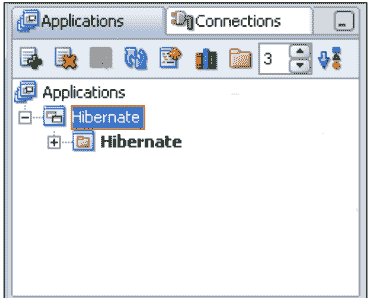
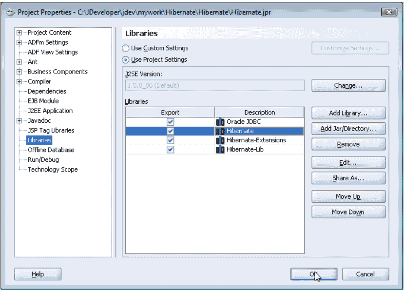
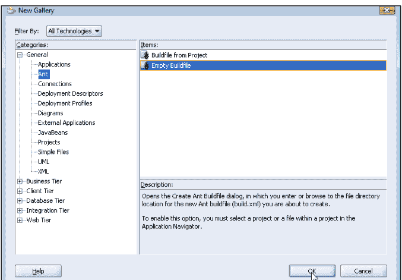
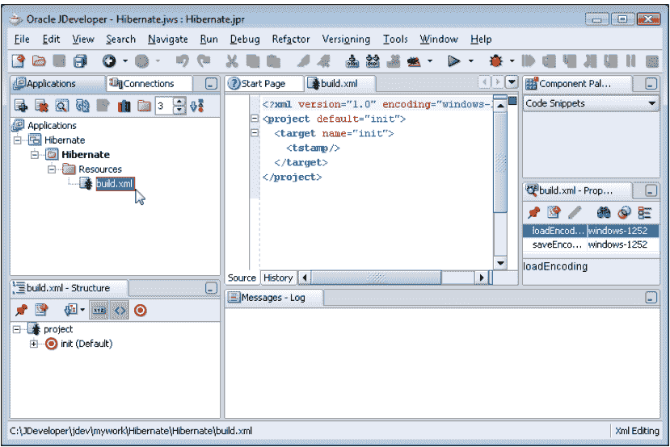
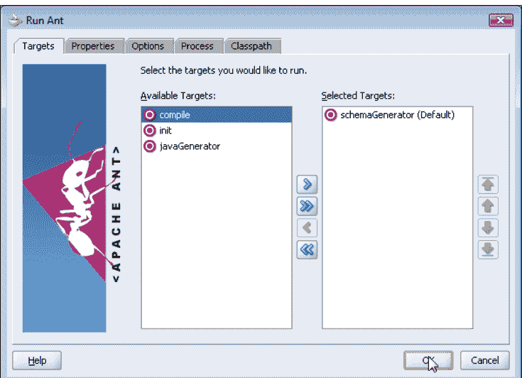
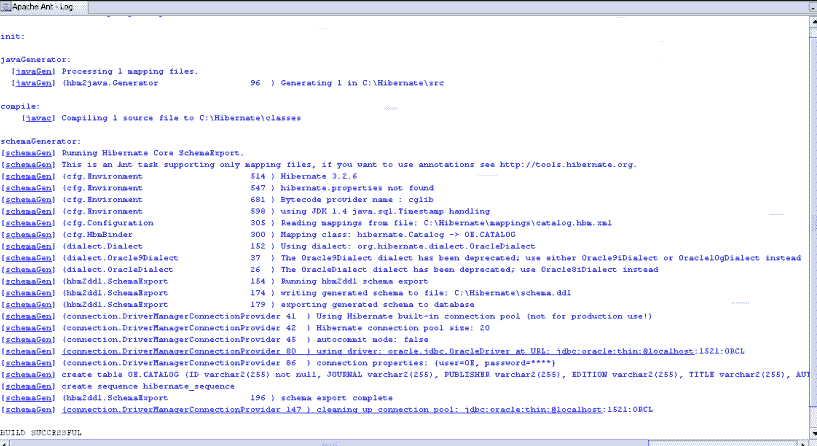
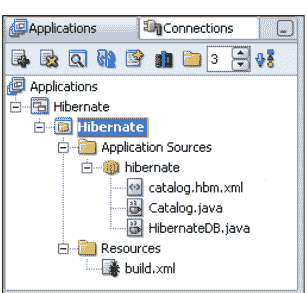
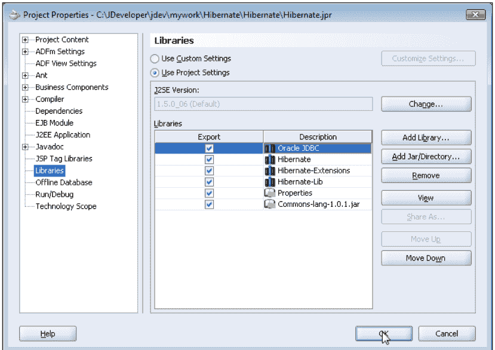

## 15 Hibernate

Hibernate 是一个开源的、基于 JDBC 的对象/关系持久化和查询服务。Hibernate 用于将 Java 对象中的数据表示映射到数据库。Hibernate 支持多个数据库，包括 DB2、MySQL、Oracle 和 PostgreSQL。使用 Hibernate，Java 数据类型映射到 SQL 数据类型。Hibernate 生成创建、更新和删除数据库表所需的 SQL。Hibernate 用于从 Java Bean 类生成表，并向表中添加、检索、更新和删除数据。

由于复杂度更低、灵活性更高、开源架构以及支持不同数据库而无需在数据访问层提供特定于厂商的 SQL 代码，Hibernate 比其他数据库持久化技术（如 Castor、TopLink 和 Entity EJB）更受青睐。Hibernate 还提供了 Ant 构建任务的类，可集成到 Ant 构建文件中。在本章中，我们将把 Hibernate 与 JDeveloper 10.1.3 IDE 和 Oracle 数据库 10g 集成，以开发对象/关系应用程序。

Hibernate 提供的数据库持久化基于映射文件和数据库属性文件。.hbm.xml 映射文件包含数据库持久化的类定义，指定要映射到数据库表的 JavaBean 属性、数据库模式名称、数据库表名称以及与 JavaBean 属性对应的表列。表可以从映射文件生成，或在开发 Hibernate 应用程序之前生成。

映射文件指定用于数据库持久化的 Java 类、Java 对象中的不同字段和字段类型，以及对应的数据库表列和列类型。数据库应用程序的 Java 类可以从映射文件生成，或在开发 Hibernate 应用程序之前生成。数据库属性文件（hibernate.properties 文件）指定数据库、JDBC 驱动程序和数据库应用程序的连接 URL。Ant 任务类 net.sf.hibernate.tool.hbm2java.HbmJavaTask 和 org.hibernate.tool.hbm2ddl.SchemaExportTask 分别用于将映射文件映射到 Java 类和数据库表。随后使用这些 Java 类在数据库表中添加/检索/更新/删除数据。在本章中，一个示例映射文件 (`catalog.hbm.xml`)，包含期刊目录的属性，被映射到数据库表 `OE.Catalog` 和 Java 类 `Catalog.java`。

## Hibernate 与 JDBC

Hibernate 是一个基于 JDBC 的数据库持久化框架。Hibernate 应用程序的 Java 到 SQL 映射在 `org.hibernate.cfg.Configuration` 对象中定义。映射是从 XML 映射文件编译而来的。XML 映射文件按如下方式添加到 `Configuration` 对象：

```java
Configuration cfg = new
    Configuration().addResource("Catalog.hbm.xml");
```

Hibernate 配置属性（包括 JDBC 属性）可通过以下方法之一设置：

- 1. 使用 `Configuration` 对象的 `setProperties()` 方法设置配置属性。
- 2. 在 `hibernate.properties` 文件中指定配置属性。
- 3. 将属性指定为 System 属性。
- 4. 在 `hibernate.cfg.xml` 文件中指定属性。

使用 `SessionFactory` 创建和池化连接。`SessionFactory` 按如下方式从 `Configuration` 对象创建：

```java
SessionFactory sessionFactory = cfg.buildSessionFactory();
```

创建 `Session` 对象时，从连接池获取 JDBC 连接。

```java
Session session = sessionFactory.openSession();
```

Hibernate 使用 `java.sql.DriverManager` 或数据源创建和池化连接。如果使用 `DriverManager` 创建和池化连接，则需要指定下表中讨论的 JDBC 连接属性。

| 属性 | 描述 |
|---|---|
| `hibernate.connection.driver_class` | JDBC 驱动程序类 |
| `hibernate.connection.url` | JDBC 连接 URL |
| `hibernate.connection.username` | 数据库用户名 |
| `hibernate.connection.password` | 数据库用户密码 |
| `hibernate.connection.pool_size` | 可选属性。池化连接的最大数量。 |
| `hibernate.dialect` | 数据库的方言。对于 Oracle 数据库指定 org.hibernate.dialect.OracleDialect |

要在应用程序服务器中开发 Hibernate 应用程序，请从具有 JNDI 名称绑定的数据源获取连接。下表中讨论的数据源属性将 Hibernate 应用程序配置为使用数据源。

| 属性 | 描述 |
|---|---|
| hibernate.connection.datasource | 数据源 JNDI 名称 |
| hibernate.jndi.url | JNDI 提供程序 URL（可选） |
| hibernate.jndi.class | JNDI InitialContextFactory 类（可选） |
| hibernate.connection.username | 数据库用户名 |
| hibernate.connection.password | 数据库密码 |

从数据源获取的 JDBC 连接会自动参与应用程序服务器的容器管理事务。可以使用 hibernate.connection 前缀设置任意连接属性。例如，连接属性 hibernate.connection.charSet 设置字符集。可在以下表中讨论的其他一些 Hibernate、JDBC 和连接配置属性：

| 属性 | 描述 |
|---|---|
| hibernate.jdbc.fetch_size | 指定 JDBC 获取大小 |
| hibernate.jdbc.batch_size | 启用批量更新 |
| hibernate.default_schema | 指定未限定表名的模式名称。 |
| hibernate.jdbc.use_scrollable_resultset | 启用可滚动结果集 |
| hibernate.connection.isolation | 指定 JDBC 事务隔离级别。 |
| hibernate.connection.autocommit | 为 JDBC 池化连接启用自动提交。 |


| 属性 | 描述 |
|---|---|
| hibernate.connection.release_mode | 指定 Hibernate 何时应将 JDBC 连接释放回连接池。默认情况下，JDBC 连接在 Session 对象关闭时释放。可以指定以下值：auto（默认） on_close - 当连接关闭时。 after_transaction - 在事务结束时。 after_statement - 在语句结束时。 |
| hibernate.jdbc.use_scrollable_resultset | 启用可滚动结果集 |
| hibernate.connection.<propertyName> | 指定由 DriverManager.getConnection() 使用的 JDBC 属性 |
| hibernate.jndi.<propertyName> | 指定 JNDI InitialContextFactory 的 JDBC 属性 |

如果 JDeveloper OC4J 服务器支持 JDBC 4.0，则可以使用 JDBC 4.0 功能，例如连接状态跟踪。连接状态跟踪由连接池管理器实现，以识别并关闭不可用的连接。

在本章中，您将学习以下内容：

- 使用 Hibernate 创建数据库表
- 使用 Hibernate 向数据库表添加数据
- 使用 Hibernate 从数据库表检索数据
- 使用 Hibernate 更新数据库表中的数据
- 使用 Hibernate 从数据库表删除数据

## 设置环境

需要 Hibernate API 类将 Hibernate 与 JDeveloper 集成。从 http://www.hibernate.org/ 下载 Hibernate 3.2 和 Hibernate Extension 2.1.3 ZIP 文件，并将文件解压到安装目录 C:/Hibernate。为 Hibernate 3.2 创建 hibernate-3.2 目录，为扩展类创建 tools 目录。还需下载 Hibernate 2.1.6，因为 net.sf.hibernate.tool.hbm2java.Hbm2JavaTask 工具需要它。

将 Hibernate 2.1.6 ZIP 文件解压到 c:/Hibernate 目录；创建 hibernate 2.1.6 目录。安装 JDeveloper 10g IDE。安装 Oracle 数据库 10g 并创建包含示例模式的数据库实例。

接下来，将开发 Hibernate 应用程序所需的 Hibernate JAR 文件集成到 JDeveloper 10g 项目中。首先，在 JDeveloper IDE 中选择 File | New。在 New Gallery 窗口中，在列出的 Categories 中选择 General | Applications，并在列出的 Items 中选择 Application。在 Create Application 窗口中指定应用程序名称和目录名称，应用程序模板为 No Template。在 Create Project 窗口中指定项目名称并单击 OK。Hibernate 应用程序和项目已添加到 Applications-Navigator。



接下来，将生成 Hibernate 应用程序所需的库添加到项目中。在 Applications-Navigator 中选择 Hibernate 项目节点。选择 Tools | Project Properties。在 Project Properties 窗口中选择 Libraries 节点。选择 Add Library 按钮以创建新库。在 Add Library 窗口中选择 New 按钮。在 Create Library 窗口中，在 Library Name 字段中指定 Hibernate 并单击 Add Entry 按钮。在 Select Path Entry 窗口中选择 hibernate3.jar 文件并单击 Select 按钮。所选 JAR 文件已添加到 Create Library 窗口中的 Class Path 节点。单击 Create Library 窗口中的 OK 按钮。单击 Add Library 窗口中的 OK 按钮。Hibernate 库已创建并添加到 Selected Libraries。同样为 Hibernate 应用程序所需的其他 JAR 文件创建库。

创建的库和相应的 JAR 文件列在下表中：

| 项目库 | 描述 | JAR/Zip 文件 |
|---|---|---|
| Hibernate | Hibernate API 类，包括 org.hibernate.tool.hbm2ddl.SchemaExportTask 类。 | <Hibernate>/hibernate-3.2/hibernate3.jar |
| Hibernate-Extensions | Hibernate 扩展类，包括 net.sf.hibernate.tool.hbm2java.Hbm2JavaTask 类。 | <Hibernate>/tools/hibernate-tools.jar |
| Hibernate-Lib | 辅助 Hibernate 类。 | <Hibernate>/hibernate3.2/lib/dom4j-1.6.1.jar,<Hibernate>/hibernate-3.2/lib/commons-logging-1.0.4.jar,<Hibernate>/hibernate-3.2/lib/commons-collections-2.1.1.jar,<Hibernate>/hibernate-3.2/lib/ehcache-1.2.3.jar,<Hibernate>/hibernate-3.2/lib/cglib-2.1.3.jar,<Hibernate>/hibernate-3.2/lib/jta.jar,<Hibernate>/hibernate-3.2/lib/asm.jar,<Hibernate>/hibernate-3.2/lib/antlr-2.7.6.jar |
| Oracle JDBC | Oracle JDBC 库。删除 <JDeveloper 10.1.3>\jdbc\lib 中的 orai18n.jar。 |  |

> 在上表中 <Hibernate> 是 Hibernate 安装的目录。 <JDeveloper 10.1.3> 是 JDeveloper 10.1.3 安装的目录。

创建的库在 Libraries 窗口中列出，如下表所示：



## 开发 Hibernate 映射和属性文件

Hibernate 映射文件（.hbm.xml 文件）和 Hibernate 属性文件（hibernate.properties 文件）构成了 Hibernate 应用程序的基础。映射文件由类定义组成。每个类定义由一组要映射到 Java 类和数据库表的属性组成。字段/列类型以及列的附加特征，如长度、非空和唯一，也与属性一起指定。映射文件中经常使用的一些标签列在下表中：

| 标签名称 | 描述 | 属性 | 子元素 |
|---|---|---|---|
| hibernate-mapping | 根元素 | schema, package | class |
| class | 指定用于将 Hibernate Java 类映射到数据库表的类定义。 | table,schema | id,property,set,list |
| id | 类定义中的必需元素。 | column,type,length | column,generator |
| property | 指定类属性，该属性对应于表列和 Java 类字段。 | type,column,length,not-null,unique | column |

本章中的示例映射文件由期刊目录的类和类属性组成。元素 <generator class="native" /> 在 <id> 元素中是必需的，以从映射文件生成 Java 类。元素 <generator class="native" /> 指定标识符生成策略。示例映射文件 catalog.hbm.xml 如下所示。

```
<?xml version="1.0"?><!DOCTYPE hibernate-mapping PUBLIC "-//Hibernate/Hibernate Mapping DTD 3.0//EN" "http://hibernate.sourceforge.net/hibernate-mapping-3.0.dtd">
<hibernate-mapping>
<class name="hibernate.Catalog" table="OE.CATALOG">
<id name="id" type="string" column="ID">
<generator class="native"/>  </id>
<property name="journal" column="JOURNAL" type="string"/>
<property name="publisher" column="PUBLISHER" type="string"/>
<property name="edition" column="EDITION" type="string"/>
<property name="title" column="TITLE" type="string"/>
<property name="author" column="AUTHOR" type="string"/>
</class>
</hibernate-mapping>
```

在 C:/Hibernate 目录中创建 mappings 目录并将 catalog.hbm.xml 文件复制到其中。Hibernate 属性文件 hibernate.properties 指定用于持久化和从数据库查询的数据库配置。属性文件是文本文件，属性以 <property>=<value> 的形式指定。本章第一表中列出了 hibernate.properties 文件所需的 JDBC 连接属性。

在本章示例应用程序的 hibernate.properties 文件中，Oracle 数据库示例模式 OE 指定为 username 属性。Oracle Thin Type 4 驱动程序用于驱动程序类为 oracle.jdbc.OracleDriver。Oracle 数据库的 hibernate.properties 文件如下所示。

```
hibernate.connection.driver_class=oracle.jdbc.OracleDriver
hibernate.connection.url=jdbc:oracle:thin:@localhost:1521:ORCL
hibernate.connection.username=OE
hibernate.connection.password=
hibernate.dialect=org.hibernate.dialect.OracleDialect
```

在 C:/Hibernate 目录中创建 properties 目录并将 hibernate.properties 文件复制到 properties 目录。

## 创建数据库表

在本节中，从示例 Hibernate 映射文件 catalog.hbm.xml 生成 Java 类，并从映射文件和属性文件 hibernate.properties 生成 Oracle 数据库表。映射类和数据库表使用 Ant 构建文件生成。Hibernate API 提供了 net.sf.hibernate.tool.hbm2java.Hbm2JavaTask 任务类，用于从 hbm.xml 映射文件生成 Java 类，以及 org.hibernate.tool.hbm2ddl.SchemaExportTask 任务类，用于从映射文件生成数据库表。首先，在 Jdeveloper 10g IDE 中创建 Ant 构建文件。选择 File | New。在 New Gallery 窗口中选择 General | Ant。在列出的 Items 中选择 Empty Buildfile。




在 **创建 Ant 构建文件** 中指定一个 **文件名**、`build.xml`，以及构建文件的 **目录名称**。一个 `build.xml` 文件被添加到 Applications-Navigator 中的 Hibernate 项目中。



示例 `build.xml` 包含以下目标：

- 1. 从映射文件生成 Java 类。
- 2. 编译 Java 类。
- 3. 从映射文件和 `hibernate.properties` 文件生成数据库表。

我们将详细讨论 `build.xml` 文件的结构。添加 `<project/>` 标签，该标签指定项目名称、默认目标和 `basedir` 属性。添加构建文件属性，这些属性对应于 Hibernate 目录。目录相对于基本目录指定，而基本目录在 `project` 元素的 `basedir` 属性中指定。示例 `build.xml` 中的属性在下表中列出。

| 属性 | 值 | 描述 |
|---|---|---|
| src.dir | src | 从映射文件生成 Java 类的目录。 |
| classes.dir | classes |  |
| hibernate-3.2 | hibernate-3.2 |  |
| hibernate-2.1 | hibernate-2.1 |  |
| hibernate.mappings | mappings |  |
| jdbc | C:\oracle\product\10.2.0\db_1\jdbc\lib | 包含 classes12.jar 文件和 ojdbc14.jar 的目录。 |
| hibernate.extensions | tools | 包含 hibernate-tools.jar 文件的目录。 |
| hibernate.properties | properties | 包含 hibernate.properties 文件的目录。 |

在 build.xml 文件中，添加一个 <path/> 元素以指定 build.xml 文件目标的类路径。类路径包括 hibernate3.jar、hibernate-tools.jar、ojdbc14.jar 以及辅助的 Hibernate 和 Hibernate 扩展 JAR 文件。init 目标为 build.xml 文件生成目录。javaGenerator 目标使用 net.sf.hibernate.tool.hbm2java.Hbm2JavaTask 类从 Hibernate 映射文件生成 Java 类。compile 目标编译从映射文件生成的 Java 类。schemaGenerator 目标使用 org.hibernate.tool.hbm2ddl.SchemaExportTask 类从映射文件和属性文件生成数据库表。示例 build.xml 文件如下所示。

```
<?xml version="1.0"?>
<project name="Hibernate"
default="schemaGenerator" basedir="C:\Hibernate">
    <property name="src.dir" value="src"/>
    <property name="classes.dir" value="classes"/>
    <property name="hibernate-3.2" value="hibernate-3.2"/>
    <property name="hibernate-2.1" value="hibernate-2.1"/>
    <property name="hibernate.mappings" value="mappings"/>
    <property name="jdbc"
        value="C:\oracle\product\10.2.0\db_1\jdbc\lib"/>
    <property name="hibernate.extensions" value="tools"/>
    <property name="hibernate.properties" value="properties"/>
    <path id="project.class.path">
    <pathelement location="${classes.dir}" />
<fileset dir="${hibernate-3.2}">
    <include name="hibernate3.jar"/>
</fileset>
    <fileset dir="${hibernate-2.1}">
        <include name="hibernate2.jar"/>
    </fileset>
    <fileset dir="${hibernate-3.2}/lib">
        <include name="*.jar"/>
    </fileset>
    <fileset dir="${hibernate-2.1}/lib">
        <include name="commons-lang-1.0.1.jar"/>
    </fileset>
    <fileset dir="${hibernate.extensions}/lib">
        <include name="*.jar"/>
    </fileset>
    <fileset dir="${hibernate.extensions}">
        <include name="hibernate-tools.jar"/>
    </fileset>
    <fileset dir="${jdbc}">
        <include name="ojdbc14.jar"/>
    </fileset>
</path>
    <target name="init">
<mkdir dir="${src.dir}"/>
    <mkdir dir="${classes.dir}"/>
    </target>
    <taskdef name="javaGen"
        classname="net.sf.hibernate.tool.hbm2java.Hbm2JavaTask"
        classpathref="project.class.path"/>
    <target name="javaGenerator" depends="init">
    <javaGen output="${src.dir}">
        <fileset dir="${hibernate.mappings}">
            <include name="catalog.hbm.xml"/>
        </fileset>
    </javaGen>
    </target>
    <target name="compile" depends="javaGenerator">
        <javac srcdir="${src.dir}"
            destdir="${classes.dir}">
            <classpath refid="project.class.path"/></javac>
    </target>
    <taskdef name="schemaGen"
classname="org.hibernate.tool.hbm2ddl.SchemaExportTask"
classpathref="project.class.path"/>
    <target name="schemaGenerator" depends="compile">
<schemaGen properties="${hibernate.properties}/hibernate.properties"
output="schema.ddl" create="true" quiet="no">
    <fileset
 dir="${hibernate.mappings}">
        <include name="catalog.hbm.xml"/>
</fileset>
</schemaGen>
</target>
</project>
```

将 build.xml 列表复制到 JDeveloper Hibernate 项目中的 build.xml 文件。构建 build.xml 文件中的目标。右键单击 build.xml 文件节点并选择 Run Ant。在 Run Ant 窗口中，选择 schemaGenerator 目标。由于目标在 depends 属性中指定，因此 schemaGenerator 目标之前的前置目标也会被构建。



对应于映射文件的 Java 类被生成。Java 类为映射文件中指定的每个类属性具有 getter 和 setter 方法。Catalog.java，即使用 Hibernate 映射文件生成的 Java 类，如下所示：

```
package hibernate;
import java.io.Serializable;
import org.apache.commons.lang.builder.ToStringBuilder;
/** @author Hibernate CodeGenerator */
public class Catalog implements Serializable {
    /** identifier field */
    private Integer id;
    /** nullable persistent field */
private String journal;
/** nullable persistent field */
private String publisher;
/** nullable persistent field */
private String edition;
/** nullable persistent field */
private String title;
/** nullable persistent field */
private String author;
/** full constructor */
public Catalog(String journal, String publisher, String edition,
    String title, String author) {
    this.journal = journal;
    this.publisher = publisher;
    this.edition = edition;
    this.title = title;
    this.author = author;
}
/** default constructor */
public Catalog() {
}
public Integer getId() {
    return this.id;
}
public void setId(Integer id) {
    this.id = id;
}
public String getJournal() {
    return this.journal;
}
public void setJournal(String journal) {
    this.journal = journal;
}
public String getPublisher() {
    return this.publisher;
}
public void setPublisher(String publisher) {
    this.publisher = publisher;
}
public String getEdition() {
    return this.edition;
}
public void setEdition(String edition) {
    this.edition = edition;
}
public String getTitle() {
    return this.title;
}
public void setTitle(String title) {
    this.title = title;
}
}
public String getAuthor() {
    return this.author;
}
public void setAuthor(String author) {
    this.author = author;
}
public String toString() {
    return new ToStringBuilder(this)
        .append("id", getId())
        .toString();
}
}
```

如 build.xml 的输出所示，映射文件中类元素的 table 属性指定的数据库表被生成。



使用 Hibernate 生成的 CREATE TABLE 脚本如下：

```
create table OE.CATALOG (ID varchar2(255) not null, JOURNAL varchar2(255), PUBLISHER varchar2(255), EDITION varchar2(255), TITLE varchar2(255), AUTHOR varchar2(255), primary key (ID))
create sequence hibernate_sequence
```

生成的 OE.Catalog 表结构如下：

```
SQL> DESC OE.CATALOG;
Name                          Null?    Type
------------------------------ -------- ----------------------------
ID                            NOT NULL VARCHAR2(255)
JOURNAL                                VARCHAR2(255)
PUBLISHER                              VARCHAR2(255)
EDITION                                VARCHAR2(255)
TITLE                                  VARCHAR2(255)
AUTHOR                                 VARCHAR2(255)
SQL>
```

在以下部分，将使用从映射文件生成的 Java 类和 hibernate.properties 属性文件添加、检索、更新和删除表数据。

## 使用 Hibernate 修改表数据

在本节中，开发了一个中间层 Hibernate Java 应用程序，以向从映射文件 catalog.hbm.xml 生成的表添加/更新和删除数据。Java 应用程序不是从映射文件生成的 JavaBean 类。Java 应用程序集成从映射文件生成的 JavaBean 类、映射文件和属性文件，以提供数据库持久化和查询服务。

选择 File | New，并在 New Gallery 窗口中选择 General | Java Class。在 Create Java Class 窗口中，指定类名 HibernateDB.java 和类包 hibernate。一个 Java 类被添加到 Hibernate 项目中。接下来，将映射文件 catalog.hbm.xml 和 C:/Hibernate/src/hibernate/Catalog.java java bean 类复制到 hibernate 目录。Hibernate 应用程序的目录结构如以下图所示。




将包含 hibernate.properties 文件的目录添加到项目库中。还请从 Hibernate 2.1.6 目录中添加 Commons lang JAR 文件。



在 Hibernate Java 应用程序中导入 Hibernate API 类。导入从映射文件生成的 Java 类。

## 向数据库表添加数据

创建 Catalog 类对象并使用 setter 方法为 Java 类的不同字段设置值。

```
Catalog catalog=new Catalog();
catalog.setId("catalog 1");
catalog.setJournal("Oracle Magazine");
catalog.setPublisher("Oracle Publishing");
catalog.setEdition("Jan-Feb 2004");
catalog.setTitle("Understanding Optimization");
catalog.setAuthor("Kimberly Floss");
```

接口 org.hibernate.Session 是 Java 应用程序与 Hibernate 之间主要的运行时接口，用于在数据库中创建、更新和删除数据。Session 对象从 SessionFactory 获取。SessionFactory 接口提供 openSession() 方法来创建数据库连接并在该连接上打开会话，或在指定的连接上打开会话。org.hibernate.cfg.Configuration 类用于指定配置属性、JavaBean 持久化类和映射文件以创建 SessionFactory 对象。创建 Configuration 对象：

```
Configuration config=new Configuration();
```

使用 addClass() 方法将 JavaBean 持久化类 Catalog.class 添加到 Configuration 对象。

```
config.addClass(example.hibernate.Catalog.class);
```

映射文件 catalog.hbm.xml 被复制到映射的 Java 类所在的同一目录中，并使用 Configuration 对象进行配置。Hibernate 应用程序类路径中的 hibernate.properties 文件被配置为 Configuration 对象的属性文件。使用 buildSessionFactory() 方法从 Configuration 对象创建 SessionFactory 对象。

```
SessionFactory sessionFactory=config.buildSessionFactory();
```

SessionFactory 为 Hibernate 应用程序创建并池化 JDBC 连接。首先，我们将向使用 hibernate 映射文件和 hibernate 属性文件创建的数据库表添加数据。使用 openSession() 方法从 SessionFactory 对象获取 Session 对象。

```
Session sess = sessionFactory.openSession();
```

当打开 Session 时，JDBC 连接会从连接池中获取。Hibernate 使用 java.sql.DriverManager 获取并池化连接。使用 beginTransaction() 方法从 Session 对象获取 Transaction 对象以向数据库表添加数据。

```
org.hibernate.Transaction tx = sess.beginTransaction();
```

使用 save() 方法将之前创建的 JavaBean 对象存储到数据库中，并使用 commit() 方法提交事务：

```
sess.save(catalog);
tx.commit();
```

Catalog 对象中指定的值将被存储到数据库表中。使用 close() 方法关闭 Session 对象：

```
sess.close();
```

## 从数据库表检索数据

接下来，我们将检索存储在数据库表中的数据。创建查询以从表中选择数据。查询使用 Hibernate 查询语言（HQL）语法定义，该语法与 SQL 类似。

```
String hqlQuery ="from example.hibernate.Catalog";
```

如果查询中未指定 Select 子句，则 From 子句中选择的全部字段都将从映射类中选择。From 子句使用映射的 Java 类 example.hibernate.Catalog 指定，而不是数据库表。Java 类对象到数据库的映射由映射文件和属性文件执行。使用 openSession() 方法从 SessionFactory 对象打开 Session 对象：

```
Session sess = sessionFactory.openSession();
```

使用 Session 对象的 createQuery(hqlQuery) 方法创建 Query 对象：

```
Query query = sess.createQuery(hqlQuery);
```

使用 Query 对象的 list() 方法从 HQL 查询获取 List：

```
List list = query.list();
```

遍历 List 并输出指定 HQL 查询的值。例如，Journal 列值输出如下：

```
for (int i = 0; i < list.size(); i++) {
Catalog catalog = (Catalog) list.get(i);
    System.out.println("CatalogId " + catalog.getId() +
    " Journal: " + catalog.getJournal());
}
```

## 更新数据库表

接下来，我们将使用 Hibernate Java 应用程序更新表值。创建查询以从表中选择要修改的数据

```
String hqlQuery="from Catalog";
```

从 SessionFactory 对象获取 Session 对象。

```
Session sess = sessionFactory.openSession();
```

从 Session 对象获取 Transaction 对象。

```
Transaction tx = sess.beginTransaction();
```

使用 Session 对象的 createQuery() 方法从 HQL 查询创建 Query 对象。使用 list() 方法获取 List 结果集。获取要修改的 JavaBean 对象。

```
Query query = sess.createQuery(hqlQuery);
List list = query.list();
Catalog catalog = (Catalog) list.get(0);
```

例如，将 publisher 字段的值设置为 "Oracle Magazine"。

```
catalog.setPublisher("Oracle Magazine");
```

使用 Session 对象的 beginTransaction() 方法开始 Session 事务。

```
Transaction tx = sess.beginTransaction();
```

使用 Session 对象的 saveOrUpdate() 方法更新数据库表并提交事务：

```
sess.saveOrUpdate(catalog);
tx.commit();
```

## 删除数据

接下来，使用 Hibernate API 删除表行。例如，删除 edition 为 "March-April 2005" 的表行。创建 HQL 查询以选择要删除的数据库表行。

```
String hqlQuery="from Catalog as catalog where catalog.edition='March-April 2005'";
```

使用 SessionFactory 对象的 openSession() 方法打开数据库会话：

```
Session sess = sessionFactory.openSession();
```

使用 HQL 查询创建 Query 对象。获取 HQL 查询的结果集 List。获取要删除的结果集项：

```
Query query = sess.createQuery(hqlQuery);
List list = query.list();
Catalog catalog = (Catalog) list.get(0);
```

使用 beginTransaction() 方法开始会话事务：

```
Transaction tx = sess.beginTransaction();
```

使用 `Session` 对象的 `delete()` 方法删除 HQL 查询中指定的行并提交事务：

```
sess.delete(catalog);
 tx.commit();
```

示例 Java 应用程序 `HibernateDB.java` 具有用于添加数据的 `addToCatalog` 方法、用于检索数据的 `retrieveFromCatalog` 方法、用于更新数据的 `updateCatalog` 方法以及用于删除数据的 `deleteFromCatalog` 方法。以下列表包含 `HibernateDB.java`：

```
package hibernate;
import hibernate.Catalog;
import org.hibernate.Session;
import org.hibernate.SessionFactory;
import org.hibernate.Transaction;
import org.hibernate.cfg.Configuration;
import org.hibernate.Query;
import java.util.List;

public class HibernateDB {
Transaction tx;
Session sess;
Configuration config;
SessionFactory sessionFactory;
public void addToCatalog() {
    try {
        Catalog catalog = new Catalog();
        catalog.setId("catalog 1");
        catalog.setJournal("Oracle Magazine");
        catalog.setPublisher("Oracle Publishing");
        catalog.setEdition("Jan-Feb 2004");
        catalog.setTitle("Understanding Optimization");
        catalog.setAuthor("Kimberly Floss");

        Catalog catalog2 = new Catalog();
        catalog2.setId("catalog 2");
        catalog2.setJournal("Oracle Magazine");
        catalog2.setPublisher("Oracle Publishing");
        catalog2.setEdition("March-April 2005");
        catalog2.setTitle("Starting with Oracle ADF");
        catalog2.setAuthor("Steve Muench");

        config = new Configuration();
        config.addClass(Catalog.class);
        sessionFactory = config.buildSessionFactory();
        sess = sessionFactory.openSession();
        tx = sess.beginTransaction();
```

sess.save(catalog);
    sess.save(catalog2);
    tx.commit();
} catch (Exception e) {
    try {
        if (tx != null) {
            tx.rollback();
        }
    } catch (
        org.hibernate.HibernateException excp) {
    }
} finally {
    try {
        if (sess != null) {
            sess.close();
        }
    } catch (
        org.hibernate.HibernateException excp) {
    }
}
}
public void retrieveFromCatalog() {
    try {
        String hqlQuery = "from Catalog";
        config = new Configuration();
        config.addClass(Catalog.class);
        sessionFactory = config.buildSessionFactory();
        sess = sessionFactory.openSession();
        Query query = sess.createQuery(hqlQuery);
        List list = query.list();
        for (int i = 0; i < list.size(); i++) {
            Catalog catalog = (Catalog) list.get(i);
            System.out.println(
                "CatalogId " + catalog.getId() +
                " Journal: " + catalog.getJournal());
            System.out.println(
                "CatalogId " + catalog.getId() +
                " Publisher: " + catalog.getPublisher());
            System.out.println(
                "CatalogId " + catalog.getId() +
                " Edition: " + catalog.getEdition());
            System.out.println(
                "CatalogId " + catalog.getId() + " Title " +
                catalog.getTitle());
System.out.println(
    "CatalogId " + catalog.getId() +
    " Author: " + catalog.getAuthor());
}
if (sess != null) {
    sess.close();
}
} catch (org.hibernate.HibernateException e) {
}
}
public void updateCatalog() {
    try {
        String hqlQuery = "from Catalog";
        config = new Configuration();
        config.addClass(Catalog.class);
        sessionFactory = config.buildSessionFactory();
        sess = sessionFactory.openSession();
        Query query = sess.createQuery(hqlQuery);
        List list = query.list();
        Catalog catalog = (Catalog) list.get(0);
        catalog.setPublisher("Oracle Magazine");
        tx = sess.beginTransaction();
        sess.saveOrUpdate(catalog);
        tx.commit();
    } catch (Exception e) {
        try {
            if (tx != null) {
                tx.rollback();
            }
        } catch (
            org.hibernate.HibernateException excp) {
        }
    } finally {
        try {
            if (sess != null) {
                sess.close();
            }
        } catch (
            org.hibernate.HibernateException excp) {
        }
    }
}
    public void deleteFromCatalog() {
        try {
String hqlQuery = "from Catalog as catalog WHERE
    catalog.edition='March-April 2005'";
config = new Configuration();
config.addClass(Catalog.class);
sessionFactory = config.buildSessionFactory();
sess = sessionFactory.openSession();
Query query = sess.createQuery(hqlQuery);
List list = query.list();
Catalog catalog = (Catalog) list.get(0);
tx = sess.beginTransaction();
sess.delete(catalog);
tx.commit();
} catch (Exception e) {
    try {
        if (tx != null) {
            tx.rollback();
        }
    } catch (
        org.hibernate.HibernateException excp) {
    }
} finally {
    try {
        if (sess != null) {
            sess.close();
        }
    } catch (
        org.hibernate.HibernateException excp) {
    }
}
}
public static void main(String[] argv) {
    HibernateDB hibernateDB = new HibernateDB();
    hibernateDB.addToCatalog();
    /*hibernateDB.retrieveFromCatalog();
    hibernateDB.updateCatalog();
    hibernateDB.deleteFromCatalog();*/
}
}

将 `HibernateDB.java` 复制到 Hibernate 项目中。要向 `Catalog` 表添加数据，请注释掉除 `addToCatalog()` 之外的所有方法。要运行 Java 应用程序，请右键单击应用程序节点并选择 **运行**。要从数据库检索数据，请注释掉 `HibernateDB.java` 类中除 `retrieveFromCatalog()` 之外的所有方法并运行应用程序。Hibernate 应用程序检索 `Catalog` 表数据。

```
```
CatalogId 1 Journal: Oracle Magazine
CatalogId 1 Publisher: Oracle Publishing
CatalogId 1 Edition: Jan-Feb 2004
CatalogId 1 Title Understanding Optimization
CatalogId 1 Author: Kimberly Floss ..
CatalogId 2 Journal: Oracle Magazine
CatalogId 2 Publisher: Oracle Publishing
CatalogId 2 Edition: March-April 2005
CatalogId 2 Title Starting with Oracle ADF
CatalogId 2 Author: Steve Muench
```
```

要更新数据库表，请注释掉除 `updateCatalog()` 之外的所有方法并运行 `HibernateDB` 应用程序。要从 `Catalog` 表中删除，请注释掉除 `deleteFromCatalog()` 方法之外的所有方法并运行 `HibernateDB` 应用程序。

## 摘要

无数据库持久化和查询服务的对象/关系映射需要 JDBC API 和特定于厂商的 SQL 脚本来创建、更新、删除数据库表。使用 Hibernate 时不需要 JDBC API 和 SQL 脚本。Hibernate 生成用于向数据库添加、检索、更新和删除数据的 SQL 脚本。Hibernate 提供了 `net.sf.hibernate.tool.hbm2java.Hbm2JavaTask` Apache Ant 构建任务，用于从 `hbm.xml` 配置文件生成 JavaBean 类，以及 `org.hibernate.tool.hbm2ddl.SchemaExportTask` Apache Ant 构建任务，用于从 `hbm.xml` 配置文件生成数据库表。
