# 10. 提升质量的流程
## 文化与协作
## 尽早失败或更快失败
## 基于数据的测试
## 从历史中学习
## 将测试自动化视为软件项目
## 可视化、可视化、再可视化！
## 规范是好的
## 测试框架和商业选择日益增多
## 将工作转移到 Jenkins 节点
## 饥饿的 QA/集成服务器
## 阅读 Jenkins 的变更日志
## 避免人为瓶颈
## 避免群体思维
## 培训与社区
##  公开奖励成功的开发者
## 稳定性与代码维护
## 质量保证资源
## 总是有更多
## 最后的评论

## 前言

Jenkins 是一个基于 Java 的自动化服务器，支持在软件周期早期发现缺陷并以自动化方式部署应用程序包。得益于数量迅速增长的插件，Jenkins 可以与许多类型的系统通信，构建并触发各种测试，以及与各种发布管理服务集成。

CI 涉及对软件进行小幅更改，然后构建并应用质量保证流程。缺陷不仅出现在代码中，还出现在命名规范、文档、软件设计方式、构建脚本、将软件部署到服务器的过程等方面。CI 迫使缺陷尽早暴露，而不是等到软件完全制作完成。如果缺陷在软件开发生命周期的后期阶段被发现，流程将更加昂贵。一旦错误逃逸到生产环境，修复成本就会急剧增加。估计显示，尽早捕获缺陷的成本要低 100 到 1,000 倍。有效使用 Jenkins 等 CI 服务器，可能就是在享受假期和加班不计其数地英雄式拯救之间的区别。而且正如你能想象的，在我的日常工作中作为一名具有质量保证抱负的高级开发人员，我喜欢无聊的日子，至少对于关键任务的生产环境而言。

持续交付（CD）涉及在本地或云环境中的 Web 服务器或应用程序服务器上部署应用程序。Jenkins 支持与许多云服务提供商的集成，也支持与平台即服务提供的集成。借助 shell 脚本和命令执行支持，还可以实现许多部署和配置场景。

Jenkins 可以定期自动化构建软件并触发测试，提取结果并根据定义的标准进行失败。早期通过构建失败而失败可降低成本，增加对所生产软件的信心，并有可能将主观流程转变为开发团队认为无偏见的积极的基于指标的流程。

Jenkins 不仅仅是一个自动化服务器，它也是一个充满活力且高度活跃的社区。开明的自利决定了参与。

## 本书涵盖内容

**第 1 章，开始使用 Jenkins**，介绍如何在 Windows、CentOs、Microsoft Azure 和 AWS 上安装 Jenkins 2.x。包含重要的配方，展示如何安装或上传插件，如何配置代理，如何在管理 Jenkins 中配置 JENKINS_HOME 和工具。本章还将介绍如何为 Ant 和 Maven 项目创建自由风格作业

**第 2 章，Jenkins 的管理和监控**，帮助我们理解主/代理架构，如何使用 Eclipse 管理 Jenkins 构建作业，备份和恢复 Jenkins，使用 Jenkins CLI 的命令行选项，管理磁盘使用情况，安全关闭 Jenkins，监控 Jenkins，以及配置电子邮件通知。

**第 3 章，管理安全**，介绍如何通过 Jenkins 配置提高安全性，配置基于矩阵的安全性和处理基于项目的矩阵授权策略。它还将介绍 Jenkins 及其与 OpenLDAP 和 Active Directory 的集成。稍后在本章中，我们将介绍 Jenkins 与 OWASP Zed Attack Proxy 集成的主题，通过模糊测试在 Jenkins 中查找 500 错误和 XSS 攻击，探索 OWASP Dependency-Check 插件，以及使用 Audit Trail 插件。

**第 4 章，改进代码质量**，探讨源代码度量的使用。为了节省资金并提高质量，需要尽早在软件生命周期中消除缺陷。本章介绍如何将 Jenkins 与 SonarQube 集成，如何在 SonarQube 中更新中心、质量门、质量配置文件和规则，使用 SonarQube 验证 HTML、CSS 和 JavaScript 的有效性，使用 SonarQube 验证 Java 代码，以及将 SonarQube 配置为 Windows 服务。

**第 5 章，在 Jenkins 中构建应用程序**，详细介绍为执行配置 Ant、Maven 和 Android 项目的方法，如何配置环境变量，通过 Maven 运行 Groovy 脚本，通过 Maven 中的 Groovy 运行 Ant，以及通过 Jenkins API 远程触发作业。

**第 6 章，持续交付**，讨论持续交付，如何归档工件，从其他构建作业复制工件，将 Jenkins 与 Artifactory 集成，从 Jenkins 将 WAR 文件部署到 Tomcat、AWS Beanstalk、Azure 应用服务，以及如何提升构建。

**第 7 章，持续测试**，详细介绍持续测试，如何从 Jenkins 发布单元测试报告，使用 Eclipse 创建 Selenium 测试用例，将 Jenkins 和 Selenium 集成用于功能测试，Jenkins 和 Cucumber 测试报告，在 Apache JMeter 中创建负载测试，从 Jenkins 执行负载测试，报告 JMeter 性能指标，以及使用 FitNesse 进行测试。

**第 8 章，编排**，探讨流水线的编排，了解上游和下游作业，配置上游和下游作业，配置构建流水线，创建流水线作业，使用示例流水线进行执行，为端到端自动化配置流水线作业，以及开始使用 Blue Ocean 仪表板。

**第 9 章，Jenkins UI 自定义**，详细介绍使用 simple themes 插件为 Jenkins 换肤，使用 WAR 覆盖层对 Jenkins 进行换肤和配置，生成主页，创建 HTML 报告，高效使用视图，

使用 Dashboard View 插件节省屏幕空间，

使用 HTML5 浏览器发出噪音，以及为接待区提供极端视图。

## 你需要什么

本书面向初学者。假设你至少熟悉 Java 编程语言。了解核心 Java 和 JEE 对于使用本书获得更好见解至关重要。对程序逻辑的深入理解将为你提供使用插件编写 shell 命令时在 Jenkins 中保持生产力的背景。

由于应用程序开发生命周期通常涵盖许多工具，因此掌握 SVN 和 Git 等存储库、Eclipse 等 IDE 工具以及 Ant 和 Maven 等构建工具等知识至关重要。

了解代码分析工具将使配置和集成工作更轻松；然而，对于本书中给出的练习来说，这并不是必不可少的。大多数配置步骤都已明确说明。用于代码分析的是 SonarQuve 6.3 版本。

你将逐步了解在基于 Windows 和 Linux 的主机上安装 Jenkins 所需的步骤。为了立即成功，你需要对运行现代版本的 Windows 和 Linux 的主机具有管理员访问权限；Windows 10 将用于演示目的。如果你是更有经验的读者，那么几乎任何发行版的最新版本也同样适用（但你可能需要做一些书中未概述的额外工作）。

你可以使用 Microsoft Azure 的免费试用版来完成一些配方。

此外，你需要访问互联网来下载你尚未拥有的插件，以及 Jenkins 的安装。任何正常的硬件配置都足够，例如 4 GB RAM 和 500 GB 硬盘。


## 本书适合谁

_Jenkins Continuous Integration Cookbook_ 适合初学者和高级用户。本书面向参与应用程序开发生命周期的开发人员和系统管理员，并希望对其进行自动化。开发人员、技术负责人、测试人员和运维专业人员是本书的目标读者，可快速启动 Jenkins。读者应了解开发和运维团队面临的问题，因为他们是应用程序生命周期管理流程中的利益相关者。启动 Jenkins 的原因是为了了解持续集成（CI）、持续测试和持续交付（CD）对有效应用程序生命周期管理所做的重要贡献。

## 约定

在本书中，您会找到多种文本样式来区分不同类型的信息。以下是这些样式的示例及其含义。

正文中出现的代码词、数据库表名、文件夹名、文件名、文件扩展名、路径名、虚拟 URL、用户输入和 Twitter 账号显示如下："We can include other contexts through the use of the include directive."

代码块设置如下：

```
@charset "utf-8";
#test {
background-image: url(/userContent/camera.png);
}
#main-table{
background-image: url(/userContent/camera.png)
!important;
}
```

当我们希望引起您对代码块中特定部分的注意时，相关行或项目以粗体显示：

```
<project xmlns="http://maven.apache.org/POM/4.0.0"
xmlns:xsi="http://www.w3.org/2001/XMLSchema-instance"
xsi:schemaLocation="http://maven.apache.org/POM/4.0.0
http://maven.apache.org/maven-v4_0_0.xsd">
<modelVersion>4.0.0</modelVersion>
<groupId>nl.uva.berg</groupId>
```

任何命令行输入或输出都写成如下形式：

```
---Project and session
Project: class org.apache.Maven.model.Model
Session: class org.apache.Maven.execution.MavenSession
longname: SuperGood
```

**新术语**和**重要词语**以粗体显示。您在屏幕上看到的词语，例如菜单或对话框中的词语，在文本中显示如下："Clicking the Next button moves you to the next screen."

警告或重要说明以如下框显示。

提示和技巧以如下方式显示。

## 读者反馈

我们非常欢迎读者的反馈。请告诉我们您对本书的看法——您喜欢什么或可能不喜欢什么。读者反馈对我们开发您真正受益的书名非常重要。

如需发送一般反馈，只需发送电子邮件至 feedback@packtpub.com，并在邮件主题中提及书名即可。

## 客户支持

现在您已成为 Packt 书籍的自豪拥有者，我们提供许多帮助您充分利用购买的服务。

## 下载示例代码

您可以从 http://www.packtpub.com 在您的账户中下载本书的示例代码文件。如果您在其他地方购买了本书，您可以访问 http://www.packtpub.com/support 并注册以便直接将文件发送到您的邮箱。

您可以通过以下步骤下载代码文件：

- 1. 使用您的电子邮件地址和密码登录或注册我们的网站。
- 2. 将鼠标指针悬停在顶部 SUPPORT 选项卡上。
- 3. 点击 Code Downloads & Errata。
- 4. 在搜索框中输入书名。
- 5. 选择您要下载代码文件的书籍。
- 6. 从下拉菜单中选择您购买本书的渠道。
- 7. 点击 Code Download。

下载文件后，请务必使用最新版本解压缩或提取文件夹：

- • WinRAR / 7-Zip for Windows
- • Zipeg / iZip / UnRarX for Mac
- • 7-Zip / PeaZip for Linux

本书的代码包也托管在 GitHub 上，地址为 https://github.com/PacktPublishing/Jenkins-Continuous-Integration-Cookbook-Third-Edition。我们还有来自我们丰富的图书和视频目录的其他代码包，地址为 https://github.com/PacktPublishing/。请查看！

## 下载本书的彩色图片

我们还为您提供一份 PDF 文件，其中包含本书中使用的屏幕截图/图表的彩色图片。彩色图片将帮助您更好地理解输出中的变化。您可以从 https://www.packtpub.com/sites/default/files/downloads/JenkinsContinuousIntegrationCook 下载此文件

## 勘误

尽管我们已尽一切努力确保内容的准确性，但错误难免。如果您在我们的书籍中发现错误——可能是文本或代码中的错误——我们将不胜感激您向我们报告。通过这样做，您可以拯救其他读者免受挫折，并帮助我们改进本书的后续版本。如果您发现任何勘误，请访问 http://www.packtpub.com/submit-errata，选择您的书籍，点击 Errata Submission Form 链接，并输入勘误的详细信息。一旦您的勘误得到验证，您的提交将被接受，勘误将被上传到我们的网站或添加到该标题的勘误部分中的现有勘误列表中。

要查看之前提交的勘误，请访问 https://www.packtpub.com/books/content/support 并在搜索字段中输入书名。所需信息将显示在勘误部分下。

## 盗版

互联网上版权材料的盗版是一个持续存在的问题，涵盖所有媒体。在 Packt，我们非常重视版权和许可的保护。如果您在互联网上任何形式的非法复制品，请立即向我们提供位置地址或网站名称，以便我们采取补救措施。

请通过 <copyright@packtpub.com> 联系我们，并附上疑似盗版材料的链接。

我们感谢您保护我们的作者以及我们为您提供有价值内容的能力。

## 问题

如果您对本书的任何方面有问题，您可以联系我们 questions@packtpub.com，我们将尽力解决问题。

## 快速开始 Jenkins

在本章中，我们将讨论如何安装和配置 Jenkins，以及从 Jenkins 2 及更高版本中可用的新功能或 UI 改进。我们将涵盖以下配方：

- 在 Windows 上安装 Jenkins 2
- 在 CentOS 上安装 Jenkins 2
- 在 Azure 上安装 Jenkins 2
- 在 Windows 上将 Jenkins 安装为服务
- 在 Jenkins 中安装插件
- 在 Jenkins 中上传插件
- 在 Jenkins 中配置代理
- 在 Jenkins 中配置全局设置
- 配置 JENKINS_HOME
- 了解 JENKINS_HOME 目录
- 为 Jenkins 使用不同的端口
- 在 Jenkins 中配置 JAVA_HOME
- 在 Jenkins 中配置 Git
- 在 Jenkins 中配置 ANT_HOME
- 在 Jenkins 中配置 MAVEN_HOME
- 在 Jenkins 中配置 GRADLE_HOME
- 为 Ant 项目创建 Freestyle 作业
- 为 Maven 项目创建 Maven 作业

## 引言

Jenkins 是一个开源自动化服务器，被许多组织广泛用于实施流行的 DevOps 实践，例如持续集成和持续交付。Jenkins 功能丰富，并且可通过插件大幅扩展。此外，Jenkins 及其插件改进迅速。Jenkins 每周都会发布新的次要版本，主要是改进，偶尔会有错误。社区通过使用 Jenkins 的长期支持版本来管理核心稳定性，该版本成熟且与最新版本相比功能较少。对于复杂环境中的稳定系统，您需要监控、清理存储、备份、控制 Jenkins 脚本，并持续清理和打磨。本章包含最常见任务的配方。适当的维护可降低故障风险，例如：

- **新插件导致异常**：有很多优秀的插件以快速的版本变化编写。在这种情况下，很容易意外添加带有新缺陷的插件新版本。在升级期间，曾多次出现插件突然无法工作的情况。为对抗插件异常的风险，请考虑在发布到关键系统之前先使用测试 Jenkins 实例。
- **存储因工件溢出**：如果您保留包含工件的构建历史，例如 WAR 文件、大量 JAR 文件或其他类型的二进制文件和源代码，那么您的存储空间将被惊人的速度消耗。存储成本已大幅下降，但存储使用量相当于更长的备份时间和从从节点到主节点的更多通信。为最大限度降低磁盘溢出的风险，您需要考虑备份和恢复策略以及作业高级选项中表达的关联构建保留策略。
- **脚本意大利面条**：由于作业由各个开发团队编写，所包含脚本的位置和风格各不相同。这使您难以跟踪。请考虑为脚本使用明确定义的位置，并通过插件管理的脚本存储库。
- **资源耗尽**：随着内存被消耗，或密集作业数量增加，Jenkins 会变慢。适当的监控和快速反应可减少影响。
- **由于有机增长导致作业之间普遍缺乏一致性**：Jenkins 易于安装和使用。无缝打开插件的能力令人上瘾。Jenkins 在组织内的采用速度令人瞠目结舌。如果没有一致的策略，您的团队将引入大量插件，也将引入大量执行相同工作的方式。约定可提高作业的一致性和可读性，从而降低维护成本。

Jenkins 社区正在竭尽全力为您服务。如果您看到问题，请报告回来。

加入社区：

要添加社区错误报告或修改 wiki 页面，您需要在以下位置创建账户：https://wiki.jenkins-ci.org/display/JENKINS/Issue+Tracking。


## 在 Windows 上安装 Jenkins 2

让我们在 Windows 操作系统上安装 Jenkins 2。它可以是物理机，也可以是云上可用的虚拟机。

### 准备工作

要执行本菜谱，你需要下载 Jenkins。

对于业务部门，建议具备以下要求：

- Java 8
- 4 GB+ RAM
- 500 GB+ 可用磁盘空间

### 如何操作...

让我们按照以下步骤安装 Jenkins：

1. 访问 https://jenkins.io。

2. 点击 Download，如以下屏幕截图所示：

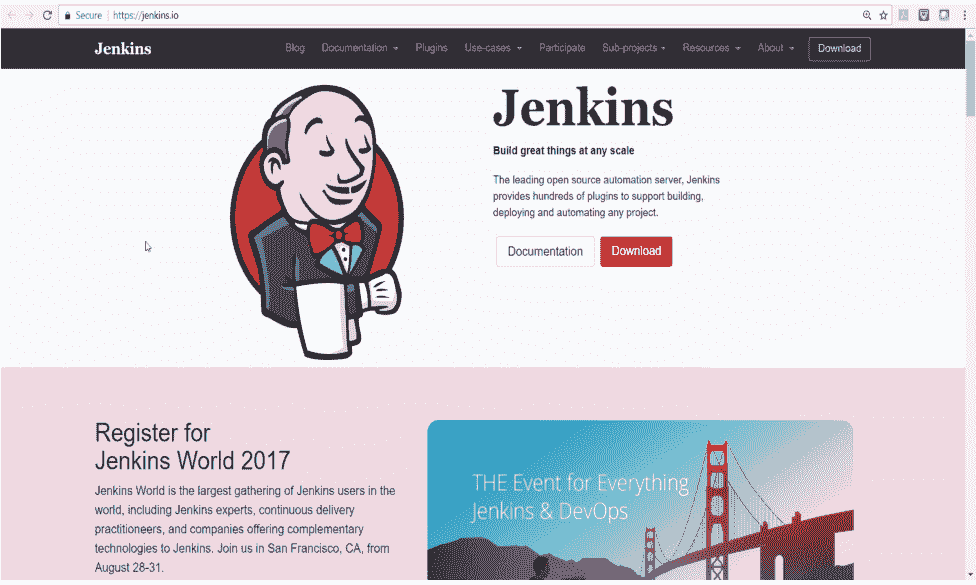

3. 从 Jenkins 下载最新的 Windows 安装包，地址为：http://mirrors.jenkins.io/windows/latest。

4. 点击该安装包并按照分步说明进行安装。

## 在 CentOS 上安装 Jenkins 2

让我们查看在 CentOS 上安装 Jenkins 所需的步骤。

### 准备工作

对于业务部门，建议具备以下要求：

- Java 8
- 4 GB+ RAM
- 500 GB+ 可用磁盘空间

Jenkins 需要 Java。要安装 Java，请执行：

```
sudo yum install java
```

### 如何操作...

1. Jenkins 的稳定版和最新版本可在 YUM 仓库中使用。
2. 将 Jenkins 仓库添加到 yum 源：

```
sudo wget -O /etc/yum.repos.d/jenkins.repo http://pkg.jenkins-ci.org/redhat/jenkins.repo
```

3. 对于稳定版，执行：

```
sudo wget -O /etc/yum.repos.d/jenkins.repo http://pkg.jenkins-ci.org/redhat-stable/jenkins.repo
```

4. 导入以下密钥：

```
sudo rpm --import https://jenkins-ci.org/redhat/jenkins-ci.org.key
```

5. 通过执行以下命令安装 Jenkins：

```
sudo yum install jenkins
```

### 还有更多...

- 要启动 Jenkins 服务，执行：

  ```
  sudo service jenkins start
  ```

- 要停止 Jenkins 服务，执行：

  ```
  sudo service jenkins stop
  ```

- 要重启 Jenkins 服务，执行：

  ```
  sudo service jenkins restart
  ```

## 在 Azure 上安装 Jenkins 2

Microsoft Azure 是近年来最受欢迎的云服务提供商之一。让我们尝试在 Azure 上安装 Jenkins。

### 准备工作

你需要在 Azure 上安装 Jenkins 时拥有 Microsoft Azure 订阅。还提供一个月的免费试用：

1. 访问 https://jenkins.io。
2. 点击 Download。

### 如何操作...

让我们看看如何在 Azure 上安装 Jenkins：

1. 在 Jenkins 下载页面点击 Deploy to Azure 链接：

### 开始使用 Jenkins

Jenkins 项目提供两个发布分支，LTS 和 weekly。根据组织的需求，其中一个可能更受青睐。

两个发布分支均以 .war 文件、原生包、安装程序和 Docker 容器形式分发。

### 长期支持 LTS

LTS 长期支持 版本每 12 周从常规发布流中挑选一次，作为该时期的稳定版本。了解更多...

Changelog | Upgrade Guide | Past Releases

**部署 Jenkins 2.60.1**


**下载 Jenkins 2.60.1 for：**

- Docker
- FreeBSD
- Gentoo
- Mac OS X
- OpenBSD
- openSUSE

### Weekly

每周都会发布新版本，以向用户和插件开发者提供错误修复和功能。

Changelog | Past Releases

**下载 Jenkins 2.70 for：**

- Arch Linux
- Docker
- FreeBSD
- Gentoo
- Mac OS X
- OpenBSD
- openSUSE
- Red Hat/Fedora/CentOS

2. 它会将你重定向到 Azure Marketplace。
3. 在同一页面上核实涉及的定价计划和类别。
4. 点击 GET IT NOW。这些步骤在以下屏幕截图中演示：

### Jenkins

Microsoft

Microsoft 在 Linux Ubuntu VM 上发布了 Jenkins Master

我们很高兴在 Microsoft Azure 上推出 Jenkins 支持的下一阶段，发布了安全、稳定且可用于生产环境的 Jenkins 版本。

**注意：** 要在部署后连接到此 Jenkins 实例，请浏览到该实例的 URL 或公共 IP。URL 是你在设置中输入的域名标签和该字段下方显示的后缀。

此解决方案模板将在 Linux Ubuntu 14.04 LTS VM 上安装最新的稳定 Jenkins 版本，并附带与 Azure 配合使用的工具和插件配置。这包括 –

- git 用于源代码控制
- Azure Credentials 插件用于安全连接
- Azure VM Agents 插件用于弹性构建、测试和持续集成
- Azure Storage 插件用于存储构建产物
- Azure CLI 用于使用脚本部署应用

有关此解决方案模板为你自动化的步骤的详细演练，请访问我们的博客文章。

5. 在 Create this app in Azure 选项卡中，点击 Continue：

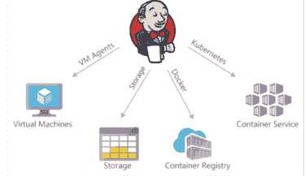


6. 如果你已有 Azure 订阅，则使用用户名和密码登录。
7. 部署模型已选择。
8. 点击 Create：

我们很高兴在 Microsoft Azure 上推出 Jenkins 支持的下一阶段，发布了安全、稳定且可用于生产环境的 Jenkins 版本。

**注意：** 要在部署后连接到此 Jenkins 实例，请浏览到该实例的 URL 或公共 IP。URL 是你在设置中输入的域名标签和该字段下方显示的后缀。

此解决方案模板将在 Linux Ubuntu 14.04 LTS VM 上安装最新的稳定 Jenkins 版本，并附带与 Azure 配合使用的工具和插件配置。这包括 –

- git 用于源代码控制
- Azure Credentials 插件用于安全连接
- Azure VM Agents 插件用于弹性构建、测试和持续集成
- Azure Storage 插件用于存储构建产物
- Azure CLI 用于使用脚本部署应用

有关此解决方案模板为你自动化的步骤的详细演练，请访问我们的博客文章。

此解决方案模板旨在按照最佳实践配置 Jenkins 实例，且 Azure 知识要求最少。通过少量用户输入和通过 Azure 门户的简单一键部署，你可以在几分钟内配置一个完全配置好的 Jenkins 实例，该实例可以

- 选择部署模型 🛈
- Resource Manager

9. 提供密码、Jenkins 发布类型和订阅详情，如下图所示：

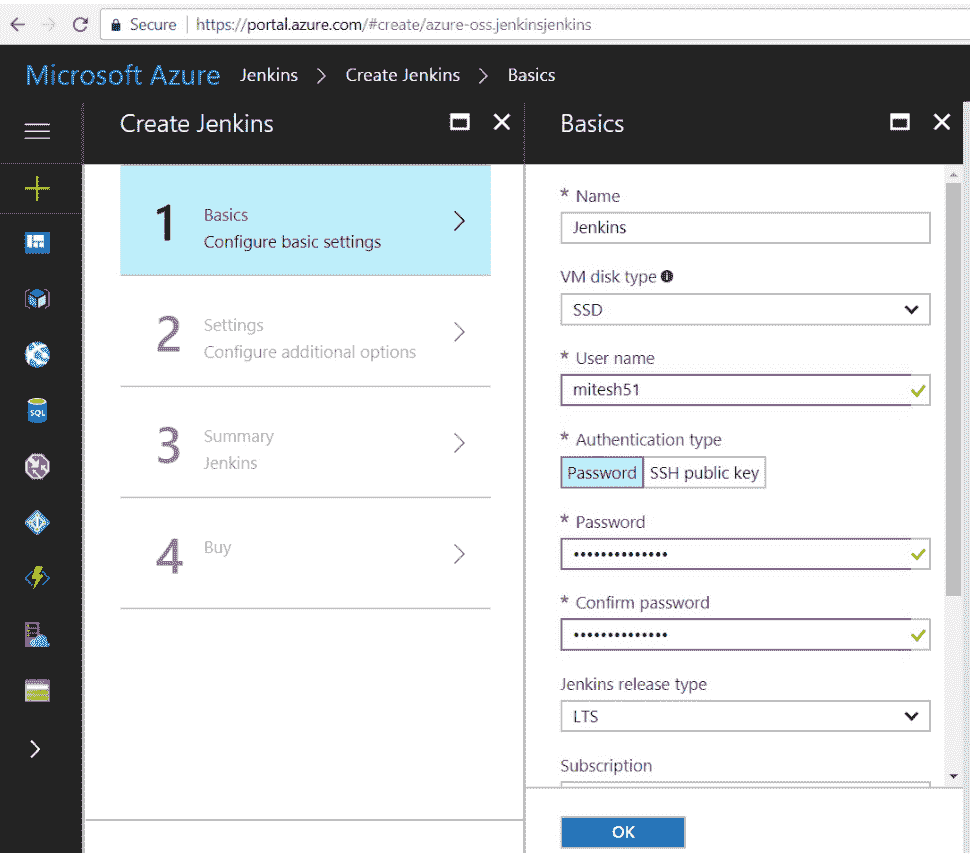

10. 选择 Create new 并提供资源组名称。
11. 根据你的偏好选择位置。
12. 点击 OK：

### Create Jenkins

13. 根据需求选择大小。
14. 提供唯一的域名标签。
15. 点击 OK：

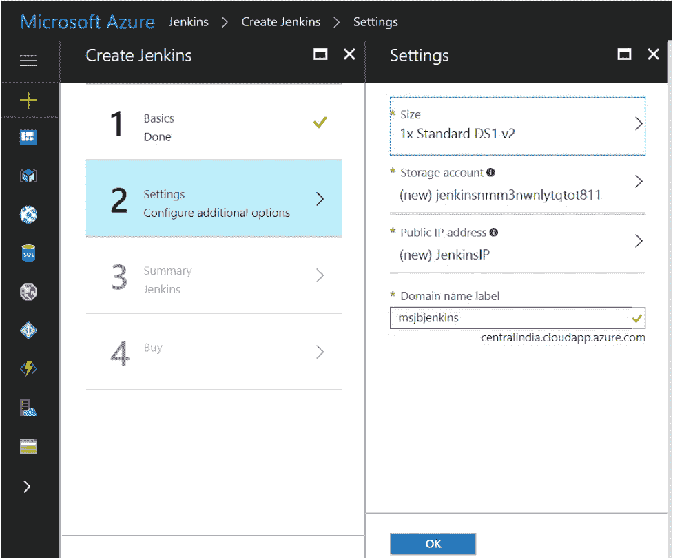

16. 查看选择。
17. 将根据你的选择执行自动验证。
18. 点击 OK：

19. 在点击 Purchase 按钮之前查看可用的模板链接：

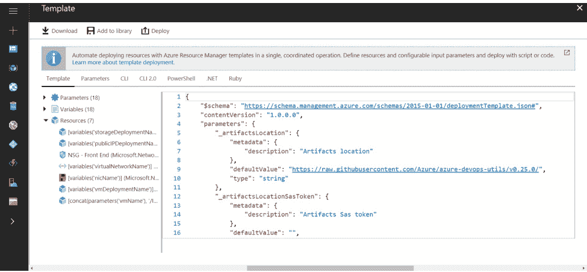

20. 准备就绪后，点击 Purchase：

21. 在 Azure 门户中，点击你创建的资源组。逐一查看正在创建的资源。在概览部分查看部署。

22. 点击 JenkinsIP 并访问与其关联的域名：

### Jenkins On Azure

此 Jenkins 实例不支持 https，因此通过公共 IP 地址登录已被禁用（这会将你的密码和其他信息暴露给窃听）。要安全登录，你需要使用 SSH 端口转发连接到 Jenkins 实例。

```
ssh -L 127.0.0.1:8080:localhost:8080 username@msbjenkins.centralindia.cloudapp.azure.com
```

如果你不想公开此 Jenkins 实例，你需要移除 nginx 反向代理。

```
sudo apt-get purge nginx nginx-common
```

23. 下载 PuTTY 或其他 ssh 客户端，以便我们可以连接到 Jenkins 页面中提到的 URL。
24. 前往 putty.exe 可用的位置。
25. 在命令提示符中执行 Jenkins 页面上给出的命令。
26. 在 PuTTY 安全警告中选择 Yes：

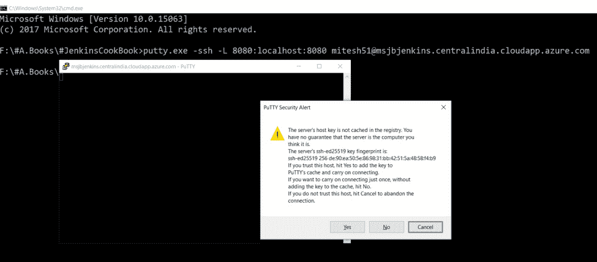

27. 打开浏览器并导航到 URL，http://localhost:8080。
28. 它会要求输入管理员密码：


## 解锁 Jenkins

为确保 Jenkins 由管理员安全设置，已将密码写入日志（不确定在哪里找到？）以及服务器上的此文件：
/var/lib/jenkins/secrets/initialAdminPassword
请从上述任一位置复制密码并粘贴到下方。
管理员密码

29. 在 PuTTY 窗口中，执行 cat 命令以获取“管理员密码”部分提到的文件的详细信息。
30. 将该密码替换到“管理员密码”框中，然后点击“继续”：

```
mitesh51@Jenkins:~$ sudo cat /var/lib/jenkins/secrets/initialAdminPassword
e0a0e477a2234e7bb45061173512eeff
mitesh51@Jenkins:~$
```

31. 点击“安装建议的插件”：

## 自定义 Jenkins

插件为 Jenkins 扩展了额外功能，以支持许多不同的需求。

### 安装建议的插件
安装 Jenkins 社区认为最有用的插件。

### 选择要安装的插件
选择并安装最适合您需求的插件。

Jenkins 2.60.1

32. 所有插件成功安装后，创建第一个管理员用户。点击“保存并完成”，如下一个截图所示：

## 创建第一个管理员用户

用户名：mitesh51
密码：··········
确认密码：··········
全名：Mitesh P
电子邮件地址：

Jenkins 2.60.1 以管理员身份继续 保存并完成

33. 现在，Jenkins 设置已完成。点击“开始使用 Jenkins”：

[24]

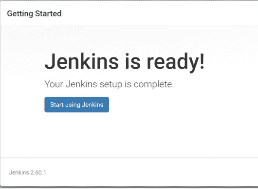

34. 最后，我们来到了仪表盘界面：

## 欢迎使用 Jenkins！

[登录以创建新任务。](https://mjjjenkins.centralindia.cloudapp.azure.com/login?from=%2F)

+   1 空闲
+   2 空闲

页面生成时间：2017年7月18日 下午6:06:58 UTC [REST API](/api/) Jenkins 版本 2.60.1

## 工作原理...

在幕后，该模板基于最佳实践创建了托管 Jenkins 所需的全部资源，包括虚拟网络、网络安全组、虚拟机等；然后 Jenkins 会在 Microsoft Azure 的安全环境中安装和配置。

## 在 Windows 中将 Jenkins 安装为服务

将 Jenkins 安装为 Windows 服务后，您可以在机器启动时立即启动 Jenkins，并且不受交互使用 Jenkins 的用户身份影响。

## 准备工作

在 Windows 上安装并配置 Jenkins。

## 操作步骤...

按照以下步骤在 Windows 中将 Jenkins 安装为服务：

+   1. 转到 Jenkins 仪表盘。
+   2. 点击“管理 Jenkins”。
+   3. 点击“安装为 Windows 服务”，如下图所示：


+   4. 将“安装目录”保留为默认值，然后点击“安装”：

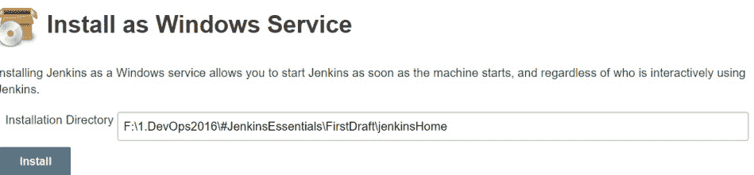

+   5. “Windows 服务”安装成功完成后，点击“是”：

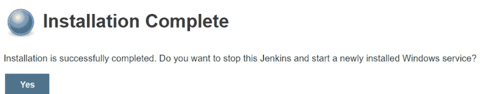

+   6. 现在，Jenkins 将作为 Windows 系统中的一个服务运行。

## 工作原理...

转到“控制面板”并搜索“服务”。

点击“服务（本地）”进行查看：

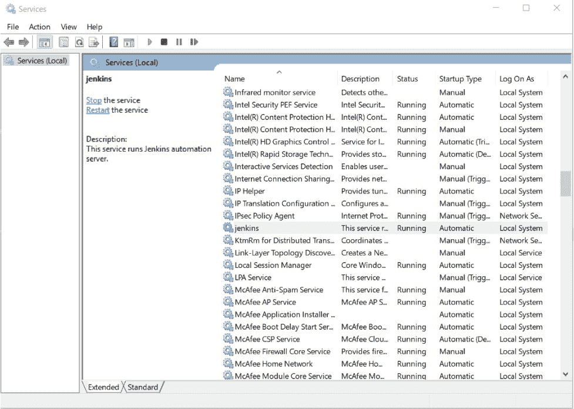

一旦 Jenkins 服务可用，您可以根据需要右键单击它并启动、停止或重启服务。

## 在 Jenkins 中安装插件

Jenkins 是一个开源自动化服务器，由于拥有 400 多个插件，它被广泛使用且具有高度扩展性。插件使 Jenkins 与其他工具的集成变得非常容易。您也可以创建自己的插件。

## 准备工作

可用的插件有各种类别，例如源代码管理、从属启动器和控制器、构建触发器、构建工具、构建通知、构建报告、其他构建后操作、外部站点/工具集成、UI 插件、身份验证和用户管理、Android 开发、iOS 开发、.NET 开发、Ruby 开发、库插件等等。

## 操作步骤...

+   1. 转到 Jenkins 仪表盘。点击“管理 Jenkins”，然后点击“管理插件”：

## 管理 Jenkins

+   - 配置系统
+   配置全局设置和路径。
+   - 配置全局安全性
+   保护 Jenkins：定义允许访问/使用系统的用户。
+   - 配置凭据
+   配置凭据提供程序和类型
+   - 全局工具配置
+   配置工具、它们的位置和自动安装程序。
+   - 从磁盘重新加载配置
+   丢弃内存中所有已加载的数据，并从文件系统重新加载所有内容。当您直接在磁盘上修改配置文件时很有用。
+   - 管理插件
+   添加、删除、禁用或启用可扩展 Jenkins 功能的插件。
+   - 系统信息
+   显示各种环境信息以协助故障排除。
+   - 系统日志
+   系统日志捕获与 Jenkins 相关的来自 `java.util.logging` 的输出。
+   - 负载统计
+   检查资源利用率，查看是否需要为构建添加更多计算机。

2. 转到“可选插件”选项卡，选择要安装的任何插件。点击“无重启安装”：

## 更多内容...

Jenkins 定义了用于建模构建系统某一方面的接口或抽象类。接口或抽象类定义了需要实现内容的协定；Jenkins 使用插件来扩展这些实现。

## 在 Jenkins 中上传插件

有些情况下，您已经从 [https://updates.jenkins-ci.org/download/plugins/](https://updates.jenkins-ci.org/download/plugins/) 下载了所有插件，或者您创建了自己的插件并希望在 Jenkins 中使用。本教程将说明如何在 Jenkins 中上传这些插件。

## 准备工作

下载所需插件 https://updates.jenkins-ci.org/download/plugins/ 或使用插件教程 https://wiki.jenkins.io/display/JENKINS/Plugin+tutorial 创建插件。

## 操作步骤...

在本教程中，我们将下载一个插件并从 Jenkins 仪表盘上传它：

+   1. 下载 copyartifact 插件（`.hpi`）文件：

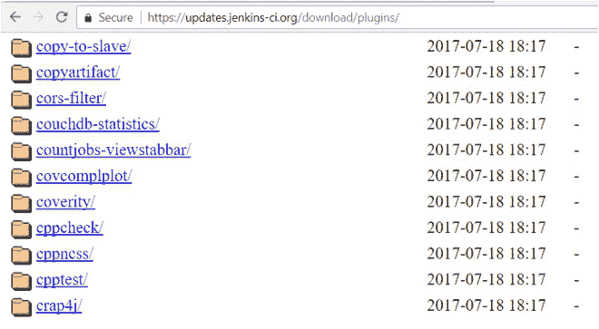

+   2. 将最新版本下载到您的系统：

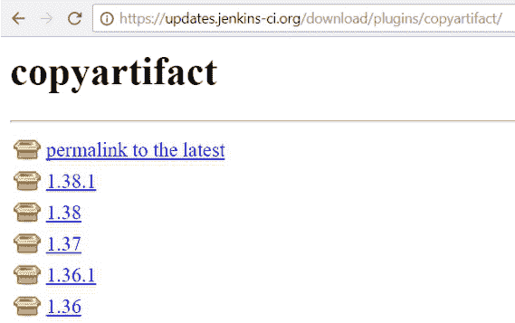

+   3. 转到 Jenkins 仪表盘。
+   4. 点击“管理 Jenkins”。
+   5. 点击“管理插件”。
+   6. 转到“高级”选项卡。在“上传插件”部分点击“选择文件”：

## 工作原理...

一旦插件成功上传，我们就可以利用上传到 Jenkins 的插件所提供的扩展性。

## 在 Jenkins 中配置代理

Jenkins 通常安装在使用代理服务器的组织中。在这种情况下，在 Jenkins 仪表盘中配置代理非常重要，这样插件更新才能成功安装。

## 准备工作

获取服务器名称、端口号以及允许访问代理服务器的凭据等所有详细信息。

## 操作步骤...

+   1. 转到 Jenkins 仪表盘。
+   2. 点击“管理 Jenkins”。
+   3. 点击“管理插件”。
+   4. 转到“高级”选项卡。
+   5. 提供“服务器”、“端口”、“用户名”、“密码”和“无代理主机”：

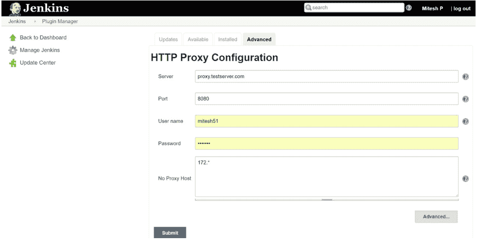

+   6. 点击“提交”。

## 在 Jenkins 中配置全局设置

“配置系统”是进行初始设置的地方，并且非常有用。您可以配置 SMTP 服务器详细信息、SonarQube 服务器详细信息、环境变量等。

## 准备工作

要配置全局设置和路径，我们需要进入 Jenkins 仪表盘中的“配置系统”。

## 操作步骤...

+   1. 转到 Jenkins 仪表盘。
+   2. 点击“管理 Jenkins”。
+   3. 点击“配置系统”。
+   4. 验证“主目录”是否可用：

5. 在“配置系统”页面中，我们也可以定义环境变量，以便在构建作业执行期间使用它们。

6. 例如，我们可以在“环境变量”中配置 ANDROID SDK 路径，以便为 Android 应用设置持续集成。

## 全局属性

环境变量

变量列表

名称 PROP_LOC

值 <属性文件的路径>

删除

添加

7. 同一页面上另一个重要的配置是“Jenkins 位置”。您可以指定 Jenkins 安装的 HTTP 地址，因为 Jenkins 无法可靠地从自身检测到这样的 Jenkins URL：

## Jenkins 位置

Jenkins URL http://10.0.0.5:8080/

系统管理员电子邮件地址 尚未配置 <nobody@nowhere>


## 还有更多...

在 Configure System 部分，这里有一些重要的配置需要你进行，例如 SCM Polling、E-mail Notification、Extended E-mail Notification、Git plugin、Disk usage、Quality Gates - SonarQube、Build Pipeline Plugin、Copyartifact: Upstream build that triggered this job、Audit Trail、SonarQube servers 等等。

## 配置 JENKINS_HOME

`.jenkins` 是包含 Jenkins 安装文件、配置、插件、构建作业配置等所有详细信息的核心目录。

## 准备工作

`.jenkins` 目录应保存在有充足可用空间的位置。默认情况下，Jenkins 会根据操作系统在特定位置创建 `.jenkins`（或 `JENKINS_HOME`）。

例如，在 Windows 中它位于 `c:\Users\<USER_NAME>\.jenkins`。

## 如何操作...

- 1. 在 Windows 中，要更改 `JENKINS_HOME`，请前往 控制面板 | 所有控制面板项 | 系统。
- 2. 点击 高级系统设置。
- 3. 点击 环境变量。
- 4. 创建一个新变量 JENKINS_HOME 并给出路径：

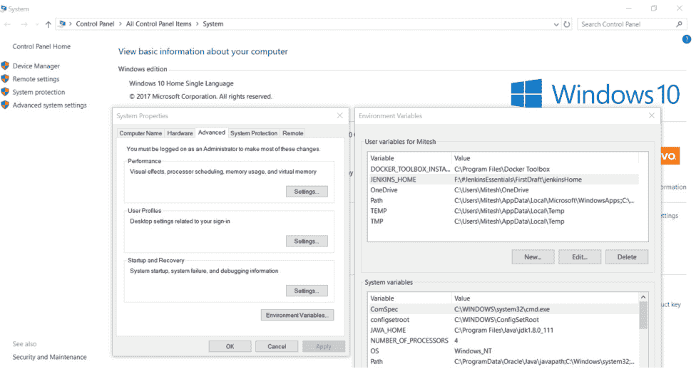

- 5. 在 Ubuntu 中，前往 `/etc/default/Jenkins`。
- 6. 更改 `JENKINS_HOME` 位置：

```
mitesh51@Jenkins:~$ vi /etc/default/jenkins
defaults for Jenkins automation server

## pulled in from the init script; makes things easier.
NAME=jenkins

### location of java
JAVA=/usr/bin/java

# arguments to pass to java
# Allow graphs etc. to work even when an X server is present
JAVA_ARGS="-Djava.awt.headless=true"

#JAVA_ARGS="-Xmx256m"

# make jenkins listen on IPv4 address
#JAVA_ARGS="-Djava.net.preferIPv4Stack=true"

PIDFILE=/var/run/$NAME/$NAME.pid

# user and group to be invoked as (default to jenkins)
JENKINS_USER=$NAME
JENKINS_GROUP=$NAME

# location of the jenkins war file
JENKINS_WAR=/usr/share/$NAME/$NAME.war

# jenkins home location
JENKINS_HOME=/var/lib/$NAME

# set this to false if you don't want Jenkins to run by itself
# in this set up, you are expected to provide a servlet container
# to host jenkins.
RUN_STANDALONE=true

# log location. this may be a syslog facility.priority
JENKINS_LOG=/var/log/$NAME/$NAME.log
#JENKINS_LOG=daemon.info
```

7. 完成更改后，保存更改。

## 还有更多...

下表描述了不同操作系统中 `JENKINS_HOME` 的默认位置：

| 操作系统 | $JENKINS_HOME 位置 |
|---|---|
| Windows | C:\Program Files (x86)\jenkins or c:\Users\<USER>\.jenkins |
| Mac OSX | Macintosh HD/Users/Shared/Jenkins |
| Ubuntu/Debian | /var/lib/jenkins |
| Red Hat/CentOS/Fedora | /var/lib/jenkins |
| OpenSUSE | /var/lib/jenkins |
| FreeBSD | /usr/local/etc/jenkins |
| OpenBSD | /usr/local/etc/jenkins |

## 理解 JENKINS_HOME 目录

在本教程中，我们将讨论 `JENKINS_HOME` 目录中可用的目录。

## 准备工作

从环境变量中定位 `JENKINS_HOME` 目录，或前往不同操作系统中 `JENKINS_HOME` 可用的默认位置。

## 如何操作...

- 1. `JENKINS_HOME` 目录中有许多文件和目录。我们将对一些重要文件和目录进行简要说明：

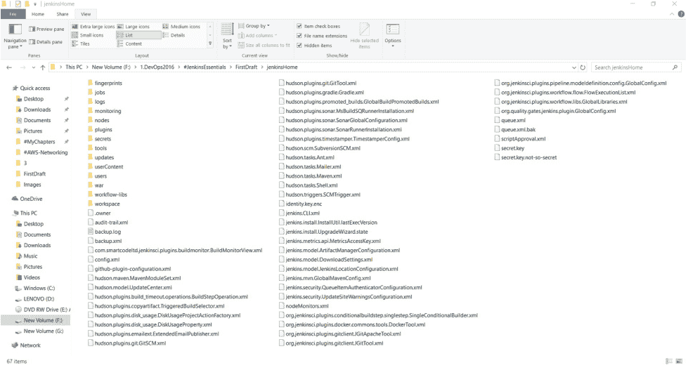

2. `JENKINS_HOME` 目录中一些重要的文件和目录如下：

- `config.xml` — Jenkins 根配置文件
- `fingerprints` — 它存储指纹记录，如有
- `plugins` — 它是所有 Jenkins 插件的根目录
- `jobs` — 它是所有 Jenkins 作业的根目录
- `logs` — 它存储所有日志文件
- `secrets` — 它是用于凭据解密的密钥的根目录
- `users` — 它存储 Jenkins 中所有与用户相关的详细信息
- `war` — 它存储与 `JENKINS_WAR` 文件相关的所有详细信息
- `workspace` — 它存储与不同构建作业相关的所有文件和工件，并在归档元素时将内容移至 jobs 目录。

## 另请参阅

在 `JENKINS_HOME` 目录中，用任意文本编辑器打开 `config.xml` 并查看文件中可用的选项。

## 为 Jenkins 使用不同的端口

默认情况下，Jenkins 运行在端口号 8080。

## 如何操作...

让我们更改 Jenkins 运行的端口：

- 1. 如果你使用命令行运行 Jenkins，则可以执行类似 `java -jar -httpPort=9999 jenkins.war` 的命令，将现有端口从 `8080` 更改为 `9999`。
- 2. 另一种更改端口的方法是在使用 Windows 包安装 Jenkins 时如下：
  - 前往你安装 Jenkins 的 `Program Files/Jenkins` 目录
  - 在编辑器中打开 `Jenkins.xml`
  - 找到 `"--httpPort=8080"` 并将端口 `8080` 替换为新端口号

## 其工作原理...

首先，你安装了 Ubuntu 的虚拟镜像，更改了密码以使其更难被他人登录，并为安全补丁更新了客户机操作系统。

## 在 Jenkins 中配置 JAVA_HOME

Jenkins 是一个开源自动化服务器，可用于为多种编程语言编写的项目配置持续集成。让我们考虑一个基于 Java 的应用程序的情况。

我们需要告诉 Jenkins Java 安装在何处。

## 如何操作...

- 1. 打开 Jenkins 仪表板。
- 2. 前往 管理 Jenkins。
- 3. 前往 全局工具配置 以配置工具、其位置和自动安装程序。
- 4. 前往 JDK 部分。
- 5. 输入名称并勾选 自动安装 选项；提供 Oracle 账户的详细信息以成功下载 JDK。
- 6. 你可以给出 JDK 1.7 或 JDK 1.8 等逻辑名称，以便在配置构建作业时识别正确版本。
- 7. 你可以根据版本添加多个 JDK，因此如果不同应用程序需要不同的 JDK，则可以通过在 Jenkins 中添加 JDK 轻松管理该场景：

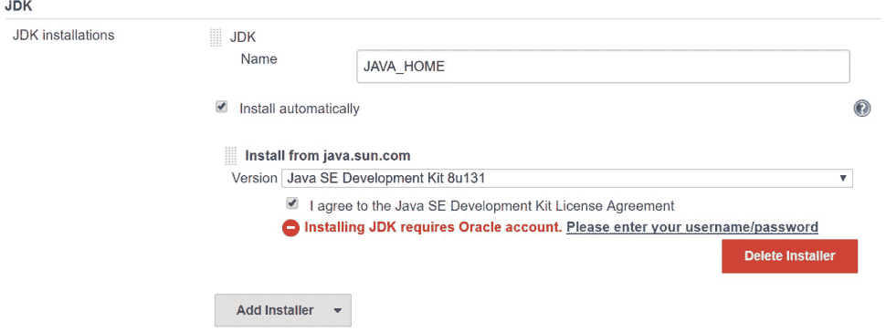

## 其工作原理...

当你在 Jenkins 中创建构建作业并配置它时，你需要指定构建执行将使用的 Java 版本。如果你不想自动安装，也可以使用系统上已有的 Java。

在构建作业的常规部分，我们可以从列表中选择一个 JDK。该列表包含我们在全局工具配置中配置的所有 JDK。

## 在 Jenkins 中配置 Git

Jenkins 可以与许多源代码存储库集成，Git 就是其中之一。让我们考虑一个基于 Java 的应用程序的情况，其源代码存储在 Git、Gitlab 和/或 GitHub 中。

我们需要告诉 Jenkins Git 在本地系统中的安装位置。

## 准备工作

根据操作系统下载所需的 Git 版本，或自动安装。

## 如何操作...

- 1. 打开 Jenkins 仪表板。
- 2. 前往 管理 Jenkins。
- 3. 前往 全局工具配置 以配置工具、其位置和自动安装程序。
- 4. 前往 Git 部分。
- 5. 输入名称并点击 自动安装，或提供 Git 的路径。
- 6. 你可以根据版本或特定代理添加多个 Git。你需要给出有意义的名称，以便在配置构建作业时易于识别：

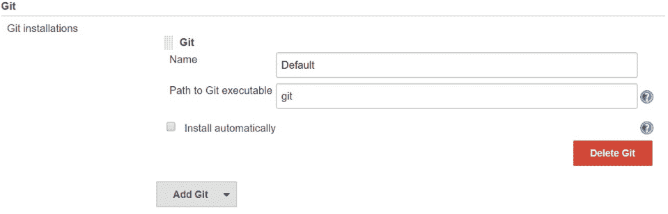

## 其工作原理...

当你在 Jenkins 中创建构建作业并配置它时，你需要指定构建执行将使用的 Git 版本。如果你不想自动安装，也可以使用系统上已有的 Git 安装。

在源代码管理部分，从列表中选择在全局工具配置中配置的适当 Git。

前往 Git 可执行文件配置以更改 Git 安装程序。


## 在 Jenkins 中配置 ANT_HOME

Jenkins 是一个开源自动化服务器，可用于为多种编程语言编写的项目配置持续集成。让我们考虑一个基于 Java 的应用程序，并且使用 Ant 作为构建工具的情况。

我们需要告诉 Jenkins Ant 可安装目录的位置。

### 准备工作

下载所需的 Ant 版本或自动安装。

### 工作原理...

当你在 Jenkins 中创建构建作业并进行配置时，需要指定构建执行将使用的 Ant 版本。如果你不想自动安装，也可以使用系统上已有的 Ant 安装。

## 在 Jenkins 中配置 MAVEN_HOME

Jenkins 是一个开源自动化服务器，可用于为多种编程语言编写的项目配置持续集成。让我们考虑一个基于 Java 的应用程序并且使用 Maven 作为构建工具的情况。

我们需要告诉 Jenkins Maven 可安装目录的位置。

### 准备工作

下载所需的 Maven 版本或自动安装。

### 如何操作...

- 1. 打开 Jenkins 仪表盘。
- 2. 进入 管理 Jenkins。
- 3. 进入 全局工具配置 以配置工具、其位置和自动安装程序。
- 4. 进入 Maven 部分。
- 5. 输入名称并点击 自动安装，或提供现有 Maven 安装可用的位置路径。
- 6. 你可以给出一个逻辑名称，例如 `Maven 3.5.0` 或 `Maven 3.4.0`，以便在配置构建作业时识别正确的版本：
- 7. 你可以在 Jenkins 中根据版本添加多个 Maven。

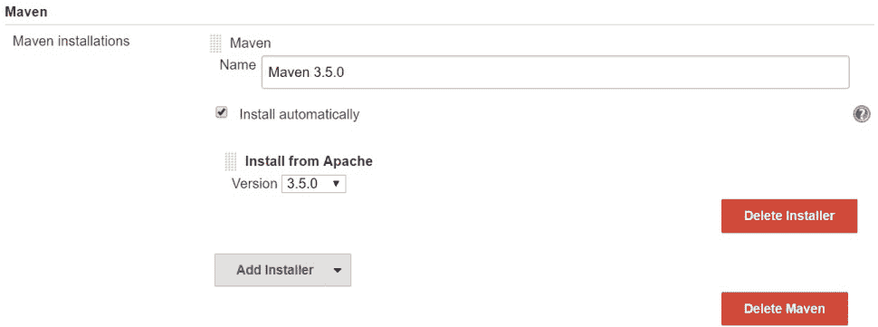

### 工作原理...

当你在 Jenkins 中创建构建作业并进行配置时，需要指定构建执行将使用的 Maven 版本。如果你不想自动安装，也可以使用系统上已有的 Maven 安装。

## 在 Jenkins 中配置 GRADLE_HOME

Jenkins 是一个开源自动化服务器，可用于为多种编程语言编写的项目配置持续集成。让我们考虑一个基于 Android 的应用程序，并且使用 Gradle 作为构建工具的情况。

我们需要告诉 Jenkins Gradle 可安装目录的位置。

### 准备工作

下载所需的 Gradle 版本或自动安装。

### 如何操作...

- 1. 打开 Jenkins 仪表盘。
- 2. 进入 管理 Jenkins。
- 3. 进入 全局工具配置 以配置工具、其位置和自动安装程序。
- 4. 进入 Gradle 部分。
- 5. 输入名称并点击 自动安装，
  或提供现有 Gradle 安装可用的位置路径。
- 6. 你可以给出一个逻辑名称，例如 `Gradle 4.0.1` 或 `Gradle 4.0.0`，以便在配置构建作业时识别正确的版本：
- 7. 你可以在 Jenkins 中根据版本添加多个 Gradle。

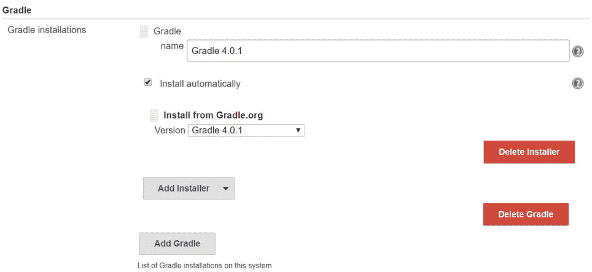

## 为 Ant 项目创建 Freestyle 作业

构建作业是 Jenkins 中的基本执行单元。我们可以使用构建作业执行许多操作。我们可以执行命令、发送通知、配置持续集成等等。

### 准备工作

你需要根据应用程序配置工具，例如 Ant、Gradle、Java、Git 等等。

### 如何操作...

- 1. 打开 Jenkins 仪表盘。
- 2. 点击 新建任务。
- 3. 输入项目名称。
- 4. 选择模板 Freestyle project。
- 5. 点击 确定：

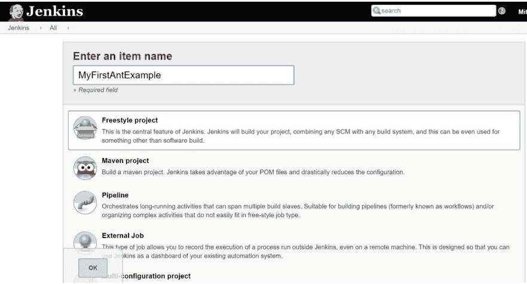

- 6. 进入 源代码管理 部分并选择 Git。
- 7. 提供 仓库 URL。
- 8. 提供凭据，如下一张截图所示：

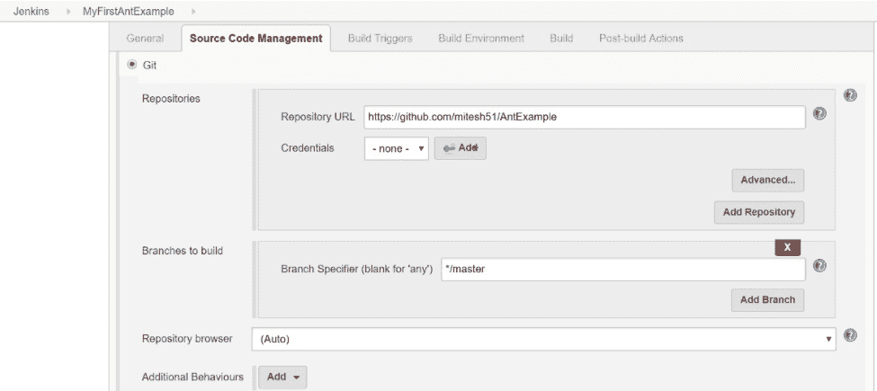

- 9. 在 构建 部分，点击 添加构建步骤 并选择 调用 Ant。
- 10. 根据我们的全局工具配置选择 Ant 名称。
- 11. 提供目标。在 Ant 中，我们可以根据 build.xml 文件中定义的目标给出一个目标：
- 12. 点击 保存。

### 工作原理...

当你进入构建作业页面并点击 立即构建 时，它将根据配置执行构建。

### 准备工作

你需要根据应用程序配置工具，例如 Maven、Java、Git 等等。

### 如何操作...

- 1. 打开 Jenkins 仪表盘。
- 2. 点击 新建任务。
- 3. 输入项目名称。
- 4. 选择模板 Maven project。
- 5. 点击 确定：

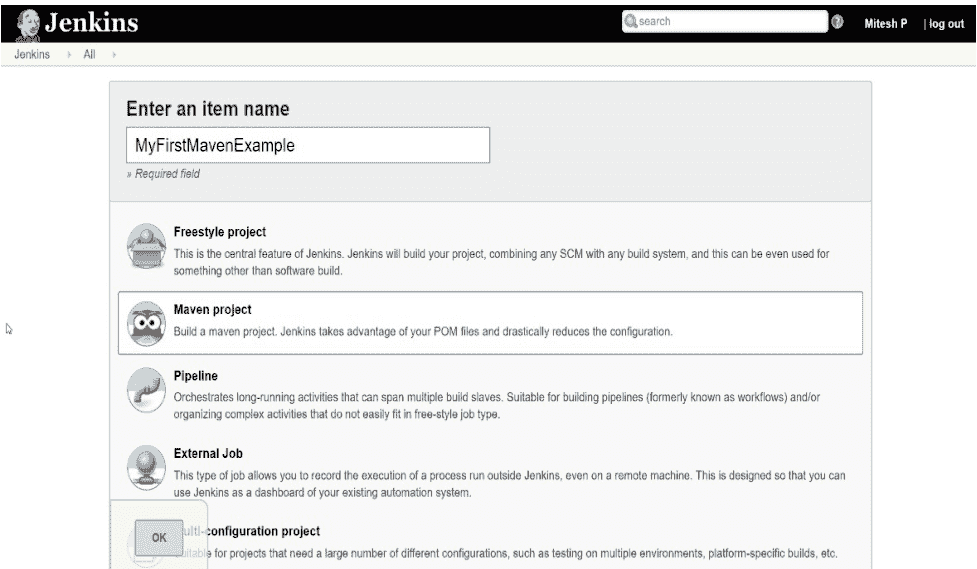

- 6. 进入 源代码管理 部分并选择 Git。
- 7. 提供 仓库 URL。
- 8. 提供凭据。
- 9. 在 构建 部分，Root POM 名称将已可用。
- 10. Maven 有自己的一套目标，我们可以根据需求执行其中任何一个目标。这些步骤在下一张截图中演示：

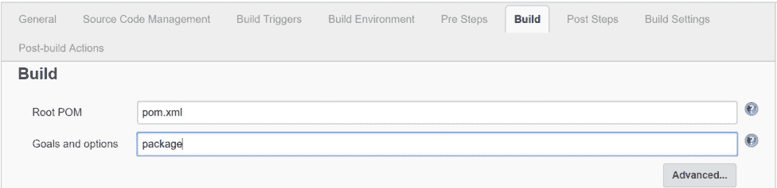

- 11. 点击 保存。
