## Jenkins 的管理和监控

在本章中，我们将介绍以下配方：

- 理解 master/agent 架构
- 使用 Eclipse 管理 Jenkins 构建作业
- 备份和恢复 Jenkins
- 使用 Jenkins CLI 的 Jenkins 命令行选项
- 从命令行修改 Jenkins 配置
- 管理磁盘使用
- 安全关闭 Jenkins
- 使用 JavaMelody 监控 Jenkins
- 使用 Build Monitor View 监控 Jenkins 作业
- 配置邮件通知
-  signaling the need to archive

### 理解 master/agent 架构

Jenkins 支持 master/agent 架构。在 master/agent 架构中，我们可以在 master 上安装 Jenkins，然后利用其他 agent 来分发负载。

我们应该将 Jenkins 作业委托给 agent 执行。这样，我们就可以使用不同的资源支持多次执行。

master/agent 架构在以下特定场景中非常有用，例如：

- Jenkins 机器容量有限；即使容量更高，也会有无法满足所有请求的时候。通过将负载分发到 agent 节点，我们可以释放 Jenkins 安装系统上可用的资源。
- 不同作业需要不同种类的资源，并且仅限于特定机器。在这种情况下，我们只能利用该机器，并且不可能在 Jenkins 安装的系统上配置它，因此最好将该机器用作 agent。
- 需要不同的操作系统或某些工具仅在特定操作系统中工作，因此我们可以通过在安装了这些工具的系统上创建 agent 来利用这些工具。
- 通过不在 Jenkins 机器上安装每一个工具来避免单点故障。

Murphy 作为朋友：

你应该为本书中的所有配方假设最坏的情况：外星人攻击、咖啡洒在主板上、猫吃掉你的电缆、电缆吃掉猫等等。确保你使用的是测试 Jenkins 实例。

### 准备工作

这里重要的是我们根本不在任何 agent 节点上安装 Jenkins。我们只在 master 上安装 Jenkins 并利用该 Jenkins 来编排 master/agent 架构。

仅供参考：在我们安装 Jenkins 的任何系统上，它都成为 master。只需通过导航到 管理 Jenkins | 管理节点 来验证。

- 1. 导航到 管理 Jenkins | 管理节点 并点击 新建节点：

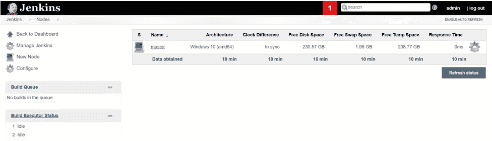

- 2. 输入节点名称并选择 永久代理；点击 确定：

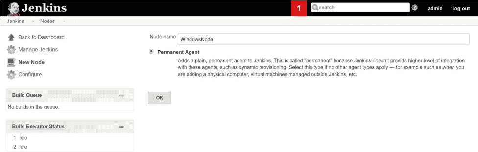


## 如何操作...

1. Jenkins 稳定版及更新版本在 YUM 仓库中可用。以下是配置代理（Agents）的详细信息表：

| 配置项 | 详情 |
|---|---|
| 执行器数量 | • 此处可指定 Jenkins 可在该代理节点上执行的并发构建数量。<br>• 代理必须至少有一个执行器；若我们不希望执行任何构建，可将此设置配置为 0。 |
| 远程根目录 | • 代理节点需要有一个专用于 Jenkins 的目录。请在代理上指定该目录的路径。<br>• 仅使用绝对路径。所有作业配置、构建日志和工件均存储在主节点（master）上。<br>• 工作区位于代理节点上。 |
| 标签 | • 标签（Labels）或标记（tags）可用于将多个代理节点分组为一个逻辑集合。<br>• 最好的地方在于，我们可以利用此机制作为资源池，在 Jenkins 中执行构建作业。<br>• 例如，我们有多个代理设置了测试基础设施。我们有两三个项目的自动化测试由 QA 团队负责。<br>• 在这种情况下，我们可以为所有具备测试基础设施的代理节点提供相同的“Test”标签，并为这些项目分配相同的“Test”标签。<br>• 这样，构建作业将在带有“Test”标签的任一测试代理上执行，而不是在没有该标签的代理上执行。 |
| 用法 | • 此设置控制 Jenkins 如何在特定代理节点上调度构建。<br>• 尽可能使用此节点：这是默认设置，大多数时候代理节点将用于作业执行。<br>• 仅构建与此节点匹配的标签表达式的作业：使用此设置，当项目配置为通过标签表达式在此节点上执行时，Jenkins 将在此代理节点上执行构建。 |
| 启动方式 | • 此设置控制 Jenkins 如何启动特定代理节点。<br>• 通过 Java Web Start 启动代理：允许使用 Java Web Start 启动代理。<br>• 在主节点上执行命令来启动代理：通过远程在另一台机器上执行进程，例如通过 SSH 或 RSH。<br>• 通过 SSH 启动从属代理：通过安全的 SSH 连接发送命令。<br>• 让 Jenkins 将此 Windows 从属节点作为 Windows 服务控制，因为它通过 Windows 内置的远程管理功能启动 Windows 从属节点。 |
| 可用性 | • 此设置控制 Jenkins 何时启动和停止此代理。<br>• 尽可能保持此代理在线。<br>• 在特定时间将此代理设为在线和离线。<br>• 按需将此代理设为在线，空闲时设为离线。 |
| 环境变量 | • 我们可在此定义代理节点特定的环境变量。 |
| 工具位置 | • 我们可在此定义代理节点特定的工具位置。 |

2. 配置设置并点击“保存”：

### 🔒 配置全局安全

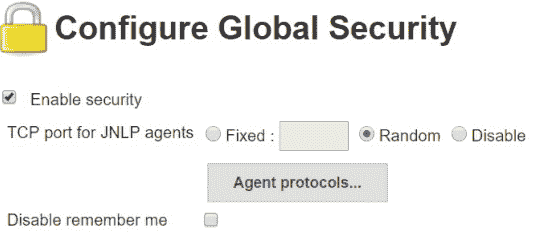

7. 再次转到代理节点，在代理节点的终端或命令行中执行给定命令，然后它应连接到主节点：

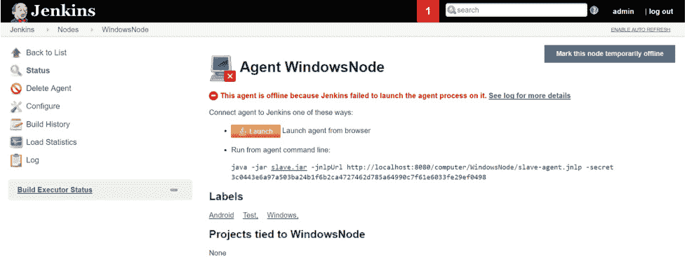

8. 要将作业配置到特定节点，请转到构建作业并点击“配置”。

9. 在“常规”部分，选择“限制此项目可运行的位置”，并提供我们创建的代理节点的标签：

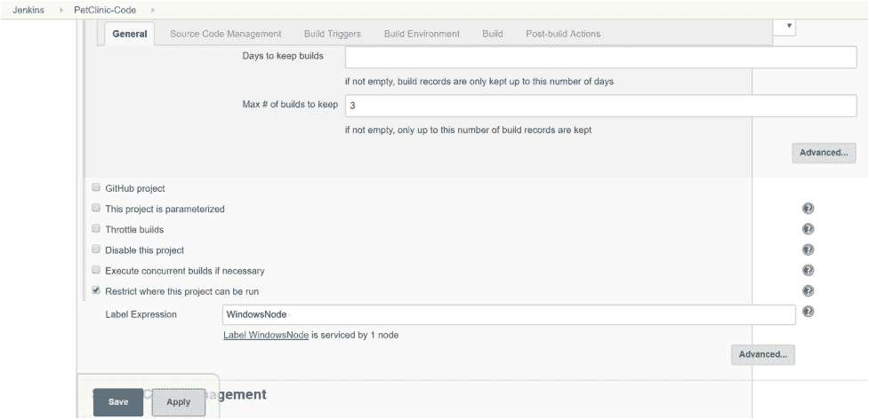

10. 转到“管理节点”，选择代理节点，以验证与其关联的构建作业：

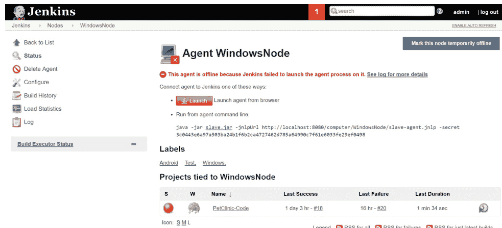

11. 这就是我们创建主/代理架构并在只有一个主节点的情况下将负载分布到各代理的方法。

## 使用 Eclipse 管理 Jenkins 构建作业

我们能否从 Eclipse 执行 Jenkins 作业？当然可以！下面我们来看看如何操作。

### 准备工作

1. 转到“帮助”|“安装新软件...”：

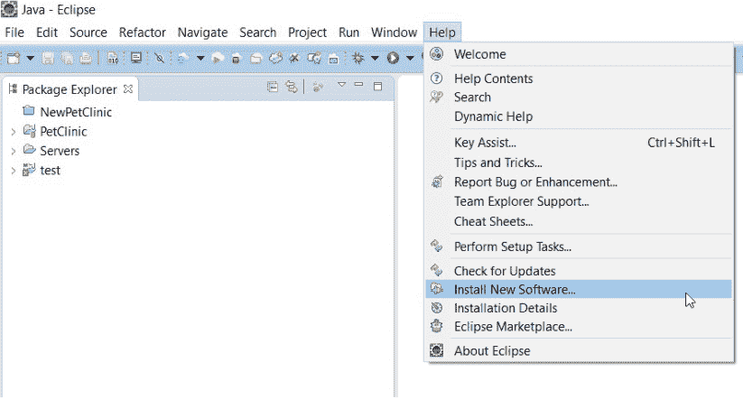

2. 为 Mylyn 添加一个站点，并点击“下一步 >”：

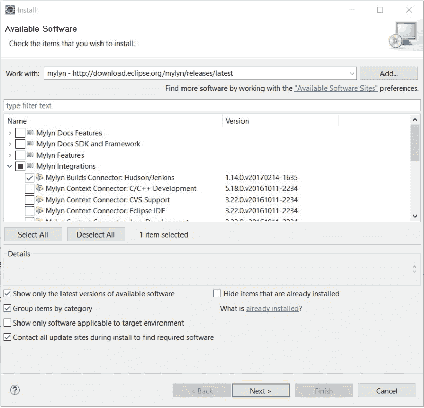

3. 查看要安装的项，并点击“下一步 >”。

4. 接受许可协议的条款，然后点击“完成”。将开始安装 Mylyn 软件包。

5. 安装完成后，重启 Eclipse。

### 如何操作...

让我们看看如何从 Eclipse 触发 Jenkins 构建。

1. 在 Window 菜单中，点击“视图”。

2. 选择 Mylyn，然后点击“构建”。接着点击“确定”：

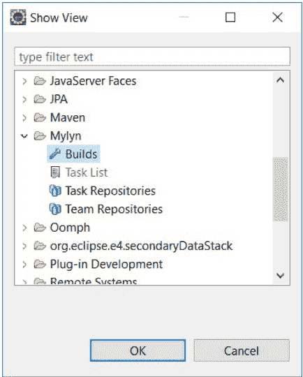

3. 在“构建”部分，点击构建服务器链接：

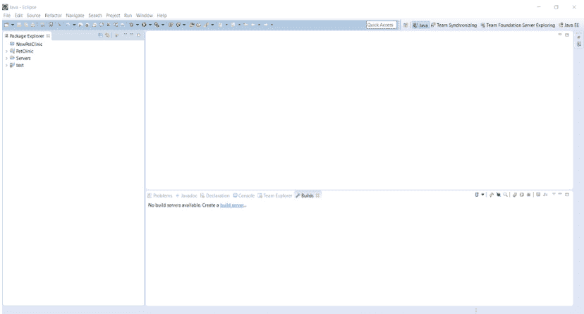

Java 视图中的 Eclipse

4. 选择 Hudson（支持 Jenkins），然后点击“下一步 >”：

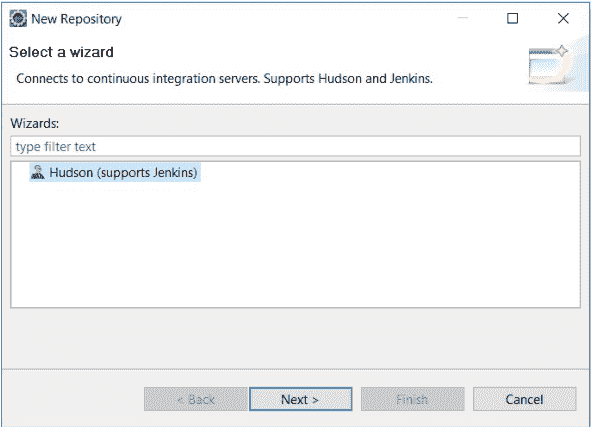

5. 提供服务器详细信息。提供用户名和密码。然后点击“完成”：

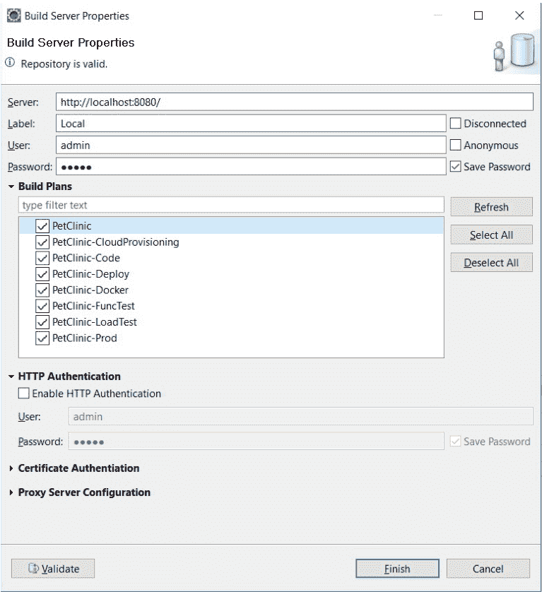

6. 在“构建”部分查找作业列表，如下所示。选择任意作业并点击“运行构建”以从 Eclipse 执行它：

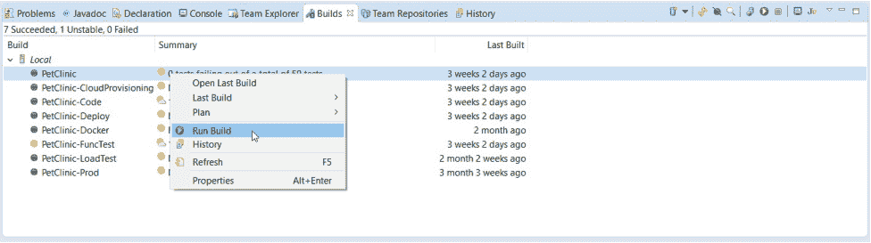

7. 尝试其他选项作为练习。

## 备份和恢复 Jenkins

确保 Jenkins 顺利运行的核心任务之一，是定期备份其主目录。这未必包括所有工件，但至少应包括其配置和测试历史，插件生成报告时会需要这些数据。

备份只有在能够恢复时才有意义。关于这一点有很多故事。我最喜欢的一个（我不会提及所涉及的知名公司）是：70年代初，一家公司购买了一套非常昂贵的软件和一套磁带备份设备，用于备份通过其大型机收集的所有营销结果。然而，并非所有流程都自动化。每晚，都需要将一盘磁带放入指定插槽。一名薪资微薄的工人被分配了这项任务。一年来，这位工人一直专业地完成着任务。有一天，发生故障，需要恢复备份。但恢复失败。原因是，工人每晚还需要按下录音按钮，但这并未包含在分配给他的任务说明中。问题在于没有定期测试恢复流程。失败的是流程，而不是那位薪资微薄的工人。因此，借鉴历史教训，本教程将同时描述备份和恢复。

### 插件的快速演进与教程的有效性

插件更新迭代很快，您可能需要每周更新。虽然核心配置不太可能改变，但很可能会添加额外选项，增加您在 GUI 中输入的变量。因此，本书中显示的截图可能与最新版本略有不同，但教程内容应保持有效。

### 准备工作

现在，让我们一次性安装后续章节所需的重要插件：

### 安装插件/升级

**准备**

- 检查互联网连接  成功
- 检查更新中心连接  成功

- 仪表盘视图  成功
- 部署到容器插件  成功
- 监控  成功
- 审计跟踪  成功
- 磁盘使用插件  成功
- 备份插件  成功

返回顶部页面
（您可以立即开始使用已安装的插件）

安装完成且没有作业运行时重启 Jenkins

备份插件允许我们备份 JENKINS_HOME 并恢复它。

### 如何操作...

1. 转到“管理 Jenkins”，点击“备份管理器”：

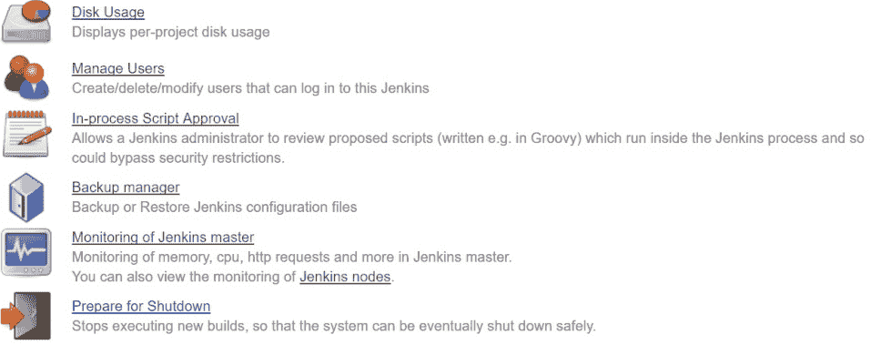

2. 点击“设置”：

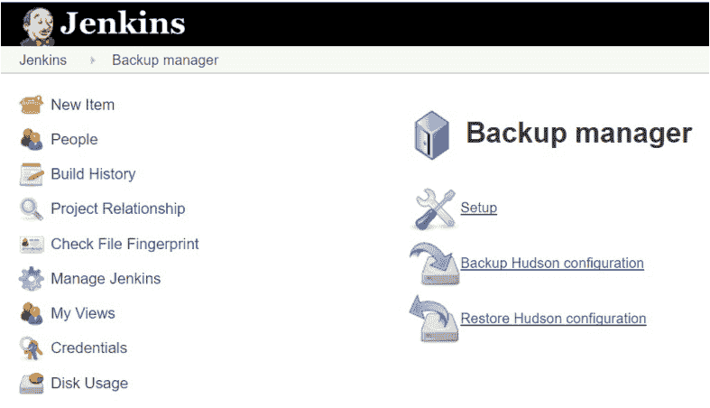

3. 配置备份目录、格式、文件名模板等：

### 备份配置文件

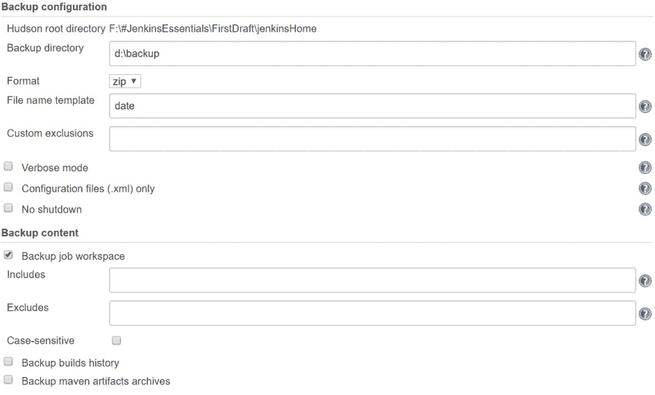

4. 点击“备份 Hudson 配置”：

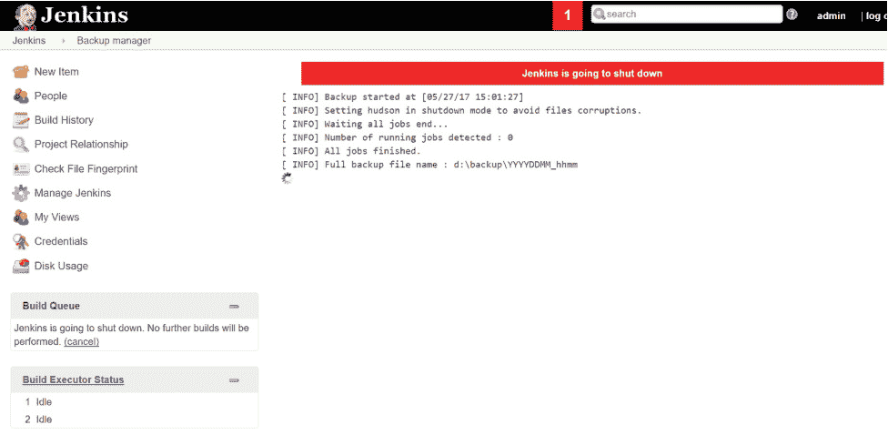

5. 备份成功完成后，验证日志：


```text
[ INFO] Backup started at [05/27/17 15:01:27]
[ INFO] Setting hudson in shutdown mode to avoid files corruptions.
[ INFO] Waiting all jobs end...
[ INFO] Number of running jobs detected : 0
[ INFO] All jobs finished.
[ INFO] Full backup file name : d:\backup\YYYYDDMM_hhmm
[ INFO] Saved files : 12482
[ INFO] Number of errors : 0
[ INFO] Cancel hudson shutdown mode
[ INFO] Backup end at [05/27/17 15:03:51]
[ INFO] [143.935s]
```

6. 前往 Backup Manager，点击 Restore Hudson configuration：

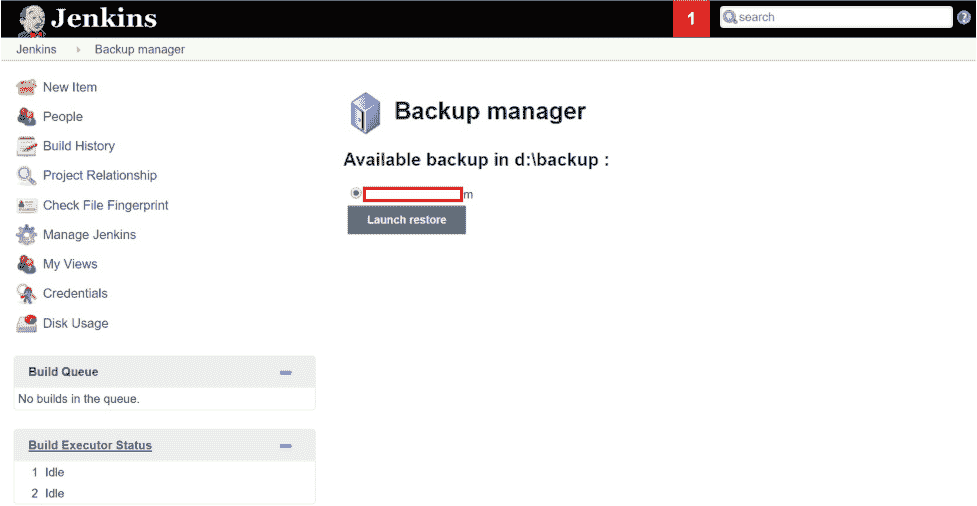

### 另请参阅

目前，备份插件不止一个。我选择了 `thinBackup` 插件（[https://wiki.jenkins-ci.org/display/JENKINS/thinBackup](https://wiki.jenkins-ci.org/display/JENKINS/thinBackup)），因为它支持计划调度。

## 通过 Jenkins CLI 使用命令行选项

你可以通过命令行工具访问 Jenkins 中的各种功能。

### 准备工作

从 Jenkins 仪表盘上的链接下载 `Jenkins-cli.jar` 文件。

### 操作步骤...

1. 进入 `Jenkins-cli.jar` 的下载位置，执行 `java -jar jenkins-cli.jar -s http://localhost:8080/ help` 命令查看 CLI 命令的帮助信息：

```text
C:\Users\Mitesh\Downloads>java -jar jenkins-cli.jar -s http://localhost:8080/ help
  add-job-to-view
    Adds jobs to view.
  build
    Builds a job, and optionally waits until its completion.
  cancel-quiet-down
    Cancel the effect of the "quiet-down" command.
  clear-queue
    Clears the build queue.
  connect-node
    Reconnect to a node(s)
  console
    Retrieves console output of a build.
  copy-job
    Copies a job.
  create-credentials-by-xml
    Create Credential by XML
  create-credentials-domain-by-xml
    Create Credentials Domain by XML
  create-job
    Creates a new job by reading stdin as a configuration XML file.
  create-node
    Creates a new node by reading stdin as a XML configuration.
  create-view
    Creates a new view by reading stdin as a XML configuration.
  declarative-linter
    Validate a Jenkinsfile containing a Declarative Pipeline
  delete-builds
    Deletes build record(s).
  delete-credentials
    Delete a Credential
  delete-credentials-domain
    Delete a Credentials Domain
  delete-job
    Deletes job(s).
  delete-node
    Deletes node(s)
  delete-view
    Deletes view(s).
```

2. 执行以下命令：

```text
java -jar jenkins-cli.jar -s http://localhost:8080/ version
java -jar jenkins-cli.jar -s http://localhost:8080/ who-am-i
java -jar jenkins-cli.jar -s http://localhost:8080/ list-jobs
```

3. 验证输出，如下所示：

```text
C:\Users\Mitesh\Downloads>java -jar jenkins-cli.jar -s http://localhost:8080/ version
2.73

C:\Users\Mitesh\Downloads>java -jar jenkins-cli.jar -s http://localhost:8080/ who-am-i
Authenticated as: anonymous
Authorities:
anonymous

C:\Users\Mitesh\Downloads>java -jar jenkins-cli.jar -s http://localhost:8080/ list-jobs
AzureAppDeploy
CucumberProject
CucumberProject2
FirstAndroidProject
FirstAntExample
FirstJob
FirstPipeline
Main-PetClinic
Maven-Sample
mitesh51
PetClinic-Code
PetClinic-Deploy
PetClinic-FuncTest
PetClinic-LoadTest
PetClinic-Package
PetClinic-Prod
PetClinicWebHook
SonarHTMLCSSJS
SpringBoot
Test
TestPipeline
ZapTest
ZapTestBackup

C:\Users\Mitesh\Downloads>
```

4. 请自行尝试其他命令。

## 从命令行修改 Jenkins 配置

你可能对 Jenkins 工作区顶层的 XML 文件感到好奇。这些是配置文件。`config.xml` 是处理默认服务器值的主要文件，但任何通过 GUI 设置值的插件也有对应的特定配置文件。

工作区下还有一个 `jobs` 子目录。每个单独的任务配置都包含在与任务同名的子目录中。任务特有的配置存储在子目录内的 `config.xml` 中。`users` 目录的情况类似：每个用户都有一个子目录，个人信息存储在 `config.xml` 中。

在受控情况下，如果你基础设施中的所有 Jenkins 服务器具有相同的插件和版本级别，你可以在一台测试机上测试，然后将配置文件推送到所有其他机器。然后你可以使用**命令行界面（CLI）**重启 Jenkins 服务器。

本教程将帮助你熟悉主要的 XML 配置结构，然后根据 XML 的细节提供有关插件 API 的提示。

### 准备工作

你需要一台启用了安全性的 Jenkins 服务器，并且能够编辑文件，可以通过登录后使用命令行操作，也可以使用文本编辑器进行编辑。

### 操作步骤...

让我们看看如何修改 Jenkins 配置。

1. 在 Jenkins 的顶层目录中，找到 `config.xml` 文件。编辑包含 `numExecutors` 的那一行，将数字 2 改为 3：

   ```text
   <numExecutors>3</numExecutors>
   ```

2. 重启服务器。你会看到执行器数量从默认的两个增加到三个。

3. 插件通过 XML 文件持久化其配置。为了证明这一点，请查找 `thinBackup.xml` 文件。除非你已安装 `thinBackup` 插件，否则你找不到它。

### 工作原理...

Jenkins 使用 **XStream**（[http://xstream.codehaus.org/](http://xstream.codehaus.org/)）将其配置持久化为可读的 XML 格式。工作区中的 XML 文件是插件、任务以及其他各种持久化信息的配置文件。`config.xml` 是主配置文件。安全设置和全局配置都在此处设置，并反映通过 GUI 所做的更改。插件使用相同的结构，XML 值对应于底层插件类中的成员值。GUI 本身是通过 Jelly 框架（[http://commons.apache.org/jelly/](http://commons.apache.org/jelly/)）从 XML 创建的。

通过重启服务器，你可以确保任何配置更改都会在初始化阶段被加载。

也可以使用“管理 Jenkins”页面中的**从磁盘重新加载配置**，无需重启即可加载更新后的配置。

## 管理磁盘使用情况

Jenkins 存储多个任务，并且创建的多个构建也存储在机器上。跟踪磁盘使用情况非常重要，因为随着时间的推移，多个项目的构建会占用大量空间。

### 准备工作

转到 Dashboard | Manage Jenkins | Manage Plugins | Available | 安装 Disk Usage 插件。

### 操作步骤...

该插件提供 Jenkins 安装所在系统的磁盘使用情况详细信息。

1. 转到 Dashboard | Manage Jenkins | Disk Usage：

2. 转到 Manage Jenkins，点击 Configure System。转到 Disk usage 部分，勾选 Show disk usage trend graph on the project page：

   **磁盘使用**

   - 启用构建计算
   - 计算时间间隔
   - 启用任务计算
   - 计算时间间隔
   - 启用工作区计算
   - 计算时间间隔
   - 当某些大小超限时发出警告
   - 在项目页面显示磁盘使用趋势图
   - 在全局图表中显示任务目录的可用空间
   - 全局磁盘使用历史的长度
   - 计算从节点工作区的超时时间（分钟）
   - 也从从节点端控制工作区
   - 排除在磁盘使用计算之外的任务

3. 转到一个特定项目，验证 Disk Usage Trend 图表是否可用：

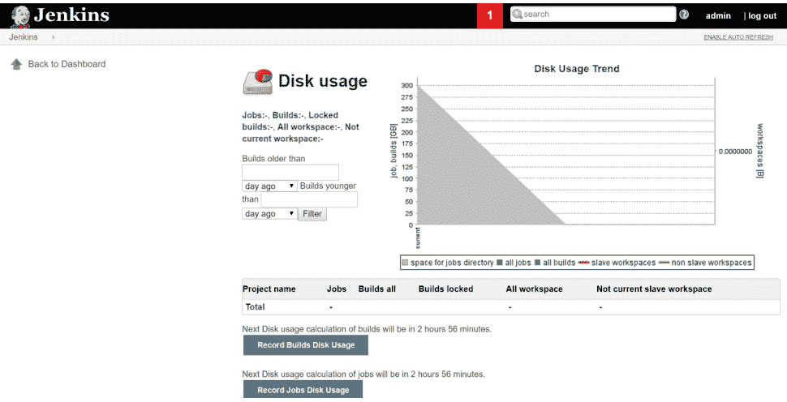

## 安全关闭 Jenkins

是否有可能停止执行新的构建，以便最终可以安全地关闭系统？让我们在下面的教程中了解。


## 准备工作

您需要拥有 Jenkins 的管理员访问权限。

## 如何操作...

1. 进入 Jenkins 仪表盘，然后 管理 Jenkins 准备关机：

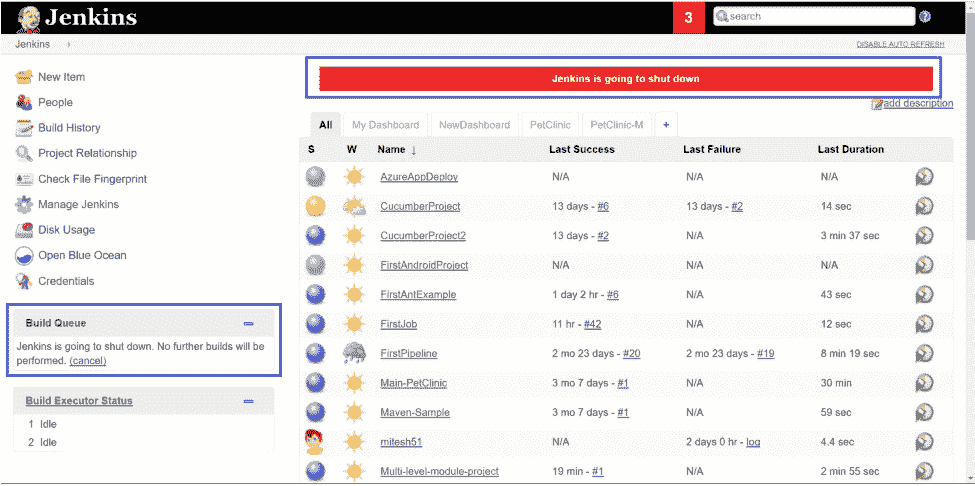

2. 再次进入 Jenkins 仪表盘，然后 管理 Jenkins 以 取消关机：


[取消关机](https://)

## 使用 JavaMelody 监控 Jenkins

JavaMelody (http://code.google.com/p/javamelody/) 是一个开源项目，提供全面的监控。Jenkins 插件同时监控 Jenkins 的主实例及其节点。插件提供大量详细的重要信息。您可以查看从 1 天或 1 周到数月的演变图表，显示主要指标，如 CPU 或内存。演变图表非常擅长定位资源消耗大的计划作业。

`Monitoring` 插件提供使用 JavaMelody 对 Jenkins 的监控。它提供 CPU、内存、系统负载平均值、HTTP 响应时间等的图表。它还提供 HTTP 会话、错误和日志、垃圾回收操作、堆转储、无效会话等详细信息。

## 准备工作

从 Jenkins 仪表盘安装 Monitoring 插件：

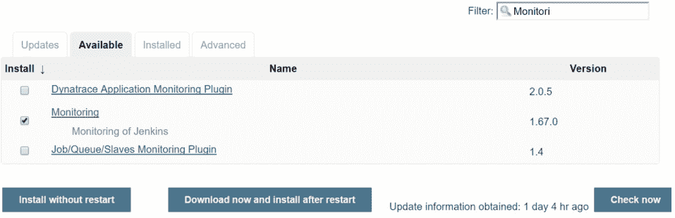

## 如何操作...

1. 在 Jenkins 仪表盘上，单击 管理 Jenkins。单击 Jenkins 主机的监控，如以下屏幕截图所示：

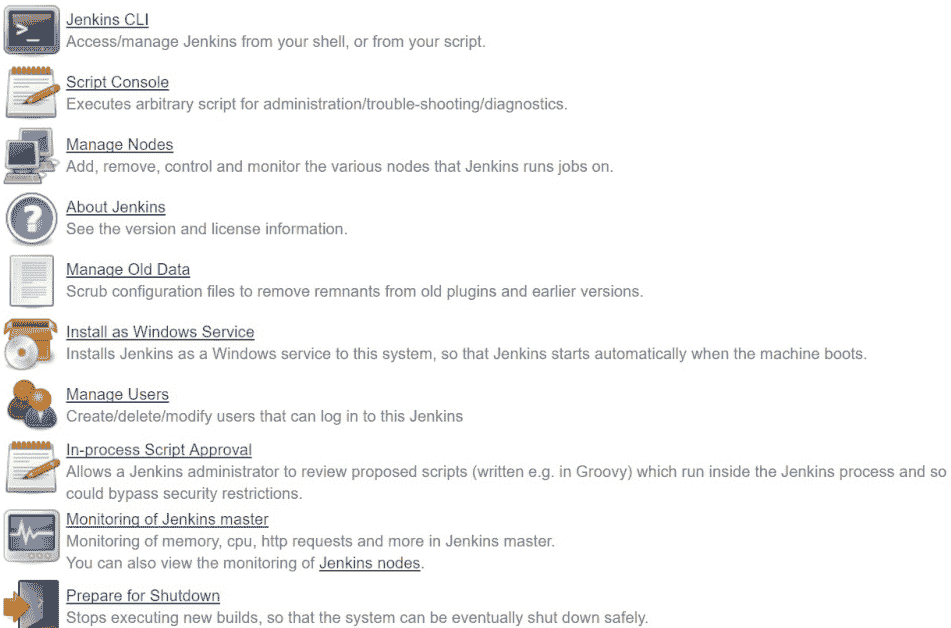

2. 它将打开 JavaMelody 监控的统计信息，如以下屏幕截图所示。观察所有统计信息：

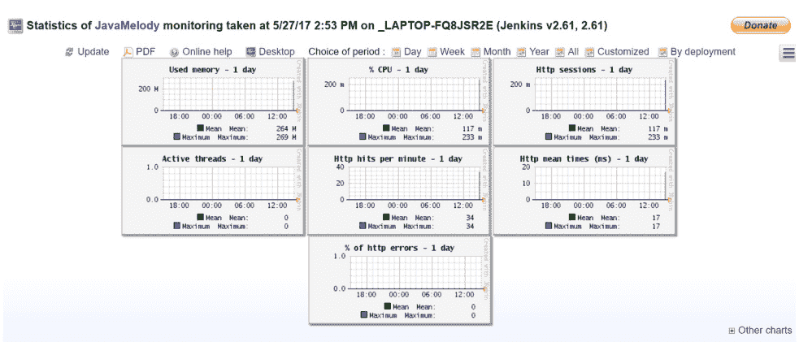

3. 单击 其他图表 并观察与垃圾回收时间相关的其他详细信息，

## 线程

LAPTOP-FQ8JSR2E@192.168.99.1 上的线程：数量 = 42，最大 = 51，已启动总数 = 789 详细信息

| 线程 | 守护进程？ | 优先级 | 状态 | 执行的方法 | Cpu 时间 (ms) | 用户时间 (ms) | Kill |
|---|---|---|---|---|---|---|---|
| Attach Listener | yes | 5 | RUNNABLE |  | 0 | 0 |  |
| AWT-Window | yes | 6 | RUNNABLE | sun.awt.windows.WToolkit.eventLoop(Native Method) | 93 | 31 |  |
| DestroyJavaVM | no | 5 | RUNNABLE |  | 3,515 | 2,203 |  |
| FilePath localPool [6d] | yes | 5 | TIMED_WAITING | sun.misc.Unsafe.park(Native Method) | 15 | 0 |  |
| Finalizer | yes | 8 | WAITING | java.lang.Object.wait(Native Method) | 328 | 109 |  |
| Handling GET monitoring from 0.0.0.0:0.1 : RequestHandlerThread[0x309] | yes | 5 | RUNNABLE | java.lang.Thread.sleep(Native Method) | 1,546 | 1,187 |  |
| [CHub]1 Selector (sun.nio.ch. gen 0) : Computer threadPoolForRemoting [9] | yes | 5 | RUNNABLE | sun.java2d.Windows.Selector$SubSelector.poll(Native Method) | 0 | 0 |  |
| Java2D Disposer | yes | 10 | WAITING | java.lang.Object.wait(Native Method) | 15 | 0 |  |
| javanotify | yes | 5 | TIMED_WAITING | java.lang.Object.wait(Native Method) | 140 | 15 |  |
| Jenkins cron thread | no | 5 | WAITING | java.lang.Object.wait(Native Method) | 0 | 0 |  |
| Jenkins UDP 33849 monitoring thread | no | 5 | RUNNABLE | sun.net.www.http.HttpClient.parseHeaders(Native Method) | 0 | 0 |  |
| jenkins.util.Timer [#10] | yes | 5 | TIMED_WAITING | sun.misc.Unsafe.park(Native Method) | 500 | 93 |  |
| jenkins.util.Timer [#1] | yes | 5 | WAITING | sun.misc.Unsafe.park(Native Method) | 359 | 125 |  |
| jenkins.util.Timer [#2] | yes | 5 | WAITING | sun.misc.Unsafe.park(Native Method) | 328 | 109 |  |
| jenkins.util.Timer [#3] | yes | 5 | WAITING | sun.misc.Unsafe.park(Native Method) | 578 | 218 |  |
| jenkins.util.Timer [#4] | yes | 5 | WAITING | sun.misc.Unsafe.park(Native Method) | 484 | 156 |  |
| jenkins.util.Timer [#5] | yes | 5 | WAITING | sun.misc.Unsafe.park(Native Method) | 328 | 156 |  |
| jenkins.util.Timer [#6] | yes | 5 | WAITING | sun.misc.Unsafe.park(Native Method) | 540 | 171 |  |
| jenkins.util.Timer [#7] | yes | 5 | WAITING | sun.misc.Unsafe.park(Native Method) | 593 | 205 |  |

Java Melody - 线程

## 更多内容...

监控是全面测试和故障排除的基础。本节探讨这些问题之间的关系以及插件中公开的度量。

## 使用 JavaMelody 故障排除 - 内存

您的 Jenkins 服务器有时会因贪婪的构建、泄漏的插件或基础设施中的某些隐藏复杂性而出现内存问题。JavaMelody 提供了全面的内存度量范围，包括堆转储和内存直方图。

Java 虚拟机将内存划分为各个区域，并通过删除没有引用其他对象的对象来清理。垃圾回收在繁忙时可能占用大量 CPU，并且越接近内存耗尽，垃圾回收就越繁忙。对外部监控代理来说，这看起来像是难以追踪的 CPU 峰值。仅仅因为垃圾收集器管理内存，并不意味着 Java 中不存在内存泄漏的可能性。内存可能因自定义缓存或调用本地库等常见做法而被保留过久。

缓慢的内存泄漏会在内存相关演变图上显示为缓慢的斜坡。如果您怀疑存在内存泄漏，则可以让插件通过 执行垃圾收集器 链接强制进行完全垃圾回收。如果不是内存泄漏，缓慢的斜坡会突然下降。

内存问题也可能表现为垃圾收集器拼命清理但几乎清理不出足够空间时的大 CPU 峰值。垃圾收集器在全面查找不再引用的对象时也会暂停应用程序（“全局停顿垃圾收集”），从而导致 Web 浏览器请求的响应时间变长。这可以通过 统计 http - 1 天 中的平均值和最大值看到。

## 使用 JavaMelody 故障排除 - 痛苦的作业

您应考虑以下几点：

- **卸载工作：** 为了获得稳定的基础设施，尽可能将尽可能多的工作从主实例卸载。如果您有计划任务，请在时间上将最重的任务分开。时间分离不仅使负载更均匀，而且还通过观察 JavaMelody 的演变图表使找到有问题的构建变得更容易。还应考虑空间分离；如果某个节点或一组标记的节点显示出问题，则开始在机器位置之间切换作业，并通过 http://host:port/monitoring/nodes 查看其各自的性能特征。
- **硬件很便宜：** 与支付人工时间相比，购买额外的 8 GB 大约相当于一个人工小时的成本。

一个常见的陷阱是向服务器添加内存，同时忘记更新初始化脚本以允许 Jenkins 使用更多内存。

- **审查构建脚本：** Javadoc 生成和自定义 Ant 脚本可以分叉 JVM 并保留在其自身配置中定义的内存。编程错误也可能是沮丧的原因。不要忘记查看 JavaMelody 关于 统计系统错误日志 和 统计 http 系统错误 的报告。
- **不要忘记外部因素：** 因素包括备份、cron 作业、更新 locate 数据库和网络维护。这些将在演变图表中显示为周期性模式。
- **数量的力量：** 将 JavaMelody 与磁盘使用插件等结合使用，以保持对重要统计数据的全面概述。每个插件都易于配置，但它们对您的用处将比添加额外插件的维护成本增长得更快。

## 使用构建监控视图监控 Jenkins 作业

`Build Monitor` 插件提供所选 Jenkins 作业的状态和进度的可视化。它使用 AJAX 每隔几秒自动显示更新的视图。它也可以轻松适应不同的计算机屏幕尺寸。


### 准备工作

转到“系统管理”|“插件管理”|“可选插件”选项卡。安装 Build Monitor View 插件：

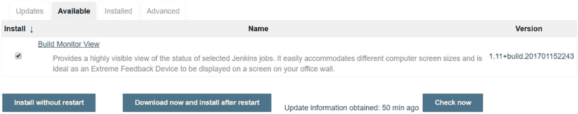

转到 Jenkins 仪表盘。

### 如何操作...

- 1. 点击“新建视图”：

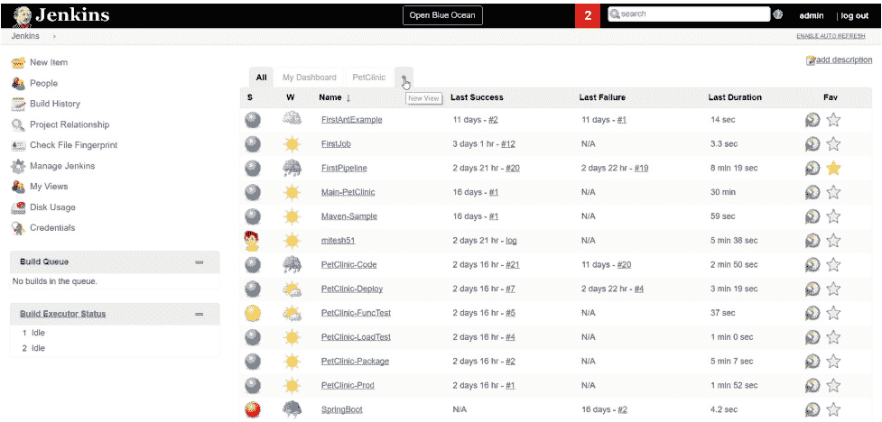

Jenkins 仪表盘 - 创建新视图

- 2. 提供视图名称并选择 Build Monitor View。点击“确定”：

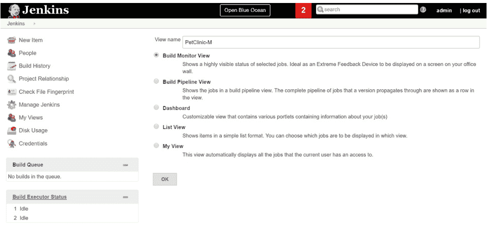

- 3. 选择要在新建的 Build Monitor View 中显示的作业。点击“保存”：
- 4. 在 Jenkins 仪表盘上验证 Build Monitor View 的状态：

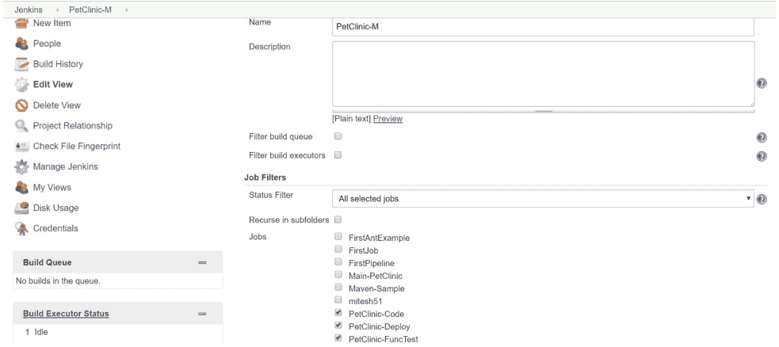

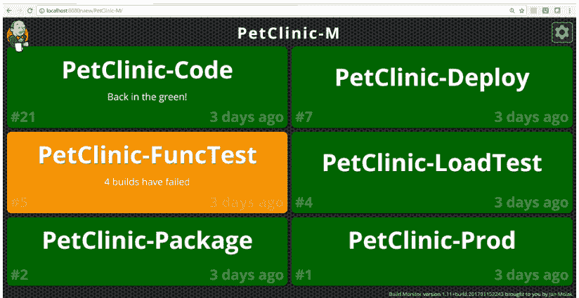

在单个窗口中，我们可以获取多个作业的状态。

## 配置邮件通知

当构建成功或失败时，发送一封邮件通知怎么样？

### 准备工作

了解何时出现问题至关重要，这样我们才能及时采取纠正措施。你需要在 Jenkins 中配置邮件通知时拥有一个电子邮件账户以及 SMTP 详细信息。

### 如何操作...

- 1. 转到“系统管理”，并进入“邮件通知”部分。根据电子邮件账户提供所有必要的详细信息：

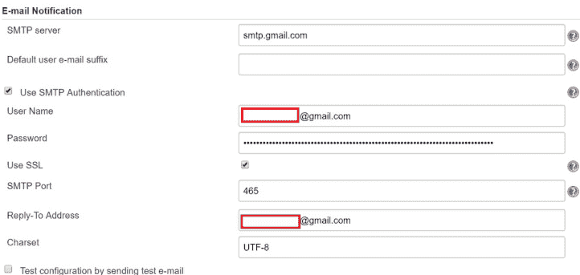

- 2. 在要配置邮件通知的构建作业中，转到“构建后操作”并选择“邮件通知”。提供收件人列表，并选中其中一个复选框：

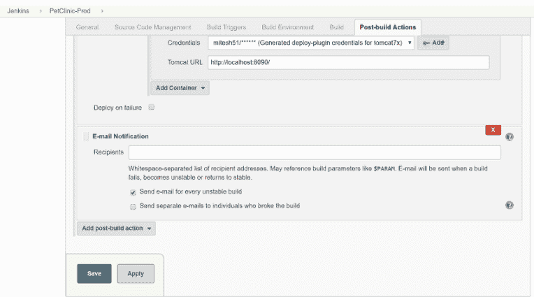

- 3. 转到 Jenkins 构建作业的“构建后操作”，选择“可编辑邮件通知”以向收件人发送更多自定义电子邮件：

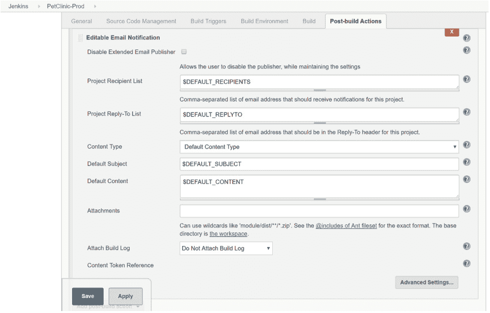

- 4. 这样即可配置邮件通知。

## 提示需要归档

每个开发团队都是独特的。团队有自己的做事方式。在许多组织中，有一些需要定期完成的一次性任务。例如，在每年年底，对整个文件系统进行完整备份。

本方案详细介绍了一个脚本，该脚本检查任何作业的最后一次成功运行；如果年份与当前年份不同，则在作业描述的开头设置一条警告。因此，这提示你是时候执行某个操作了，例如归档然后删除。当然，你可以通过编程方式执行归档。但是，对于高价值操作，值得强制干预，让 Groovy 脚本引起你的注意。

### 如何操作...

- 1. 在“系统管理”页面中，点击“脚本控制台”链接并运行以下脚本：
- 2. 在“脚本控制台”中提供脚本并点击“运行”：

```groovy
def warning='[You can ARCHIVE this Job]'
def now=new Date()

for (job in hudson.model.Hudson.instance.items) {
println "\nName: ${job.name}"
Run lastSuccessfulBuild = job.getLastSuccessfulBuild()
if (lastSuccessfulBuild != null) {
def time = lastSuccessfulBuild.getTimestamp().getTime()
if (now.year.equals(time.year)){
println("Project has same year as build");
}else {
if (job.description.startsWith(warning)){
println("Description has already been changed");
}else{
job.setDescription("${warning}")
}
}
}
}
```

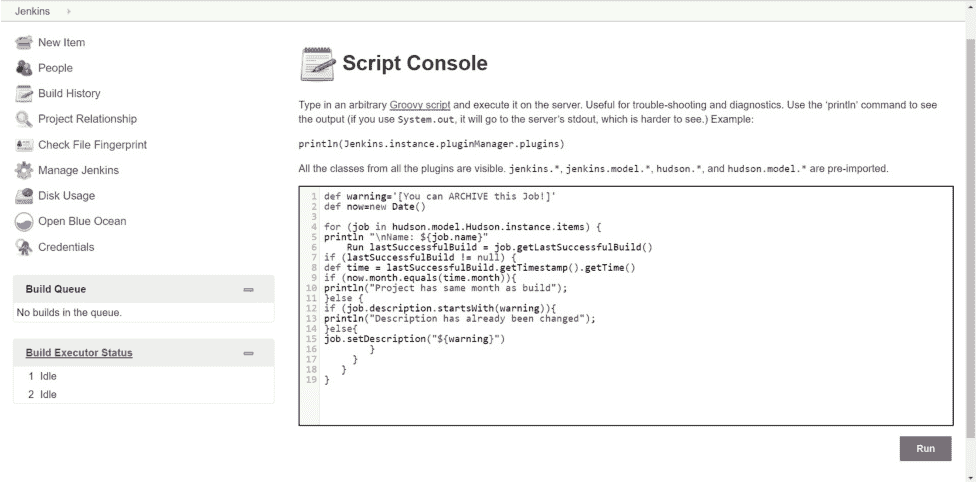

- 3. 脚本成功执行后，将根据你的 Jenkins 中可用的构建作业给出输出。以下是示例输出：

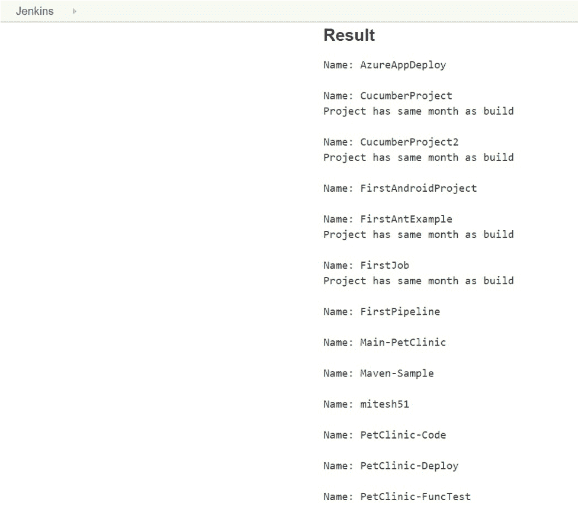

- 4. 任何最后一个成功构建不是在今年的项目，其描述中都会添加“你可以归档此作业”，如下面的截图所示：

项目 PetClinic-Deploy

[你可以归档此作业！]

返回仪表盘

- 状态
- 更改
- 工作区
- 立即构建
- 删除项目
- 配置
- 打开 Blue Ocean

构建历史

- #7 2017年6月4日 下午5:38 5 KB
- #6 2017年6月4日 下午12:01 5 KB
- #5 2017年6月4日 上午11:44 5 KB
- #4 2017年6月4日 上午11:39 4 KB
- #3 2017年6月4日 上午11:25 5 KB

工作区

最近的更改

磁盘使用情况

| 项目 | 使用量 |
| --- | --- |
| 作业 | 32 KB |
| 所有构建 | 32 KB |
| 锁定的构建 | - |
| 所有工作区 | 40 MB |
| 从工作区 | - |
| 非从工作区 | 40 MB |

磁盘使用趋势

下游项目

PetClinic-FuncTest

固定链接

- 5. 点击“配置”以查看描述：

常规

源代码管理

构建触发器

构建环境

构建

构建后操作

项目名称

PetClinic-Deploy

描述

[你可以归档此作业！]

[纯文本] 预览

- 丢弃旧的构建
- GitHub 项目
- 允许复制构件
- 何时提升构建...
- 此项目已参数化
- 节流构建
- 为运行准备环境
- 禁用此项目

保存

应用

高级...

### 工作原理...

让我们看看脚本是如何执行的：

- 定义了一个警告字符串，并存储了当前日期。通过 `for` 语句以编程方式遍历 Jenkins 中的每个作业。
- Jenkins 有一个类来存储构建运行信息。通过 `job.getLastSuccessfulBuild()` 获取运行时信息，并存储在 `lastSuccessfulBuild` 实例中。如果没有发生成功构建，则 `lastSuccessfulBuild` 设置为 null；否则，它包含运行时信息。
- 通过 `lastSuccessfulBuild.getTimestamp().getTime()` 获取最后一次成功构建的时间，并将其存储在 `time` 实例中。

将当前年份与最后一次成功构建的年份进行比较，如果它们不同且警告字符串尚未添加到作业描述的开头，则更新描述。

Javadoc：

你将在 [http://javadoc.jenkins-ci.org/hudson/model/Job.html](http://javadoc.jenkins-ci.org/hudson/model/Job.html) 找到作业 API，并在 [http://javadoc.jenkins-ci.org/hudson/model/Run.html](http://javadoc.jenkins-ci.org/hudson/model/Run.html) 找到运行信息。
