## 安全管理

在本章中，我们将介绍以下方案：

- 通过 Jenkins 配置提高安全性
- 配置授权 - 基于矩阵的安全性
- 配置基于项目的矩阵授权策略
- Jenkins 与 OpenLDAP 集成
- Jenkins 与 Active Directory 集成
- Jenkins 与 OWASP Zed Attack Proxy 集成
- 测试 OWASP 十大安全问题
- 通过模糊测试发现 Jenkins 中的 500 错误和 XSS 攻击
- 使用 JCaptcha 避免注册机器人

### 简介

在本章中，我们将讨论 Jenkins 的安全性，考虑到 Jenkins 可以运行在各种各样的基础设施中。我们还将研究如何扫描 Jenkins 编译的 Java 代码所用库中的已知安全问题。

唯一完全安全的系统是不存在的系统。对于真实服务，你需要注意不同可攻击面。Jenkins 的主要攻击面是其基于 Web 的图形用户界面，以及它与从节点和本地操作系统之间的信任关系。在线服务需要对其安全面给予高度重视。对于 Jenkins，主要有三个原因：

- Jenkins 能够通过其插件或主从拓扑与各种基础设施进行通信
- 插件的代码变更速度很快，并且容易意外包含与安全相关的缺陷
- 你需要加固默认安装

另一个积极因素是，Jenkins 代码可免费供人审查，核心社区也时刻保持警惕。

### 通过 Jenkins 配置提高安全性

在本节中，我们将介绍如何管理多个用户。


## 准备工作

通过用户管理，我们可以为多个用户提供对 Jenkins 的访问权限，并在需要时根据项目提供基于角色的访问权限。Manage Users 仅在所选的安全域为 Jenkins 自有用户数据库时才会出现。

- 1. 进入 Manage Jenkins 并点击 Manage Users：

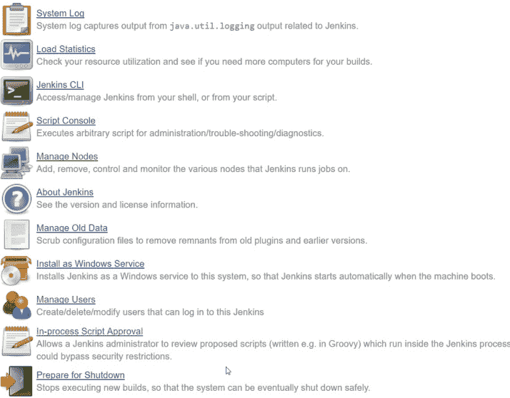

- 2. 验证 Jenkins 中可用的现有管理员用户：

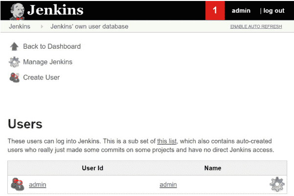

- 3. 点击 Create User 链接并提供详细信息：

4. 在 Manage Jenkins | Manage Users 中验证用户列表：

## 用户

这些用户可以登录 Jenkins。这是一个子集，其中还包含自动创建的用户，他们只是对某些项目进行了提交，没有直接的 Jenkins 访问权限。

| User Id | Name |
|---|---|
| admin | admin |
| Shreyansh | Shreyansh Soni |

您可以在 Manage Jenkins | Manage Users 中更改或删除用户。

## 如何操作...

- 1. 要允许注册并仅允许已登录用户访问，请进入 Manage Jenkins | Configure Global Security。
- 2. 在 Access Control 部分，点击 Jenkins' own user database 并选择 Allow users to sign up：

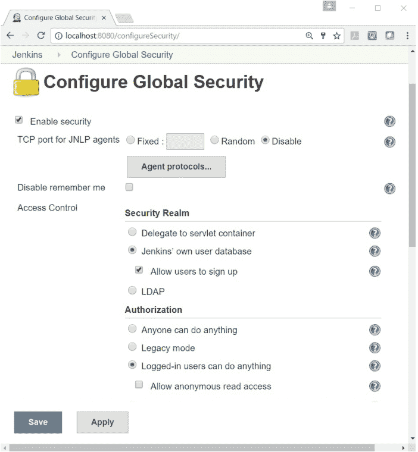

- 3. 因此，我们可以创建用户并允许用户注册，以及访问 Jenkins。

## 如何操作...

- 1. 输入我们新创建的用户名，点击 Add，并提供所有必需的权限。我们可以对不同用户执行相同的操作。
- 2. 点击 Save：

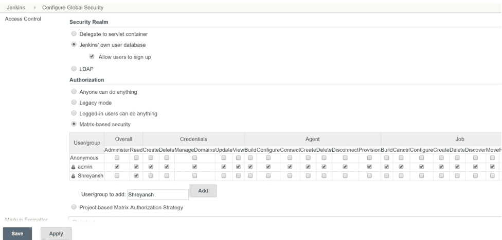

- 3. 为验证访问权限，在浏览器中打开一个新隐身窗口并使用新创建用户的用户名和密码登录：

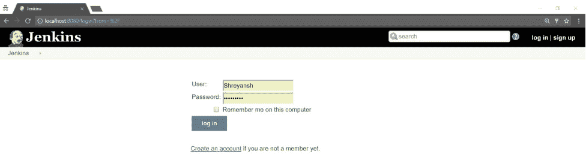

- 4. 验证新用户可用的有限访问权限。New Item 和 Manage Jenkins 链接不可用：

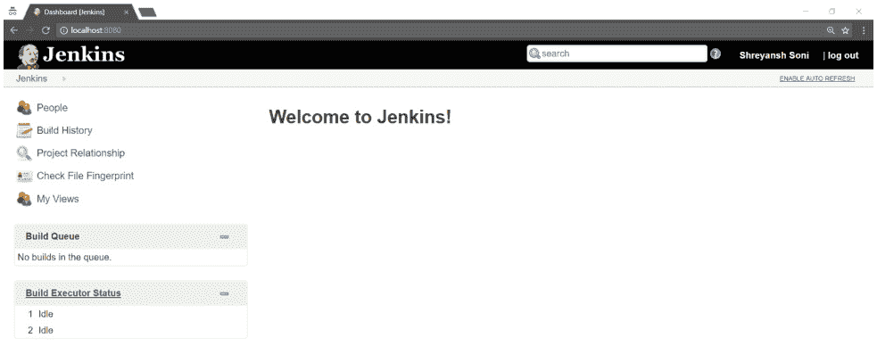

5. 现在进入 Manage Jenkins | Global Security Configuration。为用户 Shreyansh 在 Job 类别中允许 Read 权限。

6. 点击 Save：

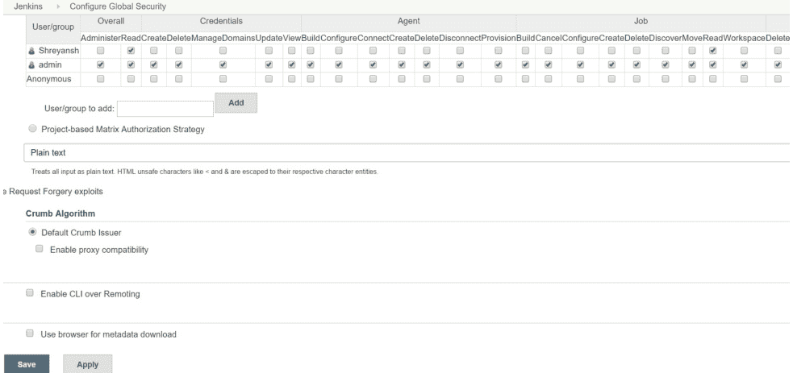

7. 进入之前打开的隐身窗口并刷新页面。现在我们可以在 Jenkins 中读取可用的作业：

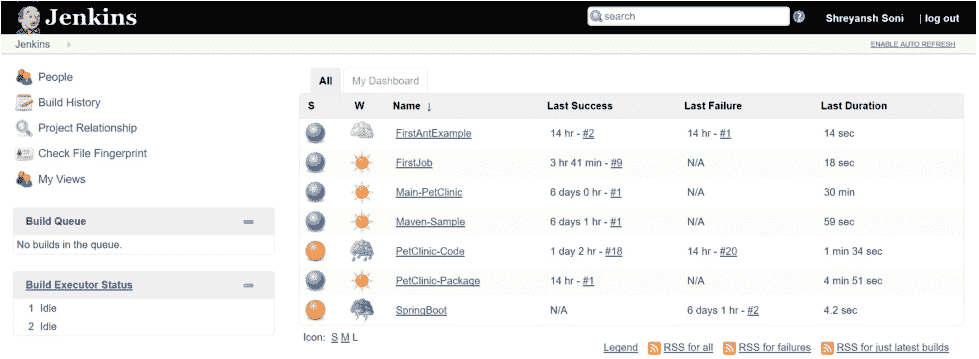

8. 我们可以看到作业，但由于没有权限，无法执行它们：

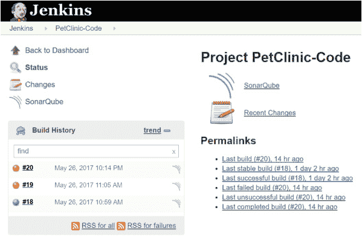

9. 这就是我们在 Jenkins 中管理用户和授权的方式。在下一节中，我们将学习如何进行基于项目的访问。

## 准备工作

进入 Manage Jenkins | Global Security Configuration。

## 如何操作...

- 1. 在 Authorization 部分，选择 Project-based Matrix Authorization Strategy。
- 2. 为 admin 授予所有权限并保存：

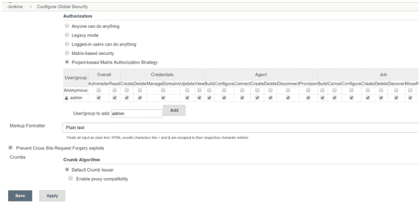

- 3. 进入使用 Shreyansh 凭据登录的隐身窗口。
- 4. 刷新页面，我们将收到 Access Denied。原因是我们尚未在 Project-based Matrix Authorization Strategy 中为 Shreyansh 授予任何权限：

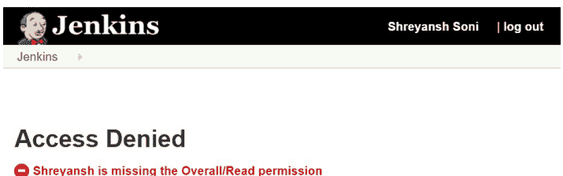

## Access Denied

Shreyansh is missing the Overall/Read permission

- 5. 我们需要提供总体 Read 权限，以便 Shreyansh 可以访问 Jenkins 仪表板：

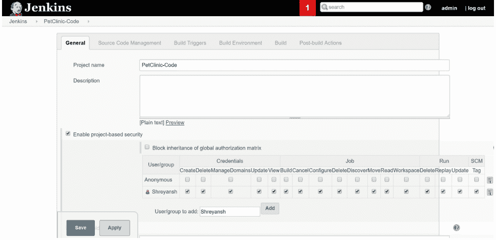

6. 现在以管理员身份进入单个构建作业，并在作业配置页面中选择 Enable project-based security。

7. 添加 Shreyansh 作为用户并点击 Save：

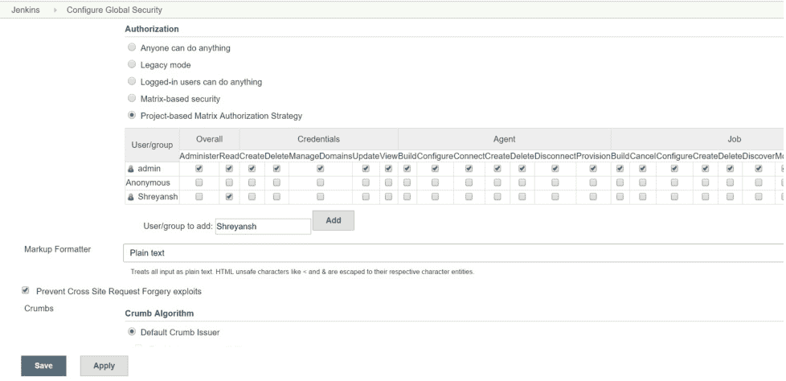

- 8. 现在进入 Shreyansh 已登录的隐身窗口并刷新页面。
- 9. 我们可以看到一个作业，我们已配置为授予 Shreyansh 访问权限：

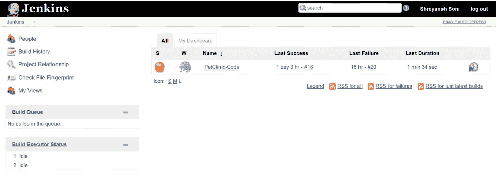

10. 点击构建并验证用户 Shreyansh 可用的所有权限：

## Project PetClinic-Code

Back to Dashboard

Status

Changes

Workspace

Build Now

Delete Project

Configure

SonarQube

## Build History

#20
May 26, 2017 10:14 PM

#19
May 26, 2017 11:05 AM

#18
May 26, 2017 10:59 AM

SonarQube

Workspace

Recent Changes

## Permalinks

- - Last build (#20), 16 hr ago
- - Last stable build (#18), 1 day 3 hr ago
- - Last successful build (#18), 1 day 3 hr ago
- - Last failed build (#20), 16 hr ago
- - Last unsuccessful build (#20), 16 hr ago
- - Last completed build (#20), 16 hr ago

现在我们已完成 Jenkins 中用户管理、基于角色的访问和基于项目的访问，作为保护 Jenkins 的一部分。

## Jenkins 和 OpenLDAP 集成

**Lightweight Directory Access Protocol (LDAP)** 提供了一种非常流行的开放标准目录服务。它被许多组织用于向世界展示用户信息。LDAP 也用作中央服务来保存用于身份验证的用户密码，并且可以包含用于邮件路由、POSIX 账户管理以及外部系统可能需要的各种其他信息。Jenkins 可以直接连接到 LDAP 进行身份验证，或间接通过 CAS SSO 服务器（[http://www.jasig.org/cas](http://www.jasig.org/cas)）进行连接，后者然后使用 LDAP 作为其密码容器。Jenkins 还具有一个邮件插件（[https://wiki.jenkins-ci.org/display/JENKINS/LDAP+Email+Plugin](https://wiki.jenkins-ci.org/display/JENKINS/LDAP+Email+Plugin)），可从 LDAP 中提取其路由信息。

由于 LDAP 是一种常见的企业服务，Jenkins 在作为构建应用程序测试基础设施的一部分运行集成测试时也可能会遇到 LDAP。

本教程展示了如何快速安装名为 slapd 的 OpenLDAP 服务器，然后通过 **LDAPData Interchange Format (LDIF)** 添加组织、用户和组，LDIF 是一种用于存储 LDAP 记录的简单文本格式（[http://en.wikipedia.org/wiki/LDAP_Data_Interchange_Format](http://en.wikipedia.org/wiki/LDAP_Data_Interchange_Format)）。

Active Directory 在企业环境中也很流行。Jenkins 有一个 Active Directory 插件（[https://wiki.jenkins-ci.org/display/JENKINS/Active+Directory+plugin](https://wiki.jenkins-ci.org/display/JENKINS/Active+Directory+plugin)）。

## 准备工作

对于本教程，您将在 Ubuntu 14.04 LTS 或更新版本上安装 OpenLDAP。您可以使用 VirtualBox 或 VMware Workstation 创建虚拟机。

在这里，Ubuntu 虚拟机是在 Microsoft Azure 中创建的。您可以为 Microsoft Azure 设置免费试用账户并尝试此操作：

- 1. 在左侧边栏中点击 Virtual Machines 并点击 Add。选择 Ubuntu Server 14.04 LTS 并点击 Create：

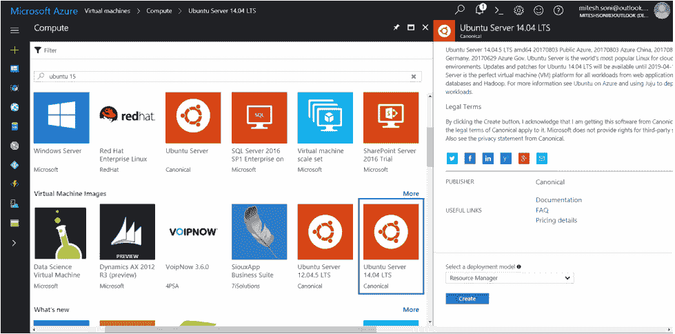

- 2. 提供虚拟机的 Name、User name、Password、Subscription 和 Resource group name。
- 3. 选择 Location。
- 4. 点击 OK：

## Microsoft Azure

Virtual machines > Compute > Ubuntu Server 14.04 LTS > Create virtual machine > Basics

### Create virtual machine

### Basics

- 1 Basics
Configure basic settings

- 2 Size
Choose virtual machine size

- 3 Settings
Configure optional features

- 4 Purchase
Ubuntu Server 14.04 LTS

* Name
myopenldap
VM disk type
SSD
* User name
mitesh51
* Authentication type
SSH public key Password
* Password
********
* Confirm password
********
Subscription
Visual Studio Enterprise with MSDN
* Resource group
Create new Use existing
JenkinsCookBook
Location
OK

5. 选择 Choose virtual machine size：

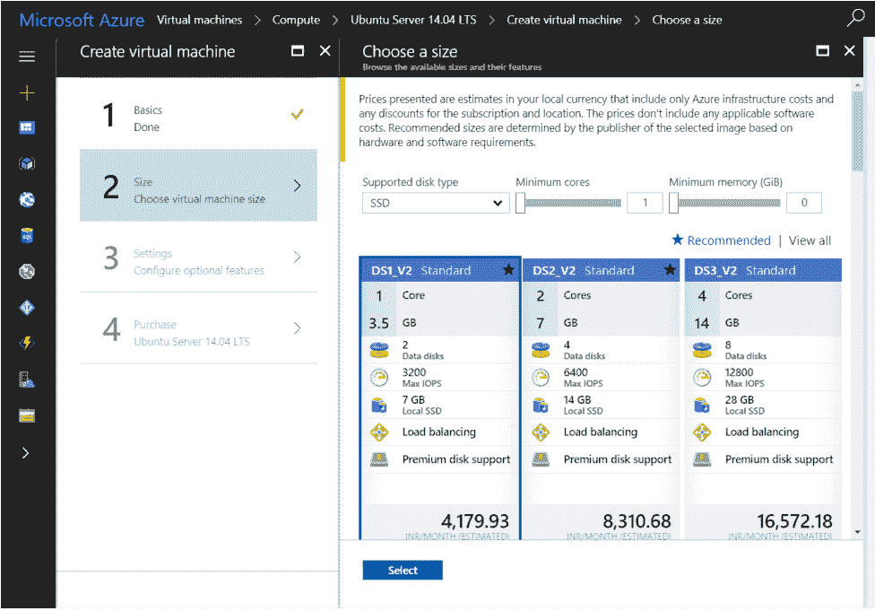

6. 保持默认设置：

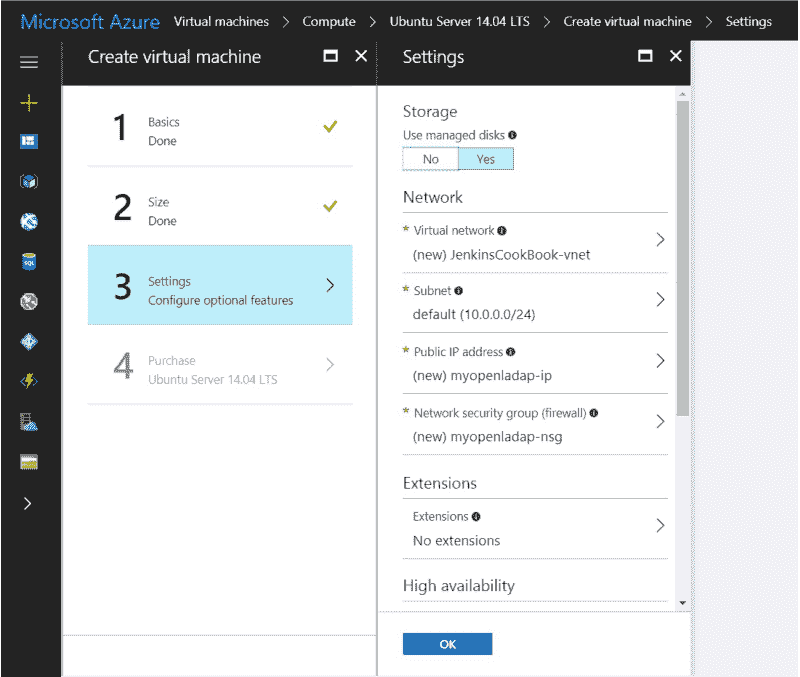

7. 在下一个窗格中点击 Purchase。注意分配的 IP 地址：

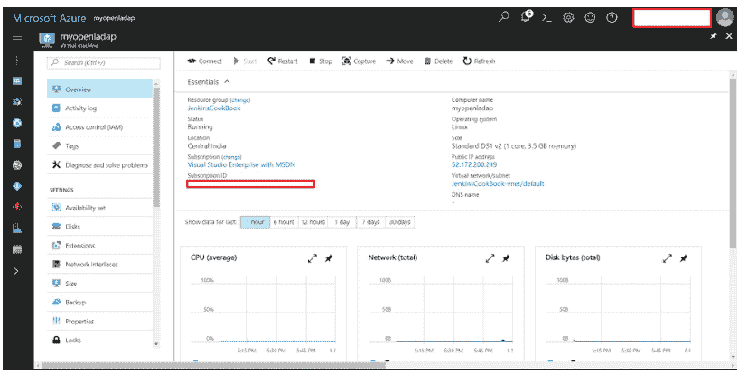

Virtual Machine in Microsoft Azure

8. 打开 PuTTY 以远程访问您创建的 Ubuntu 虚拟机：

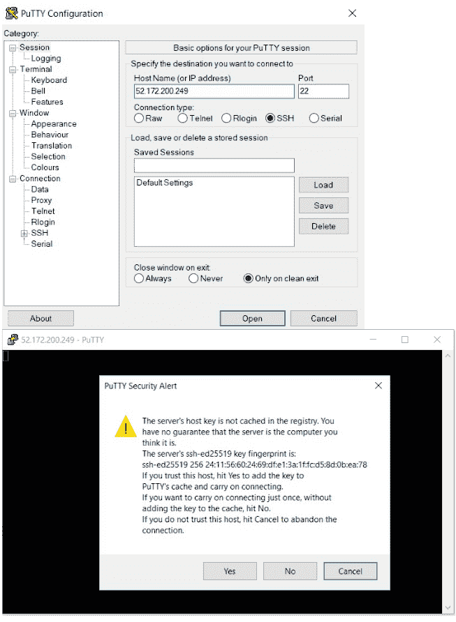


15. 确认 LDAP 目录中 admin 条目的管理员密码：

16. 在“是否省略 OpenLDAP 服务器配置？”中选择“否”：

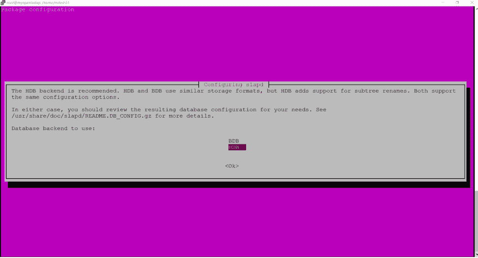

21. 在“是否在清除 slapd 软件包时移除数据库？”中选择“否”：

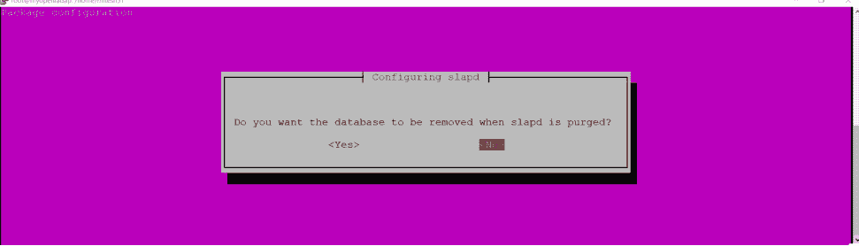

22. 在“移动旧数据库”对话框中选择“是”：

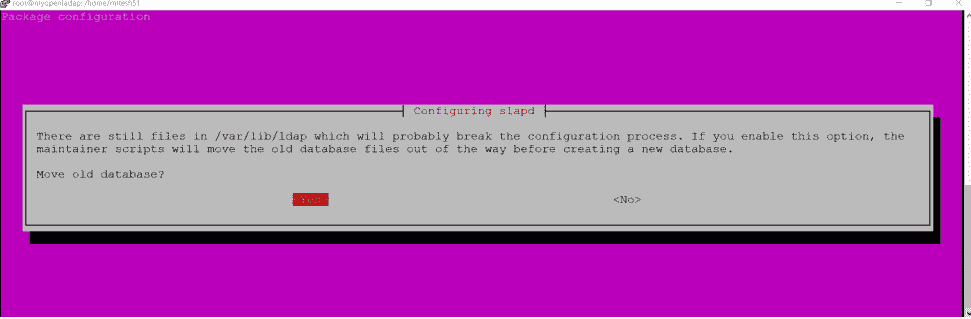

23. 在“是否允许 LDAPv2 协议？”中选择“否”：

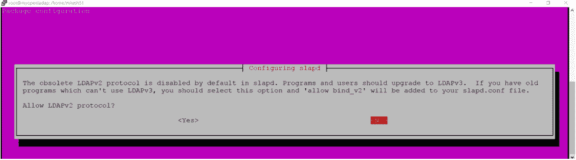

24. 完成所有配置后，安装过程即告完成。

```
Creating initial configuration... done.
Creating LDAP directory... done.
* Starting OpenLDAP slapd [ OK ]
Setting up ldap-utils (2.4.31-1+nmu2ubuntu8.4) ...
Processing triggers for libc-bin (2.19-0ubuntu6.13) ...
Processing triggers for ufw (0.34~rc-0ubuntu2) ...
Processing triggers for ureadahead (0.100.0-16) ...
root@myopenldap:/home/mitesh51#
root@myopenldap:/home/mitesh51# sudo dpkg-reconfigure slapd
* Stopping OpenLDAP slapd [ OK ]
Moving old database directory to /var/backups:
- directory unknown... done.
Creating initial configuration... done.
Creating LDAP directory... done.
* Starting OpenLDAP slapd [ OK ]
Processing triggers for libc-bin (2.19-0ubuntu6.13) ...
root@myopenldap:/home/mitesh51#
```

你将安装 PHPldapadmin 来管理 OpenLDAP。在 PuTTY 控制台中使用命令 sudo apt-get install phpldapadmin 进行安装：

```
root@myopenldap:/home/mitesh51# sudo apt-get install phpldapadmin
Reading package lists... Done
Building dependency tree
Reading state information... Done
The following extra packages will be installed:
apache2-bin apache2-data libapache2-mod-php5 libapr1 libaprutil1
libaprutil1-dbd-sqlite3 libaprutil1-ldap php5-cli php5-common php5-json
php5-ldap php5-readline ssl-cert
Suggested packages:
apache2-doc apache2-suexec-pristine apache2-suexec-custom apache2-utils
php-pear php5-user-cache openssl-blacklist
The following new packages will be installed:
apache2-bin apache2-data libapache2-mod-php5 libapr1 libaprutil1
libaprutil1-dbd-sqlite3 libaprutil1-ldap php5-cli php5-common php5-json
php5-ldap php5-readline phpldapadmin ssl-cert
0 upgraded, 15 newly installed, 0 to remove and 0 not upgraded.
Need to get 6,881 kB of archives.
After this operation, 30.9 MB of additional disk space will be used.
Do you want to continue? [Y/n] Y
Get:1 http://azure.archive.ubuntu.com/ubuntu/ trusty/main libapr1 amd64 1.5.0-1 [85.1 kB]
Get:2 http://azure.archive.ubuntu.com/ubuntu/ trusty/main libaprutil1 amd64 1.5.3-1 [76.4 kB]
Get:3 http://azure.archive.ubuntu.com/ubuntu/ trusty/main php5-json amd64 1.3.2-2build1 [34.4 kB]
Get:4 http://azure.archive.ubuntu.com/ubuntu/ trusty-updates/main php5-common amd64 5.5.9+dfsg-1ubuntu4.22 [449 kB]
Get:5 http://azure.archive.ubuntu.com/ubuntu/ trusty-updates/main php5-ldap amd64 5.5.9+dfsg-1ubuntu4.22 [19.1 kB]
Get:6 http://azure.archive.ubuntu.com/ubuntu/ trusty-updates/main php5-cli amd64 5.5.9+dfsg-1ubuntu4.22 [2,154 kB]
Get:7 http://azure.archive.ubuntu.com/ubuntu/ trusty-updates/main php5-readline amd64 5.5.9+dfsg-1ubuntu4.22 [12.1 kB]
Get:8 http://azure.archive.ubuntu.com/ubuntu/ trusty/main libaprutil1-dbd-sqlite3 amd64 1.5.3-1 [10.5 kB]
Get:9 http://azure.archive.ubuntu.com/ubuntu/ trusty/main libaprutil1-ldap amd64 1.5.3-1 [8,634 B]
```

```
Get:10 http://azure.archive.ubuntu.com/ubuntu/ trusty-updates/main apache2-bin amd64 2.4.7-1ubuntu4.17 [845 kB]
Get:11 http://azure.archive.ubuntu.com/ubuntu/ trusty-updates/main apache2-data all 2.4.7-1ubuntu4.17 [160 kB]
Get:12 http://azure.archive.ubuntu.com/ubuntu/ trusty-updates/main apache2 amd64 2.4.7-1ubuntu4.17 [87.4 kB]
Get:13 http://azure.archive.ubuntu.com/ubuntu/ trusty-updates/main libapache2-mod-php5 amd64 5.5.9+dfsg-1ubuntu4.22 [2,194 kB]
Get:14 http://azure.archive.ubuntu.com/ubuntu/ trusty/main ssl-cert all 1.0.33 [16.6 kB]
Get:15 http://azure.archive.ubuntu.com/ubuntu/ trusty-updates/universe phpldapadmin all 1.2.2-5ubuntu1.1 [730 kB]
Fetched 6,881 kB in 5s (1,305 kB/s)
Preconfiguring packages ...
Selecting previously unselected package libapr1:amd64.
(Reading database ... 29206 files and directories currently installed.)
Preparing to unpack .../libapr1_1.5.0-1_amd64.deb ...
Unpacking libapr1:amd64 (1.5.0-1) ...
...
Processing triggers for man-db (2.6.7.1-1ubuntu2) ...
Processing triggers for ureadahead (0.100.0-16) ...
Processing triggers for ufw (0.34~rc-0ubuntu2) ...
Setting up libapr1:amd64 (1.5.0-1) ...
Setting up libaprutil1:amd64 (1.5.3-1) ...
...
Setting up apache2 (2.4.7-1ubuntu4.17) ...
Enabling module mpm_event.
.
.
Enabling site 000-default.
* Starting web server apache2
AH00558: apache2: Could not reliably determine the server's fully qualified domain name, using 10.0.0.4. Set the 'ServerName' directive globally to suppress this message
*
Setting up ssl-cert (1.0.33)
sent invalidate(group) request, exiting
.
Setting up php5-common (5.5.9+dfsg-1ubuntu4.22) ...

Creating config file /etc/php5/mods-available/pdo.ini with new version
php5_invoke: Enable module pdo for apache2 SAPI
php5_invoke: Enable module pdo for cli SAPI
.
.
Enabling module mpm_prefork.
apache2_switch_mpm Switch to prefork
* Restarting web server apache2
AH00558: apache2: Could not reliably determine the server's fully qualified domain name, using 10.0.0.4. Set the 'ServerName' directive globally to suppress this message
[ OK ]
apache2_invoke: Enable module php5
* Restarting web server apache2
AH00558: apache2: Could not reliably determine the server's fully qualified domain name, using 10.0.0.4. Set the 'ServerName' directive globally to suppress this message
[ OK ]
Processing triggers for libc-bin (2.19-0ubuntu6.13) ...
root@myopenldap:/home/mitesh51#
```

以编辑模式打开 `/etc/phpldapadmin/config.php`，并更新以下内容：

- `$servers->setValue('server','host','52.172.200.249')` 设置为所创建虚拟机的 IP 地址
- `$servers->setValue('server','base',array('dc=jenkinscookbook,dc=net'));`
- `$servers->setValue('login','bind_id','cn=admin,dc=jenkinscookbook,dc=net');`
- `$config->custom->appearance['hide_template_warning'] = true;`

转到创建虚拟机时所在的资源组。找到网络安全组。

单击“添加入站安全规则”，然后添加 HTTP 规则：

## 添加入站安全规则

Microsoft Azure myopenladap-nsg - 入站安全规则 > 添加入站安全规则

myopenladap-nsg

高级

* 名称
HTTP
* 优先级
1010
* 源
任何 CIDR 块 标记
服务
HTTP
* 协议
任意 TCP UDP
* 端口范围
80
* 操作
拒绝 允许
确定

同时添加 Ping 命令，以便我们可以测试虚拟机的 IP 地址是否可访问：

这是 phpLDAPadmin 的 Web 界面：

单击域组件以查看你正在使用的登录账号：

现在你需要添加组织单位、组和用户。单击“在此创建新条目”。选择“Generic: Organizational Unit”模板：

输入 groups 并单击“创建对象”：

单击“提交”：

选择新创建的组织单位并验证内容：

[195]

同样，在组织单位中创建用户：

在 phpldapadmin Web 界面中提交并验证对象：

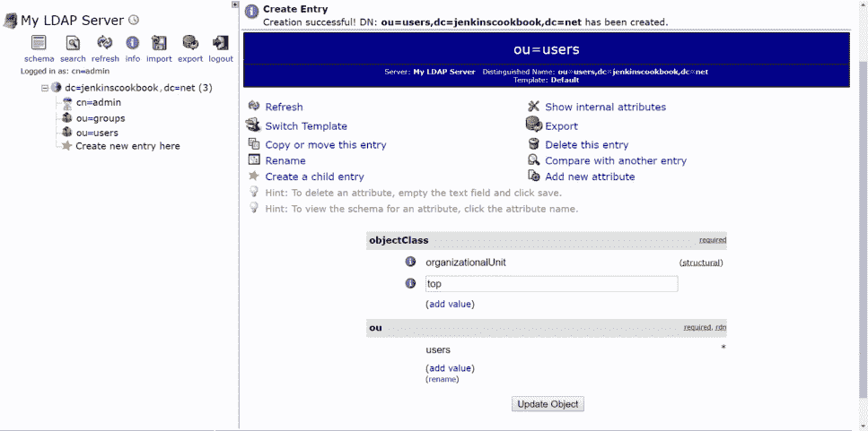

现在，你需要在 groups 中创建具体的组。选择 groups 并单击“创建子条目”：

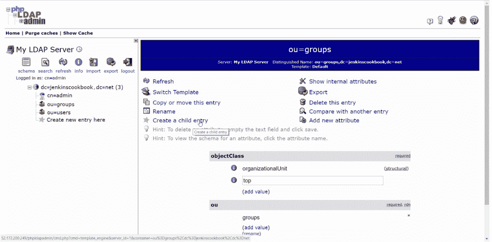

选择“Generic: Posix Group”：

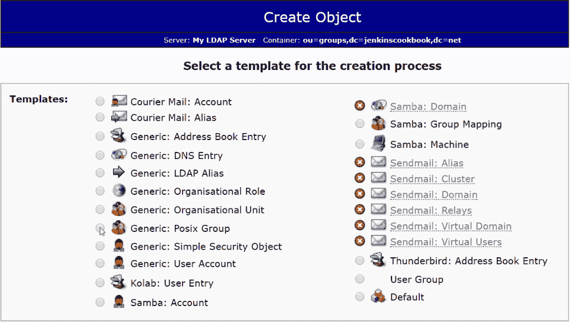

输入组名并单击“创建对象”：

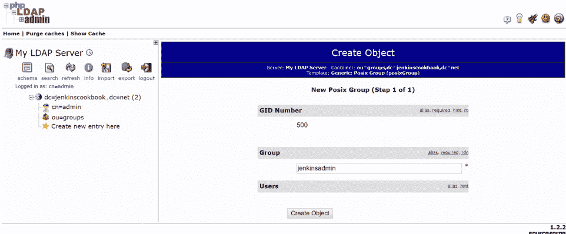

提交更改：

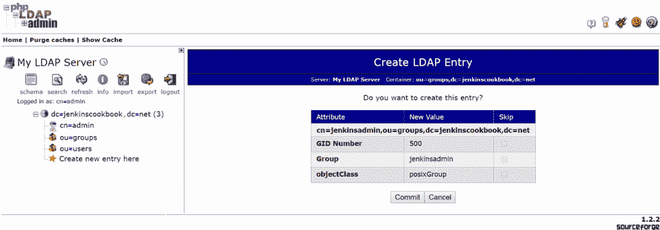

同样，创建 jenkinsusers 组：

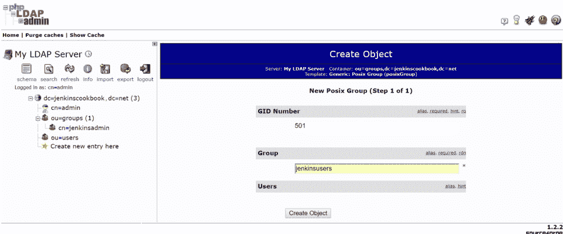

在 phpldapadmin Web 界面中验证这两个组：

[199]


## 搜索结果

服务器：我的 LDAP 服务器
查询：默认

ou=groups,dc=jenkinscookbook,dc=net

找到条目数：2
（0.01 秒）

基础 DN：ou=groups,dc=jenkinscookbook,dc=net
执行的过滤器：objectClass=*

cn=jenkinsadmin
dn: cn=jenkinsadmin,ou=groups,dc=jenkinscookbook,dc=net
cn: jenkinsadmin
gidNumber: 500
objectClass: posixGroup
objectClass: top

cn=jenkinsusers
dn: cn=jenkinsusers,ou=groups,dc=jenkinscookbook,dc=net
cn: jenkinsusers
gidNumber: 501
objectClass: posixGroup
objectClass: top

## ou=users

服务器：我的 LDAP 服务器
专有名称：ou=users,dc=jenkinscookbook,dc=net
模板：默认

- 刷新
- 切换模板
- 复制或移动此条目
- 重命名
- 创建子条目

- 显示内部属性
- 导出
- 删除此条目
- 与其他条目比较
- 添加新属性

提示：要创建子条目，请清空文本字段并点击保存。
提示：要查看属性的模式，请点击属性名称。

objectClass
必填
organizationalUnit（结构类型）
top
（添加值）

ou
必填，添加
users
（添加值）

现在该创建用户了。点击“在此创建新条目”。

选择“通用：用户账户”：

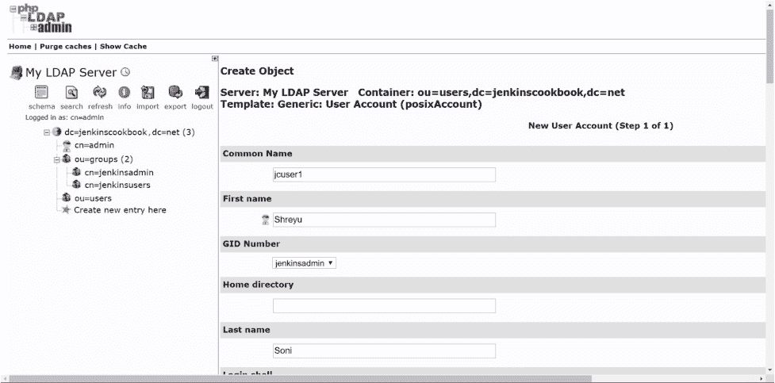

如果在 `phpldapadmin` 中创建通用用户账户时在设置密码字段时遇到错误，请以编辑模式打开 `/usr/share/phpldapadmin/lib/TemplateRender.php`，并在第 2469 行将 `password_hash` 改为 `password_hash_custom`：

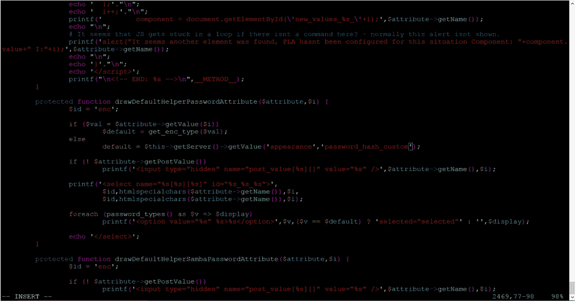

提供密码和用户 ID 详细信息，然后点击“创建对象”：

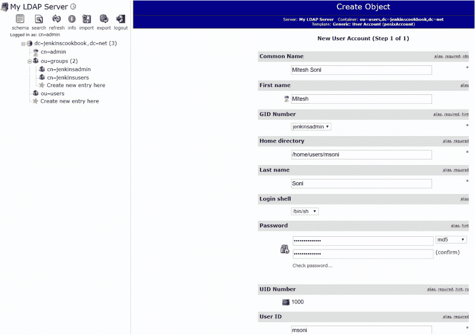

点击“提交”：

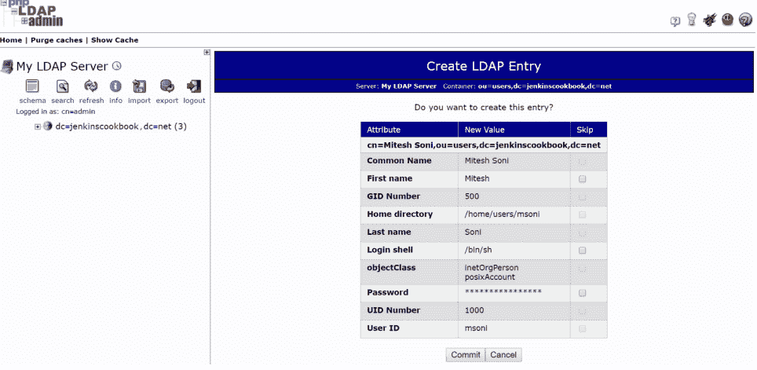

同样，创建另一个用户 ID 为 `ssoni` 的用户：

## 创建 LDAP 条目

是否要创建此条目？

| 属性 | 新值 | 跳过 |
|---|---|---|
| cn=Shreyu Soni,ou=users,dc=jenkinscookbook,dc=net |  |  |
| 通用名称 | Shreyu Soni |  |
| 名 | Shreyu |  |
| GID 编号 | 501 |  |
| 主目录 | /home/users/soni |  |
| 姓 | Soni |  |
| 登录 Shell | /bin/sh |  |
| objectClass | inetOrgPerson<br>posixAccount |  |
| 密码 | *************** |  |
| UID 编号 | 1001 |  |
| 用户 ID | ssoni |  |

现在，组和用户都已就绪。下一步是将用户分配到组中。

点击“添加新属性”。选择 memberUid：

点击“保存更改”：

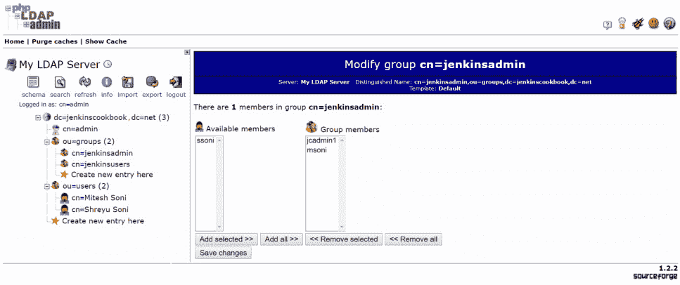

点击“更新对象”：

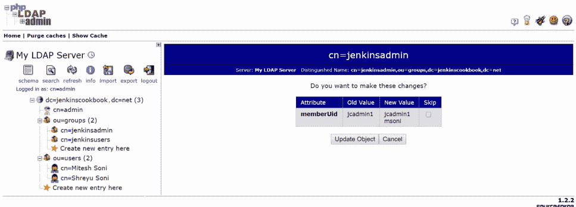

现在我们已经有了可用用户，可以开始将 OpenLDAP 与 Jenkins 集成。

- 5. 在“授权”部分，转到“基于项目的矩阵授权策略”，并添加我们在 OpenLDAP 中创建的用户：

- 6. 保存更改后，Jenkins 将退出登录。使用你的 LDAP 用户凭据登录，即可成功登录：

- 7. 仅授予 ssoni 用户读取权限以验证访问：

授权

- 任何人都可以做任何事
- 传统模式
- 已登录用户可以做任何事
- 基于矩阵的安全
- 基于项目的矩阵授权策略

- 8. 使用权限受限的 ssoni 用户登录，可以看到“管理 Jenkins”部分不可用：

- 9. 点击 Jenkins 仪表板上可用的项目，确认只有读取权限可用：

## Jenkins

打开 Blue Ocean

搜索

ssoni | 退出登录

Jenkins > FirstAndroidProject

返回仪表板

状态

变更

收藏

## 项目 FirstAndroidProject

### 最近的变更

### 永久链接

### 构建历史

趋势

查找

所有 RSS   失败 RSS

## Jenkins 与 Active Directory 集成

在本节中，我们将配置 Active Directory，它已可用于与 Jenkins 集成，从而使 Active Directory 特定域中的所有可用用户都可以根据所授予的访问权限，使用他们自己的 Active Directory 凭据来使用 Jenkins。

### 操作步骤...

- 1. 前往 Jenkins 仪表板 | 管理 Jenkins | 配置全局安全 | 启用安全 | 选择 Active Directory：

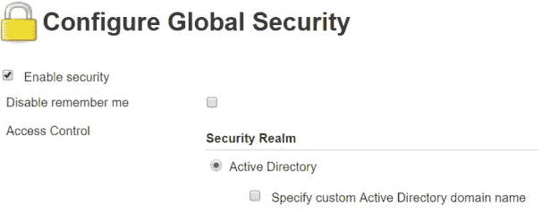

- 2. 选择“指定自定义 Active Directory 域名”，点击“添加域”，提供域名，然后保存：

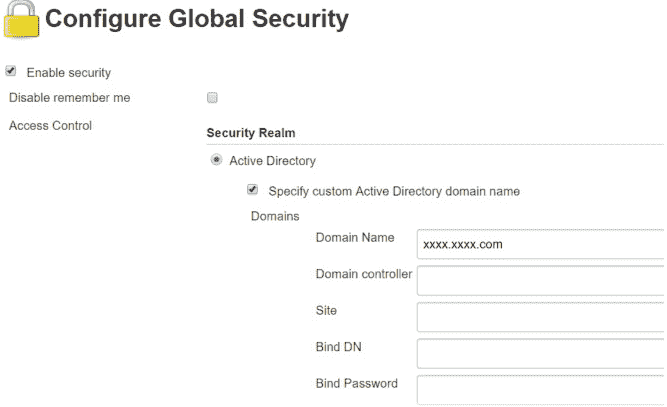

- 3. 如果配置和访问均正确，那么我们可以直接在 Jenkins 中使用该域中的所有用户。

## Jenkins 与 OWASP Zed Attack Proxy 集成

**OWASP Zed Attack Proxy（ZAP）**是一款开源 Web 应用安全扫描器。你可以将 ZAP 安全工具与 Jenkins CI 环境集成。

### 准备工作

前往 https://github.com/zaproxy/zaproxy/wiki/Downloads 下载 Windows（64 位）安装程序。

在 Windows 上安装它。

在 Windows 中打开 OWASP ZAP，点击“文件 | 持久化会话”，并将其保存到 Jenkins 工作空间中该构建作业的目录下：

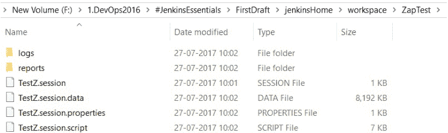

现在你可以开始配置 Jenkins 中的 ZAP 插件了。

### 操作步骤...

- 1. 前往 Jenkins 仪表板 | 配置系统 | 全局属性 | 环境变量，创建 `ZAPPROXY_HOME` 变量：

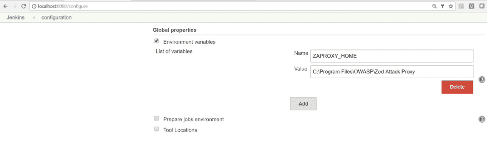

- 2. 前往 Jenkins 仪表板 | Zap 项目 | 构建 | 添加构建步骤 | 执行 ZAP。
- 3. 将主机和端口设置保留为默认值，或根据你的 OWASP ZAP 安装情况进行更改：

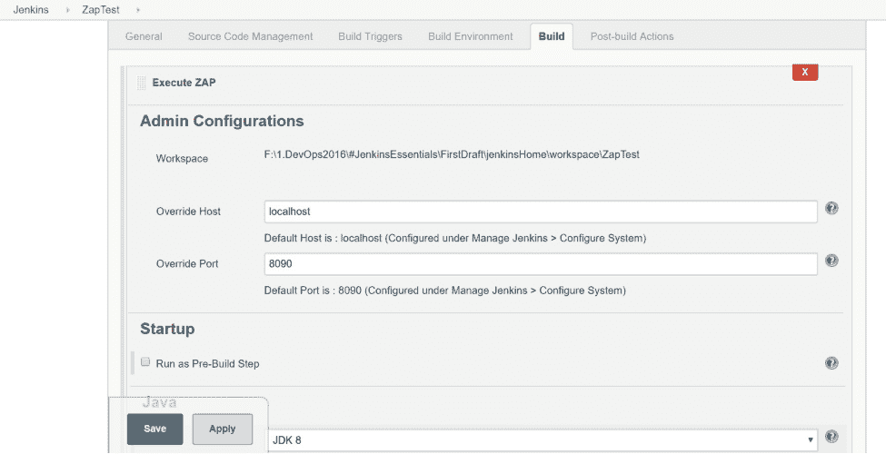

- 4. 提供 `ZAPPROXY_HOME`：

- 5. 提供 ZAP 主目录的路径，注意这不是安装目录。

- 6. 提供你保存在工作空间中的会话名称：

- 7. 配置攻击模式：

- 8. 配置“生成报告”部分：

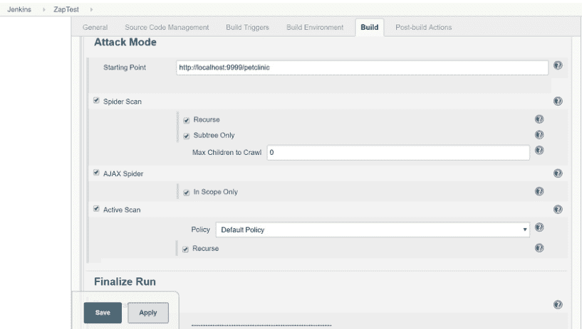

- 9. 发布 HTML 报告。点击“保存”：

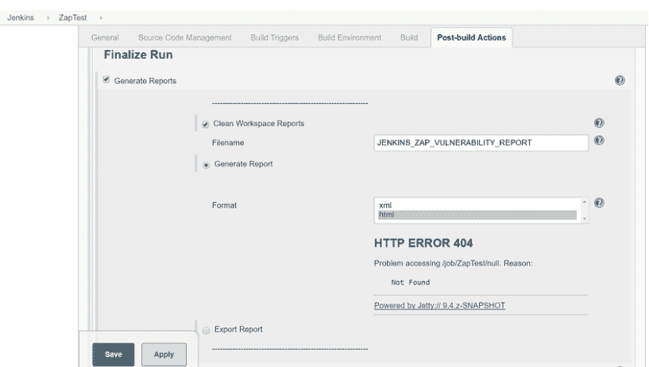

### 另请参阅

- 运行 Jenkins 构建，它将创建 HTML 报告。导航到 HTML 报告并验证扫描报告：

## ZAP 扫描报告

### 警报摘要

| 风险级别 | 警报数量 |
|---|---:|
| 高 | 1 |
| 中 | 1 |
| 低 | 2 |
| 信息 | 0 |

### 警报详情

| 字段 | 值 |
|---|---|
| 高（中） | SQL 注入 |
| 描述 | 可能存在 SQL 注入。 |
| URL | `http://localhost:9999/petclinic/oups.htm;jsessionid=E47011BD0E9AC2E848D2F180797D2E7E?query=query%22+AND+%221%22%3D%221` |
| 方法 | GET |
| 参数 | query |
| 攻击 | `query" AND "1"="1` |
| URL | `http://localhost:9999/petclinic/oups.htm;jsessionid=E47011BD0E9AC2E848D2F180797D2E7E?query=query+AND+1%3D1+--` |
| 方法 | GET |
| 参数 | query |
| 攻击 | `query AND 1=1 --` |
| URL | `http://localhost:9999/petclinic/oups.htm;jsessionid=E47011BD0E9AC2E848D2F180797D2E7E?query=query+AND+1%3D1+--+` |
| 方法 | GET |

- 你已将 Jenkins 与 OWASP ZAP 集成用于安全测试，也可以将其集成到流水线中。

## 测试 OWASP 的十大安全问题

本教程详细介绍了使用 w3af 对 Jenkins 进行自动测试以发现已知安全问题的方法。w3af 是来自 **开放 Web 应用程序安全项目（OWASP）** 的渗透测试工具。更多信息，请访问 [http://w3af.sourceforge.net](http://w3af.sourceforge.net)。OWASP 的目标是让应用安全可见。OWASP 2010 年的十大不安全清单包括：

- **A2-跨站脚本（XSS）：** 当应用程序将未转义的输入返回给客户端浏览器时，就可能发生 XSS 攻击。默认情况下，Jenkins 管理员可以通过作业描述执行此操作。

- **A6-安全配置错误：** Jenkins 插件让你能够编写自定义身份验证脚本。通过错误配置很容易把脚本弄错。

- **A7-不安全的加密存储：** Jenkins 有 600 多个插件，每个插件都将配置存储在单独的 XML 文件中。极有可能出现一种罕见错误：以明文形式存储密码。你需要仔细检查。

- **A9-传输层保护不足：** 默认情况下，Jenkins 通过 HTTP 运行。获取受信任的证书可能很麻烦，而且涉及额外成本。你可能会想不实施 TLS，从而使数据包暴露在外。

你会发现，与 2010 版本相比，OWASP 2013 年的十大不安全清单有些变化。最重要的变化是加入了 **A9-使用已知易受攻击组件**。如果你的软件依赖于较旧的库，那么就存在利用已知弱点进行操纵的机会窗口。

Jenkins 拥有大量由积极、分散且勤奋的社区编写的插件。由于代码变动频繁，可能会无意中加入安全缺陷。例如，在配置文件中以明文形式保留密码，或使用不会移除可疑 JavaScript 的不安全渲染。你可以通过手动检查配置文件来发现第一类缺陷。第二类缺陷面向更广泛的受众，因此更容易被破解。你可以手动攻击新插件。互联网上有有用的速查表（[http://hackers.org/xss.html](http://hackers.org/xss.html)）。这项工作枯燥乏味；自动化测试可以覆盖更多内容，并可以作为 Jenkins 作业的一部分进行调度。

在名为 *探索 OWASP dependency-check 插件* 的教程中，你将配置 Jenkins，使其基于对代码依赖项的自动审查，向你发出已知攻击媒介的警告。

### OWASP 店面：

OWASP 每年都会发布一份针对 Web 应用的十大最常见安全攻击媒介清单。他们通过 [http://lulu.com](http://lulu.com) 发布这份文档以及大量书籍。在 Lulu，你可以免费访问 OWASP 文档的 PDF 版本，也可以购买廉价的按需印刷版本。官方店面位于：[http://stores.lulu.com/owasp](http://stores.lulu.com/owasp)。


## 准备工作

渗透测试有可能损坏正在运行的应用程序。请确保你拥有 Jenkins 工作区的备份副本。你可能需要重新安装。另外，请关闭 Jenkins 中任何已启用的安全设置：这允许 w3af 自由地扫描安全表面。

从 SourceForge（[http://w3af.org/download/](http://w3af.org/download/)）下载最新版本的 w3af，并从 [https://www.owasp.org/index.php/Category:OWASP_Top_Ten_Project](https://www.owasp.org/index.php/Category:OWASP_Top_Ten_Project) 下载并阅读 OWASP 十大知名攻击列表。

w3af 同时提供 Windows 和 *NIX 安装包；你可以选择你喜欢的操作系统安装包。然而，Windows Installer 不再受支持，而且没有 Installer 的安装过程很复杂。因此，最好使用该工具的 *NIX 版本。

w3af 的 Debian 软件包比 SourceForge 上用于 Linux 的软件包更旧、更不稳定。因此，不要使用 apt-get 和 yum 安装方法，而应使用从 SourceForge 下载的软件包。

## 如何操作...

1. 要安装 w3af，请遵循开发者网站上给出的说明（[http://w3af.org/download/](http://w3af.org/download/)）。如果 Ubuntu 有任何无法解决的依赖问题，请回退到 apt-get 安装方法并安装旧版本的工具，如下所示：

   ```bash
   sudo apt-get install w3af
   ```

2. 运行 w3af。
3. 在 Profiles 选项卡下，选择 OWASP_TOP10。
4. 在 Target address 窗口中，填写 `http://localhost:8080/`，并修改主机名以适合你的环境。
5. 点击 Start 按钮。渗透测试现在将开始，Start 按钮将变为 Stop。扫描结束时，Stop 按钮将变为 Clear。
6. 通过选择 Log 选项卡查看攻击历史。
7. 通过点击 Results 选项卡查看结果。
8. 在第一次扫描后，在 Profiles 下选择 full_audit。
9. 点击 Clear 按钮。
10. 在 Target address 窗口中输入 `http://localhost:8080/`。
11. 点击 Start 按钮。
12. 等待扫描完成，然后查看 Results 选项卡。

## 工作原理...

w3af 由安全专业人士编写。它是一个可插拔的框架，带有针对不同类型攻击编写的扩展。配置文件定义了你在渗透测试中将使用哪些插件及其相关配置。

你首先使用 OWASP_TOP10 配置文件进行攻击，然后使用更完整的插件集再次攻击。

结果将根据你的设置而有所不同。根据插件不同，有时会标记出不存在的问题。你需要手动验证提到的任何问题。

在撰写本文时，使用这种方法没有发现重大缺陷。但是，该工具指出了缓慢的链接并生成了服务器端异常。这是你希望在错误报告中记录的信息类型。

## 更多内容...

持续保护你的应用程序需要经验丰富的对细节的关注。这里还有一些内容供你查看。

### 使用 WebGoat 进行靶机练习

十大安全缺陷列表有时看起来难以理解。如果你有空闲时间并且想针对一个故意不安全的应用程序进行练习，你应该尝试 WebGoat（[https://www.owasp.org/index.php/Category:OWASP_WebGoat_Project](https://www.owasp.org/index.php/Category:OWASP_WebGoat_Project)）。

WebGoat 文档完善，带有提示系统和视频教程链接；它几乎不会让你对攻击产生误解。

### 行业中的更多工具

w3af 是一个强大的工具，但与以下工具配合使用时效果更好：

- **Nmap** (http://nmap.org/): 一个易于使用、非常受欢迎、屡获殊荣的网络扫描器。
- **Nikto** (http://cirt.net/nikto2): 一个 Perl 脚本，可快速汇总系统详细信息并查找最明显的缺陷。
- **Skipfish** (https://code.google.com/p/skipfish/downloads/list): 一个 C 程序，可在长时间内处理大量请求。你可以从不同的攻击字典中进行选择。这是一个极好的穷人压力测试；如果你的系统保持运行，你就知道它已达到最低稳定性水平。
- **Wapiti** (http://wapiti.sourceforge.net/): 一个基于 Python 的脚本，可发现可攻击的 URL，然后循环遍历一系列恶意参数。

Jenkins 非常灵活，因此你可以通过作业中运行的脚本调用各种工具，包括提到的安全工具。

有许多保护原生操作系统的好资源，包括 Debian 安全指南（https://www.debian.org/doc/manuals/securing-debian-howto/）；对于 Windows，有 MSDN 安全中心下的文章（http://msdn.microsoft.com/en-us/security/）；对于 Mac，有 Apple 官方安全指南（https://www.apple.com/support/security/guides/）。在线服务需要密切关注其安全攻击面。

## 通过模糊测试在 Jenkins 中发现 500 错误和 XSS 攻击

本教程介绍如何使用模糊测试器在 Jenkins 服务器中查找服务器端错误和 XSS 攻击。

模糊测试器会遍历一系列 URL，盲目附加不同的参数，并检查服务器的响应。输入的参数是脚本命令的变体，例如 `<script>alert("random string");</script>`。如果服务器的响应包含未转义的脚本版本，则表明发现了攻击向量。

跨站脚本攻击目前是较流行的攻击形式之一（http://en.wikipedia.org/wiki/Cross-site_scripting）。该攻击涉及将脚本片段注入客户端的浏览器，使脚本运行起来就像来自受信任的网站。例如，一旦你登录应用程序，你的会话 ID 很可能存储在 cookie 中。注入的脚本可能会读取 cookie 中的值，然后将信息发送到另一台服务器，以便尝试重用。

模糊测试器会发现在其攻击的网站上的链接以及网站网页中存在的表单变量。对于发现的网页，它基于历史攻击和大量微小变体反复发送输入。如果响应与发送的相同随机字符串一起返回，模糊测试器就知道它发现了一个恶意 URL。

为了与基于 Web 的应用程序的构建过程完全集成，你需要构建应用程序、部署并运行应用程序、通过脚本运行模糊测试器，最后，如果输出中提及恶意 URL，则使用日志解析来使构建失败。此过程与你希望集成的其他命令行工具类似。有关日志解析的更多信息，请参阅第 1 章“开始使用 Jenkins”中的 *通过日志解析故意使构建失败* 配方。

### 准备工作

备份你的牺牲 Jenkins 服务器并关闭其安全设置。预计在攻击结束时应用程序会不稳定。

你需要在计算机上安装 Python 编程语言。要下载并安装 Wapiti，你需要遵循 http://wapiti.sourceforge.net 上的说明。

如果你是在本机攻击本机，那么你可以关闭其网络功能。攻击将停留在回环网络驱动器中，并且不会有数据包逃逸到互联网。

在本教程中，方法论和命令行选项是正确的。然而，在撰写本文时，提到的结果可能不存在。Jenkins 经历了一个快速的生命周期，开发人员会迅速移除错误。

### 如何操作...

1. 在 wapiti bin 目录中，运行以下命令：

   ```bash
   python wapiti http://localhost:8080 -m "-all,xss,exec" -x http://localhost:8080/pluginManager/* -v2
   ```

2. 命令运行完毕后，你将在控制台输出中看到最终报告的位置：

   ```
   Report
   !!!!
   A report has been generated in the file
   ~/.wapiti/generated_report
   You can open ~/.wapiti/generated_report/index.html with a browser to see this report.
   ```

3. 在 Web 浏览器中打开报告并查看它。
4. 点击 Internal Server Error 链接。
5. 对于名为“在 /iconSize 中发现异常”的条目之一，从 URL command line 选项卡复制 URL。
6. 在 Web 浏览器中打开该 URL。现在你将看到一个新生成的 Jenkins 错误报告页面，如下图所示。
7. 运行以下命令：

   ```bash
   python wapiti http://localhost:8080 -m "-all,xss,permanentxss" -x http://localhost:8080/pluginManager/*
   ```

8. 查看输出以确认 permanentxss 模块已运行：

   ```
   [*] Loading modules :
   mod_crlf, mod_exec, mod_file, mod_sql, mod_xss,      mod_backup, mod_htaccess,
   mod_blindsql, mod_permanentxss, mod_nikto
   [+] Launching module xss
   [+] Launching module permanentxss
   ```


## 工作原理...

Wapiti 会加载不同的模块。默认情况下，所有模块都会被使用。你需要有选择性地加载；对于 Ubuntu Linux 上的版本 2.2.1，这会导致 Wapiti 崩溃或超时。

要加载特定模块，请使用 `-m` 选项。

`-m "-all,xss,exec"` 语句告诉 Wapiti 忽略除 xss 和 exec 模块之外的所有模块。

exec 模块非常擅长发现 Jenkins 中的 500 错误。这主要是因为意外输入，而 Jenkins 对此处理得并不好。这纯粹是一组外观问题。但是，如果你开始看到与文件或数据库服务等资源相关的错误，那么你应该优先处理这些问题并提交错误报告。

`-x` 选项指定要忽略哪些 URL。在本例中，我们不想给插件管理器造成负担。如果我们这样做，它就会对无辜的外部服务产生大量请求。

Wapiti 会爬取网站。如果你不小心，该工具可能会顺着链接到达你不想测试的位置。为避免尴尬，请谨慎使用排除 URL 选项 `-x`。

`-v2` 选项将日志记录详细程度设置为最高，以便你能看到所有攻击。

在第二次运行 Wapiti 时，你还使用了 permanentxss 模块，该模块有时会发现真正的 XSS 攻击，这取决于开发人员在开发功能和清理 bug 之间的竞赛：

模糊测试工具擅长覆盖应用程序 URL 空间的很大一部分，触发那些需要花费大量时间才能发现的错误。可以考虑通过 Jenkins 作业进行自动化，作为项目 QA 流程的一部分。

## 更多内容...

你在本菜谱中生成的报告提到的服务器错误远多于 XSS 攻击。这是因为许多生成的错误是由于意外输入导致的失败，而这些失败只有最后一层错误处理才能捕获；在本例中，也就是 bug 报告页面。如果你认为该错误值得报告，请按照 bug 报告页面上的说明进行操作。

以下是一些关于堆栈跟踪输出含义的指南：

- `java.lang.SecurityException`：如果 Jenkins 用户正在做程序员认为不安全的事情，例如访问某个 URL，则该 URL 应该只在登录后才可访问。
- `java.lang.IllegalArgumentException`：Jenkins 检查了参数的有效范围，而参数值超出了该范围。这是一个故意抛出的异常。
- `java.lang.NumberFormatException`：Jenkins 没有检查字符串是否有效，然后尝试将不符合格式的字符串解析为数字。
- `java.lang.NullPointerException`：这通常发生在你访问一个未设置 Jenkins 期望的所有参数的 URL 时。用程序员的话说，代码期望一个不存在的对象，然后在不检查对象是否存在的情况下尝试调用该不存在对象的方法。程序员需要添加更多的错误检查。请写一个错误报告。

## 另请参阅

- *测试 OWASP 十大安全问题* 菜谱

## 使用 JCaptcha 防止注册机器人

**CAPTCHA** 的全称是 **全自动区分计算机和人类的公开图灵测试**。最常见的 CAPTCHA 是以图形形式显示的连续字母和数字，你必须正确地将它们输入到文本输入框中。

如果你允许任何人在你的 Jenkins 服务器上注册帐户，那么你最不希望看到的就是机器人（自动化脚本）创建帐户。机器人具有规模经济效应，能够快速扫描互联网，而且永远不会感到厌倦。CAPTCHA 是抵御这些愚蠢攻击的必要防御手段。

机器人的恶意用途如下：

- 对你的服务器执行**拒绝服务（DOS）**攻击，例如通过自动创建大量重量级作业
- 通过收集大量 Jenkins 服务器向其他服务器发起大量请求，从而实施**分布式拒绝服务攻击（DDOS）**
- 注入不需要的广告或内容，然后指向恶意网站
- 添加永久存储的脚本，当用户意外浏览 Jenkins 站点时运行这些脚本

犯罪分子有商业动机去规避 CAPTCHA，这已经导致了有据可查的法律案件。你可以在 [http://www.wired.com/2010/10/hacking-captcha/](http://www.wired.com/2010/10/hacking-captcha/) 找到一个这样的法律案件。

## 准备工作

确保你已经备份了你的可牺牲的 Jenkins 服务器。你将要修改其安全设置。很容易犯下改变服务的错误。

JCaptcha 插件基于 Java 实现，你可以在 https://jcaptcha.atlassian.net/wiki/display/general/Home 找到相关内容。

## 操作步骤...

- 1. 以管理员身份登录。
- 2. 单击 “Configure Global Security”（配置全局安全性）链接。
- 3. 在 “Security Realm”（安全域）下选择 “Jenkins’ own user database”（Jenkins 自己的用户数据库）。
- 4. 选择 “Allow users to sign up”（允许用户注册）：
- 5. 单击 “Save”（保存）。
- 6. 浏览到注册位置 http://localhost:8080/signup。
- 7. 在 “Manage Jenkins”（管理 Jenkins）页面中单击 “Manage Plugins”（插件管理）链接。
- 8. 选择 “Available”（可用）选项卡。
- 9. 安装 JCaptcha 插件。
- 10. 在 “Manage Jenkins”（管理 Jenkins）页面下单击 “Configure Global Security”（配置全局安全性）链接。
- 11. 在 “Security Realm”（安全域）下选择 “Jenkins’ own user database”（Jenkins 自己的用户数据库）。
- 12. 选择 “Enable captcha on sign up”（在注册时启用验证码）。
- 13. 单击 “Save”（保存），然后点击 “Log Out”（注销）链接。
- 14. 浏览到注册位置 http://localhost:8080/signup。该页面现在受到 CAPTCHA 的保护。

## 工作原理...

安装插件会在注册过程中添加 CAPTCHA 图像。解读该图像需要模式识别。人类非常擅长这一点；自动化过程则差得多，不过在不断改进。
