## 提升代码质量

在本章中，我们将介绍以下菜谱：

- 将 Jenkins 与 SonarQube 集成
- SonarQube 中的更新中心
- 质量门、质量配置文件和规则
- 使用 SonarQube 验证 HTML、CSS 和 JavaScript 的有效性
- 使用 SonarQube 验证 Java 代码
- 将 SonarQube 配置为 Windows 服务

## 引言

本章探讨如何使用 Jenkins 插件来显示代码指标和失败的构建。自动化可以降低成本并提高一致性。该过程不会疲倦。如果你在项目开始之前就确定成功和失败的标准，那么这将消除发布会议中的一定程度的主观争论。

2002 年，NIST 估计软件缺陷每年给美国造成约 600 亿美元的损失（http://www.abeacha.com/NIST_press_release_bugs_cost.html）。可以预期此后成本已大幅增加。为了节省资金和提高质量，你需要在软件生命周期中尽可能早地消除缺陷。

你还会在本章中找到有关通过 SonarQube 进行静态代码审查的菜谱。静态意味着你可以在不运行代码的情况下查看代码。良好的文档和源代码结构有助于提高代码的可维护性和可读性。

有许多不错的软件指标介绍。其中包括关于指标细节的维基教科书（http://en.wikibooks.org/wiki/Introduction_to_Software_Engineering/Quality/Metrics）以及 Diomidis Spinellis 所著的一本名为 *Code Quality: The Open Source Perspective* 的优秀书籍。

在本章的 *将 Jenkins 与 SonarQube 集成* 菜谱中，你会将 Jenkins 项目链接到 Sonar 报告。Sonar 是一种专门收集软件指标并将其分解为可理解报告的工具。Sonar 详细描述项目的质量。它使用广泛的指标，包括本章提到的 FindBugs 和 PMD 等工具的结果。该项目本身发展迅速。考虑使用 Jenkins 进行早期警告并发现明显缺陷，例如糟糕的提交。然后你可以使用 Sonar 进行更深入的审查。

从 https://www.sonarqube.org/downloads/ 下载 SonarQube 并将其解压到系统中：

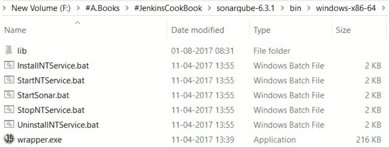

SonarQube 支持 20+ 种编程语言：Java Android、JavaScript、HTML、CSS、Objective-C、C#、C/C++、PHP、Python、PL/SQL、Flex、Groovy、COBOL、Swift（付费插件）等。它支持有关 bug、漏洞、代码异味、重复代码、代码覆盖率、注释等的报告。

- 1. 运行 SonarQube 需要先安装 Java 8。
- 2. 在 Windows 操作系统中，转到 `bin` 目录，然后根据操作系统及其平台，进入相应的子目录。


3. 在命令行窗口中执行 `StartSonar.bat`，因为我们使用的是 Windows 操作系统：

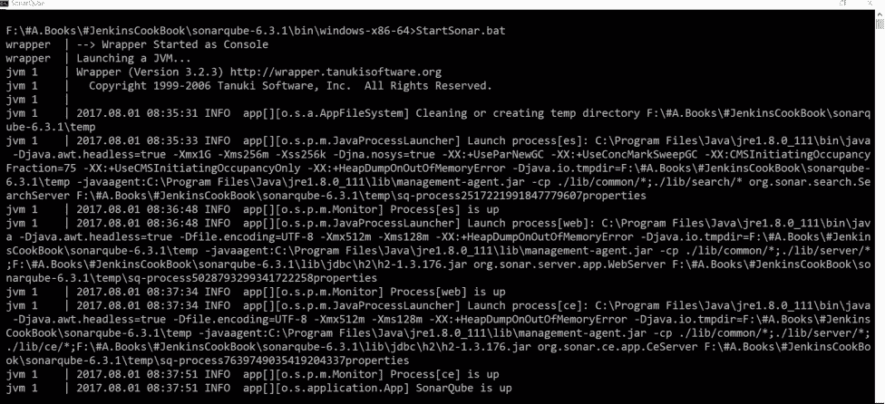

如果启动成功，您将在控制台中看到“SonarQube is up”信息。

- 一旦 SonarQube 启动并运行，请在浏览器中打开 `http://localhost:9000` 访问 SonarQube 仪表盘。
- 您可能希望查看 [https://docs.sonarqube.org/display/SONAR/Requirements](https://docs.sonarqube.org/display/SONAR/Requirements) 上的要求，并在 [https://docs.sonarqube.org/display/SONAR/Setup+and+Upgrade](https://docs.sonarqube.org/display/SONAR/Setup+and+Upgrade) 上进行设置和升级。

## 将 Jenkins 与 SonarQube 集成

SonarQube（以前称为 Sonar）是一款快速发展的应用程序，用于报告质量指标和发现代码热点。本教程详细介绍了如何通过 Jenkins 插件生成代码指标，然后直接将其推送到 Sonar 数据库。

## 准备工作...

- 1. 转到 Jenkins 仪表盘，点击“管理 Jenkins”。进入“管理插件”，在“可选插件”选项卡中找到 SonarQube 插件。
- 2. 点击“不重启安装”：

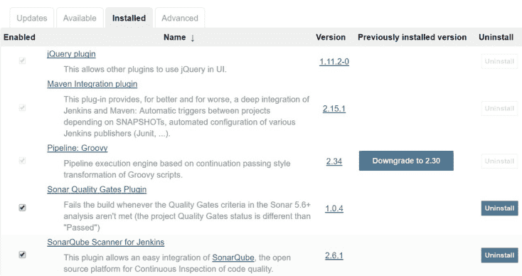

- 3. 转到 Jenkins 仪表盘，点击“管理 Jenkins”。
- 4. 点击“系统配置”，找到 SonarQube 部分。
- 5. 现在，我们去 SonarQube 获取令牌，以便集成 Jenkins 和 SonarQube。
- 6. 一旦 SonarQube 启动并运行，请在浏览器中打开 http://localhost:9000 访问 SonarQube 仪表盘：

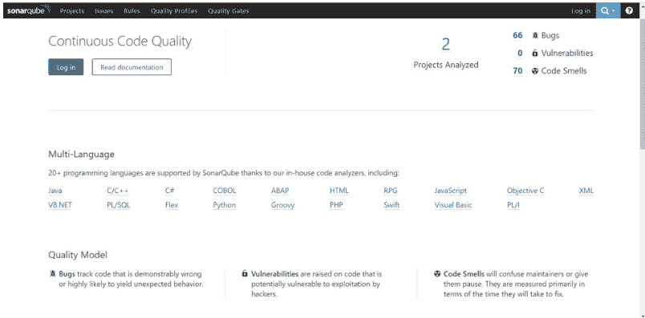

- 7. 点击“登录”，输入默认用户名和密码（admin/admin）以管理员身份登录。
- 8. 点击“登录”：

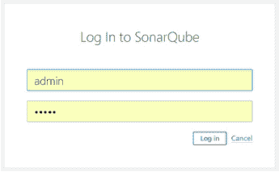

- 9. 目前，SonarQube 仪表盘中还没有可用的项目。
- 10. 点击 *Administration* 选项卡，在 Security 菜单中点击 Users：

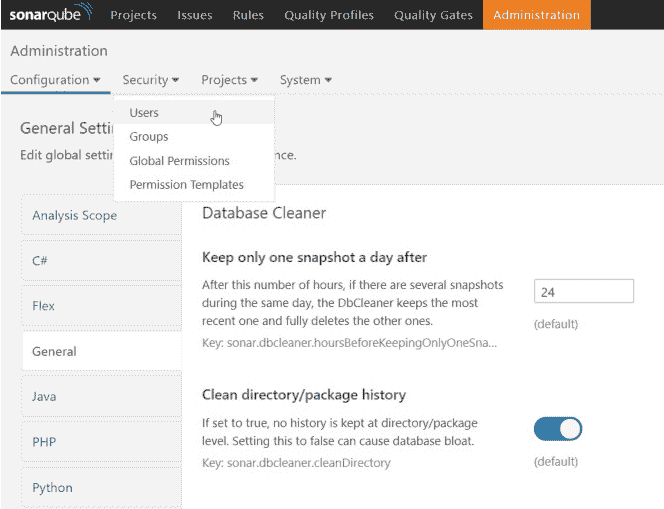

- 11. 最初，没有签发任何令牌；Administrator 的令牌数为 0：

## 12. 点击 Tokens：

SCM Accounts
Groups
Tokens
Administrator admin
sonar-administrators
sonar-users
0
Update Tokens

## 13. 在 Generate Tokens 部分输入名称，然后点击 Generate：

sonarqube Projects Issues Rules Quality Profiles Quality Gates Administration Administrator
Administration
Configuration Security Projects System
Users
Create and administer individual users.
Create User
Search
SCM Accounts
Groups
Tokens
Administrator admin
sonar-administrators
sonar-users
0
1/1 shown
Embedded database should be used for evaluation purpose only
The embedded database will not scale, it will not support upgrading to newer versions of SonarQube, and there is no support for migrating your data out of it into a different database engine.
SonarQube™ technology is powered by SonarSource SA
Version 6.3.1 (build 21392) - LGPL v3 - Community - Documentation - Get Support - Plugins - Web API - About

## 如何操作...

- 1. 转到 Jenkins 仪表盘，点击“管理 Jenkins”。
- 2. 点击“系统配置”，找到 SonarQube 部分。
- 3. 点击“添加 SonarQube”。
- 4. 提供名称、服务器 URL 和服务器版本。
- 5. 将令牌值粘贴到 Jenkins 中并保存：

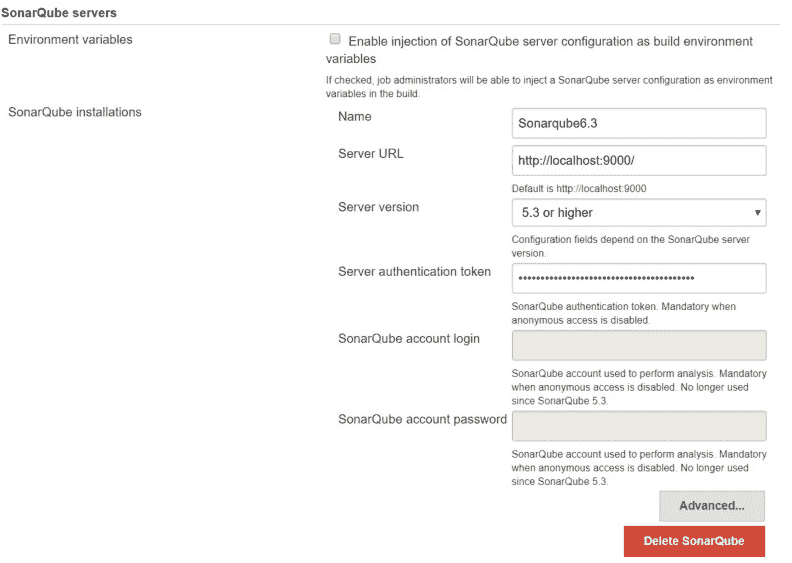

- 6. 转到“全局工具配置”，配置“添加 SonarQube Scanner”：

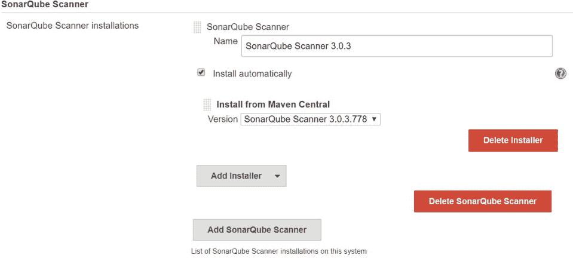

- 7. 现在，您已准备好对项目进行静态代码分析。

## SonarQube 中的更新中心

管理员可以利用更新中心通过安装插件和更新插件来保持 SonarQube 的最新状态。

## 准备工作

- 1. 转到 Administration | System | Update Center：

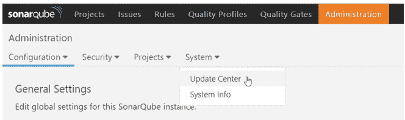

- 2. 更新中心包含四个选项卡：Installed、Updates Only、Available 和 System Upgrades：

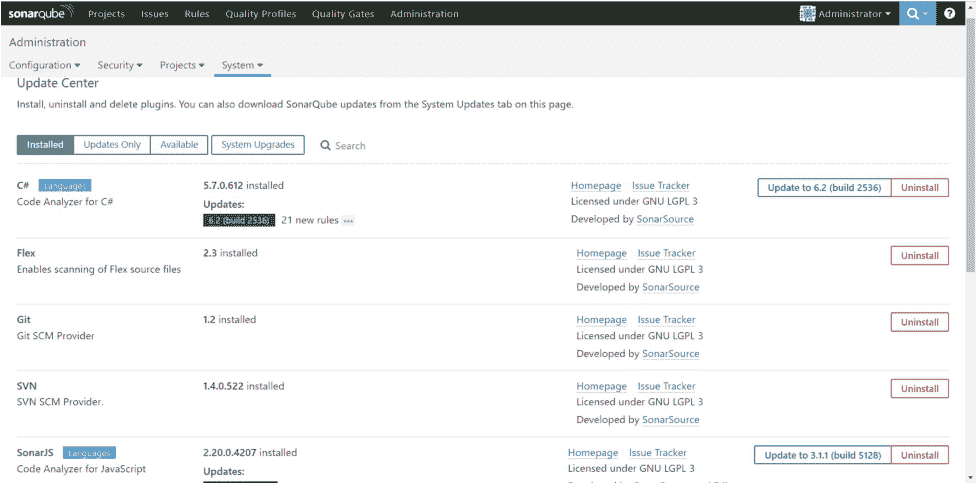

3. 如前所述，我们可以安装和更新不同的插件，以便执行静态代码分析。

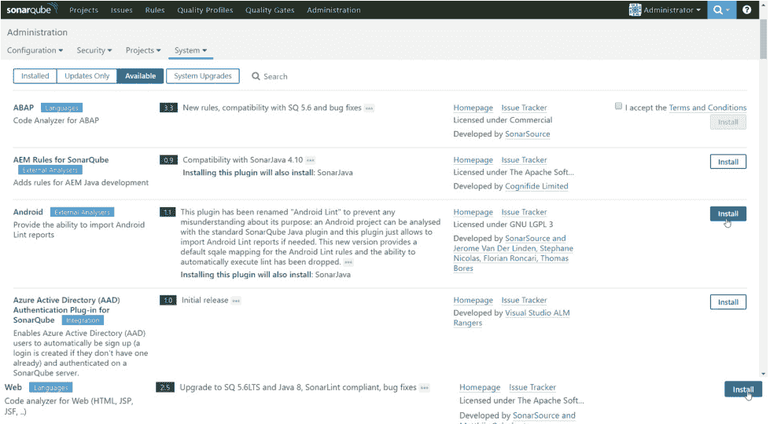

## 5. 点击 Restart：

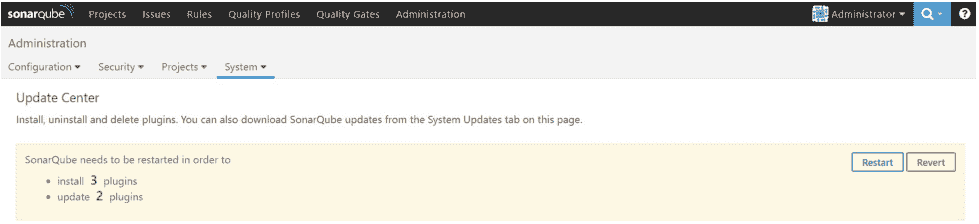

## 6. 重启 SonarQube：

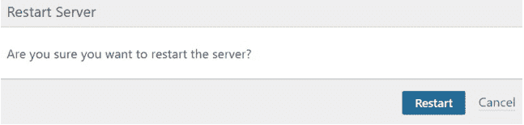

## 7. 等待服务器重启：

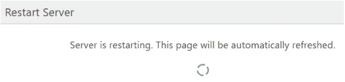

8. 这样，我们就可以使用更新中心来安装、卸载和更新 SonarQube 中可用的插件。

## 更多内容...

- 1. 转到 Administration | System | Update Center | Installed 选项卡，验证所有新安装的插件：

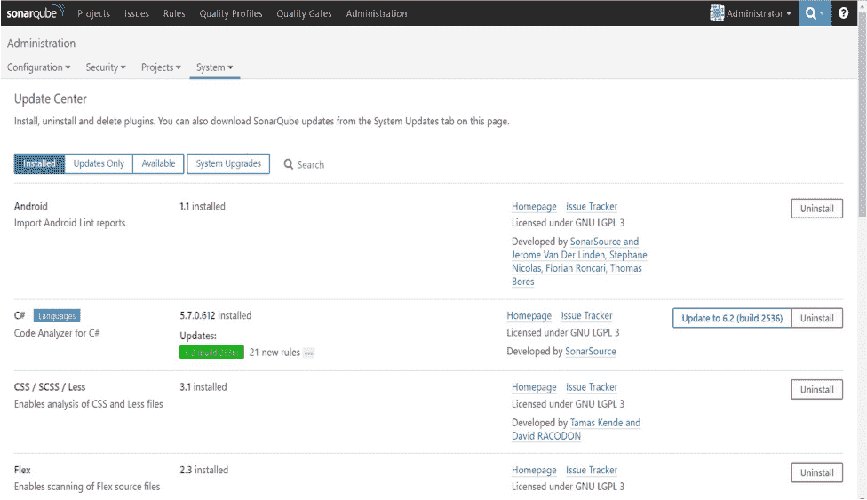

- 2. 您也可以从 Installed 选项卡卸载插件。

## 质量门、质量配置文件和规则

在本节中，我们将了解默认的质量门，它定义了代码分析通过或失败的基础标准，而质量配置文件则是针对特定编程语言的规则集。

## 如何操作...

- 1. 目前，SonarQube 仪表盘中还没有可用的项目：

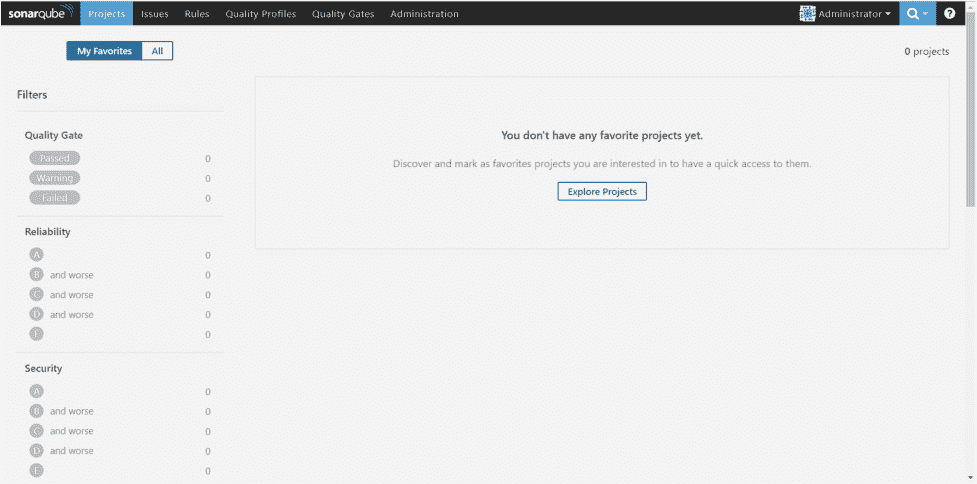

- 2. 质量门用于在组织中强制实施静态代码分析策略。
- 3. “SonarQube 方式”是默认的质量门，您可以根据所需的策略将其分配给不同的项目。
- 4. 您还可以根据需求和要强制实施的策略添加条件：

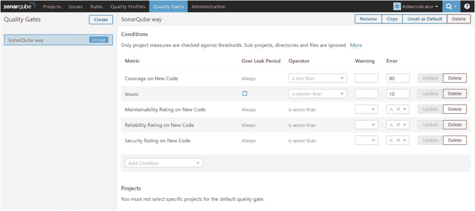

- 5. 点击 Quality Profiles 选项卡，查看 SonarQube 中可用的默认质量配置文件详情。
- 6. 质量配置文件是 SonarQube 的核心；它只是一组特定于某语言的规则。如果没有明确说明，所有项目都将使用默认配置文件进行分析。然而，理想情况下，每个项目都应有一个配置文件，以便可以设置或停用特定规则。每种语言都有一个名为“Sonar way”的默认配置文件：

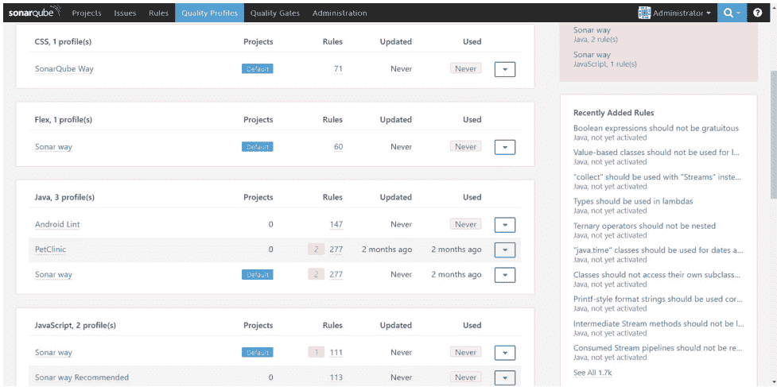

7. 点击 Rules 选项卡，了解更多关于配置文件中现有规则的详细信息：

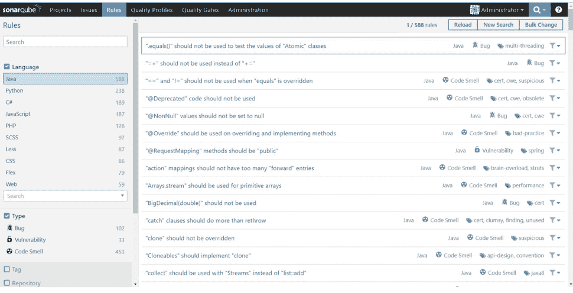

8. 点击规则以获取更多相关信息：

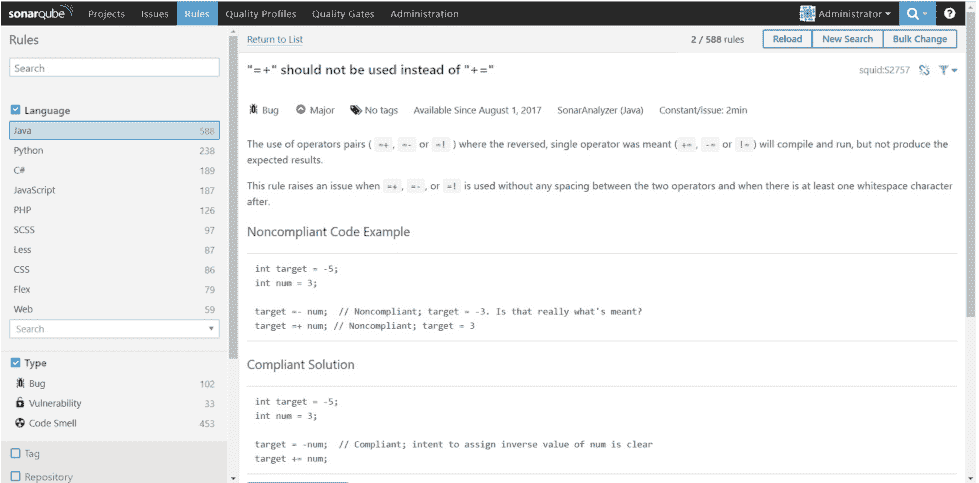

- 9. 转到 Quality Profiles，选择 “Sonar way” 默认配置文件。观察总的启用规则和停用规则数量。

## 使用 SonarQube 验证 HTML、CSS 和 JavaScript 的有效性

您将对一个包含 HTML、CSS 和 JavaScript 文件的示例应用程序执行静态代码分析。

## 准备工作

- 1. 转到 Jenkins 仪表盘，点击“新建任务”。
- 2. 输入名称并选择“自由风格项目”：

## 输入任务名称

SonarHTMLCSSJS

» 必填字段

- **自由风格项目**
  这是 Jenkins 的核心功能。Jenkins 将构建您的项目，将任何 SCM 与任何构建系统相结合，甚至可以用于软件构建之外的其他用途。
- **Maven 项目**
  构建 Maven 项目。Jenkins 利用您的 POM 文件，大大减少了配置。
- **流水线**
  编排可跨多个构建从属节点运行的长时间活动。适用于构建流水线（以前称为工作流）和/或组织不适合自由风格任务类型的复杂活动。
- **外部任务**
  此任务类型允许您记录在 Jenkins 外部（甚至在远程机器上）运行的进程执行情况。这样您就可以将 Jenkins 用作现有自动化系统的仪表盘。
- **多配置项目**
  ...适用于需要大量不同配置的项目，例如在多个环境中测试、特定平台的构建等。

3. 在源代码管理部分提供仓库 URL：


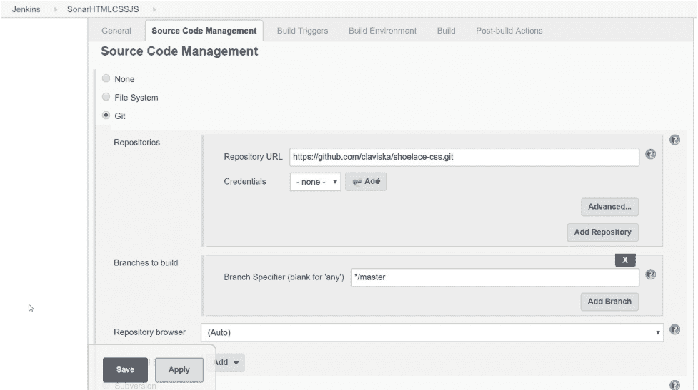

- 4. 任何包含 HTML、CSS 和 JavaScript 文件的项目都可以使用。

### 如何操作...

- 1. 进入 Build 部分并选择 Execute SonarQube Scanner：

  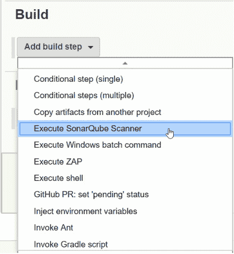

- 2. 你可以提供 `sonar-project.properties` 的位置，或直接提供静态代码分析的详细信息。

```properties
## Required metadata
sonar.projectKey=SonarHTMLCSSJS
sonar.projectName=Simple HTML CSS JS project analyzed with the SonarQube
sonar.projectVersion=1.0
### Comma-separated paths to directories with sources (required)
sonar.sources=.
### Encoding of the source files
sonar.sourceEncoding=UTF-8
```

- 3. `sonar.sources` 是静态代码分析的主要属性。通过此属性，你可以告知 SonarQube 需要分析哪个目录：

  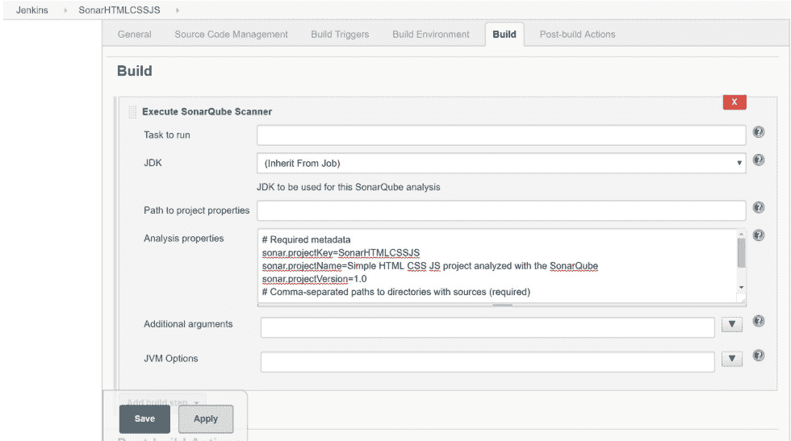

- 4. 点击 Save。
- 5. 进入 Jenkins Project 并点击 Build now。
- 6. 进入 Console output 查看日志。
- 7. 仅观察以下代码中给出的日志。
- 8. 你会注意到，根据可用的文件，SonarQube 会自动选择不同的质量配置文件并分析代码：
- 9. Started by user admin.
- 10. [EnvInject] - Loading node environment variables.
- 11. Building in workspace:
    F:\1.DevOps2016\#JenkinsEssentials\FirstDraft\jenkinsHome\workspace\SonarHTMLCSSJS
- 12. Cloning the remote Git repository:
    Cloning repository https://github.com/claviska/shoelace-css.git
    >git.exe init
    F:\1.DevOps2016\#JenkinsEssentials\FirstDraft\jenkinsHome\workspace\SonarHTMLCSSJS
    # timeout=10
- 13. Fetching upstream changes from https://github.com/claviska/shoelace-css.git:
    > git.exe --version # timeout=10
    >git.exe fetch --tags --progress https://github.com/claviska/shoelace-css.git
    +refs/heads/*:refs/remotes/origin/*
    >git.exe config remote.origin.url https://github.com/claviska/shoelace-css.git # timeout=10
    >git.exe config --add remote.origin.fetch +refs/heads/*:refs/remotes/origin/* # timeout=10
    >git.exe config remote.origin.url https://github.com/claviska/shoelace-css.git # timeout=10
- 14. Fetching upstream changes from https://github.com/claviska/shoelace-css.git:
    >git.exe fetch --tags --progress https://github.com/claviska/shoelace-css.git
    +refs/heads/*:refs/remotes/origin/*
    >git.exe rev-parse "refs/remotes/origin/master{commit}" # timeout=10
    >git.exe rev-parse "refs/remotes/origin/origin/master{commit}" # timeout=10
- 15. Checking out revision 39b44e9519e5050675e01527c421c5e0f3a046b7 (refs/remotes/origin/master):

```
>git.exe config core.sparsecheckout # timeout=10
>git.exe checkout -f 39b44e9519e5050675e01527c421c5e0f3a046b7
```

- 16. First time build. Skipping changelog:

```
[SonarHTMLCSSJS] $
F:\1.DevOps2016\#JenkinsEssentials\FirstDraft\jenkinsHome\tools\hudson.plugins.soscanner.bat -e -Dsonar.host.url=http://localhost:9000/ ******* "-Dsonar.projectName=Simple HTML CSS JS project analyzed with the SonarQube" -Dsonar.projectVersion=1.0 -Dsonar.sourceEncoding=UTF-8 -Dsonar.projectKey=SonarHTMLCSSJS -Dsonar.sources=. -Dsonar.projectBaseDir=F:\1.DevOps2016\#JenkinsEssentials\FirstDraft\jenkinsHome\workspace\SonarHTMLCSSJS

INFO: Option -e/--errors is no longer supported and will be ignored
INFO: Scanner configuration file:
F:\1.DevOps2016\#JenkinsEssentials\FirstDraft\jenkinsHome\tools\hudson.plugins.soscanner.properties
INFO: Project root configuration file: NONE
INFO: SonarQube Scanner 3.0.3.778
INFO: Java 1.8.0_111 Oracle Corporation (64-bit)
INFO: Windows 10 10.0 amd64
INFO: User cache: C:\WINDOWS\system32\config\systemprofile\.sonar\cache
INFO: Load global settings
INFO: Load global settings (done) | time=557ms
INFO: User cache: C:\WINDOWS\system32\config\systemprofile\.sonar\cache
INFO: Load plugins index
INFO: Load plugins index (done) | time=113ms
INFO: Download sonar-csharp-plugin-5.7.0.612.jar
INFO: Download sonar-python-plugin-1.7.0.1195.jar
INFO: Download sonar-css-plugin-3.1.jar
INFO: Download sonar-java-plugin-4.12.0.11033.jar
INFO: Download sonar-scm-git-plugin-1.2.jar
INFO: Download sonar-android-plugin-1.1.jar
INFO: Download sonar-php-plugin-2.9.2.1744.jar
INFO: Download sonar-scm-svn-plugin-1.4.0.522.jar
INFO: SonarQube server 6.3.1
INFO: Default locale: "en_IN", source code encoding: "UTF-8"
INFO: Process project properties
INFO: Load project repositories
INFO: Load project repositories (done) | time=140ms
INFO: Load quality profiles
INFO: Load quality profiles (done) | time=437ms
INFO: Load active rules
INFO: Load active rules (done) | time=6984ms
INFO: Load metrics repository
INFO: Load metrics repository (done) | time=752ms
INFO: Publish mode
INFO: Project key: SonarHTMLCSSJS
INFO: --------- Scan Simple HTML CSS JS project analyzed with the SonarQube
INFO: Load server rules
INFO: Load server rules (done) | time=1241ms
INFO: Initializer GenericCoverageSensor
INFO: Initializer GenericCoverageSensor (done) | time=0ms
INFO: Base dir:
F:\1.DevOps2016\#JenkinsEssentials\FirstDraft\jenkinsHome\workspace\SonarHTMLCSSJS
INFO: Working dir:
F:\1.DevOps2016\#JenkinsEssentials\FirstDraft\jenkinsHome\workspace\SonarHTMLCSSJS
INFO: Source paths: .
INFO: Source encoding: UTF-8, default locale: en_IN
INFO: Index files
INFO: 30 files indexed
INFO: Quality profile for css: SonarQube Way
INFO: Quality profile for js: Sonar way
INFO: Quality profile for web: Sonar way
INFO: Sensor NoSonar Sensor [php]
INFO: Sensor NoSonar Sensor [php] (done) | time=0ms
INFO: Sensor Coverage Report Import [csharp]
INFO: Sensor Coverage Report Import [csharp] (done) | time=0ms
```

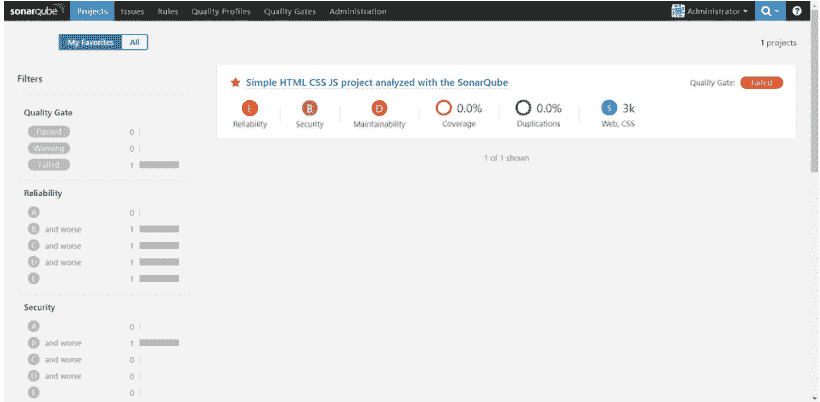

- 19. 静态代码分析中使用了默认的质量配置文件和质量门禁。

- 20. 可用 Bugs & Vulnerabilities 和 Code Smells 相关详情。点击每个项目可根据文件获取更多详情。

- 21. 此处 Quality Gate 已失败，未满足条件：

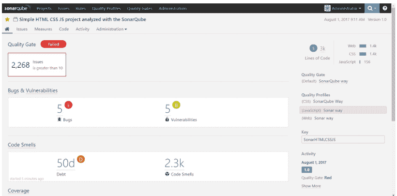

- 22. 进入 Code 选项卡以获取文件和目录的 Bugs & Vulnerabilities 和 Code Smells：

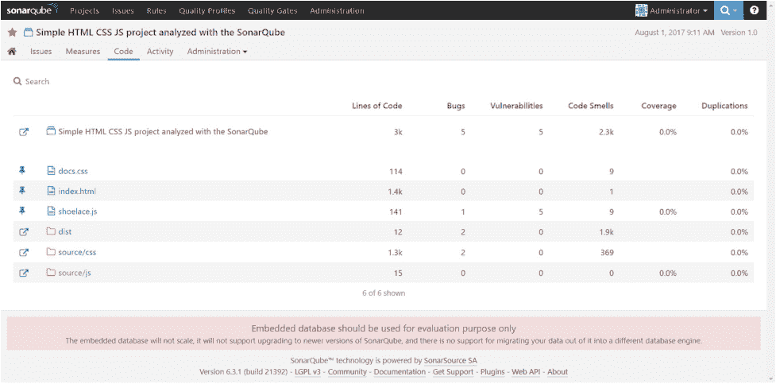

- 23. 点击 Activity 以获取项目分析历史：

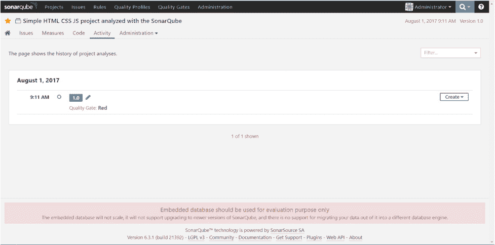

- 24. 进入 Measures | Maintainability 以获取评级和技术债务详情：

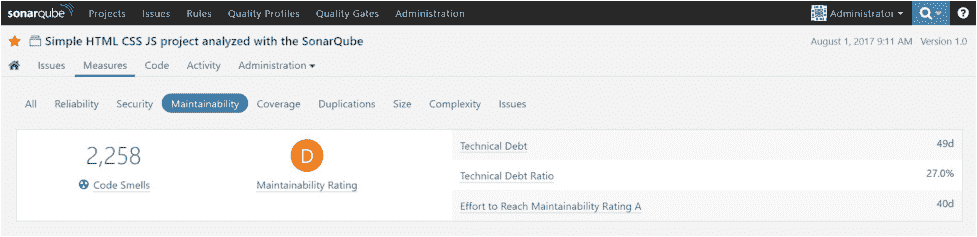

- 25. 进入 Measures | Size 以获取代码异味大小的图表：

- 26. 进入同一层级的不同子部分并深入观察详情以获得更多理解。

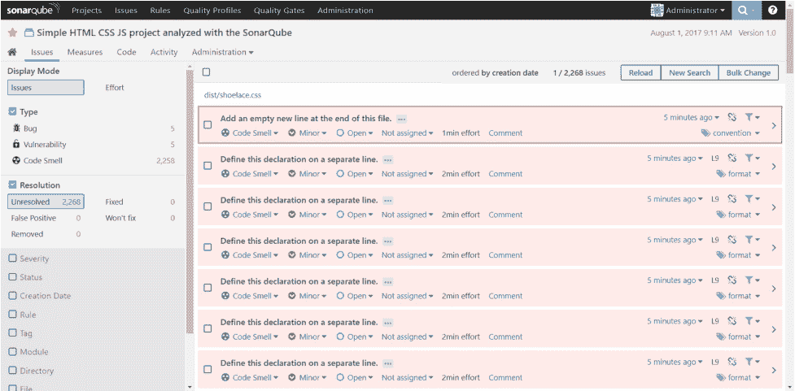

- 2. 有些情况下某些问题是误报。在这种情况下，可从 SonarQube 仪表板将其配置为已修复。

## 使用 SonarQube 验证 Java 代码

现在让我们创建一个新的 Quality Profile 并分配项目，以便每次执行静态代码分析时不使用默认配置文件而使用自定义配置文件。

### 准备工作

- 1. 进入 Quality Profiles，并在 Java 部分复制默认配置文件：

  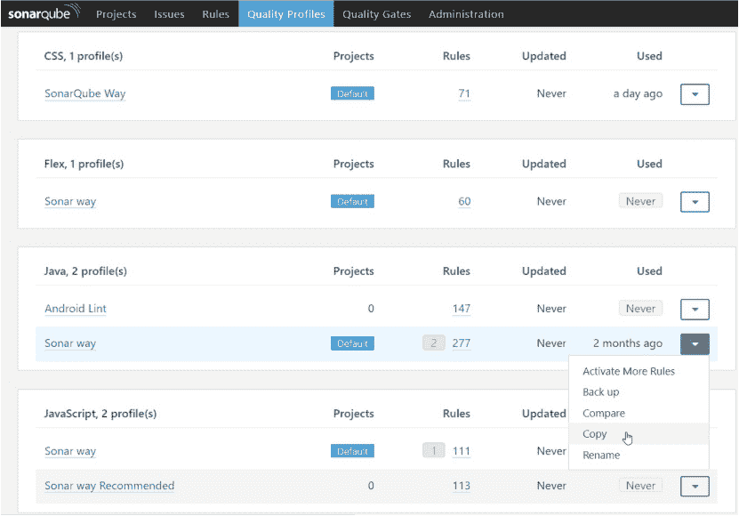

- 2. 为其指定特定名称并点击 Copy：

  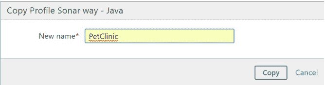

- 3. 我们也可以通过点击 Change Projects 来为特定 Quality Profile 指定项目：

## Build

## Execute SonarQube Scanner

Task to run

JDK

JDK to be used for this SonarQube analysis

Path to project properties

Analysis properties

```
## Language
sonar.language=java

### Encoding of the source files
sonar.sourceEncoding=UTF-8
```

Additional arguments

JVM Options

Add build step

## Post-build Actions

Save

Apply

- 6. 点击 Save 然后 Build now。

- 7. 进入 SonarQube 仪表板并检查 Quality Gate 和 Quality Profiles：


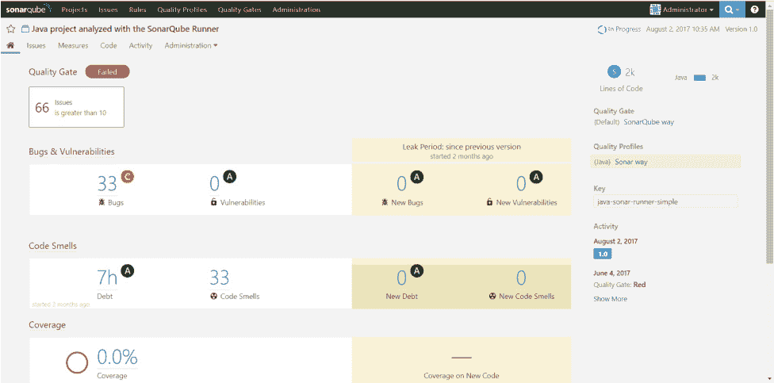

+   8. 现在前往 PetClinic 质量配置页面，点击“更改项目”。
+   9. 选择使用 SonarQube Runner 分析的 Java 项目，然后点击“关闭”：

10. 检查 PetClinic 质量配置中的项目：

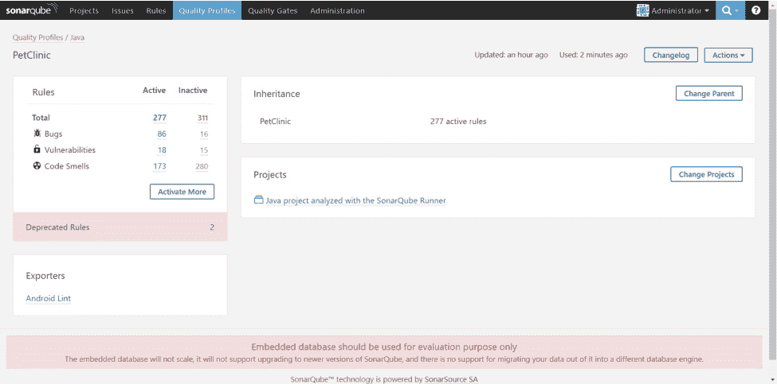

11. 前往 Jenkins，点击“立即构建”：

12. 创建一个新的质量门禁，并将该质量门禁分配给 Java 项目。

13. 我们不需要显式指定语言，因为 SonarQube 足够智能，能够自动识别编程语言并根据默认配置文件对其进行分析。

## 将 SonarQube 配置为 Windows 服务

每次启动系统时都要手动启动 SonarQube 是一件很麻烦的事情。更好的方式是让 SonarQube 在系统启动时自动启动。

## 准备工作

选择“以管理员身份运行”打开命令提示符：

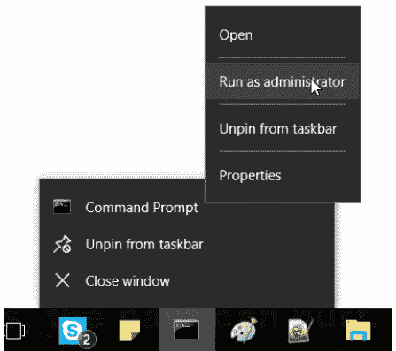

以管理员身份启动命令提示符非常重要。

## 操作步骤...

+   1. 进入 `SonarQube\bin\特定操作系统目录` | 执行 `InstallNTService`：

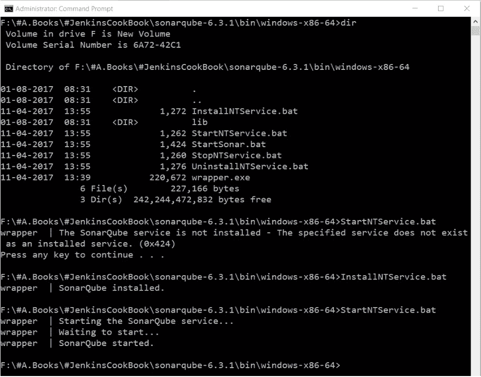

+   2. 执行 `StartNTService.bat`。

## 补充说明

前往 Windows 中的“服务”，验证 SonarQube 服务现在是否可用：

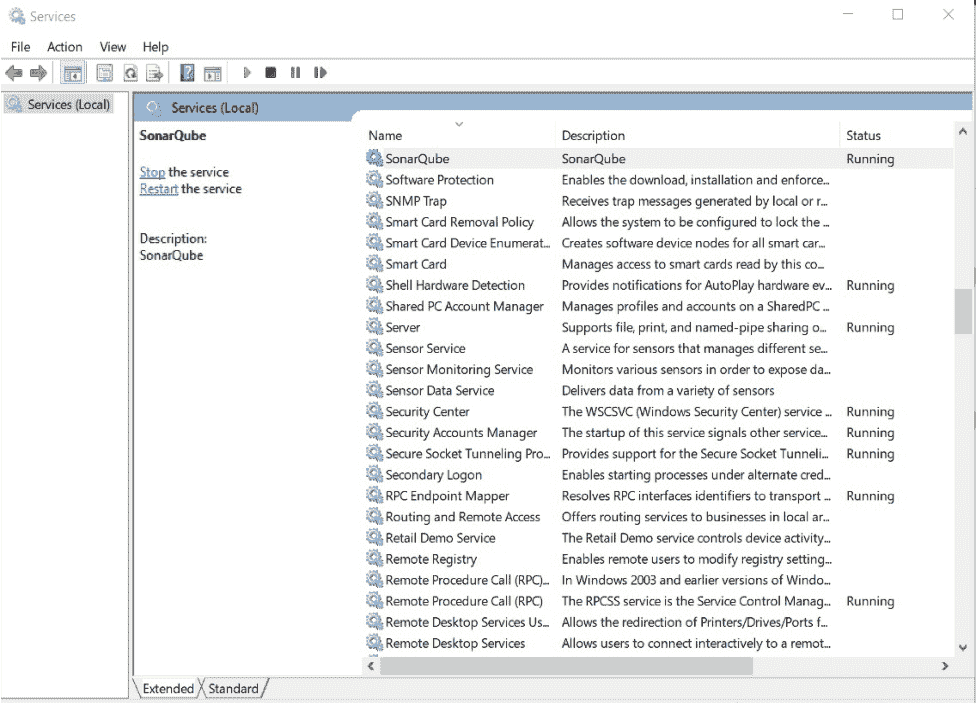

服务一旦可用，你就可以启动、停止或重启服务。
