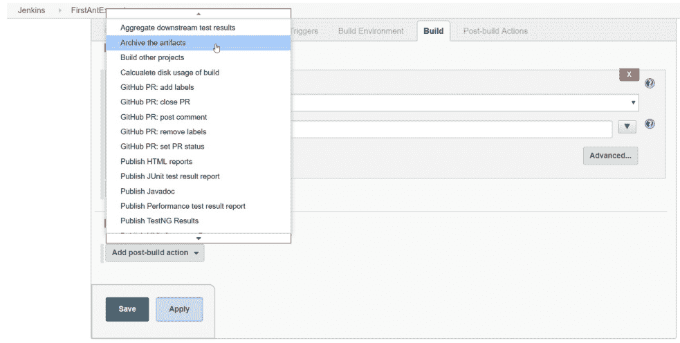
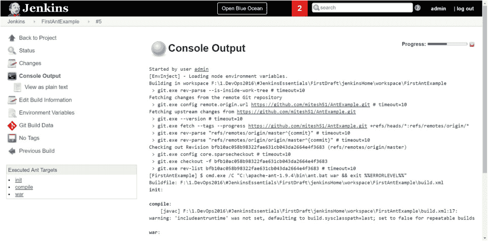
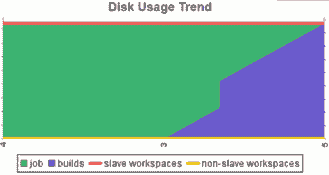
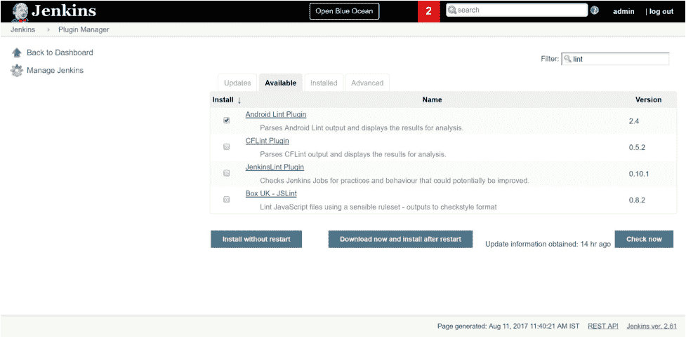
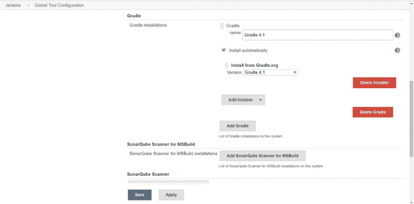
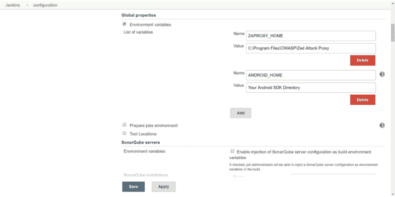
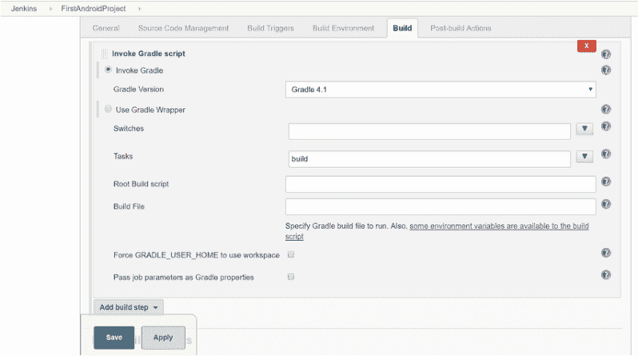
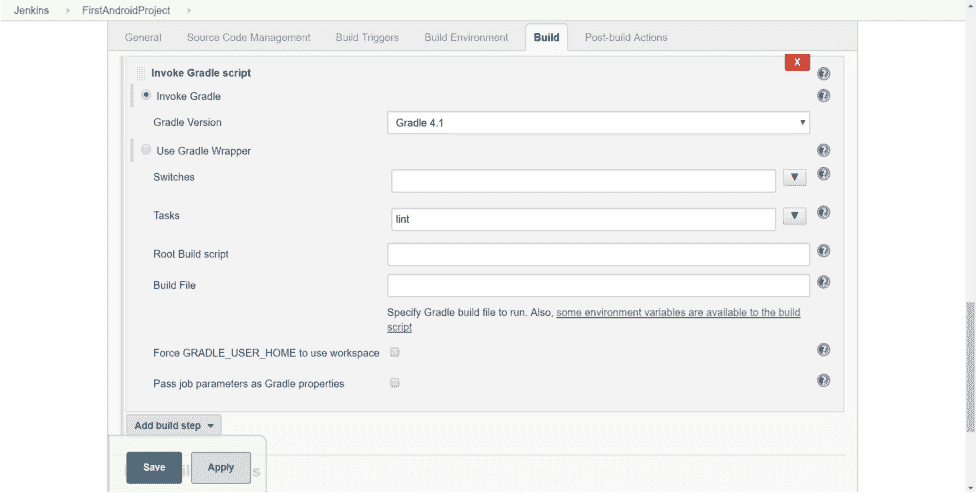
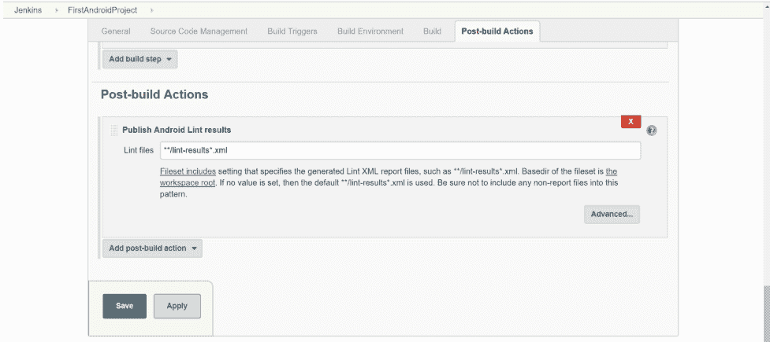
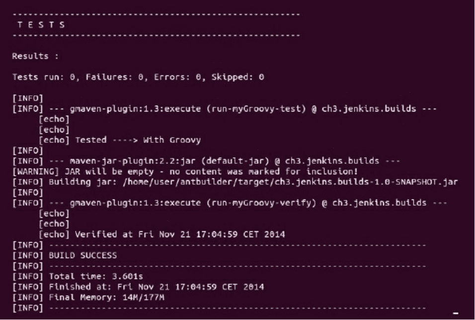

## 在 Jenkins 中构建应用程序

在本章中，我们将涵盖以下内容：

+   - 配置 Ant 项目以执行构建
+   - 配置 Maven 项目以执行构建
+   - 配置 Android 项目以执行构建
+   - 操作环境变量
+   - 在 Maven 中通过 Groovy 运行 Ant
+   - 基于 JSP 语法错误导致的 Jenkins 构建失败
+   - 通过 Jenkins API 远程触发构建任务

## 简介

本章将回顾 Jenkins 与 Ant、Gradle 和 Maven 构建之间的关系，并简要介绍如何使用 Groovy 和 Ant 编写脚本。

Jenkins 极其灵活，能够很好地支持多种平台和技术。Jenkins 拥有直观的界面和清晰的配置设置，非常适合完成构建任务。然而，明确划分 Jenkins 插件与 Maven 构建文件之间的边界同样非常重要。如果缺乏这种划分，你会过度依赖 Jenkins。如果你确定始终通过 Jenkins 运行构建，那么可以将部分核心工作放在 Jenkins 插件中，从而获得一些有用的额外功能。

Jenkins 与具体技术无关，可以将企业内不同项目技术、开发团队以及软件生命周期中的各个阶段无缝衔接在一起。Jenkins 支持你选择任意脚本语言，并能轻松地通过 Git、Subversion、CVS 以及其他版本控制系统获取源代码。如果 Jenkins 不兼容，稍加练习的开发者也可以编写自己的集成方式。

在本书中，你会看到 Subversion 和 Git 项目都有提及，这反映了现实中的混合使用情况。许多人认为 Git 比 Subversion 更灵活。你可以放心地在本书示例中使用 Git 作为首选代码仓库。Jenkins 从一开始就设计为让你能够轻松地在不同的版本控制系统之间进行选择。

如果你查看 2014 年初 Ohoh 中具有代表性的 Git 与 Subversion 使用情况，Git 有 247,103 个代码仓库（占总数的 37%），而 Subversion 有 324,895 个代码仓库（占总数的 48%）。

传统企业由于不愿改变工作流程，往往在使用最新技术方面落后于其他企业。因此，与规模较小的组织相比，这类企业使用 Subversion 仓库的比例会更高。

## 配置 Ant 项目以执行构建

让我们在 Jenkins 中配置一个 Ant 项目，包括静态代码分析、文件编译、创建包文件以及归档，这样你就可以在后续的其他构建任务或项目中使用它。

## 准备工作

你已经在[第1章](Chapter 1)“Jenkins 入门”中的“为 Ant 项目创建自由风格任务”一节中，在 Jenkins 里创建了一个 Ant 项目。

## 操作步骤...

+   1. 前往 Jenkins 仪表板 | Ant 项目 | 常规部分。
+   2. 选择“丢弃旧构建” | 配置“要保留的最大构建数”（以避免构建过多并节省磁盘空间）：

3. 前往“构建” | “添加构建步骤” | “调用 Ant” | 根据 build.xml 提供目标：

4. 前往“构建后操作” | “添加构建后操作” | “归档构建产物”。

5. 提供需要归档的 .WAR 文件路径，以便其他项目在需要时可以使用该包文件：



+   6. 点击“立即构建”。
+   7. 前往“控制台输出”（如下方截图所示），验证我们配置的所有操作或动作的构建执行日志：



8. 前往项目仪表板，并在左下方验证构建历史中的构建次数。前往项目仪表板并验证工作区。你将找到包文件。这两项都在此截图中展示：

## 项目 FirstAntExample

Jenkins › FirstAntExample

+   - 返回仪表板
+   - 状态
+   - 变更
+   - 工作区
+   - 立即构建
+   - 删除项目
+   - 配置
+   - 收藏

## 构建历史

+   - #5 — 2017年8月11日 上午10:41 — 4 MB
+   - #4 — 2017年7月27日 上午8:57 — 9 KB
+   - #3 — 2017年7月27日 上午8:53 — 7 KB

+   - 工作区
+   - 最后成功构建的产物 — AntExample.war — 4.19 MB
+   - 最近变更
+   - 磁盘使用情况
+     - 任务 — 4 MB
+     - 所有构建 — 4 MB
+     - 锁定构建
+     - 所有工作区 — 9 MB
+     - 从属工作区 — 9 MB
+     - 非从属工作区



添加描述
禁用项目

## 固定链接

+   - 上次构建（#5），2 分 40 秒前
+   - 上次稳定构建（#5），2 分 40 秒前
+   - 上次成功构建（#5），2 分 40 秒前

所有 RSS · 失败 RSS

## 配置 Maven 项目以执行构建

让我们在 Jenkins 中配置一个 Maven 项目，包括静态代码分析、文件编译、创建包文件以及归档，这样你就可以在后续的其他构建任务或项目中使用它。

## 操作步骤...

+   1. 前往 Jenkins 仪表板 | Maven 项目 | 常规部分。
+   2. 选择“丢弃旧构建” | 配置“要保留的最大构建数”（以避免构建过多并节省磁盘空间）。
+   3. 由于在创建构建任务或项目时已选择 Maven 模板，我们只需验证 pom.xml 的路径，然后可以输入 `package` 作为目标来创建包文件，对于 Java 项目则生成 WAR 文件。
+   4. 前往“构建后操作” | “添加构建后操作” | “归档构建产物”。
+   5. 提供需要归档的 war 文件路径，以便其他项目在需要时可以使用该包文件。
+   6. 点击“立即构建”。
+   7. 前往“控制台输出”，验证我们配置的所有操作或动作的构建执行日志。

```
INFO: Task total time: 1:02.260 s
INFO: ------------------------------------------------------------
INFO: EXECUTION SUCCESS
INFO: ------------------------------------------------------------
INFO: Total time: 1:37.380s
INFO: Final Memory: 51M/223M
INFO: ------------------------------------------------------------
Archiving artifacts
Started calculation of disk usage of build
Finished calculation of disk usage of build in 0 seconds
Started calculation of disk usage of workspace
Finished calculation of disk usage of workspace in 0 seconds
Finished: SUCCESS
```

8. 前往项目仪表板，并在构建历史中验证构建次数：


## 配置 Android 项目以执行

您已经在[第1章](#)（*Jenkins入门*）中的“*为Ant项目创建Freestyle任务*”一节创建了一个 Jenkins Freestyle 项目。现在您需要为 Android 项目创建 Freestyle 项目。

## 准备工作

您可以使用 Android Lint 进行静态代码分析。在配置持续集成之前，请先安装所需插件。

前往 Jenkins 仪表盘 | 管理 Jenkins | 管理插件 | 可选插件

安装 Android Lint 插件：



等待插件成功安装：

## 安装插件/升级

准备

- 检查互联网连接
- 检查更新中心连接
- 成功

- 静态分析工具 — 成功
- Android Lint 插件 — 成功

- [返回顶部页面](#)（您可以立即开始使用已安装的插件）
- 安装完成且没有任务在运行时，请重启 Jenkins

前往 Jenkins 仪表盘 | 管理 Jenkins | 全局工具配置 | Gradle | 添加 Gradle，如截图所示：



前往 Jenkins 仪表盘 | 管理 Jenkins|配置系统 | 全局属性 | 环境变量。

为 `ANDROID_HOME` 提供 Android SDK 路径：



现在，您可以使用 Lint 配置 Android 构建和代码分析，并在 Jenkins 中发布 Android Lint 结果。



5. 要使用 Android Lint 分析代码，请使用任务栏中的 lint：



6. 从构建后操作中发布 Android Lint 结果，如下图所示：



7. 这样，我们就可以为持续集成或执行配置 Ant、Maven 和 Android 项目，以创建可分发给或部署的包文件。

## 操作环境变量

本方案介绍如何将变量从 Jenkins 传递到构建任务，以及不同变量如何被覆盖。它还描述了一种在关键信息未正确传递时导致构建失败的方法。

在典型的开发/验收/生产环境中，您希望保留相同的 `pom.xml` 文件，但传递不同的配置。一个例子是属性文件的扩展名，如 `.dev`、`.acc` 和 `.prd`。如果由于人为错误导致关键配置值缺失，您希望构建失败。

Jenkins 有许多插件可用于向构建传递信息，包括 EnvFile 插件（[https://wiki.jenkins-ci.org/display/JENKINS/Envfile+Plugin](https://wiki.jenkins-ci.org/display/JENKINS/Envfile+Plugin)）和 EnvInject 插件（[https://wiki.jenkins-ci.org/display/JENKINS/EnvInject+Plugin](https://wiki.jenkins-ci.org/display/JENKINS/EnvInject+Plugin)）。本方案选择 EnvInject 插件，因为据报道它可以与节点配合使用，并提供多种属性注入选项。

### 操作步骤...

1. 创建一个 Jenkins 可读的 `pom.xml` 文件，包含以下代码行：

```xml
<project xmlns="http://maven.apache.org/POM/4.0.0"
xmlns:xsi="http://www.w3.org/2001/XMLSchema-instance"
xsi:schemaLocation="http://maven.apache.org/POM/4.0.0
http://maven.apache.org/maven-v4_0_0.xsd">
<modelVersion>4.0.0</modelVersion>
<groupId>org.berg</groupId>
<artifactId>ch3.jenkins.builds.properties</artifactId>
<version>1.0-SNAPSHOT</version>
<name>${project.name}</name>
<properties><project.build.sourceEncoding>UTF8</project.build.sourceEncoding>
</properties>
<build>
<plugins><plugin>
<groupId>org.codehaus.gmaven</groupId>
<artifactId>gmaven-plugin</artifactId>
<version>1.3</version>
<executions>
<execution>
<id>run-myGroovy</id>
<goals><goal>execute</goal></goals>
<phase>verify</phase>
<configuration>
<source>
def environment = System.getenv()
println "---Environment"
environment.each{println it }
println "---Property"
println(System.getProperty("longname"))
println "---Project and session"
println "Project: ${project.class}"
println "Session: ${session.class}"
println "longname: ${project.properties.longname}"
println "Project name: ${project.name}"
println "JENKINS_HOME: ${project.properties.JENKINS_HOME}"
</source>
</configuration>
</execution></executions>
</plugin></plugins>
</build>
</project>
```

2. 创建一个名为 `my.properties` 的文件，并将其放在与 `pom.xml` 文件相同的目录中。然后，在 `my.properties` 文件中添加以下代码行：

```properties
project.type=prod
secrets.file=/etc/secrets
enable.email=true
JOB_URL=I AM REALLY NOT WHAT I SEEM
```

3. 创建一个名为 `ch3.environment` 的空白 Freestyle 任务。

4. 在“源代码管理”部分，勾选“文件系统”，并在“路径”字段中为您的目录添加一个完整路径，例如 `/var/lib/jenkins/cookbook/ch3.building_software/environment`。

5. 在“构建”部分，选择“调用顶层 Maven 目标”添加一个构建步骤。在新展开的部分中，添加以下详细信息：

```text
Maven version: 3.2.1
Goals: verify
```

6. 点击“高级”按钮，并在“属性”中键入 `longname=SuperGood`。

### 工作原理...

EnvInject 插件对于向构建中注入属性非常有用。

在本方案中，Maven 会运行两次。第一次运行时未定义 `name.from.jenkins` 变量，Jenkins 任务失败。第二次运行时定义了该变量，Jenkins 任务成功。

Maven 期望定义 `name.from.jenkins` 变量，否则项目的名称也将不会被定义。通常，这不足以阻止任务成功。然而，在运行 Groovy 代码时，`println "Project name: ${project.name}"` 这一行，特别是 `project.name` 调用，会导致构建失败。这对于防止属性值缺失非常有用。

Groovy 代码可以查看 `org.apache.Maven.model.Model` 项目和 `org.apache.Maven.execution.MavenSession` 类的实例。项目实例是 XML 配置的模型，您可以以编程方式访问。您可以通过 `project.properties.longname` 引用 longname 属性。如果该属性不存在，您的 Maven 目标将失败。您还可以通过 `System.getProperty("longname")` 调用来获取该属性。但是，您无法通过 `System.getenv()` 环境调用获取该属性。

非常值得了解各种选项：

- **保留 Jenkins 环境变量和保留 Jenkins 构建变量：** 这两个选项都会影响您的任务所看到的与 Jenkins 相关的变量。最好保持环境尽可能干净，因为这有助于您稍后进行调试。
- **属性内容：** 您可以覆盖属性文件中的特定值。
- **环境脚本文件路径：** 此选项指向一个将设置环境的脚本。如果您想检测运行环境的特定细节并相应地配置构建，这很有用。
- **填充构建原因：** 您可以启用 Jenkins 设置 `BUILD_CAUSE` 环境变量。该变量包含有关触发任务的事件的信息。

### 扩展阅读...

Maven 有一个用于读取属性的插件（http://mojo.codehaus.org/properties-maven-plugin/）。要在属性文件之间进行选择，您需要在插件配置中设置一个变量，并将其作为 Jenkins 任务的一部分调用，如下所示：

```
<build>
<plugins>
<plugin>
<groupId>org.codehaus.mojo</groupId>
<artifactId>properties-maven-plugin</artifactId>
<version>1.0-alpha-2</version>
<executions>
<execution>
<phase>initialize</phase>
<goals>
<goal>read-project-properties</goal>
</goals>
<configuration>
<files>
<file>${fullpath.to.properties}</file>
</files>
</configuration>
</execution>
</executions>
</plugin>
</plugins>
</build>
```

如果您使用指向 `properties` 文件的相对路径，那么该文件可以位于您的源代码中。如果您使用完整路径，则 `properties` 文件可以存储在 Jenkins 服务器上。如果包含敏感密码（例如数据库连接密码），则第二种选择更佳。

Jenkins 可以在您手动运行任务时请求变量。这称为参数化构建（https://wiki.jenkins-ci.org/display/JENKINS/Parameterized+Build）。在构建时，您可以从一系列属性文件位置中进行选择，从而选择您的属性文件。


## 另请参阅

-   *《在 Maven 中通过 Groovy 运行 Ant》*配方

## 在 Maven 中通过 Groovy 运行 Ant

Jenkins 所面向的用户具有广泛的技术背景。许多开发者在转向使用 Maven 之前就已精通 Ant 脚本编写，他们可能更乐于编写 Ant 任务，而不是编辑 pom.xml 文件。在相当一部分组织中，仍然运行着关键业务的 Ant 脚本。

在 Maven 中，你可以直接使用 AntRun 插件（http://maven.apache.org/plugins/maven-antrun-plugin/）或通过 Groovy（http://docs.codehaus.org/display/GROOVY/Using+Ant+from+Groovy）来运行 Ant 任务。AntRun 代表了一条自然的迁移路径，也是初期工作最少的路径。

对于将 Groovy 作为任务一部分的 Jenkins 管理员来说，Groovy 方法很有意义。作为一种一流的编程语言，Groovy 拥有许多 Ant 难以复制的控制结构。你可以使用 Ant-contrib 库（http://ant-contrib.sourceforge.net）来部分实现这些控制结构。然而，作为一种功能丰富的编程语言，Groovy 的表达能力要强得多。

本配方详细介绍了如何运行两个涉及 Groovy 和 Ant 的 Maven POM 文件。第一个 POM 展示了如何在 Groovy 中运行最简单的 Ant 任务，第二个 POM 则执行一个 Ant-Contrib 任务，以安全地从大量计算机复制文件。

## 准备工作

创建一个名为 `ch3.building_software/antbuilder` 的目录。

## 如何操作...

- 1. 创建一个模板文件并将其命名为 `pom_ant_simple.xml`。
- 2. 将 `groupId`、`artifactId`、`version` 和 `name` 的值改为适合你的值。
- 3. 在 `</project>` 标签之前添加以下 XML 片段：

```xml
<build>
  <plugins><plugin>
    <groupId>org.codehaus.gmaven</groupId>
    <artifactId>gmaven-plugin</artifactId>
    <version>1.3</version>
    <executions>
      <execution>
        <id>run-myGroovy-test</id>
        <goals><goal>execute</goal></goals>
        <phase>test</phase>
        <configuration>
          <source>
            def ant = new AntBuilder()
            ant.echo("\n\nTested ----> With Groovy")
          </source>
        </configuration>
      </execution>
      <execution>
        <id>run-myGroovy-verify</id>
        <goals><goal>execute</goal></goals>
        <phase>verify</phase>
        <configuration>
          <source>
            def ant = new AntBuilder()
            ant.echo("\n\nVerified at ${new Date()}")
          </source>
        </configuration>
      </execution>
    </executions>
  </plugin></plugins>
</build>
```

- 4. 运行 `mvn test -f pom_ant_simple.xml`。查看输出（注意不会出现关于空 JAR 文件的警告）：
- 5. 运行 `mvn verify -f pom_ant_simple.xml`。查看输出，它应该类似于以下截图：



- 4. 创建第二个模板文件并将其命名为 `pom_ant_contrib.xml`。
- 5. 将 `groupId`、`artifactId`、`version` 和 `name` 的值改为适合你的值。
- 6. 在 `</project>` 标签之前添加以下 XML 片段：

```xml
<build>
<plugins><plugin>
<groupId>org.codehaus.gmaven</groupId>
<artifactId>gmaven-plugin</artifactId>
<version>1.3</version>
<executions>
<id>run-myGroovy</id>
<goals><goal>execute</goal></goals>
<phase>verify</phase>
<configuration>
<source>
def ant = new AntBuilder()
host="Myhost_series"
print "user: "
user = new String(System.console().readPassword())
print "password: "
pw = new String(System.console().readPassword())

for ( i in 1..920) {
  counterStr=String.format('%02d',i)
  ant.scp(trust:'true',file:"${user}:${pw}@${host}${counterStr}:/${full_path_to_loca

localTofile:"${myfile}-${counterStr}", verbose:"true")
}
</source>
</configuration>
</execution>
</executions>
<dependencies>
<dependency>
<groupId>ant</groupId>
<artifactId>ant</artifactId>
<version>1.6.5</version>
</dependency>
<dependency>
```

```xml
<groupId>ant</groupId>
<artifactId>ant-launcher</artifactId>
<version>1.6.5</version>
</dependency>
<dependency>
<groupId>ant</groupId>
<artifactId>ant-jsch</artifactId>
<version>1.6.5</version>
</dependency>
<dependency>
<groupId>com.jcraft</groupId>
<artifactId>jsch</artifactId>
<version>0.1.42</version>
</dependency>
</dependencies>
</plugin></plugins>
</build>
```

这只是示例代码，除非你已将其设置为指向真实服务器上的真实文件：

```text
mvn verify -f pom_ant_simple.xml will fail
```

## 工作原理...

Groovy 无需额外依赖即可运行基本的 Ant 任务。系统会创建一个 `AntBuilder` 实例（http://groovy.codehaus.org/Using+Ant+Libraries+with+AntBuilder），然后调用 Ant 的 echo 任务。在底层，Groovy 会调用 Ant 用于执行 `echo` 命令的 Java 类。在 `echo` 命令中，通过直接创建一个匿名对象来打印日期：

```
ant.echo("\n\nVerified at ${new Date()}").
```

你将 `pom.xml` 文件配置为在两个阶段触发 Groovy 脚本：test 阶段，以及随后的 verify 阶段。test 阶段发生在生成 JAR 文件之前，因此避免了创建空 JAR 文件的警告。顾名思义，该阶段适用于打包前的测试。

第二个示例脚本凸显了 Groovy 与 Ant 结合的优势。SCP 任务（http://ant.apache.org/manual/Tasks/scp.html）在多台服务器上被多次运行。脚本首先要求输入用户名和密码，避免将其存储在文件系统或版本控制系统中。Groovy 脚本需要你注入 `host`、`full_path_to_location` 和 `myfile` 变量。

请注意 Ant SCP 任务与其在 `pom_ant_contrib.xml` 文件中的表达方式之间的相似性。

## 更多内容...

通过 Groovy 运行 Ant 的另一个示例是即时创建自定义属性文件。这允许你将信息从一个 Jenkins 任务传递到另一个任务。

你可以通过 AntBuilder 使用 echo 任务创建属性文件。以下代码行创建一个包含两行（x=1 和 y=2）的 value.properties 文件：

```
def ant = new AntBuilder()
ant.echo(message: "x=1\n", append: "false", file: "values.properties")
ant.echo(message: "y=2\n", append: "true", file: "values.properties")
```

第一个 echo 命令将 append 设置为 false，因此每次构建时都会创建一个新的属性文件。第二个 echo 命令则追加其消息。

你可以移除第二个 append 属性，因为其默认值为 true。

## 准备工作

创建一个名为 `ch3.building_software/jsp_example` 的目录。

```html
</html>
```

- 6. 使用 `mvn package` 命令创建 WAR 文件。
- 7. 通过在以 `if` 开头的行下方添加 `if (evilInput==null)` 来修改 `./src/main/webapp/index.jsp`，使其不再是一个有效的 JSP 文件。
- 8. 运行 `mvn package` 命令。现在构建将失败，并显示以下错误消息：

```text
[ERROR] Failed to execute goal org.mortbay.jetty:maven-jetty-jspc-
plugin:6.1.14:jspc (jspc) on project jsp_example: Failure processing jsps ->
[Help 1]
```

## 工作原理...

你使用一个原型（archetype）创建了一个模板项目。

Maven 插件在检测到 `index.jsp` 页面后，会将其编译成一个名为 `jsp.index_jsp` 的类，并将编译后的类放在 `WEB-INF/classes` 下。随后，插件会在 `WEB-INF/web.xml` 中将该类定义为 servlet，并映射到 `/index.jsp`。让我们看下面的示例：

```xml
<servlet>
<servlet-name>jsp.index_jsp</servlet-name>
<servlet-class>jsp.index_jsp</servlet-class>
</servlet>

<servlet-mapping>
<servlet-name>jsp.index_jsp</servlet-name>
<url-pattern>/index.jsp</url-pattern>
</servlet-mapping>
```

原型（archetype）列表会随时间不断增长。你可以在 [http://maven-repository.com/archetypes](http://maven-repository.com/archetypes) 找到完整列表。如果你运行的是 Ubuntu，你会在 `~/.m2` 目录下找到一个名为 `archetype-catalog.xml` 的本地 XML 目录文件，其中列出了所有原型。


## 更多内容...

这里有一些你应该考虑的事项。

## 用于JSP页面的Eclipse模板

Eclipse是一个流行的Java开发者开源IDE（http://www.eclipse.org/）。如果你使用Eclipse及其默认的JSP页面模板，那么你的页面可能无法编译。这是因为，在撰写本文时，默认编译器不喜欢在<html>标签之前提到的元信息，如下所示：

```
<%@ page language="java" contentType="text/html;charset=UTF-8"
pageEncoding="UTF-8"%>
<!DOCTYPE html PUBLIC "-//W3C//DTD HTML 4.01 Transitional//EN"
"http://www.w3.org/TR/html4/loose.dtd">
```

由于元信息遵循JSP规范，很可能之后JSP编译器会接受该信息。在那之前，只需在编译前删除这些行，或者更换你使用的JSP编译器。

## 通过Jenkins API远程触发作业

Jenkins有一个远程API，允许你启用、禁用、运行和删除作业；它还允许你更改配置。该API随着每个Jenkins版本而增加。要获取最新的详细信息，你需要查看`http://yourhost/job/Name_of_Job/api/`。其中`yourhost`是你Jenkins服务器的位置，`Name_of_Job`是你服务器上存在的作业名称。

本教程详细介绍了如何使用安全令牌远程触发构建。这将允许你从Maven内部运行其他作业。

## 准备工作

本教程期望Jenkins安全已开启，以便你可以作为用户登录。它还假设你安装了现代版本的wget（http://www.gnu.org/software/wget/）。

## 操作步骤...

- 1. 创建一个Freestyle项目，项目名称为`ch3.RunMe`。
- 2. 勾选“此构建已参数化”（This Build is parameterized），选择“字符串参数”（String Parameter），并添加以下详细信息：
  - 1. 名称（Name）：`myvariable`
  - 2. 默认值（DefaultValue）：`Default`
  - 3. 描述（Description）：`This is my example variable`
- 3. 在“构建触发器”（Build Triggers）部分，勾选“远程触发构建（例如，从脚本）”（Trigger builds remotely (for example, from scripts)）。
- 4. 在“身份验证令牌”（Authentication Token）文本框中，添加`changeme`。
- 5. 点击“保存”（Save）按钮。
- 6. 点击“使用参数构建”（Build with Parameters）链接。
- 7. 系统会要求你输入名为`myvariable`的变量。点击“构建”（Build）。
- 8. 访问你的个人配置页面，例如http://localhost:8080/，将`your_user`替换为你的Jenkins用户名。
- 9. 在“API令牌”（API Token）部分，点击“显示API令牌...”（Show API Token...）按钮。
- 10. 将令牌复制到`apiToken`。
- 11. 从终端控制台运行`wget`以登录并远程运行作业：
- 12. 检查Jenkins作业，验证它尚未运行并返回405 HTTP状态码：
- 13. 从终端控制台运行`wget`以登录并运行作业，返回201 HTTP状态码：

```
wget --auth-no-challenge --http-user=username --http-password=apiToken
http://localhost:8080/job/ch3.RunMe/build?token=changeme
```

```
Resolving localhost (localhost)... 127.0.0.1
Connecting to localhost (localhost)|127.0.0.1|:8080... connected.
HTTP request sent, awaiting response... 405 Method Not Allowed
2014-08-14 15:08:43 ERROR 405: Method Not Allowed.
```

```
wget --auth-no-challenge --http-user=username --http-password=apiToken
http://localhost:8080/job/ch3.RunMe/buildWithParameters?
token=changeme&myvariable='Hello World'
Connecting to localhost (localhost)|127.0.0.1|:8080... connected.
HTTP request sent, awaiting response... 201 Created
```

HTTP可能会被第三方进行数据包嗅探。传输密码时请使用HTTPS。

## 更多内容...

这里有一些你应该考虑的事项。

## 从Maven内部运行作业

无需多费周折，你可以通过Maven-AntRun插件运行wget。以下是等价的`pom.xml`片段：

```
```xml
<build>
<plugin>
<groupId>org.apache.maven.plugins</groupId>
<artifactId>maven-antrun-plugin</artifactId>
<version>1.7</version>
<executions><execution>
<phase>compile</phase>
<configuration>
<tasks>
<exec executable="wget">
<arg line="--auth-no-challenge --http-user=username --http-password=apiToken http://localhost:8080/job/ch3.RunMe/build?token=changeme" />
</exec>
</tasks>
</configuration>
<goals><goal>run</goal></goals>
</execution></executions>
</plugin>
</build>
```
```

你可以使用Exec Maven插件来达到与Maven-AntRun插件相同的目的。更多详情，请访问http://mojo.codehaus.org/exec-maven-plugin/。

## 远程生成作业

还有一个项目允许你通过Maven远程创建Jenkins作业（https://github.com/evgeny-goldin/maven-plugins/tree/master/jenkins-maven-plugin）。这种方法的好处是能够在作业之间强制实现一致性和复用。你可以使用一个参数来选择Jenkins服务器并填充它。这对于生成大量结构一致的作业非常有用。

## 另请参阅

- *通过Maven中的Groovy运行Ant*的教程
