## 持续交付

在本章中，我们将介绍以下教程：

- 归档构件
- 从另一个构建作业复制构件
- 将Jenkins与Artifactory集成
- 从Jenkins将WAR文件部署到Tomcat
- 从Jenkins将WAR文件部署到AWS Beanstalk
- 从Jenkins将WAR文件部署到Azure应用服务
- 提升构建

## 引言

**持续交付（CD）**是一种DevOps实践，用于在非生产环境中通过自动化方法快速部署应用程序，同时保持高质量。它关乎应用程序包在开发、测试或预发布等环境中的Web服务器或应用服务器上的部署方式。应用程序的部署可以使用shell脚本、批处理文件或Jenkins中可用的插件来完成。在持续交付和持续部署的情况下，自动化部署的方法在大多数时候总是相同的。在持续交付的情况下，应用程序包始终是生产就绪的。

## 归档构件

当你想在另一个项目或构建作业中使用可安装或分发包时，构件归档非常有用。通常，你会创建一个不同的项目来实现端到端自动化的流水线。

## 操作步骤...

- 1. 转到Jenkins仪表盘 | Jenkins项目或构建作业 | 构建后操作 | 添加构建后操作 | 归档构件：

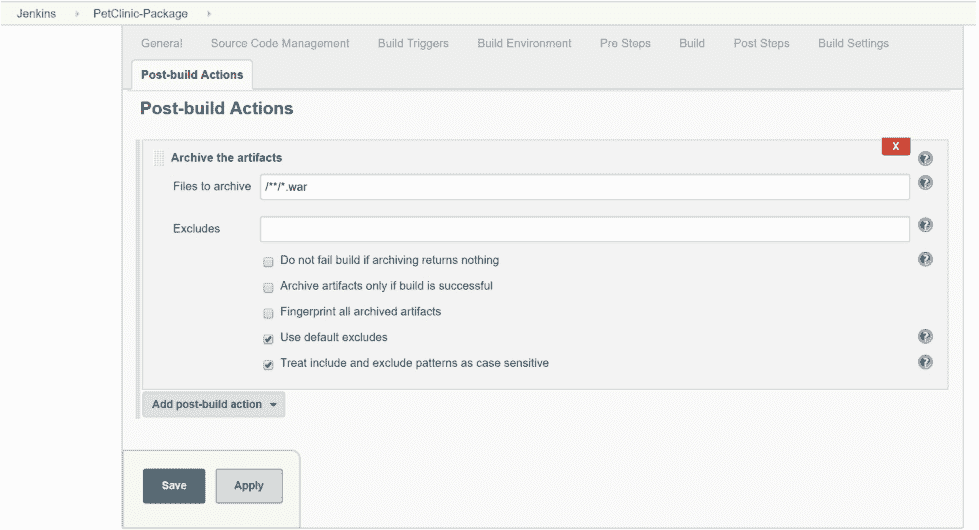

2. 你可以使用通配符，例如`module/dist/**/*.zip`。构件归档器使用Ant的`org.apache.tools.ant.DirectoryScanner`，默认情况下排除以下模式：`**/%*, **/.git/**, **/.bzr, **/hg/**, **/.bzrignore, **/.git, **/SCCS/**, **/hg, **/#*`

## 另请参阅

- *从其他构建作业复制构件*的教程对于将已归档的构件从另一个项目复制到Jenkins非常有用

## 从另一个构建作业复制构件

在本教程中，我们将把构件/文件/包从一个构建复制到另一个构建。这有助于部署或复制操作。即使使用Master/Agent架构，我们也可以使用`Copy Artifact`插件轻松复制构件。

## 准备工作

你需要允许匿名用户具有读权限，因为Copyartifact插件将运行中的构建视为匿名。要允许匿名用户读访问，请执行以下操作：

转到管理Jenkins | 全局安全配置：

## Jenkins › 配置全局安全

启用安全
禁用记住我
访问控制

## 安全域

Active Directory
委托给servlet容器
Jenkins自己的用户数据库
允许用户注册
在注册时启用验证码
验证码支持
JCaptcha
LDAP

## 授权

任何人都可以做任何事
传统模式
已登录用户可以做任何事
基于矩阵的安全

| 用户/组 | 总体 | 凭据 | 代理 | 作业 |
| 匿名 | 管理 读取 创建 删除 管理域 更新 查看 构建 配置 连接 创建 删除 断开 配置 构建 取消 配置 创建 删除 发现 |

要添加的用户/组： [ ] 添加

保存   应用

点击“保存”。


## 如何操作...

+   1. 进入 Jenkins 仪表盘 | 项目 | 配置 | 构建 | 添加构建步骤 | 从另一个项目复制构件。
+   2. 输入要复制构件的项目名称。
+   3. 对于“Which build”字段，从可用列表中选择合适的选项：
+   4. 提供要复制的构件名称：

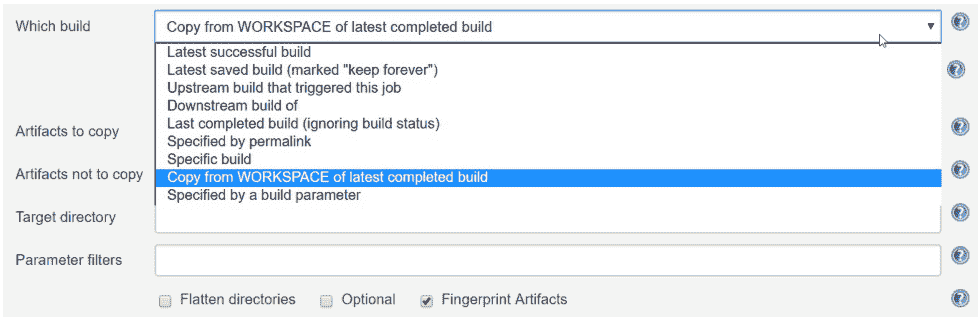

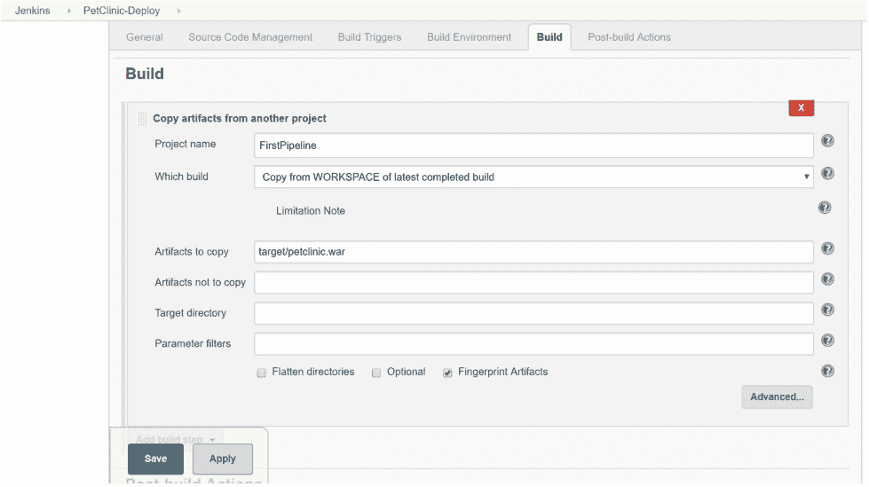

5. 点击保存。

## 还有更多...

+   - 你还可以指定可以复制构件的项目。
+   - 例如，在 `PetClinic-Package` 项目中你可以创建一个 WAR 文件以部署到应用服务器。
+   - 在 `PetClinic-Package` 的 General 部分，勾选 Permission to Copy Artifact 并提供可以复制构件的项目名称：

+   - 点击保存。

## 将 Jenkins 与 Artifactory 集成

Artifactory 是一个仓库管理器，允许你存储和检索构件，例如依赖项或包文件。它就像组织中的本地仓库。

## 准备工作

在本教程中，使用 https://bintray.com/jfrog/artifactory/jfrog-artifactory-oss-zip/4.15.0 作为 Artifactory。

要启动 Artifactory，进入 artifactory-oss-4.15.0 | bin 并执行 artifactory.bat。如果操作系统基于 Linux，则使用 .sh 脚本启动 Artifactory。

在浏览器中打开并访问 IP_ADDRESS:8081 以在浏览器中访问 Artifactory：

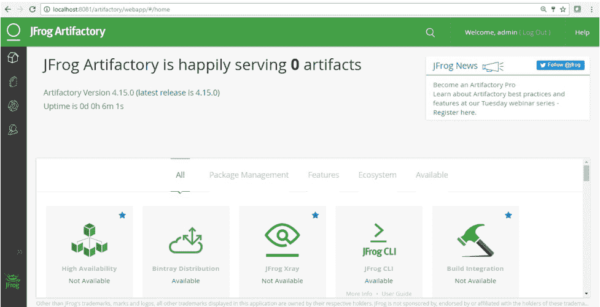

创建本地仓库以存储 Jenkins 项目创建的包文件：

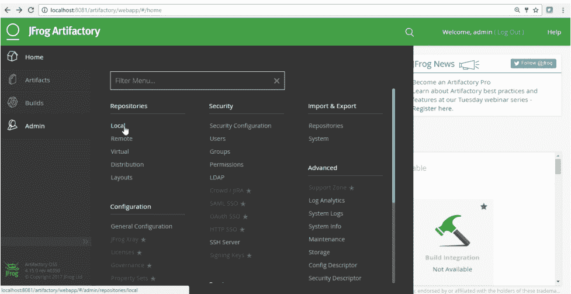


创建一个可从 Jenkins 使用以访问 Artifactory 的用户：

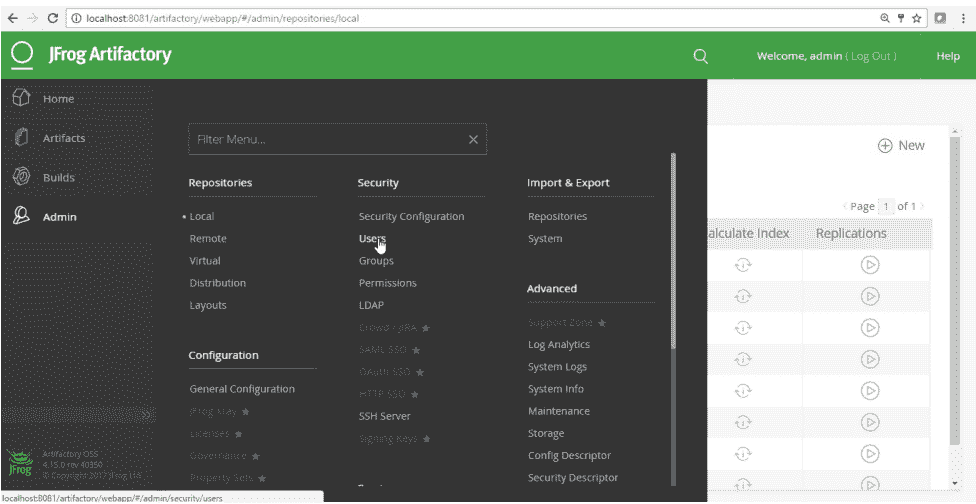

点击新建：

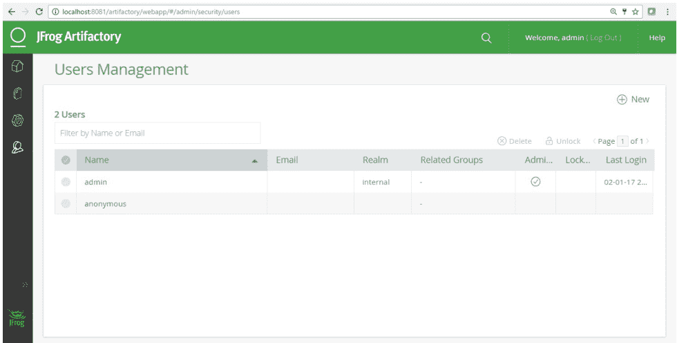

提供用户详细信息并保存：

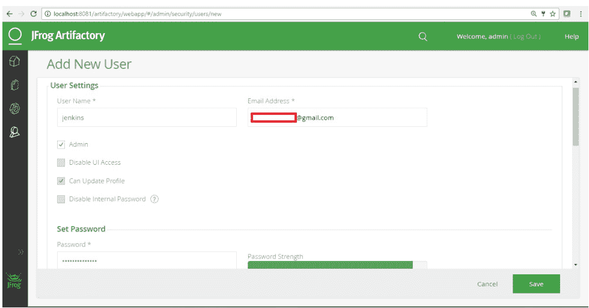

验证用户列表：

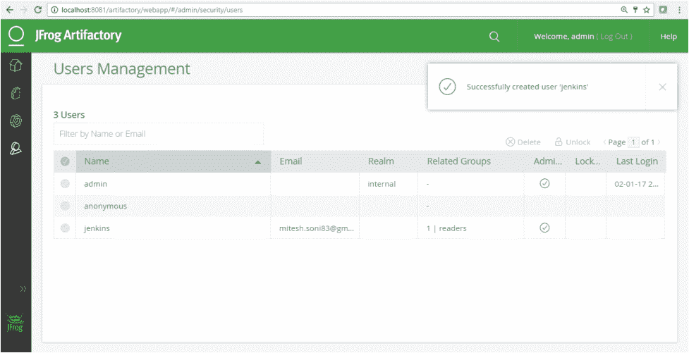

为新创建的用户提供对仓库的权限：

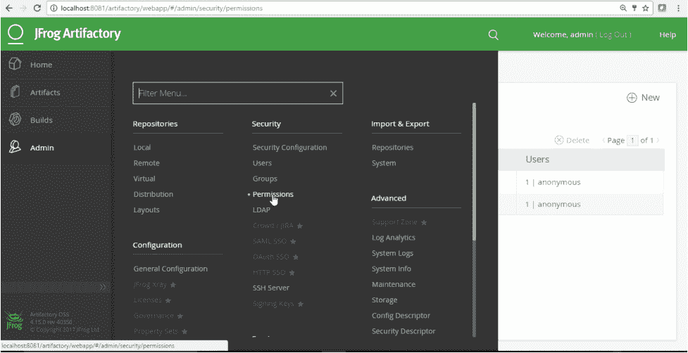

选择 Repositories 并点击保存并完成：

检查 Artifactory 中的权限管理部分以查看最近的更改：

编辑权限并分配用户：

点击保存并完成：

检查 Artifactory 中的权限管理部分以查看最近的更改：

[368]

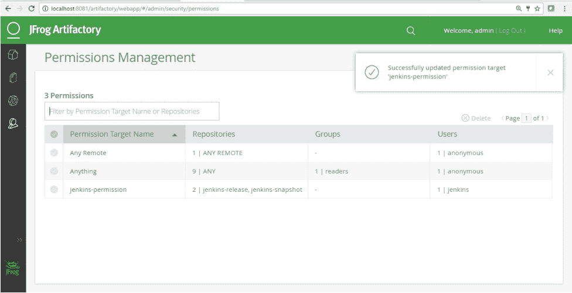

现在，你已准备好将 Artifactory 与 Jenkins 集成。

在 Jenkins 中安装 Artifactory 插件：

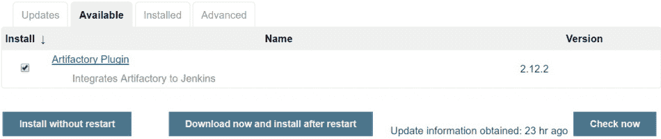

插件安装成功后，你可以在 Jenkins 中配置 Artifactory 相关设置：

## 安装插件/升级

准备工作

+   - 检查互联网连接
+   - 检查更新中心连接
+   - 成功

+   - Config File Provider Plugin — 成功
+   - Ivy Plugin — 成功
+   - Artifactory Plugin — 成功

+   - [返回顶部页面](#)（你现在就可以开始使用已安装的插件）
+   - 安装完成后且没有作业运行时重启 Jenkins

## 在 Jenkins 中配置 Artifactory：

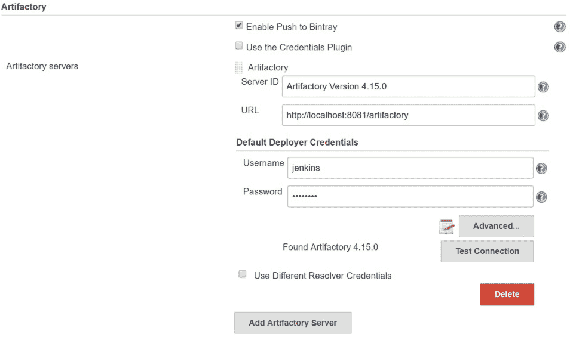

当你使用 Maven 作为构建工具时，它会创建 `.m2` 目录。这会在从互联网上可用的 Maven 仓库下载依赖项时，将所有依赖项保存在仓库目录中。

为验证目的，将 `.m2` 目录中的目录名称更改为 `repository1`：

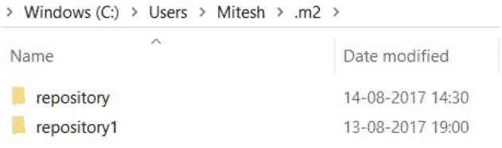

Jenkins 构建执行开始的瞬间，它将从 Artifactory 获取依赖项，并在 `.m2` 中创建仓库目录。

4. 从添加后构建操作中选择部署构件到 Artifactory：

5. 点击刷新并选择之前创建的仓库：

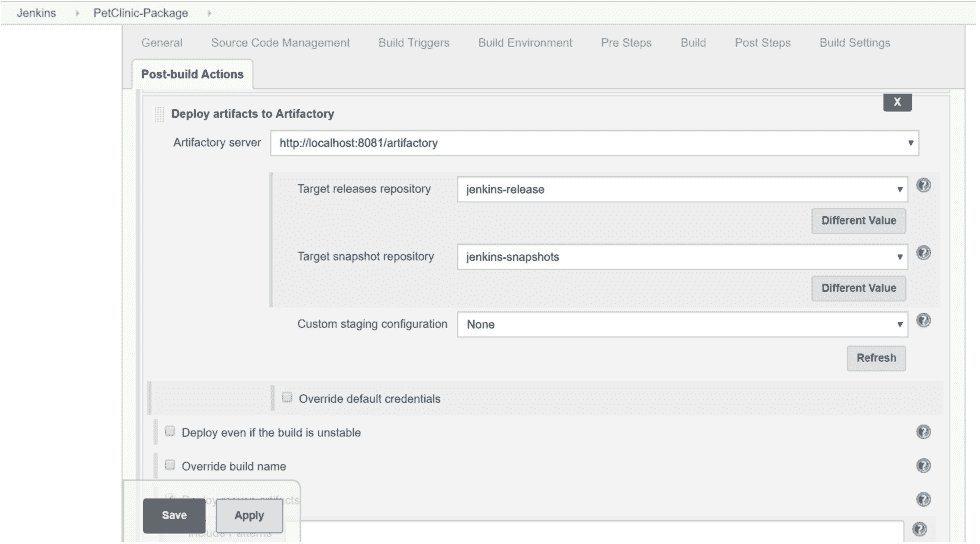

+   6. 点击保存。

+   7. 点击立即构建并在控制台输出中验证日志。Jar 文件从本地仓库或 Artifactory 解析：

```
```text
[INFO] Scanning for projects...
[INFO] Initializing Artifactory Build-Info Recording
[HUDSON] Collecting dependencies info
[INFO]
[INFO] ------------------------------------------------------------------------
[INFO] Building petclinic 4.2.5-SNAPSHOT
[INFO] ------------------------------------------------------------------------
[INFO] Downloading: http://localhost:8081/artifactory/libs-release/com/itextpdf/itextpdf/5.4.5/itextpdf-5.4.5.pom
log4j:WARN No appenders could be found for logger
(org.apache.maven.wagon.providers.http.httpclient.client.protocol.RequestAddCookies).
log4j:WARN Please initialize the log4j system properly.
log4j:WARN See http://logging.apache.org/log4j/1.2/faq.html#noconfig for more info.
[INFO] Downloaded: http://localhost:8081/artifactory/libs-release/com/itextpdf/itextpdf/5.4.5/itextpdf-5.4.5.pom (9 KB at 3.7 KB/sec)
[INFO] Downloading: http://localhost:8081/artifactory/libs-release/com/itextpdf/itext-parent/1.0.0/itext-parent-1.0.0.pom
[INFO] Downloaded: http://localhost:8081/artifactory/libs-release/com/itextpdf/itext-parent/1.0.0/itext-parent-1.0.0.pom (4 KB at 9.3 KB/sec)
[INFO] Downloading: http://localhost:8081/artifactory/libs-release/com/itextpdf/itextpdf/5.4.5/itextpdf-5.4.5.jar
[INFO] Downloaded: http://localhost:8081/artifactory/libs-release/com/itextpdf/itextpdf/5.4.5/itextpdf-5.4.5.jar (2054 KB at 137.0 KB/sec)
[INFO]
[INFO] --- maven-resources-plugin:2.6:resources (default-resources) @ spring-petclinic ---
[INFO] Downloading: http://localhost:8081/artifactory/libs-release/org/apache/maven/maven-plugin-api/2.0.6/maven-plugin-api-2.0.6.pom
[INFO] Downloaded: http://localhost:8081/artifactory/libs-release/org/apache/maven/maven-plugin-api/2.0.6/maven-plugin-api-2.0.6.pom (2 KB at 0.4 KB/sec)
[INFO] Downloading: http://localhost:8081/artifactory/libs-release/org/apache/maven/maven/2.0.6/maven-2.0.6.pom
```
```

## 8. 包创建后，它也会存储在 Artifactory 中：

```
Finished Calculation of disk usage of workspace in 2 second
[INFO] Artifactory Build Info Recorder: Saving Build Info to 'F:\\DevOps2016\\#JenkinsEssentials\\FirstDraft\\jenkinsHome\\workspace\\PetClinic-Package\\target\\build-info.json'
[INFO] Deploying artifact: http://localhost:8081/artifactory/jenkins-snapshots/org/springframework/samples/spring-petclinic/4.2.5-SNAPSHOT/spring-petclinic-4.2.5-SNAPSHOT.war
log4j:WARN No appenders could be found for logger (org.apache.http.client.protocol.RequestAddCookies).
log4j:WARN Please initialize the log4j system properly.
log4j:WARN See http://logging.apache.org/log4j/1.2/faq.html#noconfig for more info.
[INFO] Artifactory Build Info Recorder: Deploying build info ...
[INFO] Deploying build descriptor to: http://localhost:8081/artifactory/api/build
[INFO] Build successfully deployed. Browse it in Artifactory under
http://localhost:8081/artifactory/webapp/builds/PetClinic-Package/14
[INFO] ------------------------------------------------------------------------
[INFO] BUILD SUCCESS
[INFO] ------------------------------------------------------------------------
[INFO] Total time: 03:53 min
[INFO] Finished at: 2017-08-14T17:03:32+05:30
[INFO] Final Memory: 35M/245M
[INFO] ------------------------------------------------------------------------
Waiting for Jenkins to finish collecting data
[JENKINS] Archiving F:\\DevOps2016\\#JenkinsEssentials\\FirstDraft\\jenkinsHome\\workspace\\PetClinic-Package\\pom.xml to org.springframework.samples/spring-petclinic/4.2.5-SNAPSHOT/spring-petclinic-4.2.5-SNAPSHOT.pom
[JENKINS] Archiving F:\\DevOps2016\\#JenkinsEssentials\\FirstDraft\\jenkinsHome\\workspace\\PetClinic-Package\\target\\petclinic.war to org.springframework.samples/spring-petclinic/4.2.5-SNAPSHOT/spring-petclinic-4.2.5-SNAPSHOT.war
channel stopped
Archiving artifacts
Started calculate disk usage of build
Finished Calculation of disk usage of build in 0 seconds
Started calculate disk usage of workspace
Finished Calculation of disk usage of workspace in 2 second
Finished: SUCCESS
```

## 9. 进入 Artifactory 并验证包：


## 从 Jenkins 部署 WAR 文件到 Tomcat

对于应用程序部署，我们可以使用多种方法将应用部署到 Web 服务器或应用服务器。我们可以使用批处理脚本或 shell 脚本复制持续集成过程后创建的包文件，也可以使用 Jenkins 插件部署应用。

## 准备工作

转到“管理 Jenkins | 管理插件”并安装“Deploy to container Plugin”：

| 安装 ↓ | 名称 | 版本 |
|---|---|---|
| Deploy to container Plugin | 1.10 |
| Deploy to Websphere container Plugin | 1.0 |

筛选器：Deploy to  
选项卡：更新、可用、已安装、高级  
按钮：不重启安装、立即下载并在重启后安装、立即检查  
更新信息获取时间：1天2小时前

等待插件成功安装。

5. 使用 Jenkins 插件指定要部署的 WAR 文件路径。从“构建后操作”中选择**将 war/ear 部署到容器**。点击**添加容器**并选择最新版本的 Tomcat。输入 Tomcat URL。输入我们在 `tomcat-users.xml` 中定义的用户名和密码：

6. 通过点击**立即构建**执行构建。验证应用程序部署的日志：

```
Results :

Tests run: 59, Failures: 0, Errors: 0, Skipped: 0

[INFO]
[INFO] --- maven-war-plugin:2.3.1:war (default-war) @ spring-petclinic ---
[INFO] Packaging webapp
[INFO] Assembling webapp [spring-petclinic] in [d:\jenkins\workspace\PetClinic-Test\target\spring-petclinic-4.2.5-SNAPSHOT]
[INFO] Processing war project
[INFO] Copying webapp resources [d:\jenkins\workspace\PetClinic-Test\src\main\webapp]
[INFO] Webapp assembled in [1669 msecs]
[INFO] Building war: d:\jenkins\workspace\PetClinic-Test\target\spring-petclinic-4.2.5-SNAPSHOT.war
[INFO] ------------------------------------------------------------------------
[INFO] BUILD SUCCESS
[INFO] ------------------------------------------------------------------------
[INFO] Total time: 28.772 s
[INFO] Finished at: 2016-07-06T22:59:37+05:30
[INFO] Final Memory: 29M/261M
[INFO] ------------------------------------------------------------------------
Deploying d:\jenkins\workspace\PetClinic-Test\target\spring-petclinic-4.2.5-SNAPSHOT.war to container Tomcat 7.x Remote
[d:\jenkins\workspace\PetClinic-Test\target\spring-petclinic-4.2.5-SNAPSHOT.war] is not deployed.
Doing a fresh deployment.
  Deploying [d:\jenkins\workspace\PetClinic-Test\target\spring-petclinic-4.2.5-SNAPSHOT.war]
Finished: SUCCESS
```

7. 打开浏览器，使用 Tomcat URL 和应用程序上下文访问该应用：

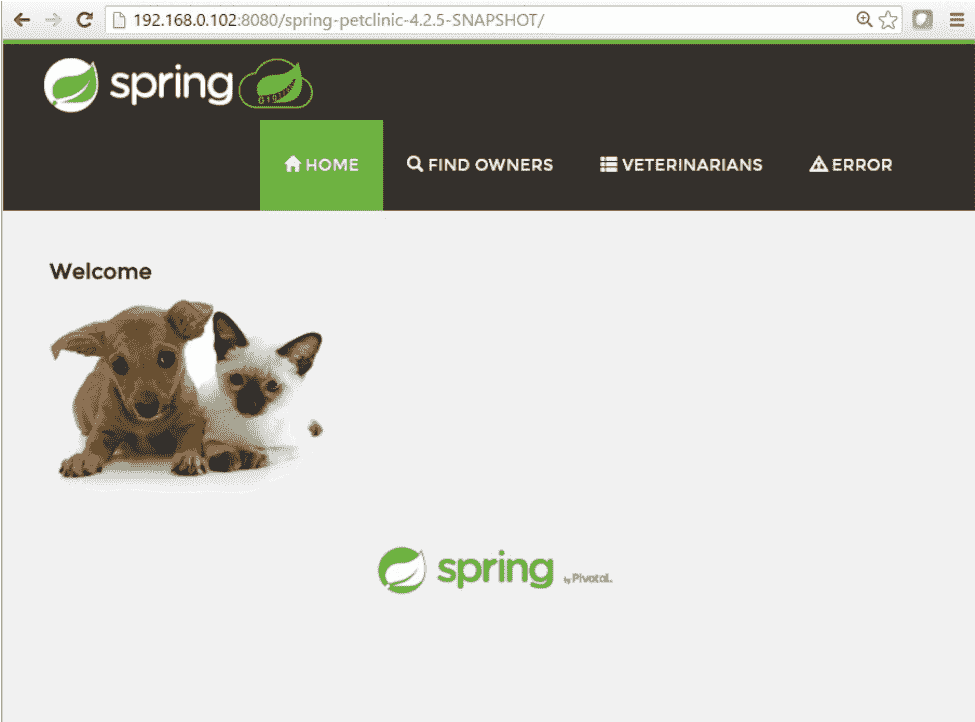

8. 在下一节中，我们将把 PetClinic 应用部署到位于 AWS EC2 实例中的 Tomcat。

## 从 Jenkins 部署 WAR 文件到 AWS Beanstalk

AWS Elastic Beanstalk 是一种**平台即服务（PaaS）**。我们将使用它部署 PetClinic 应用。以下是在 AWS Elastic Beanstalk 上部署应用需要遵循的步骤：

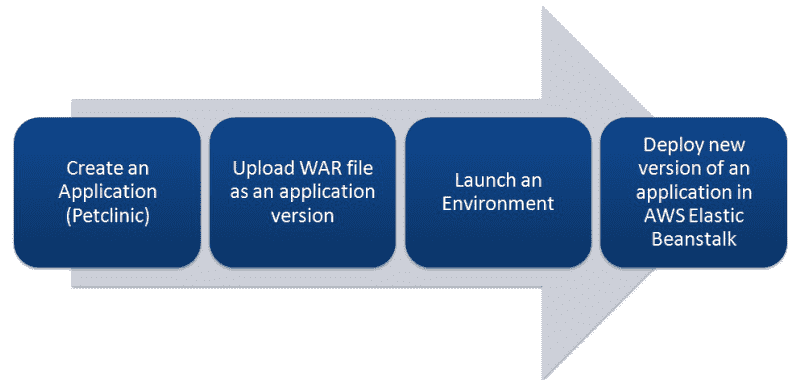

## 准备工作

让我们在 Elastic Beanstalk 中创建一个示例应用，以了解 Elastic Beanstalk 的工作原理。然后，我们将使用 Jenkins 插件将应用部署到其中。

在 AWS 管理控制台中点击**服务**，选择**AWS Elastic Beanstalk**。创建一个名为 `petclinic` 的新应用。选择**Tomcat**作为平台，并选择**示例应用**单选按钮：

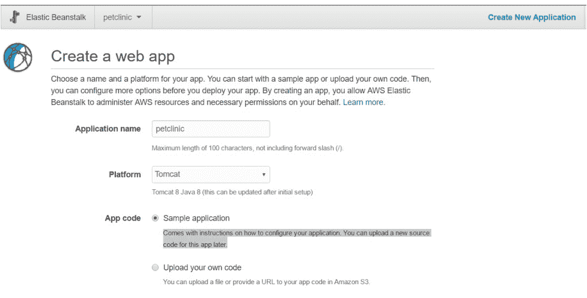

验证创建示例应用的事件顺序：

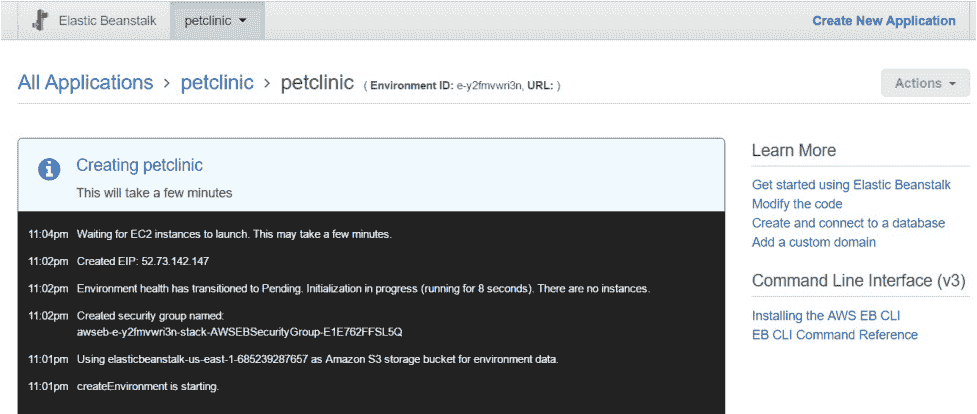

这需要一些时间，一旦环境创建完成，它将以绿色高亮显示：

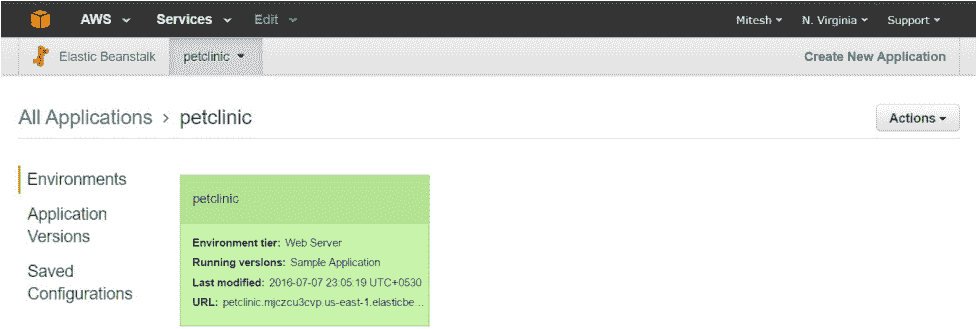

点击 petclinic 环境，并在仪表板中验证运行状况和运行版本：

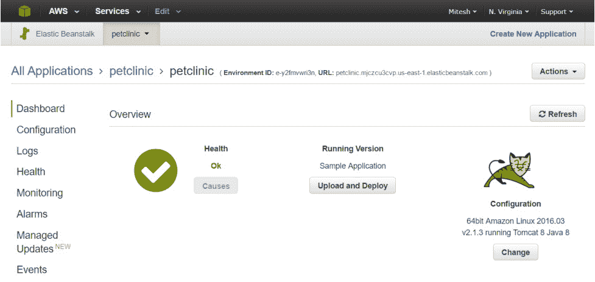

验证环境 ID 和 URL。点击该 URL 并验证默认页面：

## 恭喜

您的第一个 AWS Elastic Beanstalk 应用现在已在 AWS 云中您自己的专属环境中运行。

### 下一步是什么？

- 了解如何使用 AWS Elastic Beanstalk 构建、部署和管理您自己的应用
- AWS Elastic Beanstalk 概念
- 了解如何创建新的应用版本
- 了解如何管理您的应用环境

### 下载 AWS 参考应用

- 使用 AWS SDK for Java 探索一个功能完整的参考应用

### 适用于 Eclipse 的 AWS 工具包

- 开发人员可以直接从 Eclipse 构建和部署 AWS Elastic Beanstalk 应用
- 通过观看此视频开始使用 Eclipse 和 AWS Elastic Beanstalk
- 查看所有 AWS Elastic Beanstalk 文档

## 操作步骤...

1. 安装 AWS Elastic Beanstalk Publisher 插件。更多详细信息，请访问 https://wiki.jenkins-ci.org/display/JENKINS/AWS+Beanstalk+Publisher+Plugin：

2. 在“构建后操作”中会出现一个用于 Elastic Beanstalk 的新区域。

3. 点击 Jenkins 仪表板并选择“凭据”；添加您的 AWS 凭据。

4. 转到您的 Jenkins 构建，并选择在全局配置中设置的 AWS 凭据。

5. 从列表中选择 AWS 区域，然后点击**获取可用应用程序**。由于我们已经创建了一个示例应用，它将像下面这样显示。

6. 在**环境查找**中，于**按名称获取环境**框中提供环境 ID，然后点击**获取可用环境**：

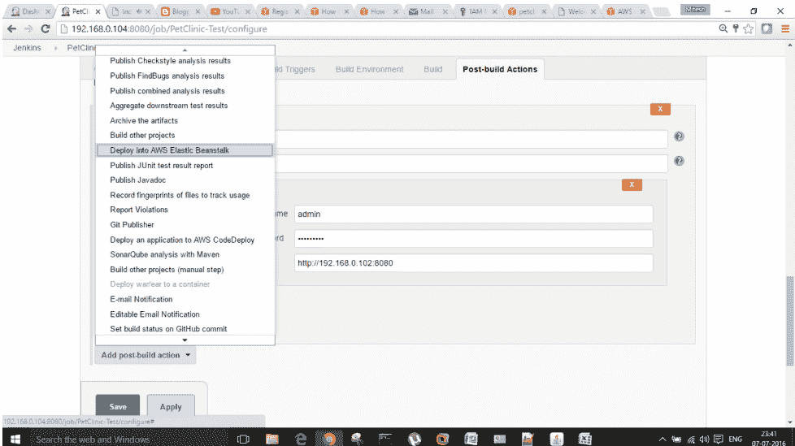

### Elastic Beanstalk 应用程序

AWS 凭据

AWS：AKI

按名称查找 AWS 凭据

获取凭据名称

AWS 区域

us-east-1

AWS 区域文本

应用程序名称

petclinic

petclinic

获取可用应用程序

环境查找

#### 按名称获取环境

环境名称

e-y2fmvwri3n

petclinic

获取可用环境

7. 保存配置并点击**立即构建**。

8. 现在，让我们转到 AWS 管理控制台，检查 WAR 文件是否正在复制到 Amazon S3：

9. 转到 S3 服务并检查可用的存储桶：

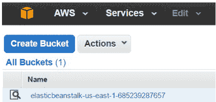

10. 由于 WAR 文件较大，上传到 Amazon S3 需要一些时间。上传完成后，它将出现在 Amazon S3 存储桶中。

11. 在 Jenkins 中检查构建任务的执行状态。预期输出的部分内容如下：

- 测试用例执行和 WAR 文件创建成功
- 构建成功

12. 现在，检查 AWS 管理控制台：

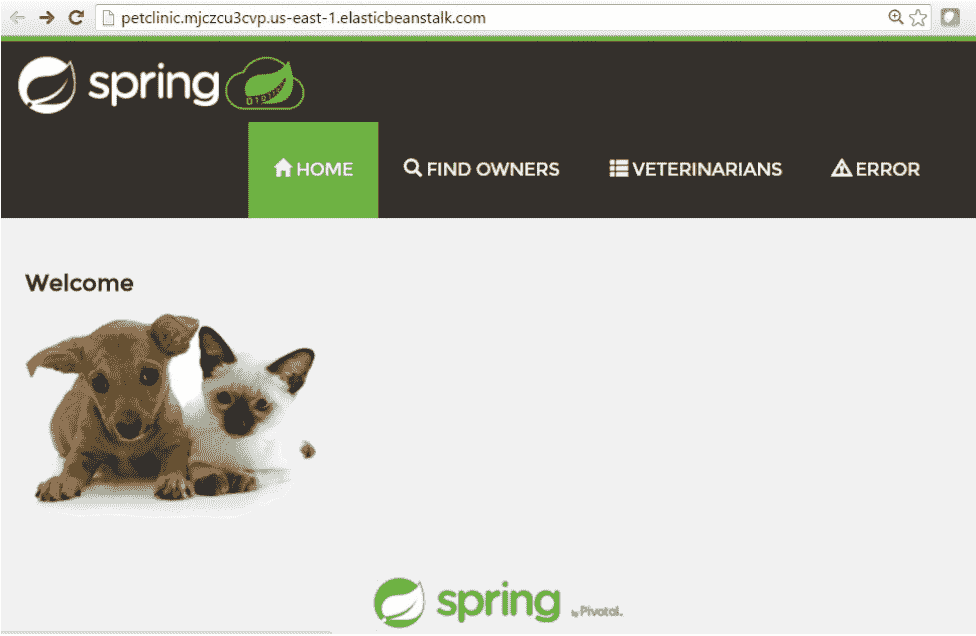

16. 应用程序部署成功后，请终止环境。转到特定环境，点击**操作**中的**终止**来终止环境。至此，我们已成功在 Elastic Beanstalk 上部署了应用。

## 从 Jenkins 部署 WAR 文件到 Azure 应用服务

Microsoft Azure 应用服务是一种 PaaS。在本节中，我们将了解 Azure Web 应用以及如何部署我们的 PetClinic 应用。

## 准备工作

我们需要有一个 Microsoft Azure 订阅。转到“应用服务”并点击**+ 添加**：

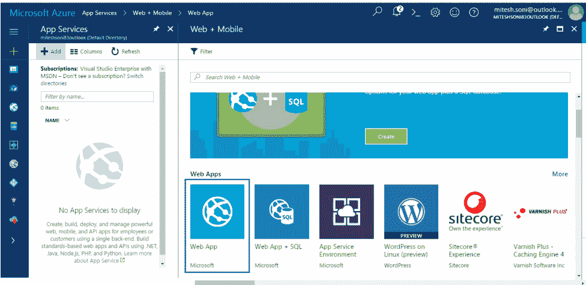

然后，点击**创建**：

### Web 应用

Microsoft

在数秒内创建和部署网站，功能强大，满足您的需求。

利用现有工具创建和部署应用，无需管理基础架构的麻烦。Microsoft Azure Web Sites 为任意规模的 Web 应用提供安全、灵活的开发、部署和扩展选项。使用框架和模板，在数秒内创建网站。从 TFS、GitHub、BitBucket 等源代码控制选项中进行选择。使用任何工具或操作系统，通过 .NET、PHP、Node.js 或 Python 开发您的网站。

- 构建云应用的最快方式
- 快速预置和部署
- 可自动扩展的安全平台
- 为 Visual Studio 开发人员提供出色体验
- 对所有人开放且灵活
- 监控、警报和自动扩展（预览）


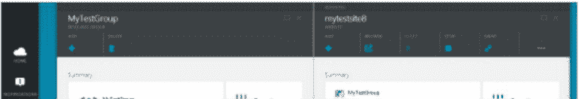

创建

转到 Microsoft Azure 门户 https://portal.azure.com。点击“应用服务”，然后点击**+ 添加**。为“应用名称”、“订阅”、“资源组”和“应用服务计划/位置”提供值。然后，点击**创建**。


创建 Azure Web App 后，查看它是否出现在 Azure 门户中。点击 DevOpsPetClinic 并查看其与 URL、状态、位置等相关的详细信息：

同时在 App Services 部分也进行验证：

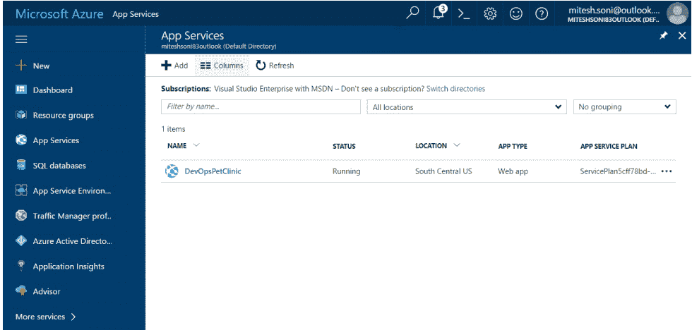

点击 All Settings，进入 SETTINGS 部分，然后点击 Application settings 以配置 Azure Web App 用于 Java Web 应用托管。选择 Java 版本、Java 次要版本、Web 容器和平台，然后点击 Always On：

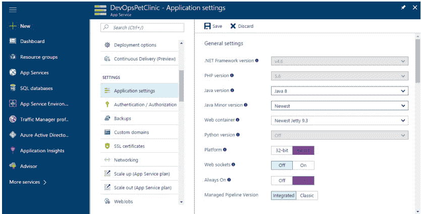

从浏览器访问 Azure Web App 的 URL 并验证它是否已准备好托管我们的示例 spring 应用 PetClinic：

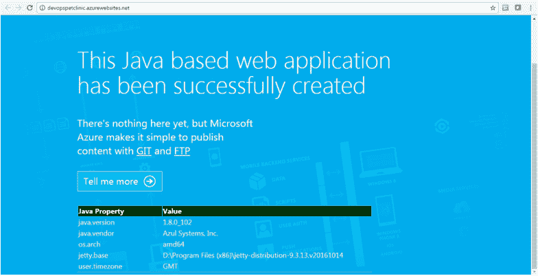

点击 All Settings，进入 DEPLOYMENT 部分的 Deployment credentials。提供 FTP/部署用户名和密码，并保存更改：

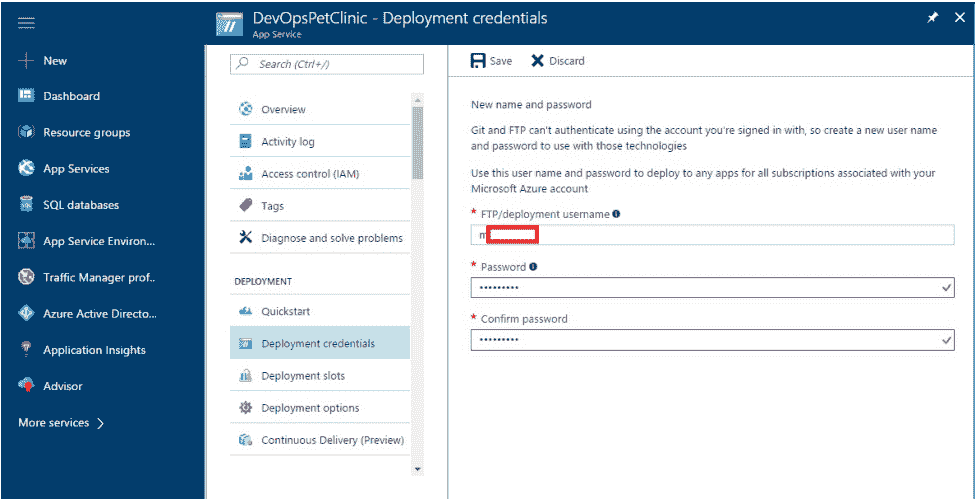

让我们在 Jenkins 中安装 `Publish Over FTP` 插件。我们将使用 Azure Web App 的 FTP 详细信息来发布 PetClinic WAR 文件。

### 如何操作...

1. 让我们进入 Jenkins 仪表板。点击 New Item 并选择 Freestyle project。
2. 在 Jenkins 中，进入 Manage Jenkins 并点击 Configure | Configure FTP settings。提供在 Azure 门户中可用的主机名、用户名和密码。
3. 进入 [azurewebsites.net](https://azurewebsites.net) 并进入 Kudu 控制台。浏览不同的选项并找到 site 目录和 webapps 目录。在 App Service URL 中，在 Web App 名称后添加 `.scm`。
4. 点击 Test Configuration，一旦收到 Success 消息，您就可以部署 PetClinic 应用了：

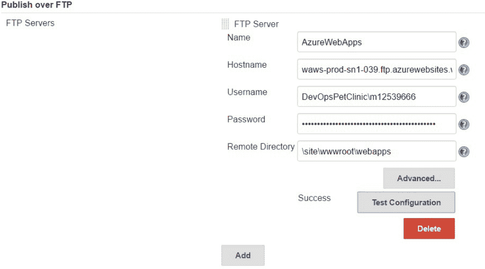

5. 在我们创建的构建作业中，进入 Build 部分并配置 Copy artifacts from another project。我们将把 WAR 文件复制到虚拟机上的特定位置。
6. 在 Post-build Actions 中，点击 Send build artifacts over FTP。选择在 Jenkins 中配置的 FTP Server Name。配置 Source files 和 Remove prefix 以部署 Azure Web App。
7. 在 Console 中选择 Verbose output：

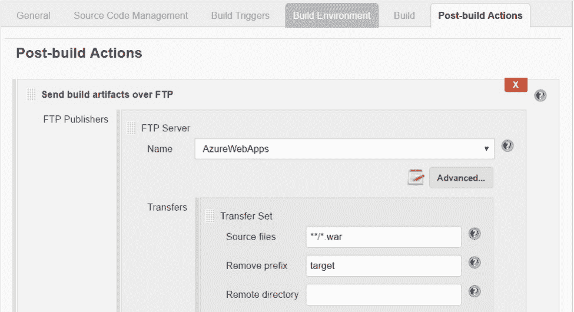

8. 点击 Build now 并查看幕后发生了什么：
9. 进入 Kudu 控制台，点击 DebugConsole 并进入 Powershell。进入 site | wwwroot | webapps。检查 WAR 文件是否已被复制：

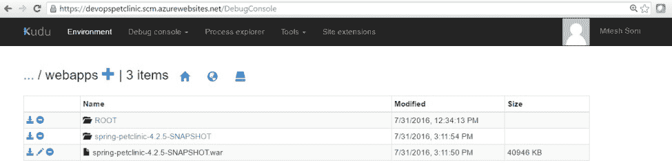

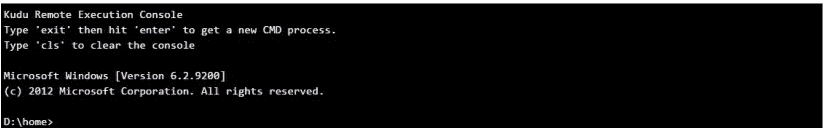

现在我们已经在 Azure Web App 上部署了应用。

## 构建推广

根据验证或通过特定阶段，有必要区分彼此的构建。

### 准备工作

进入 Manage Jenkins | Manage Plugins | Available。安装 promoted builds 插件。

### 如何操作...

1. 进入项目配置并检查 Promote builds when...：
2. 此构建在构建完成后立即被推广，而与其状态无关。
3. 您也可以配置手动批准的推广。
