## 持续测试

在本章中，我们将介绍以下配方：

- 开始进行持续测试
- 使用 Eclipse 创建 Selenium 测试用例
- 集成 Jenkins 和 Selenium 进行功能测试
- Jenkins 和 Cucumber 测试报告
- 在 Apache JMeter 中创建负载测试
- 从 Jenkins 执行负载测试
- 报告 JMeter 性能指标
- 使用 FitNesse 进行测试

### 准备工作

您需要 Eclipse Java EE IDE for Web Developers，版本：Mars.2 Release (4.5.2)，Build ID: 20160218-0600。

进入 Eclipse Marketplace 并安装 Maven integration for the Eclipse 插件：

1. 使用 Eclipse IDE 中的向导创建 Maven 项目：

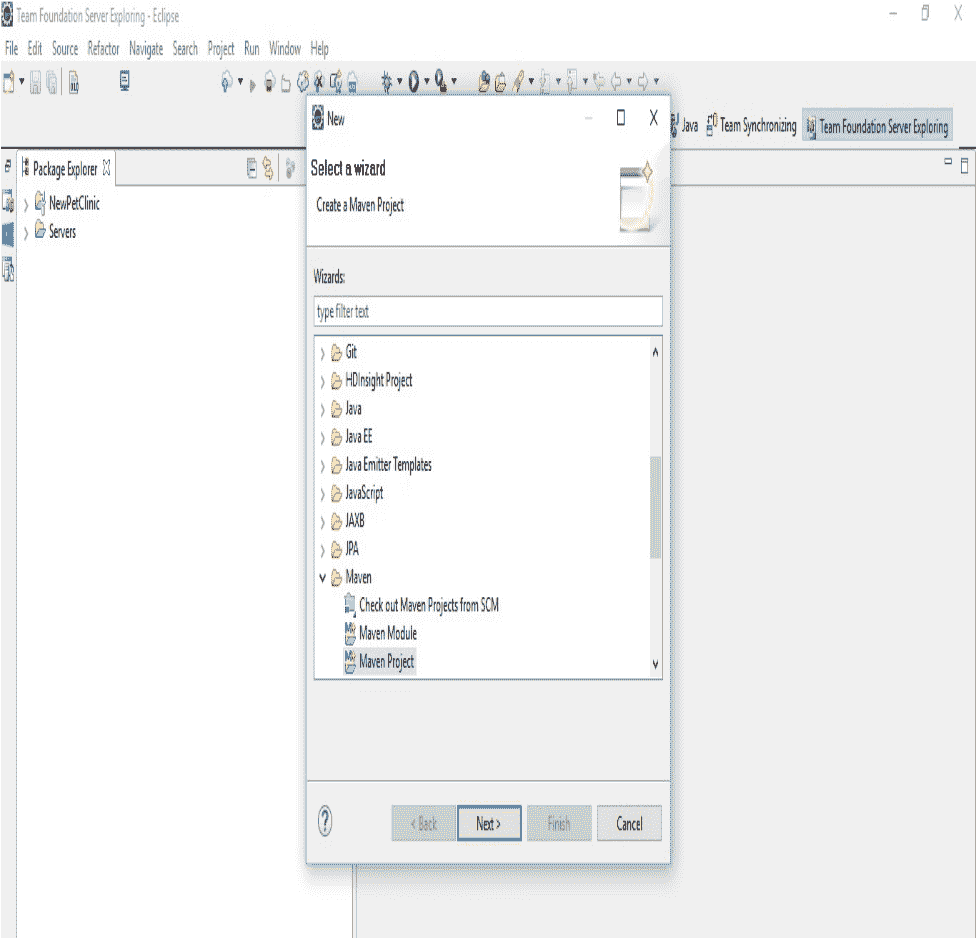

2. 选择 Create a simple project (skip archetype selection) 并点击 Next：

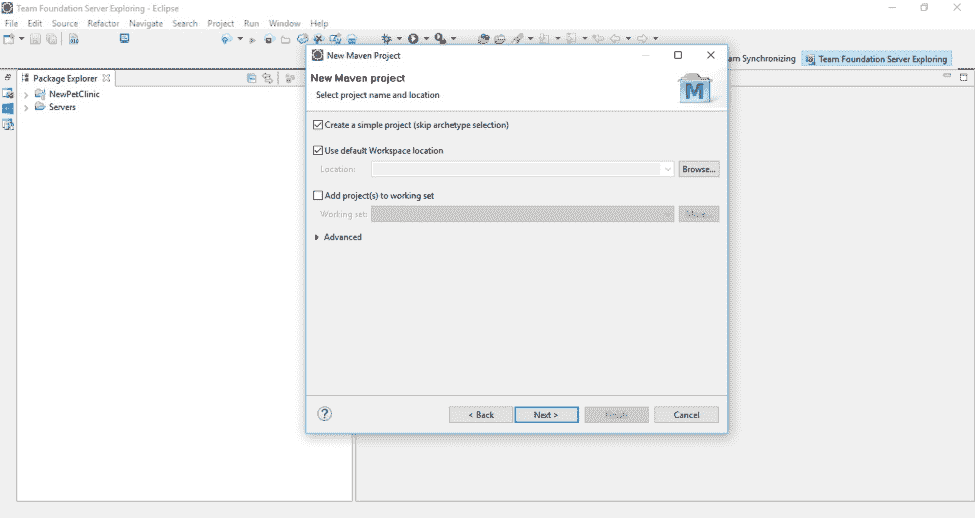

3. 按照向导创建项目。创建 Eclipse 项目需要一些时间。提供 Artifact、Version、Packaging、Name 和 Description。点击 Finish。

4. 等待 Maven 项目创建并配置完成。确保 Maven 已正确安装和配置。在 Maven 位于代理后面的情况下，将代理详细信息配置到 conf .xml 中，该文件位于 Maven 目录中。

5. 在 pom.xml 中，我们需要在 `<project>` 节点中添加 Maven、Selenium、TestNG 和 JUnit 依赖项。以下是修改后的 pom.xml：

```xml
<project xmlns="http://maven.apache.org/POM/4.0.0"
         xmlns:xsi="http://www.w3.org/2001/XMLSchema-instance"
         xsi:schemaLocation="http://maven.apache.org/POM/4.0.0
         http://maven.apache.org/xsd/maven-4.0.0.xsd">
  <modelVersion>4.0.0</modelVersion>
  <groupId>com.tiny</groupId>
  <artifactId>test</artifactId>
  <version>0.0.1-SNAPSHOT</version>
  <name>test</name>
  <build>
    <plugins>
      <plugin>
        <groupId>org.apache.maven.plugins</groupId>
        <artifactId>maven-compiler-plugin</artifactId>
        <version>3.6.1</version>
        <configuration>
          <source>1.8</source>
          <target>1.8</target>
        </configuration>
      </plugin>
      <plugin>
        <groupId>org.apache.maven.plugins</groupId>
        <artifactId>maven-surefire-plugin</artifactId>
        <version>2.19.1</version>
        <configuration>
          <suiteXmlFiles>
            <suiteXmlFile>testng.xml</suiteXmlFile>
          </suiteXmlFiles>
        </configuration>
      </plugin>
    </plugins>
  </build>
  <dependencies>
    <dependency>
      <groupId>org.seleniumhq.selenium</groupId>
      <artifactId>selenium-java</artifactId>
      <version>3.6.0</version>
    </dependency>
    <dependency>
      <groupId>org.testng</groupId>
      <artifactId>testng</artifactId>
      <version>6.10</version>
      <scope>test</scope>
    </dependency>
  </dependencies>
</project>
```

6. 在添加这些更改后保存 pom.xml 并从 Project 菜单再次构建项目。它将下载新的依赖项：

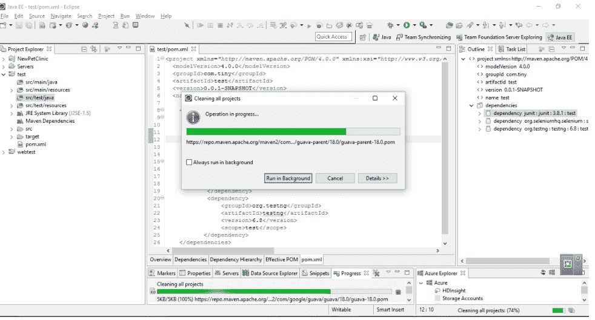

7. 点击对话框的 Details 按钮以验证正在进行的操作。

8. 下一个任务是编写 TestNG 类。安装 TestNG 插件。进入 Help 并点击 Install New Software。添加 Repository：

### 如何操作...

1. 现在让我们创建一个 TestNG 类：

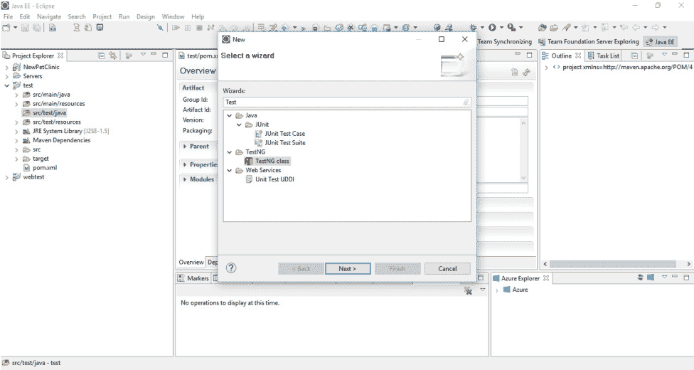

2. 提供 Class name：

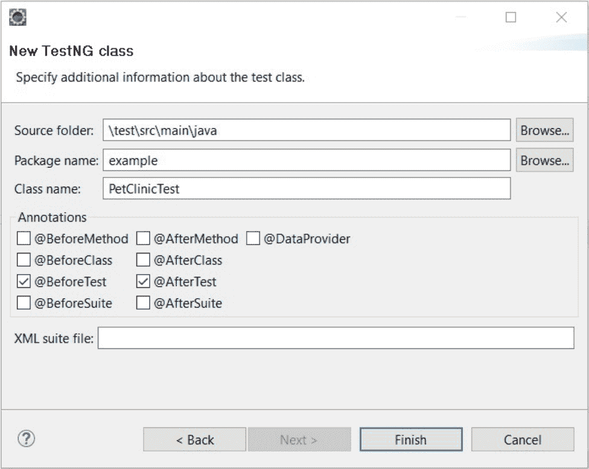

3. 输入 Package name 并点击 Finish。
4. 新创建的类将如下面的屏幕截图所示：

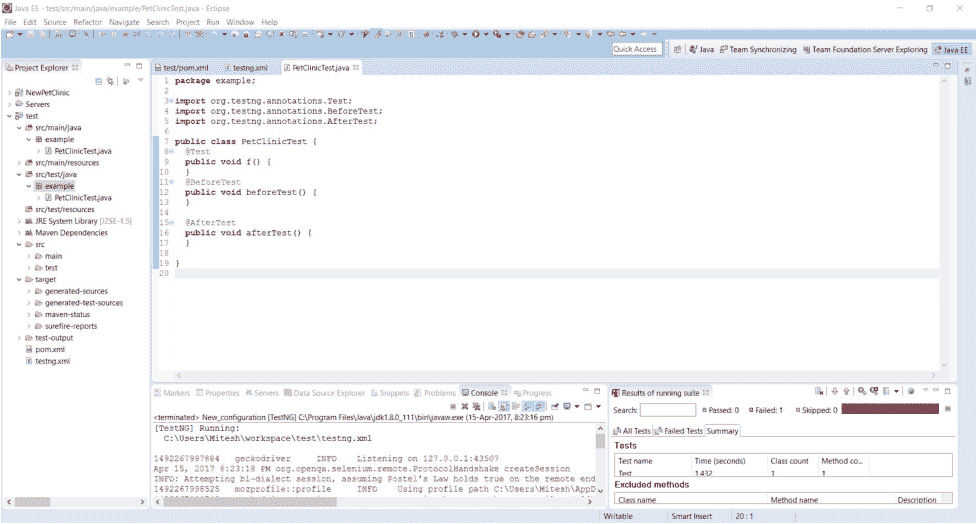

5. 右键点击测试文件并点击 TestNG，convert to TestNG。
6. 它将创建一个 `testng.xml` 文件，其中包含有关测试套件的详细信息。
7. 右键点击 Project 并点击 Run Configurations。
8. 右键点击 TestNG 并点击 New：

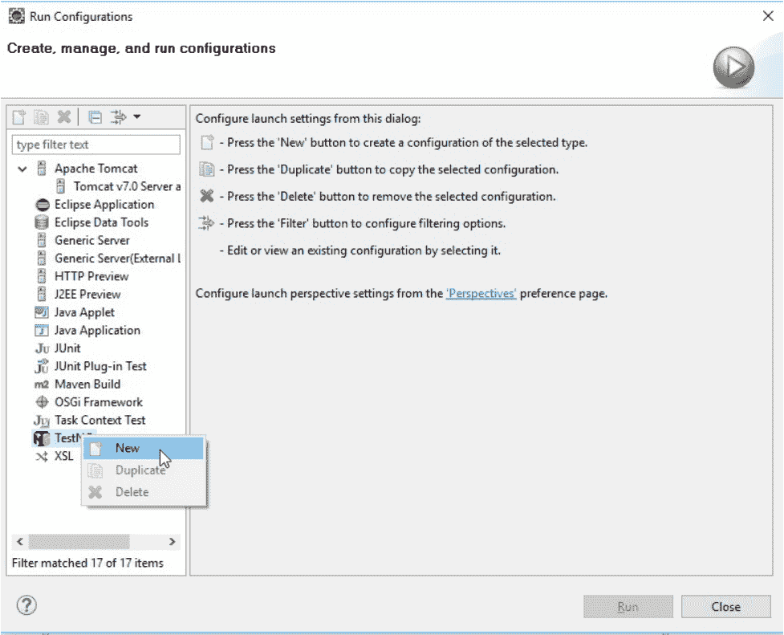

9. 提供 Project name 并在 Suite 中选择 `testng.xml`。
10. 点击 OK 和 Apply。
11. 点击 Run：

Run Configurations

Create, manage, and run configurations

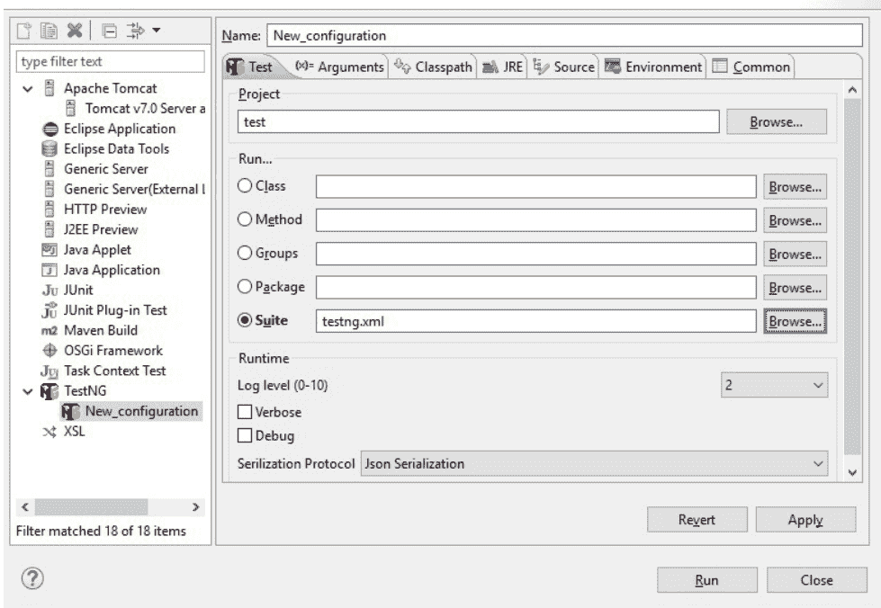

12. 如果 Windows 防火墙阻止它，则点击 Allow Access。

testng.xml 中没有用于执行的配置，因此即使 Maven 执行成功运行，也不会执行任何套件。

在 test 文件夹下生成 TestNG 类。

1. 选择位置、套件名称和类名称：

```xml
<?xml version="1.0" encoding="UTF-8"?>
<!DOCTYPE suite SYSTEM "http://testng.org/testng-1.0.dtd">
<suite name="Suite">
<test name="Test">
<classes>
<class name="example.PetClinicTest"/>
</classes>
</test><!-- Test -->
</suite><!-- Suite -->
```


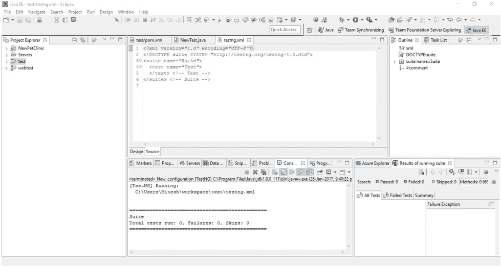

- 2. 前往 [https://github.com/mozilla/geckodriver/releases](https://github.com/mozilla/geckodriver/releases) 并下载一个版本。
- 3. 根据我们拥有的系统配置，从下载的 ZIP 文件中提取可用的文件。在我们的例子中，我们下载了 `geckodriver-v0.13.0-win64`。下载可用的最新版本。
- 4. 点击它并验证驱动程序详细信息。

- 5. 让我们也编写一些代码。它将检查网页标题是否包含特定字符串。以下代码的结果或输出基于页面的标题。如果它包含给定的字符串，则测试用例将通过；否则，它将失败包示例：

```
import java.io.File;
import org.openqa.selenium.WebDriver;
import org.openqa.selenium.firefox.FirefoxDriver;
import org.testng.Assert;
import org.testng.annotations.Test;
import org.testng.annotations.BeforeTest;
import org.testng.annotations.AfterTest;
public class PetClinicTest {
    private WebDriver driver;
    @Test
    public void testPetClinic() {
        driver.get("http://localhost:8090/petclinic/");
        String title = driver.getTitle();
        Assert.assertTrue(title.contains("a Spring Framework"));
    }
    @BeforeTest
    public void beforeTest() {
        File file = new File("F:\\JenkinsEssentials\\geckodriver-v0.13.0-win64\\geckodriver.exe");
        System.setProperty("webdriver.gecko.driver", file.getAbsolutePath());
        driver = new FirefoxDriver();
    }
    @AfterTest
    public void afterTest() {
        driver.quit();
    }
}
```

- 6. 同样的文件也在 IDE 中可用，如以下屏幕截图所示。
- 7. 让我们再次从 Eclipse 运行 Maven 测试。

8. 测试用例成功执行时的输出如下：

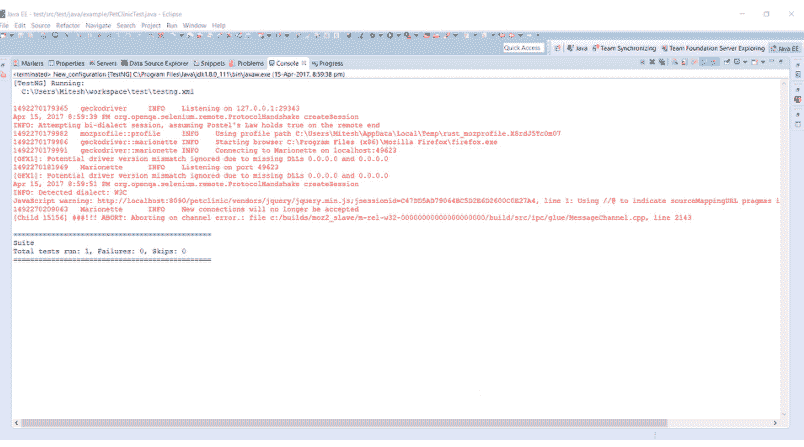

9. 在 Eclipse 中运行套件结果部分中验证 All Tests 选项卡。我们可以在这里看到成功的执行：

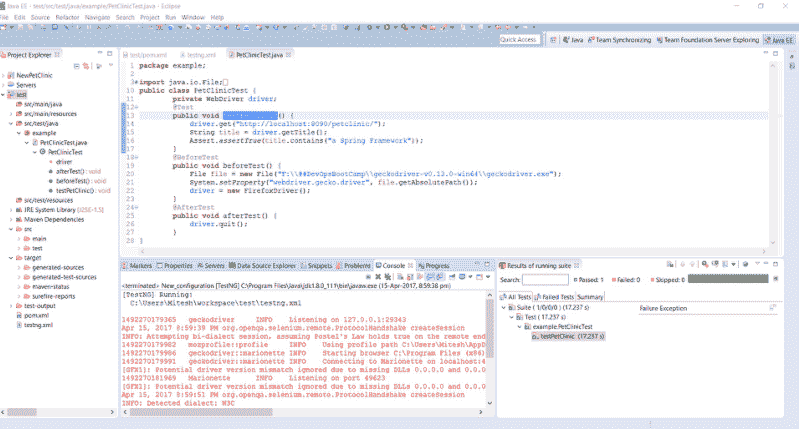

10. 在 Eclipse 中运行套件结果部分中验证 Failed Tests 选项卡。
11. 在 Eclipse 中运行套件结果部分中成功场景下验证 Summary 选项卡。
12. 在代码中更改用于标题比较的文本，以便测试用例失败。
13. 验证 Console 中的输出：

14. 在 Eclipse 中运行套件结果部分中验证 All Tests 选项卡并注意失败图标：

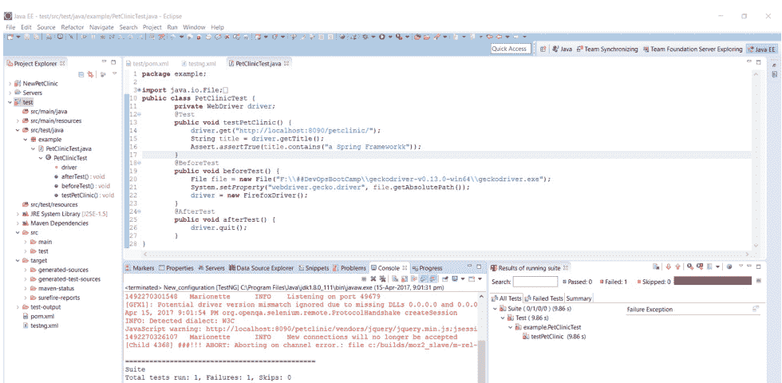

- 15. 在 Eclipse 中运行套件结果部分中验证 Failed Tests 选项卡。
- 16. 点击 testPetClinic 并验证 Failure Exception。
- 17. 在 Eclipse 中运行套件结果部分中验证 Summary 选项卡。

因此，我们已经基于 Selenium 创建了一个示例测试用例来验证 PetClinic 主页的标题。

## 深度学习

深度学习是机器学习的一个重要分支，其核心思想是通过构建包含多个隐层的神经网络模型，让计算机自动从海量数据中学习并提取特征。与传统的机器学习方法相比，深度学习具有更强的特征表达能力，尤其适用于图像识别、语音识别和自然语言处理等复杂任务。

神经网络的基本组成单元是神经元，每个神经元接收来自上一层节点的输入信号，通过加权求和后经过激活函数产生输出。常见的激活函数包括 Sigmoid、ReLU 和 Tanh 等。ReLU 函数因其计算简单且能有效缓解梯度消失问题，成为目前在深度网络中使用最为广泛的激活函数。

- - 卷积神经网络（CNN）：擅长处理图像数据
- - 循环神经网络（RNN）：适用于序列数据建模
- - 生成对抗网络（GAN）：用于生成新的数据样本
- - Transformer：基于自注意力机制的架构，推动了 NLP 的发展

在训练深度神经网络时，通常采用反向传播算法结合梯度下降优化器来更新网络参数。损失函数用于衡量模型预测值与真实值之间的差异，常见的损失函数包括均方误差（MSE）和交叉熵损失。优化器如 SGD、Adam 等通过调整学习率来加速收敛过程。

> 深度学习的本质是使用多层次的非线性变换来逼近复杂的函数映射关系。

```
```python
import torch
import torch.nn as nn

model = nn.Sequential(
    nn.Linear(784, 256),
    nn.ReLU(),
    nn.Linear(256, 10),
    nn.Softmax(dim=1)
)
```
```

综上所述，深度学习通过端到端的训练方式，在多个领域取得了超越传统方法的性能表现。随着计算能力的不断提升和大规模数据集的出现，深度学习技术将继续推动人工智能的发展。

## Getting ready

安装 TestNG Results 插件：

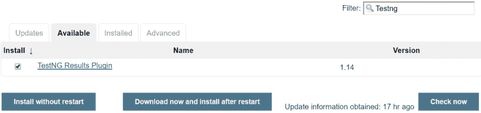

在 Jenkins 中创建新的项目或构建作业。

## How to do it...

现在让我们尝试从 Jenkins 执行：

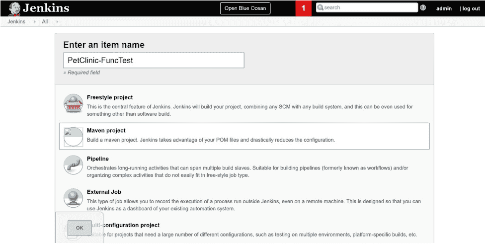

- 1. 在 Repository 中检入 Test Project。在 Jenkins 中创建一个 `PetClinic-FuncTest` freestyle 作业。
- 2. 在 Build 部分，提供 Root POM 位置以及执行所需的 Goals 和 options：

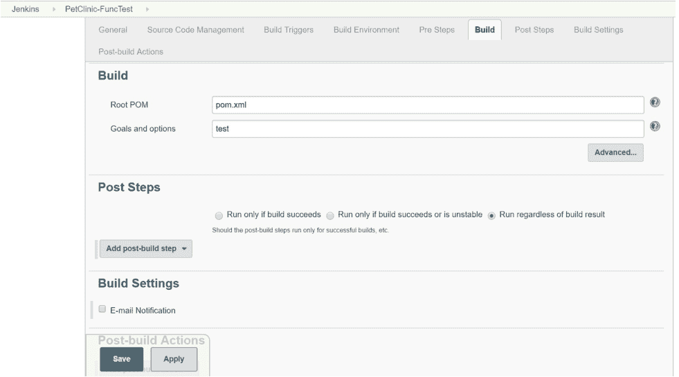

- 3. 保存构建作业并点击 Build now。
- 4. 在 Console Output 中验证构建作业的执行情况。
- 5. 它将打开一个 Mozilla Firefox 窗口并打开代码中给出的 URL。这需要我们的 PetClinic 应用程序部署在 Web 服务器上并且运行没有问题：

```
----------------------------------------------
T E S T S
----------------------------------------------
Running TestSuite
1496572454522 geckodriver INFO Listening on 127.0.0.1:6486
Jun 04, 2017 4:34:14 PM org.openqa.selenium.remote.ProtocolHandshake createSession
INFO: Attempting bi-dialect session, assuming Postel's Law holds true on the remote end
1496574525134 mozprofile::profile INFO Using profile path
C:\Users\Mitesh\AppData\Local\Temp\rust_mozprofile.t3uOSiy56On
1496574255138 geckodriver::marionette INFO Starting browser C:\Program Files (x86)\Mozilla Firefox\firefox.exe
14965745255175 geckodriver::marionette INFO Connecting to Marionette on localhost:60430
[GFX1]: Potential driver version mismatch ignored due to missing DLLs 0.0.0.0 and 0.0.0.0
[GFX1]: Potential driver version mismatch ignored due to missing DLLs 0.0.0.0 and 0.0.0.0
1496574288578 Marionette INFO Listening on port 60430
Jun 04, 2017 4:34:49 PM org.openqa.selenium.remote.ProtocolHandshake createSession
INFO: Detected dialect: W3C
JavaScript warning:
http://localhost:8090/petclinic/vendors/jquery/jquery.min.js;jsessionid=884F4251137D820A5723530BAA688915, line 1:
Using // to indicate sourceMappingURL pragmas is deprecated. Use //# instead
>>>>>>PetClinic :: a Spring Framework demonstration
1496574305189 Marionette INFO New connections will no longer be accepted
Jun 04, 2017 4:35:12 PM org.openqa.selenium.os.UnixProcess destroy
SEVERE: Unable to kill process with PID 10376
Tests run: 1, Failures: 0, Errors: 0, Skipped: 0, Time elapsed: 69.499 sec - in TestSuite
Results :

Tests run: 1, Failures: 0, Errors: 0, Skipped: 0
```

- 6. 前往 Post-build Actions 并选择 Publish TestNG Results：

## 7. 提供 TestNG XML 报告模式：

### Post-build Actions

Publish TestNG Results

TestNG XML report pattern **/testng-results.xml

Add post-build action

Save

Apply

## 8. 点击 Build now：

PetClinic-FuncTest

+   General
+   Source Code Management
+   Build Triggers
+   Build Environment
+   Pre Steps
+   Build
+   Post Steps
+   Build Settings

Post-build Actions

+   Aggregate downstream test results
+   Archive the artifacts
+   Build other projects
+   Calculate disk usage of build
+   Deploy artifacts to Maven repository
+   Publish Performance test result report
+   Publish TestNG Results
+   Quality Gates SonarQube Plugin
+   Record fingerprints of files to track usage
+   Git Publisher
+   SonarQube analysis with Maven
+   Deploy war/ear to a container
+   Editable Email Notification
+   Set GitHub commit status (universal)

Advanced...

Run only if build succeeds or is unstable
Run regardless of build result

Add post-build action

Save

Apply

## There's more

前往项目仪表板并验证 TestNG 结果的图表：

## TestNG Results Trends

Need at least 2 builds with results to show trend graph

## Latest Test Results (build ##2)

- - Total Tests: 1 (+1)
- - Failed Tests: 0 (+0)
- - Skipped Tests: 1 (+1)
  1. example.PetClinicTest.testPetClinic
- - Failed Configurations: 1 (+1)
  1. example.PetClinicTest.beforeTest
- - Skipped Configurations: 1 (+1)
  1. example.PetClinicTest.afterTest

在下一节中，我们将看到如何使用 Jenkins 执行负载测试。

## Jenkins and Cucumber test reports

在本教程中，我们将集成 Jenkins 和 Cucumber 以使用 Jenkins 发布 Cucumber 报告。


## 准备工作

转到 Jenkins 仪表盘 | 管理 Jenkins | 管理插件 | 可选插件。

安装 Cucumber reports 插件：

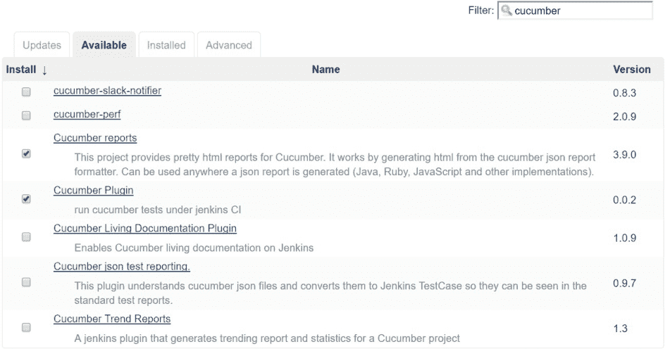

点击“安装，无需重启”。

## 操作步骤...

- 1. 在 Jenkins 中创建一个 Maven 项目。
- 2. 选择任意集成了 Cucumber 并会生成 `.JSON` 文件作为报告的 GitHub 项目：

3. 在“构建”（Build）部分配置 Root POM 和测试目标：

4. 从“构建后操作”（Post-build Actions）中选择 Cucumber reports。

5. 添加测试执行后生成的 *.json 文件：

## Cucumber 报告

### JSON 报告位置

报告路径

Cucumber 生成的 json 报告相对于工作区的路径，例如 target - 留空则扫描整个工作区。

文件包含模式

**/cucumber.json

默认包含模式为 "**/*.json"。

文件排除模式

默认不排除任何内容。

趋势限制

0

趋势部分显示最近多少次构建。设为零表示不设限制。

### 构建结果

此部分用于配置构建在何时被标记为失败或不稳定。当以下至少一条规则成立时，结果会改变。

- 6. 保存构建任务。
- 7. 点击“立即构建”（Build now）。
- 8. 转到控制台输出（Console Output）并验证测试执行日志：

## 功能统计

以下图表显示功能的通过和失败统计


| 功能 | 步骤 |  |  |  |  |  | 场景 |  |  | 功能 |  |
| 功能 | 通过 | 失败 | 跳过 | 待定 | 未定义 | 总计 | 通过 | 失败 | 总计 | 时长 | 状态 |
| Person Repository | 11 | 1 | 0 | 0 | 0 | 12 | 3 | 1 | 4 | 001ms | 失败 |
| 1 | 11 | 1 | 0 | 0 | 0 | 12 | 3 | 1 | 4 | 001ms |  |
|  | 91.67% | 8.33% | 0.00% | 0.00% | 0.00% |  | 75.00% | 25.00% |  |  | 0.00% |

11. 检查与步骤、场景和功能相关的图表和数据：

Cucumber 报告

Jenkins   先前结果   最新结果   功能   标签   步骤   趋势

| 项目 | 数量 | 日期 |
|---|---:|---|
| CucumberProject | 6 | 13 Aug 2017, 19:26 |

## 功能统计

以下图表显示功能的通过和失败统计


| 功能 | 步骤：通过 | 失败 | 跳过 | 待定 | 未定义 | 总计 | 场景：通过 | 失败 | 总计 | 功能：时长 | 状态 |
|---|---:|---:|---:|---:|---:|---:|---:|---:|---:|---|---|
| Person Repository | 11 | 1 | 0 | 0 | 0 | 12 | 3 | 1 | 4 | 091ms | 失败 |
| 1 | 11 | 1 | 0 | 0 | 0 | 12 | 3 | 1 | 4 | 091ms | |
|  | 91.67% | 8.33% | 0.00% | 0.00% | 0.00% |  | 75.00% | 25.00% |  |  | 0.00% |

12. 验证功能报告：

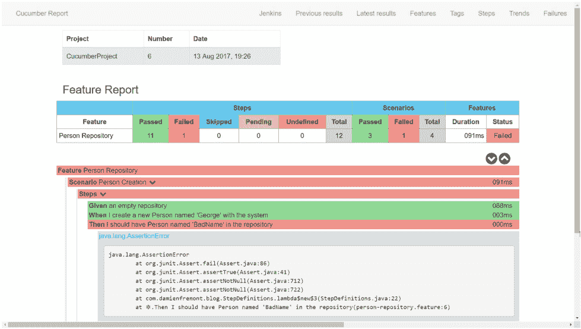

13. 点击“功能”（Features），并详细了解功能、场景和步骤：

## 功能：Person Repository

## 场景：Person Creation

## 步骤

假定存在一个空存储库 088ms

当我使用系统创建一个名为 'George' 的新 Person 时 003ms

那么存储库中应该有一个名为 'BadName' 的 Person 000ms

```
java.lang.AssertionError
  at org.junit.Assert.fail(Assert.java:86)
  at org.junit.Assert.assertTrue(Assert.java:41)
  at org.junit.Assert.assertNotNull(Assert.java:712)
  at org.junit.Assert.assertNotNull(Assert.java:722)
  at com.damienfremont.blog.StepDefinitions.lambda$new$3(StepDefinitions.java:22)
  at *.Then I should have Person named 'BadName' in the repository(person-repository.feature:6)
```

## 场景大纲：Person 创建示例

## 场景大纲：Person 创建示例

14. 以下图表显示此次构建的步骤统计（Steps Statistics）。以下列表基于结果：

## 步骤统计

以下图表显示此次构建的步骤统计。下面的列表基于结果。如果步骤未提供结果信息，则不会在下方列出。此外，@Before 和 @After 不计入其中，因为它们属于场景的一部分，而非步骤。

| 实现 | 出现次数 | 时长 | 平均 | 比率 |
| StepDefinitions.java:14 | 1 | 088ms | 088ms | 100.00% |
| StepDefinitions.java:16 | 3 | 000ms | 000ms | 100.00% |
| StepDefinitions.java:18 | 4 | 003ms | 000ms | 100.00% |
| StepDefinitions.java:21 | 4 | 000ms | 000ms | 75.00% |
| 4 | 12 | 091ms | 007ms | 总计 |

15. 趋势统计（Trends Statistics）图表显示一段时间内的功能、场景和步骤：

| 项目 | 数量 | 日期 |
|---|---:|---|
| CucumberProject | 6 | 13 Aug 2017, 19:26 |

## 趋势统计

以下图表显示一段时间内的功能、场景和步骤。

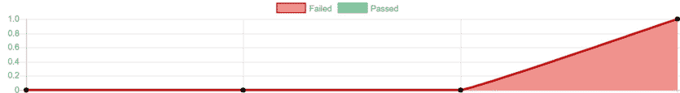

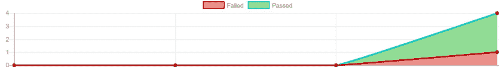

尝试在 GitHub 上找到类似的项目，并在 Jenkins 中配置它们，以验证 Jenkins 中的 Cucumber 报告。

## 在 Apache JMeter 中创建负载测试

Apache JMeter 是一个开源的 Apache 项目。它是一个纯 Java 应用程序。Apache JMeter 用于负载测试、分析和衡量服务的性能。

JMeter（http://jmeter.apache.org）是一款用于压力测试的开源工具。它允许你以可视化方式创建测试计划，然后基于该计划对系统进行加压测试。

JMeter 可以发起多种类型的请求，称为采样器（samplers）。它可以对 HTTP、LDAP 和数据库进行采样，还可以使用脚本等等。它可以通过监听器（listeners）以可视化方式回传报告。

一本适合初学者的 JMeter 书籍是 *Apache JMeter*，作者 Emily H. Halili，由 Packt Publishing 出版，ISBN 1847192955（http://www.packtpub.com/beginning-apache-jmeter）。

同一家出版社还有两本更高级的书籍：https://www.packtpub.com/application-development/performance-testing-jmeter-29 和 https://www.packtpub.com/application-development/jmeter-cookbook-raw。

在本节中，你将编写一个测试计划，用于访问在文本文件中定义 URL 的网页。在下一节 *报告 JMeter 测试计划* 中，你将配置 Jenkins 以运行 JMeter 测试计划。

## 准备工作

从 http://jmeter.apache.org/download_jmeter.cgi 下载 Apache JMeter。解压文件并进入 `bin` 目录。执行 `jmeter.bat` 或 `jmeter.sh`。

## 操作步骤...

- 1. Jenkins 的稳定版和最新版可在 YUM 仓库中获取。
- 2. 打开 Apache JMeter 控制台并创建一个测试计划（Test Plan）。
- 3. 右键单击测试计划，点击“添加”（Add），然后选择“线程（用户）”（Threads (Users)）。
- 4. 选择“线程组”（Thread Group）。
- 5. 提供线程组名称。
- 6. 在线程组属性中，提供线程数（Number of Threads）、启动周期（Ramp-up Period）和循环次数（Loop Count）。
- 7. 右键单击线程组。点击“添加”（Add）。点击“采样器”（Sampler）。点击“HTTP 请求”（HTTP Request）。
- 8. 在 HTTP 请求中，提供服务器名称或 IP。在我们的示例中，它将是 localhost 或一个 IP 地址。
- 9. 提供你的 Web 服务器运行所在的端口号。
- 10. 选择 GET 方法并为负载测试提供路径：

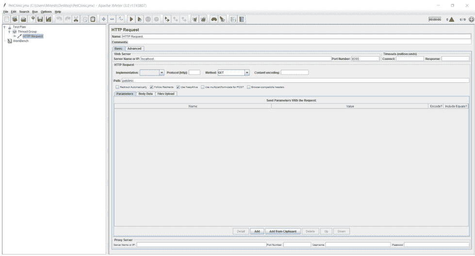

### Apache JMeter HTTP 请求配置

- 11. 保存 .jmx 文件。
- 12. 按 Ctrl + R 运行测试计划。
- 13. 点击“查看结果树”（View Results Tree）。

## 补充说明

JMeter 使用线程并行运行请求。每个线程大约用于模拟一个用户。实际上，真实用户对系统的访问强度远低于一个线程。线程每秒钟可以多次访问系统，而典型情况下，用户大约每 20 秒点击一次。

测试计划使用了许多元素：

- 线程组：定义运行的线程数量。
- Cookie 管理器：跟踪每个线程的 Cookie。如果你想在请求之间跟踪 Cookie，这一点很重要。例如，如果某个线程登录到 Tomcat 服务器，则需要为每个线程存储唯一的 JSESSIONID。
- CSV 数据集配置：该元素解析 CSV 文件的内容，将值放入 HOST、PORT 和 URL 变量中。每次迭代时，每个线程都会读取 CSV 文件的新一行。通过使用 `${variable_name}` 表示法在元素中展开变量。
- 查看结果树：此监听器在 GUI 中以请求和响应的树形结构显示结果。这对调试非常有用，但之后应该将其移除。

一个常见的错误是认为一个线程等同于一个用户。主要区别在于线程的响应速度比普通用户更快。如果你不在请求中添加延迟因素，那么少量线程就能真正压垮你的应用程序。例如，阿姆斯特丹大学的在线系统通常每点击一次会有 25 秒的延迟。

如果你想在应用程序中排查多线程问题，那么应使用随机延迟元素，而不是固定延迟。这也能更好地模拟典型的用户交互。


## 从 Jenkins 执行负载测试

现在，让我们创建一个 Jenkins 任务。

## 准备工作

在 Jenkins 中创建一个自由风格项目：

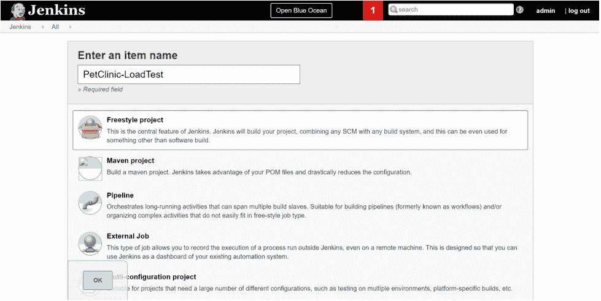

添加构建步骤：执行 Windows 批处理命令。

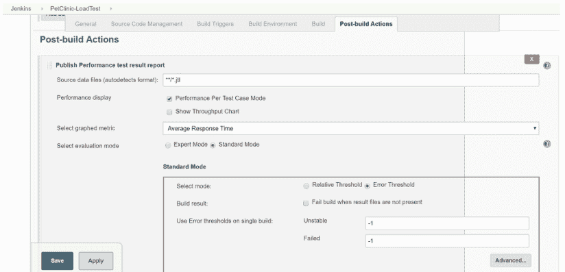

4. 点击“立即构建”：

## 控制台输出

```
Started by user admin
Building in workspace F:\#JenkinsEssentials\FirstDraft\jenkinsHome\workspace\PetClinic-LoadTest
[PetClinic-LoadTest] $ cmd /c call C:\Users\Mitesh\AppData\Local\Temp\jenkins136957989406107476.bat
F:\#JenkinsEssentials\FirstDraft\jenkinsHome\workspace\PetClinic-LoadTest\C:\apache-jmeter-3.0\bin\jmeter.bat -Jjmeter.save.saveservice.output_format=xml -n -t C:\Users\Mitesh\Desktop\PetClinic.jmx -l Test.jtl
Writing log file to: F:\#JenkinsEssentials\FirstDraft\jenkinsHome\workspace\PetClinic-LoadTest\jmeter.log
Creating summariser <summary>
Created the tree successfully using C:\Users\Mitesh\Desktop\PetClinic.jmx
Starting the test @ Sun Jun 04 16:56:19 IST 2017 (1496575579885)
Waiting for possible Shutdown/StopTest/Now/Heapdump message on port 4445
summary =  50  in 00:00:09 =   5.4/s Avg:   175 Min:     5 Max:  2724 Err:     0 (0.00%)
Tidying up ...    @ Sun Jun 04 16:56:29 IST 2017 (1496575589522)
... end of run
Java HotSpot(TM) 64-Bit Server VM warning: MaxNewSize (4194304k) is equal to or greater than the entire heap (4194304k). A new max generation size of 4193792k will be used.
Performance: Recording JMeter reports "**/*.jtl"
Performance: Parsing JMeter report file 'F:\#JenkinsEssentials\FirstDraft\jenkinsHome\jobs\PetClinic-LoadTest\builds\1\performance-reports\JMeter\Test.jtl'.
Performance: Percentage of errors greater or equal than 0% sets the build as unstable
Performance: Percentage of errors greater or equal than 0% sets the build as failure
Performance: File Test.jtl reported 0.0% of errors [SUCCESS]. Build status is: SUCCESS
Started calculate disk usage of build
Finished Calculation of disk usage of build in 0 seconds
Started calculate disk usage of workspace
Finished Calculation of disk usage of workspace in 0 seconds
Finished: SUCCESS
```

5. 在项目仪表板上验证性能趋势。

6. 点击“性能趋势”：

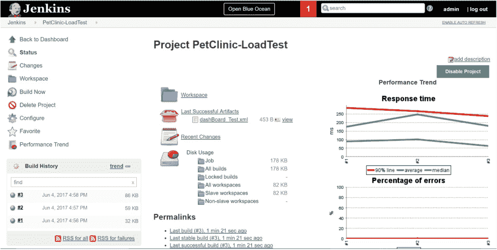

## 7. 验证性能明细：

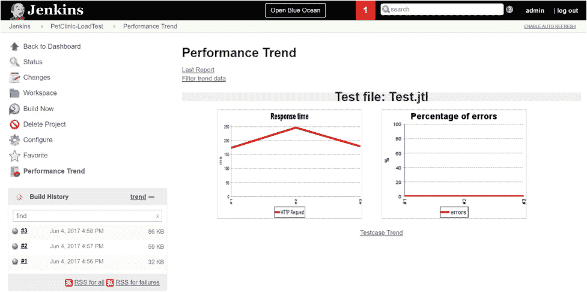

8. 点击“最后报告”，获取有关负载测试结果的更多详细信息：

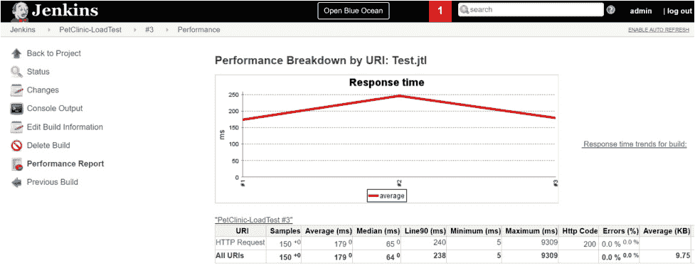

| URI | 样本数 | 平均值 (ms) | 中位数 (ms) | 90% 行 (ms) | 最小值 (ms) | 最大值 (ms) | HTTP 代码 | 错误率 (%) | 平均大小 (KB) |
|---|---:|---:|---:|---:|---:|---:|---:|---:|---:|
| HTTP Request | 150 | 179 | 65 | 240 | 5 | 9309 | 200 | 0.0% | 0.0 |
| 所有 URI | 150 | 179 | 64 | 238 | 5 | 9309 |  | 0.0% | 9.75 |

9. 完成！

## 报告 JMeter 性能指标

在本节中，你将了解如何配置 Jenkins 来运行 JMeter 测试计划，然后收集并报告结果。还将解释如何将变量从 Ant 脚本传递到 JMeter。

## 准备工作

假设你已经完成了上一节创建 JMeter 测试计划的内容。你还需要安装 Jenkins 性能插件（[https://wiki.jenkins-ci.org/display/JENKINS/Performance+Plugin](https://wiki.jenkins-ci.org/display/JENKINS/Performance+Plugin)）。

## 操作步骤...

- 1. 在 JMeter 中打开 `./examples/jmeter_example.jmx`，并另存为 `./plans/URL_ping.jmx`。
- 2. 选择 CSV Data Set Config，将文件名改为 `${__property(csv)}`。
- 3. 在“文件”菜单下，选择“保存”选项。
- 4. 在项目的顶层创建一个 `build.xml` 文件，内容如下：

```
```xml
<project default="jmeter.tests">
  <property name="jmeter" location="/var/lib/jenkins/jmeter" />
  <property name="target" location="${basedir}/target" />
  <echo message="Running... Expecting variables [jvarg,desc]" />
  <echo message="For help please read ${basedir}/README" />
  <echo message="[DESCRIPTION] ${desc}" />
  <taskdef name="jmeter" classname="org.programmerplanet.ant.taskdefs.jmeter.JMeterTask" classpath="${jmeter}/extras/ant-jmeter-1.0.9.jar" />
  <target name="jmeter.init">
    <mkdir dir="${basedir}/jmeter_results"/>
    <delete includeemptydirs="true">
      <fileset dir="${basedir}/jmeter_results" includes="**/*" />
    </delete>
  </target>
  <target name="jmeter.tests" depends="jmeter.init" description="launch jmeter load tests">
    <echo message="[Running] jmeter tests..." />
    <jmeter jmeterhome="${jmeter}" resultlog="${basedir}/jmeter_results/LoadTestResults.jtl">
      <testplans dir="${basedir}/plans" includes="*.jmx"/>
      <jvmarg value="${jvarg}" />
      <property name="csv" value="${basedir}/data/URLS.csv" />
    </jmeter>
  </target>
</project>
```
```

- 5. 将更新提交到你的 Subversion 项目。
- 6. 登录 Jenkins。
- 7. 创建一个名为 `ch6.remote.jmeter` 的新自由风格任务。
- 8. 在“源码管理”下，勾选 Subversion，将你的 Subversion 仓库 URL 添加到“仓库 URL”中。
- 9. 在“构建”部分中，添加构建步骤“调用 Ant”。
- 10. 在新的“调用 Ant”子部分中，单击“高级”，并为属性添加以下内容：

```
```properties
jvarg=-Xmx512m
desc= This is the first iteration in a performance test
environment - Driven by Jenkins
```
```

- 11. 在“构建后操作”部分中，勾选“发布性能测试结果报告”。将输入 `jmeter_results/*.jtl` 添加到“报告文件”中。
- 12. 单击“保存”。
- 13. 运行任务几次，并在“性能趋势”链接下查看结果。

## 工作原理...

`build.xml` 文件是一个 Ant 脚本，它负责设置环境，然后调用库 `/extras/ant-jmeter-1.0.9.jar` 中定义的 JMeter Ant 任务。该 JAR 文件是标准 JMeter 发行版的一部分。

位于 `plans` 目录下的任何 JMeter 测试计划都将运行。将测试计划从 `examples` 目录移动到 `plans` 目录即可激活它。结果汇总在 `jmeter_results/LoadTestResults.jtl` 中。

Ant 脚本将 `csv` 变量传递给 JMeter 测试计划；`.csv` 文件的位置为 `${basedir}/data/URLS.csv`。`${basedir}` 由 Ant 自动定义。顾名思义，它是 Ant 项目的基本目录。

你可以使用 `${__functioncall(parameters)}` 结构在其元素内调用 JMeter 函数。你已在测试计划的 CSV Data Set Config 元素中添加了函数调用 `${__property(csv)}`。该函数会拉取 Ant 脚本中定义的 `.csv` 值。

Jenkins 任务运行 Ant 脚本，Ant 脚本依次运行 JMeter 测试计划并汇总结果。随后，Jenkins 性能插件解析结果，生成报告。

## 更多内容...

为了快速构建复杂的测试计划，可以考虑使用 JMeter 内置的透明代理（[http://jmeter.apache.org/usermanual/component_reference.html#HTTP_Proxy_Server](http://jmeter.apache.org/usermanual/component_reference.html#HTTP_Proxy_Server)）。你可以在本地机器的指定端口上运行它，并在 Web 浏览器中设置匹配的代理首选项。录制到的 JMeter 元素将让你清楚地了解所捕获请求中发送的参数。

另一种选择是 Badboy（[http://www.badboysoftware.biz/docs/jmeter.html](http://www.badboysoftware.biz/docs/jmeter.html)），它有自己的内置 Web 浏览器。它允许你以类似于 Selenium IDE 的方式记录操作，然后将它们保存到 JMeter 测试计划。

## 使用 FitNesse 进行测试

FitNesse（[http://fitnesse.org](http://fitnesse.org)）是一个完全集成的独立 wiki 和验收测试框架。你可以在表格中编写测试并运行它们。使用 wiki 语言编写测试扩大了潜在测试编写者的范围，并减少了学习新框架所需的最初工作量。

如果测试通过，表格行会以绿色显示；如果失败，则以红色显示。测试可以被 wiki 内容包围，在同一位置提供上下文信息，例如用户故事。你还可以考虑在 FitNesse 中创建 Web 应用程序的模型（mock-ups），与测试放在一起，并将测试指向这些模型。

本节介绍如何在远程运行 FitNesse，并在 Jenkins 中显示结果。


## 准备工作

从 [http://fitnesse.org/FitNesseDownload](http://fitnesse.org/FitNesseDownload) 下载最新的稳定版 FitNesse JAR 包。从 [https://wiki.jenkins-ci.org/display/JENKINS/FitNesse+Plugin](https://wiki.jenkins-ci.org/display/JENKINS/FitNesse+Plugin) 安装适用于 Jenkins 的 FitNesse 插件。

## 操作步骤

1. 创建 `fit/logs` 目录，并将 `fitnesse-standalone.jar` 放入 `fit` 目录中。
2. 在命令行中运行 FitNesse 帮助命令，查看相关选项：

```
java -jar fitnesse-standalone.jar -help
Usage: java -jar fitnesse.jar [-vpdrleoab]
-p <port number> {80}
-d <working directory> {.}
-r <page root directory> {FitNesseRoot}
-l <log directory> {no logging}
-f <config properties file> {plugins.properties}
-e <days> {14} Number of days before page versions expire
-o omit updates
-a {user:pwd | user-file-name} enable authentication.
-i Install only, then quit.
-c <command> execute single command.
-b <filename> redirect command output.
-v {off} Verbose logging
```
3. 在命令行中运行 FitNesse，查看启动输出：

```
java -jar fitnesse-standalone.jar -p 39996 -l logs -a tester:test
Bootstrapping FitNesse, the fully integrated standalone wiki and acceptance
testing framework.
root page: fitnesse.wiki.fs.FileSystemPage at ./FitNesseRoot#latest
logger: /home/alan/Desktop/X/fitness/logs
authenticator: fitnesse.authentication.OneUserAuthenticator
page factory: fitnesse.html.template.PageFactory
page theme: fitnesse_straight
Starting FitNesse on port: 39996
```
4. 使用 Web 浏览器访问 http://localhost:39996。
5. 点击 **Acceptance Test** 链接。
6. 点击 **Suite** 链接。这将启动一组测试。根据你的计算机性能，测试可能需要几分钟才能完成。直接链接为 http://localhost:39996/FitNesse.SuiteAcceptanceTests?suite。
7. 点击 **Test History** 链接。你需要使用用户名 `tester` 和密码 `test` 登录。
8. 查看 `fit/logs` 目录中的日志。再次运行测试套件后，你将看到类似于以下内容的记录：

```
127.0.0.1 - tester [01/Oct/2014:11:14:59 +0100] "GET
/FitNesse.SuiteAcceptanceTests?suite HTTP/1.1" 200 6086667
```
9. 登录 Jenkins，创建一个名为 `ch6.remote.fitnesse` 的自由风格软件项目。
10. 在 **构建** 部分，从 **添加构建步骤** 中选择 **Execute fitnesse tests** 选项。
11. 勾选 **FitNesse instance is already running** 选项，并填写：

- FitNesse 主机：`localhost`
- FitNesse 端口：`39996`
- 目标页面：`FitNesse.SuiteAcceptanceTests?suite`
- 勾选 **Is target a suite** 选项
- HTTP 超时时间（毫秒）：`180000`
- FitNesse XML 结果文件路径：`fitnesse-results.xml`
12. 在 **构建后操作** 部分，勾选 **Publish FitNesse results report** 选项。
13. 在 **Path to fitnesse xml results file** 输入框中添加 `fitnesse-results.xml` 值。
14. 点击 **保存**。
15. 运行该任务。
16. 点击 **FitNesse Results** 链接查看最新任务结果。

## 工作原理

FitNesse 内置了一套验收测试，用于检查自身是否存在回归问题。Jenkins 插件通过 HTTP GET 请求调用测试，并要求以 XML 格式返回结果，其 URL 为：`http://localhost:39996/FitNesse.SuiteAcceptanceTests?suite&format=xml`。结果类似于以下内容：

```xml
<testResults>
<FitNesseVersion>v20140901</FitNesseVersion>
<rootPath>FitNesse.SuiteAcceptanceTests</rootPath>
<result>
<counts><right>103</right>
<wrong>0</wrong>
<ignores>0</ignores>
<exceptions>0</exceptions>
</counts>
<runTimeInMillis>27</runTimeInMillis>
<relativePageName>CopyAndAppendLastRow</relativePageName>
<pageHistoryLink>
FitNesse.SuiteAcceptanceTests.SuiteFitDecoratorTests.CopyAndAppend
LastRow?pageHistory&resultDate=20141101164526
</pageHistoryLink>
</result>
```

随后，Jenkins 插件解析该 XML 并生成报告。

默认情况下，FitNesse 页面未启用任何安全机制。在本教程中，我们在启动时定义了用户名和密码。然而，我们并未进一步在页面上定义安全权限。要激活安全权限，你需要点击页面左侧的 **properties** 链接，并勾选 **secure-test** 的安全权限。

你还可以通过文本文件中的用户列表或 Kerberos/Active Directory 进行身份验证。更多详情，请参阅 [http://fitnesse.org/FitNesse.FullReferenceGuide.UserGuide.AdministeringFitNesse.SecurityDescr](http://fitnesse.org/FitNesse.FullReferenceGuide.UserGuide.AdministeringFitNesse.SecurityDescr)

此外，还有一个用于 LDAP 认证的社区贡献插件：[https://github.com/timander/fitnesse-ldap-authenticator](https://github.com/timander/fitnesse-ldap-authenticator)。

建议考虑深度防御；在 FitNesse 服务器上通过防火墙添加 IP 限制可形成额外的防御层。例如，你可以在 wiki 前放置 Apache 服务器，并启用 SSL/TLS 以确保密码加密传输。Apache 的一个更轻量级替代方案是 NGINX：[http://wiki.nginx.org](http://wiki.nginx.org)。

## 另请参阅

你可以在 FitNesse 的 GitHub 主页上找到包含构建最新版本信息的源代码：https://github.com/unclebob/fitnesse。
