## 编排

在本章中，我们将介绍以下内容：

- 简介
- 理解上游和下游任务
- 配置上游和下游任务
- 配置构建流水线
- 创建流水线任务
- 使用示例流水线执行
- 配置用于端到端自动化的流水线任务
- Blue Ocean 仪表盘入门

## 简介

编排或流水线是指根据需求定义一系列执行序列，以管理应用程序的生命周期。

一个简单的例子是：你可能希望先执行静态代码分析；如果它符合所定义的质量门禁，那么才执行持续集成并创建可部署到特定环境的应用程序包。

包准备就绪后，根据组织中的需求和既定策略，将其部署到测试环境中进行手动或自动化测试。一旦被提升至 UAT 或预发布环境，你可能需要执行功能测试和性能测试。

此流程完成后，你可能希望将其部署到生产环境，但必须经过特定利益相关者的批准。

这就是构建任务的编排或已定义的执行流程。

## 准备工作

你需要将应用程序生命周期管理流程的端到端自动化划分为多个不同的项目。

这种策略的好处在于，你可以隔离自动化任务，并在不同的代理上独立执行。

## 操作步骤

让我们从第一个任务开始，进行上游和下游任务的配置。将执行静态代码分析的项目作为第一个任务：

1. 在 **PetClinic-Code** 构建任务的配置中，进入 **构建后操作** 部分。
2. 从可用选项中选择 **Build other projects**：

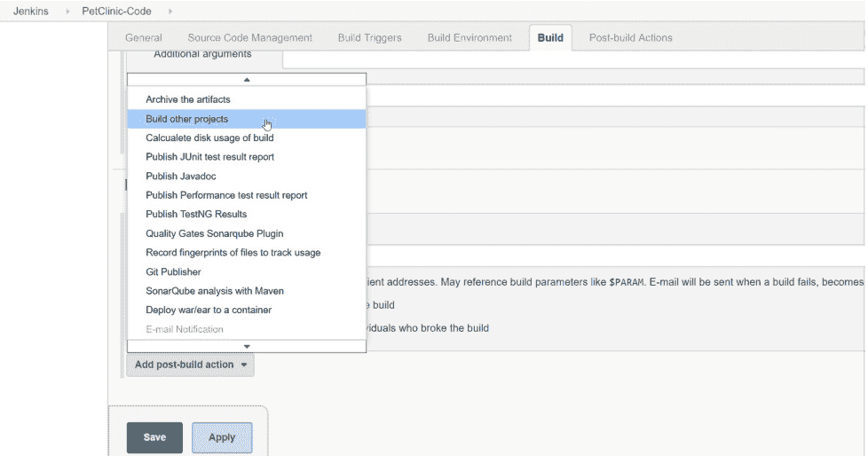

3. 你应该在静态代码分析完成后创建包，因此应选择 **PetClinic-Package**，该任务已配置了源代码编译、单元测试执行和包文件生成的持续集成。
4. 点击 **保存**。

因此，对于 **PetClinic-Code** 而言，**PetClinic-Package** 是下游任务；而对于 **PetClinic-Package** 而言，**PetClinic-Code** 是上游任务。

## 配置上游和下游任务

让我们使用上游和下游任务配置一个完整的流程。


## 准备工作

确保你拥有在前几章中创建的所有构建作业，例如 WAR 文件的部署、功能测试和负载测试。

在 PetClinic-FuncTest 作业中，你将在 Post-build Actions 中将 PetClinic-LoadTest 配置为下游作业：

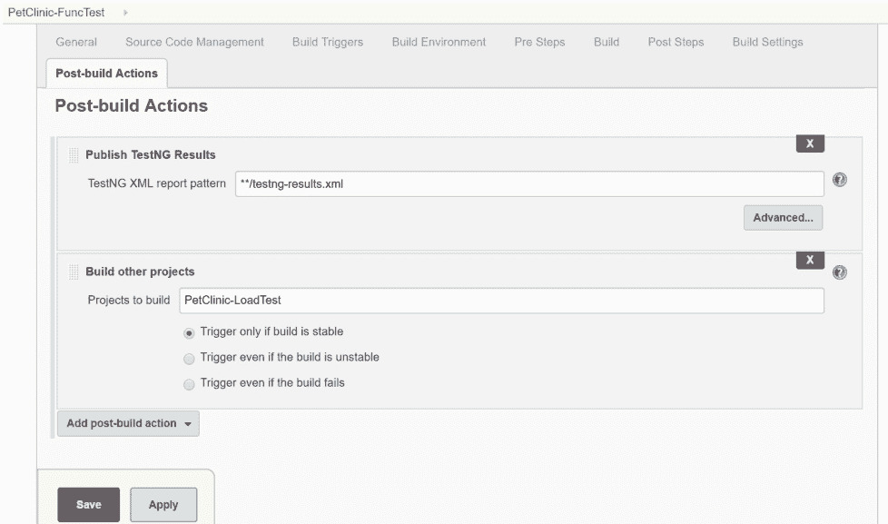

负载测试完成后，你应该在 Prod 环境中部署应用程序，因此在 PetClinic-LoadTest 作业中，你将在 Post-build Actions 中将 PetClinic-Prod 配置为下游作业：

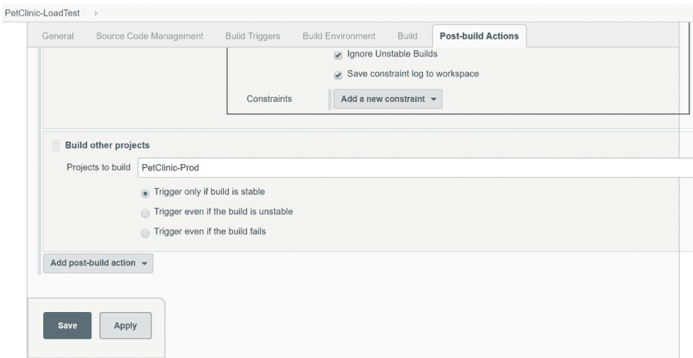

## 配置构建流水线

现在你已经配置了所有上游和下游作业。你知道执行顺序，因此可以执行第一个构建，其余构建将依次跟进，直到序列中某个作业失败。你也可以配置为继续进行不稳定构建。

然而，如果你能可视化你配置的上游和下游作业的执行流程会更有用。

构建流水线插件可基于上游和下游作业的配置对执行流程进行可视化。

## 准备工作

从 Manage Jenkins | Manage Plugins 安装插件：

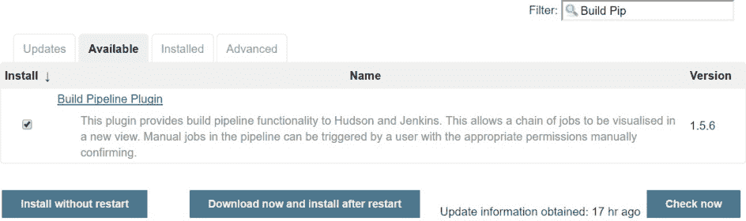

验证 Build Pipeline Plugin 是否成功安装：

## Installing Plugins/Upgrades

Preparation

- Checking internet connectivity
- Checking update center connectivity
- Success

- TestNG Results Plugin  Success
- promoted builds plugin  Success
- Run Condition Plugin  Success
- Conditional BuildStep  Success
- Parameterized Trigger plugin  Success
- Build Pipeline Plugin  Success

Go back to the top page
(you can start using the installed plugins right away)

Restart Jenkins when installation is complete and no jobs are running

现在，你可以创建构建流水线并使用初始作业进行配置。

## 如何操作...

- 1. 进入 Jenkins 仪表盘并点击标签页上方的 + 号。
- 2. 提供 View 名称并选择 Build Pipeline View。
- 3. 点击 Save：

## Jenkins

Open Blue Ocean

search

admin | log out

- New Item
- People
- Build History
- Project Relationship
- Check File Fingerprint
- Manage Jenkins
- My Views
- Disk Usage
- Credentials

View name

PetClinic

Build Pipeline View
Shows the jobs in a build pipeline view. The complete pipeline of jobs that a version propagates through are shown as a row in the view.

Dashboard
Customizable view that contains various portlets containing information about your job(s)

List View
Shows items in a simple list format. You can choose which jobs are to be displayed in which view.

My View
This view automatically displays all the jobs that the current user has an access to.

OK

Build Queue
No builds in the queue.

Build Executor Status

4. 验证 Layout 是否配置为 Based on upstream/downstream relationship。

5. 你希望以 PetClinic-code 作为第一个作业执行并从该作业开始可视化，因此在 Select Initial Job 中选择它：

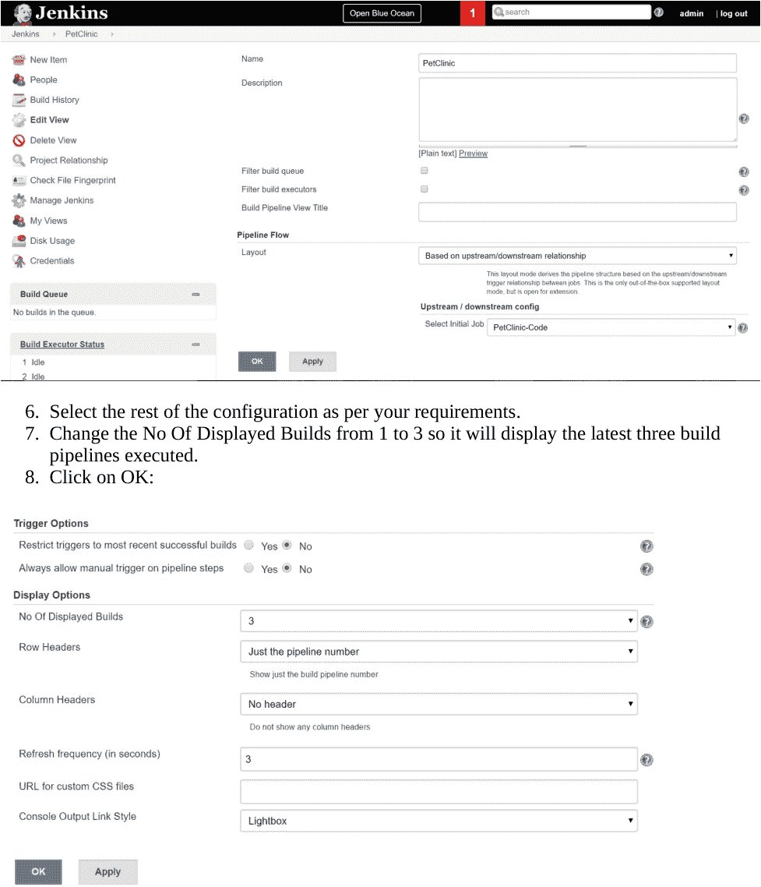

- 6. 根据你的需求选择其余配置。
- 7. 将 No Of Displayed Builds 从 1 改为 3，以便显示最近执行的三个构建流水线。
- 8. 点击 OK：

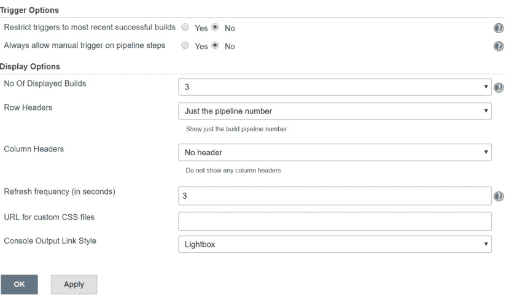

9. 在 Jenkins 仪表盘中验证 Build Pipeline 视图：

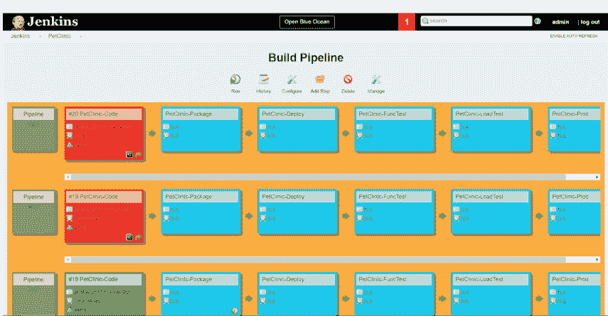

Build Pipeline in Initial Phase

10. 如果你希望即使某些构建不稳定也继续执行流水线怎么办？在这种情况下，你需要在 Post-build Actions 中选择 Trigger even if the build is unstable 选项，如以下屏幕截图所示：

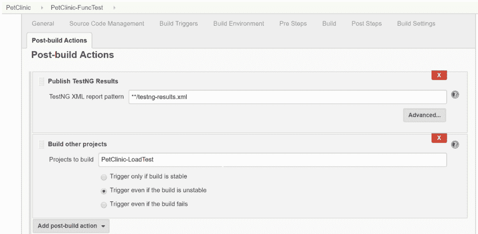

11. 在 Build Pipeline 视图中点击 run。等待整个流水线执行完毕：

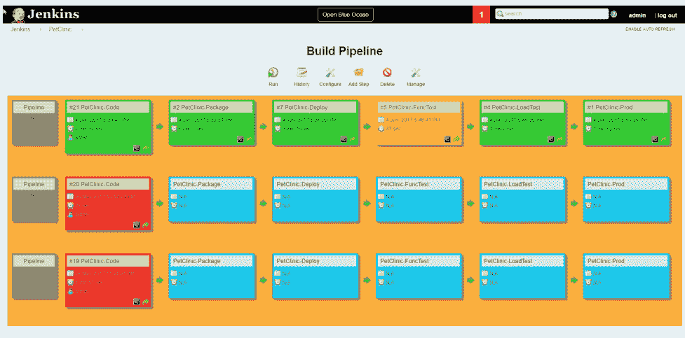

## Successful Build Pipeline Execution

12. 完成。这就是如何为不同的构建作业创建执行序列并实现应用程序生命周期管理的端到端自动化。在下一个配方中，你将使用 pipeline as a code 功能实现类似的事情。

## 创建流水线作业

在流水线中，你对所有相关任务进行建模以决定执行顺序。你将执行与使用构建流水线时相同的任务，但使用代码完成。

## 准备工作

打开 Jenkins 仪表盘。

## 如何操作...

- 1. 点击 New Item。输入项目名称并选择 Pipeline。
- 2. 点击 OK：

## Enter an item name

FirstPipeline

- **Freestyle project** — This is the central feature of Jenkins. Jenkins will build your project, combining any SCM with any build system, and this can be even used for something other than software build.
- **Maven project** — Build a maven project. Jenkins takes advantage of your POM files and drastically reduces the configuration.
- **Pipeline** — Orchestrates long-running activities that can span multiple build slaves. Suitable for building pipelines (formerly known as workflows) and/or organizing complex activities that do not easily fit in free-style job type.
- **External Job** — This type of job allows you to record the execution of a process run outside Jenkins, even on a remote machine. This is designed so that you can use Jenkins as a dashboard of your existing automation system.
- **Multi-configuration project** — Suitable for projects that need a large number of different configurations, such as testing on multiple environments, platform-specific builds, etc.

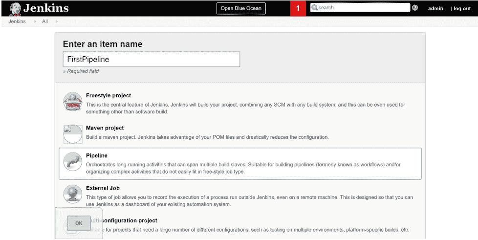

## 使用示例流水线进行执行

Jenkins 提供示例语法以帮助你了解如何配置流水线。

## 准备工作

在 Jenkins 2 中，流水线和其他功能已随默认安装及建议插件一起安装。

## 如何操作...

- 1. 进入 Jenkins 仪表盘 | New item | Pipeline。
- 2. 它将打开新创建的流水线作业的配置。
- 3. 进入 Pipeline 部分：

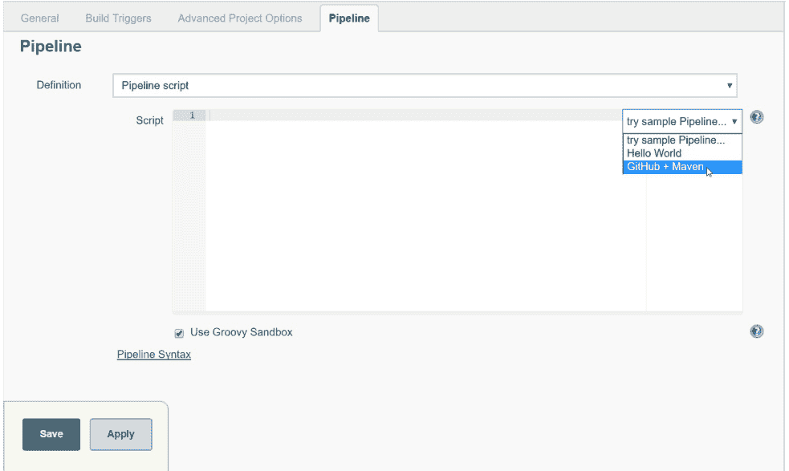

4. 在 try sample Pipeline... 下拉菜单中选择 GitHub + Maven。它将自动生成示例代码的语法。确保 mvnHome 具有与系统中的 Maven 路径相符的正确值：

## Pipeline

Definition

Pipeline script

Script

```
node {
    def mvnHome
    stage('Preparation') { // for display purposes
        // Get some code from a GitHub repository
        git 'https://github.com/jglick/simple-maven-project-with-tests.git'
        // Get the Maven tool
        // ** NOTE: This 'M3' Maven tool must be configured
        // **       in the global configuration.
        mvnHome = tool 'M3'
    }
    stage('Build') {
        // Run the maven build
        if (isUnix()) {
            sh "${mvnHome}/bin/mvn" -Dmaven.test.failure.ignore clean package"
        } else {
            bat("/${mvnHome}/bin/mvn" -Dmaven.test.failure.ignore clean package/)
        }
    }
```

GitHub + Maven

Use Groovy Sandbox

Pipeline Syntax

Save

Apply

- 5. 点击 Save 并执行构建以验证其是否有效。
- 6. 然而，你将在下一个配方中创建自己的流水线，其序列与使用 Build Pipeline 插件时尝试的序列相同。

## 配置流水线作业以实现端到端自动化

在本配方中，你将创建脚本以创建与使用 `Build Pipeline` 插件配置的类似流水线。

## 准备工作

点击 Pipeline Syntax 以生成你想要执行的特定任务的语法。

你可以选择步骤并配置所需内容，然后点击 Generate Pipeline Script 以获取可直接在流水线中使用的语法：


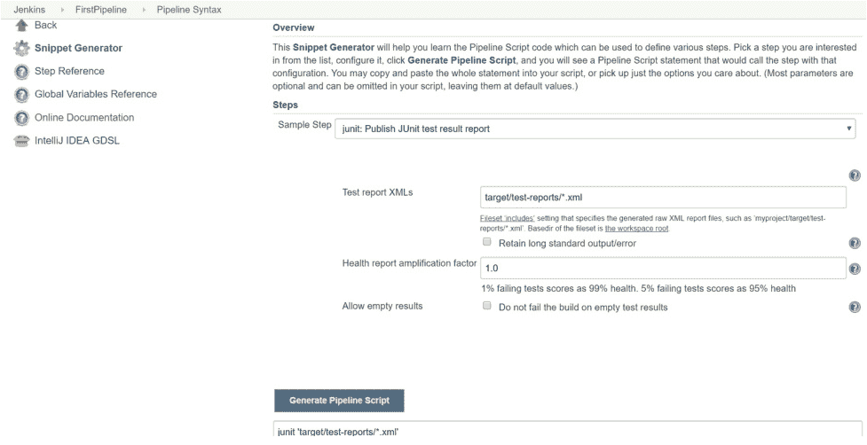

在创建您的第一个流水线脚本之前，让我们先了解一些重要术语。

节点（node）是指在 Jenkins 主代理架构上下文中创建的节点。当执行器在节点上可用时，节点会立即执行步骤。它还会为流水线创建工作空间或目录来保存文件。以下是示例语法：

```groovy
node {
    // execute the pipeline on Master node
}
node('windows') {
    // execute the pipeline on node labelled as Windows
}
```

阶段（stage）是一种步骤，可以看作是逻辑上独立的步骤，例如 Init、Build、Test、Deploy 等。

步骤（step）或构建步骤（build step）是可以执行以完成某项活动的任务，例如复制制品、归档制品、从 GitHub 检出代码以及定义环境变量。

流水线的脚本如下：

```groovy
node {
def mvnHome
stage('Preparation') { // for display purposes
    // Get Pipeline code from a GitHub repository
git 'https://github.com/mitesh51/spring-petclinic.git'
    // Get the Maven tool.
    // ** NOTE: This 'apache-maven-3.3.1' Maven tool must
    // be configured in the global configuration.
mvnHome = tool 'apache-maven-3.3.1'
}
stage('SonarQube analysis') {
    // requires SonarQube Scanner 3.0+
def scannerHome = tool 'SonarQube Scanner 3.0.3';
// Sonarqube6.3 must be configured in the Jenkins
// Configuration -> Add SonarQube server
withSonarQubeEnv('Sonarqube6.3') {
//provide all required properties for Sonar
// execution
bat "${scannerHome}/bin/sonar-scanner -
Dsonar.host.url=http://localhost:9000/ -
```
```

## 如何操作...

让我们看看如何在 Jenkins 中执行“流水线即代码”（Pipeline as Code）功能：

- 1. 点击“Build now”以执行流水线：

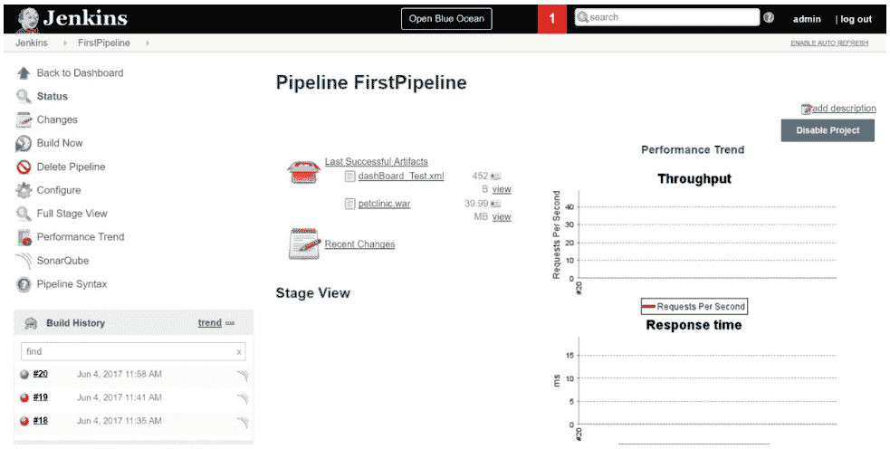

- 2. 在 Jenkins 仪表板上点击“Full Stage View”，验证您所创建流水线的阶段视图：

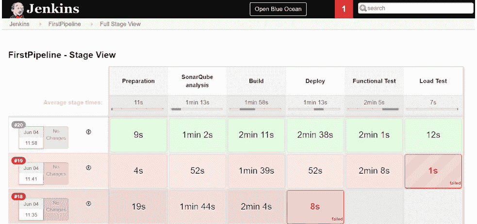

- 3. 将鼠标悬停在特定阶段上，然后点击“Logs”：

## FirstPipeline - 阶段视图

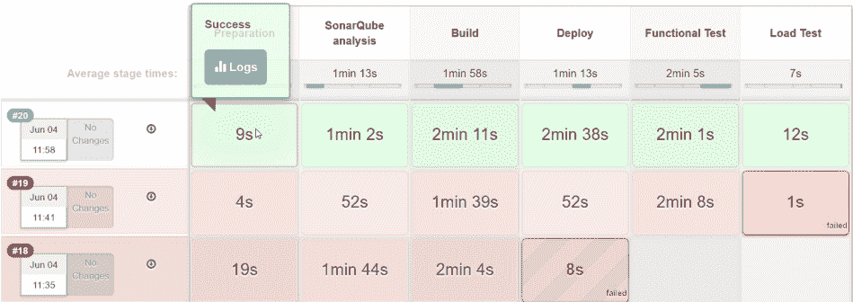

4. 您可以直接在阶段视图中查看和验证阶段日志：

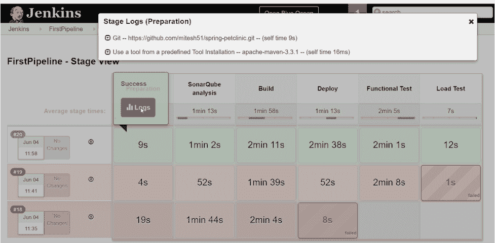

5. 点击下拉菜单以获取日志的更多详细信息：

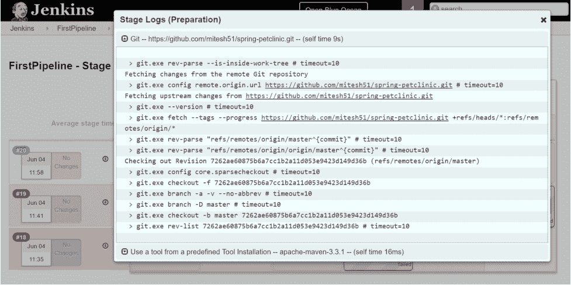

- 6. 让我们转到“Console Output”中的各个阶段日志。
- 7. 查看准备（Preparation）阶段的日志：

## 控制台输出

```
Started by user admin
[Pipeline] node
Running on master in F:\#JenkinsEssentials\FirstDraft\jenkinsHome\workspace\FirstPipeline
[Pipeline] {
[Pipeline] stage
[Pipeline] { (Preparation)
[Pipeline] git
 > git.exe rev-parse --is-inside-work-tree # timeout=10
Fetching changes from the remote Git repository
 > git.exe config remote.origin.url https://github.com/mitesh51/spring-petclinic.git # timeout=10
Fetching upstream changes from https://github.com/mitesh51/spring-petclinic.git
 > git.exe --version # timeout=10
 > git.exe fetch --tags --progress https://github.com/mitesh51/spring-petclinic.git +refs/heads/*:refs/remotes/origin/*
 > git.exe rev-parse "refs/remotes/origin/master^{commit}" # timeout=10
 > git.exe rev-parse "refs/remotes/origin/origin/master^{commit}" # timeout=10
Checking out Revision 7262ae60875b6a7cc1b2a11d053e9423d149d36b (refs/remotes/origin/master)
 > git.exe config core.sparsecheckout # timeout=10
 > git.exe checkout -f 7262ae60875b6a7cc1b2a11d053e9423d149d36b
 > git.exe branch -a -v --no-abbrev # timeout=10
 > git.exe branch -D master # timeout=10
 > git.exe checkout -b master 7262ae60875b6a7cc1b2a11d053e9423d149d36b
 > git.exe rev-list 7262ae60875b6a7cc1b2a11d053e9423d149d36b # timeout=10
[Pipeline] tool
```

8. 查看 SonarQube 分析阶段的日志：

```text
[Pipeline] stage
[Pipeline] { (SonarQube analysis)
[Pipeline] tool
[Pipeline] wrap
Injecting SonarQube environment variables using the configuration: Sonarqube6.3
[Pipeline] }
[Pipeline] bat
[FirstPipeline] Running batch script

F:\#JenkinsEssentials\FirstDraft\jenkinsHome\workspace\FirstPipeline>F:\#JenkinsEssentials\FirstDraft\jenkinsHome\tools\hudson.plugins.sonar.SonarRunnerInstallation\SonarQube_Scanner_3.0.3/bin/sonar-scanner -Dsonar.host.url=http://localhost:9000/ -Dsonar.login=***** -Dsonar.projectVersion=1.0 -Dsonar.projectKey=petclinicKey -Dsonar.sources=src
INFO: Scanner configuration file:
F:\#JenkinsEssentials\FirstDraft\jenkinsHome\tools\hudson.plugins.sonar.SonarRunnerInstallation\SonarQube_Scanner_3.0.3\bin\..\conf\sonar-scanner.properties
INFO: Project root configuration file: F:\#JenkinsEssentials\FirstDraft\jenkinsHome\workspace\FirstPipeline\sonar-project.properties
INFO: SonarQube Scanner 3.0.3.778
INFO: Java 1.8.0_111 Oracle Corporation (64-bit)
INFO: Windows 10 10.0 amd64
INFO: User cache: C:\Users\Mitesh\.sonar\cache
INFO: Load global settings
INFO: Load global settings (done) | time=3968ms
INFO: User cache: C:\Users\Mitesh\.sonar\cache
INFO: Load plugins index
INFO: Load plugins index (done) | time=138ms
INFO: SonarQube server 6.3.1
```

## 9. 查看构建（Build）阶段的日志：

```text
[Pipeline] stage
[Pipeline] { (Build)
[Pipeline] isUnix
[Pipeline] bat
[FirstPipeline] Running batch script

F:\#JenkinsEssentials\FirstDraft\jenkinsHome\workspace\FirstPipeline>"C:\apache-maven-3.3.1\bin\mvn" clean package
[INFO] Scanning for projects...
[INFO]
[INFO] ------------------------------------------------------------------------
[INFO] Building petclinic 4.2.5-SNAPSHOT
[INFO] ------------------------------------------------------------------------
[INFO]
[INFO] --- maven-clean-plugin:2.5:clean (default-clean) @ spring-petclinic ---
[INFO] Deleting F:\#JenkinsEssentials\FirstDraft\jenkinsHome\workspace\FirstPipeline\target
[INFO]
[INFO] --- cobertura-maven-plugin:2.7:clean (default) @ spring-petclinic ---
[INFO]
[INFO] --- maven-resources-plugin:2.6:resources (default-resources) @ spring-petclinic ---
[INFO] Using 'UTF-8' encoding to copy filtered resources.
[INFO] Copying 18 resources
[INFO]
[INFO] --- maven-compiler-plugin:3.0:compile (default-compile) @ spring-petclinic ---
[INFO] Changes detected - recompiling the module!
[INFO] Compiling 45 source files to F:\#JenkinsEssentials\FirstDraft\jenkinsHome\workspace\FirstPipeline\target\classes
[parsing started
RegularFileObject[F:\#JenkinsEssentials\FirstDraft\jenkinsHome\workspace\FirstPipeline\src\main\java\org\springframework\samples\petclinic\web\PetValidator.java]]
[parsing completed 219ms]
```

## 10. 查看部署和功能测试阶段的日志：

[INFO] Building war: F:\#JenkinsEssentials\FirstDraft\jenkinsHome\workspace\FirstPipeline\target\petclinic.war
[INFO] ------------------------------------------------------------------------
[INFO] BUILD SUCCESS
[INFO] ------------------------------------------------------------------------
[INFO] Total time: 02:03 min
[INFO] Finished at: 2017-06-04T12:01:43+05:30
[INFO] Final Memory: 27M/88M
[INFO] ------------------------------------------------------------------------
[Pipeline] }
[Pipeline] // stage
[Pipeline] stage
[Pipeline] { (Deploy)
[Pipeline] step
Recording test results
[Pipeline] archive
[Pipeline] build (Building PetClinic-Deploy)
Scheduling project: PetClinic-Deploy
Starting building: PetClinic-Deploy #6
[Pipeline] }
[Pipeline] // stage
[Pipeline] stage
[Pipeline] { (Functional Test)
[Pipeline] git
> git.exe rev-parse --is-inside-work-tree # timeout=10
Fetching changes from the remote Git repository
> git.exe config remote.origin.url https://github.com/mitesh51/petclinic-func.git # timeout=10
Fetching upstream changes from https://github.com/mitesh51/petclinic-func.git
> git.exe --version # timeout=10
> git.exe fetch --tags --progress https://github.com/mitesh51/petclinic-func.git
+refs/heads/*:refs/remotes/origin/*

11. 查看负载测试阶段的日志：

Results :

Tests run: 1, Failures: 0, Errors: 0, Skipped: 0

[INFO] ------------------------------------------------------------------------
[INFO] BUILD SUCCESS
[INFO] ------------------------------------------------------------------------
[INFO] Total time: 01:42 min
[INFO] Finished at: 2017-06-04T12:06:24+05:30
[INFO] Final Memory: 18M/80M
[INFO] ------------------------------------------------------------------------
[Pipeline] }
[Pipeline] // stage
[Pipeline] stage
[Pipeline] { (Load Test)
[Pipeline] bat
[FirstPipeline] Running batch script

F:\#JenkinsEssentials\FirstDraft\jenkinsHome\workspace\FirstPipeline>C:/apache-jmeter-3.0/bin/jmeter.bat -Jjmeter.save.saveservice.output_format=xml -n -t C:/Users/Mitesh/Desktop/PetClinic.jmx -l Test.jtl
Writing log file to: F:\#JenkinsEssentials\FirstDraft\jenkinsHome\workspace\FirstPipeline\jmeter.log
Creating summariser <summary>
Created the tree successfully using C:/Users/Mitesh/Desktop/PetClinic.jmx
Starting the test @ Sun Jun 04 12:06:32 IST 2017 (1496558192833)
Waiting for possible Shutdown/StopTestNow/Heapdump message on port 4445
summary +     1 in 00:00:01 =    1.0/s Avg:   270 Min:   270 Max:   270 Err:     0 (0.00%) Active: 1 Started: 1
Finished: 0
summary +    49 in 00:00:01 =   61.1/s Avg:    13 Min:     4 Max:   157 Err:     0 (0.00%) Active: 0 Started: 1
Finished: 1
summary =    50 in 00:00:02 =   27.0/s Avg:    18 Min:     4 Max:   270 Err:     0 (0.00%)

12. 在项目仪表板上，查看底部的阶段视图：


## 最新测试结果（无失败）

## 固定链接

- 上次构建（#20），3小时33分钟前
- 上次稳定构建（#20），3小时33分钟前
- 上次成功构建（#20），3小时33分钟前
- 上次失败构建（#19），3小时50分钟前

|  | 准备 | SonarQube 分析 | 构建 | 部署 | 功能测试 | 负载测试 |
|---|---|---|---|---|---|---|
| 平均阶段时间： | 11秒 | 1分13秒 | 1分58秒 | 1分13秒 | 2分5秒 | 7秒 |
| #20 6月4日 11:58 无变更 | 9秒 | 1分2秒 | 2分11秒 | 2分38秒 | 2分1秒 | 12秒 |
| #19 6月4日 11:41 无变更 | 4秒 | 52秒 | 1分39秒 | 52秒 | 2分8秒 | 1秒 失败 |
| #18 6月4日 11:35 无变更 | 19秒 | 1分44秒 | 2分4秒 | 8秒 失败 |  |  |

## 准备工作

你将在本章后面使用 Blue Ocean，但这里先安装它：

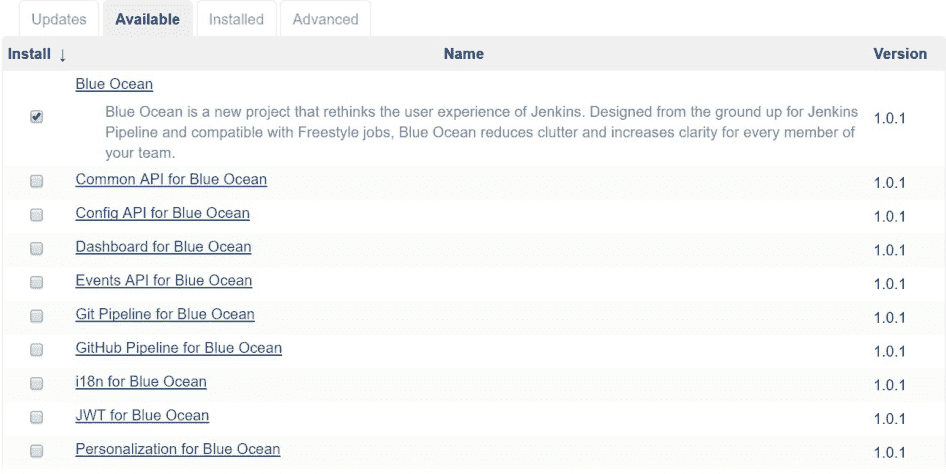

在 Jenkins 仪表板中验证插件是否安装成功：

| 插件 | 状态 |
|---|---|
| Common API for Blue Ocean | 成功 |
| Variant Plugin | 成功 |
| Jackson 2 API Plugin | 成功 |
| Metrics Plugin | 成功 |
| Web for Blue Ocean | 成功 |
| REST API for Blue Ocean | 成功 |
| JWT for Blue Ocean | 成功 |
| Favorite | 成功 |
| REST Implementation for Blue Ocean | 成功 |
| Pipeline REST API for Blue Ocean | 成功 |
| Pub-Sub "light" Bus | 成功 |
| GitHub Pipeline for Blue Ocean | 成功 |
| Git Pipeline for Blue Ocean | 成功 |
| Config API for Blue Ocean | 成功 |
| Server Sent Events (SSE) Gateway Plugin | 成功 |
| Events API for Blue Ocean | 成功 |
| Personalization for Blue Ocean | 成功 |
| BlueOcean Display URL plugin | 成功 |
| Blue Ocean Pipeline Editor | 成功 |
| Autofavorite for Blue Ocean | 成功 |
| i18n for Blue Ocean | 成功 |
| Dashboard for Blue Ocean | 成功 |
| Blue Ocean | 成功 |

现在你将在 Jenkins 中创建你的第一个流水线。

## 操作步骤...

现在让我们看看你的流水线在 Blue Ocean 用户界面中的样子。进入你创建的 FirstPipeline 流水线任务。点击 Jenkins 仪表板顶部栏中的 Blue Ocean 链接。

点击成功的流水线 20：

## Jenkins

## FirstPipeline

| 状态 | 运行 | 提交 | 消息 | 时长 | 完成时间 |
|---|---|---|---|---|---|
| ✓ | 20 | 7262ae6 | - | 8分19秒 | 3小时前 |
| ✕ | 19 | 7262ae6 | - | 5分44秒 | 4小时前 |
| ✕ | 18 | 7262ae6 | - | 4分18秒 | 4小时前 |

1.0.1 · Core 2.61 · 9b77619 · (无分支) · 2017年4月12日 02:47 AM

它将在 Blue Ocean 仪表板中提供每个阶段执行状态的详细信息。日志可在同一页面上获取：

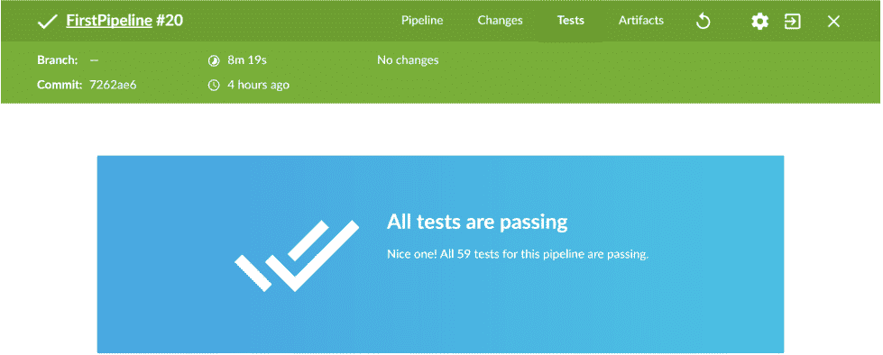

点击顶部栏上的“Artifacts”链接，验证此流水线中可用的所有构件：

## FirstPipeline #20

流水线

变更

测试

构件

分支：-

8分19秒

无变更

提交：7262ae6

4小时前

| 名称 | 大小 |
|---|---|
| pipeline.log | - | ↓ |
| dashBoard_Test.xml | 452 字节 | ↓ |
| target/petclinic.war | 40 MB | ↓ |

全部下载

在本章中，你使用了 Build Pipeline 插件以及 Jenkins 2 及更高版本中的流水线即代码功能创建了一个流水线。
