## Jenkins 界面定制

在本章中，我们将介绍以下操作指南：

- 使用 simple themes 插件为 Jenkins 换肤
- 使用 WAR 覆盖层为 Jenkins 换肤并配置资源
- 生成主页
- 创建 HTML 报告
- 高效使用视图
- 使用 Dashboard View 插件节省屏幕空间
- 利用 HTML5 浏览器发出提醒
- 为接待区提供极限视图

## 引言

本章探讨如何通过 Jenkins 进行沟通，并认识到存在不同的目标受众。

Jenkins 是一位才华横溢的沟通者。其主页显示所有任务的状态，让你能够快速做出决策。你可以轻松设置多个视图，自然地优先展示信息。Jenkins 拥有大量插件，可通过电子邮件、仪表板和 Google 服务通知你。它通过移动设备向你呼喊，当你走过大屏幕时向外辐射信息，还会用 USB 海绵导弹发射器向你开火。

它的主要受众是开发者，但不要忘记那些想要使用正在开发的软件的更广泛受众。看到 Jenkins 以一致的视图和企业风格进行定期构建，会增强人们对软件路线图的信心。本章包含一些操作指南，帮助你触及这些更广泛的受众。

在制定一致的沟通策略时，有许多 Jenkins 特有的细节需要配置。以下是在本章中将考虑的几个方面：

- **通知**：当出现问题时，开发者需要迅速知晓。Jenkins 有许多插件；你应该选择几个适合团队精神的插件。
- **页面装饰**：页面装饰器是一种为每个页面添加内容的插件。你可以通过添加自己的样式表和 JavaScript 来低成本地打造企业外观和风格。
- **覆盖 Jenkins**：使用 Maven WAR 插件，你可以在 Jenkins 之上覆盖自己的内容。你可以利用它添加自定义内容并预置主页等资源，从而增强企业外观和风格。
- **优化视图**：首页视图是以标签页形式显示的任务列表。受众使用首页快速决定选择哪个任务进行查看。插件扩展了视图类型的选项，并优化信息消化。这有可能避免进一步查看的需要，节省宝贵时间。
- **路过通知**：在视觉上辐射信息的极限视图在大显示器上看起来很棒。如果你在接待处或咖啡机等聚集地放置一台显示器，路人便会吸收任务状态变化的起起伏伏。这种视图巧妙地暗示了你公司的专业性和产品路线图的稳定性。
- **跟踪受众**：如果你公开沟通，那么应该跟踪使用模式，以便改进服务。考虑将 Jenkins 页面连接到 Google Analytics 或 Piwik（一个开源分析应用）。

## 使用 simple themes 插件为 Jenkins 换肤

本节操作指南通过 themes 插件修改 Jenkins 的外观和风格。

themes 插件是一个页面装饰器；它会用额外的 HTML 标签装饰每个页面。该插件允许你上传样式表和 JavaScript 文件。之后可通过本地 URL 访问这些文件。然后，每个 Jenkins 页面都会使用这些 URL 的 HTML 标签来加载你上传的文件。虽然简单直接，但若设计得当，视觉效果会非常强大。

## 准备工作

1. 安装 themes 插件（https://wiki.jenkins-ci.org/display/JENKINS/Simple+Theme+Plugin）。
2. 点击“安装而不重启”：

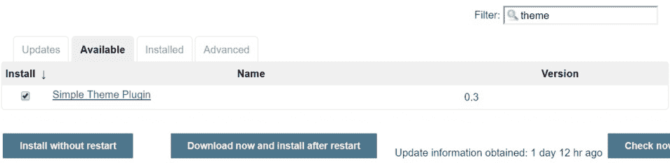

3. 等待插件安装成功：

## 正在安装插件/升级

准备

- 检查互联网连接
- 检查更新中心连接
- 成功

Static Analysis Utilities 成功
Android Lint Plugin 成功
Simple Theme Plugin 成功

返回顶部页面
（你可以立即开始使用已安装的插件）

当安装完成且没有任务在运行时，重启 Jenkins

4. 转到 Jenkins 仪表板，点击 管理 Jenkins | 配置系统 | 主题：

## 主题

主题 CSS 的 URL

指定主题 CSS 的 URL。

主题 JS 的 URL

指定主题 JS 的 URL。

你需要在此处提供自定义 CSS 和自定义 JS 文件，以更改 Jenkins 仪表板的外观和风格。

## 操作步骤...

1. 在 Jenkins 的 userContent 目录下，创建一个名为 my.js 的文件，包含以下代码行：
   
       document.write("<h1 id='test'>Example Location</h1>")
2. 在 Jenkins 的 userContent 目录下创建一个 mycss.css 文件，包含以下代码行：
   
       @charset "utf-8";
       #test {
       background-image: url(/userContent/camera.png);
       }
       #main-table{
       background-image: url(/userContent/camera.png)
       !important;
3. 从 http://sourceforge.net/projects/openiconlibrary/files/0.11/open_icon_library-standard-0.11.tar.bz2/download 下载并解压图标存档，查看可用的图标。或者，你可以使用本书网站（www.packtpub.com/support）下载中包含的图标。将图标添加到 userContent 目录，并将其重命名为 camera.png。
4. 访问 Jenkins 主配置页面：/configure。在“主题”部分，填写 CSS 和 JavaScript 文件的位置：
   - 主题 CSS 的 URL：/userContent/mycss.css
   - 主题 JS 的 URL：/userContent/myjavascript.js
5. 点击“保存”。
6. 返回 Jenkins 主页并检查你的成果，如下图所示：

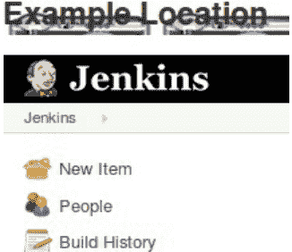

另一种更改 Jenkins 主题的方法是在 CSS 字段中使用以下任一 URL 来更改外观和风格：

- https://jenkins-contrib-themes.github.io/jenkins-material-theme/dist/material-red.css
- https://jenkins-contrib-themes.github.io/jenkins-material-theme/dist/material-pink.css
- https://jenkins-contrib-themes.github.io/jenkins-material-theme/dist/material-purple.css


- https://jenkins-contrib-themes.github.io/jenkins-material-theme/dist/material-deep-purple.css
- https://jenkins-contrib-themes.github.io/jenkins-material-theme/dist/material-indigo.css
- https://jenkins-contrib-themes.github.io/jenkins-material-theme/dist/material-blue.css
- https://jenkins-contrib-themes.github.io/jenkins-material-theme/dist/material-light-blue.css
- https://jenkins-contrib-themes.github.io/jenkins-material-theme/dist/material-cyan.css
- https://jenkins-contrib-themes.github.io/jenkins-material-theme/dist/material-teal.css
- https://jenkins-contrib-themes.github.io/jenkins-material-theme/dist/material-green.css
- https://jenkins-contrib-themes.github.io/jenkins-material-theme/dist/material-light-green.css
- https://jenkins-contrib-themes.github.io/jenkins-material-theme/dist/material-lime.css
- https://jenkins-contrib-themes.github.io/jenkins-material-theme/dist/material-yellow.css
- https://jenkins-contrib-themes.github.io/jenkins-material-theme/dist/material-amber.css
- https://jenkins-contrib-themes.github.io/jenkins-material-theme/dist/material-orange.css
- https://jenkins-contrib-themes.github.io/jenkins-material-theme/dist/material-deep-orange.css
- https://jenkins-contrib-themes.github.io/jenkins-material-theme/dist/material-brown.css
- https://jenkins-contrib-themes.github.io/jenkins-material-theme/dist/material-grey.css
- https://jenkins-contrib-themes.github.io/jenkins-material-theme/dist/material-blue-grey.css

你也可以前往上述位置，将文件内容复制并粘贴到 `/userContent/mycss.css` 中。你可以根据自己的需求修改 CSS 并进行定制。

## 工作原理...

简单主题插件是一个页面装饰器。它向每个页面添加以下信息：

```html
<link rel="stylesheet" type="text/css"
    href="/userContent/mycss.css" /><script
    src="/userContent/myjavascript.js" type="text/javascript">
</script>
```

JavaScript 会在生成页面的顶部附近写入一个带有 `id="test"` 的标题。通过 CSS 定位器 `#test` 触发级联样式表规则，即可将相机图标添加到背景中。

图片尺寸并不适合屏幕顶部；它们会被浏览器裁剪。这个问题你可以稍后通过实验来解决。

第二条 CSS 规则针对 `main-table` 触发，这是 Jenkins 生成的标准首页的一部分。完整的相机图标会显示在那里。

在访问 Jenkins 的其他部分时，你会注意到相机图标看起来与上下文不符且尺寸过大。你需要花时间来修改 CSS 和 JavaScript 以产生更好的效果。凭借细致的自定义代码，你可以为 Jenkins 定制皮肤，以符合你的企业形象。

CSS 3 怪癖：

不同浏览器类型和版本对各种 CSS 标准的支持存在一些怪癖。如需概览，请访问 [http://www.quirksmode.org/css/contents.html](http://www.quirksmode.org/css/contents.html)。

## 更多内容...

这里还有一些需要考虑的要点。

## CSS 3

CSS 3 具有许多特性。要在 JavaScript 生成的标题周围绘制一个按钮，请将 CSS 文件中的 `#test` 部分改为以下代码：

```css
#test {
width: 180px; height: 60px;
background: red; color: yellow;
text-align: center;
-moz-border-radius: 40px; -webkit-border-radius: 40px;
}
```

使用 Firefox 时，CSS 规则会生成以下按钮：

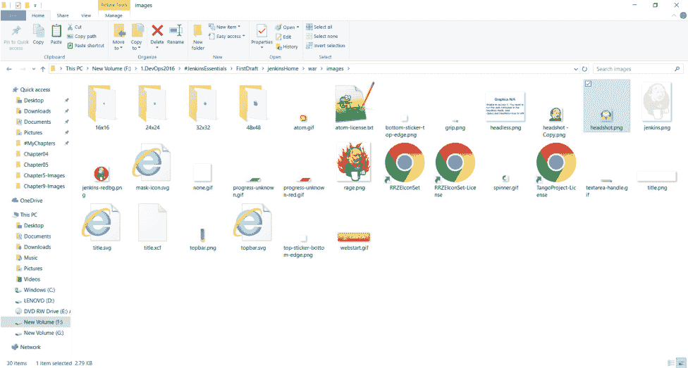

## JENKINS_HOME 中的图片

如果你没有耐心，可以在 Smashing Magazine 网站下载 CSS 3 速查表：

[http://coding.smashingmagazine.com/wp-content/uploads/images/css3-cheat-sheet/css3-cheat-sheet.pdf](http://coding.smashingmagazine.com/wp-content/uploads/images/css3-cheat-sheet/css3-cheat-sheet.pdf)

## 附带的 JavaScript 库框架

Jenkins 使用 `YUI` 库：http://yuilibrary.com/。每个 HTML 页面都包含核心 `YUI` 库（`/scripts/yui/yahoo/yahoo-min.js`），以便直接重用。然而，许多 Web 开发人员习惯于使用 jQuery。你也可以通过安装 `jQuery` 插件（https://wiki.jenkins-ci.org/display/JENKINS/jQuery+Plugin）将此库包含进来。你还可以考虑通过 WAR 覆盖（请参阅下一个技巧）将你喜欢的 JavaScript 库添加到 `Jenkins/scripts` 目录中。

## 信任但要验证

能力越大，责任越大。如果只有少数管理员维护你的 Jenkins 部署，那么你很可能可以信任每个人添加 JavaScript 而不会产生有害的副作用。然而，如果你有大量管理员使用各种各样的 Java 库，那么你的维护和安全风险会迅速增加。请考虑你的安全策略，并至少添加审计跟踪插件（[https://wiki.jenkins-ci.org/display/JENKINS/Audit+Trail+Plugin](https://wiki.jenkins-ci.org/display/JENKINS/Audit+Trail+Plugin)）来跟踪操作。

该插件会在 Jenkins 主配置页面中添加一个 **审计跟踪** 部分。在这里，你可以配置日志位置和设置（文件大小和轮转日志文件数量），以及记录请求的 URI 模式。默认选项会选择大多数影响显著的操作，如创建/配置/删除作业和视图，或删除/永久保存/启动构建。日志按配置写入磁盘，最近条目也可以在“管理/系统日志”部分查看。

另外，请参阅 JobConfigHistory 插件，以记录对作业配置所做的实际更改：

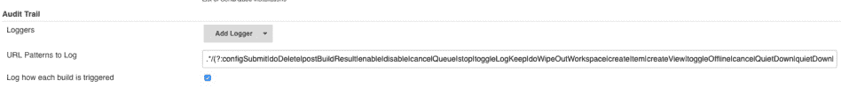

## 更多内容

- 要直接更改任何图片或图标，你可以前往 `JENKINS_HOME/war/images`：

  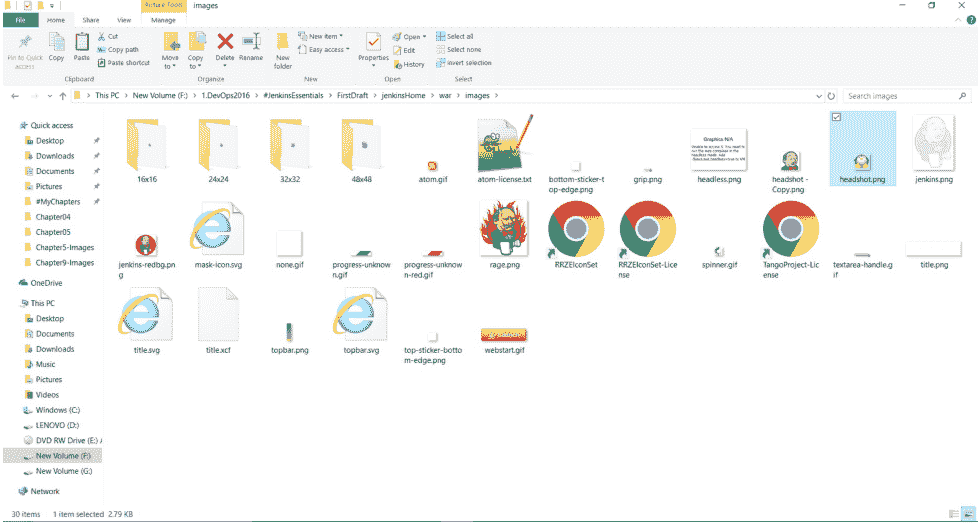

- 重新启动 Jenkins 并验证更改：

Jenkins

打开 Blue Ocean

搜索

admin | 退出登录

禁用自动刷新

- 新建任务
- 人员
- 构建历史
- 项目关系
- 检查文件指纹
- 管理 Jenkins
- 我的视图
- 磁盘使用
- 凭据

添加描述

| 状态 | 天气 | 名称 | 上次成功 | 上次失败 | 上次持续时间 | 收藏 |
|---|---|---|---|---|---|---|
|  |  | FirstAndroidProject | N/A | N/A | N/A |  |
|  |  | FirstAndroidExample | 1 天 0 小时 - #5 | 16 天 - #3 | 31 秒 |  |
|  |  | FirstJob | 2 小时 23 分钟 - #30 | N/A | 38 秒 |  |
|  |  | FirstPipeline | 2 个月 8 天 - #20 | 2 个月 8 天 - #19 | 8 分钟 19 秒 | ★ |
|  |  | Main-PetClinic | 2 个月 22 天 - #1 | N/A | 30 分钟 |  |
|  |  | Maven-Sample | 2 个月 22 天 - #1 | N/A | 50 秒 |  |
|  |  | mheas51 | 2 天 13 小时 - #0 | N/A | 1 分钟 1 秒 |  |
|  |  | PetClinic-Code | 2 个月 8 天 - #21 | 10 天 - #40 | 2 分钟 50 秒 |  |
|  |  | PetClinic-Deploy | 2 个月 8 天 - #7 | 2 个月 8 天 - #4 | 3 分钟 19 秒 |  |
|  |  | PetClinic-FuncTest | 2 个月 8 天 - #5 | N/A | 37 秒 |  |
|  |  | PetClinic-LoadTest | 2 个月 8 天 - #1 | N/A | 1 分钟 0 秒 |  |
|  |  | PetClinic-Package | 1 天 0 小时 - #7 | N/A | 4 分钟 37 秒 |  |
|  |  | PetClinic-Prod | 2 个月 8 天 - #1 | N/A | 1 分钟 52 秒 |  |
|  |  | PetClinic-WebHook | N/A | N/A | N/A |  |

构建队列

队列中没有构建

构建执行器状态

- 1 空闲
- 2 空闲

## 另请参阅

- *使用 WAR 覆盖为 Jenkins 定制外观和资源* 技巧
- *生成主页* 技巧

## 使用 WAR 覆盖为 Jenkins 定制外观和资源

本技巧描述如何将内容覆盖到 Jenkins WAR 文件上。通过 WAR 覆盖，你可以更改 Jenkins 的外观和感觉，为企业品牌和主页内容配置做好准备。这里使用了添加自定义 favicon.ico（Web 浏览器地址栏中的图标）的基本示例。要包含更多内容，只需很少的功夫。

Jenkins 将其版本作为依赖项保存在 Maven 存储库中。你可以使用 Maven 拉取 WAR 文件，解压，添加内容，然后重新打包。这使你可以配置资源，例如图片、主页、地址栏中的图标（称为 favicon），以及影响搜索引擎浏览内容的 `robots.txt`。

请注意，如果 Jenkins 的结构和图形内容不会随时间发生根本变化，那么使用 WAR 覆盖的成本很低。然而，如果覆盖确实破坏了结构，那么你可能直到执行详细的功能测试时才会发现。

你还可以考虑通过 WAR 覆盖进行最小更改，也许只更改 `favicon.ico`，添加图片和 `userContent`，然后使用简单主题插件（参见前面的技巧）来进行样式设置。


## 准备工作

为本操作指南中的文件创建名为 `CH9.communicating/war_overlay` 的目录。

## 操作步骤...

- 1. 浏览位于 http://repo.jenkins-ci.org/releases/org/jenkins-ci/main/jenkins-war/ 的 Maven 仓库，并查看 Jenkins 依赖。
- 2. 创建以下 pom.xml 文件。可以随意更新到较新的 Jenkins 版本：
- 3. 访问一个 favicon.ico 生成网站，例如 http://www.favicon.cc/。按照其说明创建你自己的 favicon.ico。或者，使用提供的示例。
- 4. 将 favicon.ico 添加到 src/main/webapp 位置。
- 5. 创建目录 src/main/webapp/META-INF，并添加一个名为 context.xml 的文件，内容为以下代码行：
- 6. 在你的顶级目录中，运行以下命令：
- 7. 在新建的 target 目录中，你会看到 WAR 文件 overlay-1.437.war。检查内容，确认已经修改了 favicon.ico。
- 8. （可选）将 WAR 文件部署到本地 Tomcat 服务器，验证并浏览更新后的 Jenkins 服务器：

```
<project xmlns="http://maven.apache.org/POM/4.0.0"
xmlns:xsi="http://www.w3.org/2001/XMLSchema-instance"
xsi:schemaLocation="http://maven.apache.org/POM/4.0.0
http://maven.apache.org/maven-v4_0_0.xsd">
<modelVersion>4.0.0</modelVersion>
<groupId>nl.uva.berg</groupId>
<artifactId>overlay</artifactId>
<packaging>war</packaging>
<!-- Keep version the same as Jenkins as a hint -->
<version>1.437</version>
<name>overlay Maven Webapp</name>
<url>http://maven.apache.org</url>
<dependencies>
<dependency>
<groupId>org.jenkins-ci.main</groupId>
<artifactId>jenkins-war</artifactId>
<version>1.437</version>
<type>war</type>
<scope>runtime</scope>
</dependency>
</dependencies>
<repositories>
<repository>
<id>Jenkins</id>
<url>http://repo.jenkins-ci.org/releases</url>
</repository>
</repositories>
</project>
```

```
<Context logEffectiveWebXml="true" path="/"></Context>
```

```
mvn package
```

## 工作原理...

Jenkins 将其 WAR 文件发布在中央 Maven 仓库中。这使你可以通过标准的 Maven 依赖管理拉取特定版本的 Jenkins。

Maven 遵循约定。它期望在 `src/main/webapp` 或 `src/main/resources` 中找到要覆盖的内容。

`context.xml` 文件定义了 Web 应用程序的某些行为，例如数据库设置。在本示例中，`logEffectiveWebXML` 设置要求 Tomcat 在应用程序启动时记录特定信息（http://tomcat.apache.org/tomcat-7.0-doc/config/context.html）。该设置是 Jenkins Wiki（https://wiki.jenkins-ci.org/display/JENKINS/Installation+via+Maven+WAR+Overlay）中推荐的。该文件放在 `META-INF` 目录中，因为 Tomcat 会在此处获取设置，无需重启服务器。

`<packaging>war</packaging>` 标签告诉 Maven 使用 WAR 插件进行打包。

你在最终覆盖后的 WAR 文件名中使用了与原始 Jenkins WAR 版本相同的版本号。这样可以更容易地发现 Jenkins 版本的变化。这再次突出表明，使用约定有助于提高可读性并减少出错机会。从验收环境部署到生产环境时，你应该移除版本号。

在 `pom.xml` 文件中，你将 http://repo.jenkins-ci.org/ 定义为查找 Jenkins 的仓库。

Jenkins WAR 文件作为类型为 `war`、作用域为 `runtime` 的依赖被引入。`runtime` 作用域表示该依赖在编译时不需要，但在运行时需要。有关作用域的更多详细信息，请查看 http://maven.apache.org/guides/introduction/introduction-to-dependency-mechanism.html#Dependency_Scope。

有关 WAR 覆盖的更多详细信息，请查看 http://maven.apache.org/plugins/maven-war-plugin/index.html。

避免重复劳动：

为减少维护工作量，最好添加额外内容，而不是替换可能在其他地方或第三方插件中使用的内容。

## 更多内容...

如果你希望全面修改 Jenkins 的外观和体验，需要处理很多细节。以下部分提到了其中一些细节。

## 可以替换哪些类型的内容？

Jenkins 服务器部署到两个主要位置。第一个位置是核心应用程序，第二个是工作区，存储动态变化的信息。为了更全面地理解内容，请查看目录结构。Linux 中一个有用的命令是 tree 命令，它可以显示目录结构。要在 Ubuntu 下安装，请使用以下命令：

```
apt-get install tree
```

在 Windows 操作系统中，它默认在命令提示符中可用。

对于 Jenkins Ubuntu 工作区，使用以下命令可以帮助你生成工作区的树状视图：

```
tree -d -L 1 /var/lib/jenkins
```

- `fingerprints`：这是用于存储校验和以唯一标识文件的目录
- `jobs`：存储作业配置和构建结果
- `plugins`：这是插件部署并通常进行配置的位置
- `tools`：这是 Maven 和 Ant 等工具部署的位置
- `updates`：用于更新
- `userContent`：内容可通过 URL `/userContent` 访问
- `users`：这是通过 `/me` URL 显示的用户信息

Ubuntu 中 Web 应用的默认位置是 `/var/run/jenkins/war`。如果你从命令行运行 Jenkins，则用于指定 Web 应用位置的选项如下：

```
-webroot
```

- `css`：Jenkins 样式表的位置
- `executable`：用于从命令行运行 Jenkins
- `favicon.ico`：我们在本操作指南中替换的图标
- `help`：包含帮助内容的目录
- `images`：包含不同尺寸的图片
- `META-INF`：这是存放清单文件和生成 WAR 的 pom.xml 文件的位置
- `robots.txt`：用于告诉搜索引擎允许爬取的位置
- `scripts`：JavaScript 库的位置
- `WEB-INF`：这是 Web 应用程序 servlet 部分的主要位置
- `winstone.jar`：这是可在 http://winstone.sourceforge.net/ 获取的 servlet 容器

## 搜索引擎与 robots.txt

如果你要添加自己的自定义内容，例如用户主页、公司联系信息或产品详情，那么请考虑修改顶层 `robots.txt` 文件。目前，它禁止搜索引擎访问所有内容：

```
## we don't want robots to click "build" links
User-agent: *
Disallow: /
```

你可以在 http://www.w3.org/TR/html4/appendix/notes.html#h-B.4.1.1 找到 `robots.txt` 结构的完整详细信息。

Google 使用更丰富的结构，可同时包含允许和禁止规则；请参阅 https://developers.google.com/webmasters/control-crawl-index/docs/robots_txt?csw=1。

以下 `robots.txt` 允许 Google 爬虫访问 `/userContent/corporate/` 目录。所有 Web 爬虫是否会遵循这一意图，仍是一个悬而未决的问题。

```
User-agent: *
Disallow: /
User-agent: Googlebot
Allow: /userContent/corporate/
```

为了帮助保护你的 Jenkins 基础设施，请参阅第 3 章“管理安全性”中的操作指南。

## 生成主页

用户主页是展现你组织身份的好地方。你可以创建一致的外观和体验，以表达你团队的精神。

本操作指南将探讨如何定制位于 `/user/userid` 目录下、由用户通过 Jenkins/me URL 配置的主页。

另一个值得查看的类似插件是 Gravatar 插件。你可以在 https://wiki.jenkins-ci.org/display/JENKINS/Gravatar+plugin 找到该插件的主页。


## 创建 HTML 报告

作业仪表盘左侧菜单是宝贵的空间。开发者的目光自然会扫向该区域。本食谱描述了如何从自定义 HTML 报告添加一个链接到菜单，使报告能更快被注意到。

### 准备工作

安装 HTML Publisher 插件 (https://wiki.jenkins-ci.org/display/JENKINS/HTML+Publisher+Plugin)。我们假设你有一个 Subversion 仓库，其中已提交 Packt 的代码。

### 如何操作...

- 1. 创建一个自由风格软件项目，并将其命名为 `CH9.html_report`。
- 2. 在源代码管理部分，点击 Subversion。
- 3. 在模块部分，将 `Repo/CH9.communicating/html_report` 添加到仓库 URL，其中 `Repo` 是你的 Subversion 仓库的 URL。
- 4. 在构建后操作部分，勾选发布 HTML 报告。添加以下详细信息：
  - 要归档的 HTML 目录：`target/custom_report`
  - 索引页[s]：`index.html`
  - 报告标题：`My HTML Report`
  - 勾选保留过去的 HTML 报告复选框
- 5. 点击保存。
- 6. 运行作业并查看左侧菜单。你现在会看到指向报告的链接，如以下屏幕截图所示：

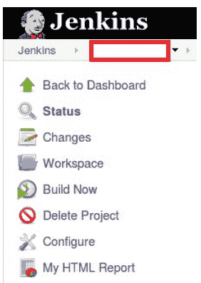

### 工作原理...

你的 Subversion 仓库包含一个 `index.html` 文件，该文件会被拉取到作业的工作区中。插件按广告所述工作，并添加一个指向 HTML 报告的链接。这使你的受众能够高效地找到你自定义生成的信息。

### 更多内容...

示例报告如下所示：

```
```html
<html><head><title>Example Report</title>
<link rel="stylesheet" type="text/css" href="/css/style.css" /></head>
<body>
<h2>Generated Report</h2>
Example icon: 
</body></html>
```
```

它引入了主 Jenkins 样式表 `/css/style.css`。

有可能当你在应用程序中更新样式表时，直到你清理浏览器缓存后才会在浏览器中看到更改。Jenkins 以一种巧妙的方式解决了这种延迟问题。它使用一个随每次 Jenkins 版本更改而变化的唯一数字的 URL。例如，对于 `css` 目录，你有两个 URL：

- `/css`
- `/static/uniquenumber/css`

大多数 Jenkins URL 使用后一种形式。建议对你的样式表也这样做。

唯一数字会随版本更改，因此每次升级时你都需要更新 URL

在 Maven 构建中运行 site 目标时，会生成一个本地网站 (http://maven.apache.org/plugins/maven-site-plugin)。该网站在 Jenkins 作业内部有一个固定的 URL，你可以用 My HTML Report 链接指向它。这使诸如测试结果等文档触手可及。

### 另请参阅

- *Efficient use of views* 食谱
- *Saving screen space with the Dashboard View plugin* 食谱

## 高效使用视图

Jenkins 上瘾般的易配置性使其容易创建大量作业。这增加了向开发者展示的信息量。Jenkins 需要通过高效利用浏览器空间来避免混乱。一个方法是定义最小化视图。在本食谱中，你将使用 `DropDownViewsTabBar` 插件。它将视图作为标签移除，并用一个选择框替换标签。这有助于更快导航。你还将学习如何使用脚本生成的简单 HTML 表单快速配置大量作业。

在本食谱中，你将创建大量可能稍后想要删除的视图。如果你使用的是虚拟机镜像，请考虑克隆镜像，并在完成后删除它。

### 准备工作

安装 `DropDownViewsTabBar` 插件 (https://wiki.jenkins-ci.org/display/JENKINS/DropDown+Views+TabBar+Plugin)。

### 如何操作...

- 1. 复制并粘贴以下 Perl 脚本到名为 create.pl 的可执行文件中：
- 2. 从 Perl 脚本的输出创建一个 HTML 文件，例如：
- 3. 在 Web 浏览器中，以管理员身份登录 Jenkins。
- 4. 创建 Template1 作业，添加你想要的任何详细信息。这是你的模板作业，将被复制到许多其他作业中。
- 5. 将 form.html 加载到同一浏览器中。
- 6. 点击其中一个 Create CH9.fake 按钮。Jenkins 返回错误消息：
- 7. 访问 http://localhost:8080/configureSecurity 上的配置全局安全，并取消勾选防止跨站请求伪造攻击复选框。
- 8. 点击保存。
- 9. 点击所有 Create CH9.fake 按钮。
- 10. 访问 Jenkins 的首页并验证作业是否已创建，并且基于 Template1 作业。
- 11. 创建大量包含随机作业选择的视图。查看首页，注意混乱情况。
- 12. 访问配置屏幕 /configure；选择 DropDownViewsTabBar 提供一个用于在视图标签栏选择框中选择视图的下拉菜单。在 DropDown ViewsTabBar 子部分中，勾选显示作业计数框，如以下屏幕截图所示：

```
#!/usr/bin/perl
$counter=0;
$end=20;
$host='http://localhost:8080';
while($end > $counter){
    $counter++;
    print "<form action=$host/createItem?mode=copy method=POST>\n";print "<input type=text name=name value=CH9.fake.$counter>\n";
    print "<input type=text name=from value=Template1 >\n";
    print "<input type=submit value='Create CH9.fake.$counter'>\n";
    print "</form><br>\n";
    print "<form action=$host/job/CH9.fake.$counter/doDelete method=POST>\n";print "<input type=submit value='Delete CH9.fake.$counter'>\n";
    print "</form><br>\n";
}
```

```
perl create.pl > form.html
```

```
HTTP ERROR 403
Problem accessing /createItem. Reason:
No valid crumb was included in the request
```

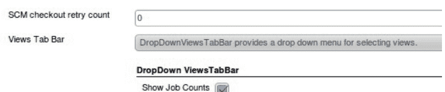

- 13. 点击保存按钮：
- 14. 在 Jenkins 中，访问 `http://localhost:8080/configureSecurity` 配置全局安全并勾选防止跨站请求伪造攻击复选框。
- 15. 点击保存。

### 工作原理...

只要 Jenkins 中的面包屑安全功能关闭，表单就能正常工作。该功能在开启时，会生成一个随机数，表单在提交时必须返回该数。这使 Jenkins 能知道表单是与服务器有效对话的一部分。生成的 HTTP 状态错误在 4xx 范围内，这意味着客户端输入无效。如果 Jenkins 返回 5xx 错误，则意味着服务器错误。因此我们在提交自己的数据时必须关闭该功能。我们不建议在生产环境中这样做。

一旦你以管理员身份登录 Jenkins，你就可以创建作业。你可以通过 GUI 或发送 POST 信息来完成。在本食谱中，我们将名为 `Template1` 的作业复制到以 `CH9.fake` 开头的新作业中，如以下代码所示：

```
<form action=http://localhost:8080/createItem?mode=copy
method=POST>
<input type=text name=name value=CH9.fake.1>
<input type=text name=from value=Template1 >
<input type=submit value='Create CH9.fake.1'>
</form>
```

你使用的 POST 变量为 `name` 表示新作业的名称，`from` 表示模板作业的名称。POST 操作的 URL 为 `/createItem?mode=copy`。

要更改主机名和端口号，你需要更新 Perl 脚本中找到的 `$host` 变量。

要删除作业，Perl 脚本生成了指向 `/job/Jobname/doDelete` 的操作表单（例如，`/job/CH9.fake.1/doDelete`）。不需要额外变量。

要增加表单条目数量，你可以将变量 `$end` 从 20 改为其他值。

### 更多内容...

Jenkins 使用标准库 Stapler (http://stapler.kohsuke.org/what-is.html) 将服务绑定到 URL。插件也使用 Stapler。当你安装插件时，可用操作的数量也会增加。这意味着你可以通过与本食谱类似的 HTML 表单激活大量操作。你将在第 7 章 *Exploring Plugins* 中了解到，为 Stapler 编写绑定代码所需的努力极小。


## 另请参阅

-   *使用 Dashboard View 插件节省屏幕空间*方法

## 使用 Dashboard View 插件节省屏幕空间

在 *高效使用视图* 方法中，你发现可以使用 `views` 插件节省水平标签页空间。在本方法中，你将使用 `Dashboard View` 插件来压缩水平空间的利用。压缩水平空间有助于高效地整合信息。

`Dashboard View` 插件允许你配置视图的各个区域以显示特定功能，例如，作业的网格视图，或显示失败作业子集的视图区域。用户可以拖放这些区域在屏幕上的位置。

开发人员已经让仪表板易于扩展，所以未来会有更多选择。

## 如何操作...

1. Dashboard View 插件将屏幕划分为多个区域。在仪表板配置期间，你选择作业网格和不稳定作业小工具。其他仪表板小工具包括作业列表、最新构建、从站统计、测试统计图表或网格，以及测试趋势图。随着插件成熟，将有更多选择。
2. 作为 Jenkins 管理员，登录你的 Jenkins 实例主页。
3. 通过单击屏幕顶部第二个选项卡中的加号创建新视图。
4. 选择 Dashboard 视图。
5. 单击 OK：

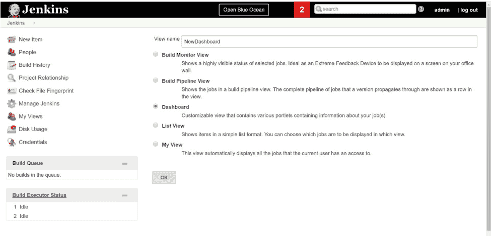

6. 在“作业筛选器”中选择“作业”：
7. 选择“仪表板小工具”：

### 仪表板小工具

- ☑ 在页面顶部显示标准 Jenkins 列表
- ☐ 全屏视图 - 隐藏标准 Jenkins 面板
- ☐ 设置 CSS 自定义参数

8. 添加或删除要在 Dashboard 视图中保留的列：

### 列

状态

删除

名称

删除

构建按钮

删除

上次成功

删除

添加列

### 仪表板小工具

- 在页面顶部显示标准 Jenkins 列表
- 全屏视图 - 隐藏标准 Jenkins 面板
- 设置 CSS 自定义参数

9. 单击“保存”并验证新的 Dashboard 视图：

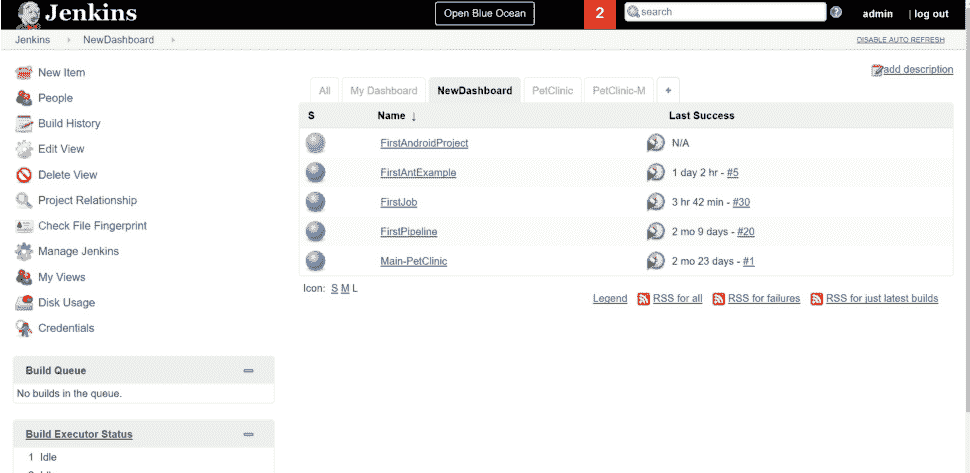

10. 你可以将仪表板小工具添加到页面的不同部分：

### 仪表板小工具

- ☑ 在页面顶部显示标准 Jenkins 列表
- ☐ 全屏视图 - 隐藏标准 Jenkins 面板
- ☐ 设置 CSS 自定义参数

### 页面顶部的小工具

将仪表板小工具添加到视图顶部

- 每个项目的 Android Lint 问题
- Android Lint 问题趋势图（新增 vs. 已修复）
- Android Lint 问题趋势图（按优先级分布）
- 构建流水线仪表板视图
- 构建统计
- Iframe 小工具
- 图像
- Jenkins 作业列表
- 作业统计
- 作业网格
- 最新构建
- 从站统计
- 测试统计图表

11. 选择“构建统计”小工具并保存：

### 仪表板小工具

- ☑ 在页面顶部显示标准 Jenkins 列表
- ☐ 全屏视图 - 隐藏标准 Jenkins 面板
- ☐ 设置 CSS 自定义参数

### 页面顶部的小工具

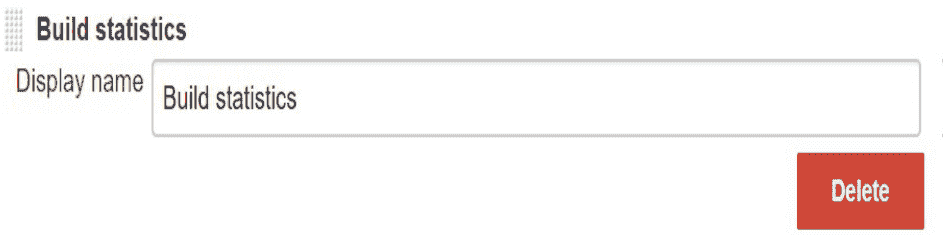

12. 在 Jenkins 仪表板中保存配置后，验证新的小工具：

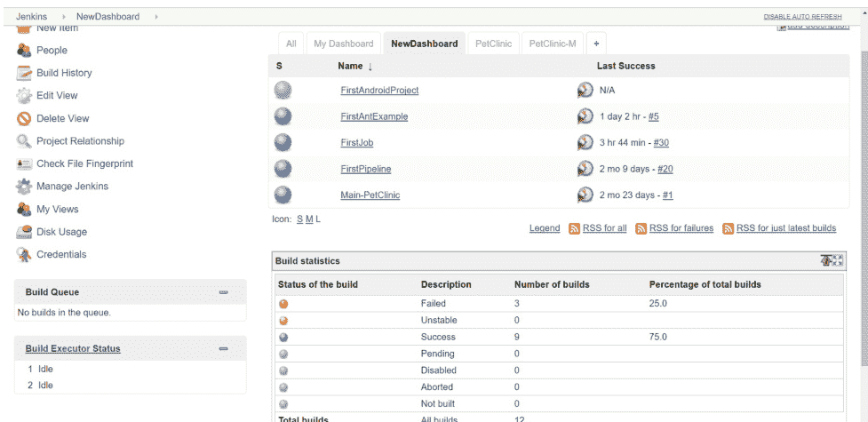

与其他视图相比，作业网格小工具节省了空间，因为显示的作业密度很高。

如果你还使用了“多视图”选项卡（参见上一个方法），会有个小问题。当你单击仪表板标签时，显示的是原始视图集合，而不是选择框。

## 更多内容...

Dashboard 插件为其他插件开发者提供了一个创建仪表板视图的框架。这种用法的一个示例是 `Project Statistics` 插件（https://wiki.jenkins-ci.org/display/JENKINS/Project+Statistics+Plugin）。

## 另请参阅

- *创建 HTML 报告*方法
- *高效使用视图*方法

## 使用 HTML5 浏览器发出声音

本方法介绍如何在事件发生时（例如构建成功）向 Jenkins 用户的浏览器发送自定义声音。你也可以在任意时间发送声音消息。这不仅适合那些喜欢被喊叫、被著名演员唱歌等开发者，也适合在大型服务器场中寻找计算机的系统管理员。

## 准备工作

安装 Jenkins 声音插件（https://wiki.jenkins-ci.org/display/JENKINS/Jenkins+Sounds+plugin）。确保你安装了符合 HTML5 规范的浏览器，例如当前版本的 Firefox 或 Chrome。

有关浏览器中 HTML5 合规性的更多详细信息，请参考：http://en.wikipedia.org/wiki/Comparison_of_layout_engines_%28HTML5%29。

## 如何操作...

1. 以 Jenkins 管理员身份登录，并访问“配置系统”屏幕 `/configure`。
2. 在“Jenkins 声音”部分，勾选“通过支持 HTML5 音频的浏览器播放”。

如果 Jenkins 在查找声音归档时出现问题，并出现诸如 `File not found 'file:/C:/Users/Alan/.jenkins/jar:file:/C:/Users/Alan/.jenkins/plugins/sounds/WEB-INF/lib/classes.jar/sound-archive.zip'` 的错误消息，则解压 `classes.jar` 文件，并将 `sounds-archive.zip` 文件移动到错误消息中提到的相同目录。最后，将配置指向该归档，例如 `file:/C:/Users/Alan/.jenkins/plugins/sounds/WEB-INF/lib/sound-archive.zip`。

3. 单击“保存”按钮。
4. 选择 Jenkins 主页上的“创建作业”链接。
5. 创建一个新作业，作业名称为 `ch4.sound`。
6. 选择“构建一个自由风格的软件项目”。
7. 单击 OK。
8. 在“构建后操作”部分，勾选“Jenkins 声音”选项。
9. 添加两个声音：EXPLODE 和 doh。
10. 单击“保存”。
11. 单击“立即构建”链接。
12. 成功后，你的浏览器将播放 `EXPLODE` wav 文件。
13. 编辑你的作业使其失败，例如，通过添加一个不存在的源代码仓库。
14. 再次构建该作业。失败时，你的 Web 浏览器将播放 `doh` wav 文件。

## 工作原理...

你已成功配置作业，使其根据构建的成功或失败播放不同的声音。

你可以通过配置哪些事件转换将触发声音来进一步调整插件的响应方式，例如，如果上一次构建结果为失败而当前构建结果为成功。这可以在“对于上一次构建结果”复选框组中定义。

该插件作为一个页面装饰器工作。它添加了以下 JavaScript，用于异步轮询新声音。你的浏览器承担了大部分工作，从而释放了服务器资源：

```html
<script src="/sounds/script"
     type="text/javascript"></script><script type="text/javascript"
     defer="defer">function _sounds_ajaxJsonFetcherFactory(onSuccess,
     onFailure) {
return function() {
new Ajax.Request("/sounds/getSounds", {
parameters: { version: VERSION },
onSuccess: function(rsp) {
onSuccess(eval('x='+rsp.responseText))
},
onFailure: onFailure
});
}
}
if (AUDIO_CAPABLE) {
    _sounds_pollForSounds(_sounds_ajaxJsonFetcherFactory);
}</script>
```

## 更多内容...

声音插件还允许你将任意声音流式传输到已连接的 Web 浏览器。这不仅对针对分布式团队的恶作剧和激励演讲有用，你还可以执行有用的操作，例如在重启服务器前发出 10 分钟警告警报。

你可以在 http://www.archive.org/details/opensource_audio 找到一些不错的声音集。

例如，你可以在 http://www.archive.org/details/OpenPathMusic44V2 找到“每个孩子一台笔记本电脑”音乐库的副本。在该集合中，你会发现 `shenai.wav`。首先，将声音添加到互联网上可以找到的地方。一个合适的位置是 Jenkins 的 `userContent` 目录。要在任何已连接的 Web 浏览器上播放该声音，你需要访问触发地址（将 `localhost:8080` 替换为你自己的地址）：

```
http://localhost:8080/sounds/playSound?src=http://localhost:8080/userContent/shenai.wav
```


## 参见

- 在[第1章](Chapter 1)的*Jenkins入门*中，介绍*通过 Firefox 与 Jenkins 保持联系*技巧

## 接待区的极致视图

敏捷项目强调沟通的作用，而非文档的必要性。信息辐射器有助于快速反馈。信息辐射器有两个主要特点：随时间变化，且呈现的数据易于理解。

极致反馈面板插件就是信息辐射器的一个例子。它是一种高度视觉化的 Jenkins 视图。如果布局格式一致并显示在大显示器上，就是这项任务的理想选择。你也可以把它看作开发过程的正面宣传。你可以把它放在接待台后面，或人流量大的社交区域，比如咖啡机旁或项目室。

在本技巧中，你将添加`eXtreme Feedback Panel`插件，并通过描述中的 HTML 标签修改其外观。

## 准备工作

安装`eXtreme Feedback Panel`插件（[https://wiki.jenkins-ci.org/display/JENKINS/eXtreme+Feedback+Panel+Plugin](https://wiki.jenkins-ci.org/display/JENKINS/eXtreme+Feedback+Panel+Plugin)）。

## 操作步骤...

1. 创建一个描述性名称如`Blackboard Report Pro Access`的任务，并添加以下描述：

```html
<center>
<p>Writes Blackboard sanity reports<br>
and sends them to a list.
<table border="1" class="myclass"><tr><td>More Details</td></tr></table>
</center>
```

2. 创建一个名为 eXtreme 的新视图（`/newView`）。勾选 eXTremeFeedBack Panel，然后点击 OK。
3. 选择 6-24 个已创建的任务，包括本技巧之前创建的那个。
4. 将列数设置为 2。
5. 将刷新时间设置为 20 秒。
6. 点击“Show Job descriptions”。
7. 点击 OK。
8. 尝试调整设置（尤其是字体的像素大小）。优化视图取决于所使用的显示器以及观众观看显示器的距离，如下面的截图所示：

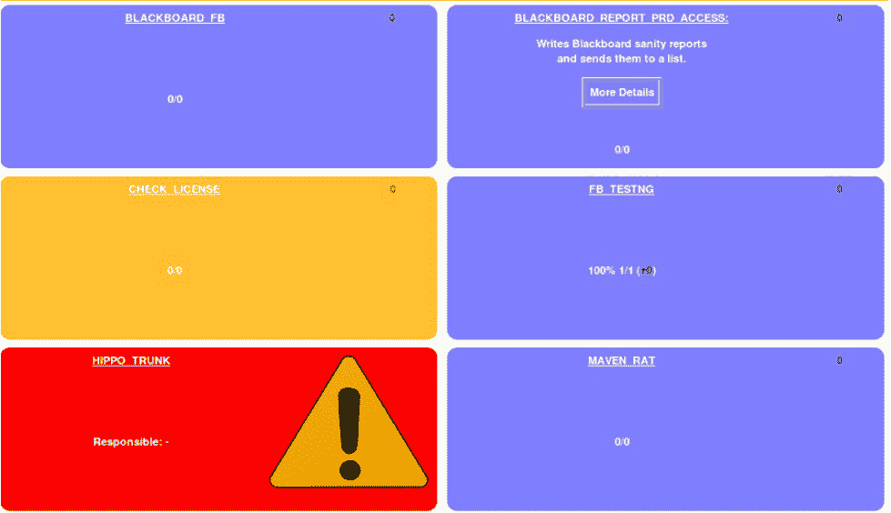

| 功能 | 内容 | 数量 | 报价(元/次) |
| --- | --- | --- | --- |
| Chrome 内核版本 | Chrome/131.0.0.0 | 1 | 20 |
| 浏览器驱动 | ChromeDriver/131.0.0.0 | 1 | 20 |
| 代理 IP | 动态代理 | 1 | 30 |
| 指纹浏览器 | 动态指纹 | 1 | 10 |
| 运营系统 | Windows Server 2019 中英文 | 1 | 0 |
| 服务器 | 按量计费 | 1 | 0 |
| 调用接口 | 编码 | 1 | 0 |
| 使用教程 | 防御 | 1 | 0 |
| 支持服务 | 渠道支持 | 1 | 0 |

## 更多内容...

信息辐射器很有趣，形式多种多样。从大显示器上显示的不同视图，到 USB 海绵导弹发射，再到著名演员声音的“咒骂”（参见*使用HTML5浏览器制造噪音*的技巧）。

以下是一些值得在 Jenkins 中探索的电子项目示例：

- **熔岩灯**: https://wiki.jenkins-ci.org/display/JENKINS/Lava+Lamp+Notifier
- **USB 导弹发射器**: https://github.com/codedance/Retaliation
- **交通信号灯**: http://code.google.com/p/hudsontrafficlights/

记住，我们都要小心行事。

## 参见

- 使用*Dashboard View插件节省屏幕空间*的技巧
- *使用HTML5浏览器制造噪音*的技巧
