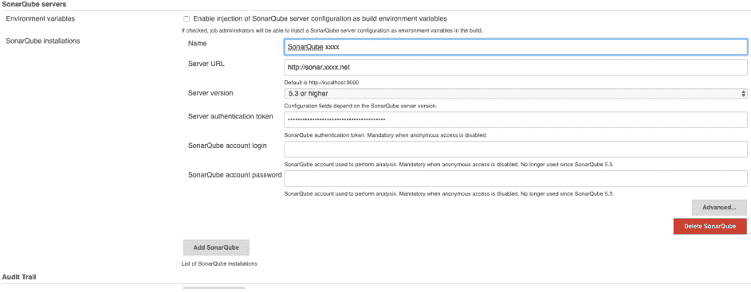

## 提高质量的流程

质量保证要求专家关注广泛的细节。这些细节很多与人类行为相关，而不仅仅是纯技术层面的。本章既提到了成功运行项目所需的软技能，也提到了本书各技巧中固化下来的配置技能。以下是一些来之不易的经验之谈。

## 文化与协作

- DevOps 是一场文化运动，其核心在于改变组织文化，利用工具使流程更高效，使人们更有生产力。
- 组织文化是成功的关键。多年来，组织在考虑资源能力、环境和许多其他因素的基础上，创建了模板、最佳实践和模式。如果组织文化能够适应变化，那在当今这个动态环境中便是一大幸事。
- 如果组织文化支持知识共享与协作，那么它不仅能创造可反复利用的稳健资产，还能创造创新空间，并将其应用到不同的业务部门。
- 规划持续开发、持续集成、持续测试和持续部署的流程，需要不同利益相关者之间的协作，才能实现更好的实施和有效的结果。

## 尽早失败，或更快失败

在诸多因素面临风险、价格、声誉和市场状况方面的成本更难处理的情况下，避免或预防问题总比事后解决问题要好。你在软件生命周期中越晚纠正问题，代价就越高。尽早失败比晚失败要便宜得多。持续集成允许你在早期自动让软件失败。通过插件或连接的云服务添加额外测试，可以让你有更多机会尽早面对问题，从而提高质量并降低成本。坦然承认问题，因为你是在节省时间和金钱。项目后期失败会造成无法回头的局面。即使在基础设施供应方面，云计算也改变了局面。由于按需付费的计费模式，组织与中小企业也能负担得起以前不敢想象的资源。你可以在开发与测试环境中使用相同类型的资源一段特定时间，并确切知道会发生什么样的问题以及如何解决。生产环境也将是相同的，因此在应用开发后期你不必处理任何重大问题，因为你已经遇到过这些问题，并且很清楚如何快速应对。

通常，尽早失败的经验有助于创建框架或最佳实践，不仅能解决问题，还能使整体场景更健壮，并促生特定解决方案的设计模式。

## 数据驱动测试

如果使用数据驱动测试方法，你可以高效地覆盖测试范围。例如，在编写 JMeter 测试计划时，可以使用 CSV 配置元素从文本文件中读取变量。这使 JMeter 能够从 CSV 文件中读取参数（例如主机名），并遍历你的基础设施。这样，一个测试计划就可以攻击多台服务器。SoapUI 也是如此；通过添加 Excel 数据源并循环遍历各行，你可以使用许多不同角色范围的测试用户来测试应用程序。数据驱动测试往往易于维护。在重构期间，与其随着应用程序中的 URL 变化而修改测试计划，不如将 URL 提取到 CSV 文件中。

## 从历史中学习

团队往往有自己的编码习惯，这因组织而异，因为工具和遵循的编码标准不同。如果项目因代码质量而失败，请尝试找出哪些代码指标本可以阻止代码进入生产环境。哪些错误反复出现？看看以下示例：

- **周五下午代码失败：** 我们都是人，都会有分心之事。一周结束时，程序员可能心不在焉，没把心思放在代码上。一小部分程序员的代码质量会受到影响，在他们的排班接近尾声时，往往会持续引入更多缺陷。可以考虑安排一个每周运行的 Jenkins 任务，在注意力最低的时段对质量指标设置更严苛的阈值。
- **代码变更率：** 在产品从验收环境迁移到生产环境之前，代码提交突然激增，说明存在最后一刻的匆忙。对于某些有强烈代码质量意识的团队，这也是保持额外警惕的标志。对于其他纪律较差的团队，这可能是导致毁灭的幼稚之举。如果项目因为代码变更激增而失败，QA 不堪重负，可以考虑根据提交速度设置一个 Jenkins 警告任务。如有必要，你也可以显示自己的自定义指标。
- **不守规矩的程序员：** 并非所有开发人员都能创造出同样统一的高质量代码。项目中可能存在持续的低水平表现。“不守规矩的程序员”会被人工代码审查发现。然而，作为第二道防线，可以考虑为 SonarQube、FindBugs 和 PMD 的静态代码审查报告设置阈值。如果某个开发人员不遵循公认的实践，构建就会经常失败。
- **GUI 不合理：** 当你构建一个 Web 应用程序，却在最后一刻才被告知 GUI 的交互方式与产品负责人的预期不太一致，这岂不是很痛苦？一种解决方案是在 FitNesse 中编写一个模拟界面，并使用 fixtures 为其加上自动化功能测试。当 GUI 偏离计划的工作流程时，Jenkins 就会开始报警。
- **责任追踪：** 错误会发生，也需要吸取教训。然而，如果没有明确记录的责任链，就很难确定谁需要学习机会。一种方法是通过一系列相互关联的任务来组织 Jenkins 工作流，并使用 promoted builds 插件确保合适的团队在正确的节点进行验证。这种方法还有助于提醒团队短期任务。

为了更好的代码质量，你可以创建一个 Jenkins 构建，每晚从中央仓库获取代码，使用 SonarQube 执行静态代码分析，并每天将结果发送给利益相关者。这样，我们不仅每天传达问题，还通过培养习惯来营造持续改进的文化。也许有一天，程序员将清楚地知道需要避免哪些类型的编程，从而代码质量将开始逐步提高。

## 将测试自动化视为软件项目

如果将自动化测试视为一个软件项目并应用众所周知的原则，那么你将节省维护成本并提高测试的可靠性。

**不要重复自己（DRY）**原则就是一个很好的例子。在时间压力下，很有诱惑力将相似的测试从代码库的一个区域复制粘贴到另一个区域，不要这样做。项目会演进，改变代码库的形状；测试需要可重用以适应这种变化。脆弱的测试会推高维护成本。如果你将代码分离到页面中，那么当页面间的流程发生变化时，大部分测试代码仍然保持完整。

**保持简单愚蠢（KISS）**原则意味着让项目的每个方面都尽可能简单。例如，可以使用真实浏览器进行自动化功能测试，或使用 HtmlUnit 框架来模拟浏览器。第二种选择避免了设置内存中 X 服务器或 VNC（http://en.wikipedia.org/wiki/Virtual_Network_Computing）的需求，也能跟踪浏览器版本。这些额外的工作会降低 Jenkins 作业运行的可靠性，但会增加测试的价值。因此，对于小型项目，考虑从使用 `HtmlUnit` 开始。对于大型项目，额外的努力是值得的成本。

考虑你是否需要一个独立的集成服务器，或者是否可以在 Maven 的集成目标中调用 Jetty 服务器来应付。

## 可视化，可视化，再可视化！

印度有一句流行的话叫做 *娱乐，娱乐，再娱乐*。可视化对于保持事物稳健极其有效。当你有许多散布在多个服务器上的项目，由不同的团队和个人开发时，很难理解关键指标和出现的问题。

由于 80% 的信息通过视觉传达到你的大脑，而你的大脑是优秀的模式识别器，理解底层复杂性的一种技巧是可视化你的 Jenkins 作业的结果。

SonarQube 是可视化项目整体质量概览并深入研究代码不同区域之间关系和耦合的绝佳起点。

然而，如果你有专门的需求，你将需要构建图表生成。测试结果通常以 XML 或 CSV 格式存储。一旦你积累了结果，你就可以用你选择的语言轻松转换它们。

你也可以创建一个监控视图或构建管道，以便可视化 Jenkins 中运行的不同作业。

## 约定是好的

遵循约定，你可以减少维护量并降低代码中隐藏缺陷的数量。当多个开发人员参与编写代码时，编码约定尤其重要。约定有助于可读性。 consistently 缩进的代码使眼睛聚焦在写得不好的部分。结构良好的变量名有助于避免组织不同部分编写的代码之间的命名冲突。命名中的结构突出了你可以稍后移至配置文件的数据，它也增加了使用正则表达式进行半自动重构的机会。例如，你可以编写一段简短的 R 代码来可视化每个模块中全局变量的数量。全局变量越多，使用同一变量用于多个目的的风险越大。因此，该图是代码异味的粗略指标。

正确遵循的约定有助于最大程度地减少问题并有助于故障排除。它在组织中创造了一种独特的文化。

## 测试框架和商业选择不断增加

测试框架和商业选择不断增加。过去几年，测试自动化有了很大改进。一个例子是静态代码审查被更彻底地用于安全检查。SonarQube 是项目质量的全方位报告者，新的框架正在涌现以改进旧的。以下是一些影响：

- **SonarQube：** 这衡量项目质量。它的社区很活跃。SonarQube 的演进速度将快于 Jenkins 质量指标插件的全部范围。考虑使用 Jenkins 插件对负面质量变化进行早期警告，并使用 SonarQube 进行深入报告。
- 你可以在以下位置找到 SonarQube Jenkins 插件：[https://wiki.jenkins.io/display/JENKINS/SonarQube+plugin](https://wiki.jenkins.io/display/JENKINS/SonarQube+plugin)

- **静态代码审查工具：** 这些工具正在改进。FindBugs 已将评论制作移至云端。正在开发更多错误模式检测器。静态代码审查工具在发现安全缺陷方面变得更好。随着时间的推移，预计工具会有显著改进，可能只需更新当前工具的版本。
- **代码搜索：** 如果代码搜索引擎能够根据缺陷密度或编码实践，对特定代码片段在搜索结果中的位置进行排名，那不是很棒吗？你就可以搜索各种开源产品以寻找最佳实践。你可以搜索要删除的缺陷，然后将补丁发送回代码的社区。
- **云：** CloudBees 允许你在云中创建按需从节点。预计 Jenkins 周围会有更多类型的云式集成。

有关 SonarQube 的功能和 CloudBees 云服务的更多信息，请访问 [http://www.sonarqube.org/features/](http://www.sonarqube.org/features/) 和 [http://www.CloudBees.com/products/dev](http://www.CloudBees.com/products/dev)。

## 将工作转移到 Jenkins 节点

得益于其丰富的插件，Jenkins 可以轻松连接许多类型的系统。因此，Jenkins 的使用可以在组织中病毒式增长。测试和 Javadoc 生成占用系统资源。主 Jenkins 最好用于快速报告分布在一系列 Jenkins 节点上的作业。这种方法使分析基础设施中故障所在变得更容易。

如果你使用 JMeter 进行大规模性能测试，请考虑从 Jenkins 卸载到 BlazeMeter（[http://blazemeter.com/](http://blazemeter.com/)）等云服务。

对于使用 Selenium 的功能测试，也有广泛的云服务。考虑使用它们不仅因为负载，还因为提供的广泛的浏览器类型和版本。一个商业服务的例子是 Sauce Labs（[https://saucelabs.com/](https://saucelabs.com/)）。定期审查市场以寻找新的云服务是值得的。

还有其他场景，你也可以在 Jenkins 中利用分布式架构。例如，保留 Android 和 iOS 代理并将其与 Jenkins 主服务器绑定，以便与主 Jenkins 卸载所有与 Android 和 iOS 应用相关的作业。

## 饥饿的 QA/集成服务器

几百年前，煤矿工人会因为矿井中甲烷和一氧化碳的积聚而死亡。为了对这种情况发出早期警告，金丝雀被带入矿井。由于更敏感，鸟类会先昏倒，给矿工足够的时间逃脱。考虑对你的验收环境中的集成服务器做同样的事情：故意让它们资源匮乏。如果它们倒下，你将有足够的时间在生产环境中爆炸之前进行审查。

## 阅读 Jenkins 的变更日志

Jenkins 言行一致。次要版本号发布大约每周一次。出现新功能，修复错误，并引入新错误。总的来说，大多数更改都会带来改进，但少数不会。然而，一旦引入，错误通常会被及早发现并迅速移除。

在更新 Jenkins 以获得新功能和潜在的稳定性问题之前，值得阅读变更日志（[http://jenkins-ci.org/changelog](http://jenkins-ci.org/changelog)）。偶尔，你可能希望因安全问题而加快部署到生产环境，或因稳定性失误而跳过一个版本。

## 避免人为瓶颈

你的测试环境越简单，维护它所需的技能就越少。当你学会使用插件并探索新工具和脚本语言的潜力时，组织需要掌握的知识就越多，才能维护一个稳定的系统。如果你希望休假时不收到各种求助短信，请确保你的知识至少转移给了另一个人。这听起来显而易见，但在日常工作的忙碌中，这一原则常常被遗忘或搁置。

分享知识最简单的方法之一是让几位开发者一起参加相同的会议和活动（https://www.CloudBees.com/company/events/juc）。从Jenkins用户大会和其他会议中学习最佳实践。

这正是管理者在知识传播中发挥重要作用的地方。他们需要为知识分享规划时间和活动，而不是指望它能凭空发生。

## 避免群体思维

在纸面上做到完美很容易，比如定义一套可靠的Javadocs和单元测试的重要性。然而，现实世界即使在最顺利的时候也是混乱的。项目势头，由交付需求驱动，是一种难以抗拒的力量。

与项目势头相关的是项目团队或资源所有者可能存在的群体思维（http://en.wikipedia.org/wiki/Groupthink）。如果团队抱有错误的集体态度，作为质量保证专业人员，将更难注入来之不易的现实主义。质量保证不仅在于尽早发现和捕获缺陷，还在于将成功或失败的客观标准注入项目周期的不同阶段。

考虑在Jenkins构建中加入可衡量的标准。显然，如果代码编译失败，产品就不应进入验收和生产阶段。关于单元测试代码覆盖率的规则是否值得在发布管理会议上捍卫，这一点就不那么明显了。

尝试在项目开始、编写任何代码之前就让整个团队参与进来，并就导致构建失败的指标达成一致。一种方法是将一个小型成功项目与一个小型失败项目进行比较。如果之后出现分歧，那么讨论的就是流程和数字，而非个人因素。

## 公开奖励成功的开发者

这是对资源管理者的呼吁。

开发者和测试人员专精于有时难以向问题领域之外的人解释的技术事务。要达到最高专业水平并跟踪趋势，需要时间（有时需要他们自己的大量时间）、精力和动力。削弱他们的积极性或低估他们培养技能所需的时间，最终会降低产品质量，并最终付出更高代价。

考虑你能做些什么来支持他们，从工资等级跃升、学习路径、每周留出时间让开发者阅读和实践新想法，到会议和小工具。例如，加薪之后，Kickstarter（https://www.kickstarter.com/）是寻找激励性奖励和激发开发者创造力的好地方。

通常，最好的做法是信任开发者和测试人员，并给他们正确的方向去追求卓越、达到更高高度，只有这样他们才能创造一个自我激励的平台。

培训他们，挑战他们，奖励他们，激励他们；就能免费获得创新。你需要记住，每一个小小的赞赏都能激励团队成员，有时团队中也可能出现良性的竞争。

最后，不要让开发者做非开发工作。通常，他们需要高度专注于理解详细需求并将其转化为可靠代码这一复杂任务。

## 稳定性与代码维护

本书提到了许多插件以及多种语言和测试工具。在开发环境中进行实验然后再推送到验收环境是可以的，但生产环境中的多样性越多，维护、特别是编写流畅工作流程所需的技能就越多。一些细微的选择，例如将Jenkins插件固定到已知版本，并让生产版本的Jenkins服务器在固定时期内保持稳定，有助于提高正常运行时间。同样重要的是，监控负载并将大多数作业从主Jenkins上转移出去，可以确保作业时间安排的高度确定性。

要减少作业维护的工作量，意味着保持配置简单且相似。在一个高度多样化的复杂组织中，这并不现实。采用测试驱动的方法会有所帮助；约定也能简化配置。随着多样性增加，沟通并达成约定变得重要。简单的策略，如统一的知识文档来源（例如，共同维护的wiki）、定期的经验教训会议和每周评审，变得至关重要。

## 质量保证资源

将测试视为测试人员的唯一责任是错误的。编码人员应为自己代码的质量负责，架构师应为自己设计的质量负责，管理者应为项目文化和项目规划负责，等等。以下是一些关于可操作质量保证的实用资源示例——这不仅仅是针对测试人员的。

关于避免经典错误，有许多基于多年艰辛挫折的睿智之言。在 http://www.exampler.com/testing-com/writings/classic/mistakes.html 上可以找到一组深思熟虑的评论。

如果单元测试彻底覆盖了你的代码，那么如果在更新过程中破坏了某段代码，你会在下一次构建时迅速发现。JUnit可以说是这类框架中最著名的。你可以在 http://junit.org/ 找到该框架的主页。

Jenkins主页（http://jenkins-ci.org/）涵盖了大量关于配置实用性、插件、社区以及提示和技巧的信息。

**开放Web应用安全项目（OWASP）** 是安全测试信息和工具的绝佳来源。OWASP致力于改善软件安全性。其使命是让软件安全可见，以便全球个人和组织能够就真实的软件安全风险做出明智的决策。你可以在 https://www.owasp.org/index.php/Main_Page 找到OWASP主页。

一个知名的商业公司示例是Sauce Labs（https://docs.saucelabs.com/ci-integrations/jenkins/），它在云端提供Jenkins基础设施。

有许多优秀且可免费下载的软件测试杂志。《专业测试人员》就是其中之一，可在 http://www.professionaltester.com/ 获取。

uTest是全球最大的专注于专业测试人员和软件测试的开放社区。其唯一目的是促进和推动测试行业的发展，并支持从事这项重要工作的人们。欲了解更多信息，请访问 http://www.utest.com/about-us。

现在有越来越多的免费MOOC课程，其中许多支持软件测试人员的学习路径。你可以在 https://www.mooc-list.com/ 找到当前正在运行的MOOC课程完整列表。

## 而且总会有更多

总会有更多需要考虑的点。以下是一些精选内容：

- **模糊团队边界**：诸如FitNesse和Selenium IDE之类的工具使得非Java程序员更容易编写测试。编写测试越容易，相关测试就越有可能捕获用户期望的关键细节。寻找支持这些工具的新的Jenkins插件，这些工具能降低学习曲线。
- **故意添加缺陷**：通过轮流进行Jenkins构建，然后故意添加失败的代码，你可以测试团队的警觉性和响应时间。
- **通过链接爬虫和安全扫描器提高代码覆盖率**：模糊测试器会发现它所攻击的应用程序的输入，然后发送意外输入。这不仅有利于安全测试，也有利于边界测试。如果你的服务器返回意外错误，可以使用模糊测试器触发更彻底的审查。模糊测试器和链接爬虫是提高测试代码覆盖率的一种廉价方式。

在开发环境中，定期查看新的Jenkins插件。插件数量正在迅速增加，Jenkins可能会有新的方式将组织基础设施的不同部分连接到持续集成。

