# 7

# 与外部来源协作

在 Joomla! 用户中，与 Twitter、Facebook 和 Google 等流行外部资源之间共享信息的需求日益增长。

随着新的社交网络站点和多媒体门户每月不断涌现，这些与 Joomla! 之间的集成继续通过强大的第三方扩展而不断发展。

本章旨在扩展 Joomla! 框架的新功能，将介绍 Joomla! 最受欢迎的协作扩展及其包含的功能，以及使用老式 HTML 将内容嵌入到你的网站中。它包括：

- 社交网络
- 使用 HTML 代码包含资源
- 使用第三方扩展

## Flickr、YouTube、MySpace、Twitter、Facebook、Google…… 列表还在继续

自诞生以来，网络一直被用作结识人们和分享信息的工具。然而，近年来，网络用户之间的互动经历了快速演变。

我们不再将网络用作查找信息的工具，而是将自己融入其中，并利用它与他人建立联系。“Web 2.0”这一术语被用来描述一个更具社交性、协作性和响应性的网络，我们看到这些功能现在已深深植根于现代“网络”中。


## 与外部资源协作

“先有鸡还是先有蛋？”这个问题在试图总结 Web 以及其上流行的网络站点，例如 Facebook 和 Twitter 的近期演变时就会浮现。这两个“社交工具”需要 Web 处于当时的状态才能演化，但它们也极大地塑造了“Web”现在的样子，创造了通往网站开发、第三方协作和交互的新路径。

“它将走向何方？”和“它会去向何处？”是经常被问到的问题。当我五岁时，我观看了一集《星际迷航》，演员们使用手持翻盖式设备，并使用“Beam me up Scotty”这一术语，与他们的星舰进行通信。如今我每天携带的是一部可被卫星追踪的手持计算机/手机，只需几次点击，我就可以向全球公告板——万维网——发布和接收信息。就我们围绕这个日益由企业驱动的名为 Web 的实体所进行的社会演变速度之快而言，这让我感到害怕，但我对它带来的技术和机遇感到兴奋：


因此，无论是 Google、Facebook、Twitter、MySpace、YouTube 等等；Joomla! 都可以与它们全部协作。归根结底，是电子信息存储在一个位置，然后在另一个位置呈现。某些 Joomla! 扩展之所以开发出来，正是因为有将这些信息展示并显示在用户基于 Joomla! 的网站上的需求。本章将重点介绍目前提供这些解决方案的一些最受欢迎的扩展和工具。

## 使用 HTML 代码包含资源

当使用 Joomla! 作为您网站的框架时，您不仅获得了一个功能齐全的数据库驱动内容管理系统，您还获得了在站点中通过将其包含到文章和模块中使用自定义 HTML 的能力。

甚至还有专门的 Joomla! 扩展，允许您更进一步插入自定义 PHP、JavaScript 和 HTML。对于流行的外部资源，共享内容的代码通常以可访问的 HTML 格式提供，Joomla! 可以在无需自定义代码插件的情况下管理它。

这一关键特性意味着我们可以自定义 Joomla! 页面的内容，并只需几次点击即可嵌入和共享来自流行外部资源的内容。许多流行的多媒体网络资源，如 YouTube、Google Video、MySpace 和 Flickr 都提供共享内容的能力；事实上，这一功能是这些分发服务各自主要目的之一。

使用这些分发服务的内容意味着我们可以更轻松地与世界分享它，同时节省带宽成本。数据密集型的多媒体文件必须存储然后传递给您的网站访问者，自行托管多媒体内容很快就会花费您相当可观的网络托管费用。

从 MySpace、YouTube、Google Video 和 Flickr 等外部资源插入自定义嵌入代码实际上是一个简单的过程，这得益于分发站点打包并交付内容供我们使用。重要的是，由您的外部资源生成的代码需要有效并设计为在 HTML 环境中工作。如果是这种情况，那么将其嵌入到您的 Joomla! 文章或模块中的过程对于大多数来说应该非常相似。

在本例中，我们将插入一个*来自 Google Video 的视频剪辑*，并将其输入到 Joomla! 模块中。由于 Google Video 交付内容并设计为提供易于共享内容的代码，将其添加到我们的 Joomla! 网站上只不过是一个简单的复制和粘贴练习。

以下是所需步骤：


> > 在开始将自定义代码插入 Joomla! 文章时，重要的是为您的用户账户关闭 WYSIWYG 编辑器。这是因为这些编辑器不总是能处理自定义 HTML 代码。如果编辑器在加载内容时无法识别代码，它将完全删除代码。编辑器设置可以在全局配置中调整，或通过用户管理器按用户进行调整。

- 选择您的资源，在本例中我们将使用来自 Google Video 的冲浪视频。在视频页面上，我们看到许多共享内容的选项。我们想要**嵌入视频**选项：
- 将代码复制到剪贴板：
- 登录您的 Joomla! 管理后台并导航到**模块管理器**区域。从顶部右侧菜单图标中选择**新建**按钮以创建新模块。
- 在**添加新模块**页面上，选择**自定义 HTML**选项，这允许您使用自己的内容创建新模块：

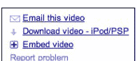

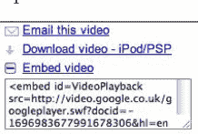

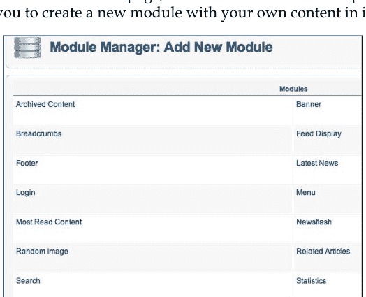

自定义 HTML 选项允许您在模块位置中输入自定义文本或代码。

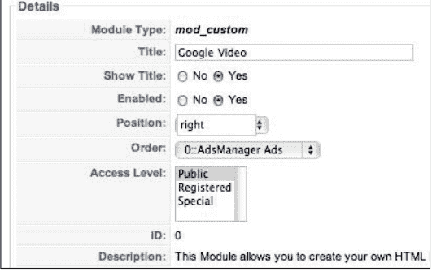

- 您需要为新模块提供一个**标题**。选择其在模板上的**位置**并选择模块发布的其他可用选项。
- 在**自定义输出**框中，粘贴您的“Google Video 嵌入代码”：

```html
<embed id=VideoPlayback src=http://video.google.co.uk/googleplayer.swf?docid=-166983677991678306&hl=en&fs=true style=width:400px;height:326px allowFullScreen=true allowScriptAccess=always type=application/x-shockwave-flash></embed>
```

- 导航到 Joomla! 站点的前端，查看**Google Video**内容现在显示在您的 Joomla! 网站上。

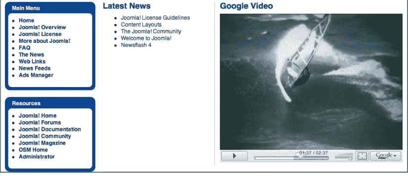

这种嵌入外部内容的方法也可以应用于 Joomla! 文章，并且只要其提供的 HTML 代码被 Joomla! 接受，就可以使用几乎所有分发站点的资源。

## 使用第三方扩展用于外部资源

首先，本章包含数百个外部资源的可能性。


与其采用这种方法，这里列出了一些在 Joomla.org 上驻留的更受欢迎的基于 GPL 的扩展，以及功能丰富且经受住时间考验的扩展。有关 GPL 的更多信息可在 `http://en.wikipedia.org/wiki/GNU_General_Public_License` 找到。

我们还利用了这个机会，尝试在本章中仅列出非商业扩展。用于与外部资源协作的专业商业扩展也可能可用。

不啰嗦地说，Joomla! 扩展的目的是为您的 Joomla! 框架提供额外功能。有些扩展非常有用，以至于如果您构建多个 Joomla! 网站，您甚至可能会考虑始终将其作为默认安装。一个例子是来自 `http://www.joomlapolis.com` 的 Community Builder，它除了其他许多功能外，还增强了用户注册和个人资料选项。不同的 Joomla! 用户会收集或设计他们喜欢使用的工具，这也是 Joomla! 拥有如此繁荣社区的原因之一。

开箱即用的 Joomla! 是一个轻量级的 slick CMS，而 Joomla! 的真正力量在于已开发的应用框架，该框架允许扩展其核心功能。大多数多媒体功能都是通过扩展添加到我们的 Joomla! 站点的，随着社交网络和外部多媒体资源门户的流行，围绕这些站点的扩展迅速增长。

扩展已按社交网络、视频、音频、天气等热门标题组织。有些扩展可能属于多个类别，因此已在最适用的区域中组织。每个扩展列表将包含其目的的摘要和功能列表。以下扩展标题右侧的字母表示该扩展是组件、模块、插件、语言还是模板。

> 由于 URL 冗长且 Joomla! 扩展目录（JED）列表可能随时更改，因此已包含以下扩展的搜索词，而不是直接链接到扩展。在 JED 上对相关术语进行搜索将帮助您轻松找到这些扩展。
> 
> 扩展标题后的字母表示以下内容：
> M = 模块
> C = 组件
> P = 插件
> L = 语言
> T = 模板

### Joomla! 与社交网络集成

社交网络是定义共享兴趣并能够互动的人群社区或群体的能力。传统上，这些是通常位于相似区域内的少数人群，但随着互联网和社交网络网站的增长，这些社区现在可供全球受众使用。

### Twitter Follow Me (M)

“Twitter Follow Me”模块在您的网站页面上放置一个 Twitter 链接图像图标，以便访问者可以点击它前往您的 Twitter 页面。模块定位可以位于 Joomla! 模板之外，以便图标相对于用户的浏览器窗口放置，而不是包含在站点模板内。

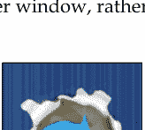


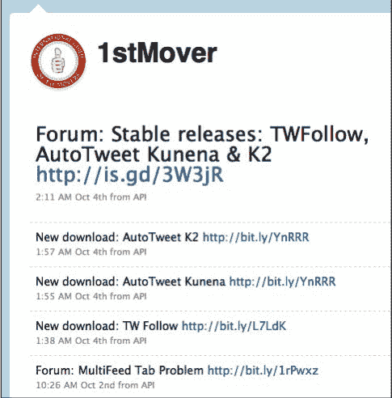

AutoTweet 扩展的一个不错的功能是可用的额外插件，它们可以从与 Joomla! 相关的软件和扩展中发布推文。示例包括 Kunena 论坛帖子、K2 文章管理器、Phoca Download、EventList 事件管理等。

安装后，配置在插件参数中进行：

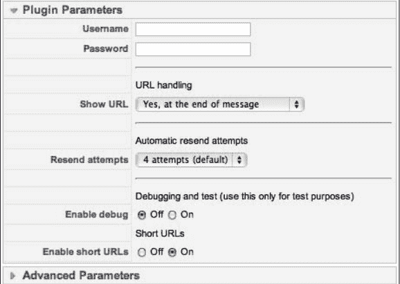

## 与外部源协作

新版本中的一些功能包括：

- 使用 Twitter REST API 发布消息。
- 所有插件均可自定义：账户、要发布的分类/版块、链接位置、显示版块/分类、发布私有文章、发布已修改文章、排除版块/分类、使用标题或文本作为消息、附加静态文本（例如，用于 hashtags）、短网址服务提供商（现在也支持 bit.ly）。
- 也兼容 sh404sef 和 JoomSEF 以及 Joomla! 原生的 SEF 支持。
- 自动支持短网址。
- 自动消息重发：有时发布时会收到错误消息。这在 Twitter 或 Facebook 负载过重或 API 宕机时偶尔会发生。AutoTweet 会在 API 站点出现错误时自动重新发送状态消息。
- AutoTweet 也会发布稍后发布或重新发布的文章。
- AutoTweet NG 带有后端组件。该组件记录所有已发布的消息（包括错误和待处理消息），你可以在组件的后端管理和重发这些消息。
- AutoTweet NG 支持具有当前发布日期的文章。 （这些文章在 Joomla! 发布时会自动发布到 Twitter，或你可以从 AutoTweet NG 后端组件手动发布它们。）

要下载此扩展，请访问 `http://extensions.joomla.org/` 并搜索 "AutoTweet"。

## JTweet (M)

JTweet 扩展是一个模块，可在你的 Joomla! 网站上发布你的 Twitter 推文：

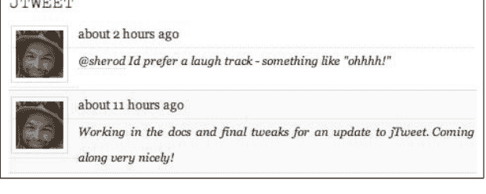

该模块的功能包括：

- 设置要显示的推文数量。
- 选择是否显示你的头像。
- 选择仅显示你的推文还是与特定主题相关的所有推文。
- 根据推文的性质选择自动连接短语。例如，回复的特定介绍文本、动词、回复推文等。
- 设置推文加载时显示的文本。
- 通过关键词过滤你自己的推文。例如，仅显示包含 "Joomla!" 的推文。

安装后，所有配置均在 **模块参数** 中进行：

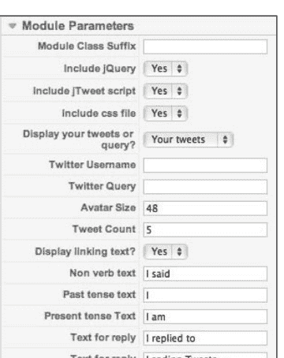

最新版本现在会即时加载脚本，使模块符合 XHTML 标准。

> 请注意，该模块现在需要 JB Library 插件才能工作。JB Library 插件会自动将 jQuery 库加载到你的模板头部。jQuery 库是 jTweet 模块所必需的。

要下载此扩展，请访问 http://extensions.joomla.org/ 并搜索 "JTweet"。

## Tweetboard (P)

由 "Twitter Follow Me" 模块的制作方带来的 "Tweetboard"。利用 Tweetboard API 插件，你可以在 Joomla! 网站上显示 Twitter Tweetboard：

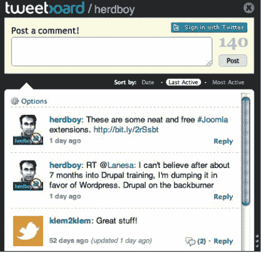

Tweetboard 是一种有趣且引人入胜的微型论坛类型应用，它会抓取你的 Twitter 动态并将其重新格式化为线程式对话。这是一种很好的营销技巧，可以提高网站的流量。源自原始内容的对话也会被捕获，有效地为网站访问者提供讨论布局。

Tweetboard 扩展是一个 Joomla! 插件。安装后，配置设置位于插件管理器区域的插件中：

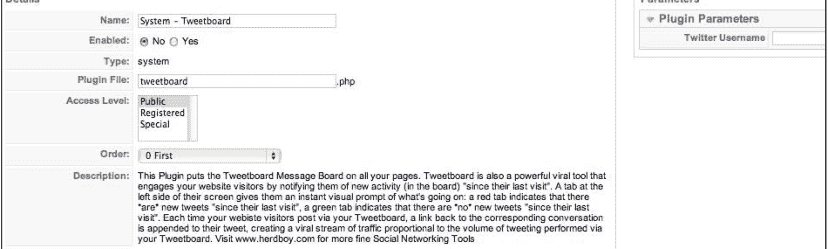

> 在启用插件之前，请访问 Joomla 独家邀请门户（作者下载页面上的链接）并使用特别生成的代码：`joomlainvites01`。这将允许你快速使用 Tweetboard 与你的 Twitter 账户。

要下载此扩展，请访问 `http://extensions.joomla.org/` 并搜索 "Tweetboard"。

## WebScribble jConnector (C,M,P)

jConnector 允许你的 Joomla! 成员使用 Facebook Connect 登录，Facebook Connect 是一套强大的 API，让开发者可以将身份和连接带入其他应用：


如果用户已在 Facebook 注册，他们下次访问你的网站时只需点击 **Facebook Connect** 图标，即可自动登录。此集成会将这些用户添加到你的 Joomla! 数据库中，以便你通过 Joomla! 管理他们的账户。

安装非常简单，只需上传一个 `jConnector.zip` 软件包文件通过扩展管理器上传。成功安装后，你需要进入模块管理器以配置 **模块参数**：

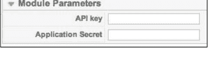

要开始使用 Facebook Connect，你必须从 Facebook 获取 **API 密钥** 和 **应用密钥**。为此，你应首先在 `http://facebook.com` 登录 Facebook。

登录后，你需要前往 http://facebook.com/developers/ 并按照创建新应用的流程进行操作。一旦获得 Facebook API 密钥，你需要在插件管理屏幕中填充此参数。

要下载此扩展，请访问 http://extensions.joomla.org/ 并搜索 "jConnector"。

## Facebook Fanbox Free (M)

Facebook Fanbox 是一个 Joomla! 模块，可在你的 Joomla! 网站上显示 Facebook FanBox：


Fanbox 允许用户：

- 查看已有多少用户是粉丝，并查看他们中的一些朋友
- 阅读页面的最新帖子
- 一键成为粉丝，无需访问页面

在向你的网站添加 Fanbox 之前，你需要以下内容：

- 一个 Joomla! 1.5 网站，以及安装模块的能力
- 一个推广你网站的 Facebook 页面（你必须是该页面的管理员）
- 要输入到 **模块参数** 中的你的 Facebook 页面 ID 和个人资料 ID

该扩展有许多参数选项可供控制，并且已从需要此类型功能的 Joomla! 网站用户那里获得了良好的反馈：

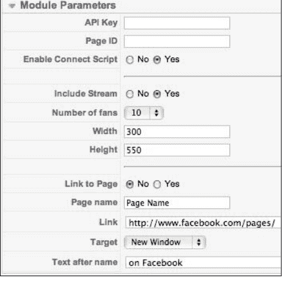

要下载此扩展，请访问 `http://extensions.joomla.org/` 并搜索 "Facebook Fanbox"。

## jwFacebook Comments (P)

jwFacebook Comments 插件利用 Facebook 的评论功能，允许你在 Joomla! 文章末尾放置这些评论：

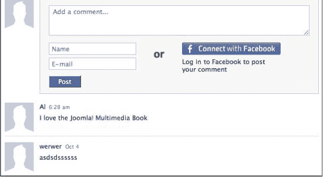

如果你的网站访问者拥有 Facebook 账户，他们可以轻松地在你的 Joomla! 文章上发表评论，但该系统的一个不错的功能是任何人都可以发表评论（你不需要 Facebook 账户）。它使用 Facebook 的评论功能而不是使用你自己的，可能为你节省托管带宽成本。

安装很容易，但为了使此功能正常工作，需要执行几个额外的步骤。这些步骤在开发者的网站上清楚列出，但简而言之是：

- 使用 Joomla! 扩展管理器安装插件
- 将包含的 .htm 文件上传到你的 Web 服务器，然后导航到插件管理器以配置插件参数
- 配置你的 Facebook API、上传的 .htm 文件的路径
- 然后你需要登录 Facebook 以输入你要安装评论的网站的域名

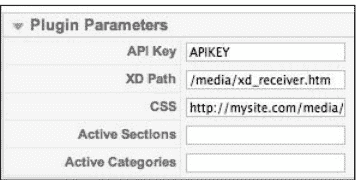

要下载此扩展，请访问 http://extensions.joomla.org/ 并搜索 "jwFacebook Comments"。


## Joomla! 与视频频道集成

视频目前是网络上最酷的东西，而有一些很棒的 Joomla! 视频扩展可用于显示来自外部视频分发站点的内容。

> 必须提到的是，有一些专门针对 Joomla! 的视频解决方案，也提供对流媒体外部视频内容的支持。请参阅第 6 章《在 Joomla! 网站中使用视频》中列出的扩展，以获取更多视频解决方案。

### easiertube (P)

easiertube 是一个 Joomla! 插件，使用和管理起来再简单不过了。它旨在从以下来源在您的文章中显示视频：YouTube、Google、UStream、Revver 和 MySpace。


要使用它，只需安装此插件并在插件参数区域配置其设置。在内容文章中输入远程视频链接，插件将自动转换 URL 并在页面中嵌入播放器。可以设置的参数有：

- 首页显示宽度和高度
- 主内容显示宽度和高度
- 全屏
- 自动播放

最新版本（5.5）现已包含：

- YouTube 支持
- 相关视频（YouTube），也可禁用搜索
- 禁用显示信息
- 禁用注释
- 显示边框（可选项颜色）
- Metacafe 视频
- 显示统计信息
- 显示视频标题

使用扩展管理器安装插件，并在插件管理器区域配置其参数：

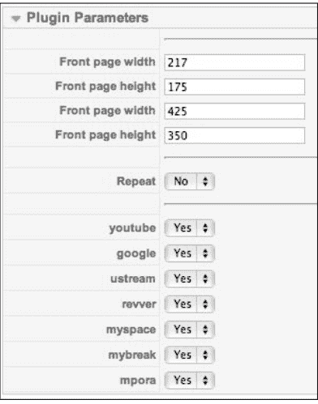

要下载此扩展，请访问 http://extensions.joomla.org/ 并搜索 "easiertube"。

### QTUBE (M, P)

QTUBE 是一个模块和插件，旨在将 YouTube 视频嵌入到 Joomla! 内容文章中：

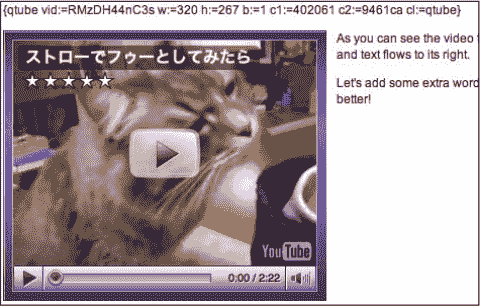

该插件允许您在 Joomla! 文章中播放视频，并包含可用于调整视频容器对象外观的参数。

QTUBE 的开发者还开发了一个 QTUBE 模块，可将视频包含到模块中。

模块和插件均通过扩展管理器安装，其默认参数可在插件和模块管理器区域设置：

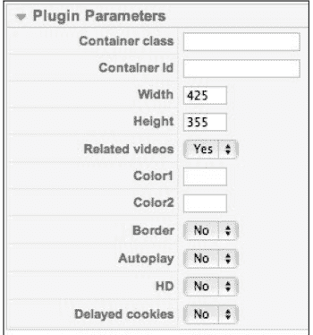

要下载此扩展，请访问 http://extensions.joomla.org/ 并搜索 "QTUBE"。

### JMultimedia Suite (C, M, P)

JMultimedia Suite 是一套多媒体扩展。它可以自动检测并显示来自众多流媒体站点和多种媒体格式的视频。它为管理员提供众多视频选项：

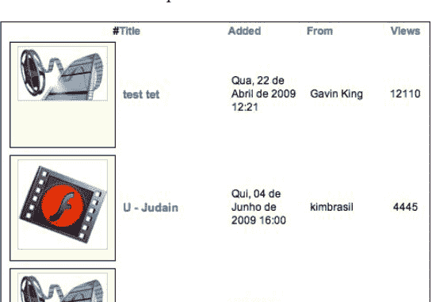

主要功能有：

- 创建/编辑视频分类
- 创建/编辑媒体项目
- 可自定义 CSS
- 支持多媒体格式
- 与 commenter 评论系统集成

JMultimedia Suite 的要求是必须安装扩展 "denVideo"。安装后，它将自动识别文章中的视频链接，并支持 denVideo 支持的所有视频格式，包括：

- SWF（Flash 应用程序）
- FLV 和 H264（Flash 视频）
- CLASS（Java 小程序）
- MOV 和 MP4（QuickTime）
- RM 和 RAM（RealMedia）
- MP3（音频）

要下载此扩展，请访问 http://extensions.joomla.org/ 并搜索 "LCPlayer"。

## Joomla! 与照片集成

Joomla! 与图像配合良好，从外部资源显示照片和画廊的机会非常广泛。以下是用于此目的的一些更受欢迎的扩展。

> Joomla! 的许多图像扩展也提供从外部资源显示内容的能力。

### UniversalPlayground - Flickr 幻灯片插件 (P)

UniversalPlayground - Flickr 幻灯片插件使用简单的灯箱效果显示您 Flickr 账户中的幻灯片：

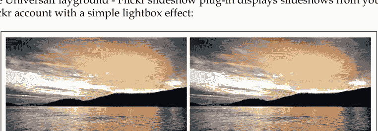

此扩展使用 phpFlickr 库、Slimbox（轻量级视觉灯箱克隆）和 TripTracker 幻灯片脚本。

只需在文章中输入简单表达式，即可显示单张照片或完整的图集，例如：`[flickr photo=xxx]`（其中 xxx 用照片 ID 号替换）。

插件包含众多自定义参数：

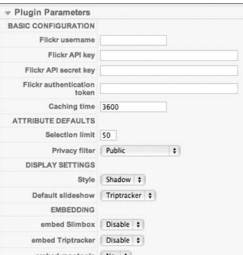

> 需要输入 Flickr API 密钥到您的插件中，模块和开发者网站上提供此链接。

要下载此扩展，请访问 http://extensions.joomla.org/ 并搜索 "UniversalPlayground - Flickr slideshow"。

### Flickr + Highslide (M)

Flickr + Highslide 模块扩展使用 Highslide JavaScript 效果在您的 Joomla! 网站中显示来自 Flickr 的照片：


Highslide 是一个用 JavaScript 编写的开源媒体和画廊查看器。该模块以优雅的外观显示 Flickr 内容，并包含以下功能：

- 13 种独特的照片显示方式
- 八种不同的画廊样式
- 显示来自照片集的照片
- 显示用户的全部照片
- 按最新或随机顺序显示照片
- 可更改图像和缩略图的大小
- 可将照片分页显示
- 显示照片标题

该模块需要您的 Flickr 账户 ID。它还提供众多样式参数：

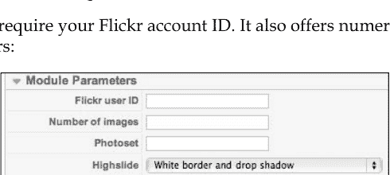

要下载此扩展，请访问 http://extensions.joomla.org/ 并搜索 "Flickr Highslide"。

## Joomla! 与天气集成

对于繁忙的新闻和社区门户，提供天气预报是一个常见需求。Google Weather 是这些扩展天气信息来源的热门资源，这归功于其提供的全球解决方案。还有许多其他天气扩展；以下是一些热门的。

### Google Weather - Plugin (P, M)

Google Weather - Plugin 是一个轻量级插件，使用 Google Weather Forecast API 在您的 Joomla! 文章中显示当前天气：

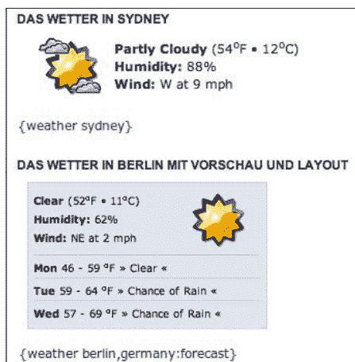

通过使用简单的插件标签触发插件，可以将 {WEATHER CITY, COUNTRY} 包含到内容中，插件将完成其余工作！

插件通过扩展管理器安装，然后使用插件管理器配置。可用的样式选项众多，插件可使用自定义 CSS 配置。您可以使用文章中的插件标签随意频繁地显示天气。

## 与外部资源协作

组件、模块和插件均通过扩展管理器安装，然后使用相应的管理器配置。每个元素都提供自己的参数和配置选项，以便按您想要的方式显示天气：

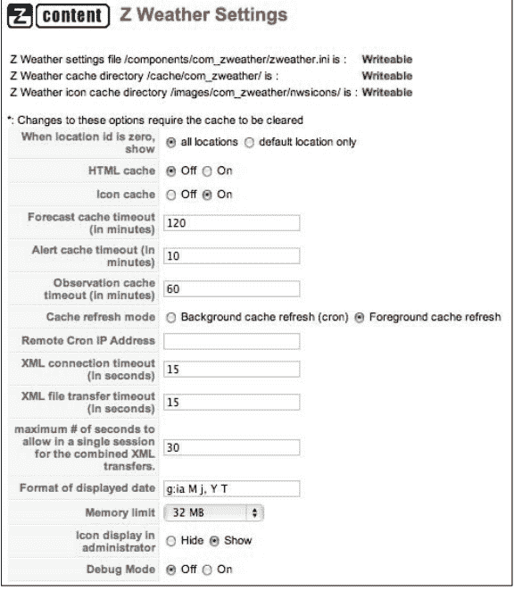

要下载此扩展，请访问 `http://extensions.joomla.org/` 并搜索 "Z Weather"。

### eWeather (C,M)

eWeather 是一个组件（附带一个额外模块），可在您的 Joomla! 页面中以视觉上吸引人的方式显示当前状况和天气预报。天气数据由 The Weather Channel 通过 XML feed 提供：

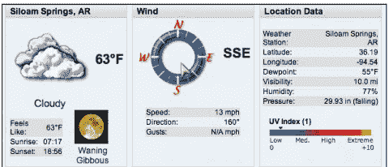

组件的一个不错功能是允许网站访问者选择自己的城市并查看五天预报。然而，信息显示中包含一些 "Weather Channel" 广告。

eWeather 是一个功能强大的组件，允许在组件配置设置中进行配置。这些包括：

- 已安装地区/国家的全新概览和管理
- 城市的默认配置
- 最长五天的天气预报
- 日期/时间格式可自由定义
- 可定义代理

新的图标样式包现已可用，可自定义您网站的外观。还提供了一个配套模块，可在任何模块位置显示天气：

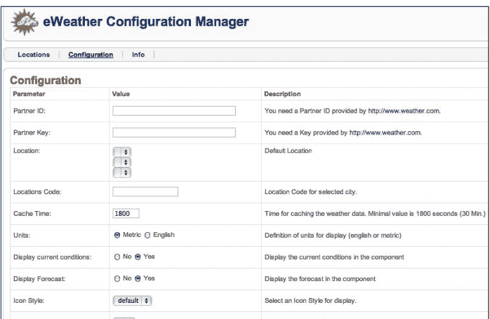


要下载此扩展，请访问 http://extensions.joomla.org/ 并搜索 "eWeather"。

## Joomla! 与新闻频道集成

有许多优秀的新闻频道扩展可用于抓取外部新闻并在您的网站页面上显示。使用 RSS 技术，可以手动执行此过程，但以下扩展使事情变得简单易行。

### Google News (M)

Google News 模块可将 Google 新闻故事嵌入到您网站的任何模块位置。它允许您的网站访客查看您选择的 Google 新闻的标题和预览：


此模块包含众多参数，包括过滤主题、调整显示的尺寸、国家和语言的能力。它是一个简单的模块，但非常适合希望在 Joomla! 网站中轻松显示 Google 新闻的用户。

Google News 模块通过扩展管理器安装，配置在模块中设置。

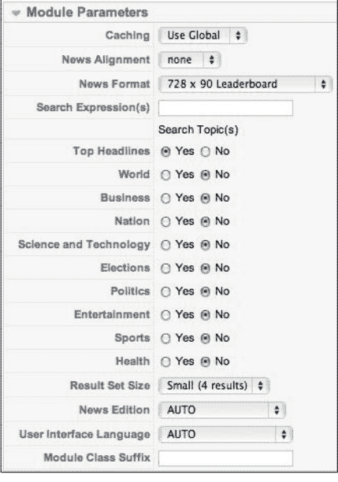

要下载此扩展，请访问 http://extensions.joomla.org/ 并搜索 "Google News"。

## 其他资源及如何将其与 Joomla! 集成

有数百个扩展允许 Joomla! 与外部资源交互，以下是一些示例。

### Plugin GoogleMaps (P)

此扩展是用于在 Joomla! 的文章、模块或组件中显示一个或多个 Google 地图的插件！


与许多插件一样，地图是通过使用包含众多参数的特殊标签来显示的。这些提供了真正自定义地图内容的能力，以下是该插件功能的少量选择：

- 可调整宽度和高度
- 可调整纬度和经度
- 缩放控件
- 地图标记
- 为地图添加选择和工具提示

GoogleMaps 插件通过扩展管理器安装，默认配置在插件中设置，可通过每次使用插件触发标签的实例进行覆盖。

使用大多数 Google 地图服务需要 GoogleMaps 参考密钥，并且是此插件正常工作的要求。

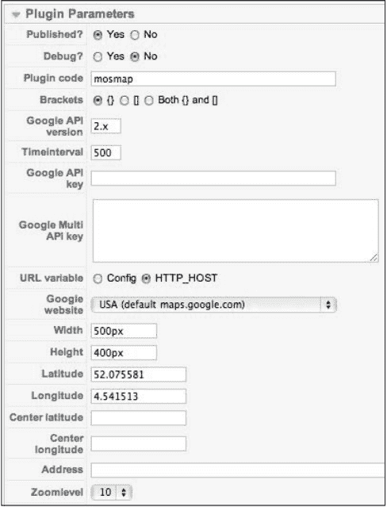

要下载此扩展，请访问 http://extensions.joomla.org/ 并搜索 "GoogleMaps"。

### Ajax Whois (C,M)

Ajax Whois 扩展是 Joomla! 的国际域名搜索和“whois”扩展，利用 Ajax 技术，让您的 Joomla! 网站访客可以检查域名是否可用。这些搜索结果会即时显示在网站上：

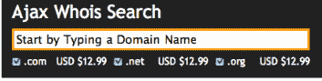

Ajax Whois 组件和模块通过扩展管理器安装，默认配置在组件中设置。有众多显示选项可用。

要下载此扩展，请访问 http://extensions.joomla.org/ 并搜索 "Ajax Whois"。

### SlideShare (P)

SlideShare 是一项服务，允许您上传和分享 PowerPoint 演示文稿、Word 文档和 PDF 文档。此简单模块随后允许您在 Joomla! 网站中显示 SlideShare 内容：


使用此服务需要 SlideShare 用户账户。

SlideShare 插件通过扩展管理器安装，默认配置使用插件管理器设置：

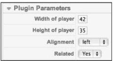

要下载此扩展，请访问 http://extensions.joomla.org/ 并搜索 "SlideShare Plugin"。

### Slick RSS (M)

Slick RSS 允许您解析并在 Joomla! 网站上以漂亮的工具提示摘要功能显示外部 RSS 源：


部分功能包括：

- 配置项目数量
- 显示标题和描述
- 启用/禁用图片
- 限制标题和描述的字数

Slick RSS 模块通过扩展管理器安装，配置在模块管理器中设置：

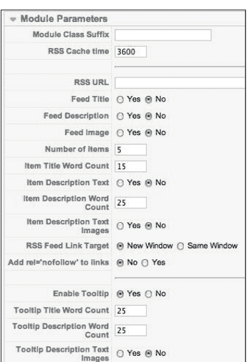

要下载此扩展，请访问 http://extensions.joomla.org/ 并搜索 "Slick RSS"。

### RokBox Plugin (P)

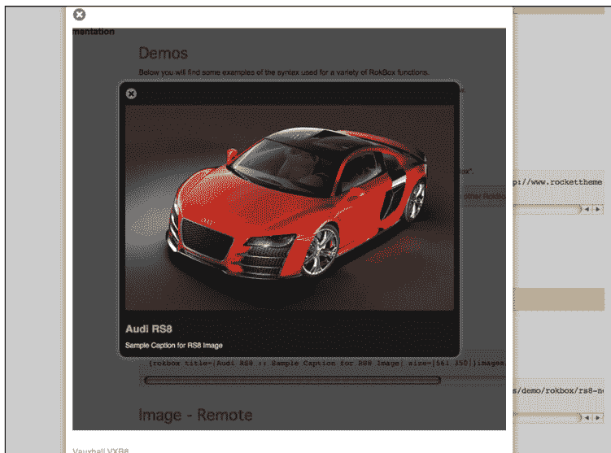

RokBox 是一个由 MooTools 驱动的 JavaScript 幻灯片放映，允许您快速轻松地显示多种媒体格式，包括图片、视频（视频分享服务也支持）和音乐。

RokBox 提供主题系统，允许您创建自己的自定义主题以适应您网站的设计。它包含两个预定义主题，即浅色主题和深色主题，可无缝融入您的网站设计。

RokBox 是一个不错的一体化解决方案，可使用专业效果呈现多媒体内容。它可以像播放您自己的文件一样轻松播放外部媒体源，例如 YouTube 视频。

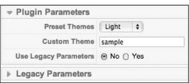

要下载此扩展，请访问 http://extensions.joomla.org/ 并搜索 "RokBox"。

### Simple RSS Feed Reader (M)

使用“Simple RSS Feed Reader”模块，现在在 Joomla! 网站中添加 RSS 汇集内容变得超级简单：

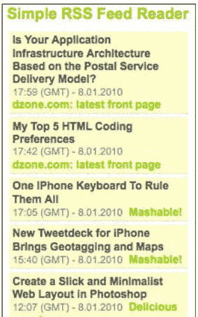

使用方法：在模块设置中插入您想要汇集的网站的源（RSS）URL，编辑您的模块选项，然后在所需位置发布模块。模块将显示您模块中的最新源内容。

Simple RSS Feed Reader 基于非常流行的 SimplePie PHP 类，这使得将汇集内容集成到 Joomla! 网站变得容易。该模块支持从 RSS 0.91 和 RSS 1.0 格式到 ever-popular RSS 2.0 格式的所有内容。它还支持新兴的 Atom 格式，包括 0.3 和 1.0 版本。

该模块具有非常快速、非常高效的缓存系统。通过缓存处理后的数据而不是原始 XML，模块能够创建快速的源解析器，不会在页面加载时造成过多的开销。

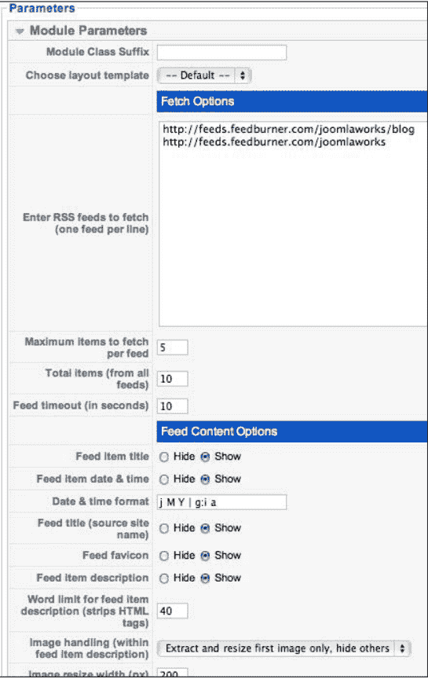

要下载此扩展，请访问 http://extensions.joomla.org/ 并搜索 "Simple RSS Feed Reader"。

## 总结

对于 Web 的常规用户，有几个关键工具和社交网络站点可能包含您的个人资料和数据。每个月，这些站点与其他在线资源（包括 Joomla!）之间的集成都在改进。所有这些都有助于最大限度地减少账户登录次数和数据在不同地方的重复。

Web 2.0 全部是关于将自己融入 Web 体验并分享您的信息；成为 Web 的一部分，而不仅仅是搜索资料。来自外部资源的内容可通过使用 HTML 代码或为与流行资源协作而设计的自定义扩展轻松嵌入到 Joomla! 中。

Joomla! 在将其框架中显示外部数据的同时，也非常适合将自己的内容广播到其他来源。正在以惊人的速度开发新扩展，为与流行的外部网络资源协作提供解决方案。随着时间的推移，这只会增加，因为 Joomla! 开发者社区帮助定义了 Web 上“下一个大事件”的集成……无论它是什么。
