# 8 Joomla! 模板和多媒体

Joomla! 模板是使一个 Joomla! 网站与下一个网站不同的决定性因素。它们包含显示 Joomla! 内容的结构元素，并向用户的网络浏览器提供样式和脚本信息。

由于 Joomla! 模板为您的网站提供样式信息，因此它们自然会对 Joomla! 网站中的多媒体元素产生影响。除了您的网站设计和模块格式（通常使用图片）之外，模板可能包含高级 JavaScript 功能，可增强您网站的多媒体功能。

本章是 Joomla! 模板的概述，说明它们的工作原理以及它们如何影响 Joomla! 网站中多媒体内容的显示。了解模板如何增强多媒体功能，以及它们如何影响 Joomla! 网站在移动网络设备上的显示方式。它包含：

- 什么是 Joomla! 模板？
- 模板组件
- 脚本和多媒体
- 移动网络
- 使您的网站适合移动设备
- 可访问性

## 什么是 Joomla! 模板？

Joomla! 使用模板系统来控制网页内容的外观、风格和布局。

Joomla! 的设计将交付网站的关键流程在其设计中分离出来，使 Joomla! 尽可能高效，并且作为软件易于维护：

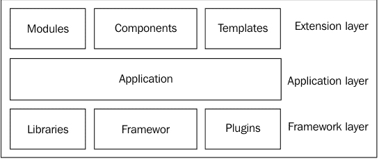

其中一个元素是 Joomla! 模板，它控制整体布局，并区分一个 Joomla! 安装与下一个。模板提供结构，可将各种内容元素（包括组件、插件和模块）放置在任何给定页面的几乎任何您选择的部分。您 Joomla! 网站成功的最重要因素之一将是您希望向受众传达的信息，以及模板是如何设计来实现这一点的。这就是模板设计可以成就或毁掉您的 Joomla! 网站的地方：

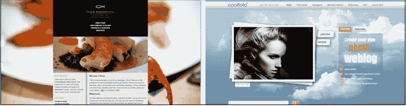

在制作网站时，许多元素的位置通常保持不变。例如，菜单、搜索框、横幅、版权、侧边栏通常都固定在页面的固定位置。重要的样式信息将包含在样式表中（控制字体、颜色和信息放置），并且需要包含在内，以便在每个页面上呈现。

这就是为什么开发了模板，而 Joomla! 是它们可以有效利用的完美示例。您可以为站点构建的每个网页重新创建所有上述功能，也可以利用模板结构将此信息包含并传递到每个页面。我们作为管理员只需用站点内容“填补空白”。

## 模板组件

Joomla! 利用模板用于站点的前端视图和后台管理部分。

管理部分有一个模板（名为 Khepri），作为默认安装并创建管理界面的样式：

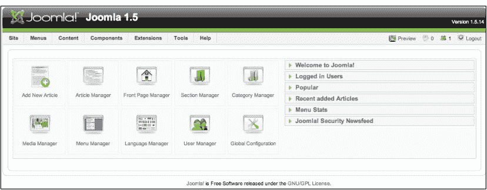

Joomla! 管理模板位于 /administrator/templates 目录中。如果您希望调整站点管理模板，请复制默认的 Khepri 模板并将模板文件夹重命名为您的新名称。确保重命名 XML 引用，然后您可以开始自定义管理主题。也有第三方管理员模板可用，可为您的 Joomla! 管理提供全新的外观。

前端的模板包含在 Joomla! 的 /templates 目录中：

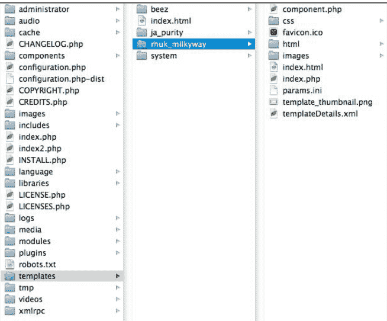

您的 Joomla! 模板包含一组文件和目录以对内容进行子分类。典型的 Joomla! 1.5 模板结构通常包含以下内容：

- `index.php`：这是一个关键文件，通常包含用于模块和组件显示及定位的 HTML 和 PHP 逻辑。
- `component.php`：提供“通过电子邮件将此链接发送给朋友”等附加页面的显示逻辑，以及打印友好页面。
- `css/template.css`：模板 CSS 文件通常位于 CSS 文件夹中，处理模板的展示方面，包括字体、标题、边距、图像边框、列表格式等规范。
- `templateDetails.xml`：`templateDetails.xml` 是另一个关键文件，其中保存与模板相关的元信息，并被 Joomla! 安装程序和模板管理器使用。该文件还包含模板使用的模块位置引用。

- `template_thumbnail.png`：此图像文件可以是 JPG、GIF 或 PNG 文件。通常，它是一个 200 x 150 像素的图像，当在模板管理器中将光标悬停在模板名称上时显示。这为管理员在将模板应用到站点之前提供了模板的快照视图。

典型的 Joomla! 1.5 模板还将包含以下目录：

- `css`：CSS 文件夹包含模板的所有 CSS 文件。
- `html`：此文件夹通常包含核心输出的模板覆盖文件。
- `images`：images 文件夹包含模板使用的所有图像。在流行的商业模板中，在 images 文件夹内拥有多个子目录，每个子目录包含图像的不同颜色变化的情况并不少见。

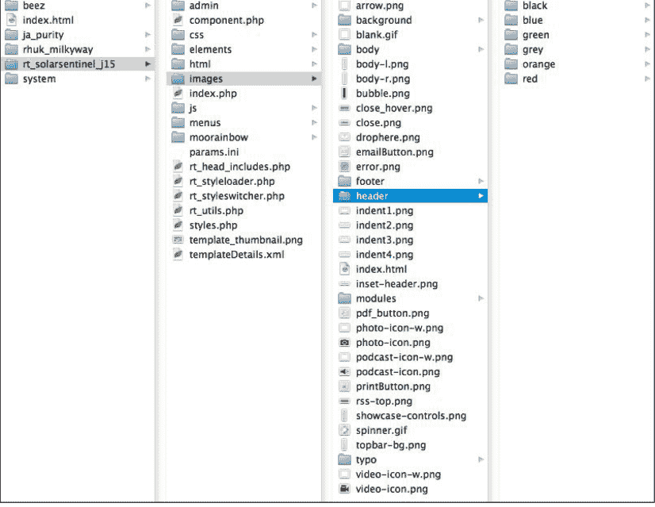

Joomla! 的模板文件夹通常包含与网站上使用的模板直接相关的所有相关文件。因此，您在 Joomla! 文章中使用的图像和其他多媒体内容应位于自己的文件夹中，而不是放置在模板文件夹中。

## 脚本和多媒体

当大多数用户听到“多媒体”一词时，可能会首先想到“图像”和“视频”内容。该术语用于描述这些突出的媒体元素；然而，在这个快速发展的网络世界中，新的功能和交互元素正在不断出现。

一些商业模板提供商现在为 Joomla! 创建功能丰富的模板系统，不仅包含基本模板元素，还包括大量脚本，使软件包对用户来说更具功能性和多功能性。

这些功能包括复杂的 JavaScript 下拉菜单系统、用户定义的模块排序、移动网络主题、广泛的排版选项等等。虽然其中一些功能可能不被视为“多媒体”的传统形式，但它们通常包含文本、图像、字体、颜色，并为网站用户提供交互体验。

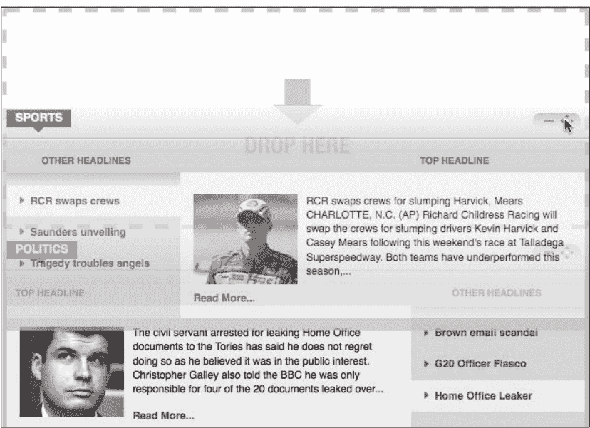

上图显示了来自 RocketTheme 的 Solar Sentinel 模板，网址为 http://www.rockettheme.com。

## Mellow 模板—Yootheme

Mellow 是 YooTheme 提供的一个功能丰富但简单且组织良好的模板：

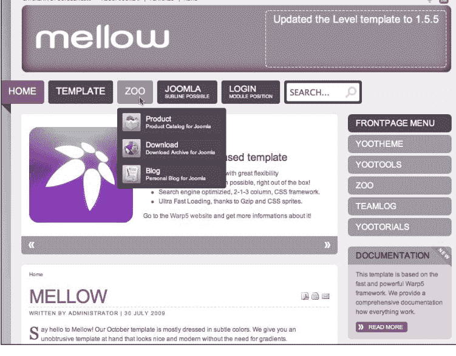

`www.yootheme.com` 包含大量脚本功能，包括以下内容：

- 功能强大的灵活菜单系统：这包括带图标的众多子菜单选项等：

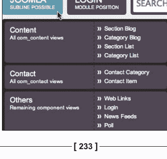

- 自动日期/天数调整：它使用 PHP 脚本来相应地调整日期：
- 十种颜色选项：这个系列适合每个人：
- MooTools 酷炫淡入淡出菜单项：主菜单和侧菜单项不仅有悬停效果，还有使用 JavaScript 操作实现的微妙淡入淡出效果。
- 详细的排版：Mellow 包含大量文本格式和标题样式信息，使您的网站文本可以轻松包含众多样式元素：

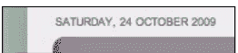

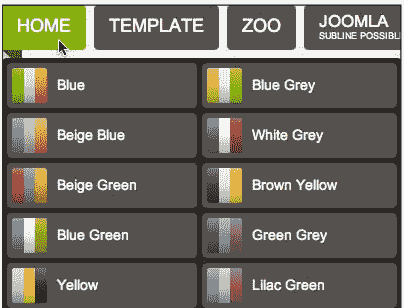

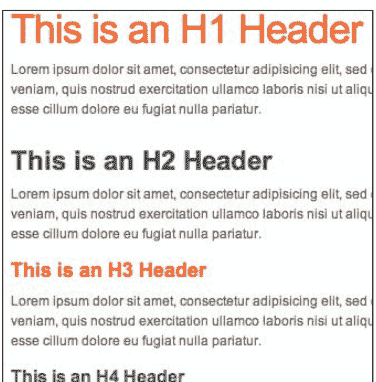

- 返回顶部：页面底部包含一个图标，并带有 JavaScript 平滑滚动返回顶部的功能：

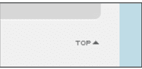

## Infuse—RocketTheme

Infuse by RocketTheme 是一款色彩丰富且专业的模板，可能适合各种用途：

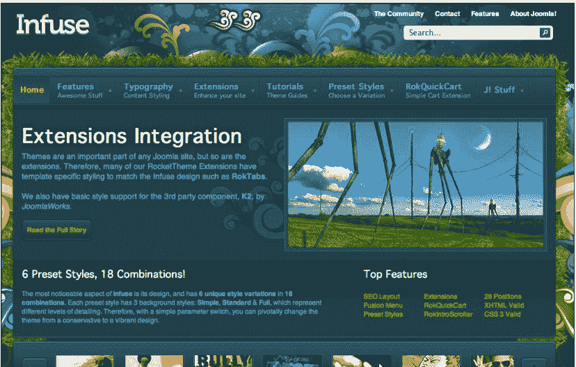

Infuse 模板是艺术风格和功能的融合。该主题拥有六种独立且独特的样式变体：

- 1. Fusion：功能强大的基于 JavaScript 的下拉菜单系统（包括菜单图标、子菜单支持）：

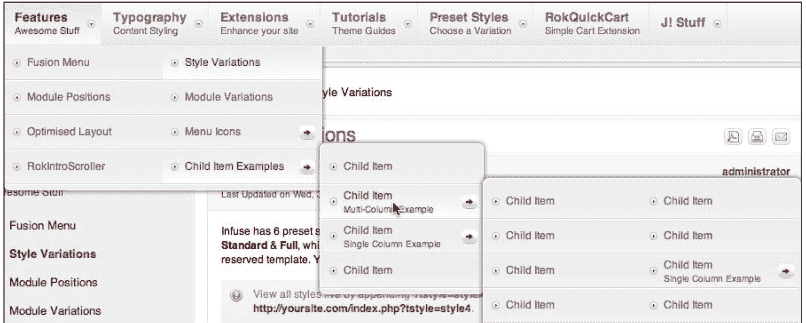

- 2. 样式变体：有 18 个选项可供选择，同一模板可以通过各种主题选项呈现全新的外观和感觉：

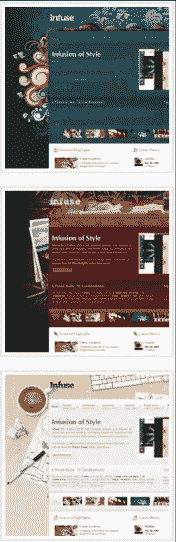

3. 优化布局：您的中心内容将首先加载到页面中，领先于侧边栏，这对搜索引擎优化是一个额外的增强：

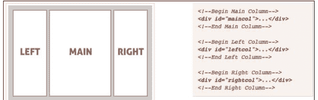

4. 排版选项：为您的内容增添特色并使其栩栩如生，使用一系列精美的样式选项：

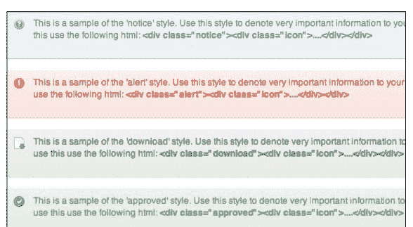

5. 返回顶部：而不是让用户再次滚动到页面顶部，他们可以利用易于使用的返回顶部超链接，该链接使用 JavaScript 平滑滚动到页面顶部：

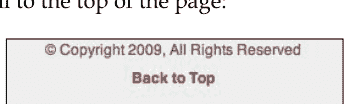

- 6. 多模块位置和变体：拥有28个模块位置，并且每个位置都有一系列样式选项，你总能找到地方放置内容：

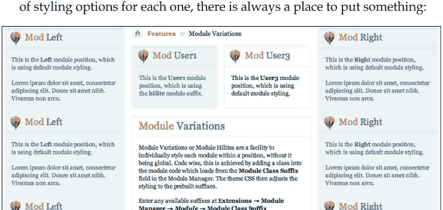

## Joomla! 模板与多媒体

### JA Halite—Joomla Art

JA Halite 是 Joomla Art（www.joomlaart.com）出品的一款简洁而醒目的模板。该模板功能丰富，包括移动设备支持、颜色和样式选项以及菜单选项：

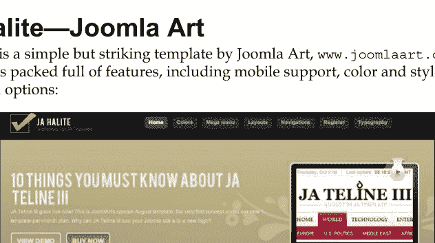

其功能包括：

- 手持设备和 iPhone 支持：当识别到移动设备时，此模板会自动简化站点内容和样式：

  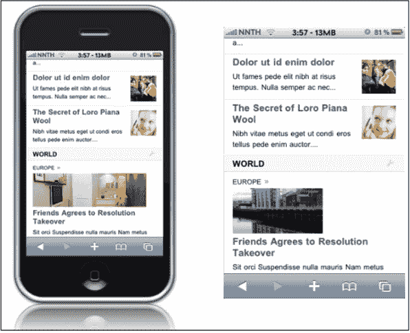

- 多主题：十个主题选项，每个主题内还有模块变体：

  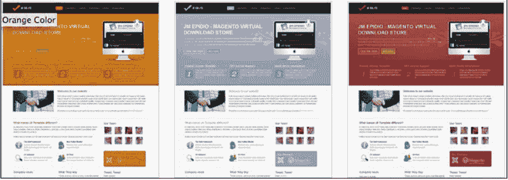

- 丰富的菜单选项：四种不同的菜单选项，包括分割菜单、CSS 菜单、MooTools 菜单和超级菜单。

- **排版：** 此模板包含一些精心预设计的样式和格式，让你可以轻松使用多种颜色、样式和图标来美化网页文本：

  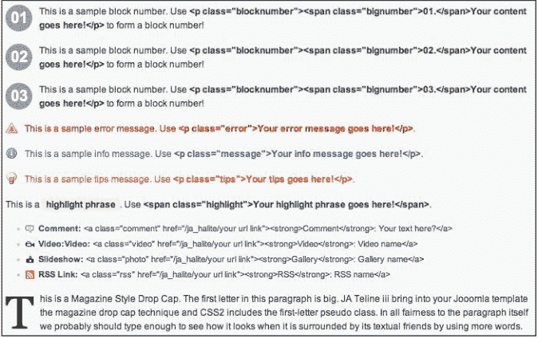

### Motion—Yootheme

无论是否合你口味，Yootheme 出品的 Motion 主题都是一个功能丰富的 Joomla! 模板，包含宽屏布局和强大的脚本，可创造出众多动画效果：

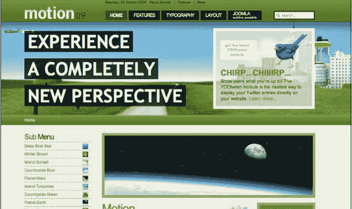

该模板中的每个主题都有自己独特的动画效果，这些效果通过图形、CSS 和 JavaScript 的组合来实现。在下一个截图显示的主题中，两艘船在屏幕上划过，背景中的云朵也在页面上缓缓飘动：

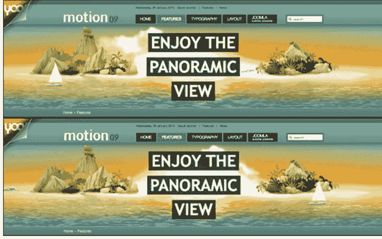

Motion 模板实际上是将十个模板合为一体，这得益于其主题的多样性：

- 十个内置主题：每个主题都包含丰富的图形和动画：

  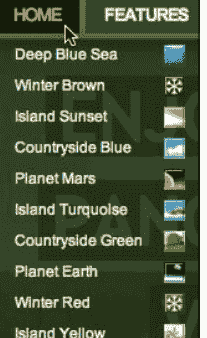

- 自动日期功能：日期随服务器日期的变化而变化。

  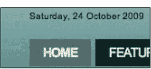

- MooTools 菜单：具有滑动框、颜色渐变等炫酷效果的菜单。菜单项可以包含说明性副标题和其他强大的菜单效果。
- IE 的 PNG 修复：由于只有 IE7 及更高版本支持透明的 PNG 图像文件，Yootheme 的 PNG 修复功能可为整个模板中的内联图像和背景图像启用 PNG 透明效果。
- 无表格模板覆盖：该模板不仅设计上不使用表格，还会让整个内容区域摆脱表格布局，而 Joomla! 通常会将内容区域渲染为表格：

  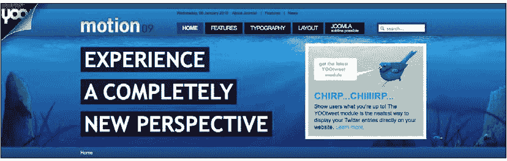

模板的列表还可以继续列下去。正如你所见，模板可以完全改变 Joomla! 网页的外观、感觉和复杂程度。即使是同一个模板，也可以按照与他人不同的方式进行完全不同的配置。为你的项目选择合适的模板，可以大幅缩短项目时间和节约开支，同时还能让你开箱即用地获得这些额外的多媒体功能。

大多数新的专业 Joomla! 模板都包含菜单选项、彩色主题和复杂的 CSS。这意味着，你添加到网站上的大多数构建良好的扩展都能轻松集成到你的模板中，并自动采用合适的模板样式。

## 移动网络

“移动网络”一词指的是使用移动设备（如手机、PDA、iPhone 等）访问的基于 Web 浏览器的服务。

移动网络用户的数量每年都在增长，维基百科热门页面 `http://en.wikipedia.org/wiki/Mobile_Web` 上的一条条目提到：“2008 年，移动网络用户总数首次超过了基于 PC 的互联网用户总数。” 这对于一些从未使用过移动网络服务的人来说可能是个冲击，而对我们这些开发者/管理员来说，注意到这一点很重要。

在移动网络设备发展的早期，浏览移动网络的唯一方式是访问 WAP 站点。**无线应用协议（WAP）**是一种安全规范，允许用户通过手持无线设备即时访问信息。WAP 使用**无线标记语言（WML）**作为其主要标记语言。

随着移动网络的发展，WML 已被多种其他技术所取代。现在的新技术标准是**可扩展超文本标记语言（XHTML）**。

XHTML 是一种可扩展标记语言，被设计为 XML 的子集。这是为了促进更强的互操作性，并使得使用标准 XML 工具解析 XHTML 成为可能。如今大多数移动设备都支持两种风格的 XHTML：

- XHTML：与桌面 Web 浏览器使用的标记语言相同
- XHTML—MP：MP 代表移动电话（Mobile Phone）

这种媒介最大的限制之一在于，移动网络仍然存在可访问性和可用性问题。例如，移动设备通常屏幕较小，难以容纳内容。有些设备试图模仿 Web 浏览器，但仍然需要放大和缩小网页。另一些设备则无法运行某些软件，例如 Adobe Flash Player。此外还有格式多样和连接方面的问题。

Web 开发者们直到现在才开始花时间研究这一主题，以及如何让网站对移动网络用户可用。作为 Joomla! 用户，我们有许多测试流程和选项可供使用。

> 在为基于 PC 的万维网浏览进行开发时，作为开发者，我们需要考虑不同的 Web 浏览器和屏幕分辨率。而在为移动网络开发时，需要考虑的因素更多。这主要是因为移动设备上可用的操作系统和屏幕尺寸种类繁多。

### 让网站更适合移动设备

你网站的主要目的是尽可能轻松地将内容传递给受众，同时（希望）让他们享受这一体验。由于大多数 Joomla! 模板都是为桌面浏览而设计的，因此往往很少考虑到日益增长的移动网络用户群体。

可以通过多种方法来调整你的网站，使其更适合移动网络这一媒介：

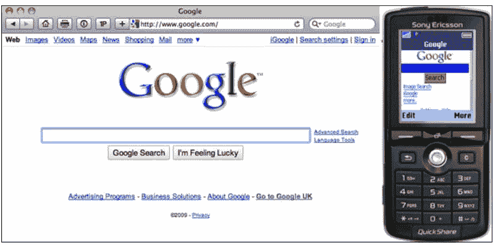

移动用户上网通常是为了快速获取信息，因此尽可能简化这一过程对他们来说非常重要。虽然你的 Joomla! 模板在桌面浏览器中可能包含数百张图片，看起来非常精美时尚，但移动网络用户可能正在“外出奔波”，他们可能只想要能直接带他们到所需信息的链接。这通常意味着需要对内容进行简化，而这也是移动网络用户所期望的。

### 考虑这些调整

开发移动友好的 Joomla! 网站的最佳途径之一，是从一个格式良好、HTML 有效的模板代码库入手，并使用合理的语义标记进行构建。结构良好的代码文档将清晰显示，按有序顺序加载元素，并且由于代码有效且组织良好，应当能在许多设备上使用。

### 重要区域

Joomla! 模板中最重要的视觉热点之一是左上角区域。这里通常是放置 Logo 的地方。请注意，你希望移动网络用户能够轻松导航，而不是为了找到一个菜单链接而不断缩放或滚动整个页面。因此，如果你正在创建网站内容的定制移动版本，请将主导航或搜索功能放在左上角区域：

上面的图片显示了一个用于 PC 端 Web 浏览器的网站模板，以及一个专为手持设备提供的独立网站模板。

## 禁用图像、CSS 和 JavaScript

对于较旧的移动设备，可用的最佳开发方法之一是在网站页面上禁用图像 CSS 和 JavaScript，然后看看效果如何。去掉模板的主要样式后，您的网站将呈现完全不同的外观和感觉，您将看到元素在页面上加载时的自然布局。

## 对多媒体采用按需方式

如果您在网站中使用多媒体，请考虑在用户请求时提供这些内容，而不是在用户登陆网站页面时就轰炸用户这些信息。

视频、图像、音频或其他网站中的多媒体可以通过超链接到预期内容的方式呈现给用户。这种方法提供选择，意味着用户可以选择在想要时访问该内容，而不是被强行灌输。如果您使用 Flash 播放器显示播客的剧集，请考虑使用在有人选择播放时才加载媒体的播放器。这种方法通常会导致结构良好的网站，加载速度快，并且具有健康的“大内容”感觉。

## 为移动设备加载自定义样式表或模板

通过 PHP、HTML 和 CSS 的组合，您的 Joomla! 网站可以识别特定的移动网络设备并为其提供特定的样式表。通过使用此方法，您可以为内容提供简化的布局，从而使页面加载更快，使用户更易于导航网站页面。

有一些网站和工具可以帮助生成用于识别访问您网站的特定设备的 PHP 代码。需要一定的 PHP 和 CSS 技能才能实现这些结果，但通过在该领域的努力，您可以使用 Joomla! 内容专门针对移动市场。一种有用的工具可以在 `http://detectmobilebrowsers.mobi/` 找到。

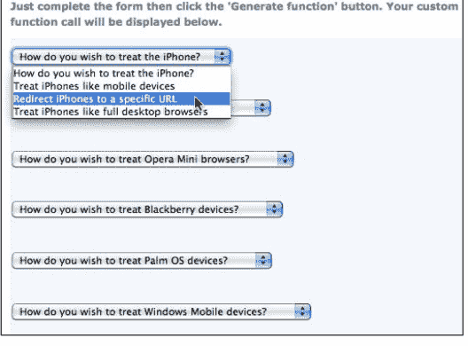

站点生成器将允许您根据自己的环境定制代码，然后下载适用的代码供您使用。它对非营利网站免费，商业用途接受捐赠。对于 PHP 知识有限但喜欢动手玩代码的人来说，这个工具会很有帮助。

对于开发技能有限的人来说，还有许多 Joomla! 扩展可用。

## 可用的扩展

现在有许多移动网络扩展可用于 Joomla!，可以帮助使您的网站可供移动设备访问，并降低实现这一目标所需的专业知识。

## Joomla! 1.5 的 PDA 插件 (P.T)

Joomla! 1.5 的 PDA 插件的本质是为您的 Joomla! 网站激活 PDA 模板或移动网络友好的模板，而不是使用默认站点模板：

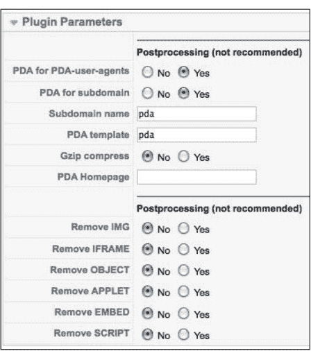

此插件将根据其识别移动设备的用户代理来确定是否适合激活自身。有两种使用此插件的方法：

- 1. 在同一链接 http://yoursite.com/ 上为移动浏览器显示网站的移动版本。可以根据用于查看的设备看到网站的完整版和移动版。这被称为多客户端方法。
- 2. 为子域显示网站的移动版本。例如，http://pda.yoursite.com/。这被称为多站点方法。

使用此插件，可以使用这两种方法中的一种或两种。

### 安装

Joomla! 1.5 的 PDA 插件有两个元素。首先，您安装模板，其次使用 Joomla! 扩展管理器安装插件。

插件需要发布并包含许多配置选项。PDA 插件的工作方式是激活 PDA 模板（或在插件参数中设置的其他模板），以便您的网站简化为可在移动网络设备上工作。

此插件省去了放置代码以识别访问您网站的不同设备的繁重工作，但您可能仍需要动手调整包含的 PDA 模板以满足您的喜好。

要下载此扩展，请访问 http://extensions.joomla.org/ 并搜索 "PDA-plugin"。

## WAFL：移动内容适配 (P,C,T,M)

**网站适配和格式化层 (WAFL)** 是为实现 Joomla! 网站的设备特定内容适配而构建的。它仍处于 alpha 模式，因此尚未达到其他 Joomla! 扩展的成熟度。

此插件支持三种操作模式。所选模式将在插件检测到请求来自移动设备时激活：

- 1. 模板切换：您将能够选择一个将在移动请求中使用的模板。插件包含一个移动模板，可供使用。
- 2. 移动重定向：访问者将被重定向到您可以指定的 URL。
- 3. Siruna：它是一个用于创建移动网络应用程序的完全托管解决方案。当此模式激活时，插件将把任何移动请求重定向到 Siruna 平台的实例。它还将向来自 Siruna 平台的请求提供移动模板（丰富了 Siruna 的信息）。

### 安装

有一个扩展需要安装，其中包含四个不同的文件：

- 1. **插件**：它拦截 Joomla! 事件，以便移动用户获得增强的移动内容。
- 2. **管理员组件**：在 WAFL 管理端部分，网站管理员将能够更改首选项以适应其网站。
- 3. **WAFL 模板**：它提供我们移动模板的基本版本，而不考虑屏幕宽度和高度。
- 4. **WAFL 模块**：它实际上是一个组件包装器，可在 WAFL 模板中启用模块排序。

扩展通过扩展管理器安装。

我们的扩展的管理端可以通过在 **组件** 菜单中单击 **WAFL** 找到。在这里，您可以更改移动网站版本的风格，或配置和显示移动网站的方式。

您需要通过使用移动设备浏览您的网站来检查移动设置，甚至最好查看多个设备（就像您使用 Safari、IE6、IE7 等进行测试时一样），以确保一切符合您的要求。

要下载此扩展，请访问 [http://extensions.joomla.org/](http://extensions.joomla.org/) 并搜索 "WAFL Mobile Content"。

## Joomla 1.5 的 Mobilebot (P)

Mobilebot 1.0 for Joomla! 1.5.x 可以检测使用移动设备的访客并自动更改 Joomla! 模板。

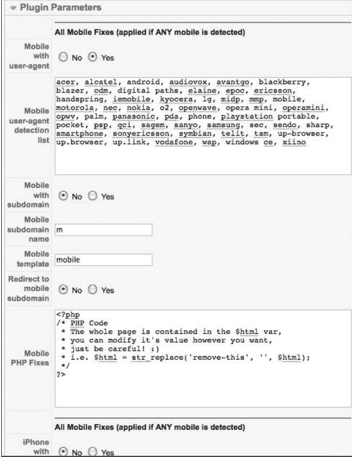

[ 251 ]

Mobilebot 1.0 for Joomla! 1.5.x 具有以下功能：

- 1. 它可以分别检测 iPhone、Blackberry、Android 和 Opera Mini 浏览器，并为每个浏览器加载特定的模板。
- 2. 它有两个额外空间，您可以添加自己的自定义移动设备。
- 3. 您可以使用简单/正则表达式 PHP 替换调整最终 HTML 代码。这可以针对每个特定设备独立完成。
- 4. 如果未检测到任何特定设备（或您只有一个适用于所有移动设备的模板），插件也可以执行通用移动检测并在配置 accordingly 时加载“通用”移动模板。

### 安装

Mobilebot 是一个简单的插件扩展，通过扩展管理器安装，配置在插件参数中进行。

要下载此扩展，请访问 http://extensions.joomla.org/ 并搜索 "Mobilebot"。

## 测试移动网络

以下是您可以采取的一系列措施来改善 Joomla! 网站的“移动友好”表现。

## 禁用样式表

如前所述，测试网站兼容性的最简单方法之一是移除层叠样式表的影响。由于您的样式表将包含大量样式元素，从可访问性的角度来看，重要的是您在移除样式后看到“菜单是否仍然出现”或“我是否仍然显示搜索功能”：

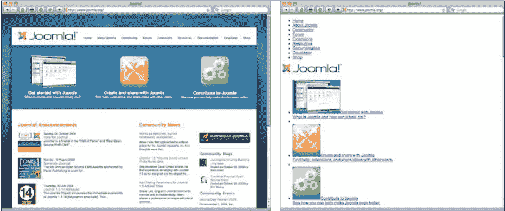

上图显示了在用户的网络浏览器中打开了层叠样式表后以及关闭后的 joomla.org 网站。

许多较旧的移动设备仍会渲染未样式化的原始 HTML 输出。因此，关闭样式表后，你就能了解内容的语义布局以及它在网络浏览器中的显示方式。如果你的模板和 HTML 内容是按照网络标准构建的，那么菜单链接和其他主要导航功能仍应继续正常工作。

如果你使用 Mozilla Firefox，可以通过进入菜单 | 开发 | 禁用样式 来轻松关闭样式表的加载。

## 调整浏览器大小

调整浏览器窗口大小可以让你很好地了解你的网站在支持样式表的移动设备上会是什么样子。这是一种简单但有效的方法，可以在较小的屏幕上查看你的网站：

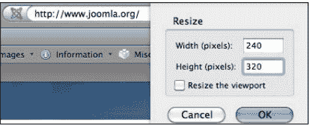

如果你使用 Mozilla Firefox，http://www.firefox.com，并为其安装了“开发者工具栏”插件，https://addons.mozilla.org/firefox/60/，那么调整浏览器大小就轻而易举了。只需前往 调整大小 | 调整窗口大小 菜单选项，即可输入自定义值来调整浏览器窗口大小。

以下是移动设备的常见屏幕分辨率：

- 128 x 160
- 176 x 220
- 240 x 160
- 320 x 240
- 480 x 320

了解这些屏幕分辨率并在上面进行测试，将有助于你相应地优化网络内容。正如你所见，有许多不同的分辨率，而且这些只是流行的分辨率，因此设计一个在移动网络上可用的网站需要重要的考虑。

## 借用手机进行测试

这并不难，但这是一种经常被忽视的简单方法：

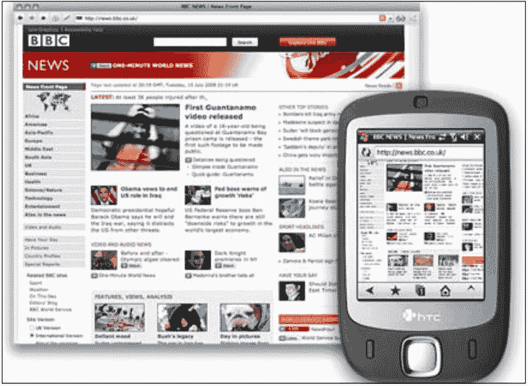

与朋友和同事交谈，请他们在自己的移动设备上查看你的网站，并告诉你使用体验。虽然有许多出色的模拟器可用，但没有什么能比得上用实体设备查看，尤其可能运行不同软件版本。

## 针对你的访客，以及他们需要看到的内容

任何网站的目标，无论是移动网络还是非移动网络，都应该是向用户提供最合适的内容。目标可能是销售某物、提供重要信息，或只是提供学习材料，但使用良好的导航并快速引导用户找到这些信息是关键！

当在移动网络上查看内容时，这一目标变得更加重要。这意味着你可能需要简化网站内容的版本以适应移动设备。使用 Joomla! 移动网络扩展或手动加载不同的模板和 CSS 也可能有助于简化页面布局和显示。归根结底，确保你试图提供的信息简洁明了，用户可以轻松到达其位置。

考虑使用 Google Analytics 等工具来监控你的网站统计数据。Google Analytics 工具免费使用，可以设定目标、跟踪用户路径，并密切监控谁在访问哪些页面，以及使用何种设备。有关 Google Analytics 的更多信息，可访问 www.google.com/analytics/。

## 使用模拟器

桌面和网络浏览器模拟器是查看你的网站在不同设备上显示效果的简便且极佳的方式。与大多数模拟器一样，它们并不总是能完全复制“真实情况”，因此不如手持设备进行测试那样好。话虽如此，如果它们能正常工作，它们就是第二好的选择，因此这里列出了一些流行的网络模拟器，可用于测试移动网络内容：

| 模拟器 | 描述 | URL |
|---|---|---|
| Microsoft Pocket PC emulators | 用于构建 Windows Mobile 6 应用程序的文档、示例代码、头文件和库文件、模拟器图像以及工具。 | http://msdn.microsoft.com/en-gb/windowsmobile/bb264327.aspx |
| dotMobi web emulator | 带有 Nokia N70 和 Sony Ericsson K750 皮肤的在线模拟器。 | http://emulator.mtid.mobi/emulator.php |
| iPhone Simulator | 基于网络浏览器的模拟器，可快速测试你的 iPhone 网络应用程序。 | http://www.testiphone.com/ |
| Opera Mini Simulator | Opera Mini 5 beta 的实时演示，其功能与安装在手机上的情况相同。 | http://www.opera.com/mini/demo/ |
| **TagTag emulator** | 在计算机上查看移动网页的模拟器。在 TagTag 模拟器底部输入页面地址并点击 go。像在手机上一样浏览页面。 | http://tagtag.com/site/info/emulator |
| **OPENWAVE** | OPENWAVE® 手机模拟器是一款免费的软件开发工具包，可让创建创新移动应用程序变得更加容易。 | http://developer.openwave.com/dvl/tools_and_sdk/phone_simulator/ |

## 可访问性

你的 Joomla! 模板的可访问性是一个重要的话题，因为你的模板是传递 Joomla! 内容的关键容器，因此会影响网站上每个页面的输出。

### 可访问的内容

为了使你的网站尽可能可访问，你可能需要考虑前几章中提到的一些可访问性主题。始终尝试使用有效的 HTML 代码来嵌入或显示你的内容。如果你定期更新 Joomla! 网站，那么考虑学习一些基本的 HTML 代码。关闭你的 WYSIWYG 编辑器，以便手动格式化内容，通常可以让你获得更干净的 HTML，并且可能是你网络职业生涯的开始！

其次，提供替代信息以照顾残障用户非常重要。例如，如果你链接到一份充满文字的文档，请考虑为视力受损的用户提供音频版本。这种“替代选项”方法可以应用于网站上几乎所有主要的内容添加，无论是文本、音频还是视频。

### 可访问的模板代码

关于模板本身，你的 `index.php` 文件包含所有 HTML 标记，并且是 Joomla! 交付的每个页面的核心。它是一个页面，就像任何 HTML 页面一样，但扩展名为 `.php`，并包含 PHP 代码来交付你的网站内容。非常重要的一点是，该文档必须包含有效的 HTML 代码，因为验证错误会影响 Joomla! 网站的每个页面。要检查你网站的验证情况，你可以使用在线验证工具，例如 http://validator.w3.org/

## 第 8 章

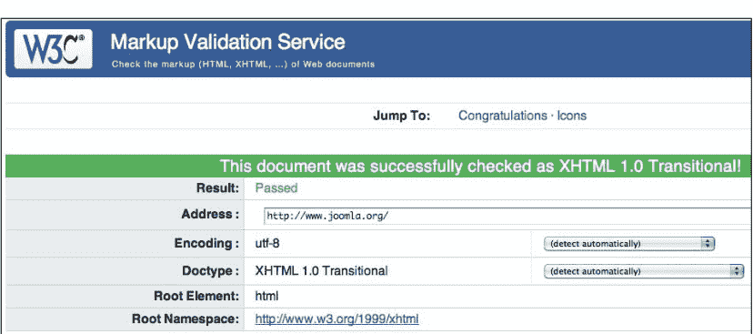

在构建或调整你的 Joomla! 模板时，这里有一些需要遵守的关键要点：

- 使用有效的 HTML 代码。
- 不要使用表格标签 <table> 来构建 HTML。改用现代的 div 标签 
 方法。
- 选择对比鲜明且易于查看的颜色。
- 为模板优化图形。
- 使用有效的 CSS 代码。
- 提供文字大小调整选项（大多数主流浏览器现在都提供此功能，因此请确保在 CSS 文件中使用 em 值来控制字体）。
- 使用在线验证工具测试你的模板和网站。
- 在所有流行的网络浏览器中测试你的网站。

## 字体、颜色和对比度

我们都倾向于选择我们认为看起来很棒的字体和配色方案，但正如在时装秀上所证明的那样，一个人的风格观念不一定是另一个人的！你可能使用了默认模板，或使用了为 Joomla! 设计的第三方预设计模板，并接受了预配置的选项。虽然在完美环境中带有圆角和阴影/高光的光泽图像看起来很棒，但会有用户使用移动设备、许多不同的网络浏览器，甚至可能有残障人士访问你的网站，这些都是需要考虑的重要因素。

[ 257 ]

选择合适的配色方案是使模板更易访问的一种相当简单但有效的方法。尝试使用足够的颜色对比度，以便视力受损的用户不会在查看内容时遇到问题：

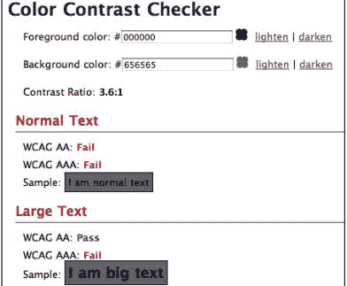

网络上有许多工具可用于测试颜色对比度，例如 WebAIM，http://www.webaim.org/resources/contrastchecker/。

如果你的最爱颜色是浅绿色文字在深绿色背景上，并且你一定要使用它们，请考虑为网站用户提供调整网站对比度的选项，通过按需加载不同的样式表。这可以使用 CSS 实现，其方法与为用户提供字体大小控制以调整文字大小的方法类似。大多数现代网络浏览器都提供调整字体大小的能力。尝试在网站 CSS 中使用 em 值，以便用户可以根据需要自行在浏览器中定义字体大小。

## 总结

由于 Joomla! 模板控制着我们网站的布局和样式属性，因此它在网站的可访问性方面发挥着重要作用。

模板可以通过提供 JavaScript 脚本来增强多媒体功能，从而为网站提供额外的多媒体功能。模板通常在其演示和样式中包含许多图像，这会影响我们在 Joomla! 网站上发布的扩展。

移动网络是一个快速发展的环境，有许多事情需要检查和测试，以确保你的网站可以在移动网络设备上有效查看。更进一步，可以利用一些 Joomla! 扩展来帮助创建你自己的 Joomla! 网站的移动网络版本，使其可供更广泛的受众使用。

