# 9
# Joomla! 多媒体项目

在之前的章节中，我们已经介绍了多种媒体类型（以及相应的元素），它们被视为不同形式的媒体。只要把这些元素任意组合在一起，你就创建了多媒体！

在最后一章中，我们采用“食谱式”的方法，从头到尾构建一个多媒体内容丰富的 Joomla! 网站。我们会加入一些之前提到过的技巧，也会添加一些新的诀窍，让内容更加充实！

本章包含：

- 概述
- 网站结构
- 多媒体特性
- 可访问性与验证

## 概述

本章是我们的游乐场！它以食谱式的方法设计，使你能够将各种媒体元素整合到默认的 Joomla! 安装中。

整个想法就是在我们的 Joomla! 安装中尽情玩耍、尝试各种操作，并在此过程中学习。我坚信，只有当我们真正动手去做（而不仅仅是阅读），去创造或破坏某些东西（并希望能再次修复它），我们才能真正了解它是如何运作的！

*Joomla! 多媒体项目*

如果你读过这本书，但没有使用书中提到的媒体功能，那么至少你现在已经了解了 Joomla! 的多媒体能力，这在规划未来项目时非常重要。如果你确实在网站中使用了其中一些功能，那么你最终将得到一个功能丰富、包含许多前沿 Web 特性的网站：

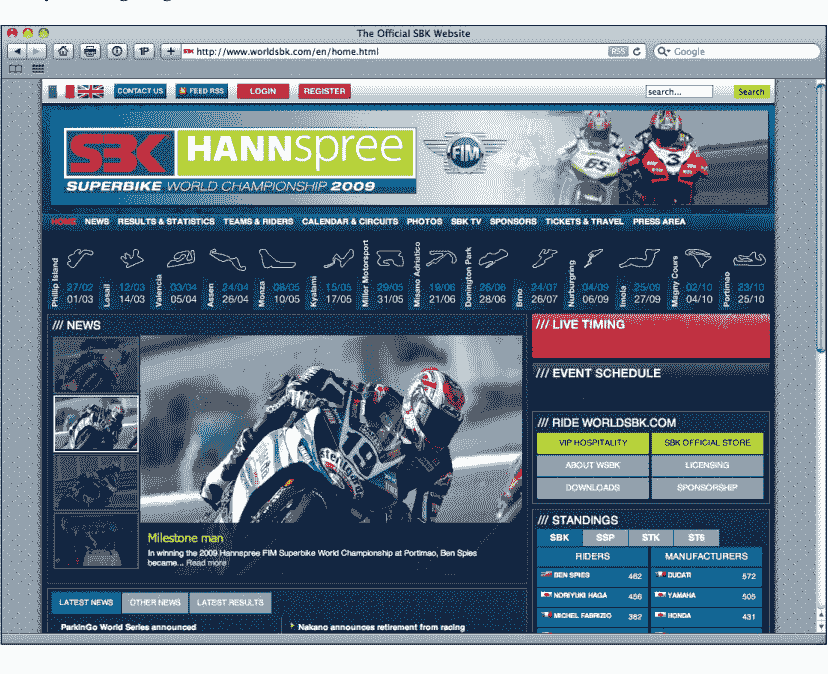

## 初步建议

在继续之前，有必要指出以下信息：

- * **请勿在正式网站上尝试以下操作：** 最好始终使用一个测试网站，其中包含文件和扩展的副本，以及一个单独的数据库。
- * **请将以下内容视为演示项目，不要为正式项目构建：** 将功能复制到新网站或在你了解后复制它们是非常容易的。采用轻松的方式构建演示站点，而不是“与时间赛跑”、试图解决真实项目中的问题，你可能会学到更多。
- **花时间阅读你所使用的扩展及其支持文档**：扩展是由许多经验不同、目的各异的开发人员编写的。尽可能了解你网站中包含的内容。
- **如果你安装了一个扩展但不使用它，请将其移除**：除了保持你的 Joomla! 网站井井有条、简洁清爽之外，最好从服务器中移除未使用的代码/文件/文件夹。遗留旧代码可能会造成安全漏洞。
- **为你的用户构建网站，而不是对抗他们**：在完成网站的开发区域后，请征求朋友和家人对其的意见。有时候我们太容易沉迷于“某样东西看起来如何”，而忘记用户将如何导航到它或有效使用它。一个新鲜的视角只会让项目变得更好。
- **使用 Joomla! 论坛**：Joomla! 是为社区而生的，也正是社区造就了如今的 Joomla!。论坛中充满了有价值的信息，有时你所遇到问题的答案可能只需快速搜索即可获得。如果没有找到你要找的内容，请将其发布在论坛上，帮助建立知识库。
- **保持 Joomla! 更新**：Joomla! 发布是有原因的，保持软件更新非常重要。由于框架设计良好，现在几乎没有理由去修改核心代码。与其他一些 Web 平台相比，升级通常是一个简单的过程。请记住，在执行任何升级工作之前备份你的网站文件，并尽可能定期备份。有一些很棒的 Joomla! 备份扩展，可以在 http://extensions.joomla.org/extensions/access-a-security/backup 找到。

## 开始使用

Joomla! 可以成为你想要的样子。它在设计时考虑了灵活性，我个人曾将它用于从单页网站到每月获得四百万次访问量的英国政府项目。仅 Joomla.org 网站每月就有近五百万次访问量，这是该平台多样性的一个很好的例子。

Joomla! 很容易；只要有一定的知识，你可以在十分钟内完成安装，并立即拥有一个动态数据库驱动的网站。此时，“又一个 Joomla! 安装”与“你的定制网站”（恰好是构建在 Joomla! 框架之上）之间的区别，就在于知识、经验、内容和辛勤付出！

## 本地开发

这正是我们接下来要做的：创建一个容易且安全的环境，让我们动手实践，最终得到一个功能完备、充满多媒体特性的 Joomla! 网站。然后，如果需要，你可以轻松地在正式网站上重现这些功能，因为你已经掌握了相关知识。

本地开发是在你的计算机上进行的，而不是在外部远程 Web 服务器上。在忽略本节之前，请记住：本地开发是你的朋友。让我们看看建立一个本地开发环境有多容易。

现在有了各种工具，搭建一个可以模拟你的正式网站的本地开发环境变得非常容易。本地开发常常被看作是只有那些躲在壁橱里、满脸痘痘的程序员才该做的事，但事实上，它是在不影响正式站点环境的情况下进行网站工作的最安全方式。

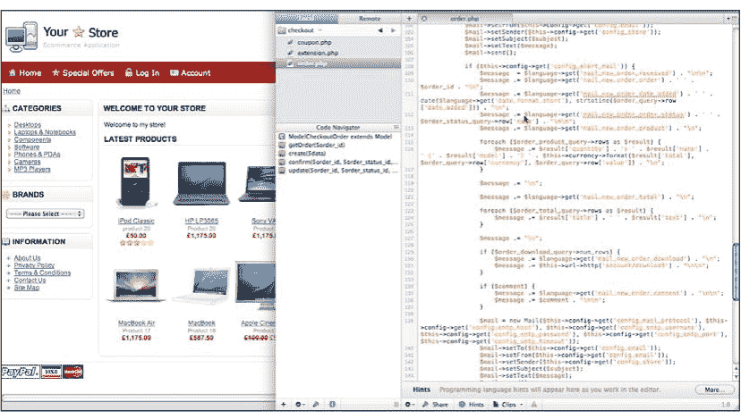

运行本地开发服务器的理由如下：

- 在不上网的情况下，在你的计算机上进行本地开发。
- 犯错误并将工作放到你的网站上，而不必担心被 Google 搜索和索引。我们不希望在事情做到一半时，Google 出现并将其展示给全世界。
- 在将相同的功能引入正式环境之前，先测试你的工作。
- 使用诸如 MAMP、WAMP 之类的 localhost 软件包进行开发，有助于你理解服务器和数据库之间的关系，从而让你更深入地了解你的 Joomla! 网站是如何工作的。
- 本地服务器开发更快。无需通过 FTP 上传到你的 Web 服务器，也无需等待页面通过缓慢的互联网连接重新加载。
- 本地开发服务器环境免费设置和使用。

有许多方法可以搭建本地开发环境。在服务器上运行 Joomla! 网站的主要要求如下：

- **Apache 服务器**
  Apache 是世界上使用最广泛的 Web 服务器软件。Web 服务器是一个程序，它把你的网站上的文档、图像以及所有其他内容提供给外界。
- **PHP**
  PHP 是一种流行的服务器端、内嵌于 HTML 的脚本语言。PHP 可以收集表单数据、生成动态页面内容并处理 Cookie。它支持广泛的数据库，包括 mSQL、MySQL、MS-SQL、ODBC、Oracle 和 PostgreSQL。PHP 还支持广泛的协议，包括 IMAP、SNMP、NNTP 和 POP3。PHP 借鉴了 Perl 和 C 语言的精华，并拥有数百个内置函数来简化大多数常见任务。
- **MySQL**
  MySQL 是一个速度非常快、多线程、多用户的 SQL 数据库服务器。它可以利用多个 CPU，支持许多列类型和非常大的数据库。其速度、灵活性和价格（免费）使其成为一个有吸引力的数据库选择。

如果你知道自己在做什么，那么可以分别安装这些组件并配置自己的本地开发环境；但对于那些只想快速上手的人来说，有许多优秀的软件包可以安装这些元素，并创建一个易于使用的本地 Web 服务器。


一些可用的较流行软件包如下：

| 软件包 | URL |
|---|---|
| WAMP – Windows | http://www.wampserver.com/en/ |
| MAMP – Apple Mac OS X | http://www.mamp.info/en/mamp.html |
| LAMP – Linux（及其他 Unix） | 取决于发行版 |
| XAMPP – 多平台 – Windows、Linux、Solaris、Mac | http://apachefriends.org |

上述链接将帮助你获得有关在自己环境中安装这些软件包的建议。在本教程中，我将展示在 Mac OS X 上安装 MAMP 平台是多么简单。

## 安装 MAMP 软件包

MAMP 代表 Macintosh、Apache、MySQL 和 PHP。MAMP 完全免费，只需点击几下，即可按照典型的 Mac 方式进行安装。

MAMP 不会影响你 OS X 中已运行的任何现有 Apache 安装，而且你无需启动脚本或更改任何配置文件，即可安装 Apache、PHP 和 MySQL。

1. 直接前往 MAMP 官网 http://mamp.info/en/downloads/index.html 下载 MAMP .dmg 文件。

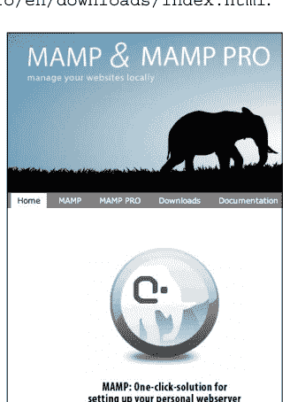

上图显示的是 MAMP 官网以及 MAMP DMG 文件下载选项。

2. 像安装其他 Mac OS X 应用程序一样，点击运行此文件。
3. 将应用程序拖入你的*应用程序*文件夹，大功告成！现在你已在本地安装好 MAMP 服务器。
4. 安装完成后，点击*应用程序*目录中的 MAMP 图标，打开 MAMP 启动控制面板：

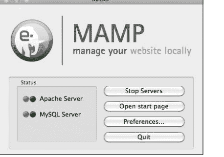

MAMP 控制面板提供以下选项：

- **启动/停止服务器**：只需单击一下，即可轻松启动和停止你的 localhost Apache 服务器。
- **打开起始页**：打开默认的 MAMP 起始页，其中提供指向 phpInfo、phpMyAdmin、SQLiteManager 的链接。
- **偏好设置...**：允许配置 Apache 端口号、PHP 版本及其他设置的一些选项。
- **退出**：停止所有服务并关闭 MAMP 应用程序。

在 MAMP 控制面板中点击**打开起始页**选项，Web 浏览器中会出现以下起始页：

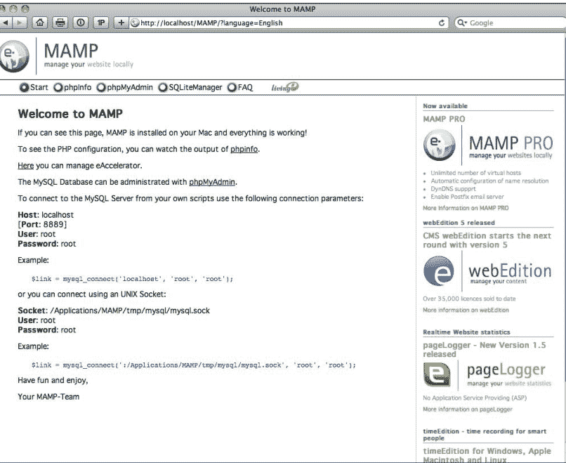

此页面上可以找到以下工具的链接：

- **phpMyAdmin**：这是一个数据库管理工具，用于轻松设置和管理 MySQL 数据库。
- **phpInfo**：提供 PHP 和服务器配置信息的列表。

5. 打开 Web 浏览器并输入 http://localhost:8888。MAMP 在 Mac 上默认使用 8888 端口，因此在 URL 中包含该端口很重要。你可以从 MAMP 控制面板进入偏好设置区域，调整 MAMP 偏好设置以不使用该端口：

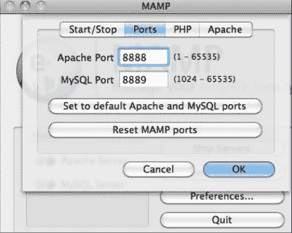

如果我们保持默认设置，要访问新的 Joomla! 安装，我们需要在 URL 中输入的地址将是：http://localhost:8888/JMultimedia（假设你将自己的项目也命名为 JMultimedia）。

如果一切顺利，现在会显示 Joomla! 安装页面。

在开始 Joomla! 安装之前，我们首先需要去创建一个数据库；幸好可以使用 MAMP 自带的 phpMyAdmin 工具轻松完成。

## 创建本地数据库

打开 MAMP 控制面板，点击“打开起始页”选项，或在 URL 栏中输入 http://localhost/MAMP/。在这里，我们可以使用 phpMyAdmin 创建一个新数据库，然后运行 Joomla! 安装程序。

在 MAMP 起始页上，可以找到指向 **phpMyAdmin** 工具的链接：

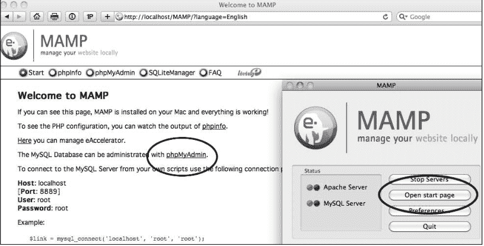

点击它后，浏览器将转到 phpMyAdmin 工具主页。

要为你的 Joomla! 安装创建新的 MySQL 数据库，只需在**创建新数据库**字段中输入一个新的数据库名称，然后点击**创建**按钮：

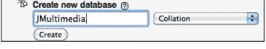

你可以将所有其他设置保留为默认值。数据库创建完成后，你应该会在左侧列中看到该数据库已列出，显示数据库列表。

现在，可以通过 Web 浏览器安装程序继续 Joomla! 安装，并在安装过程中输入数据库的详细信息。你的数据库服务器将是 **localhost**，默认用户名和密码将是 **root**：

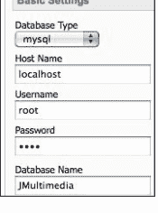

## 在本地运行多个网站

在本地创建多个网站很容易。只需下载另一份 Joomla!，或从你已有的下载中重新解压一份，然后为解压后的目录指定一个不同的项目名称，例如 JMultimedia2。将该文件夹移动到本地 Web 服务器（本例中为 MAMP）的 `htdocs` 区域，然后你的项目就可以通过新 URL http://localhost:8888/JMultimedia2 访问；当你导航到主 localhost 目录（例如 http://localhost:8888）时，它们应显示在列表中。

像之前一样为新项目创建一个新数据库，然后就可以安装 Joomla! 了。只要指定不同的名称，你就可以在空间允许的范围内创建任意数量的本地站点。

对于那些想要安装其他服务器软件包（如适用于 Windows 的 WAMP 或 XAMPP）的用户，其过程与 MAMP 非常相似。访问每个产品的支持文档，可以获得进一步的安装帮助。

> 大多数免费的 Web 服务器环境都被配置为可在本地计算机上轻松、开放地运行，以方便开发。它们并未被配置为用作线上 Web 托管服务器，而且由于配置开放，也不应被用来托管线上网站。

## 远程服务器开发

远程主机是通过互联网访问的主机。它可以是你的服务器，也可以通过 Web 托管公司租用。Web 托管服务器有许多不同类型，包括独立、虚拟和共享主机；运行这些服务器的操作系统也有多种形式。无论选择哪种选项，检查 Joomla! 是否能在该环境中运行非常重要；可以在 Joomla.org 的文档区域找到需求清单。

在远程 Web 服务器上处理你的网站是一种非常常见的做法，许多人都在使用，包括那些刚接触 Joomla! 和 Web 开发行业的人。远程 Web 开发通常需要 FTP 访问权限，或某种 Web 托管控制面板的文件管理器工具。在正式站点上工作可能很危险，原因很简单：一旦文件被覆盖，如果没有备份副本，就无法轻松找回。互联网连接可能使这个过程非常缓慢，有时 FTP 连接还可能导致文件损坏。

话虽如此，在远程服务器上工作或许能让开发环境与线上环境高度一致，也可以轻松地向客户展示项目进度。如果你不想在本地进行开发，我建议建立一个远程托管空间来模拟你的线上环境，并通过 `htaccess` 对其进行密码保护。cPanel 和 Plesk 等服务器端程序都可以轻松地对域上的目录进行密码保护，这样可以保证其私密性，并阻止搜索引擎收录你的开发工作。

如果你使用远程托管环境或 localhost 环境来对网站执行以下添加操作，请养成在进行以下任何操作之前备份数据库和文件的习惯。

## 网站结构

以下内容假设你的 Web 服务器上已有可正常运行的 Joomla! 安装。如果在安装过程中遇到任何问题，请在 Joomla.org 网站、`http://help.joomla.org` 和论坛中搜索答案和帮助。通常情况下，安装过程中出现的问题可能是托管环境的问题，而不是 Joomla! 本身的问题。

为了本教程，我们将以全新的 Joomla! 安装为基础，该安装不包含默认内容。在处理 Joomla! 网站时，我发现最好在浏览器窗口中打开两个标签页：一个用于 Joomla! 网站的前端，一个用于管理后台。在本教程中，我将使用 Joomla! 1.5、用于本地开发的 MAMP Web 服务器以及 Firefox Web 浏览器：

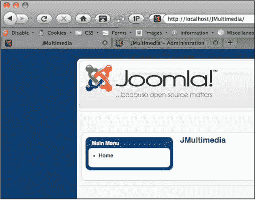


## 初始配置时需要考虑的事项

在 Joomla! 安装过程中，你有机会输入一些基本站点信息，例如网站名称、电子邮件地址以及站点登录用户名和密码。但通常还有其他一些内容值得在你首次登录新的 Joomla! 安装环境时进行配置。

## 全局配置设置

你的 Joomla! 站点的全局配置区域包含一些强大的全站设置。在项目开始时查看这些设置是值得的，看看是否需要调整。

## 站点设置

在“站点设置”框中，我们需要进行一项重大更改：

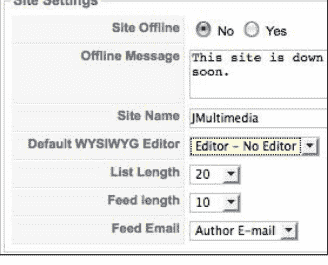

将默认富文本编辑器更改为“编辑器 - 无编辑器”。这将给予我们更多的控制权，并限制向站点输入自定义代码时可能出现的问题。

## 元数据设置

如果你知道你的站点将涉及什么内容（希望你知道），那么在这个阶段可以预先填充全局元数据设置：

你需要为以下三个字段都选择**“是”**，如前一张截图所示，然后点击全局配置页面右上角的**“应用”**。为了让 SEO 功能生效，我们需要对 Joomla! 中的一个文件进行额外的调整。

为了使 SEO 正确工作，它需要使用一种名为 `mod_rewrite` 的功能，该功能安装在 Web 服务器上。大多数 Apache 服务器应该已经安装了这个功能，但如果你的服务器没有，那么你需要启用它，或者请你的 Web 服务器支持人员查看此事。你可以通过访问 Joomla! 管理菜单中的**“帮助 | 系统信息”**菜单链接来轻松检查 `mod_rewrite` 是否处于活动状态。在此页面上，将有一个标记为“PHP 信息”的链接，在该页面上使用浏览器窗口的搜索栏搜索 `mod_rewrite`。它应该会在一个标记为“已加载模块”的区域中显示出来。

如果 `mod_rewrite` 处于活动状态，我们就可以继续了，并且需要将一个名为 `htaccess.txt` 的文件（包含在你的 Joomla! 安装根目录中）重命名为 `.htaccess`。这是 Joomla! 使用对搜索引擎友好的 URL 所需的一切。

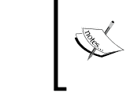

> 根据你计算机平台的不同，重命名以点符号开头的文件可能存在限制。你可能需要使用 FTP 程序，例如免费且功能强大的 FileZilla 客户端 [http://filezilla-project.org/](http://filezilla-project.org/)，来重命名你的 `htaccess.txt` 文件。

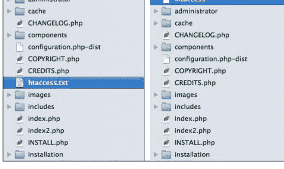

好，回到全局配置屏幕。全局配置页面的顶部有三个菜单链接。点击第二个名为“系统”的链接。在系统页面上，有一些与托管服务器相关的选项，以及 Joomla! 如何与该服务器交互。

## 用户设置

此框包含用户注册设置。出于本项目目的，我将关闭用户注册，因为我们现阶段没有站点用户的需求。用户注册可以随时为站点激活：

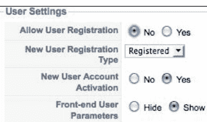

## 媒体设置

我们在前面的章节中已经研究过这些设置，它们对于让媒体管理器有效工作非常重要。在这个阶段，我们可以将这些设置保留为默认值，但根据我们最终在站点上使用的媒体格式，可能需要重新访问这些设置。

## 调试设置

开发人员使用调试功能来查看已加载页面的额外信息。它有助于显示诊断信息和 SQL 错误。你可以随意打开或关闭此功能。如果你知道如何解读这些信息，它在故障排查网站构建时会非常有用。

## 缓存设置

网站缓存通过创建页面的临时副本并将该信息交付给用户，而不是每次都回到数据库检索数据，从而帮助优化和改进你的站点性能：

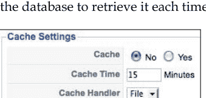

缓存对大型生产网站可能非常有用，但对于开发而言，有时会导致麻烦，因为你进行了更改却看不到效果。让我们暂时关闭缓存。

通常，这些设置可以保留为默认值，但如果你的站点因某种原因没有发送电子邮件，这是首先要检查电子邮件配置的地方。

一旦你对全局配置设置满意，请确保点击全局配置屏幕右上角的“保存”按钮以保存你的更改。

## 内容参数

Joomla! 中的文章管理器包含一个“全局参数”设置，它为你的 Joomla! 文章设置默认选项。你可以在每篇文章中覆盖这些设置，但首先全局设置这些是良好的做法，这样你就不必回头稍后调整它们了。

文章的全局参数可以在查看文章管理器屏幕时，在页面右上角找到：

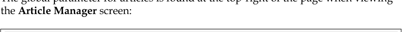

当你点击“参数”按钮时，具有灯箱弹出效果的新屏幕将显示可用的参数。对于这个教程，让我们将以下参数调整为“隐藏”：

- 作者名称
- 创建日期和时间
- 修改日期和时间

你也可以调整其他你认为适合你项目的文章参数。

## 主页

当你安装 Joomla! 时，链接到你的主页（或默认菜单项）的主菜单项会将此菜单链接的标题设置为与你的站点名称相同。

有时你可能希望主页项目显示不同的内容，例如“欢迎来到我们的网站”。你可以通过访问该页面的默认菜单项来调整此主页标题，在本例中就是我们的“主页”菜单链接。

要调整你的标题，请转到菜单 | 主菜单，并点击“主页”菜单链接。

在右侧，**参数（系统）**下方，你会看到重命名菜单链接**“页面标题”**的选项。让我们暂时将此重命名为**“欢迎”**，以便你可以看到这如何影响 Joomla! 主页：

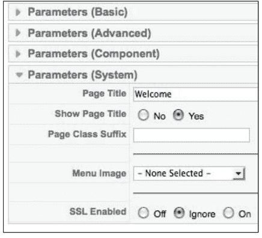

当我们现在查看网站的前端并点击**“主页”**菜单链接时，页面标题将从 **JMultimedia** 更改为**“欢迎”**。

## 栏目和分类

现在还要做一件事，让我们去看看我们的栏目和分类。

栏目和分类是我们内容管理系统管理的基础。它们在 1.5 版本中是一个选项（意味着你不必使用它们）。然而，如果你选择使用它们，它们确实允许你做到两件事：

- 1. 如果你的 Joomla! 网站有很多文章，使用栏目和分类可以让你组织内容并相应地显示。你可以在查看文章管理器页面时使用过滤器，这可以帮助你轻松找到文章。对于经常添加新内容的站点，这真的有助于保持站点井井有条。
- 2. Joomla! 有内置功能可以利用这种文章组织方式。菜单项类型（也称为布局）可以链接到栏目或分类，并根据你在该菜单链接上设置的参数自动显示其中的内容。一个例子是链接到栏目博客、栏目列表、分类博客和分类列表的菜单链接。

许多其他 Joomla! 和第三方模块利用栏目和分类来显示特定主题的新闻项。例如，通过将特定主题的所有文章分组到一个分类中（如最新新闻），你添加到该分类的任何新项目都可以通过模块自动显示在站点页面上。我们将很快对此进行详细研究。

可以从**内容 | 栏目管理器**和**内容 | 分类管理器**菜单链接轻松添加栏目和分类。你还可以通过管理控制面板上的图标访问这些区域：

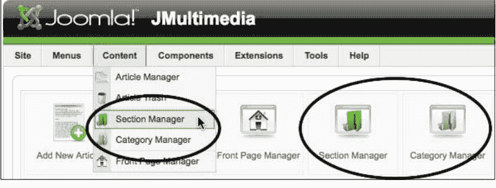

如果你保持站点井井有条，你可能会经常访问这些区域以添加新栏目和分类。首先，我将放置以下内容。要创建新的栏目或分类，只需点击相应管理器屏幕右上角的“新建”图标，给栏目或分类一个标题，然后点击**保存**。

### 栏目

栏目如下：

- 站点
- 图片
- 音频
- 视频
- 通用
- 新闻


## 分类

分类需要放置在章节中，因此请在刚刚创建的各个章节下创建以下分类：

- 站点：创建一个名为“General”的分类
- 站点：创建一个名为“Legal”的分类
- 图片：创建一个名为“General Image”的分类
- 音频：创建一个名为“Podcast”的分类
- 音频：创建一个名为“General Audio”的分类
- 视频：创建一个名为“General Video”的分类
- 通用：创建一个名为“Content”的分类
- 新闻：创建一个名为“Latest”的分类

这应该能为我们提供一个基本的组织结构，我们可以根据后续需要进行进一步定义。

## 为你的网站选择模板/主题

Joomla! 模板用于控制内容传递给浏览设备的方式。对于 Joomla! 网站来说，模板是非常强大的元素，也是决定一个网站与其他网站外观差异的关键因素之一。

字体、颜色、背景、链接，以及我们的扩展在页面中的显示方式，都由 Joomla! 模板控制或影响。因此，我们需要选择一个适合网站用途的模板。我所说的“适合”不仅指配色方案，更是指布局和灵活性，以便轻松地向用户展示所需类型的内容。

模板可以在任何阶段添加到 Joomla! 安装中，添加后可以使用 HTML、CSS 和 PHP、图像以及 JavaScript 技能的组合进行调整。

为了本项目的需要，我将使用 Joomla! 1.5 自带的内置模板之一。为了切换到这个模板，我们需要进入“扩展 | 模板管理”菜单链接：

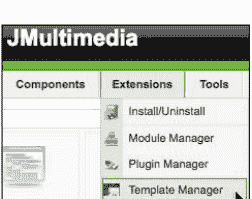

**模板管理**屏幕允许你做两件事：首先，你可以在该区域设置你网站的默认模板；其次，你还可以进入每个模板，调整任何可用的模板参数。

首先，让我们选中左侧名为 **JA_Purity** 的模板旁边的单选按钮，然后点击页面右上角的“默认”图标。这将使 **JA_Purity** 模板成为网站的默认模板，并会立即显示在你的页面上。

其次，让我们点击 **JA_Purity** 的标题，进入并编辑它的一些参数。进入模板编辑屏幕后，你应该会在右侧看到一个参数列表。请调整以下参数：

- **模板宽度**：自动（流式）
- **水平导航类型**：吸盘式菜单

你也可以根据需要调整其他任何选项，并点击该屏幕上的**保存**。

在我们正式开始之前还有一件事：快速修改一下这个模板的徽标。

JA_Purity 模板很容易修改，是创建你自己网站主题的绝佳基础。关于这个模板的更多定制教程，可以访问 http://docs.joomla.org/Tutorial:Customising_the_JA_Purity_template，或者参考《Joomla! 1.5 模板设计》一书（Tessa Blakeley Silver 著，Packt Publishing 出版），网址为 http://www.packtpub.com/joomla-1-5-template-design-2nd-edition/book。

要将 JA_Purity 的徽标替换为你网站的自定义徽标，你需要进入 JA_Purity 模板文件夹，该文件夹位于你的 Joomla! 文件集中。如果你在本地工作，只需访问以下目录并找到 logo.png 文件：**htdocs | JMultimedia | Templates | ja_purity | images | logo.png**。

你需要在电脑上的图像编辑程序中编辑该文件。

文件调整完成后，将新徽标（使用相同的 .png 文件扩展名）保存到与原始文件相同的目录中。原始文件将被覆盖，你的新徽标将显示在其位置上。默认徽标尺寸为宽 207 像素、高 80 像素。如果你需要调整徽标尺寸以适应新徽标，那么我们也需要修改引用徽标图形的 CSS 文件。

有两种方法可以编辑模板的 CSS：

- 1. **外部编辑**
  在计算机上使用外部编辑器，导航到以下文件并用适用的编辑程序打开：**htdocs | JMultimedia | Templates | ja_purity | css | template.css**。
  在 `template.css` 文件中，搜索 `h1.logo a` 样式。它应该位于文件中大约第 956 行：
  根据你的新徽标尺寸调整相应的宽度和高度值，然后点击**保存**。
- 2. **内部编辑**
  你也可以使用 Joomla! 管理后台内置的 CSS 编辑器来编辑 `template.css` 文件。步骤如下：
  - 导航到**扩展 | 模板管理**。
  - 点击 **JA_Purity** 模板以进入模板编辑模式。
  - 点击屏幕右上角的**编辑 CSS** 图标。
  - 选中 `template.css` 单选按钮，然后按下屏幕右上角的“编辑”图标。
  - 使用浏览器的搜索功能搜索 `h1.logo a`。编辑以下值：

```
h1.logo a
{
    width: 208px;
    display: block;
    background: url(../images/logo.png) no-repeat;
    height: 80px;
    position: relative;
    z-index: 100;
}
```

```
h1.logo a
{
    width: 208px;
    display: block;
    background: url(../images/logo.png) no-repeat;
    height: 80px;
    position: relative;
    z-index: 100;
}
```

如果你对网站的徽标进行了调整，那么当你查看网站前端时，新徽标应该会显示出来：

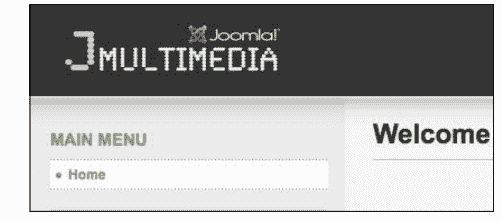

在我们继续之前，请在浏览器中刷新此页面几次。你会注意到 JA_Purity 模板有一个不错的功能：它会随机更换右上角的页眉背景图片。因此，虽然我们还没有向网站添加任何多媒体功能，但我们已经在页面上拥有以下媒体元素：

- 多张图片（包括渐变和其他模板样式图片，实际上我的网页中已经加载了令人印象深刻的 19 张图片）
- 文本（包括字体调整控件）
- 使用我们 CSS 中字体的样式化文本
- 模板图片

## 多媒体功能

现在，有趣的部分开始了。以下部分将媒体功能分离开来，并将它们归类到“添加视频功能”、“添加图片画廊”等标题下。为了实现一个媒体丰富的可用网站，我们将同时使用 Joomla! 内置功能和一系列第三方扩展。

## 文本内容

由于没有现成的内容可以放入这个网站项目中，我将加入一些假拉丁文段落，以帮助在整个项目中建立一些文本内容。假拉丁文本对于模拟带有文本内容的网站页面外观非常有用。当客户可能尚未将“文字稿”内容交付给你时，这也是一个可选的解决方案。假拉丁文本生成器可以在以下网站找到：`http://www.4guysfromrolla.com/demos/latin.asp`。

## 模块位置

模块位置的作用是让你能够在模板的不同区域中显示处理后的代码。有一个巧妙的小技巧可以在浏览器 URL 中添加一段代码，用来查看模块位置在 Joomla! 模板中的位置。只需在主 URL 末尾输入：/index.php?tp=1。因此完整的 URL 应该类似于：http://localhost/JMultimedia/index.php?tp=1：

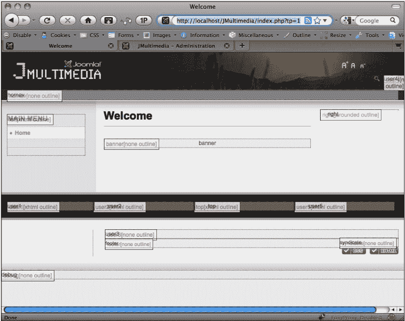

在大多数 Joomla! 模板中，这会显示页面上的可用位置，并帮助你记住它们在模板中的名称和位置。

你也可以通过访问“扩展 | 模板管理”屏幕并点击你想要预览的模板名称来达到同样的效果。在模板编辑屏幕上，预览按钮位于页面右上角。

## 调整菜单

默认情况下，我们的 Joomla! 安装将主菜单模块发布在左侧列中。JA_Purity 模板内置了模块定位和样式设置，可以让你的主菜单显示在徽标区域下方的水平位置。要让你的主菜单显示在该位置，请执行以下操作：

- 1. 在 Joomla! 管理后台中，导航到“扩展 | 模块管理”屏幕。
- 2. 找到主菜单模块，并点击其标题进行编辑。
- 3. 在页面的“详细信息”区域，调整以下参数：显示标题 = 否，位置 = hornav：

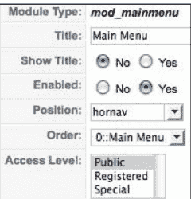

4. 点击此页面上的**保存**，然后查看网站前端。你原来位于左侧列的侧边菜单现在会显示在网站徽标下方的菜单栏中：

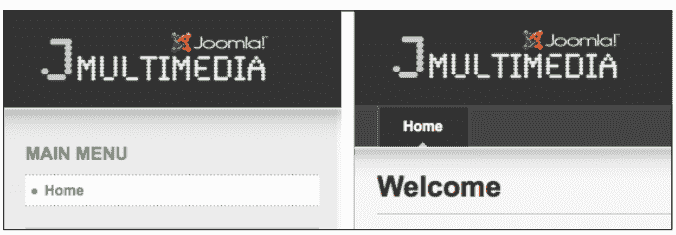

使用这个水平导航区域有助于最大化显示空间。


## 首页功能

有若干种方式可以在 Joomla! 网站的“首页”上显示内容。

### 首页组件

Joomla! 首页是 `com_content` 组件的默认视图。该组件允许你控制首页的显示方式。`com_content` 组件能够在首页显示多篇文章，帮助你创建杂志式的文章展示效果。首页布局由与主菜单中“首页”链接关联的参数配置。

要自定义其外观和风格，请在后台中导航到“菜单 | 主菜单”，然后点击“首页”链接进行编辑。

在右侧的“菜单参数”下，你可以调整要在首页显示的文章数和列数。让我们按照下图设置数值：

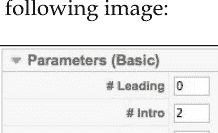

更改数值后，点击该屏幕上的“保存”以保存更改，这就是我们目前在此区域需要做的全部操作。如果你刷新网站前端，暂时还不会看到任何变化，但我们已经为稍后添加内容时设置好了显示方式。

让我们向网站添加几篇文章，以便开始构建首页功能。

导航到“文章管理器”，点击屏幕右上角的“新建”图标创建新文章。还记得我们的假拉丁文本生成器吗？现在它派上用场了！去获取一些假文本（如果你愿意，也可以使用真实文本），然后将其粘贴到新文章中。确保为文章设置标题（我使用了“Article 1”），并将其放入名为“General”的版块和名为“Content”的分类中。确保文章状态为“已发布”，并且“发布到首页”，然后点击屏幕右上角的“保存”。

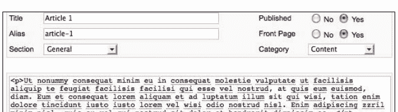

点击“保存”后，你会返回“文章管理器”界面。我们希望重复此过程，以便至少显示三到四篇文章。因此，请使用“文章管理器”界面上的“复制”功能来克隆文章：

- 1. 在文章管理器中，点击要复制文章旁边的左侧单选按钮。
- 2. 点击屏幕右上角的“复制”文章图标。
- 3. 选择要将文章复制到的版块和分类（本例中为“General – Content”），然后点击“保存”。
- 4. 点击新文章的标题进行编辑。进入“编辑文章”界面后，调整文章的标题和别名（Article 2、3、4 等），并确保它们设置为已发布状态且可在首页查看。

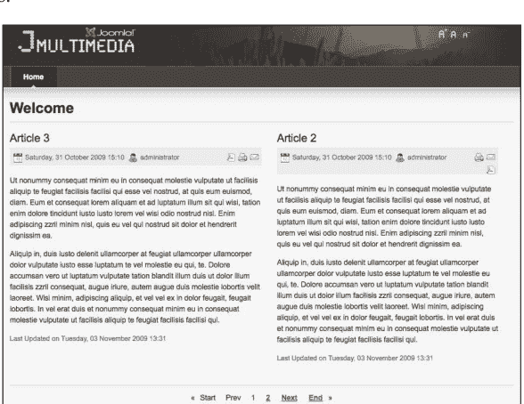

你会注意到文章是随机显示的。你可以按最新文章优先、文章管理器中的物理排序，或按字母顺序来显示它们。这些显示和排序配置都可以在“首页”菜单链接的 **参数（高级）** 部分中设置：

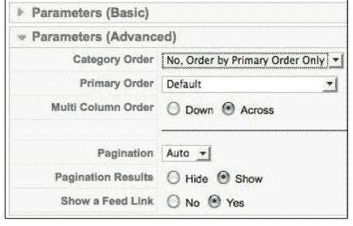

### 添加模块以显示最新新闻

首页还有其他许多可用功能；让我们添加一个模块扩展，它能很好地显示位于特定分类中的文章。我们将使用的模块名为“ThumbsUp”，可从 Joomla! 扩展页面获取。

在使用此模块之前，我们需要一些内容供其显示。请重复之前创建和复制文章的过程，但这次请确保文章位于标记为“News”的版块和标记为“Latest”的分类中，并且已发布。不过，不要将它们发布到首页。你可以随意在内容项中添加图片，为页面增添色彩和趣味。

> 此模块会从特定版块和分类中拉取新闻。在编辑此模块之前，请分别记下标记为“News”的版块和标记为“Latest”的分类的 ID 编号。这些信息可以在相应区域的管理器中找到。

请按以下步骤操作：

- 1. 访问 `http://extensions.joomla.org` 并搜索“ThumbsUp”。
- 2. 访问扩展开发者的网站，将扩展下载到你的计算机。（我将使用稳定的 1.3 版本。）
- 3. 在 Joomla! 后台中，使用“扩展 | 安装 / 卸载”功能上传此扩展。
- 4. 在后台中，导航到“扩展 | 模块管理器”，然后点击“带缩略图的最新文章”模块的标题进行编辑。
- 5. 调整以下参数：

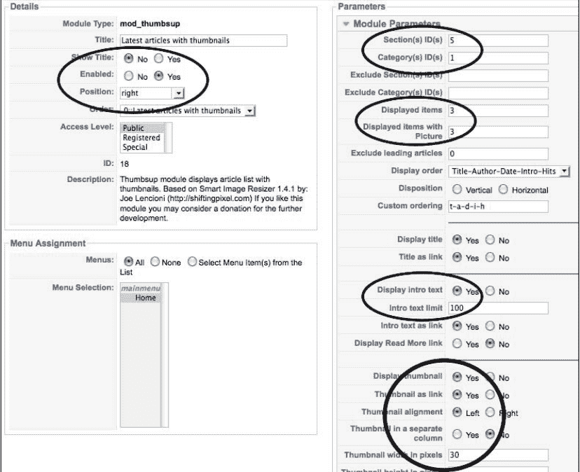

你可以根据需要随意调整任何其他参数。现在查看网站首页，你会看到它很快就开始变得层次丰富起来：

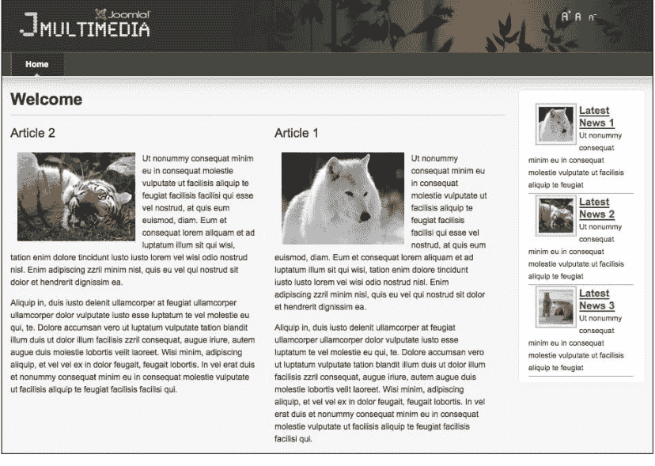

### 添加日期和时间

有几种方法可以为你的 Joomla! 网站添加时间和日期功能。对于新闻、杂志或繁忙的 Web 门户网站的用户来说，这可能是一个有用的功能。某些商业模板可能已经包含此功能，只需激活即可。其他模板（如 JA_Purity 模板）没有此选项，因此我们将继续添加它。

- **方法 1**：手动将正确的 PHP、JavaScript 和/或 HTML 代码插入到你的模板中。Web 上有许多预构建脚本可用于在网站页面上显示时间和日期。

- **方法 2**：使用可用的 Joomla! 扩展，例如“Date and Time”模块。步骤如下：

  - 在 `http://extensions.joomla.org` 的 Joomla! 扩展区域中搜索“Time”。
  - 在结果页面中，点击标记为 **日期和时间** 的分类，该模块就会显示出来。
  - 访问扩展开发者的网站，将扩展下载到你的计算机。
  - 在 Joomla! 后台中，使用 **扩展 | 安装 / 卸载** 功能上传此扩展。
  - 在后台中，导航到 **扩展 | 模块管理器**，然后点击“Date2”模块的标题进行编辑。

请根据需要调整模块参数。我将使用“JavaScript”功能来显示时间（这样秒数会实时显示），并将模块发布到“Left”位置，它将在我们的模板左列中显示。我还将关闭模块标题：

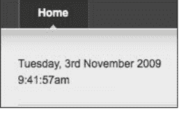

值得注意的是，这些时间和日期功能将基于服务器时间运行。因此，如果在本地工作，你将看到本地计算机的时间。

### 添加搜索功能

任何包含任何形式内容的网站都需要搜索功能，以便用户轻松找到内容。JA_Purity 模板的 CSS 中已经内置了搜索框的样式，因此为我们的网站添加新的搜索功能将非常容易。

- 1. 在后台中，导航到 **扩展 | 模块管理器** 界面。
- 2. 点击屏幕右上角的 **新建** 图标以创建新模块。
- 3. 从可用选项列表中，选择“搜索”链接并点击该文字，以加载新的搜索模块：


- 4. 确保不显示标题，但模块已启用。它需要发布到 user4 位置，这将使它显示在网页右上角：

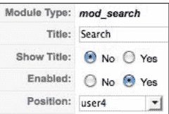

- 5. 点击该模块的“保存”，如果查看网站前端，你会看到新的搜索框显示在字号控件下方：

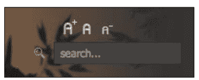


个人而言，我觉得默认的黑色背景有点太暗看不清，所以可以快速修改模板 CSS 文件来调整。我将把搜索背景设为白色，搜索文字设为黑色：

```
#ja-search .inputbox
{
    width: 120px;
    border: 1px solid #333333;
    padding: 3px 5px;
    color: #000000;
    background: #FFFFFF;
    font-size: 92%;
}
```

记得保存你的更改，你应该能在网站上看到这些更改的反映。

## 添加图片

正如你在本书的课程中看到的，图片可以轻松添加到 Joomla! 文章和模块中并按需格式化。然而，Joomla! 还有一些强大的图片扩展，我们现在将在我们的网站中使用它们。

## 添加图片画廊

图片画廊是 Joomla.org 上最受欢迎的扩展之一，因此有许多优秀的选择可用。

希望你已经仔细阅读了第 4 章《添加和管理图片内容》，并为你的项目找到了所需的图片解决方案。对于本教程，我将使用几个扩展在整个网站中显示图片。

## 使用 Phoca Gallery 的图片画廊

Phoca Gallery 是在 Joomla! 中展示精美照片画廊的重量级竞争者。它功能丰富，丰富到足以单独写一本书！

话虽如此，我们将快速将其添加到我们的网站，以便使用此组件、模块、插件创建一个功能丰富的照片画廊。我将介绍基本步骤，不过对于详细支持，开发者的网站和 Joomla! 论坛将能够提供丰富的知识：

+   1. 在 http://extensions.joomla.org 上搜索 Joomla! 扩展区域中的 "Phoca Gallery"。
2. 访问扩展开发者的网站并下载以下扩展到你的电脑：

+   - **Phoca Gallery 组件**：驱动主要的 Phoca Gallery 功能。
+   - **Phoca Gallery 搜索插件**：允许你的 Joomla! 搜索功能也搜索 Phoca Gallery 图片。
+   - **Phoca Gallery 幻灯片插件**：显示来自所选 Phoca Gallery 分类中的图片幻灯片 `{pgslideshow id=...|width=...|height=...|delay=...|image=...}`。对于图片，O：原始，L：大，M：中，S：小。示例：`{pgslideshow id=1|width=100|height=100|delay=3000|image=M}`。
+   - **Phoca Gallery 图片模块**：从 Phoca Gallery 组件中显示随机图片。

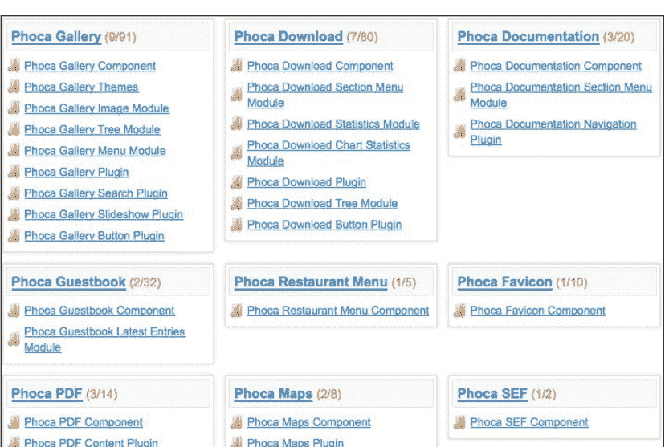

3. 使用扩展 | 安装 / 卸载 功能将这些扩展上传到 Joomla! 管理后台。（最后处理组件，因为你需要在上传后运行组件的安装程序）。

+   4. 在管理后台，导航到 **扩展 | 插件管理器**，并启用搜索和幻灯片插件。
+   5. 在管理后台，导航到 **组件 | Phoca Gallery**，在主控制面板页面上，点击图标 "分类"。通过点击页面右上角的 "新建" 图标设置一个新分类。让我们给它一个标题 **图片** 并在该页面点击 **保存**（注意你可以随时重新访问这些选项以按需定义它们）。
+   6. 添加图片可以通过各种方法完成，Phoca 允许你使用基于 Flash 和基于 Java 的上传功能快速上传多张图片。

我将使用多图片功能向我的新 "图片" 分类中添加多张图片。第一步是上传图片，然后在上传后将它们与分类关联。这为将来参考提供了邮件图片资源。

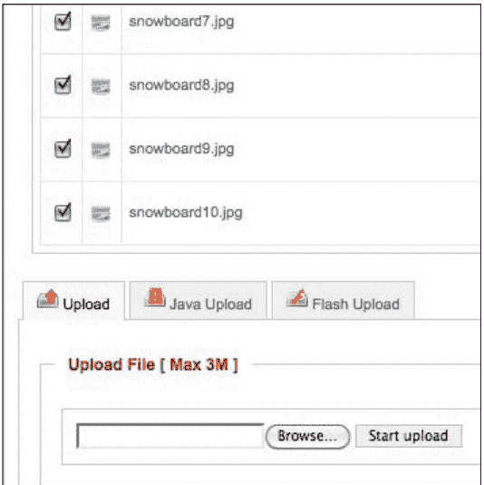

一旦你的图片上传完成，选择 "图片" 分类（我们将把它们放入其中）并点击屏幕顶部的 **保存** 按钮。根据你上传的图片数量，你可能会看到处理屏幕出现一段时间。页面在处理后应刷新，你将看到新图片加载到 **图片** 区域：

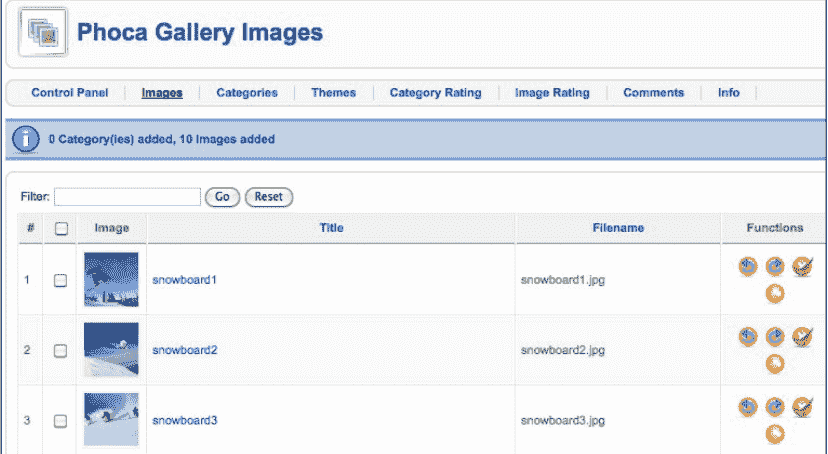

要在你的网站上显示这些图片，我们需要为此画廊创建一个新的菜单链接。

导航到 **菜单 | 主菜单**，并创建一个新的菜单项链接到 **Phoca Gallery | Phoca Gallery 分类布局**。新的菜单项编辑页面将显示，我们需要给我们的菜单链接一个标题 "图片画廊"。

在此屏幕右侧是新的 Phoca Gallery 菜单链接的可用参数。首先，我们需要选择要链接到的分类 — **图片**。以下参数包含大量选项，可以让你操纵画廊的颜色、布局、功能等。你可以在 Phoca Gallery 中全局设置这些，但菜单项级别的覆盖意味着你创建的每个画廊（或链接到画廊）都可以包含所需的各种选项。现在，让我们点击此菜单项上的 **保存** 并查看结果。

## 参数（基本）

## 参数（组件）

|  | 分类视图设置（缩略图） |
|---|---|
| 字体颜色 | 选择颜色 [] |
| 背景颜色 | 选择颜色 [] |
| 背景颜色（鼠标悬停） | 选择颜色 [] |
| 图片背景颜色 | 选择颜色 [] |
| 图片背景阴影 | 使用全局 |
| 边框颜色 | 选择颜色 [] |
| 边框颜色（鼠标悬停） | 选择颜色 [] |
| 盒子边距 | [] |
| 盒子内边距 | [] |
| 显示名称 | 使用全局 |
| 显示详情图标 | 使用全局 |
| 显示下载图标 | 使用全局 |
| 显示文件夹图标 | 使用全局 |
| 名称字体大小 | [] |
| 名称字符数 | [] |
| 图片盒子间距 | [] |
| 在分类视图中显示分类 | 使用全局 |
| 在每个页面上显示子分类 | 使用全局 |
| 显示图片代替文件夹图标 | 使用全局 |

+   1. 在 http://extensions.joomla.org 上搜索 Joomla! 扩展区域中的 "bk thumb"。
+   2. 访问扩展开发者的网站并下载扩展到你的电脑。
+   3. 使用扩展 | 安装 / 卸载 功能将此扩展上传到 Joomla! 管理后台。
+   4. 在管理后台，导航到 扩展 | 插件管理器，并点击 BK-Thumbs 插件的标题进行编辑。

BK-Thumbs 包含许多参数，所有这些都会为你的图片展示带来相当不同的外观和感觉。我建议你根据需要进行调整，但现在让我们确保插件已启用并点击屏幕右上角的保存。

为了让 BK-Thumbs 发挥作用，我们需要一个名为 "BK-Thumbs" 的新内容文章，并使其位于标记为 "图片" 的分区内以及标记为 "通用图片" 的分类内。在你的内容项中，插入一些文字并使用内容文章底部的 "图片上传" 按钮上传一张尺寸合适的图片。对于合适的尺寸，目标像素尺寸为 600px 到 700px 宽或高，具体取决于图片布局。

为了显示我们的新图片功能，我们需要从主菜单链接到这篇文章。为此，只需在主菜单上创建一个新链接并链接到 文章 | 文章布局：

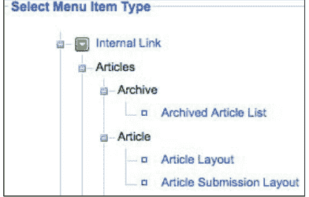

给你的菜单链接一个标题（BK-Thumb），并在右侧选择你创建的 "BK-Thumb" 文章。这里还有一件事要做，即在左侧列下的父项中；选择你现有的 "图片画廊" 菜单链接。这将开始在 "图片画廊" 菜单下构建子菜单。记得通过点击屏幕右上角的保存来保存你的新菜单项。

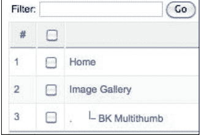

当你查看网站的前端（刷新页面）时，你现在应该能在 "图片画廊" 菜单链接下看到子菜单项 "BK-Thumb"。这将带你到显示内容文章中较大图片的漂亮新自动缩略图的页面

> 如果你在 管理 | 扩展 | 模块管理器 | 主菜单 模块中看不到子菜单项，请确保参数 "始终显示子项" 设置为 "是"。

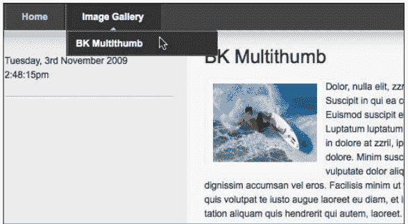


BK-Thumb 可以自动拾取多张图片，添加标题、标题等。它包含了一些很棒的插件功能。我建议你试用一下，看看是否适合你的项目。你可能会注意到 BK-Thumb 也会影响网站上的其他一些图片，因此这种解决方案适合某些人而不适合其他人。

## 使用 RokBox 进行多媒体显示

我之前提到过，我最喜欢的扩展之一是 Rocket Theme 的 RokBox；这是因为它能够以多种方式显示多种类型的内容。RokBox 是一个基于 MooTools 的 JavaScript 幻灯片，允许你快速轻松地显示多种媒体格式，包括图片、视频（也包括视频分享服务）以及音乐。以下是如何在你的网站上轻松使用它的方法：

- 1. 在 http://extensions.joomla.org 的 Joomla! 扩展区域搜索 "RokBox"。
- 2. 访问扩展开发者的网站并将扩展下载到你的电脑。 （你也可以安装内容按钮，但我们确实需要主 rokbox-system.zip 文件）。
- 3. 使用扩展 | 安装 / 卸载 功能在 Joomla! 管理后台上传此扩展。
- 4. 在管理后台导航至 扩展 | 插件管理器，并启用 "RokBox" 插件：

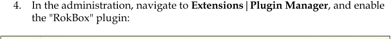

RokBox 插件是通过在内容项和模块中使用特殊标签或链接代码触发的。开发者的网站包含一个有用的文档页面和论坛。你可以在 http://www.rockettheme.com/extensions-joomla/rokbox 找到主要的 RokBox 页面。

RokBox 的工作原理非常简单。所有潜在的 RokBox 链接只需要在其内部添加一个额外的元素即可与任何超链接配合使用：<a>。此元素用于将以下代码放入你的链接中：<a rel="rokbox" href="/...">example</a>。当 RokBox 找到包含此信息的超链接时，RokBox 会将其纳入考虑。使用这种方法意味着你可以在模块中使用 RokBox，而不仅仅是在文章中使用。如果你确实想在 Joomla! 文章中使用 RokBox，那么你可以使用另一种方法（以下标签），RokBox 就是为识别这些标签而构建的：

```
{rokbox...}link to the file{/rokbox}
```

我们可以在这个基本标签中添加许多其他参数，以开始为你的媒体显示标题和其他信息：

```
{rokbox size=|100 50| text=|my rokbox| thumb=|images/thumb.jpg| title=|Head :: Text| album=|photos| module=|login|}images/image.jpg{/rokbox}
```

你引用媒体的方式由你决定。更多信息可以在 RokBox 文档中找到。

现在，让我们通过导航到 扩展 | 模块管理器 屏幕，点击 "新建" 图标，然后点击 "自定义 HTML" 来创建一个新的自定义 HTML 模块，以创建一个新的自定义 HTML 模块。

给模块一个名为 "RokBox" 的标题，并确保位置设置为 "Left"。然后我们需要在该屏幕的 "自定义输出" 区域输入以下内容：

```
<a href="images/stories/image1.jpg" title="Image 1 :: Image Description" rel="rokbox[600 400]">Link to RokBox Image 1</a>
```

之前的代码为名为 Link to RokBox Image 1 的文本添加了一个超链接，给它一个标题 Image 1 和描述 Image Description，并在 600 x 400 像素的窗口大小中使用 RokBox 打开图像。确保你在 /images/stories 文件夹中有名为正确名称的图片，然后点击屏幕右上角的 应用 按钮以应用你的更改。

当你查看网站的前端时，你现在应该有一个指向 RokBox 功能的文本链接：

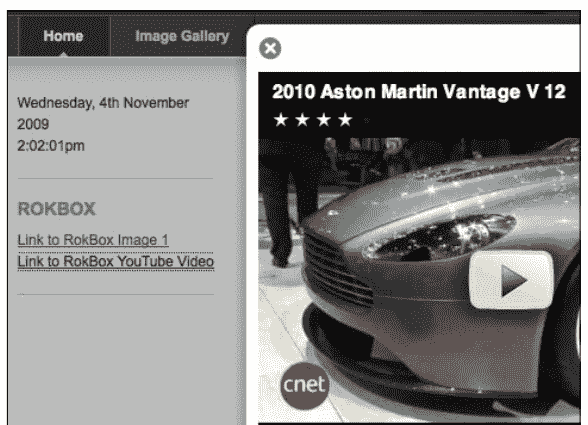

RokBox 可以像我们在这里使用的一样使用，或者你也可以在 RokBox 链接周围插入一张图片，从而有效地创建一个指向 RokBox 内容的缩略图链接。许多选项都是可能的，包括使用 RokBox 创建带缩略图的图像画廊。

## 添加视频功能

视频是当下的媒体元素！如本书前面所强调的那样，现在有许多很棒的视频功能可用于 Joomla!，因此让我们继续并将一些功能集成到我们的项目中。

## RokBox，再来一次！

由于 RokBox 插件也可以播放视频，让我们在 RokBox 侧边模块中添加内容，以在我们最近创建的 RokBox 图像链接下方显示一个 YouTube 视频。以下是步骤：

- 1. 在 扩展 | 模块管理器 中打开 RokBox 模块。
- 2. 将以下代码添加到自定义输出框中：

```
<p>
<a href="http://www.youtube.com/watch?v=6RWQ2OQ7_2Y"
 title="Cars :: 2010 Aston Martin Vantage V 12"
 rel="rokbox(425 373) (demo)">Link to RokBox YouTube Video</a>
</p>
```

代码的分解如下：

- * 链接指向一个 YouTube 主机视频。
- * 标题是 Cars。
- * 描述是 2010 Aston Martin Vantage V 12。
- * 它将在 425 px x 373 px 大小的 RokBox 窗口中打开。
- * 文本是 Link to RokBox YouTube Video。我在周围放置了段落标签，以便与我们之前创建的图像链接创建间距。

点击页面右上角的 应用 以保存更改。

可以使用 RokBox 在模块和文章中显示视频画廊。我认为你会同意这是一个很棒的多媒体扩展！

## 使用 hwdVideoShare 进行视频

如果你想要一个像 YouTube 那样的强大的视频方法，hwdVideoShare 视频分享画廊是一个开源（GNU GPL）视频分享 Joomla! 扩展，其功能类似于 YouTube 等网站。它具有多种上传工具，可用于大媒体上传。该组件支持众多视频格式。

让我们看看如何为我们的项目设置它：

- 1. 在 http://extensions.joomla.org 的 Joomla! 扩展区域搜索 "hwdVideoShare"。
- 2. 访问扩展开发者的网站并将扩展下载到你的电脑。
- 3. 在上传到 Joomla! 之前先解压下载的文件。压缩包包含 ZIP 文件中的众多扩展。
- 4. 使用 扩展 | 安装 / 卸载 功能将 com_hwdVideoShare.gz 文件上传到 Joomla! 管理后台。在管理后台导航至 组件菜单 | hwdVideoShare。在此页面上，你可以选择安装示例视频数据。同意非商业许可并点击该页面上的 "完成设置" 图标：

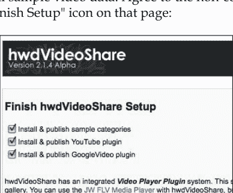

设置完成后，你将看到一个包含清理选项和对视频组件进行维护的页面。保持所有设置不变并点击屏幕右上角的 "运行工具" 图标。维护应该会运行并刷新屏幕。

现在让我们看看在安装了主组件和一些默认数据后我们有什么。在管理后台导航至 菜单 | 主菜单 并点击屏幕右上角的新建以创建新的菜单项。从可用列表中选择 hwdVideoShare，然后从子列表中选择 视频主页：

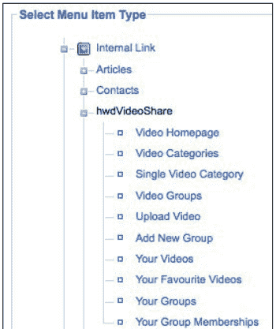

给菜单链接一个名为 "Video Gallery" 的标题并点击屏幕右上角的 保存。如果现在查看网站的前端，你将看到一个指向 hwdVideoShare 组件的新菜单项：

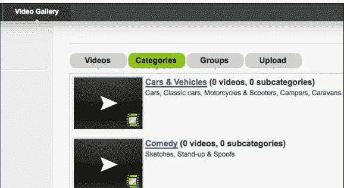

hwdVideoShare 组件非常庞大，充满了作者演示站点上显示的视频功能。可以创建一个像 YouTube 一样的完整视频托管服务（在你的 Joomla! 站点内），也可以简单地很好地分类视频并锁定前端上传功能。我很想花更多时间填充此组件并添加视频功能，但我认为支持文档解释了此扩展的所有功能。现在，我们需要继续并为我们的项目添加更多多媒体功能。

## 使用 FlowPlayer 在文章中嵌入视频

对于大多数人来说，能够在文章中放置视频可能是一个你经常需要的技术。FlowPlayer 使用基于 Flash 的视频播放器，通过使用插件标签轻松在文章中播放视频文件：

```
{flowplayer}URL_Video{/flowplayer}
```

FlowPlayer 可作为 Joomla! 插件使用，以便添加到你的文章中，也可作为模块放置在你需要的任何模块位置。要将 FlowPlayer 添加到 Joomla!：

- 1. 在 http://extensions.joomla.org 的 Joomla! 扩展区域搜索 "FlowPlayer"。
- 2. 访问扩展开发者的网站并将扩展下载到你的电脑。
- 3. 使用 扩展 | 安装 / 卸载 功能将视频和插件扩展都上传到 Joomla!。
- 4. 导航至 扩展 | 插件管理器 并发布 内容 – FlowPlayer 插件：

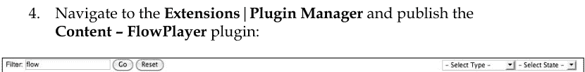

> 还有另一个名为 Flow Player 的插件，是为与 hwdVideoShare 组件一起使用而安装的。确保你启用的是 内容 – FlowPlayer 插件，即我们刚刚安装的那个。


插件还包含额外的参数，因此在启用插件时可能需要查看这些参数：

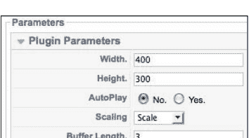

启用插件后，导航到 内容 | 文章管理器 并创建一个新的 Joomla! 文章，命名为“Videos”。选择标记为 Video 的分区和标记为 General Video 的分类；这只是为了帮助组织我们的内容和媒体。我们需要在文章中输入一些文本，然后输入以下代码以激活 FlowPlayer 并链接到你的视频文件：

```
{flowplayer}URL to Video{/flowplayer}
```

该文件可以位于你的网站文件系统中：

```
{flowplayer}images/video/dog.mov{/flowplayer}
```

确保保存你的文章，然后前往创建一个新的菜单链接来显示此文章。我将把它做成 Video Gallery 链接的子菜单链接，类似于我们为音频链接所做的那样，并将其命名为“Video Page”。

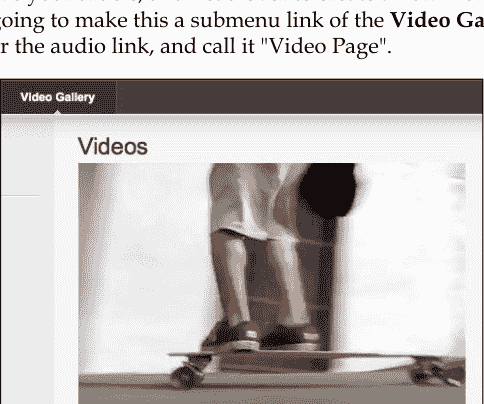

> 想做类似的事情但链接到 YouTube 视频呢？
> 不幸的是由于许可问题，FlowPlayer 无法播放 YouTube 内容，但我们还有其他选择。

## 使用 QTube 扩展显示 YouTube 视频

正如你现在所知，有许多多媒体扩展提供了显示多种媒体类型的灵活性。这些非常有用，因为你只需要一个插件或扩展即可满足众多情况。

一个简单但专业的插件值得提及的是 QTube 插件。如果你认为你的所有视频内容都将来自 YouTube 主机视频，那么就利用这个插件所创建的小巧占用空间吧。它名副其实，就是在你的 Joomla! 文章中播放 YouTube 视频。

与 FlowPlayer 类似，QTube 提供了一个模块和一个插件，因此你可以从 YouTube 播放视频，无论是在模块位置还是在文章中。要安装这些扩展，请按照以下步骤操作：

- 1. 在 `http://extensions.joomla.org` 的 Joomla! 扩展区域搜索“QTube”。
- 2. 访问扩展开发者的网站并将扩展下载到你的计算机。
- 3. 使用 **扩展 | 安装 / 卸载** 功能将两个扩展上传到 Joomla!。
- 4. 导航到 **扩展 | 插件管理器** 区域并点击 **QTube** 插件标题进行编辑。在这里你可以配置所需的插件参数，并确保插件已启用。点击 **保存**，我们就准备就绪了！

以下是所需插件语法最简单的形式：

```
{qtube vid:=xxx}
```

将 xxx 替换为 YouTube.com 分配给该视频的唯一标识符。要获取它，只需访问 YouTube 网站并在观看你想要包含的视频时查看浏览器地址栏。你会看到类似这样的 URL：


CQzUsTFqtW0 部分是唯一的电影标识符，因此我们的 QTube 代码将变为：

```
{qtube vid:= CQzUsTFqtW0}
```

现在我们需要做的就是将其插入到我们的文章中，所以让我们回到包含 FlowPlayer 视频的 Video Page 并也插入我们的 QTube 代码。

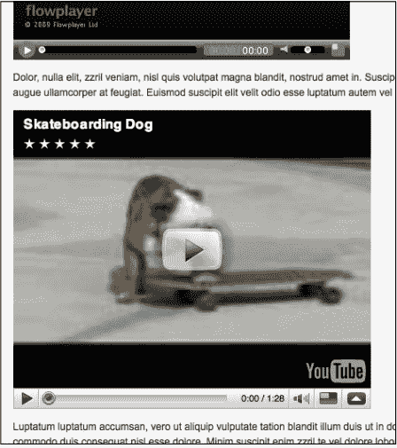

查看 QTube 播放器的文档；你可以调整播放器大小、添加边框和颜色，以及其他功能。

让我们快速使用 QTube 模块发布一个视频。导航到 扩展 | 模块管理器 屏幕并点击 QTube 模块。你可以按需配置它。我将其放置在左侧，在我的 RokBox 模块下方，并配置了宽度和高度，以便我的视频适合左侧列。我选择在所有页面上显示它并保存了模块。

当我们现在查看网站前端时，你可以看到新的 QTUBE 模块在左侧列中播放视频：

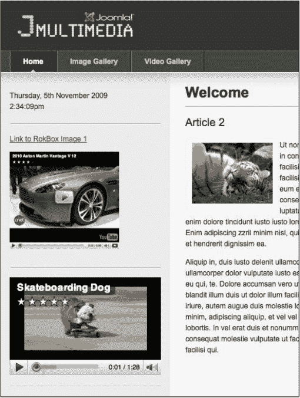

使用 QTUBE 插件和模块进行样式设置和播放视频还有许多其他参数和功能。它确实是一种简单但非常容易的方式将 YouTube 视频嵌入到我们的 Joomla! 网站中。

## 添加音频功能

Joomla! 的音频工具不仅是向网站访问者提供音乐和访谈的绝佳方式，还可用于帮助向残障用户提供内容。有一些很棒的音频扩展可用，我们现在将向我们的项目中添加一些。

你需要点击文章上的 **保存** 并为其创建一个新的顶级菜单链接，现在你应该会看到类似以下内容：

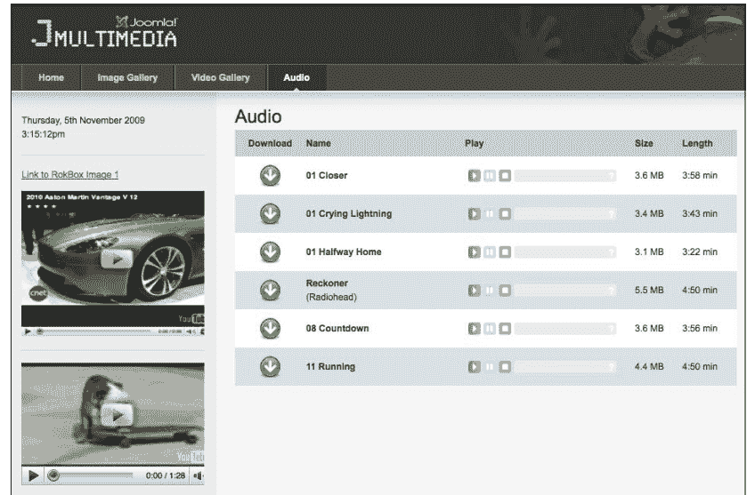

### 简单 MP3 播放器

简单 MP3 播放器是一个易于配置的 MP3 播放器模块，使用基于 Flash 的音频播放器。它具有各种样式选项，可用作多播放器播放列表以及仅带控制按钮的单播放器。该模块附带语言支持，其中包括英语和德语语言文件。

简单 MP3 播放器是一个多功能播放器，我们可以将其放入任何模块位置，所以让我们添加它：

- 1. 在 `http://extensions.joomla.org` 的 Joomla! 扩展区域搜索“Simple MP3 Player”。
- 2. 访问扩展开发者的网站并使用页面右侧的下载链接。
- 3. 使用 **扩展 | 安装 / 卸载** 功能将扩展上传到 Joomla!。
- 4. 导航到 **扩展 | 模块管理器** 区域并点击 **Simple MP3 Player** 模块标题进行编辑。

该模块不仅设计精良，作者还考虑将文档放入模块中，因此你拥有所有模块参数的简易参考指南。主要需要填充的字段如下：

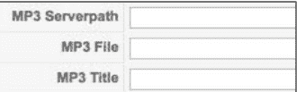

你可以将音频目录的详细信息输入到服务器路径中，将 MP3 文件名输入到 MP3 文件中（用竖线 | 符号分隔），然后输入曲目的 MP3 标题（用竖线符号分隔）。该模块允许进行大量其他调整，例如播放器颜色和布局，但现在请确保它已启用并发布在右侧列中。然后点击 应用，你将在网站上看到结果：


你可能想要重新访问模块来自定义它，支持文档将使这项工作变得轻松。

## RokBox 用于音频

你也可以使用 RokBox 播放音频文件，并使用漂亮的 JavaScript 弹出框让观众的音频播放器在其中播放。

要使用它，请返回管理中的 RokBox 模块并输入以下语法：

```
<a href="PathToAudio" title="Audio Title :: Audio Description" rel="rokbox[200 100](audio)">Link to RokBox Audio File</a>
```

我们与图像和视频文件做得完全一样，只是将值调整为音频文件。我将保存此模块并查看我更新的侧边模块：


## 添加播客

有许多方法可以为你的 Joomla! 项目添加播客功能，更多细节可在第 5 章 *在你的 Joomla! 网站中使用音频* 中找到。现在，我们将向项目中添加一个非常重要的优秀扩展。Joseph LeBlanc 的 Joomla! Podcast Suite 包含一个组件、模块和插件，是提供简易播客功能的绝佳工具包。以下是安装和使用方法：

- 1. 在 http://extensions.joomla.org 的 Joomla! 扩展区域搜索“Podcast Suite”。
- 2. 访问扩展开发者的网站并将组件、模块和插件下载到你的计算机。 （下载链接在开发者的网站上清晰列出。）
- 3. 使用 **扩展 | 安装 / 卸载** 功能将扩展上传到 Joomla!。
- 4. 导航到 **扩展 | 插件管理器** 区域并启用 **内容 – Podcast** 插件（无需设置插件参数）。
- 5. 导航到 **组件菜单 | Podcast Suite | 管理剪辑。**

你会看到通知告知你需要将一些音频 MP3 内容上传到以下目录：`/components/com_podcast/media/`。


你可以通过**管理片段**屏幕上的**参数**按钮将其更改为你希望的任何路径。将文件（或几个文件）上传到你的仓库后（如果是远程服务器，通常通过FTP），刷新此页面，你将看到你的音频内容：


Podcast Suite 的独特之处在于，该组件会生成一篇新的 Joomla! 文章，并在其中放置一个指向音频文件的标签。然后，它利用 RSS 功能来生成播客订阅源。

要创建第一个播客，请点击其中一个音频轨道的标题。你将看到以下屏幕：


你需要填写相关字段的信息，然后点击屏幕右上角的“保存并发布文章”图标。这将实际创建一篇新文章，并预先填入一些先前输入的信息。这现在只是一篇 Joomla! 文章，所以你可以在任何阶段重新访问它，如果你想输入更多信息。确保你选择了“音频”部分和“播客”类别以帮助文章组织，并确保文章也已发布。然后点击页面顶部的“保存”。

现在我们的第一个播客已经配置完成，我们可以做两件事：

- 从菜单创建指向此内容的菜单链接。
- 发布播客模块以显示我们的新订阅源。

现在我们将发布我们的播客模块。导航到**扩展 | 模块管理器**，点击播客模块进行编辑。你可以设置许多参数，但现在让我们启用模块，将其发布在右侧栏，并调整模块顺序，使其显示在右侧栏的顶部。点击“应用”保存更改，然后查看网站的前端。你会看到新的播客模块，如果点击该图标，你将进入一个 RSS 页面。（地址类似于以下地址：http://localhost/JMultimedia/index.php?option=com_podcast&view=feed&format=raw。）


在这里你将能够查看你的播客。你可能想回到你的模块中，调整一些参数来定义你需要的显示效果。这是我经过一些调整后的新模块：


当新的播客添加到 Podcast Suite 时，它们将自动显示，任何订阅了这些订阅源的用户都将收到有关新播客可用的通知。

我为了向你展示基本流程而快速完成了这一步，但 Joomla! Podcast Suite 中还有其他可用功能。在管理后台中，点击**菜单 | 主菜单**。创建一个指向**文章 | 文章布局**的新菜单链接，并选择为你的第一个播客刚刚创建的 Joomla! 音频文章。创建一个名为“播客 1”的链接，并将其设为主要音频链接的子菜单。保存此新菜单项后，访问网站前端查看结果：


你现在将看到 Joomla! 文章包含一个漂亮的 Flash MP3 播放器，其中放置了我们的播客标签。因此，Podcast Suite 不仅允许你发布播客订阅源，还可以在站点文章内播放音频并显示它。

> 如果你想创建指向所有播客的链接，只需创建一个指向**分类博客布局**的菜单链接。每次你向站点添加新的播客文章，并将其定位到正确的部分和类别中时，它将自动对你的站点访客可用。

## 添加社交资料功能

社交网络是大事。它关乎网络和群组、来自不同来源的信息整合，以及交叉宣传的机会。

本节将帮助你在 Joomla! 中添加一些最流行的社交网络功能。

### Easy Twitter Status

Easy Twitter Status 是最简单的（且非商业性的）Twitter 消息扩展之一。它包含以下功能：

- Twitter 用户名
- 推文显示限制
- 显示哪个时间线
- 显示头像
- 头像大小
- 启用默认样式或使用自定义样式
- 显示关注链接

> 要使用此扩展，你需要一个 Twitter 帐户，网址为 <http://www.twitter.com>。

其余部分很简单，让我们现在添加它：

1. 在 <http://extensions.joomla.org> 的 Joomla! 扩展区域搜索“Easy Twitter Status”。
2. 访问扩展开发者的网站，将扩展下载到你的计算机。
3. 使用**扩展 | 安装 / 卸载**功能将扩展上传到 Joomla!。
4. 导航到**扩展 | 模块管理器**区域，点击**Twitter**模块进行编辑。

你将看到可用的模块首选项。与所有模块一样，你可以将鼠标悬停在参数标题上以获取工具提示描述，这将有助于解释字段。


在我的演示中，我还更改了模块标题，将其发布在左列，并且在菜单分配区域中，我们希望此模块仅对**首页**菜单链接可用：


既然我们已将模块发布在左侧，这可能会使我们的左列与首页上发布的其他内容相比变得相当长。让我们进入我们的“RokBox”和“QTube”模块，仅将它们分配给与我们的视频示例相关的菜单链接：


Easy Twitter 模块现在应该只显示在我们的首页菜单项上，并拉取我们最新的 Twitter 消息。其样式可以通过 CSS 进行调整，也可能会受到你 `template.css` 文件中当前样式的影响：


### Twitter Follow Me

Twitter Follow Me 模块在你的 Joomla! 页面中显示一组简单醒目的图形选择，并链接到你的 Twitter 帐户。希望关注你的 Twitters 的用户可以通过点击提供的链接轻松访问它们。

按照以下步骤安装此模块：

1. 在 `http://extensions.joomla.org` 的 Joomla! 扩展区域搜索“Follow Me”。
2. 访问扩展开发者的网站，将扩展下载到你的计算机。
3. 使用**扩展 | 安装 / 卸载**功能将扩展上传到 Joomla!。
4. 导航到**扩展 | 模块管理器**区域，点击**Follow Me**模块进行编辑。

该模块包含许多不言自明的参数。我选择了以下内容：


为了使此模块在我们当前模板中合适地呈现，我选择将其显示在站点页面的左下角，并调整了模块标题使其不显示。这个 Twitter Follow Me 模块实际上可以放置在任何可用的模块位置，因为它使用了与通常模块不同的显示方法。这是它在我项目中的外观截图：


对于那些希望为他们的 Twitter 帐户提供简单链接的人来说，这是一个五分钟就能完成的醒目解决方案。

还有许多其他扩展可以让你与外部社交网络资源（如 Facebook、MySpace、Flickr 等）进行通信。我建议尝试一些，看看它们是否能为你的项目提供所需的功能。

## 添加 RSS 功能

由于 RSS 是展示和提供站点信息的完美媒介，因此从我们的站点项目提供一些 RSS 订阅源非常重要。

有许多可用的 RSS 扩展可以用来显示 Joomla! RSS 订阅源。


点击 **Apply** 保存你的新菜单项并查看网站的前端。现在应该会出现一个新 的 Main Menu 选项，点击后应会带你进入文章的博客布局：


如果查看浏览器 URL 地址栏，你现在应该会看到此页面已被识别为 RSS 订阅源，并在其上显示了图标：


点击后，用户将能够订阅两种订阅源类型。相应的 RSS 订阅源会显示出来，使用户能够订阅它们：


如果你愿意，可以使用此订阅源 URL，并在你的网站周围创建文本超链接以推广它，为你的网站页面制作漂亮的图标，或使用扩展模块来识别从你的网站创建的订阅源，并在找到时自动显示漂亮的订阅源图标。无论哪种方式，当我们向此部分和分类添加新文章时，我们的新内容将显示在我们的 RSS 订阅源上，任何订阅者都能够轻松查看你的新网站内容。

RSS 订阅源只能在首页布局、某个栏目或某个分类上生成。它们可以包含视频、音频、图像和其他多媒体内容，并直接提供给你的订阅者，而无需他们访问你的网站来获取。

## 添加地图功能

Joomla! 有许多出色的地图功能，其中大多数都利用了 Google Maps 应用程序，该应用程序已成为网络上最强大的地图工具之一。

## Googlemaps 插件

Googlemaps Plugin for Joomla! 可在你的文章中显示一个或多个 Google 地图。它是将地图功能轻松添加到你的网站的完美方法。

尽管可能不被视为传统的多媒体，地图包含一系列文本、图像和脚本功能，并且为你的网站访客提供增强的交互功能。让我们在项目中添加一个：

- 1. 在 http://extensions.joomla.org 上搜索 Joomla! 扩展区域中的 "Google map"。
- 2. 访问扩展开发者的网站并将扩展下载到你的电脑。 （对于 Joomla! 1.5 请确保文件名中列出了该版本。）
- 3. 使用 Extension | Install / Uninstall 功能将扩展上传到 Joomla!。
- 4. 导航到 Extensions | Plugin Manager 区域并点击 Google Maps 插件进行编辑。

有很多插件参数需要配置，你可能需要根据需要反复调整它们：


现在，启用插件并点击 **Save**。导航到 **Content | Article Manager** 并创建一个新文章。

将你的文章命名为 "Google Map"，并选择 Section "Site" 和 Category "General"。在你的文章中，我们需要放置插件代码。代码用法如下：Usage: {mosmap parameter='value'|parameter='value'|...}。例如：

```
{mosmap width='500'|height='400'|lat='-36.843288'|lon='174.770508'}
```

有许多可用的参数可以添加到此代码中，而 Googlemaps Plugin 非常强大。要使用它们，请确保在参数之间放置管道符号 (|)，并且确保插件代码中没有换行。以下是一些可用参数：

| Parameters | Description |
|---|---|
| width | 调整为你想要的任何值，尽管如果太小，你将看不到太多内容。 |
| height | 你必须在数字后面加上单位，例如 100% 或 400px。 |
| lon, lat | 用于坐标或用于搜索坐标的地址（使用你所在国家的标准）。 |
| zoom | 可以是 Google Maps API 中指定的任何值。 |
| zoomType | 可以是 small 或 large。这控制显示的缩放功能类型。它也可以是 none，这样就没有缩放控件。 |
| zoomNew | 可以是 1 表示连续缩放和双击缩放，或 0 表示单击居中（默认 0）。 |
| zoomWheel | 可以是 1 表示鼠标滚轮缩放和 0 表示无鼠标滚轮缩放（默认 0）。 |
| mapType | 可以是 Normal（默认）、Satellite 或 Hybrid。 |
| showMaptype | 0 表示无地图类型控件，1 显示地图类型控件（默认 1）。 |
| Overview | 0 表示右下角无概览窗口，1 显示概览，2 表示概览启用但初始关闭（默认 0）。 |
| text | 用于将在地图上显示的标记的气球/信息窗口中的文本。如果不想看到文本，只需设置 text=" "，它将不会显示。文本是显示在位置图钉上方的文本。通常它用于显示地址或超链接。超链接使用格式：< a href=linkAddress target=linkTarget title=linkTitle>linkName</a>。不要使用（双）引号。 |
| marker | 用于初始打开信息窗口（1 默认）或关闭信息窗口（0）。 |
| dir | 用于在 maps.google.com 上为坐标添加获取路线表单。 |

| Parameters | Description |
|---|---|
| `tooltip` | 用于标记在鼠标悬停在标记上时显示工具提示（不要使用 HTML）。 |
| `address` | 用于搜索坐标的地址。 |
| `gotoaddr` | 用于用户可在地图上搜索地址的搜索字段和按钮（默认 0）。 |
| `kml` | 用于加载为地图叠加层的 kml 文件的 URL，以显示多个标记或路线。 |
| `align` | 用于在内容中放置地图（left、right、center 或 none）。 |

在你的文章中添加一些代码并保存它。然后为地图文章创建一个新的菜单项。我只是简单地将其命名为 "Maps" 并使其成为顶级菜单项。你的 Google 地图现在应该显示在你的 Joomla! 文章中。


还有许多 Google 地图模块可用，可轻松将 Google 地图放置在模块位置。这些位于 `http://extensions.joomla.org`。

## 创建自定义错误页面

为任何网络项目创建自己的自定义错误页面是一个不错的个性化功能。Joomla! 使用 `/templates/system/error.php` 文件来处理多个 HTTP 状态错误，包括 "403 Forbidden"、"404 Not Found" 和 "500 Internal Server" 错误。这些不同的状态代码是由服务器为不同原因向客户端提供的信息。

个性化你的错误页面可以帮助用户获得进一步的信息，并且真正表明你已花时间考虑他们，当网站上的某些功能可能无法正常工作时。你的自定义错误页面可以包含多媒体项目，因为它们只是 HTML 网页。

创建 Joomla! 自定义错误页面有多种方法。我将使用的方法需要你动手编写一些代码，但操作起来相当容易。

### 覆盖系统错误页面

要覆盖系统错误结果，请将 `/templates/system/error.php` 文件复制到你自己的 `/templates/<active template>` 目录。在我们的例子中，这将是：`/templates/ja_purity/error.php`。

如果找到，Joomla! 将使用在活动模板中找到的 `error.php` 文件，代替系统文件。这是一种不错的方法，因为你可以升级 Joomla!，但你的自定义 `error.php` 文件将始终保留在你的模板目录中，在升级期间不应受影响。此 `error.php` 文件可以按需格式化，通常以匹配你的模板。

### 覆盖系统错误页面样式

如果你想更改此页面的样式，我们还需要复制以下文件：`/templates/system/css/error.css` 并将其副本放置到你的 `/templates/<active template>/css/error.css` 文件中。在我们的例子中，这将是：`/templates/ja_purity/css/error.css`

接下来，更新 `/templates/ja_purity/error.php` 文件以引用我们样式表的新位置，将此行更改：`<link rel="stylesheet" href="<?php echo $this->baseurl; ?>/templates/system/css/error.css" type="text/css" />`，现在将变为：`<link rel="stylesheet" href="<?php echo $this->baseurl; ?>/templates/ja_purity/css/error.css" type="text/css" />`，以便指向我们复制的 CSS 文件。你现在可以根据需要调整 CSS 文件来设置错误页面结果的样式。


我们现在已经复制了这两个相关文件。Joomla! 会先在我们的模板中查找这些文件，然后才使用系统模板中的默认文件。通过调整我们的 `error.php` 页面和 `error.css` 文件，我们可以完全自定义错误页面的显示方式。遗憾的是，我们无法深入讨论创建新页面的细节，但通过查看这两个默认文件，你应该能够进行所需的更改，即使是更改页面上的标志或背景颜色。

一个好的 **404 页面未找到** 错误页面应包含以下几点：

-   指向网站站点地图的链接。
-   指向网站主页的链接。
-   指向热门页面的相关链接。
-   搜索功能。（谷歌通过其站长工具提供了一项功能，可以轻松插入一些搜索代码。）

使用图片、文本和样式，以及上面提到的部分功能，但要尽量保持可用和简单。404 页面告诉用户，他们要找的页面无法找到。通过提供上述信息，你可以帮助网站访客轻松地访问其他位置。你最不希望看到的是一整页的站点导航、图片和其他内容，分散用户的注意力，使他们无法获取所需的信息。


## 更改网站图标

“favicon”是“Favorites Icon”的缩写。它是一个 16 x 16 像素的图标，与你的网站关联，显示在 Web 浏览器的地址栏和书签/收藏夹菜单中。在 Firefox 和 Internet Explorer 7 / 8 中，它也显示在浏览器选项卡上。

Joomla! 自带其网站图标文件。除非你知道如何更改，否则大多数人只会保留默认图标。但网站图标实际上很容易调整，而且是一个小功能，可以帮助个性化你的项目并赋予其专业感。


### 创建图像

在大多数情况下，你可能会希望使用你的组织标志或其部分内容作为网站图标。你需要使用图形编辑器来创建此图像，使其适合 16 x 16 像素的正方形。最好将此图像保存为 PNG 或 GIF 文件格式。

### 将图像转换为 ICO 格式

下一步是将你的 PNG 或 GIF 图像转换为另一种文件格式。有多种方法可以做到这一点，但我发现最简单的工具是位于 `http://tools.dynamicdrive.com/favicon/` 的 `.ico` 文件生成器。


只需上传你的图像，然后点击**创建图标**。然后将新文件保存到你的计算机上。

## 替换现有的网站图标

网站图标位于你当前使用的 Joomla! 模板目录中。这实际上适用于前端和管理后台显示，因此如果你愿意，可以为两者创建不同的网站图标。由于我们已将 JA_Purity 模板分配给我们的项目，我们需要在 Joomla! 文件结构中查找，并替换 ja_purity 模板中的 favicon.ico 文件，使用我们的新网站图标文件。确保你的新文件名为 favicon.ico，否则将无法被识别——/templates/ja_purity/favicon.ico。


## 查看新的网站图标

如果你按照上述流程操作，创建了图像和 favicon.ico 文件，并将文件放入当前使用的模板目录中，那么一切应该就绪。如果你无法查看新的网站图标，那么很可能是 Web 浏览器缓存了原始的网站图标文件。

对于大多数浏览器，最好先离开 Joomla! 页面（比如打开 google.com 或其他网页），清理浏览器缓存，重启浏览器，然后重新打开你的 Joomla! 项目。这种方法应能确保你的浏览器加载新的 favicon.ico 文件。


## 以及其余部分...

正如你在本书全过程中以及不断发展的 Joomla.org 网站上所看到的，有大量扩展功能可用于增强 Joomla! 内容管理系统。这些功能提供了多种附加功能，其中大多数易于安装且对用户友好。与开发人员为你的项目创建这些功能所需的时间相比，它们以极少甚至零成本提供了“开箱即用”的功能。

我们可以继续推进这个网站，添加大量扩展，构建一个功能丰富的多媒体网站。需要提及的一个重要点是，Joomla! 可用的每个扩展都由不同的开发人员编写，他们的技能水平和发布目的各不相同。最佳做法是删除在正式站点上未使用的任何扩展，并尽可能评估扩展的代码，而不是仅仅将它们添加到正式项目中并假设一切完美。

## 可访问性与验证

如果你已在本地开发项目，并准备将其部署到正式服务器，那么在使其上线之前，有一些步骤值得考虑。

## 可访问性

在本书的多个章节中，我们已经多次讨论该主题。这是一个非常重要但经常被忽视的主题。

可访问性有许多级别，该主题也可能被推向极端，有时网站因为人们试图使其尽可能可访问而变得枯燥且难以使用。反之亦然，但要让网站既光鲜又内容丰富，同时兼顾众多用户的能力，通常需要大量时间和考虑。最重要的考虑是，如果我们向访客提供有价值的信息，就要以某种方式提供替代内容。

我们项目中的一个例子可能是谷歌地图页面。由于多种原因，一些用户可能无法查看那幅外观漂亮的谷歌地图。因此，让我们把联系方式列在地图下方，或者提供一段文字说明地图为何出现在页面上。

始终尝试让不同类型的用户浏览你的网站并提供反馈。鉴于如今快节奏的网络特点，如果你的网站访客遇到问题，他们更倾向于关闭你的网页，而不是花时间写通知告诉你。很多时候，网站可能存在相当严重的问题，而开发人员直到有人最终提醒他们时才会意识到。

在多种 Web 浏览器中进行测试是一个非常重要的步骤，在开发项目时，依靠朋友、家人和同事的诚实反馈会很有帮助。我曾看到在 Firefox 中很漂亮的网站，后来却发现它们在 Internet Explorer 中无法正常工作或效果不佳。最好由你自己的质量控制流程来发现这些问题，而不是由你的客户（或网站访客）指出。

以下是检查最终 Web 项目时需要考虑的一些通用事项：

-   网站是否具有有效的 HTML？
-   网站是否具有有效的 CSS？
-   网站是否有清晰的导航机制？
-   是否提供听觉和视觉内容的清晰替代方案？
-   页面加载速度是否表现良好？
-   网站是否有损坏的链接？
-   如果用户浏览器中的字体大小增大，布局的某些方面是否会损坏？
-   是否有足够的颜色对比度？
-   所有超链接是否具有描述性？
-   网站是否在 IE 6-8、Mozilla Firefox、Safari、Opera、Chrome 中正常工作？
-   关闭 CSS 后网站是否可访问？
-   网站是否在手持浏览器中正常工作？
-   网站是否包含详细的元数据？
-   网站是否能在各种浏览器尺寸下良好运行？
-   网站是否有有用的 404 错误页面？
-   你的 URL 在没有 WWW 时是否有效？
-   网站是否有网站图标？

## 在线验证工具

帮助提高网站可访问性的一种方法是确保它至少通过基本要求的验证。有许多基于 Web 浏览器和在线验证的工具可帮助进行验证过程。


如果我在 JMultimedia 项目主页上运行本地验证，我会收到该页面 50 个错误和 33 个警告。现在如果我试图在网站上线前使其通过验证，就还有一些工作要做。这些错误都可能导致网站在各种情况下无法使用，因此我必须努力减少主要错误。


在对这些验证错误进行快速评估后，似乎有一两个扩展被使用，导致了大部分这些错误。我们现在的选项是：

- 尝试修复导致错误的原因。
- 卸载扩展并寻找其他解决方案。
- 忽略这些然后去泡杯茶（我不推荐这一项，虽然喝杯茶也没什么不好）。

解决验证错误的一个很好的开始方式是确保你的模板通过验证。你可以通过创建一个新的 Joomla! 文章，并在其中放置一个简单的 `<p></p>` 标签来检查这一点，保存它，并为其创建一个菜单链接。在前端访问该页面。接下来，确保该页面上没有加载任何模块，然后使用浏览器验证工具，例如 Mozilla Firefox 的“Web Developer Toolbar”，或在线验证站点，例如 `http://validator.w3.org` 来验证它。

结果将突出模板结构的基础以及其结构方式是否存在任何问题。从这里开始，你可以开始引入页面元素并轻松找到罪魁祸首，或检查验证工具结果以准确找到问题所在。

## 收尾

如果你在本地开发了你的项目，那么下一步将是将其移至远程 Web 服务器。这通常通过 FTP 或 shell 命令执行。Joomla! 帮助网站上有一些关于此过程的优秀文章。

按照 Joomla! 的惯例，甚至还有许多扩展可以帮助此过程，其中值得一提的是 JoomlaPack。JoomlaPack 是一款网站备份实用程序，使你能够复制你的网站和数据库，并在任何兼容的 Joomla! 服务器上重新安装。

JoomlaPack 不仅允许你将网站从本地开发环境移至远程服务器，而且还为你提供了随时需要的简易网站备份功能。你可以通过在 http://extensions.joomla.org 搜索 JoomlaPack 来找到 JoomlaPack。

祝你的网络项目好运。

## 摘要

本章采用了 cookbook 风格的方法，取了一个正在运行的 Joomla! 副本并增强了框架，使其包含一系列多媒体功能。

我们重点介绍了设置本地开发环境以创建安全且易于使用的开发区域，在此我们可以评估扩展并开发我们的项目。

安装了一系列扩展并在我们的工作副本中配置了 Joomla! 功能，突出了 Joomla! 可以轻松扩展为媒体丰富的网站的方式。

最后，我们通过一些可访问性测试收尾，并强调了将网站移至其最终驻地的过程。

## A

## 扩展类型及如何安装它们

为了充分利用 Joomla! 可以提供的全部功能，你在某个阶段需要向你的 Joomla! 包安装扩展。感谢扩展的设计以及 Joomla! 中包含的扩展管理器工具，安装 Joomla! 扩展是一项轻松的任务：


> 请务必在向你的 Joomla! 网站安装任何第三方扩展之前备份你的文件和数据库。

## 扩展类型

**扩展**一词是通用术语，用于描述用于扩展你的 Joomla! 网站的五大类“可扩展元素”。这些是：

## 插件

**插件**是功能强大的扩展，可为你的网站添加额外功能。插件可以在不同层面上工作，例如内容、搜索或系统范围级别：


插件的一个例子可能是向你的内容文章中添加一个简单的标签，以便轻松嵌入电影而无需复杂的 HTML 代码，或增强 Joomla! 搜索系统以便同时搜索包含的扩展。

你可以通过 **扩展管理器 | 插件管理器** 菜单链接管理你的插件。

## 组件

**组件**可以为你的 Joomla! 网站添加全新的功能，它们通常可以被归类为迷你应用程序：


组件为你的网站添加了“购物车”和“目录列表”等出色功能，并且一旦安装就可以在组件菜单下找到。组件通常包含各种元素，并包含指向配置和管理屏幕的附加子菜单链接。

## 模块

模块是帮助向最终用户传递页面信息的扩展：


它们可以从简单的 HTML 输出到系统提供的复杂信息，并在你的网站页面上显示这些信息。模块通常与组件相关联，因为它们为网页提供信息。模块的一个例子可以是简单的天气预报、投票问题，或由事件组件生成的事件列表。

模块在 扩展 | 模块管理器 区域中管理。

## 模板

Joomla! 模板影响你网页的整体设计和结构：


你可以通过使用 Joomla! 模板轻松为你的数据库驱动网站创建完全不同的风格。模板包含模块位置，有助于组织和为已发布的模块提供结构。

模板通常包含许多调整参数，这些参数在 Joomla! 管理中的模板管理器中作为模板选项提供。

## 语言

语言是 Joomla! 的核心功能，这些包可将整个 Joomla! 界面（包括你的 Joomla! 网站的前端和管理）翻译出来：


语言在 扩展 | 语言管理器 区域中管理。

## 如何安装

安装扩展的最简单方法之一是下载扩展并在你的计算机上保留一份副本。除了保留原始扩展文件的副本外，扩展已编写为可通过扩展管理器轻松安装，所有工作由扩展管理器完成：


登录你的 Joomla! 管理并导航到 **扩展管理器** 菜单项。

在 **上传安装包文件** 部分，单击 **选择文件** 按钮以在本地计算机上导航以找到你想要上传的扩展。选择后，单击 **上传文件并安装** 按钮：


你应该在网站上收到 **上传成功** 消息。你的扩展可能要求你去配置一些参数，或发布作为扩展包安装的一部分的插件和模块。

## 如何卸载

Joomla! 1.5 的扩展可以通过单击扩展管理器页面上的 **管理** 菜单项轻松卸载。

在要卸载的扩展旁边的复选框中放置一个勾选标记，然后单击页面右上角的 **卸载** 图标。


你的扩展将被卸载，屏幕上会显示一条确认消息。
