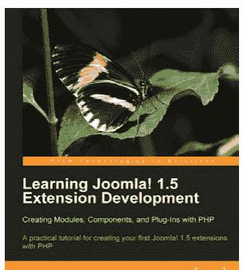
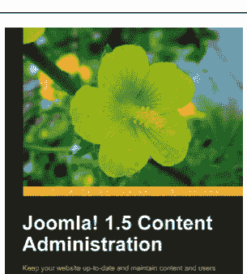
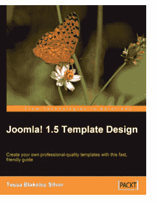
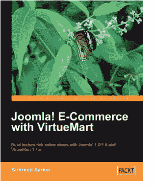
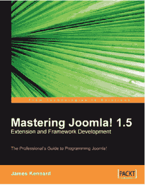
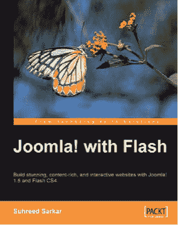
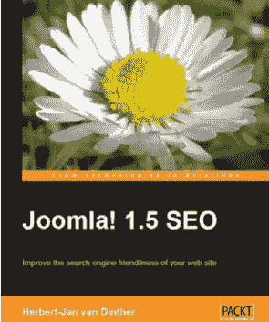
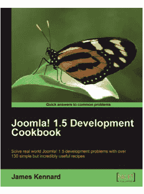

## 索引

A
accessibility, Joomla!
  about 334
  general considerations 335
accessibility, Joomla! Templates
  about 256
  accessible content 256
  accessible template code 256
  colors 257
  contrasts 257
  fonts 257
Adobe Flash 163
Ajax Whois extension
  about 219
  download link 220
  features 220
AllVideos
  about 176
  features 177
alternative content 152
Apache server 263
Apple QuickTime
  about 163
Apple QuickTime Player 184
audio
  about 115, 116
  and, internet 116, 117
  browser support 151
  compressing 121, 122
  encoding 121, 122
  including, Joomla! Plugin used 131-133
audio, Joomla! features
  adding 311
  playing, RokBox used 314
  podcast, adding 315, 318
audio, multimedia in Joomla! CMS 17, 18
audio accessibility 151
audio codecs 118
audio compression 118
audio content, Joomla! Articles
  article, creating 127
  audio HTML code 127
  editors 125
  editor settings 126
  including, Joomla! plugin 131-133
  source 123
  source material, encoding 123
  uploading 123
  uploading, via FTP 123
  uploading, via Media Manager 124, 125
  WYSIWYG editors 125
audio controls 152
audio extensions, Joomla!
  about 312
  MP3 Browser 312
  RokBox 314
  Simple MP3 Player 313
audio file format
  AAC 119
  about 118
  AIFF 119
  MIDI 119
  MP3 119
  RealAudio 119
  WAV 119
  WMA 119
audio formats
  about 117
  audio codecs 118
  audio compression 118

image, selecting 84
image properties, setting 85
FeedBurner 136
FeedBurner service 175
FireFTP 45
Flash Live Video. See FLV
Flickr + Highslide extension
  about 210
  download link 211
  features 211
FLIR 65
Flow Player
  about 173, 307
  download link 173
FLV 161
font families
  cursive 51
  fantasy 51
  monospace 51
  sans-serif 51
  serif 51
font family property, CSS
  about 59
  font-family values 60
fonts, Joomla! site
  about 50
  effects, on users 52, 53
  families 51
  serif font 50
font size property, CSS
  about 60
  absolute, sizing methods 60
  relative, sizing methods 61
  sizing methods 60
font style property 63
font weight property 64
frontend font size adjuster 67
front page, Joomla! website 277, 278
front page features, Joomla! features
  about 286
  front page component 286, 287
  module extension, adding 288, 290
FTP 14, 38
FTP, via web browser
  about 42
  connecting 43
  connecting methods 43, 44
files, downloading 45
files, uploading 45
web browser plugins 45
FTP clients
  about 38
  connecting, FTP programs used 39, 40
  FTP login methods 40
  FTP programs 38, 39
FTP login methods
  anonymous FTP access 40
  username 41, 42
  username and password 41
FTP programs
  about 38
  cURL 39
  CuteFTP 39
  Cyberduck 39
  features 42
  Fetch 39
  FileZilla 39
  FTP Command in Terminal 39
  SmartFTP 39
  Transmit 39
  WS_FTP 39
G
GIF image format 79
GIMP
  about 75
  downloading 76
global configuration settings, Joomla! web-site
  about 272
  cache settings 275
  debug settings 275
  mail settings 276
  media settings 275
  metadata settings 272
  SEO settings 273, 274
  session settings 276
  site settings 272
  user settings 275
GNU Image Manipulation Program. See GIMP
Google 187

## Googlemaps Plugin
  about 326
  Joomla! Extensions, searching for 327
  parameters 328
## Google News extension
  about 216
  download link 217
  features 216
## Google Weather - Plugin
  about 212
  download link 213
  features 212
## GPL 192
## GPL-based extensions 192

## H

## Highslide 211
## HTML code
  using, to include resources 189-191
## hwdVideoShare 178
## hypermedia
  about 8
  example 8

## I

## image formats, Joomla! website
  about 75, 78
  GIF 79
  JPEG 80
  PNG 80
  SVG 81
## image galleries
  creating 93
## image gallery, Joomla! features
  about 293
  adding 293
  in articles, BK-Thumb used 298, 299
  Phoca Gallery, using 293
## image management extensions
  about 94
  installing 95, 96
## images, Joomla! content articles and modules
  adding, Editor image button used 86-88
  adding, Joomla! Article image button used 82-85
  inserting 82
  placing, custom HTML code used 88-92
## images, Joomla! features
  adding 293
  multimedia, displaying RokBox used 301
## images, Joomla! website
  browser support 112, 113
  digital images 76
  lossless data compression 77
  lossless file compression 78
  lossy data compression 77, 78
  W3C accessibility 112, 113
## images, multimedia in Joomla! CMS 16
## image slideshows
  creating 93
## Infuse, RocketTheme
  about 235
  features 236, 237
## insert image screen
  about 84
  features 84
## iPhone Simulator 255

## J

## JA_Purity template
  about 281
  customizing 281
  external editing 282
  internal editing 282, 283
## JA Halite, Joomla Art
  about 238
  features 239
## JMultimedia project 336
## JMultimedia Suite extension
  about 206
  download link 207
  features 206
## Joomla! Extensions 93
## JoomGallery
  about 102
  features 102
## Joomla!
  about 10
  accessibility 334
  examples 12
  extensions 217
  features 11, 12
  FeedBurner 136
  HTML code, using 189, 190, 191
  integrating, with audio and radio channel 207
  integrating, with news channel 216
  integrating, with photo 209
  integrating, with social networking 193
  integrating, with video channel 203
  integrating, with weather 212
  multimedia, including 12
  multimedia features 283
  new podcast feed, creating 136
  podcasting 134
  podcasting, extensions used 144
  third-party extensions, using for external resources 192
  validation 334

## Joomla!-audio and radio channel integration
  about 207
  LCPlayer extension 208

## Joomla!-news channel integration
  about 216
  Google News extension 216

## Joomla!-photo integration
  about 209
  Flickr + Highslide extension 210, 211
  UniversalPlayground - Flickr slideshow plug-in 209, 210

## Joomla!-social networking integration
  about 193
  AutoTweet NGE extension 194-196
  Facebook Fanbox extension 200, 201
  JTweet extension 196, 197
  jwFacebook Comments extension 202
  Tweetboard extension 198
  Twitter Follow Me extension 193, 194
  WebScribble jConnector extension 199, 200

## Joomla!-video channel integration
  about 203
  easiertube extension 203, 204
  JMultimedia Suite extension 206
  QTube extension 205

## Joomla!-weather integration
  about 212
  eWeather extension 214, 215
  Google Weather - Plugin 212
  Z Weather extension 213
## Joomla! 1.5 Template structure
  about 230
  component.php 230
  CSS 231
  css/template.css 230
  html 231
  images 231
  index.php 230
  template_thumbnail.png 231
  templateDetails.xml 230

## Joomla! Articles
  audio, embedding 122

## Joomla! CMS web platform 13
## Joomla! Content Management System 333
## Joomla! editor 167, 168
## Joomla! Extensions
  about 94
  Expose Flash Gallery 97
  installing 339, 343
  JoomGallery 102
  Ozio Gallery2 99-101
  Phoca Gallery 98, 99
  Simple Image Gallery extension 96, 97
  third-party audio extensions 145
  types 340
  uninstalling 343
## Joomla! extensions 13
## Joomla! extensions, BK-Thumb 298
## Joomla! extensions, for external sources
  about 217
  Ajax Whois extension 219, 220
  Plugin GoogleMaps 218
  RokBox 222
  Simple RSS Feed Reader 223
  Slick RSS 220, 221
  SlideShare 220
## Joomla! Extensions, for FlowPlayer 307
## Joomla! Extensions, for Phoca Gallery
  Phoca Gallery Component 294
  Phoca Gallery Image Module 294
  Phoca Gallery Search Plugin 294
  Phoca Gallery Slideshow Plugin 294
## Joomla! Extensions, for RokBox 301
## Joomla! Extensions directory
  AllVideos 176
  hwdVideoShare 178
  RokBox 180
  Shadowbox 181
  Simple Flash Video Player 179
## Joomla! fashion 337
## Joomla! features
  about 283
  audio features, adding 311
  custom error page, creating 330
  date and time, adding 290, 291
  front page features 286
  images, adding 293
  map features, adding 326
  menu, adjusting 285
  module positions 284
  RSS features, adding 323
  search feature, adding 291, 292
  site favicon, changing 332
  social profiling features, adding 319
  text content 283
  video features, adding 303
## Joomla! Image Extensions
  about 103
  Boncko Cooliris (PicLens) Gallery plugin 105
  RokSlideshow 103, 104
  Simple Image Rotator 104
## Joomla! installation
  overview 259
## Joomla! installation, overview
  about 259
  local development 262
  local development, need for 262, 263
  local development, setting up 263
  preliminary advice 260, 261
  remote server development 270
## Joomla! Media Manager
  about 28
  content, organizing 33
  content, uploading 35
  detailed view 32
  files, deleting 34
  multiple file uploads 36
  new directory, creating 34
  settings 28
  single file upload 35
  thumbnail view 32
## Joomla! site
  browser support 68
  characters 50
  custom fonts, using 65
  fonts 50
  text 50
  typography extensions 66
## Joomla! Template
  about 56
  benefits 57
  CSS font properties 59
  template CSS 57
  units 61
## Joomla! template 14
## Joomla! Template images
  about 106
  adjusting 109-111
  commercial templates 108
  features 107
  simplistic template 107, 108
  structure 107
## Joomla! Templates
  about 227-229
  accessibility 256
  components 229
## Joomla! website
  image formats 75
  images, using 73-75
  structure 271
  video, on internet 155
## Joomla! website, requisites
  Apache server 263
  MySQL 263
  PHP 263
## Joomla! website structure 271
## Joomla Flash uploader 48
## JoomlaPack 337
## JosDewplayer 131
## JPEG file format 80
## JsIFR3 67
## JTweet extension
  about 196
  download link 197
  features 197
## Jukebox
  about 148, 149

下载链接 149
功能 148, 149
jwFacebook Comments 扩展
  关于 202
  下载链接 202
  功能 202
K
Khepri 模板 229
L
LameXP
  关于 121
  下载链接 121
LAMP
  关于 264
语言插件 178
语言 342
LCPlayer 扩展
  关于 208
  下载链接 209
  功能 208
Lightbox 效果 94
线性多媒体 8
无损文件压缩 78
有损数据压缩 78
M
Macintosh、Apache、MySQL 和 PHP。参见 MAMP
Adobe Flash Player 24, 184
邮件设置，Joomla! 网站 276
MAMP
  关于 264
  控制面板选项 265
  下载 264
  示例 267, 268
  安装 264-266
  本地数据库，创建 268, 269
  多个网站，本地运行 270
  使用 267
地图功能，Joomla!
  关于 326
  Googlemaps 插件 326
媒体
  管理，使用的替代方法 37
  管理，使用 Media Manager 36, 37
  上传，使用 Media Manager 28
MediaCoder 164
Media Manager 设置
  关于 28
  Flash 上传器，启用 31
  忽略的扩展名 31
  非法的 MIME 类型 31
  图片文件夹 30
  合法的扩展名 29
  合法的 MIME 类型 31
  最大大小 29
  媒体文件夹 29
  MIME 类型，检查 30
  限制上传 30
Media Manager 工具 14
媒体设置，Joomla! 网站 275
Mello 模板，Yootheme
  关于 233
  脚本功能 233, 234
元数据设置，Joomla! 网站 272
Microsoft Pocket PC 模拟器 255
适合移动设备的 Joomla! 网站
  浏览器，调整大小 253
  注意事项 246
  CSS，禁用 247
  自定义样式表或模板，加载 247, 248
  开发 245
  图片，禁用 247
  重要区域 246
  JavaScript，禁用 247
  移动 Web 扩展 248
  按需方法，采用 247
  样式表，禁用 252, 253
  测试 252
  测试，使用模拟器 255
  访问者，定位 255
Mobilebot for Joomla 1.5
  关于 251
  功能 252
  安装 252
移动 Web
  关于 243, 244
  移动 Web 扩展
    Mobilebot for Joomla 1.5 251
    PDA-plugin for Joomla! 1.5 248
    WAFL 250
  模块调整，Joomla! 功能 285
  模块位置，Joomla! 功能 284
  模块 341
  Motion，Yooheme
    关于 240, 241
    功能 241, 242
  MOV 161
  Moving Pictures Experts Group。参见 MPEG
  MP3 Browser
    关于 312
    搜索 Joomla! 扩展 312
    工作原理 312
  MP3 Browser 插件
    关于 146
    下载链接 148
    功能 147
  MPEG 162
  多媒体
    关于 7
    分类 8
    在 Joomla! 网站中包含 12
    网页浏览器支持 24
  Joomla! CMS 中的多媒体
    关于 14
    音频 17
    图片 16
    文本 15
    视频 19
  多媒体分类
    关于 8
    线性 8
    非线性 8
  富多媒体网站
    访问 22
  MySpace 187
  MySQL 263
  MySQL 数据库
    创建 269
N
新播客源，Joomla!
  文章，创建 138
  音频内容，准备 136
  音频内容，选择 136
  分类，创建 137
  FeedBurner，使用 140-143
  菜单链接，创建 138
  RSS 源，创建 139
  工作原理 139
  所见即所得编辑器，禁用 137
非线性多媒体
  关于 8
  超媒体 8
  网站多媒体 8
O
在线验证器，Joomla!
  关于 335, 337
  总结 337
OPENWAVE 256
Opera Mini 模拟器 255
Ozio Gallery2
  关于 99-101
  功能 100, 101
P
参数，Googlemaps 插件
  address 329
  align 329
  dir 328
  gotoladdr 329
  kml 329
  lon, lat 328
  mapType 328
  marker 328
  Overview 328
  showMaptype 328
  text 328
  tooltip 329
  width, height 328
  zoom 328
  zoomNew 328
  zoomType 328
  zoomWheel 328
PDA-plugin for Joomla! 1.5
  关于 248, 249
  下载链接 250
  安装 249, 250
Phoca Gallery
关于 98, 99, 293
功能 99
PHP 263
PixelOut 音频播放器插件
关于 150
下载链接 150
功能 150
像素 76
Plugin GoogleMaps 扩展
关于 218
下载链接 219
功能 218
插件
关于 24, 340
示例 340
PNG 文件格式 80
播客
关于 134
使用的扩展 144
Podcast Suite
关于 145, 315, 316
下载链接 146
功能 146
搜索 Joomla! 扩展 315
实践技巧，音频
替代内容 152
音频控件 152
字幕说明 152
下载链接 152
文本记录 151
实践技巧，Joomla! 网站视频
替代内容 183
字幕说明 183
文本记录 183
视频控件 184
Q
QTUBE 代码 310
QTUBE 扩展
关于 205, 309
下载链接 205
功能 205
QTUBE 模块 310
QTUBE 播放器 310
QTUBE 插件 311
QuickTime。参见 MOV
R
Real Audio/Video。参见 RM
Real Media Player 184
Real Simple Syndication。参见 RSS
远程主机 270
RM 162
RokBox
关于 94, 180, 301, 302
下载链接 181
功能 180
安装 94, 95, 96
RokBox 扩展
关于 222
下载链接 223
功能 222
RokSlideshow 103, 104
RSS 135
RSS 功能，Joomla!
关于 323
新源，创建 324, 325
S
无衬线字体
aerial and helvetica 54
Lucinda Sans family 54
Trebuchet MS 54
verdana 54
Scalable Inman Flash Replacement。参见 sIFR
搜索功能，Joomla! 功能 291, 292
Section 508 22, 23
区块，Joomla! 网站
音频 279
常规 279
图片 279
新闻 280
站点 279
视频 279
区块和分类，Joomla! 网站 278, 279
SEO 设置，Joomla! 网站 273, 274
衬线字体 51
衬线字体
Georgia 55
eXtplorer 47
Joomla Flash 上传器 48
第三方视频插件 178
缩略图视图，Joomla! Media Manager 32
Tweetboard 扩展
关于 198
下载链接 199
功能 198
Twitter 187
Twitter Follow Me 扩展
关于 193
配置设置 194
下载链接 194
功能 193, 194
Twitter Follow Me 模块
关于 322
安装 322, 323
排版扩展
关于 66
capDropper 68
前端字体大小调整器 67
JsIFR3 67
U
统一资源标识符。参见 URI
单位，CSS
关于 61
em 61
百分比 62
像素 63
磅 63
UniversalPlayground - Flickr 幻灯片插件 209
URI 135
用户设置，Joomla! 网站 275
V
视频，Joomla! 功能
添加 303
hwdVideoShare 视频分享画廊 305, 306
播放，使用 RokBox 303, 304
QTube 扩展，用于显示 YouTube 视频 309
视频，Joomla! 网站
关于 155, 156
文章，编写 169
浏览器支持 182
显示 163
编辑器 167, 168
嵌入 163
编码 163
格式 157
包括，使用文章插件 172, 173
实践技巧 183
来源 163
第三方视频扩展 176
上传，通过 FTP 165
上传，通过 Media Manager 166, 167
视频可访问性 182
视频 HTML 代码 169
视频播客，创建 175
在文章中，使用 FlowPlayer 307
视频，Joomla! CMS 中的多媒体 19
视频编解码器 159
视频压缩
关于 158, 159
视频编解码器 159
视频容器
关于 160
AVI 161
FLV 161
MOV 161
MPEG 162
RM 162
WMV 162
视频格式
关于 157, 158
比特率 160
视频压缩 158
视频容器 160
视频 HTML 代码
关于 169
直接下载 169
嵌入 170-172
流媒体播放 170
包括视频 172, 173
互联网上的视频，Joomla! 网站
关于 155, 156
创作 156, 157
带宽限制 156
播放 156, 157
视频集成，与其他网页内容 156
视频播放器插件 178
视频播客
创建 175
W
WAFL
关于 250
下载链接 251
安装 250
WAMP 264
WCAG
关于 22
分类 22
网页可访问性
关于 20
信息 23
原则 20
工具 23
网页浏览器插件
关于 45
FireFTP 45
SFTP 46
多媒体网页浏览器支持 24
Web 内容可访问性指南。参见 WCAG
网页模拟器
dotMobi 网页模拟器 255
iPhone 模拟器 255
Microsoft Pocket PC 模拟器 255
OPENWAVE 256
Opera Mini 模拟器 255
TagTag 模拟器 256
网络日志。参见 blog
Web 安全字体 68, 69
WebScribble jConnector 扩展
关于 199
下载链接 200
功能 199
网站适配与格式化层。参见 WAFL
网站多媒体
关于 8, 9
类型 9, 10
Windows Media
关于 163
Windows Media Player 184
Windows Media Video。参见 WMV
无线应用协议（WAP）244
无线标记语言（WML）244
WMV 162
X
XAMPP 264
XHTML 244
Y
YouTube 187
Z
Zina
关于 150
下载链接 151
功能 150
Z Weather 扩展
关于 213
下载链接 214
功能 213

## 感谢您购买
## Joomla! 1.5 多媒体

### 开源项目版税

当我们销售一本关于开源项目的书籍时，我们会直接向该项目支付版税。因此，通过购买《Joomla! 1.5 多媒体》，Packt 会将收到的部分款项捐赠给 Joomla! 项目。

从长远来看，我们将自己和您——我们书籍的客户和读者——视为开源生态系统的一部分，为我们所出版的项目提供可持续的收入。我们在 Packt 的目标是将出版版税确立为服务的重要组成部分，并支持一种能够维持开源发展的商业模式。

如果您正在从事某个开源项目，希望我们为其出版书籍并随后支付版税，请与我们联系。

### 为 Packt 撰稿

我们欢迎所有对写作感兴趣的人士前来咨询。图书提案请发送至 `authors@packtpub.com`。如果您的图书构思还处于早期阶段，希望在撰写正式提案之前先进行讨论，请联系我们；我们的一位策划编辑将与您取得联系。

我们不仅仅寻找已出版过作品的作者；如果您拥有扎实的技术技能但缺乏写作经验，我们经验丰富的编辑可以帮助您发展写作事业，或者仅仅为您的专业知识获得一些额外回报。

### 关于 Packt 出版社

Packt，发音为“packed”，于 2004 年 4 月出版了第一本书《Mastering phpMyAdmin for Effective MySQL Management》，此后一直专注于出版针对特定技术和解决方案的高度聚焦型书籍。

我们的书籍和出版物分享了您的 IT 同行们在适配和定制当今系统、应用程序和框架方面的经验。我们基于解决方案的书籍为您提供定制软件和技术以完成工作所需的知识和能力。Packt 的书籍比您以往见过的 IT 书籍更为具体，而非泛泛而谈。我们独特的商业模式使我们能够为您提供更集中的信息，让您获得更多所需的内容，减少无关的内容。

Packt 是一家现代而独特的出版公司，专注于为开发者、管理员和新手社区制作高质量的尖端书籍。欲了解更多信息，请访问我们的网站：`www.PacktPub.com`。

## PACKT PUBLISHING

### Joomla! 1.5 扩展开发学习指南

ISBN: 978-1-847191-30-4      平装: 200 页

一本实用的教程，教您使用 PHP 创建您的第一个 Joomla! 1.5 扩展

- 1. 为 Joomla! 编写您自己的扩展！
- 2. 创建具有后端和前端功能的全新、自包含组件
- 3. 创建可配置的站点模块，以在每个页面上显示信息
- 4. 将您的扩展分发给其他 Joomla! 用户

### Joomla! 1.5 内容管理

ISBN: 978-1-847198-04-4      平装: 212 页

轻松维护您的网站，保持内容与用户的最新状态

- 1. 添加、编辑和管理内容，从文章和文本到图像、音频和视频
- 2. 快速掌握新网站的管理区域，熟悉导航和内容的组织方式
- 3. 深入了解用户管理、垃圾信息拦截以及其他有助于维护内容丰富网站的活动
- 4. 为 Joomla! 站点的内容管理员和最终用户提供深入覆盖，包含大量实用的工作示例和清晰解释

请查看 www.PacktPub.com 以了解我们的图书信息

### Joomla! 1.5 模板设计

ISBN: 978-1-847197-16-0      平装: 284 页

通过这本快速、友好的指南创建您自己的专业级模板

- 1. 为您的站点创建 Joomla! 1.5 模板
- 2. 调试、验证和打包您的模板
- 3. 使用 Flash、扩展和 JavaScript 库调整现有模板的技巧

### 使用 VirtueMart 进行 Joomla! 电子商务

ISBN: 978-1-847196-74-3      平装: 476 页

使用 Joomla! 1.0/1.5 和 VirtueMart 1.1.x 构建功能丰富的在线商店

- 1. 通过逐步为示例电子商务网站添加功能，从零开始构建您自己的电子商务网站
- 2. 配置商店、构建产品目录、配置 VirtueMart 的用户注册设置以接收来自世界各地的订单
- 3. 管理客户、订单和各种货币，以提供最佳的客户服务
- 4. 处理各种情况下的运输以及销售税规则

请查看 **www.PacktPub.com** 以了解我们的图书信息

### 精通 Joomla! 1.5 扩展与框架开发

ISBN: 978-1-847192-82-0          平装: 488 页

Joomla! 编程专业指南

- 1. Joomla! 编程深入指南
- 2. 设计和构建安全、健壮的组件、模块和插件
- 3. 包含 Joomla! 框架主要领域的全面参考

### Joomla! 与 Flash

ISBN: 978-1-847198-24-2          平装: 260 页

使用 Joomla! 1.5 和 Flash CS4 构建一个令人惊艳、内容丰富且交互式的网站

- 1. 构建一个将 Flash 对象集成到 Joomla! 中的吸引人的网站
- 2. 使用 Flash 过渡和动画效果创建令人惊艳的照片画廊
- 3. 在基于 Joomla! 的网站中使用交互式 Flash 地图、图表、动画、视频、MP3 播放器、徽标、页眉和横幅
- 4. 通过这本包含截图的逐步简明指南，将您的 Joomla! 网站转变为一个功能丰富的多媒体增强站点

请查看 **www.PacktPub.com** 以了解我们的图书信息

## Joomla! 1.5 SEO

ISBN: 978-1-847198-16-7     平装: 300 页

提高您网站的搜索引擎友好性

- 1. 提高您的 Joomla! 站点在 Google、Yahoo 和 Bing 等搜索引擎结果页面中的排名
- 2. 通过获取和产生指向您网站的外部链接来提高网站 SEO 性能
- 3. 通过应用 SEO 来营销和衡量您博客的成功
- 4. 将分析和付费广告集成到您的 Joomla! 博客中

## Joomla! 1.5 开发实战手册

ISBN: 978-1-847198-14-3     平装: 360 页

通过 130 多个简单但极其有用的配方解决真实的 Joomla! 1.5 开发问题

- 1. 解决真实 Joomla! 1.5 开发问题的简单而极其有用的方案
- 2. 快速扩展 Joomla! 核心功能，以创建新颖、令人兴奋的扩展
- 3. 提供实践导向的解决方案——提供易于提取的代码示例，采用实用的方法处理配方

请查看 www.PacktPub.com 以了解我们的图书信息

