## 修改示例作者

上一章中创建的示例作者仅仅是一个示例，因此我们将把作者修改并个性化设置为自己的姓名。请跟着我们使用 Sanity Studio 修改作者的每一步操作。

### 修改现有作者

按照以下步骤了解如何完成此任务：

1. 单击顶部导航栏中的 Desk 图标，如图所示：

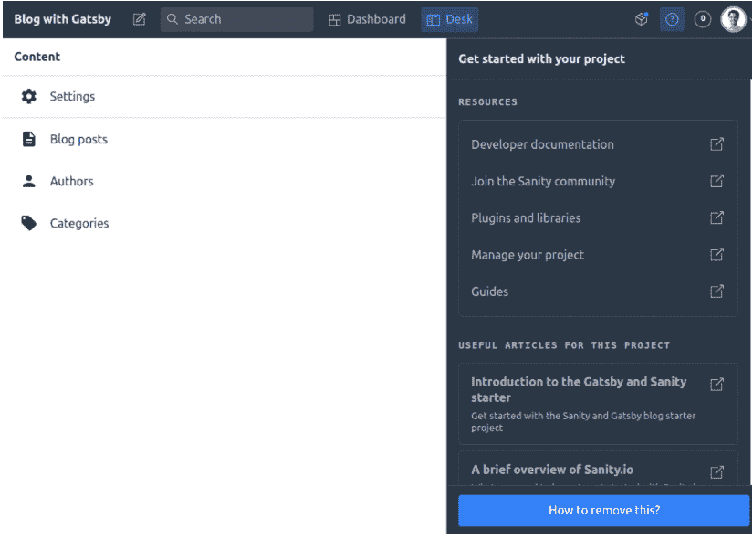

图 3.1 – Sanity Studio

Dashboard 提供了内容的广泛概览，而 Desk 提供了一种查看、创建、修改和删除项目内容的方式。

2. 单击**内容**导航菜单（位于左侧）中的**作者**，如图所示：

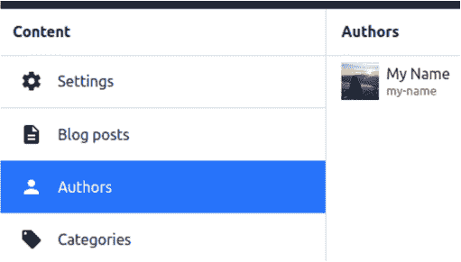

图 3.2 – 作者导航菜单项

3. 单击示例作者，本例中为**我的名字**（My Name）。

4. 将**姓名**改为你的真实姓名。这里以 **Christopher John Pecoraro** 为例。

5. 单击**生成**按钮生成新的 slug。这将是用于作者个人资料页面的 URL。

6. 单击**上传**按钮上传新图像。

7. 根据需要修改说明文字和替代文本。

8. 根据需要修改个人简介。

此时，文章应显示草稿状态。此作者尚未保存：

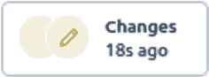

图 3.3 – 草稿状态

9. 单击**发布**按钮：

图 3.4 – 发布按钮

此时，作者资料已发布，并且应显示**已发布**状态。其最新版本将可供使用：

请注意，**内容**菜单像手风琴一样折叠起来，如以下屏幕截图所示。文本垂直显示：

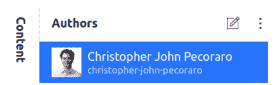

单击**内容**栏将再次在 **Desk** 中显示最顶层的菜单。

### 创建另一位作者

此时，我们只有一位作者；然而，大多数新闻网站都有不止一位作者，因此请按照以下步骤创建第二位作者：

1. 单击**内容**导航菜单（位于左侧）中的**作者**，如图所示：

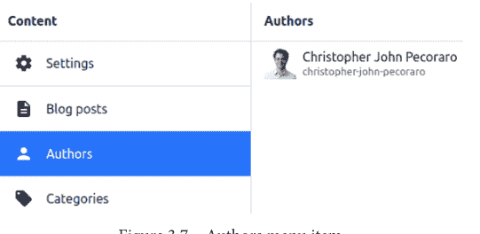

2. 单击铅笔图标以创建另一位作者，如图所示：

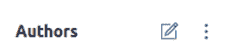

3. 输入名字和姓氏。

4. 点击 **Generate** 按钮生成新的 slug。

5. 可选地，上传头像或个人资料图片。

6. 添加标题和替代文本。

7. 输入个人简介。

8. 点击 **Publish** 按钮，如同上一节所示：

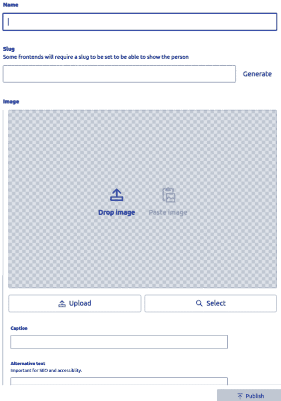

Figure 3.9 – New author details

我们已将示例作者替换为两位新作者。同样，还有需要处理的额外示例内容。正如本节中创建示例作者一样，也创建了多个示例文章。

## Removing and adding articles

现在我们将删除这些文章并开始创建自己的内容。这将使我们能够创建自己的网站。

### Removing example articles

按照以下步骤删除示例文章：

1. 在主 **Content** 菜单中点击 **Blog posts**。点击第一篇文章。

2. 在界面的底部，浮动栏右侧有一个上下文菜单，位于 **Publish** 按钮旁边。点击向下箭头图标，菜单将出现如下所示。 **Delete** 将是选项之一；点击它：

3. 将出现确认对话框菜单，因此点击 **Delete now** 按钮：

4. 对每篇文章重复 *步骤 1–3*。

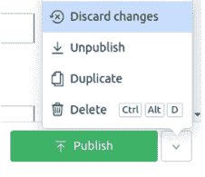

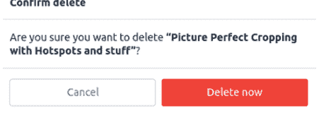

现在我们已删除所有文章，我们将添加第一篇新闻文章。

### Creating a new article

按照以下步骤创建新文章：

1. 从主 **Content** 菜单中，点击 **Blog posts** 菜单项。

2. 点击铅笔图标创建新文章。

3. 为文章输入标题。

4. 点击 **Generate** 生成 slug。

5. 选择 **Published at** 日期。截至撰写本文时，此项必须选择，不能保留占位符文本：

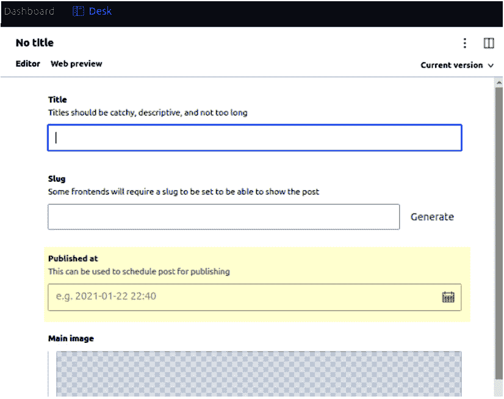

Figure 3.12 – New blog post form, part 1

6. 通过点击 **Upload** 按钮上传图片。

7. 输入 Caption 和 Alternative text：

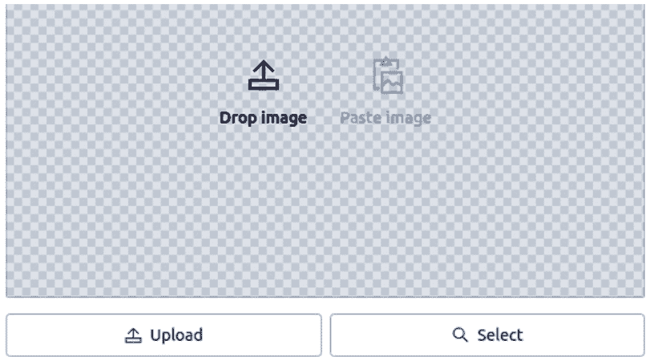

Caption

Alternative text
Important for SEO and accessibility.

Figure 3.13 – New blog post form, part 2

8. 通过编写文章的简短摘要来完成 Excerpt 部分。

9. 通过点击 Add 按钮选择姓名然后点击 Close 按钮来选择作者。

10. 可选地，选择一个类别。

11. 通过输入文章内容来完成 **Body** 部分：

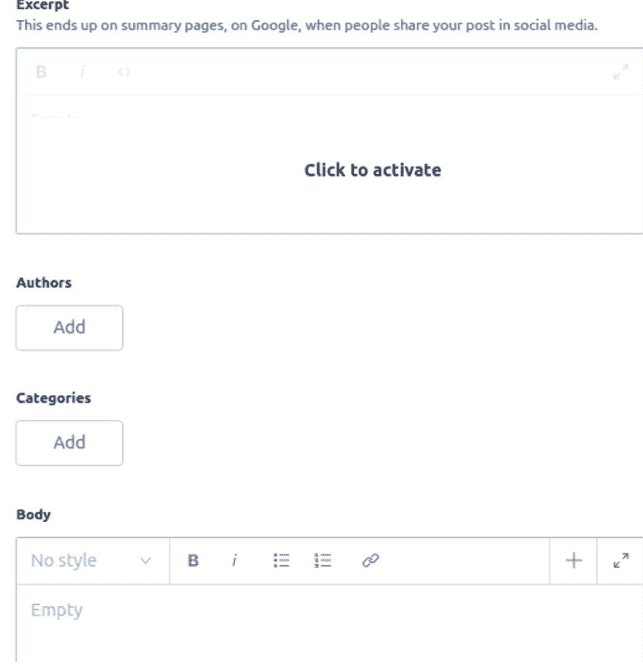

12. 点击 **Publish** 按钮，如同之前的示例进行发布。状态应从 **DRAFT**（在 **Blog posts** 菜单中标题旁的铅笔图标表示）更改为 **Published**。

## Modifying the website settings and redeploying the website

最后，我们需要修改网站设置。设置完成后，下一步将使用本章中执行的操作重新部署网站。

### Setting the website name

返回主 **Content** 菜单，点击 **Settings** 菜单项。这些设置是网站标题、描述、关键词列表和网站作者。对于本示例，标题将为 `News and Events`：

1. 修改标题。

2. 修改描述。

3. 点击底部栏上的 **Publish** 按钮：

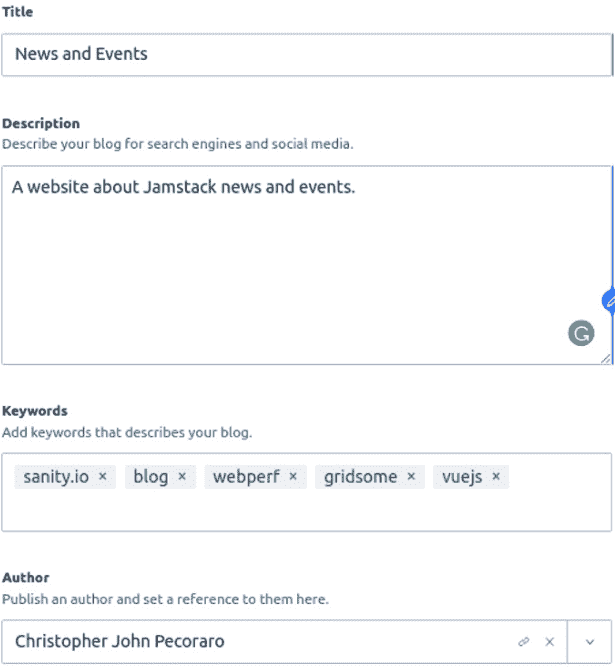

Figure 3.15 – Settings form

至此，我们已通过使用 Sanity Studio 创建、删除和修改内容，学习了 Sanity Studio 的基本功能。接下来，我们将指示 Netlify 部署网站的新版本。Netlify 将运行脚本以使 Gatsby 使用新内容与模板结合创建新版本。

### Redeployment through Netlify

按照以下步骤使用 Netlify 平台重新部署网站：

1. 点击 **Dashboard** 图标返回仪表板，如以下屏幕截图所示：

Figure 3.16 – Link to the dashboard

2. 点击对应博客网站的 **Deploy** 按钮，如下所示：

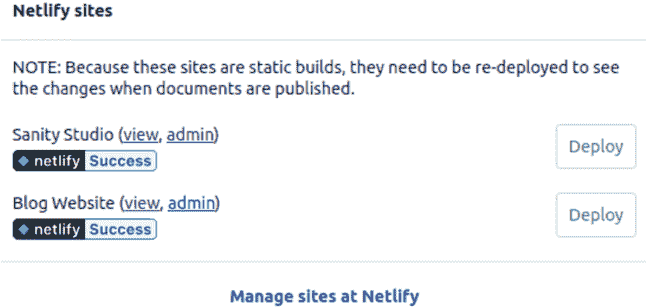

Figure 3.17 – Netlify sites list

状态将在构建过程中从 **Success**（绿色）更改为 **Building**（橙色），如下图所示：

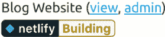

Figure 3.18 – Netlify Building status

构建时间会有所不同，但最终状态将恢复为 **Success**。

3. 点击对应 **Frontend** 的网站 URL 以查看更改。可能需要重新加载页面：

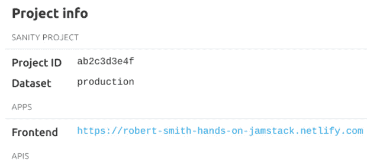

Figure 3.19 – Project info section

4. 网站将显示文章及其摘要，如图 3.20 所示：

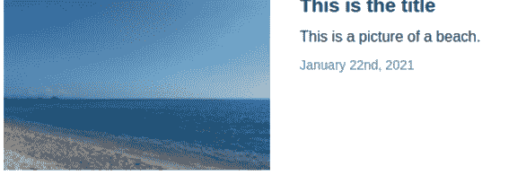

Figure 3.20 – Article excerpt

## Summary

在本章中，我们学习了如何使用 Sanity Studio 的基本功能。我们现在能够基于初始示例内容配置基本网站信息。我们可以添加、修改和删除各种内容元素。不过，我们尚无法修改 Sanity 文档的结构。

在下一章中，我们将学习 Sanity 的实体及其关系。
