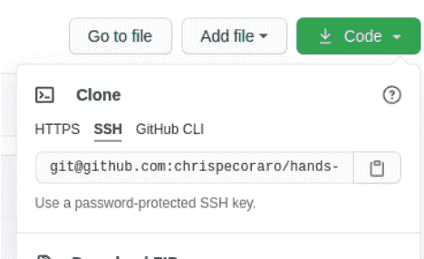
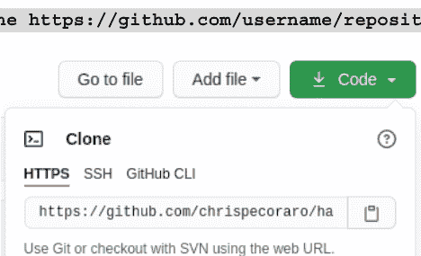
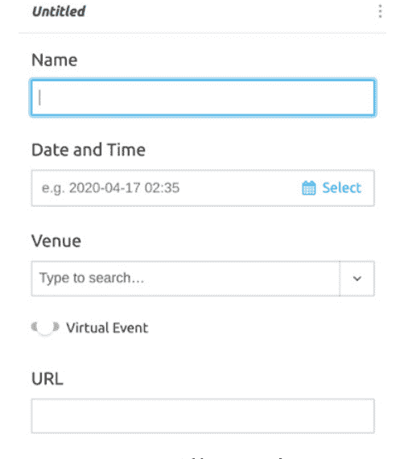

# 4 Sanity Configuration and Schemas

在上一章中，我们学习了如何使用 Sanity Studio。在本章中，我们将学习如何从 GitHub 克隆项目，安装其依赖项，学习如何启动本地开发环境，并检查文件结构。然后，我们将学习模式是如何构建的，以及如何修改它们，学习关系。这将使您能够轻松地修改模式，通过在浏览器中查看托管版本来在本地测试模式。

本章将涵盖的主要主题如下：

- Modeling content with schemas
- Schema relationships
- Extending, modifying, and deploying the schema

这在以下屏幕截图中显示：



Figure 4.1 – The GitHub Code clone modal – SSH mode

- 第二种方法使用 HTTPS，其中 username 是 GitHub 用户名，repository 是实际仓库。请注意与 SSH 方法略有不同的格式：

```text
git clone https://github.com/username/repository.git
```



Figure 4.2 – The GitHub Code clone modal – HTTPS mode

这两种方法都将在同一文件系统级别创建以仓库名称命名的文件夹。SSH 方法允许使用受密码保护的 SSH 密钥，因此是首选方法。

## Exploring the project's folders

在本节中，我们将检查项目的文件夹和文件的内容。有几个重要文件和几个文件夹。我们将检查的第一个文件是 `sanity.json` 文件。该文件位于项目的 `studio` 文件夹中。

### Examining the sanity.json file

以下是 `sanity.json` 文件的前几行：

```json
{
  "root": true,
  "project": {
    "name": "Hands On JAMstack"
  },
  "api": {
    "projectId": "abc123d4",
    "dataset": "production"
  },
}
```

该文件包含两个重要值：`projectId` 和 `dataset` 名称：

- `projectId`：`projectId` 值唯一定义项目，意味着没有其他人会拥有此 ID。`projectId` 由字母和数字组成。

- `dataset`：然而，`dataset` 值不是唯一的，将用于标识此 Sanity Studio 实例当前使用的是哪个数据集。例如，可以选择 `production` 来表示模式和数据的最终版本，而 `development` 则表示即将进行的更改。模式和实际内容都包含在数据集中。每个数据集都是完全独立的，Sanity Studio 可以加载其中任何一个数据集，但一次只能加载一个模式。

此外，`root` 设置为 `true` 以指定此文件是项目的主要 `sanity.json` 文件，因为插件可能有自己的 `sanity.json` 文件。插件中找到的 `sanity.json` 文件将 `root` 设置为 `true`。


## 检查 schemas 文件夹

接下来，我们将检查 `studio` 文件夹中的 `schemas` 文件夹。在两个子文件夹——`documents` 和 `objects` 中，我们会找到一组文件，每个 schema 一个。每个文件都是一个 JavaScript 文件，包含一个对象。以下代码示例展示了具有最少字段的 schema 文件格式：

```javascript
export default {
    name: 'siteSettings',
    type: 'document',
    title: 'Site Settings',
}
```

文件以 `export` 关键字开始。`export` 关键字意味着此 JavaScript 模块可通过使用 `import` 语句在调用文件中被使用。下一个关键字是 `default`。此关键字意味着将使用此单个对象。最后，对象本身随后出现，使用打开和关闭的括号。对象中三个基本属性，即键值属性对，是 `name`、`title` 和 `type`。

## name

在 schemas 中使用的 `name` 属性始终代表一个单一实体。`name` 值必须是单个单词，并且按惯例应与文件名称匹配，但当然不带扩展名。

**驼峰命名法**，因其最像的动物而得名，被使用。标准格式如下：第一个单词以小写表示，第二个单词及之后的单词首字母大写。例如，正确的 `name` 属性值将是 `siteSettings`。

## title

下一个重要属性是 `title`。此属性旨在作为 schema 实体的可读描述，可以包含空格和其他特殊字符。它在 Sanity Studio 中显示。因此，它应是一个清晰定义其所代表内容的词。例如，对应的标题可以是 `Site Settings`。

## type

接下来，schema 类型决定 schema 是文档还是对象。文档将在 Sanity Studio 的主导航中列出。对象是对实体的更抽象表示，例如两个文档之间的关系，或用作文档内的构建块，例如包含地址、城市和邮政编码等多个字段的地址块。

自动创建的默认项目使用两个目录——documents 和 objects，以帮助通过按类型对 schemas 进行分组来组织项目。

## Author schema

对于下一步，检查 documents 目录中 `author.js` 文件的结构。

## Schema 定义

如以下代码示例所示，fields 属性是一个数组。方括号的使用是一种表示列表或项目集合的语法。一开始，项目列表是空的。它将被填充以包含字段列表：

```javascript
export default { 
    name: 'author',
    type: 'document',
    title: 'Author',
    fields: [
    ],
}
```

所有实体必须至少包含一个字段。fields 数组中的每个对象都遵循与实体本身相同的格式，至少包括 name、title 和 type。

## Schema 字段

最简单的示例可能是 name 字段，表示作者的姓和名：

```javascript
export default { 
    name: 'author',
    type: 'document',
    title: 'Author',
    fields: [
      {
        name: 'name',
        type: 'string',
        title: 'Name'
      },
    ]
}
```

在前面的代码示例中，我们已将 name 属性放在 `fields` 数组内。此数组为 string 类型，这基本上意味着一个简短的短语或标签，没有任何关联的格式，如粗体斜体。

> **注意**
> 
> `title` 属性应代表内容编辑者可以识别的词或短语，并在 Sanity Studio 中显示。

每个字段还可以使用另外三个属性：

- `description` 是关于字段应如何使用的更长描述。
- `readOnly` 禁用 Sanity Studio 中的编辑。
- `hidden` 将字段从 Sanity Studio 中隐藏。

readOnly 和 hidden 字段将以编程方式修改，而不是由使用界面的人员修改。

## Schema 字段类型

有多种类型可供使用。截至撰写时，除 document 外，以下类型可用：

- Array
- Block
- Boolean
- Date
- Datetime
- File
- Geopoint

在此示例中，此 schema 的类型为 address，因此 author 将通过 address reference 链接到 address，如下所示：

```javascript
export default {
    name: 'author',
    type: 'document',
    title: 'Author',
    fields: [
    {
        name: 'name',
        type: 'string',
        title: 'Name'
    },
    {
        name: 'address',
        type: 'reference',
        to: {type: 'address'}
    }
    ]
}
```

在 Sanity schema 中，我们使用 reference 类型和一个额外的属性 to。to 属性接受指定类型的对象。

## 一对多关系

同样，schema 可以与许多 schema 相关，甚至是各种类型。一个简单示例是作者为多个出版机构撰稿：

```javascript
{
    name: 'publishers',
    title: 'Publishers',
    type: 'array',
    of: [
    {
        type: 'reference',
        to: '[{type: 'publisher'}]'
    }
    ]
}
```

在此示例中，type 字段为 array，因此在 Sanity Studio 内部，可以从出版商列表中选择一个或多个出版商。请注意，此字段被命名为 "publishers" 以显示该字段代表多个出版商，然而关系是到类型为 publisher 的 schema，而 schema 名称始终是单数。

在本章的第一部分，我们学习了 schema 的结构。在下一节中，我们将学习如何修改 schemas。

## 扩展、修改和部署 schema

对于本书中使用的示例，我们将创建一个新闻和活动网站。此过程中的第一步是在 document 目录中创建一个名为 event.js 的文件，它将代表我们的 event schema。

## The event schema

以下代码段是 event 的 schema，展示了其各个字段：

```javascript
export default {
    name: 'event',
    type: 'document',
    title: 'Event',
    fields: [
        {
            name: 'name',
            type: 'string',
            title: 'Name'
        },
        {
            name: 'dateAndTime',
            type: 'datetime',
            title: 'Date and Time'
        },
        {
            name: 'venue',
            type: 'reference',
            to: {type: 'venue'}
        },
        {
            name: 'virtual',
            type: 'boolean',
            title: 'Virtual Event'
        },
        {
            name: 'eventUrl',
            type: 'url',
            title: 'Event URL'
        },
        {
            name: 'location',
            type: 'geopoint',
            title: 'Location'
        },
        {
            name: 'telephone',
            type: 'string',
            title: 'Telephone'
        },
        {
            name: 'email',
            type: 'string',
            title: 'Email'
        },
        {
            name: 'website',
            type: 'url',
            title: 'Website'
        }
    ]
}
```

venue schema 还包含一些有用的字段类型，例如 geopoint，它将允许我们利用 Google Maps API 自动完成地址，以及提供输入验证的 URL。

schemas 文件夹现在应具有以下文件：

```text
schemas
    documents
        author.js
        category.js
        event.js
        post.js
        siteSettings.js
        venue.js
```

## The schema file

为了使 Sanity 能够识别新的 schema，该 schema 必须添加到 studio/schemas 文件夹中的 schema.js 文件中。让我们看看如何操作：

1. 在文件顶部通过 import 语句添加文件，位于以 import siteSettings 开始的行之后：

```javascript
// document schemas
import siteSettings from './documents/siteSettings'
//insert these two rows
import event from './documents/event'
import venue from './documents/venue'
```

2. 将导入的 schema 添加到 schema 类型列表中：

```javascript
types: schemaTypes.concat([
// The following are document types which will appear
// in the studio.
siteSettings,
//insert two rows here
event,
venue,
...
])
```

## 部署 schema

要查看 schema 更改，必须部署它们。当我们部署某物时，我们将其从一个环境移动或复制到另一个环境，通常是生产环境，在那里可以被其他人员和事物使用。在这里，我们将把 schema 的更改推送到可在浏览器中查看的环境中。在项目目录的根目录下，使用 npm 或 yarn 安装依赖项。

通过在终端中输入以下命令之一并按 Enter 执行：

```bash
yarn install
```

或

```bash
npm install
```


现在可以按照上一章中的方法查看**添加新事件**屏幕。

下图是**添加新事件**屏幕的示例。请注意**虚拟活动**的单选按钮，它是从模式（schema）中指定的布尔值自动创建的：


