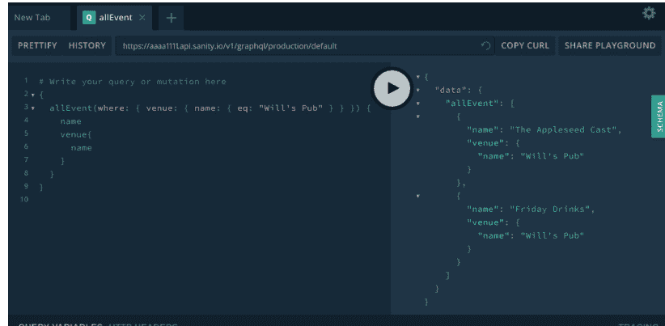
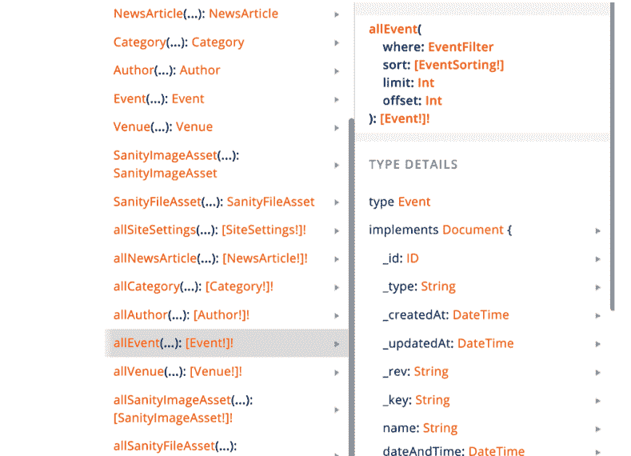

# 6
Sanity 的 GraphQL Playground

本章介绍 GraphQL，一种强大的查询语言。Sanity 的 GraphQL API 使外部程序能够在遵循其提供的标准的同时与结构化内容交互。这使开发人员能够利用开发社区中可用的丰富的 GraphQL 工具和实践生态系统。GraphQL 和 GROQ，即 Sanity 的专有查询语言，都是开源的，可以用来与 Sanity 交互。然而，虽然 GROQ 特定于 Sanity，但 GraphQL 被许多应用程序普遍使用。

在本章中，我们将解释 GraphQL 是什么，检查一些基本查询及其格式，介绍 Sanity 的 GraphQL Playground，并学习如何使用它来创建和测试 GraphQL 查询。本章将涵盖以下主题：

- GraphQL 简介
- GROQ 与 GraphQL
- Sanity.io 的 GraphQL playground 基础

### 技术要求

需要一个网络浏览器和一个终端程序。

## GraphQL 简介

首先，让我们开始了解 GraphQL。从 GraphQL 网站上，我们了解到 GraphQL 允许其用户描述数据。这意味着定义数据结构应如何形成。考虑以下示例：

```
type Event {
  name: String
  date: Date
}
```

在这里，我们定义了事件的结构。使用 GraphQL，我们可以按如下方式查询数据结构：

```
{
  event(name: "Saturday Night Party") {
    date
  }
}
```

请注意，基本结构看起来几乎相同。我们要求数据以与定义时相同的格式返回。返回的数据将具有以下格式：

```
{
  "event" {
    date: "2020-10-01"
  }
}
```

> **注意：**
> 有关 GraphQL 语法和规范的更多信息，请访问 http://spec.graphql.org/draft/。

GraphQL 的优势在于它使用户能够请求特定信息并获得可预测的结果，这些结果与请求相镜像。

在以下各节中，我们将了解 GraphQL 为什么是一种紧凑高效的标准，使其可用于从许多数据源（如 Sanity）获取数据。

我们将通过部署 GraphQL 模式并使用 Sanity 的命令行部署工具，继续我们进入 GraphQL 世界的旅程。

## 部署 GraphQL API

由于 Sanity 内部使用 GROQ，如果 Sanity 的数据集被其他应用程序使用，则需要部署可选的 GraphQL API。为此，我们需要返回到项目 `studio` 目录中的命令行。

以下命令需要在终端中输入：

```
```bash
sanity graphql deploy
```
```

我们需要安装 Sanity 命令行程序。如果尚未安装，请在命令行中输入以下内容：

```
```bash
npm install -g @sanity/cli
```
```

系统会要求您以下问题：

```
```
Do you want to enable a GraphQL playground? (Y/N)
```
```

在此提示下，只需按 *Enter* 键，或输入 Y，即可启用 playground。输出的最后一行应显示 playground 的浏览器：

```
```
GraphQL API deployed to:
https://abcd1234.api.sanity.io/v1/graphql/production/default
```
```

此 URL 可以在网络浏览器中打开。让我们检查格式。

请注意，URL 由以下部分组成：项目 ID（此处显示为 `abcd1234`），后跟 `api.sanity.io`，`v1`（版本一），`graphql`，数据集名称（在此示例中为 `production`），最后是模式名称（在本例中为 `default`）。

在下一节中，我们将探索 GraphQL 的基本语法。

### 基本 GraphQL 语法

虽然 Sanity 的 GROQ 使用更紧凑的语法，但其目标是有效地从数据集合中获取所需内容。GraphQL 的目标是允许请求服务以表达且类型化的方式指定数据的格式以返回，然后以相同的格式返回。我们现在来看 GraphQL 查询的基本语法以及它可能如何有用地轻松获取数据。

有两种基本类型的查询：

- all 前缀后跟模式名称，如下所示，用于返回多条记录。
- 单记录查询，它将只返回一条记录。

让我们开始学习 all 查询格式。

## GraphQL 的 all 查询

考虑以下示例查询：

```
{
  allEvent {
    name
  }
}
```

前面的查询将返回我们数据集中所有事件的名称。这里使用的是 event 的单数形式而不是复数形式。结果将与查询相同的格式。注意结果被包装在 data 对象中。此外，allEvent 查询在结果中重复，结果与查询格式相同：

```
{
  "data": {
    "allEvent": [
      {
        "name": "IT Conference"
      },
      ...
    ]
  }
}
```

接下来，让我们学习单记录 GraphQL 查询。

## GraphQL 的单记录查询

第二种 GraphQL 查询将只返回一条记录。以下片段是这种第二种查询的示例：

```
{
  Event(id: "6ddd2730-9aca-46dd-a7fd-850ab306f7fb") {
    name
  }
}
```

请注意，这种单记录查询需要一个参数来标识记录。在此情况下，使用事件的 id 参数。

这将返回一个事件。结果与查询格式相同。请注意，Event 查询在结果中重复：

```
{
  "data": {
    "Event": {
      "name": "IT Conference"
    }
  }
}
```

现在我们已经学习了 GraphQL 的基本语法，让我们更深入地研究它。在下一节中，我们将查看 GROQ 与 GraphQL 之间的差异。

## GROQ 与 GraphQL

在第 5 章 Sanity 的 GROQ 语言中，在高级 GROQ 部分，我们编写了一个 GROQ 查询，返回特定场馆的所有事件。现在我们将 GROQ 与 GraphQL 进行比较。

回忆 GROQ 语法，所期望的场馆名为 Will's Pub：

```
*[_type == "event" && venue->name == "Will's Pub"] {
  name,
  venue->{name}
}
```


接下来，让我们编写对应的 GraphQL 中的 GROQ 查询：

```graphql
{
  allEvent(where:
    { venue:
      { name:
        { eq:
          "Will's Pub"
        }
      }
    }
  )
    {
      name
      venue {
        name
      }
    }
}
```

GROQ 的 type == "event" 等价于 allEvent，它是一个函数。请注意 GraphQL 使用了 SQL 熟悉的 where 关键字，它是一个参数。随后是一个作为参数的对象，即 venue。venue 的 name 参数嵌套在 venue 内部。然后，eq 是 equals 的两个字母缩写。

至此，函数-参数-括号的集合结束。然后，在大括号之间，我们列出我们感兴趣返回的字段。请注意 GraphQL 在每个值之间不使用逗号，而 GROQ 使用。我们返回事件名称（name），同时也返回场馆名称，同样是嵌套的。

结果如下：

```json
{
  "data": {
    "allEvent": [
      {
        "name": "The Appleseed Cast",
        "venue": {
```

```
"name": "Will's Pub"
}
},
{
"name": "Friday Drinks",
"venue": {
"name": "Will's Pub"
}
}
]
}
}
```

正如你所见，返回了两个事件。如果只应返回名为 The Appleseed Cast 的事件，可以向 where 关键字添加一个额外的参数。会有逗号分隔符。请注意，这是事件名称，而不是场馆名称，因为两个字段具有相同的名称：

```
{
  allEvent(where: { venue: { name: { eq: "Will's Pub" } },
    name: { eq: "The Appleseed Cast" } }
  ) {
    name
    venue {
      name
    }
  }
}
```

结果仍然会是一个列表（即数组），因为使用了 allEvent；然而，该列表将只有一个值：

```
{
"data": {
"allEvent": [
{
"name": "The Appleseed Cast",
"venue": {
```

```
"name": "Will's Pub"
}
}
]
}
}
```

这将在后面很重要，因为结果将被处理为好像有不止一个结果。

在下一节中，我们将使用 Sanity.io playground 对我们的 Studio 应用程序运行 GraphQL 查询。

## GraphQL playground 基础

在第 5 章 Sanity 的 GROQ 语言中，在安装 Vision 部分，使用了 Sanity 的 Vision 工具来测试 GROQ 查询。同样，Sanity 使用 GraphQL playground 让我们可以测试 GraphQL 并与其数据集交互。

GraphQL playground 允许用户创建和运行 GraphQL 查询，这些查询稍后可用于从 GraphQL API 获取信息。在以下部分，我们将学习其基本功能。

以下是 GraphQL playground 的截图：



图 6.1 – GraphQL playground

GraphQL playground 的界面易于使用。与 Vision GROQ 工具类似，查询输入到左侧窗口，并在界面中间点击播放图标执行。

如预期，GraphQL 结果显示在右侧窗口。查询变量可以输入到底部窗口。

右侧有一个绿色标签，标记为 **SCHEMA**。点击它将显示各种 GraphQL 起始点，例如 allEvent。通过此模式导航是一种方便的方式来确定在 Sanity 中输入 `graphql deploy` 命令后 GraphQL 是否已正确部署。在 Sanity 中对模式进行任何更改后都需要此命令。

如果模式或模式字段在此不可见，则任何使用此 API 的外部服务都无法访问它，因此这是一种方便的方式来检查模式是否反映数据集的实际状态。在以下代码块中，显示了基本查询格式，以及每个参数期望的值类型：

```
allEvent(
  where: EventFilter
  sort: [EventSorting!]
  limit: Int
  offset: Int
): [Event!]!
```

点击 `allEvent` 链接后，它可能在屏幕上看起来像这样：



图 6.2 – allEvent 详情

## 查询参数

GraphQL playground 最重要的功能之一是它允许用户添加参数。这是因为在大多数实际应用中，查询参数经常被用来获得正确的结果。将 **QUERY VARIABLES** 窗口展开，通过鼠标拖动。然后，你可以输入键值对，如下所示：

```
{ "name": "Will's Pub"}
```

## 总结

在本章中，我们学习了 GraphQL 的构成方式，GraphQL 与 GROQ 的区别，以及如何使用 where 过滤结果。最后，我们学习了如何使用 Sanity 的 GraphQL playground 来构建和验证模式，并查看了示例。GraphQL 将成为所有希望连接 Sanity 的程序以标准且紧凑的方式轻松实现连接的手段。在接下来的章节中，GraphQL 将很重要，因为静态站点生成器将专门使用它。

在下一章中，我们将介绍 Gatsby，这是 Jamstack 的另一部分。我们将使用此处显示的一些 GraphQL 示例，以便将 Sanity 的数据集连接到 Gatsby。
