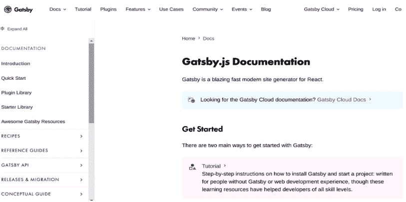

# 7 Gatsby – 简介

Gatsby 是本书中使用的三部分 Jamstack 系统的第二部分。Gatsby 对自己的定义如下：

> "*一个基于 React 的免费开源框架，帮助开发者构建极速的网站和应用。*"

由于它是一个免费开源框架，所有代码都很容易检查和修改。其次，Gatsby 生产的网站和应用速度极快，因为它创建的 HTML 页面是实际文件，而不是仅通过后端进程在服务器端语言中生成。

首先，我们将学习 React 是什么，然后，我们将查看 Gatsby 基础项目的结构，检查其文件和文件夹结构。

本章将涵盖的主要主题如下：

- 基于 React 的 Gatsby
- Gatsby 基础项目结构
- gatsby develop 命令

### 技术要求

对于本章，需要安装 Gatsby 应用程序，并需要一个终端程序和一个网页浏览器。

## 基于 React 的 Gatsby

**React** 是一个用于创建用户界面的 JavaScript 库。它使用声明式语法，并且还使用模块化组件系统。由于 Gatsby 建立在 React 之上，你在学习 Gatsby 时会很快发现许多 React 的部分。Gatsby 生态系统中的另一个部分 **JSX** 也被 Gatsby 使用。JSX 允许 Gatsby 页面元素使用熟悉的 HTML 标签格式编写，并允许使用属性向其传递参数。每个 JSX 标签可以是一个项目的单一单元。由于 JSX 标签也是 JavaScript，它们可以与 JavaScript 编程逻辑集成。

由于 React 是众多 JavaScript 库和框架之一，例如 Angular 和 Vue，框架本身相当庞大，具有健康的生态系统，并且需要大量学习才能熟练掌握。幸运的是，如果你想更深入地学习如何使用它，有许多专门针对 React 的培训课程。虽然学习 React 超出了本书的范围，但学习 Gatsby 会间接让你接触到 React 的一些做法。

## Gatsby 基础项目结构

在此项目中，项目的 files 是通过 `https://create.sanity.io` 创建的。在创建过程中，Gatsby 的项目文件结构和配置已自动安装在 `/web` 文件夹中，这大致等同于使用 Gatsby 的新项目创建命令安装的内容。

如果 Gatsby 使用 `-g` 标志创建，表示全局，它会被安装并在用户系统范围内可用：

```
`npm install -g gatsby`
```

否则，Gatsby 命令可以根据 `package.json` 文件在安装的目录中运行。

也可以通过在终端中输入以下命令创建新项目：

```
`gatsby new projectname`
```


在前面的示例中，`projectname` 是你所选项目的名称，也将成为在输入命令的任何位置创建的文件夹的名称。

我们将在接下来的章节中更详细地查看我们项目的目录结构。

## gatsby-config.js

我们要学习的第一個文件是 `gatsby-config.js`。该文件安装在 /web 文件夹中。

接下来，我们将查看该文件的三个主要要点：

- 它的结构
- 它的语法
- Gatsby 的 Sanity 安装

让我们开始吧。

## Structure

文件以 `module.exports` 开始，这是 Node.js 中允许大括号内容被暴露并在应用程序的其他部分中使用（即导出到）的 一种方式：

```
module.exports = {}
```

文件的主要部分是 `siteMetadata`，它保存应用程序的元数据，例如 `title` 和 `description`，以及 `plugins`，它是一个插件数组，以方括号在语法上表示。`gatsby-config.js` 文件的摘录如下所示：

```
module.exports = {
  siteMetadata: {
    title: `Gatsby Default Starter`,
    description: `Kick off your next, great Gatsby project with this default starter...`,
    author: `@gatsbyjs`,
  },
  plugins: [
    `gatsby-plugin-react-helmet`,
    {
      resolve: `gatsby-source-filesystem`,
```
```
options: {
    name: `images`,
    path: `${__dirname}/src/images`,
  },
  },
  ...
],
}
```

接下来，我们将查看文件的语法。

## Syntax

你可能不熟悉 Gatsby 在整个过程中使用的语法：

```
path: `${__dirname}/src/images`,
```

这种语法称为 **模板字面量**，是 ECMAScript 2015，即 ES6，最新 JavaScript 规范的一部分。这里使用了反引号字符，而以前通常会使用单引号。

单引号的一个缺点是它们不是多行的，因此例如，需要加号来连接或顺序组合两个短语。以下是一个示例：

```
var multilineString = 'This is an example of a ' +
' multi-line string that is more than one line long.';
```

在 ES6 中，可以通过以下方式实现等效功能：

```
let multilineString = `This is an example of a
multi-line string that is more than one line long.`
```

此外，`let` 关键字被用作 `var` 关键字的替代。以前只能声明变量（var），现在可以使用 let 分配可以更改的值。`const` 关键字可用于指定不可更改的值，即不可变。

此外，字符串插值是通过将变量括在大括号（也称为花括号）中，然后前面加上美元符号（$）来实现的。这允许在同一表达式中使用变量和简单字符串，如下所示：

```
path: `${__dirname}/src/images`,
```

在这里，`__dirname` 变量将被目录名称替换。参见以下示例：

```
path: `/home/chris/src/images`
```

最后，让我们学习如何配置 Gatsby 以与 Sanity 配合使用。

## Sanity's Gatsby installation

由于本书中使用的 Gatsby 版本是根据 https://www.sanity.io/create 上的说明安装和配置的，因此它预先配置为与 Sanity 配合使用，即使 Gatsby 可能会从许多不同类型的信息源获取和使用信息。这是通过 Gatsby 的源插件完成的，其名称格式如下：

```
gatsby-source-name
```

前一段代码片段中的 name 值可以用 Sanity（gatsby-source-sanity）、WordPress（gatsby-source-wordpress）、Drupal（gatsby-source-drupal）或写作本书时存在的数百种不同类型的数据源中的任何一种来替换。默认的 Gatsby 源是 gatsby-source-filesystem。在第 9 章 Gatsby 源插件中，我们将更详细地讨论这个问题。

这是 gatsby-source-sanity 插件的一个示例。它有一系列选项：

```
{
    resolve: "gatsby-source-sanity",
    options: {
        ...clientConfig.sanity,
        token: process.env.SANITY_READ_TOKEN,
        watchMode: !isProd,
        overlayDrafts: !isProd
    }
}
```

首先要注意的是以下行：

```
...clientConfig.sanity,
```

三重句点在 JavaScript 中用作展开运算符，它将所有对象属性分配到单独的变量中。但首先，让我们看看之前发生了什么。

此配置文件的前几行很重要：

```
// Load variables from `.env` as soon as possible
require('dotenv').config({
  path: `.env.${process.env.NODE_ENV || 'development'}`
})
const clientConfig = require('./client-config')
const isProd = process.env.NODE_ENV === 'production'
```

这些行很重要，因为它们确定 Gatsby 的环境变量并设置 Sanity 集成。环境变量是其值可能根据使用它的环境而变化的变量。

例如，在生产环境中，完成表单后可能会发送电子邮件，而在开发环境中则不会发送。

## dotenv

dotenv 文件是一种用于存储配置值的约定。它通常不会提交到源代码控制，GitHub 在本例中，以便凭据和密码可以保持私密：

```
require('dotenv').config({
  path: `.env.${process.env.NODE_ENV || 'development'}`
})
```

/web 目录中有一个此文件的示例，即 .env.production，其格式如下：

```
GATSBY_SANITY_PROJECT_ID="abcd1234"
GATSBY_SANITY_DATASET="production"
```

process.env.NODE_ENV 用于确定当前使用的是哪个环境。development 是如果未指定则使用的默认环境，因此要启用此文件，它必须以正确的格式存在。复制 .env.production 并将其命名为 env.development。.env.production 文件将用于生产部署。

## Client configuration

下一行需要加载 client-config 文件的内容，这意味着它必须将内容带入当前代码。

以下是该文件的内容。它用于设置两个值，projectId 和 dataset。它从 .env 文件中分配值（如果存在），否则分配创建项目时提供的实际名称：

```
module.exports = {
  sanity: {
    projectId: process.env.GATSBY_SANITY_PROJECT_ID || 'abcd1234',
    dataset: process.env.GATSBY_SANITY_DATASET || 'production'
  }
}
```

这些值被设置到 clientConfig 变量中，然后内容被展开到 gatsby-source-sanity 选项中，在那里它们用于连接到 Sanity GraphQL API：

```
options: {
  ...clientConfig.sanity,
```

const clientConfig = require('./client-config'),
```

此时，clientConfig 常量保存 Sanity 配置。

接下来，让我们了解 Gatsby 的关键文件。

## Key Gatsby files

任何 Gatsby 项目中的三个关键文件都是 gatsby-ssr.js、gatsby-node.js 和 gatsby-browser.js。它们共同属于 Gatsby API。每个文件都有特定的用途。有趣的是，每个文件都是可选的，因此可以根据需要创建并添加到项目中。

了解构建过程的工作方式很重要。请记住，由于静态站点生成器实际上只生成文件，一旦网页生成，就无法再执行服务器端代码。所有服务器端代码执行都将在名为 `gatsby-ssr.js` 的文件中发生。

让我们详细查看这三个关键文件。

- `gatsby-ssr.js`：**SSR** 是 **服务器端渲染** 的缩写，因此很快就会清楚该文件的用途。该文件允许你在 Gatsby 在服务器上生成（渲染）页面时修改页面的内容。从该文件内部可以调用的函数将在构建时与页面交互，因为它们正在被渲染。
- `gatsby-node.js`：由于 Gatsby 使用 Node.js，因此该文件中的函数允许 Gatsby 深入整个过程。
- `gatsby-browser.js`：这是网页渲染后实际页面交互发生的 文件。

## Gatsby folders

以下是主要 Gatsby 文件夹的列表。

### src

此文件夹包含 Gatsby 源文件，包括用于设置网站样式的图像和级联样式表。此外，`src` 文件夹中还包含以下文件夹。

- **Components**：在此目录中是用于网站构建的构建块。在此目录内，将有在多个页面中使用的内容片段。
- **Pages**：此目录的内容用于单个页面；例如，*关于我们* 页面，它是其类型的唯一页面。另一个示例是 404 页面，当用户在浏览器地址栏中输入不存在的网址或单击指向网站上不存在的页面的链接时使用。每个页面应具有独特的布局。如果页面过于相似，则应使用模板，其中存在许多相同类型的页面，例如博客文章。
- **Templates**：如前所述，模板用于创建许多相同类型的页面，其中单个模板的所有页面几乎具有完全相同的格式和布局，例如，仅页面标题、标题和正文内容不同。


## public

该文件夹位于`src`目录之外，当在命令行中运行`gatsby build`时，如果部署网站页面尚不存在，则会在此文件夹中创建它们。当首次使用`gatsby serve`命令查看Gatsby网站时，这些文件也将作为文档根目录被引用。`public`目录的内容可以随时删除并重新创建，因为运行`gatsby build`总会重新生成它们。

完整的Gatsby文档可在 https://www.gatsbyjs.com/docs/ 找到，内容如下：



图7.1 – Gatsby网站文档

现在我们已经了解了Gatsby的文件和文件夹结构，接下来将继续学习如何使用Gatsby。要启动Gatsby，我们需要使用命令行。以开发模式启动Gatsby。

## gatsby develop命令

在命令行中使用Gatsby可为各个项目阶段提供多种不同功能。最初，`gatsby develop`命令会以开发模式启动Gatsby，这样就能实时查看更改。该命令会持续运行，直到你按下`Ctrl + C`。这个组合键在UNIX操作系统中用于终止（杀死）进程。

在`/web`目录内输入`gatsby develop`，这将使Gatsby开发环境（.env.development）运行，使用的是开发配置，而非生产配置（.env.production）。此外，它还会创建一个名为**GraphiQL**（发音类似*graphical*）的GraphQL游乐场。这将使我们能够真正与Sanity的GraphQL接口交互，并开始编写、测试和查看创建活动网站所需的查询结果。

## 总结

在本章中，我们了解了Gatsby是什么，以及它如何使用JavaScript和React构建。接着，我们学习了它的配置文件是如何创建的，以及其主要组成部分是什么。我们还学习了如何配置`gatsby-source`插件以与Sanity交互。此外，我们还学习了`gatsby develop`命令以及如何启动一个项目。

在下一章中，我们将开始使用GraphiQL（一个GraphQL游乐场）的旅程，并进一步接近创建网站。这将使我们能够在Gatsby上下文中设计、执行和测试GraphQL查询。
