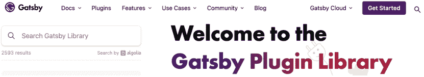
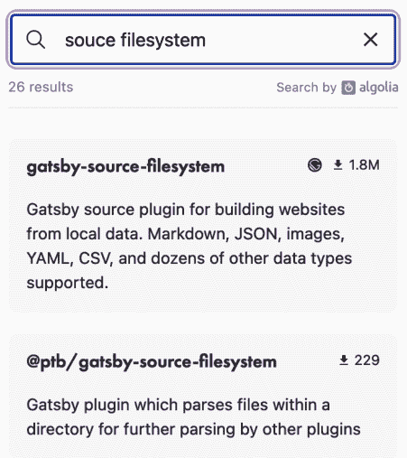

# 9

## Gatsby来源插件

在本章中，我们将解释如何通过使用插件来扩展Gatsby的功能。我们将首先探讨插件的基础知识，然后了解如何安装和维护插件。我们将探索在哪里可以找到插件，以及Gatsby如何管理其插件。在本章末尾，我们将为Gatsby应用程序安装并配置两个新插件。

本章将涵盖以下主题：

- 了解插件
- 搜索、安装和配置插件

### 技术要求

为了透彻理解本章，我们需要以下内容：

- 一个终端应用程序
- npm
- 已安装的Gatsby应用程序。

本章的代码文件可以在 https://github.com/PacktPublishing/Jumstart-Jamstack-Development/tree/chapter_nine 找到。

> 注意：
> 仅当您拥有Drupal网站时，Drupal部分才相关。GitHub链接：https://github.com/PacktPublishing/Jumstart-Jamstack-Development/tree/chapter_nine_drupal。

启用了以下模块的Drupal应用程序：

- RESTful Web Services
- JSON:API
- Serialization

### 了解插件

在本节中，我们将探讨插件的基础知识、什么是插件，以及为什么项目中需要插件。我们将探索npm这个开源代码的公共集合。我们将解释语义化版本控制如何工作以及为什么它很重要。然后我们将看到如何安装和维护插件。

**Gatsby插件**是Node.js包，是一组JavaScript和**超文本标记语言/层叠样式表（HTML/CSS）**文件，用于扩展Gatsby的**应用程序编程接口（API）**，并为应用程序添加新功能。您可以通过安装插件来启用某项功能，也可以通过卸载插件来禁用它。

Gatsby的可扩展特性允许您以可复用包的形式组织自定义业务逻辑，从而创建自己的插件，这将在下一节中讨论。

### Node包管理器

开发人员可以从npm下载插件，npm是GatsbyJS等JavaScript框架的开源代码公共集合。开发人员可以上传他们的插件，并让其他开发人员复用相同的代码。其他开发人员也可以通过修复错误或添加功能来为所使用的插件做出贡献。您还可以上传私有包到npm。

您可以通过以下网站上的搜索工具在npm上搜索插件：

```
https://www.npmjs.com
```

在上述网站的**包**页面上，您可以找到包的描述，以及安装说明、依赖项和版本。在下一节中，我们将探讨使用语义化版本的包版本控制方法。

### 语义化版本

在软件开发中，开发人员为软件的每个唯一状态分配一个唯一的版本号。对软件进行版本控制有助于开发人员选择实现其软件所需的正确版本。这也适用于软件包。

当创建一个包并添加到npm时，推荐的第一个版本是1.0.0。随着进一步的实现和错误修复，版本号会根据所引入更改的类型而递增。

包必须遵循主版本号.次版本号.修订号（major.minor.patch）的语义化版本规则，详细说明如下：

- 当开发人员引入不兼容的API更改时，*主版本号*递增一。版本从1.0.0变为2.0.0。
- 当开发人员引入向后兼容的新功能时，*次版本号*递增一。版本从1.0.0变为1.1.0。
- 当开发人员引入向后兼容的错误修复时，*修订号*递增一。版本从1.0.0变为1.0.1。

接下来，我们将看到如何从npm安装包。

### 从npm安装包

要从npm安装包，请在终端中运行以下命令：

```
npm i <package_name>
```

在这里，<package_name>是包的名称。例如，如果您想从npm安装一个名为birdie-hop的包，可以在终端中运行以下命令：

```
npm i birdie-hop
```

使用上述命令，npm将把birdie-hop包的最新稳定版本安装到您的应用程序中。

如果在版本前不加任何字符，如果您从未在应用程序中安装过该插件，则会下载该确切版本；否则会将包更新到该相同版本。现在，请看这个代码片段：

```
npm i birdie-hop@~1.2.3
```

波浪号（~）告诉npm它可以安装或更新包到可用的最新修订版本。在这种情况下，版本将大于1.2.3且小于1.3.0。接下来，请看下面的代码片段：

```
npm i birdie-hop@^1.2.3
```

插入符号（^）告诉npm它可以安装或更新包到可用的最新次版本。在这种情况下，版本将大于1.2.3且小于2.0.0。现在，请看这个代码片段：

```
npm i birdie-hop@*1.2.3
```

星号（*）告诉npm它可以安装或更新包到任何可用的主版本。在这种情况下，版本将大于1.2.3，并且对更新没有限制。让我们继续了解如何更新插件。

默认情况下，包会进入dependencies数组中，并在生产环境中被您的应用程序需要。您还可以设置仅在本地开发环境或测试环境中需要的包，例如自动化测试包。该包将进入package.json文件中的devDependencies数组，并可通过添加--save-dev标志来添加，如下所示：

```
npm i birdie-hop --save-dev
```

### 更新插件

当插件发布更新时，我们可以通过npm更新插件。要更新package.json文件中列出的所有包，请运行以下命令：

```
npm update
```

要更新单个包，请运行以下命令：

```
npm update <package_name>
```

在这里，<package_name>是您想要更新的包的名称。如果您想更新`birdie-hop`包，可以运行以下命令：

```
npm update birdie-hop
```

在更新或安装过程中，npm将检查`package.json`文件，并下载或更新插件到允许的版本。

## package.lock文件

当您在团队中工作时，您希望团队中的所有开发人员使用相同的包版本。在这种情况下，`package.lock`文件就派上了用场。当您修改`package.json`文件或`node_modules`文件夹时，它会自动生成。它列出了应用程序应使用的所有包的精确版本。`package.lock`文件将避免同一团队中两个开发人员在同一项目上使用不同版本的`birdie-hop`包的情况。

在本节中，我们探讨了包的主要组成部分。我们学习了在哪里可以找到包以及如何安装它们。我们学习了包版本控制，以及如何将特定包安装或更新到特定版本。我们还探讨了`package.json`和`package.lock`文件在确保您的应用程序获得正确版本的正确包方面所发挥的重要作用。

在下一节中，我们将为Gatsby应用程序安装一个包。

## 搜索、安装和配置插件

在本节中，我们将探索Gatsby公共插件库。我们将了解如何安装Gatsby插件，以及在哪里可以找到要安装插件的配置。

我们将安装并配置`gatsby-source-filesystem`和`gatsby-source-drupal`插件，并了解如何使用它们。

## Gatsby插件库

Gatsby还提供了一个插件库，这是一个带有*Gatsby*关键字标记的npm包的集合。在这个库中，可以找到大多数站点都会使用的标准插件，与**搜索引擎优化（SEO）**、**真正简单的聚合（RSS）**（Really Simple Syndication，RSS）、社交媒体按钮、第三方评论服务、电子商务集成等相关。


> **重要提示**  
> 在开始编写自定义插件之前，请确保该插件在 Gatsby 插件库中尚不存在。

使用 Gatsby 插件库中的插件有诸多好处。这里列出其中的一些：

- **节省时间：** 如果一个插件能完全实现你的任务，你可以直接安装、配置并开始使用。如果一个插件只能部分实现你的任务，你也可以在其基础上添加自定义功能进行扩展。
- **修复 Bug：** 你或其他开发者可以修复 Bug 并将信息发布到 npm，然后通过更新应用中的插件来获取这些修复。
- **改进功能：** 与修复 Bug 类似——你或其他开发者可以为插件添加新功能并发布到 npm。
- **安全性：** 你或其他开发者可能会发现插件中的代码或依赖存在安全问题；更新到最新的安全版本并发布到 npm。

要查找 Gatsby 插件，请访问位于 `https://www.gatsbyjs.org/plugins/` 的 Gatsby 插件库。

下面的页面提供了一个 **Search Gatsby Library** 文本框，让你可以在 2000 多个插件中导航搜索！文本框位于页面左上方，如下图所示：



*图 9.1 – Gatsby 插件库页面*

每个 Gatsby 插件都附带了如何安装、配置和使用的详细说明。Gatsby Source 插件允许 Gatsby 从数据库、文件、RESTful API（其中 **REST** 代表 **Representational State Transfer**）等来源获取内容。

我们在*第 2 章，Sanity 简介*中安装的 `Starter` 项目已经预装并配置了 `gatsby-source-sanity` 插件。通过 `gatsby-source-sanity` 插件，我们能够从 Sanity 应用中获取内容。

在下一节中，我们将说明如何在 Gatsby 插件库中搜索插件。作为示例，我们将安装并配置两个源插件：`gatsby-source-filesystem` 和 `gatsby-source-drupal` 插件。

## 搜索插件

所有 Gatsby 插件都可以在位于 https://www.gatsbyjs.org/plugins/ 的 Gatsby 插件库中找到。

在页面左侧有一个插件搜索工具。开始输入要查找的插件的潜在关键词。

例如，如果你正在查找 Google Analytics 插件，可以输入 `google analytics`。

在我们的示例中，我们将查找 `gatsby-source-filesystem` 插件，因此可以输入 `source filesystem`，如下面的截图所示：



图 9.2 – Gatsby 插件库页面

在页面左侧，会返回包含该关键词的所有结果。每个结果包含插件名称、描述、下载次数和插件类型。当你点击插件结果时，你将看到插件的描述以及如何安装的说明。

### 安装插件

插件通过命令行使用 npm 安装。当你找到所需的插件后，请在插件页面的 Install 部分查看安装命令，如下面的截图所示：

### 安装

```
npm install gatsby-source-filesystem
```

图 9.4 – gatsby-source-filesystem 插件页面的 Install 部分

在项目 `web` 文件夹内的终端中，输入上面截图所示的命令，然后按 Enter 键。

该命令会将插件及其依赖项下载到 `node_modules` 文件夹中，并将 gatsby-source-filesystem 插件及要下载的版本添加到 `package.json` 文件的 Dependencies 部分。

### 配置插件

现在，插件文件已经在自己的应用中了，但为了启用插件，我们需要将其添加到位于 Gatsby 项目根目录下的 gatsby-config.js 文件中——在我们的示例中，该文件位于 `web` 文件夹内。

gatsby-config.js 文件是应用中最重要的文件之一。它包含以下配置：

- siteMetadata（对象）
- plugins（数组）
- pathPrefix（字符串）
- polyfill（布尔值）
- mapping（对象）
- proxy（对象）
- developMiddleware（函数）

要启用插件，只需在 gatsby-config.js 文件的 plugins 数组中添加插件名称，如下所示：

```
module.exports = {
  plugins: [
    ...
    'gatsby-plugin-name',
    ...
  ]
}
```

一些其他插件可能还需要配置选项，这些选项也可以添加到 gatsby-config.js 文件的 plugins 数组中，如下面的代码片段所示：

```
module.exports = {
  plugins: [
    ...
    {
      resolve: 'plugin-name',
      options: {
        // Options list, if any
      },
    },
    ...
  ]
}
```

既然我们知道了如何启用插件，现在让我们启用 gatsby-source-filesystem 插件，并告诉 Gatsby 在哪里可以找到我们的内容。在 Gatsby 插件页面的 How to use 部分，有如何在应用中配置该插件的详细说明。

gatsby-source-filesystem 插件可以接受三个选项，如下所示：

- name：GraphQL 查询使用的名称（必填）
- path：实际文件所在的文件夹（必填）
- ignore：需要忽略的文件扩展名列表（可选）

在我们的示例中，可以这样添加配置：

```
module.exports = {
  plugins: [
    ...
    {
      resolve: 'gatsby-source-filesystem',
      options: {
        path: '${__dirname}/src/data',
        name: 'md-files',
        ignore: ['**/\.*'],
      },
    },
    ...
  ]
}
```

通过上述代码，我们启用了 gatsby-source-filesystem 插件，并告诉 Gatsby 在哪里找到文件、内容的名称，以及忽略所有以点开头的文件。现在，重新启动你的应用。在命令行中按 Ctrl + C，然后运行以下命令：

```
npm run dev
```

作为示例，我们将从一个 Markdown 文件中查询数据。我们将在 `web/src` 应用文件夹下创建一个名为 `data` 的文件夹。在 `data` 文件夹内，我们创建所有需要的 Markdown 文件。文件按子文件夹组织，系统会自动找到它们。为此，我们需要 gatsby-transformer-remark 插件，将在下一节中安装。

## 安装和配置 gatsby-transformer-remark 插件

该插件解析并编译 Markdown 文件，并将其转换为 HTML。它还支持 frontmatter，这样你就可以定义 title、slug、date、image、excerpt 等字段。

让我们安装并配置该插件。

### 安装插件

由于这是一个 Gatsby 插件，因此可以在插件库中找到它，并附带安装和配置说明。

在你的 Gatsby 文件夹中，运行以下命令来安装插件：

```
npm install --save gatsby-transformer-remark
```

### 配置插件

插件下载完成后，我们只需在 gatsby-config.js 文件中添加插件名称即可启用它，如下面的代码块所示：

```
module.exports = {
  plugins: [
    ...
    'gatsby-transformer-remark',
    ...
  ]
}
```

就这么简单！现在，重新启动你的应用，我们已准备好创建第一个内容！

## 创建内容文件

在本节中，我们将在一个 Markdown 文件中创建内容。如上所述，gatsby-transformer-remark 允许你在 Markdown 文件中添加字段。让我们开始添加 frontmatter，如下所示：

1. 在 `web/src/data` 中创建一个名为 `hello-world.md` 的文件。在文件的开头和结尾添加三条短横线。在这两行之间，你可以定义你的 frontmatter，如下所示：

```
---
// Define your frontmatter.
---
```

2. frontmatter 中的字段可以定义为键/值对。我们可以添加想要的信息。在本例中，我们将按以下方式添加 title、date 和 excerpt：

```
---
title: Hello World
date: "2020-07-12T09:01:00"
excerpt: Hi! This is my first content from a markdown file! I will fill with James Joyce's poem.
---
```


3. 现在我们有了字段，让我们添加正文并保存文件，如下所示：

```
---
title: Hello World
date: "2020-07-20T09:01:00"
excerpt: Hi! This is my first content from a markdown file! I will fill with a James Joyce's poem.
---
## Lean out of the window

> Lean out of the window,
> Goldenhair,
> I hear you singing
> A merry air.
> ...
> Singing and singing
> A merry air,
> Lean out of the window,
> Goldenhair.
```

我们的文件现在可以被 GraphiQL 查询了！

## 使用 GraphiQL 查询文件系统

现在我们已经把所有插件、配置和内容文件都放在了正确的位置，让我们开始从 GraphiQL 查询内容。

前往 http://localhost:8000/___graphql 并运行以下查询：

```
query MyQuery {
  allMarkdownRemark {
    edges {
      node {
        frontmatter {
          title
          date
          excerpt
        }
        html
      }
    }
  }
}
```

```
resolve: 'gatsby-source-drupal',
  options: {
    baseUrl: 'site-url', //for example https://example.com
  },
},
... 
],
}
```

通过上面的代码，我们告诉 Gatsby 启用了 gatsby-source-drupal 插件，并且我们指定了 Drupal 应用的统一资源定位符（URL）。

现在我们已经安装并配置了插件，可以开始通过 GraphQL 查询我们的 Drupal 应用了。

## 使用 GraphQL 查询 Drupal

配置好插件后，我们可以通过 GraphiQL 查询 Drupal 应用来测试它。

前往 http://localhost:8000/___graphql 并运行以下查询：

```
query MyQuery {
  allNodeArticle {
    edges {
      node {
        title
        body {
          value
        }
      }
    }
  }
}
```

此查询将返回以下结果：

```
```
{
    "data": {
      "allNodeArticle": {
        "edges": [
          {
            "node": {
              "title": "Hello world",
              "body": {
                "value": "<p>Lean out of the window,<br />\r\nGoldenhair,<br />\r\nI hear you singing<br />\r\nA merry air.</p>\r\n<p>My book was closed,<br />\r\nI read no more,<br />\r\nWatching the fire dance<br />\r\nOn the floor.</p>\r\n<p>I have left my book,<br />\r\nI have left my room,<br />\r\nFor I heard you singing<br />\r\nThrough the gloom.</p>\r\n<p>Singing and singing<br />\r\nA merry air,<br />\r\nLean out of the window,<br />\r\nGoldenhair.</p>\r\n"
              }
            }
          }
        ]
      }
    }
}
```
```

在本节中，我们安装并配置了 `gatsby-source-drupal` 插件。我们还查询了一个 Drupal 应用并从应用中检索了数据。

在下一节中，我们将了解如何在一个查询中同时查询 `gatsby-source-filesystem` 和 `gatsby-source-drupal` 插件。

# ### 同时查询文件系统和 Drupal 插件

可以在同一个查询中查询两个内容源，这在构建包含来自不同来源的内容的列表页面时非常有利。

我们的查询将包含属于两个插件的调用和字段。我们将得到一个单一的响应，其中包含来自两个来源的结果，按其根名称分隔。在这种情况下，Drupal 内容将包含在 `allNodeArticle` 数组下，而文件系统内容将包含在 `AllMarkdownRemark` 数组下。

正如我们已经看到的，我们可以前往 `http://localhost:8000/___graphql` 并运行以下查询：

```
query MyQuery {
  allNodeArticle {
    edges {
      node {
        title
        body {
          value
        }
      }
    }
  }
  allMarkdownRemark {
    edges {
      node {
        frontmatter {
          title
          date
          excerpt
        }
        html
      }
    }
  }
}
```

此查询将返回以下结果：

```
```
{
  "data": {
    "allNodeArticle": {
      "edges": [
        {
          "node": {...}
        }
      ],
    "allMarkdownRemark": {
      "edges": [
        {
          "node": {...}
        }
      ]
    }
  }
}
```
```

正如我们所见，我们在同一个查询结果中同时获得了来自 Drupal 和文件系统的两个不同来源的内容。

# ## 总结

在本章中，我们学习了如何使用插件扩展 Gatsby 以丰富应用的功能。我们学习了以下内容：什么是插件；npm；如何使用语义化版本控制；以及如何安装和更新插件。我们还学习了 Gatsby 插件库的结构以及如何安装和配置 Gatsby 插件。我们安装并配置了 `gatsby-source-filesystem` 和 `gatsby-transform-remark` 插件，并使用 GraphQL 查询 Markdown 文件中的内容。我们还安装并配置了 `gatsby-source-drupal` 插件，并使用 GraphQL 查询 Drupal 应用中的内容。

当我们需要从其他来源获取内容时，这些插件很有用，特别是当我们需要构建一个从不同来源聚合内容的应用时。

在下一章中，我们将讨论 Gatsby 组件以及页面、模板和局部组件的结构，以及它们之间的区别。

## 进一步阅读

+   - 在 https://semver.org/ 阅读更多关于语义化版本控制的内容。
+   - 在 https://www.gatsbyjs.org/packages/gatsby-transformer-remark/ 阅读更多关于 gatsby-transformer-remark 插件的内容。
+   - 在 https://www.gatsbyjs.org/packages/gatsby-source-drupal 阅读更多关于 gatsby-source-drupal 插件的内容。
+   - 在 https://www.gatsbyjs.org/packages/gatsby-source-filesystem/ 阅读更多关于 gatsby-source-filesystem 插件的内容。
