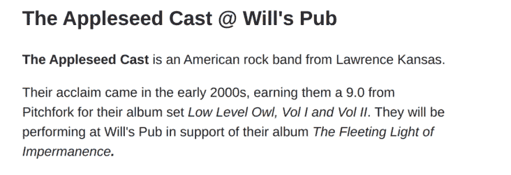

# 10
构建 Gatsby 组件

本章介绍 Jamstack 的 M 组件；即标记。标记最常用于渲染或生成最终用户将在浏览器中查看的内容，并附带一些格式。Gatsby 中的代码模块化是通过使用组件实现的，这是其构建块。每个使用 JavaScript 和 JSX 构建的组件构建块将接受输入并向浏览器返回 HTML 和网络内容。在本章中，我们将学习如何创建、编辑和扩展这些组件——网站的构建块。

组件存在多种形式，因此我们还将了解它们如何生成单个页面，作为页面模板存在，以及页面局部组件的结构，以及三者之间的区别。

本章将涵盖的主要主题如下：

+   - React 组件
+   - 理解组件的类型

### 技术要求

本章需要一个终端程序和一个源代码编辑器程序。

本章的代码文件可以在以下链接找到：https://github.com/PacktPublishing/Jumpstart-Jamstack-Development/tree/chapter_ten。

## React 组件

Gatsby 在底层使用 React，因此可以利用 React 的所有功能。React 组件大多是一个返回某些内容的 JavaScript 函数。通过利用 GraphQL，开发人员可以使用 Gatsby 的源插件将数据传递到页面。属性通常发送到组件，然后事件向上传递。这些模式——props 向下，事件向上，或数据向下，动作向上——在多个 JavaScript 框架中使用，并且非常容易理解。一旦创建了 React 组件，它可以被导入到另一个组件中以便轻松重用。

## 标签约定

如前一节所述，一旦创建了组件，就可以在 Gatsby 中像使用自己的 HTML 标签一样调用或使用它，因此对于熟悉 HTML 标签工作的人来说使用起来很熟悉。这对于可读性很有用，因为输出看起来像 HTML 而不是 JavaScript 代码。使用 React 组件的约定是将组件名称封装在 HTML 标签中。它必须以大写字母开头。

为了说明这个概念，例如，如果我们有一个名为 books 的组件，我们可以按如下方式将其包含在项目中：

```
<Books />
```

让我们开始查看 Gatsby 中使用的各种组件类型。

## 理解组件的类型

本项目中使用了三种主要类型的 Gatsby 组件：页面组件、模板和局部组件。让我们分别查看每种类型，因为它们都服务于不同的目的。


### Gatsby 页面组件

Gatsby 中使用的最简单组件类型之一是页面组件。Gatsby 页面组件仅用于单个、唯一的页面，例如索引（主页）、404 页面或“关于我们”页面。此页面只会生成一次。

#### 构建和修改 Gatsby 页面组件

如前所述，页面是唯一的。通过创建一个页面组件并将其放置在 `/web/src/pages` 文件夹中，Gatsby 将自动生成该页面。

Gatsby 中页面组件的内容可以像下面的示例一样简单，它将整个页面内容放在一个字符串中：

```
// Does not require React because there is no JSX
const AboutUsPage = () => (
  `Who we are: .......`
)
export default AboutUsPage
```

下面是编写上述代码的一种更简短方式：

```
const AboutUsPage = () => {
return `Who we are: .......`
}
```

通过使用 JSX 增强此示例，我们可以创建如下示例：

```
//Requires React because this example uses JSX tags.
import React from 'react'

const AboutUsPage = () => (
  <html>
    <body>
      <h1>Who we are:</h1>
        <p>.......</p>
    </body>
  </html>
)
export default AboutUsPage
```

如果我们将文件命名为 `about-us.js`，并将其放置在 `/web/src/pages/` 目录中，那么运行 Gatsby 后将显示以下屏幕截图：

我们是谁：......

图 10.1 – “关于我们”页面的屏幕截图

此 AboutUsPage 示例将在浏览器中渲染为 HTML。

## Gatsby 模板组件

顾名思义，Gatsby 模板组件就是模板。这些组件用作页面的模板，例如文章页面，其中页面的某些部分将填充唯一内容。这些模板会根据需要处理多次，以生成所需的全部内容。

### 构建和修改模板组件

为了说明这一概念，我们将为网站上的活动创建一个模板。我们需要处理的第一个文件是 `/web/src/gatsby-node.js`。此文件包含使用模板显示博客文章的代码。

在 `gatsby-node.js` 文件的底部，相关代码如下：

```
exports.createPages = async ({graphql, actions}) => {
  await createBlogPostPages(graphql, actions)
}
```

现在，我们将添加另一个函数，通过 GraphQL 生成来自 Sanity 的活动：

```
exports.createPages = async ({graphql, actions}) => {
  await createBlogPostPages(graphql, actions)
  await createEventPages(graphql, actions)
}
```

接下来，我们将复制 createBlogPostPages 的内容。整个函数都应该复制。不过，为节省篇幅，函数中间的部分被省略了。以下是一个片段：

```
async function createBlogPostPages (graphql, actions) {
  const {createPage} = actions
  const result = await graphql(`
  .....
createPage({
    path,
    component:
        require.resolve('./src/templates/blog-post.js'),
    context: {id}
    })
})
```

下面是新创建的 createEventPages 函数的结构：

```
async function createEventPages(graphql, actions) {
    const {createPage} = actions
    const result = await graphql(`
    {
        allSanityEvent {
            ...
        }
    }
`)
    ...
    if (result.errors) throw result.errors

    const eventEdges = (result.data.allSanityEvent || {}).edges || []
    ...
    eventEdges
    .forEach((edge, index) => {
        ...
    })
```

现在，让我们检查这段代码。使用 graphql 和 actions 参数创建一个异步函数。该函数始终会返回一个 promise：

```
async function createEventPages(graphql, actions) {
```

从 actions 中提取 createPage 方法，将其声明为常量，或者说对其进行解构：

```
const {createPage} = actions
```

声明常量 result，用于保存 GraphQL 查询的结果。JavaScript 函数会等待查询完成后再继续执行。查询包含在反引号运算符（`）中：

```
const result = await graphql(`
{
```

下面几行与 GraphQL 查询类似，它通过 `gatsby-source-sanity` 从 `allSanityEvent` 返回 Gatsby 的 id 和 `dateAndTime`：

```
allSanityEvent {
  edges {
    node {
      id
      dateAndTime
    }
  }
}
`
```

如果存在任何错误，则抛出异常：

```
if (result.errors) throw result.errors
```

接下来，我们查看下面这行代码：

```
const eventEdges = (result.data.allSanityEvent || {}).edges || []
```

声明一个名为 `eventEdges` 的常量。如果查询的 edges 不为空，则将查询结果中的 edges 赋给它。否则，如果没有结果，则为 `eventEdges` 实例化一个空数组。请记住，GraphQL 查询的结果封装在 data 中。

使用 forEach 对所有 edges 进行迭代或循环，为 GraphQL 查询中的每条 edge 使用一个 edge 变量：

```
eventEdges
.forEach((edge, index) => {
```

从 edge 的 node 对象中解构 `id` 和 `dateAndTime`：

```
const {id, dateAndTime} = edge.node
```

使用 `date-fns` 中的 `format` 函数格式化 `dateAndTime`。该函数包含在 Gatsby 的 `package.json` 文件中，可以将原本会打印为 `2020-04-10T15:30:00.000Z` 的日期转换为更易接受的四位数年份、正斜杠、两位数月份格式（YYYY/MM），并将结果赋给名为 `dateSegment` 的常量：

```
const { format } = require('date-fns')
const dateSegment = format(dateAndTime, 'YYYY/MM')
```

创建实际作为单页面 URL 并在浏览器中显示的路径。这里使用的是 Gatsby 创建的 ID，而不是 Sanity 的 ID；Sanity 的 ID 可以在 GraphQL 查询中通过 `_id` 访问：

```
const path = `/event/${dateSegment}/${id}/`
```

以下是 URL 路径示例：

```
/event/2021/09/dd88fc6c-10c5-572e-8c58-696add54a14a/
```

最后，调用 `createPage` 函数，传入路径，为每个页面指定 `event.js` 模板文件，并将 `id` 作为 `context` 参数传入：

```
createPage({
  path,
  component:
    require.resolve('./src/templates/event.js'),
  context: {id}
})
```

`event.js` 文件的内容将用于 `createPage` 方法的 `component` 属性，并且会被解析，将页面内容与其模板结合起来，从而生成一个单独的页面。

### 构建 event.js 模板

`event.js` 是每个单独活动页面所使用的模板，因此让我们看看它是如何构建的：

1. 首先，我们需要使用一些 import 语句引入必要的功能：

```
import React from 'react'
import {graphql} from 'gatsby'
import Container from '../components/container'
import GraphQLErrorList from '../components/graphql-error-list'
import Event from '../components/event'
import SEO from '../components/seo'
import Layout from '../containers/layout'
import {toPlainText} from '../lib/helpers'
```

2. 接下来，我们需要执行一个 GraphQL 查询，以获取页面的每个元素：

```
export const query = graphql`
  query EventTemplateQuery($id: String!) {
    event: sanityEvent(id: {eq: $id}) {
      name
      _rawBody
      venue {
        name
      }
    }
  }
`
```

要生成活动页面，至少需要活动的名称、`_rawBody` 以及相关场地的名称。

3. 接下来，使用 props（属性）作为参数定义 `EventTemplate`，并最终将其导出：

```
const EventTemplate = props => {
...
}

export default EventTemplate
```

4. 接下来，从 props 参数中解构 data 和 errors 对象。然后，如果存在 data，则实例化 `event` 常量以保存 data 对象中的 event：

```
const {data, errors} = props
const event = data && data.event
```

5. 接下来，在 `SEO` 组件和 `Event` 组件中调用 `Layout` 组件。为避免造成干扰，错误处理代码已被移除，但如果存在错误，这里也会显示错误。布局会生成页面布局和标签（例如页眉和页脚），并为活动提供一个包装器：

```
return (
  <Layout>
    {event && <SEO title={event.name || 'Untitled'} />}
    {event && <Event {...event} />}
  </Layout>
)
```

> 注意
> 请注意，这里使用了 JavaScript ES6 展开语法，将 Event 对象的每个值分别赋给供 Event 组件使用的独立值。


## 第 10 章（续）

这个 Event 标签代表了一种可以轻松插入到众多上下文环境中的组件示例。在图 10.2 中，我们可以看到一个示例事件在页面上的显示方式：

我的新博客

IT 大会 @ Agora

Lorem ipsum dolor sit amet, consectetur adipiscing elit, sed do eiusmod tempor incididunt ut labore et dolore magna aliqua. Ut enim ad minim veniam, quis nostrud exercitation ullamco laboris nisi ut aliquip ex ea commodo consequat. Duis aute irure dolor in reprehenderit in voluptate velit esse cillum dolore eu fugiat nulla pariatur. Excepteur sint occaecat cupidatat non proident, sunt in culpa qui officia deserunt mollit anim id est laborum.

图 10.2 – 一个事件

在下一节中，我们将探讨示例页内组件或部分组件是如何构建的。

### Gatsby 部分组件

部分组件（Partials，一些前端系统对其的称呼）是非页面组件，例如页眉或页面中可以被嵌入并在整个网站中多次重用的元素。

### 构建和修改 Gatsby 部分组件

Gatsby 部分组件的格式与其他组件相似。然而，存在一些差异。主要的区别在于它们不是完整的页面，因此不能直接渲染。此外，它们将通过导入的方式嵌入到文件中。

让我们看看部分组件文件是如何构建的：

1. 首先，几条导入语句引入了一些库以增强功能和辅助功能：

```javascript
import React from 'react'
import {buildImageObj} from '../lib/helpers'
import {imageUrlFor} from '../lib/image-url'
import PortableText from './portableText'
import Container from './container'
```

2. 首先，我们将继续使用来自博客文章的层叠样式表：

```javascript
import styles from './blog-post.module.css'
```

3. 接下来，定义 Event 函数，并通过 props 参数将单个事件的属性传入函数。该函数在末尾导出：

```javascript
function Event (props) { ... }
export default Event
```

_rawBody、name 和 venue 对象从 props 参数中解构，因为它们是页面内容所必需的：

```javascript
const { _rawBody, name, venue } = props
```

4. 最后，生成并返回页面的内容：

```javascript
return ( ... )
```

5. article 标签是 HTML5 中的标准语义标签，在这里用作最外层标签，包裹内容：

```html
<article className={styles.root}>
  <Container>
    <div className={styles.grid}>
      <div className={styles.mainContent}>
```

6. 在这里，我们使用点表示法打印事件名称和场地名称，因为场地名称包含在 venue 对象内。请注意，动态元素用大括号括起来，以便用实际值替换：

```html
<h1 className={styles.name}>{name} @ {venue.name}</h1>
```

7. 最后，这里采用了一种技巧，指示 Gatsby 如果 _rawBody 存在则显示它，使用逻辑与运算。双 ampersand（&&）用于表示“与”。格式是如果 a 和 b。在这里，如果 a 为 false，意味着 _rawBody 没有内容，那么 <PortableText> 标签及其内容 _rawBody 将不会被显示。

PortableText 是一个将 Sanity 的内容 _rawBody 转换为 React 内容的组件，以便正确显示：

```html
{_rawBody && <PortableText blocks={_rawBody} />}
      </div>
    </div>
  </Container>
</article>
```

下图是该页面显示方式的示例：



图 10.3 – 示例 Gatsby 页面

## 总结

在本章中，我们学习了页面、模板和部分组件。页面组件代表一个独特的页面，模板用于生成许多相似类型的页面，而部分组件是可以用于其他页面中的内容片段。Gatsby 中使用的每种组件都基于 React，因此它重用了基于 JavaScript 的健壮系统。这些组件是 Gatsby 的构建块，因此知道如何创建和使用它们对于所有 Gatsby 开发都是必不可少的。

在下一章中，我们将开始探索 Jamstack 缩写字母中的 A 部分 – API。
