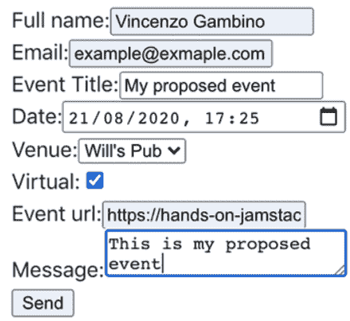
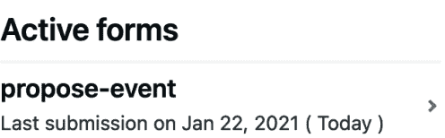
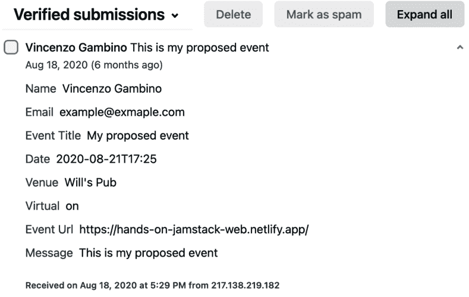
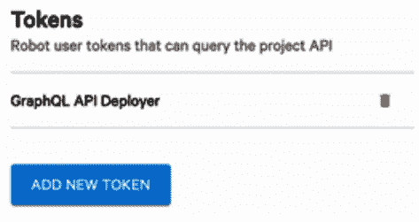
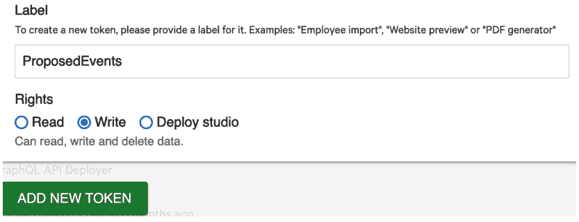
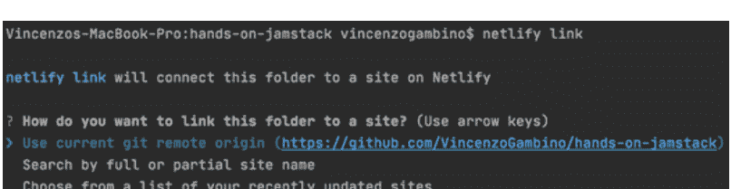
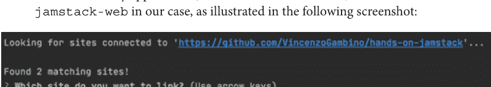
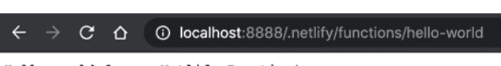

# 11

## API – 扩展 Gatsby

在本章中，您将了解 Jamstack 中的 A 部分——即**应用程序编程接口（API）**。我们将学习如何在编译后网页的动态部分中使用它们，以重现 web 开发者在传统基于服务器的 web 开发中熟悉的函数。我们将使用 Netlify 表单创建一个自定义的**提议活动**表单，并通过 Netlify 函数管理提交内容。我们还将了解如何将第三方服务连接到我们的 Gatsby 应用程序。

本章将涵盖以下主题：

- API 简介
- Gatsby – API

### 技术要求

要彻底理解本章内容，我们需要以下应用程序：

- 终端（Terminal）
- 已安装的 Gatsby 应用程序
- 一个 Netlify 账户

本章的代码文件可以在 `https://github.com/PacktPublishing/Jumpstart-Jamstack-Development/tree/chapter_eleven` 找到。

### API 简介

API 几乎从我们开始编程起就存在了。现代 API 在 21 世纪初开始成为我们现在的样子，当时像亚马逊这样的公司开始通过**超文本传输协议（HTTP）**请求提供对其数据的访问。这些公司改变了我们在网上做生意的方式。开发人员现在可以从 Salesforce 等服务获取和发布用户信息，并使用 API 在其应用程序上提供完整的电子商务体验。

2004 年，随着社交网络的引入，我们改变了使用互联网的方式。Facebook 和 Twitter 等公司开始开发自己的 API。类似于电子商务体验，开发人员现在可以从社交网络应用程序中获取用户的个人资料信息、事件和图片。

几年后，新一代智能手机问世。人们开始通过手机浏览互联网，开发人员开始开发可以安装在智能手机上的应用程序，而 API 是连接这些服务的正确方式。Instagram 改变了我们在互联网上分享照片的方式，并在几年后提供了自己的 API。

大约在 2010 年，我们拥有桌面和智能手机设备通过 Web 应用程序和移动应用程序消费 API 并依赖第三方 Web 服务，而在 2015 年左右，更多设备变得更加*智能*。任何能够连接到互联网的设备都可以访问 Web 服务的 API 资源。智能音箱、恒温器、手表和许多其他设备开始消费 API。

Amazon Alexa、Google Nest、Fitbit 和 Apple Watch 只是我们现在每天使用的众多设备中的少数几个，它们可以从 API 获取数据。

让我们在下节中探索 Gatsby API。

### Gatsby – API

在本节中，我们将探索如何在 Gatsby 内部使用 API。在本章我们将构建的示例中，我们将创建一个活动表单，匿名用户可以在其中提议他们的活动。当用户提交表单时，我们将通过 API 将提交内容添加到 Sanity。

为了实现这一点，我们将执行以下操作：

- 在我们的活动应用程序的主页上创建一个 Netlify 表单。
- 配置一个来自 Sanity 的令牌，以便我们可以通过 API 提交表单。
- 配置一个 Netlify 函数在提交时发送数据。

### 创建 Netlify 表单

作为我们的第三方服务，我们将使用 Netlify Forms，这是 Netlify 提供的内置表单处理功能。当代码部署到 Netlify 时，系统会自动检测表单并在您的 Netlify 站点管理面板中创建一个表单提交页面。

要创建 Netlify 表单，只需在 `<form>` 标签中添加 `netlify="true"` 属性数据，并添加 `<input type="hidden" name="form-name" value="YOUR_ VALUE" />` 隐藏字段，您就可以开始了。

我们的表单将包含以下字段：

- **全名**
- **电子邮件**
- **活动标题**
- **日期**
- **场地**
- **虚拟**
- **活动 URL**
- **描述**

我们将表单添加到主页，就在页脚之前，如下所示：

1. 打开位于 `/web/src/pages/` 下的 `index.js` 文件。
2. 在闭合容器标签（`</Container>`）之前，我们可以像这样添加我们的表单：

```html
<form name="propose-event" method="POST" data-netlify="true" >
    <input type="hidden" name="form-name" value="propose-event" />
</form>
```


如您所见，我们添加了将表单提交到 Netlify 所需的两个参数。

3. 让我们继续添加其他字段，如下所示：

```
<form name='propose-event' method='POST' data-netlify='true' >
    <input type='hidden' name='form-name' value='propose-event' />
    <div className='field'>
        <label className='label'>Full name:
            <input className='input' type='text' name='name'/>
        </label>
    </div>
    <div className='field'>
        <label className='label'>Email:
            <input className='input' type='email' name='email'/>
        </label>
    </div>
    ...
    <div className='field'>
        <label className='label'>Message:
            <textarea className='textarea' name='message'></textarea>
        </label>
    </div>
    <div className='field'>
        <button className='button' type='submit'>Send</button>
    </div>
</form>
```

场地（Venue）字段将从我们的站点获取场地信息。让我们添加查询以获取所有场地。

+   4. 在我们的 index.js 页面中，在 `IndexPageQuery` 查询内，我们可以添加一个查询以获取所有场地的 ID 和名称，如下所示：

```
Query IndexPageQuery {
    ...
    venues: allSanityVenue {
        edges {
            node {
                _id
                name
            }
        }
    }
}
...
```

+   5. 将数据映射到一个名为 `venueNodes` 的常量中，如下面的代码片段所示：

```
const venueNodes = (data || {}).venues
    ? mapEdgesToNodes(data.venues)
    : []
```

+   6. 将我们的场地字段添加到表单中，如下所示：

```jsx
<div className="field">
    <label className="label">Venue:
        <select className="select" name="venue">
            {
                venueNodes && venueNodes.map((venue) => (
                    <option id={venue._id}>{venue.name}</option>
                ))
            }
        </select>
    </label>
</div>
```

现在我们的 HTML 表单已经就绪，它应该看起来像这样：



图 11.1 – Gatsby 应用程序主页下的表单

我们准备好将其推送到 GitHub。

### 将表单部署到 Netlify

如我们所知，当我们将代码推送到 GitHub 时，它会自动部署到 Netlify，如下面的步骤所示：

+   1. 一旦部署到 Netlify，我们就能看到表单位于我们 Netlify 站点管理面板的“表单”选项卡下，如下面的截图所示：



图 11.2 – 表单选项卡

+   如果你点击 **表单**，你将看到 **提交内容**，如下面的截图所示：

#### 已验证的提交

#### 没有剩余的已验证提交

此表单的已验证提交已全部被删除或标记为垃圾邮件。

图 11.3 – Netlify 表单页面

让我们添加一个新的提交。

+   转到你在 Netlify 上的 Gatsby 在线站点并填写表单。当你点击 **发送** 后，你会收到以下确认消息：

#### 谢谢！

您的表单提交已收到。

← 返回我们的网站

图 11.4 – Netlify 提交成功页面

4. 现在，让我们回到 Netlify 表单管理面板以查看我们的提交，如下面的截图所示：



图 11.5 – Netlify 提交列表

如您所见，我们在 Netlify 上有我们的表单提交。

现在，让我们扩展我们的表单并使用 Sanity API 来获取和插入信息。

### 在 Sanity 中配置令牌表单

当提交新表单时，我们需要在 Sanity 应用程序中添加一个新事件。为了做到这一点，我们创建一个令牌，授予我们的函数访问 Sanity 并创建事件的权限。

我们还需要在我们的事件中添加一个新的 'approved'（已批准）字段，以避免在我们的 Sanity 应用程序上发布不需要的活动。

#### 创建 approved 字段

我们将创建一个布尔字段，用于定义活动是否已获批准。

打开位于 `studio/schemas/documents.index.js` 下的事件架构文件，并在 `fields` 数组中添加新字段，如下所示：

```
export default {
  name: 'event',
  type: 'document',
  title: 'Event',
  fields: [
    ...
    {
      name: 'approved',
      type: 'boolean',
      title: 'Approved'
    },
    ...
  ]
}
```

保存文件并重启你的本地应用程序。现在，你应该能在本地 Sanity 应用程序中看到该字段。

要将该字段部署到生产环境，请在终端中进入 `/studio` 文件夹并输入以下命令：

```
sanity graphql deploy
```

#### 部署 Sanity 令牌

首先，我们将专门为此表单生成一个新令牌。为此，请进入你的 **Manage Sanity**（管理 Sanity）管理面板 (`https://manage.sanity.io/`) 并点击你的项目。然后，按以下步骤操作：

+   1.  转到 **站点设置 | API** 并向下滚动到 **令牌**。现有令牌被 Gatsby 用于从 Sanity 检索内容。现在，我们需要生成一个新令牌以向 Sanity 写入数据。

2. 点击蓝色的 **添加新令牌** 按钮，如下面的截图所示：



图 11.6 – 令牌

3. 输入标题，然后选择 **权限** 为 **写入**。此权限赋予用户读取、写入和删除数据的权限。现在，点击绿色的 **添加新令牌** 按钮，如下面的截图所示：



图 11.7 – 添加新令牌

生成一个新令牌并提示给你。

4. 复制该令牌，然后回到你的 Netlify 项目并点击 **设置 | 构建与部署 | 环境变量**。

在设置的这一部分中，可以将令牌安全地存储为环境变量，如下面的截图所示：

#### 环境变量

为你的构建脚本和附加组件设置环境变量。

SANITY_DEPLOY_STUDIO_TOKEN      skOhxPmPlPUmb2WGJhXVppW...

在文档中了解更多信息关于环境变量 ↗

编辑变量

图 11.8 – Netlify 环境变量设置页面

+   5. 点击 编辑变量 | 新变量。

+   6. 添加你的新令牌，名为 SANITY_STUDIO_PROPOSE_EVENT，并点击保存，如下面的截图所示：

#### 环境变量

为你的构建脚本和附加组件设置环境变量。

键
SANITY_DEPLOY_STUDIO_TOKEN

值
skSlzHAEqvWdtWYww4vqM2Lw73qb9dynPyJlek

SANITY_STUDIO_PROPOSE_EVENT

skR9qwePUzIz4nyGCjv43NV1eff84ux3Zdo5X1tb

新变量

在文档中了解更多信息关于环境变量 ↗

保存   取消

图 11.9 – Netlify 环境变量设置页面

6. 一旦 netlify-cli 工具安装完毕，从终端进入 /web 目录并输入以下命令：

```
netlify link
```

7. 出现以下提示时，通过选择之前在 GitHub 创建的项目来选择正确的项目：



图 11.10 – 终端

8. 选择 Gatsby 应用程序（即那个以 web 结尾的应用程序）；在我们的案例中是 hands-on-jamstack-web，如下面的截图所示：



图 11.11 – 终端

现在，链接已完成。

9. 一旦链接完成，在 web 目录内输入以下命令：

```
netlify dev
```

此命令将启动你的 Gatsby 项目并设置一个 AWS Lambda 服务器，并在端口 8888 上启动一个服务器。

10. 现在，你可以从 http://localhost:8888 访问你的本地站点，并从 http://localhost:8888/.netlify/functions/hello-world 查看你的函数输出，如下面的截图所示：



图 11.12 – 我们 Gatsby 应用程序上的 Netlify 函数

在本节中，我们在 Gatsby 主页上创建了一个新的 Netlify 表单，在 Sanity 上创建了一个令牌以允许 Netlify 插入一个新的提议事件，并配置了我们的 Netlify 函数文件夹。

在下一节中，我们将创建一个函数，将新的提议事件插入到我们的 Sanity 数据集中。

### 创建 submission-created.js 文件

Netlify 表单提交会触发一个 submission-created 事件。请执行以下步骤来创建 .js 文件：

+   1. 在 web/functions 内部创建一个名为 submission-created.js 的文件。此函数将处理来自 Netlify 表单的提交。
+   2. 接下来，为此函数创建 export .handler，如下所示：

```
exports.handler = async (event, context, callback) => {
}
```

此 handler 接收一个 event 对象，其中包含 path、httpMethod、headers、queryStringparameters、body 和 isBase64Encoded。

context 参数包含诸如用户身份信息等信息。callback 参数类似于 AWS Lambda 函数中的 callback 参数。代码可以在下面的片段中看到：

```
exports.handler = function(event, context, callback) {
    callback(null, {
    statusCode: 200,
    body: "Hello, World"
    });
}
```

Sanity 提供 Client API 通过 API 添加内容。


3.  在我们的 `submission-created.js` 文件中，让我们在文件顶部添加客户端，如下所示：

```
const sanityClient = require('@sanity/client')
exports.handler = function(event, context, callback) {
    callback(null, {
        statusCode: 200,
        body: "Hello, World"
    });
}
```

4.  要初始化客户端，我们需要提供 Sanity 项目 ID、数据集名称和访问令牌。在我们的 Sanity 应用主页中，我们的本地环境位于 http://localhost:3333。从你的 Sanity 管理控制台获取项目 ID 和使用的数据集。

5.  我们已经在上一节中创建了访问令牌，现在可以像下面这样复用它：

```
const sanityClient = require('@sanity/client')
const client = sanityClient({
    projectId: 'my_project_id',
    dataset: 'my_dataset',
    token: process.env.SANITY_STUDIO_ADD_EVENT
})
exports.handler = function(event, context, callback) {
    callback(null, {
        statusCode: 200,
        body: "Hello, World"
    });
}
```

6.  现在，我们可以使用 `create(doc)` 方法向 Sanity 添加新事件。

7.  客户端方法需要一个表示文档的普通 JavaScript 对象。它必须包含 `_type` 属性。

让我们开始构建文档。我们的事件的字段如下：

-   标题
-   日期
-   事件 URL
-   地点
-   虚拟
-   描述

8.  在我们的 handler 内部，我们必须获取事件的 body，如下所示：

```
exports.handler = async function(event, context,
        callback) {
    const { payload } = JSON.parse(event.body)
...
}
```

9.  现在，我们可以映射 payload 中的字段，像这样：

```
const doc = {
    _type: 'event',
    name: payload.data.eventTitle,
    dateTime: payload.data.date,
    virtual: payload.data.virtual === 'on',
    eventUrl: payload.data.eventUrl,
    venue: {
        _ref: payload.data.venue,
        _type: 'reference'
    },
    body: [{
        _type: 'block',
        'children': [{
            _type: 'span',
            'text': payload.data.message
        }]
    }],
    approved: false
}
```

10.  现在我们的文档已经准备好了，我们可以将它传递给 `create(doc)` 函数，如下所示：

```
const sanityClient = require('@sanity/client')
const client = sanityClient({
  projectId: 'my_project_id',
  dataset: 'my_dataset',
  token: process.env.SANITY_STUDIO_ADD_EVENT
})

exports.handler = async function(event, context, callback) {
  const { payload } = JSON.parse(event.body)
  const doc = {
    ...
  }

  // Create document
  await client.create(doc)
    .then(res => {
      callback(null, {statusCode: 200})
    })
}
```

完成了。现在，将代码添加到 Git 并推送到 master 分支。部署完成后，我们可以在生产环境中进行测试。

在你的在线 Gatsby 应用程序中，填写表单并按下发送，如图 11.1 所示。一个新的提交将被添加到 Netlify Forms，内容将从 Gatsby 通过 Netlify 函数添加到 Sanity。

## 总结

在本章中，我们学习了如何使用 Netlify Forms 来使创建和管理表单提交变得顺畅。我们使用 Netlify 函数的力量，扩展了 Netlify 表单，并在提交时添加了我们自己的操作。最后，我们使用了 Sanity API，通过 Netlify 函数从 Netlify 表单创建新的事件内容。

在下一章中，我们将创建一个 Alexa 技能，从我们的 Sanity 数据集中读取事件。
