# 12 API – Alexa 技能

Alexa 是亚马逊的虚拟助手，可以为个人执行任务或服务，它使用自然语言处理和机器学习将语音输入转换为可执行命令。Alexa 可以提供多种服务，从音乐播放到创建待办事项列表、播放有声读物，以及提供天气、交通和新闻。Alexa 还能够控制许多智能设备，允许你为家庭构建自动化系统。亚马逊用户可以通过 Alexa 技能商店安装技能（功能，类似于应用程序），以扩展 Alexa 的能力。

在本章中，我们将构建 Jumpstart Jamstack Alexa 技能。用户将能够询问接下来的五个事件。通过这个示例，你将能够通过检索过去的事件或所有事件来扩展现有技能，并且你还可以为其他任何应用创建新技能。

我们将涵盖以下主题：

-   Alexa 技能生命周期
-   创建技能

### 技术要求

要开发 Alexa 技能，你必须通过 https://developer.amazon.com/alexa 创建账户来访问 Alexa 开发者控制台。此外，你需要在系统上安装 Sanity Studio。

本章的代码可在 `https://github.com/PacktPublishing/Jumpstart-Jamstack-Development/tree/chapter_twelve` 获取。

### Alexa 技能生命周期

用户通过说出触发词 *Alexa*，后面跟技能名称和要执行的意图（命令）来激活特定技能。例如，*Alexa，问 jumpstart jamstack 告诉我接下来的活动。*

Amazon Echo 设备将请求发送到 Alexa 控制台，控制台将通过联系我们的 Sanity 应用来处理请求，并将结果发送回 Amazon Echo 设备，向用户提示消息。

要构建 Alexa 技能，我们将使用 Alexa 开发者控制台。Alexa 技能的两个组件是技能界面和技能服务。

#### 技能界面

**技能界面** 是亚马逊提供的软件，用户可以通过一个美观干净的 UI 来开发 Alexa 技能。我们将使用技能界面来创建和修改技能的每个组件。

#### 技能服务

**技能服务** 是 Alexa 技能的业务逻辑所在。代码将执行意图，并向界面返回一个 JSON 响应，界面会给用户一个可理解的自然语言句子作为响应。

在本章中，我们的服务将在 AWS Lambda 函数内的 Node.js 中执行。

既然我们知道了技能界面和技能服务是什么，我们将继续为 Alexa 创建技能。

### 创建技能

如前所述，我们将通过 **Alexa 开发者控制台** 创建一个技能，该技能将从我们的活动网站检索五个即将举办的活动。

3. 点击标有 Create Skill 的蓝色按钮：

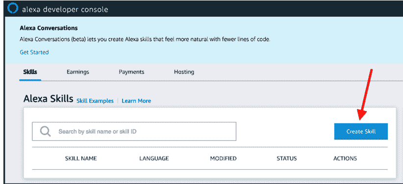

图 12.3 – Amazon Alexa Skills 概览

4. 选择一个技能名称，这也将是你的调用名称。对于这个示例，我们将写 jumpstart jamstack：

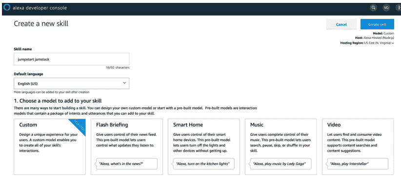

图 12.4 – Amazon Alexa Skills 创建页面

在 Alexa 范式中，模型是定义技能使用方式的意图和话语的集合。在这个示例中，我们将使用 **自定义** 模型。

5. 如前所述，我们将使用 Alexa 托管的宿主，因此使用默认选中的 **Alexa 托管（Node.js）**：

> **2. 选择一种托管技能后端资源的方法**
>
> 你可以自己配置后端资源，或者让 Alexa 为你托管。如果你决定让 Alexa 托管你的技能，你将可以使用我们的代码编辑器，从而可以从开发者控制台直接部署代码到 AWS Lambda。

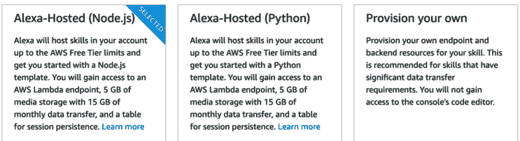


在右上角，如果你愿意，可以更改托管技能的区域。我将其保留为默认的 **美国东部（弗吉尼亚北部）**。

6. 然后，点击右上角的 **创建技能** 蓝色按钮来创建技能：

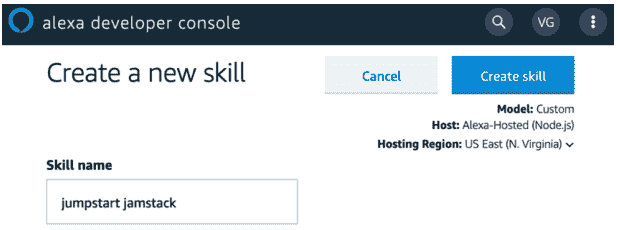


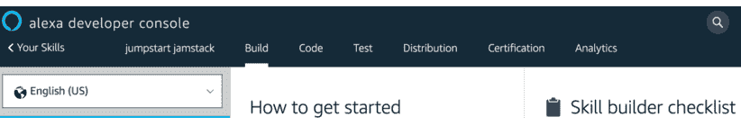

图 12.8 – Alexa 技能界面顶部菜单

由于这是一个示例技能，本章我们将探讨 **构建**、**代码** 和 **测试**。**分发**、**认证** 和 **分析** 选项卡在技能添加到市场时使用。

### 构建

**构建** 部分是我们可以在其中设置调用名称、配置交互模型、设置槽位和设置端点的位置：

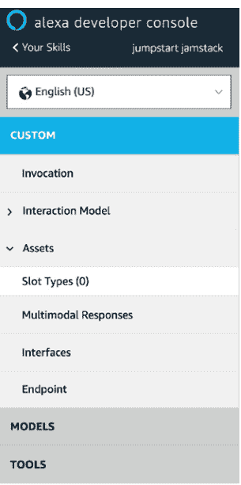

图 12.9 – Alexa 技能界面构建菜单


## 调用

调用名称是我们与技能交互时需要使用的关键词。我们的调用名称是 `jumpstart jamstack`，因此我们可以说：Alexa，打开 jumpstart jamstack：

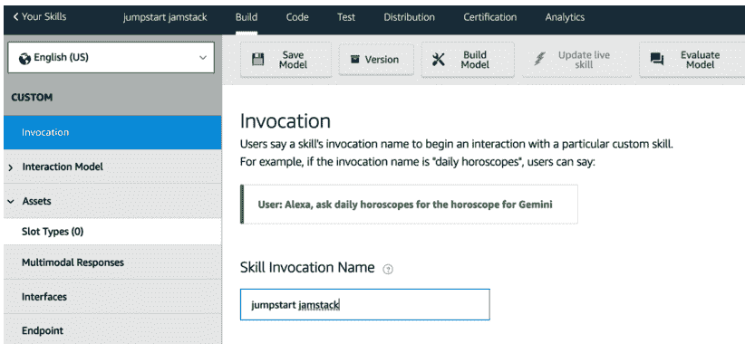

图 12.10 – Alexa 技能界面：调用选项卡

## 交互模型

在交互模型中，我们可以设置意图（intent）和话语（utterance）。任何 Alexa 技能都会创建以下四个默认的内置意图：

- `CancelIntent`
- `HelpIntent`
- `StopIntent`
- `NavigateHomeIntent`

`CancelIntent` 和 `StopIntent` 类似，当你想停止交互时会被调用。例如，当 Alexa 正在为你朗读新闻时，你可以说“Alexa，停止”，Alexa 就会停止朗读新闻；或者当你通过 Alexa 听音乐时，想停止播放时，就会调用 `StopIntent` 和 `CancelIntent`。

当你想了解更多关于某个技能以及有哪些可用话语时，会使用 `HelpIntent`。

当你使用一个多层级技能并想返回该技能的顶层菜单时，会使用 `NavigateHomeIntent`。

在我们的意图列表中，还有默认的 HelloWorldIntent，它包含七个话语。现在让我们添加 GetUpcomingEventIntent：

1. 点击意图列表上方的蓝色“添加意图”（Add Intent）按钮：

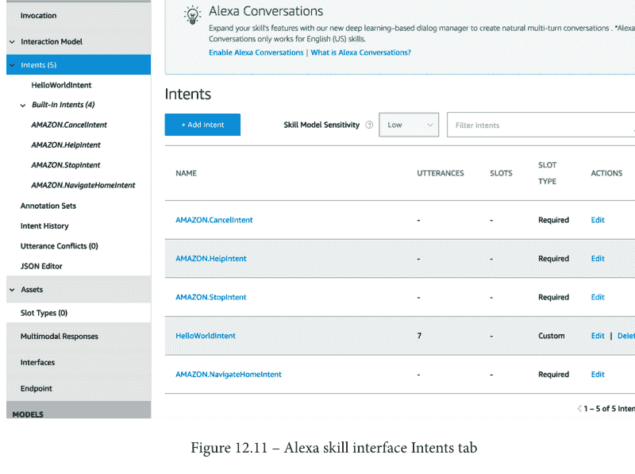

2. 在我们的 **创建自定义意图** 部分，将意图名称添加为 GetUpcomingEventsIntent。然后，点击蓝色的 **创建自定义意图** 按钮：

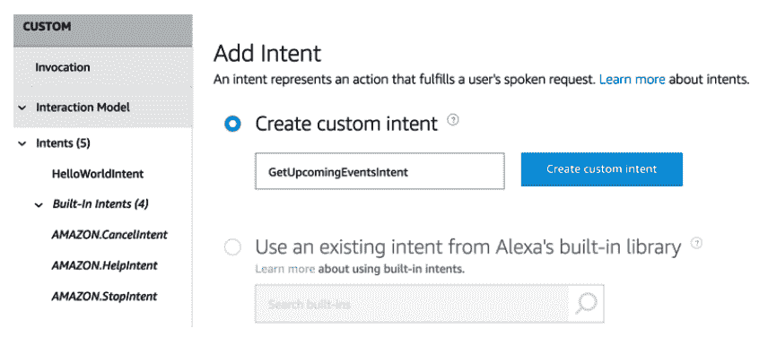

Amazon 还提供了一组可用于特定技能的意图，例如天气、视频和音频。

既然我们已经创建了自定义意图，就可以开始添加话语了。

用户可能会问：*Alexa，询问 jumpstart jamstack 即将发生的事件*，或者 *Alexa，让 jumpstart jamstack 告诉我即将发生的事件*。

我们可以添加任意数量的话语。对于这个示例，让我们添加以下话语：

- 列出即将发生的事件
- 告诉我即将发生的事件
- 有哪些即将发生的事件

要添加话语，请执行以下步骤：

1. 在 **示例话语** 文本框中写入话语，然后按下文本框右侧的 **+** 按钮。如果不点击 **+** 按钮，话语就不会被添加：

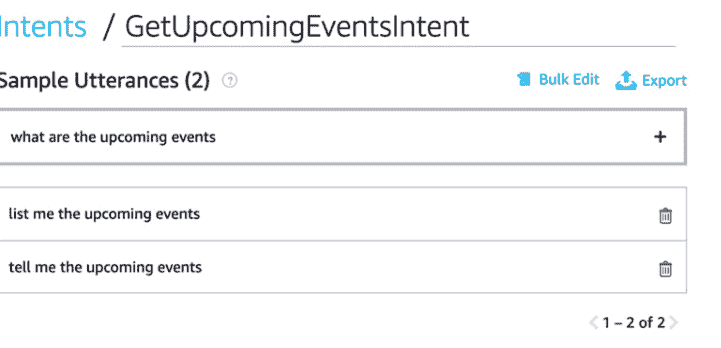

图 12.13 – Alexa 技能界面：意图页面

现在你的意图中应该已经添加了三个话语。

2. 点击 **意图** 表单上方的 **保存模型** 按钮，然后点击 **保存模型** 按钮旁边的 **构建模型** 按钮：

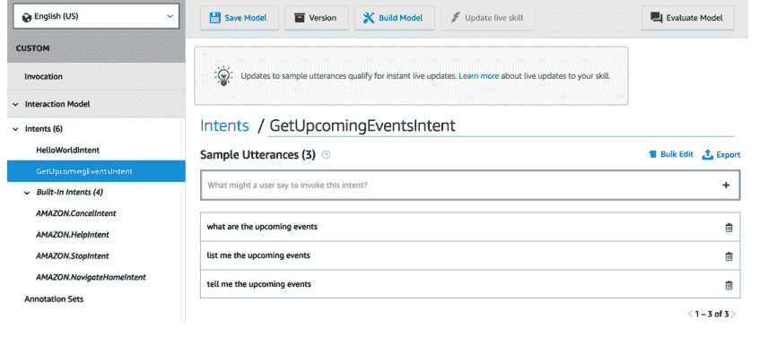

图 12.14 – Alexa 技能界面：意图页面

现在，我们的意图已添加，模型也已构建，可以在我们的 Alexa 服务中使用。

在本节中，我们创建了一个新意图来检索事件，并重新构建了模型以激活新意图。在下一节中，我们将查看意图历史。

## 意图历史

点击左侧菜单中的“意图历史”（Intent History）链接，你可以查看最近 30 天内对你的技能进行的所有频繁意图请求。你可以查看“未解决的话语”（Unresolved Utterances）和“已解决的话语”（Resolved Utterances）。从这里，你可以改进你的意图话语：

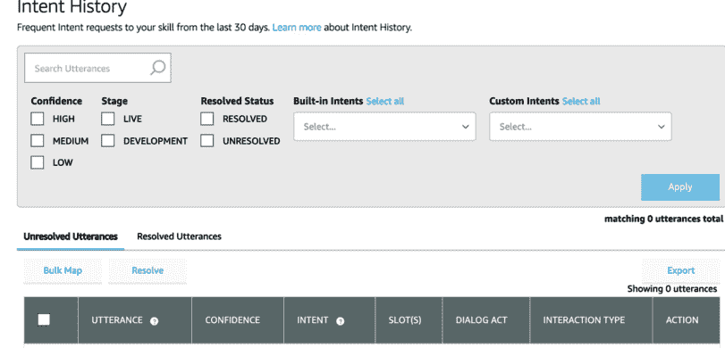

图 12.15 – Alexa 技能“意图历史”页面

## 话语冲突

点击左侧菜单中的“话语冲突”（Utterance Conflicts），你可以查看意图之间是否存在话语冲突：

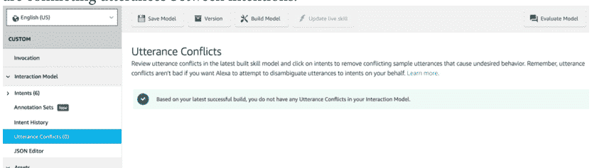

图 12.16 – Alexa 技能“话语冲突”页面

## JSON 编辑器

点击左侧菜单中的“JSON 编辑器”（JSON Editor），你也可以通过 JSON 代码创建意图。当你想要快速从另一个技能导入现有意图时，这非常有用：

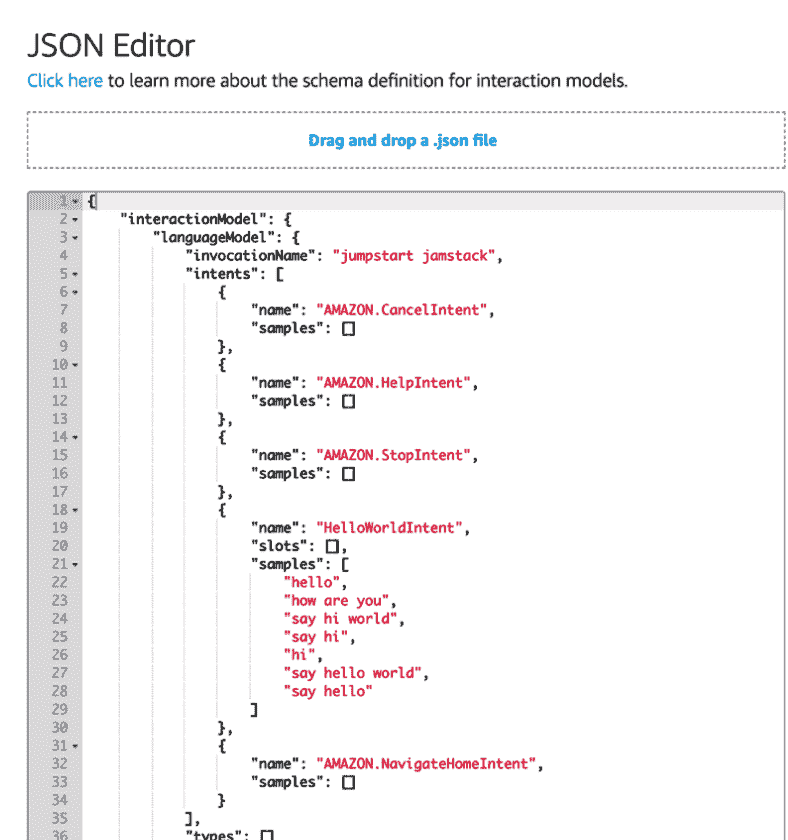

### 槽位类型

槽位（Slot）可以接收通过话语传递的变量。默认情况下，Amazon 提供了许多槽位类型，例如数字（number）、城市（city）和国家（country），Alexa 可以识别这些类型。你也可以创建自定义槽位类型，并方便地处理它。

槽位类型的一个例子可以在天气技能中找到，当你查询某个特定城市的天气时。

在你的 WeatherByCity 意图中，你不需要为世界上的每个城市添加话语，你可以将其作为变量传递：

### 槽位类型

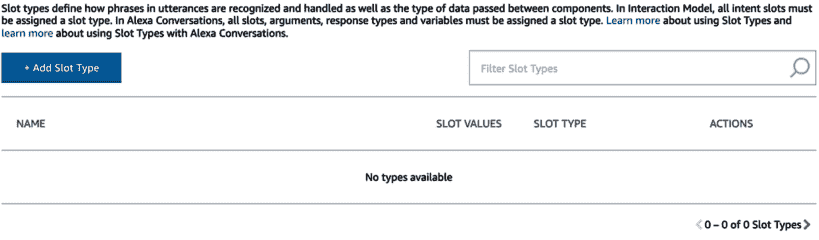

图 12.18 – Alexa 技能“槽位类型”页面

## 端点

**端点** 将接收 JSON 负载请求。由于我们使用的是 AWS Lambda 函数，这里可以保留默认设置。

如果你想在 AWS 之外的其他地方托管 Alexa 服务，可以选择 **HTTPS** 选项：

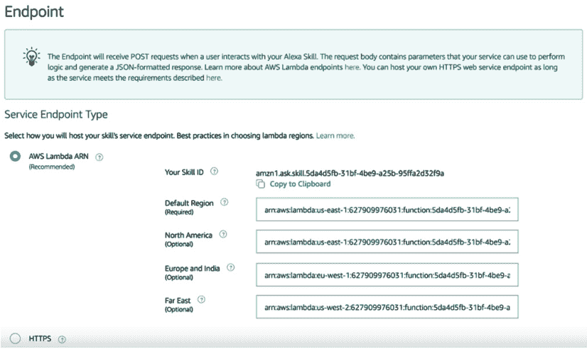

图 12.19 – Alexa 技能“端点”页面

## 代码

现在我们已经探索了“构建”（Build）部分，让我们跳到 Alexa 服务部分，也就是我们的 Node.js 代码：

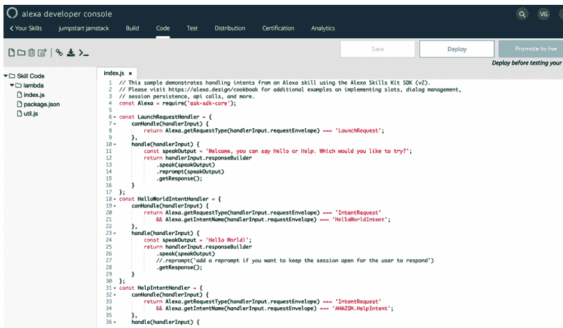

图 12.20 – Alexa 技能“代码”页面

如你所见，该界面提供了一个代码编辑器，我们可以在其中实现我们的 Alexa 服务。

在我们的 `index.js` 文件中，我们可以为意图创建处理程序。我们添加的任何新意图都可以在这里实现。Alexa 提供了一个 API 来处理请求，它被称为 ask-sdk-core API。请求位于 handlerInput JSON 对象内部。

处理程序将处理我们的意图，并由此对 Sanity 数据集发出 Sanity 调用。

在我们 `index.js` 文件的顶部，我们引入 ask-sdk-core：

```
const Alexa = require('ask-sdk-core');
```

处理程序包含两个函数：`canHandle()` 函数通过检查请求类型来判断该处理程序是否能处理此请求；`handle()` 函数将处理请求并返回响应：

```
const MyCustomHandler = {
    canHandle(handlerInput) {
        return Alexa.getRequestType(handlerInput.requestEnvelope) === 'MyRequestType' && Alexa.getIntentName(handlerInput.requestEnvelope) === 'MyIntent';
    }
};
```

在我们的 `canHandle()` 函数中，我们使用 `ask-sdk-core` API 获取请求类型和请求名称。

如果两个条件都为真，则意味着该处理程序可以处理这个请求，因此我们实现 `handle()` 函数：

```
const MyCustomHandler = {
    canHandle(handlerInput) {
        return Alexa.getRequestType(handlerInput.requestEnvelope) === 'MyRequestType' && Alexa.getIntentName(handlerInput.requestEnvelope) === 'MyIntent';
    },
    handle(handlerInput) {
        const speakOutput = 'This is my custom text response';
        return handlerInput.responseBuilder
            .speak(speakOutput)
            .getResponse();
    }
};
```

在这个简单的示例中，我们只是返回一个文本。我们使用 `responseBuilder()` 函数构建响应，将文本传递给 `speak()` 函数，然后由 `getResponse()` 函数构建最终响应。

我们在文件中遇到的第一个处理程序是 LaunchRequestHandler。当你使用命令 *Alexa，打开 jumpstart jamstack* 打开技能时，会调用该处理程序：

```javascript
const LaunchRequestHandler = {
    canHandle(handlerInput) {
        return Alexa.getRequestType(handlerInput.requestEnvelope) === 'LaunchRequest';
    },
    handle(handlerInput) {
        const speakOutput = 'Welcome, you can say Hello or Help. Which would you like to try?';
        return handlerInput.responseBuilder
            .speak(speakOutput)
            .reprompt(speakOutput)
            .getResponse();
    }
};
```

它将返回消息：*欢迎，你可以说 Hello 或 Help。你想尝试哪一个？*

让我们更改这条消息，使其与我们的技能相关。将其替换为：欢迎使用 jumpstart jamstack 技能，你可以说“告诉我即将发生的事件”或“帮助”。你想尝试哪一个？

因此，我们的 LaunchRequest 处理程序如下：

```javascript
const LaunchRequestHandler = {
    canHandle(handlerInput) {
        return Alexa.getRequestType(handlerInput.requestEnvelope) === 'LaunchRequest';
    },
    handle(handlerInput) {
        const speakOutput = 'Welcome to the jumpstart jamstack skill, you can say tell me the upcoming events or Help. Which would you like to try?';

        return handlerInput.responseBuilder
            .speak(speakOutput)
            .reprompt(speakOutput)
            .getResponse();
```


点击编辑器上方的**保存**按钮：

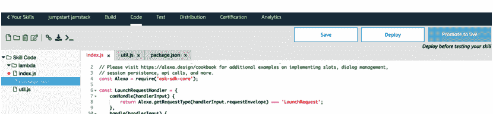

图 12.21 – Alexa 技能代码页面

之后，我们找到 `HelloWorldIntentHandler`。这是处理 `HelloWorldIntent` 的自定义处理器，该意图默认包含在我们的技能中：

```
const HelloWorldIntentHandler = {
    canHandle(handlerInput) {
        return Alexa.getRequestType(handlerInput.requestEnvelope) === 'IntentRequest'
            && Alexa.getIntentName(handlerInput.requestEnvelope) === 'HelloWorldIntent';
    },
    handle(handlerInput) {
        const speakOutput = 'Hello World!';
        return handlerInput.responseBuilder
            .speak(speakOutput)
            //.reprompt('add a reprompt if you want to keep the session open for the user to respond')
            .getResponse();
    }
};
```

`HelpIntentHandler` 向用户提供该技能的说明：

```
const HelpIntentHandler = {
    canHandle(handlerInput) {
        return Alexa.getRequestType(handlerInput.requestEnvelope) === 'IntentRequest'
            && Alexa.getIntentName(handlerInput.requestEnvelope) === 'AMAZON.HelpIntent';
    },
    handle(handlerInput) {
        const speakOutput = 'You can say hello to me! How can I help?';

        return handlerInput.responseBuilder
            .speak(speakOutput)
            .reprompt(speakOutput)
            .getResponse();
    }
};
```

`CancelAndStopIntent` 会停止该技能。在此示例中，两种意图都以相同方式处理，但如果需要返回不同的消息，你可以将它们拆分为两个单独的处理器：

```
const CancelAndStopIntentHandler = {
    canHandle(handlerInput) {
        return Alexa.getRequestType(handlerInput.requestEnvelope) === 'IntentRequest'
            && (Alexa.getIntentName(handlerInput.requestEnvelope) === 'AMAZON.CancelIntent'
                || Alexa.getIntentName(handlerInput.requestEnvelope) === 'AMAZON.StopIntent');
    },
    handle(handlerInput) {
        const speakOutput = 'Goodbye!';
        return handlerInput.responseBuilder
            .speak(speakOutput)
            .getResponse();
    }
};
```

在文件末尾，我们使用 ask-sdk-core API 导出该处理器：

```
// The SkillBuilder acts as the entry point for your skill, routing all request and response
// payloads to the handlers above. Make sure any new handlers or interceptors you've defined are included below. The order matters - they're processed top to bottom.
exports.handler = Alexa.SkillBuilders.custom()
  .addRequestHandlers(
    LaunchRequestHandler,
    HelloWorldIntentHandler,
    HelpIntentHandler,
    CancelAndStopIntentHandler,
    SessionEndedRequestHandler,
  )
  .addErrorHandlers(
    ErrorHandler,
  )
  .lambda();
```

现在，点击编辑器上方的 **Deploy** 按钮来部署我们的更改：

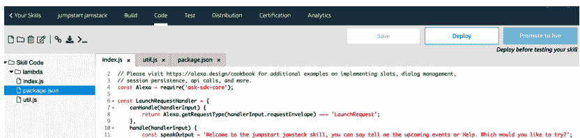

图 12.22 – Alexa 技能代码页面

## 构建我们的处理器

现在，我们需要构建处理器以从 Sanity Studio 数据集获取事件。我们将使用 Sanity Client npm 插件，正如我们在*第 11 章，API - 扩展 Gatsby*中所做的那样：

- 前往 npm 获取该软件包的最新版本：`https://www.npmjs.com/package/@sanity/client`。你可以查看页面右侧的版本号。撰写本书时，最新的稳定版本是 **1.150.1**：

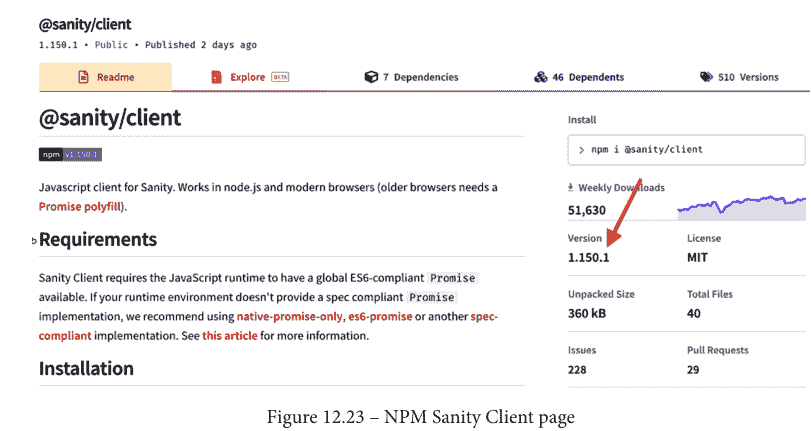

- 在 Alexa 控制台中的**代码**编辑器里，打开 `package.json` 文件，并将 Sanity Client npm 插件添加到依赖项数组中：

```
{
  "name": "hello-world",
  "version": "1.1.0",
  "description": "alexa utility for quickly building skills",
  "main": "index.js",
  "scripts": {
    "test": "echo \"Error: no test specified\" && exit 1"
  },
  "author": "Amazon Alexa",
  "license": "ISC",
  "dependencies": {
    "ask-sdk-core": "^2.6.0",
    "ask-sdk-model": "^1.18.0",
    "aws-sdk": "^2.326.0"
  }
}
```


- 现在，点击**保存**按钮，然后点击**部署**按钮。我们的软件包将被自动添加。

4. 在 index.js 页面中，在 `HelloWorldIntentHandler` 之后，我们可以添加 `GetUpcomingEventsIntentHandler`：

5. 让我们从 `canHandle()` 函数开始。我们知道请求类型必须是 `IntentRequest`，且我们的意图名称是 `GetUpcomingEventsIntent`，因此我们编写如下代码：

```
const GetUpcomingEventsIntentHandler = {
    canHandle(handlerInput) {
        return Alexa.getRequestType(handlerInput.requestEnvelope) === 'IntentRequest'
            && Alexa.getIntentName(handlerInput.requestEnvelope) === 'GetUpcomingEventsIntent';
    },
};
```

6. 现在我们可以实现 `handle()` 函数。由于 Sanity Client 返回一个 Promise，因此 `handle()` 函数必须是异步的。

第一步是初始化 Sanity Client：

```
const GetUpcomingEventsIntentHandler = {
    canHandle(handlerInput) {
        ...
    }
    async handle(handlerInput) {
        const sanityClient = require('@sanity/client')
        const client = sanityClient({
            projectId: 'your-project-id',
            dataset: 'your-dataset',
            useCdn: true
        });
    }
};
```

7. 现在，我们可以使用 Sanity Client API 中的 `fetch()` 函数来获取数据。

`fetch()` 函数需要一个**面向图的查询 (GROQ)**。在我们的情况下，我们要获取类型为 event 的五篇文档，且事件日期大于当前日期。我们还准备了 `list` 数组，用于添加结果，以及 `speakOutput` 变量，用于添加消息。然后，我们使用 `fetch()` 函数获取结果：

```javascript
const GetUpcomingEventsIntentHandler = {
    canHandle (handlerInput) {
        ...
    }
    async handle (handlerInput) {
        const sanityClient = require('@sanity/client')
        const client = sanityClient({
            projectId: 'your-project-id',
            dataset: 'your-dataset',
            useCdn: true
        });
        const query = '*[_type == "event"]'
        let speakOutput
        let list = [];
        await client.fetch(query).then(events => {
            events.forEach(event => {
                list.push(event.name)
            })
        })
    }
};
```

现在，如果有即将发生的事件，它们将被添加到 `list` 数组中。

- 8. 现在我们可以构建响应：

```javascript
const GetUpcomingEventsIntentHandler = {
    canHandle (handlerInput) {
        ...
    }
    async handle (handlerInput) {
        const sanityClient = require('@sanity/client')
        const client = sanityClient({
```

```
projectId: 'your-project-id',
    dataset: 'your-dataset',
    useCdn: true
  });
  ...
    if (list.length > 0) {
      speakOutput = `I have found ${list.length}
      events: ${list.join(', ')}`;
    }
    else {
      speakOutput = ` I am sorry, there are not
      upcoming events`;
    }
    return handlerInput.responseBuilder
      .speak(speakOutput)
      .getResponse();
  }
}
};
```

9. 最后一部分是将我们的新处理器 `GetUpcomingEventsIntentHandler` 导出到文件底部的 `exports.handler` 中：

```
exports.handler = Alexa.SkillBuilders.custom()
  .addRequestHandlers(
    ...
    GetUpcomingEventsIntentHandler,
    ...
  )
  .addErrorHandlers(
    ErrorHandler,
  )
  .lambda();
```

10. 现在，点击编辑器上方的保存和部署按钮。

至此，我们已经创建了一个新技能，配置了意图，并创建了意图的处理器。我们现在可以测试我们的技能了。

## 测试

如果你想测试你的技能，请点击顶部菜单栏上的 Test 链接：

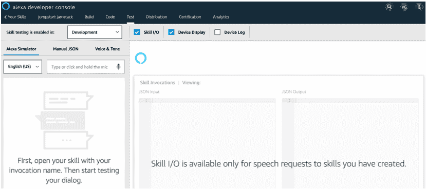

图 12.25 – Alexa 技能测试页面

在 Alexa 模拟程序标签的左侧，你可以说出或输入你的意图。每个技能都有一个启动请求，可以通过命令 Alexa, open 调用名称来调用。在我们的情况下，这将是 Alexa, open jumpstart jamstack：

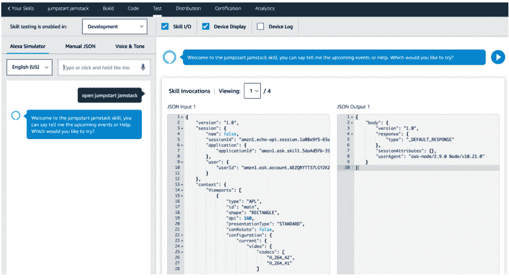

图 12.26 – Alexa 技能测试页面


如图所示，我们收到了启动请求的响应。在“技能调用”部分，你可以看到从技能接口到技能服务的 JSON 输入。

现在，按以下方式输入语音命令：ask jumpstart jamstack to tell me the upcoming events，然后检查响应。

Alexa 将提示包含五个即将举办活动的消息：

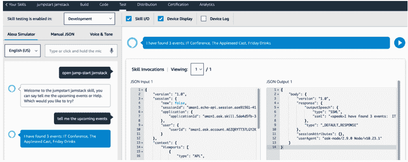

## 本章小结

在本章中，我们完成了 Alexa 技能的创建。我们了解了技能接口与技能服务之间的区别。我们学习了 Alexa 技能的组成部分，并通过新命令扩展了其功能。我们还将技能与 Sanity Studio 集成。这意味着我们的活动现在可以通过 Web 应用和 Alexa 访问！

在下一章中，我们将回到 Gatsby 应用，探索 Tailwind CSS 框架，它将帮助我们改善应用的视觉呈现。
