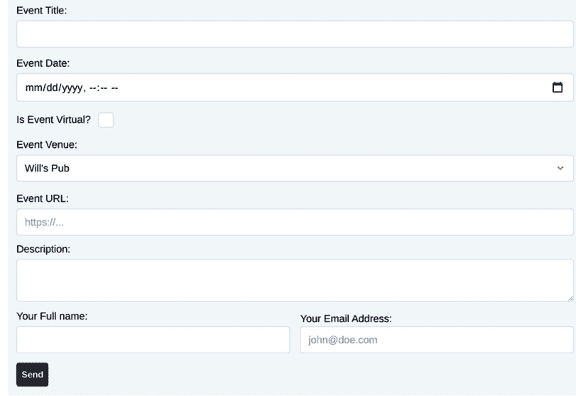
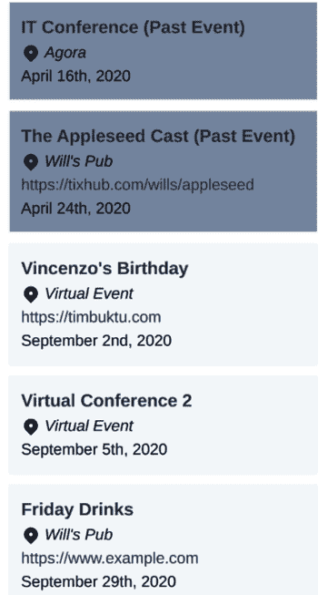

## Gatsby.js 布局修改

有多种不同的方式可以将样式融入网页，以更改默认字体、颜色、背景和布局。虽然也可以逐一创建样式和类，但更简单高效的方法是使用框架来利用预先构建的思路和设计模式。在撰写本书时，最热门的级联框架之一就是 Tailwind CSS。让我们认识一下 Tailwind，并了解为什么要在 Gatsby 中使用它。

### 认识 Tailwind CSS

Tailwind CSS 是一个优秀的 CSS 框架，易于学习和使用。它旨在不预设立场，让设计者能够从更小的部件构建样式。让我们先安装该框架，以便使用它。

### 安装 Tailwind CSS 框架

我们将安装它，并用它来改善网站的外观：

- 1. 第一步是使用 Node 包管理器安装 Tailwind CSS。在终端中，输入以下命令：
```
npm install tailwindcss --save-dev
```
`--save-dev` 参数会将其添加到项目的开发依赖中。此外，由于我们想改进表单的外观，我们将添加一个由 Tailwind Labs 构建的名为 custom-forms 的额外包。
- 2. 同样，我们会将其添加到项目的开发依赖中。在终端中输入以下命令：
```
npm install @tailwindcss/custom-forms --save-dev
```
- 3. 最后，在终端中输入以下命令，配置文件将自动创建：
```
npx tailwindcss init
```

tailwind.config.js 文件会在 Gatsby 的主文件夹中的 /web 目录下创建。该文件包含 Tailwind 配置。文件内容如下：

```
module.exports = {
  purge: [],
  theme: {
    extend: {}
  },
  variants: {},
  plugins: [require('@tailwindcss/custom-forms')]
}
```

大多数配置项使用默认设置，因此它们是空的。唯一使用到的配置项是插件列表。此处，插件列表仅包含我们之前安装的 custom-forms 插件。

### 使用 Tailwind CSS 框架

接下来，我们将 Tailwind 框架集成到项目中。首先从 web/src/styles/layout.css 文件开始，我们需要插入以下代码行。以下代码行将 Tailwind 的样式引入项目：

```
@tailwind base;
@tailwind components;
@tailwind utilities;
```

### 设置活动提案表单的样式

重新审视我们项目网站的活动提案表单，很明显它完全没有样式。那么，让我们先回顾表单的代码。以下是活动标题输入框和标签的 HTML 源代码片段：

```
<div className='field'>
  <label className='label'>Event Title:
    <input className='input' type='text' name='eventTitle'/>
  </label>
</div>
```

使用 Tailwind CSS，表单的样式效果如下图所示：

## 添加活动



图 13.1 – 使用 Tailwind 设置样式的活动提案表单

> **注意**
> Tailwind CSS 的完整文档可在 https://tailwindcss.com 找到。

就本书而言，我们将看以下示例，它只是 Tailwind CSS 全部能力的一小部分。这里，我们之前的 HTML 代码块已使用 Tailwind 设置样式：

```
```html
<div className='mt-10 block'>
  <label className='label'>Event Title:
    <input className='form-input mt-1 block w-full' type='text' name='eventTitle'/>
  </label>
</div>
```
```

首先，在每个表单元素周围添加了间距。让我们快速回顾一下，在元素周围添加间距都有哪些选项。HTML **文档对象模型（DOM）** 中的每个元素都有三个外围组成部分：边框、外边距和内边距。简单来说，外边距是元素周围的间距，内边距是元素内部的间距。而边框正如其名称所示，是在视觉上划定 HTML 元素边界的几种方式之一。

我们要查看的第一个样式是 mt-10。这种命名方式与其他 CSS 框架略有不同，因为 m 和 t 都具有原子化的含义。

Tailwind 中 m 代表外边距（margin）。同样，p 用于内边距（padding），t 代表顶部（top），显然，b 代表底部（bottom），r 代表右侧（right），l 代表左侧（left）。此外，y 同时代表顶部和底部，x 同时代表右侧和左侧。如果单独使用 m 和 p（例如 m-10），这种用法表示整个元素，因此会在所有边上提供间距。这使得记住该使用哪个属性变得非常简单，也正因如此，该框架广受欢迎。

-10 代表 10 像素。这将在每个表单元素的顶部提供 10 像素的所需间距，使其外观更整洁。

此外，还使用了 Tailwind CSS 的 block 样式来设置块级布局。

对于表单输入元素，本例中是一个文本框，使用了 Tailwind 的 form-input 样式。该样式应用了以下 CSS 规则：

- `background-color: #fff;`：白色
- `border-color: #e2e8f0; border-width: 1px; border-radius: 0.25rem;`：浅色的 1 像素输入框边框，带有轻微圆角
- `padding-right: 0.75rem; padding-left: 0.75rem;`：文字两侧有更多间距
- `padding-top: 0.5rem; padding-bottom: 0.5rem;`：文字顶部和底部有更多间距
- `line-height: 1.5;`：设置垂直文字间距
- `font-size: 1rem;`：设置文字大小

w-full 表单输入样式指示表单元素占据其容器的完整宽度。如表单中所示，**您的全名**和**您的电子邮件地址**字段为半宽。由于表单应该是响应式的，当表单处于小尺寸时，例如浏览器水平缩小，比如使用智能手机浏览时，这些元素会使用完整宽度。以下两个样式共同协作实现这一效果：sm:w-full 和 md:w-1/2。

当表单容器处于小尺寸模式时，元素的宽度为完整宽度；当表单至少为中等尺寸（即浏览器宽度大于 768 像素）时，宽度为一半（1/2）。

### 改进活动列表并设置其样式

在上一节中，我们为活动提案表单添加了 Tailwind 样式。接下来，我们可以为网站上的活动列表添加样式。在下面的*图 13.2* 中，活动列表同样应用了 Tailwind CSS 样式：

## 活动



图 13.2 – 使用 Tailwind 设置样式的活动列表

通过对活动查询添加排序，活动按时间顺序排列。以下代码演示了如何实现这一点。排序被添加到 dateAndTime 字段上，使用 ASC（升序）：

```
events: allSanityEvent(
  sort: {
    fields: [dateAndTime]

    order: ASC
  },
) {
  ...
```

如图 13.2 所示，过去发生的事件（在本例中为 2020 年 9 月 1 日之前的事件）使用比未来事件更深的背景色显示。让我们了解这种效果是如何实现的。

首先，node.dateAndTime 通过作为参数传递给 new Date() 函数而被转换为日期。当前时间通过实例化不带参数的日期对象获得。比较的布尔（真/假）结果——如果事件日期小于当前日期——被赋值给 pastEvent 变量：

```
let pastEvent =
new Date(node.dateAndTime) < new Date() ? true : false;
```

接下来，根据 pastEvent 的值是否设置为 True 来设置背景色：

```
(${pastEvent ? 'bg-gray-600' : 'bg-gray-100'}):
return (
  <div className={`max-w-full shadow-sm mt-3 p-3 ${pastEvent ? 'bg-gray-600' : 'bg-gray-100'}`}>
  ...
```

现在我们已经处理了样式，接下来，我们将探讨如何提高代码质量。我们将首先清理源代码，为部署做准备。

## 为部署做准备

在本节中，我们将对代码进行几处改进，使其更加整洁。此外，我们还将改进表单的功能。


## 清理代码

由于事件列表和事件表单的源代码最终可能在网站的多处复用，我们可以通过为各自创建单独的组件来重构代码。

在 `web/src/components` 文件夹中，创建两个文件：`event-list.js` 和 `event-form.js`。这两个文件的格式相似。

事件列表模块的基本格式如下面的代码块所示：

```
import { Link } from "gatsby";
import React from "react";
const { format } = require('date-fns')

function EventList(props) {

    return (
      ...
    )
}

EventList.defaultProps = {
    title: '',
    eventNodes: [],
}

export default EventList
```

事件表单模块的基本格式如下所示：

```
import React from "react";

function EventForm(props) {
    return (
      ...
    )
}
```

```
EventForm.defaultProps = {
  title: '',
  venueNodes: [],
}

export default EventForm
```

事件表单和事件列表的源代码将被插入到 return 中。由于 JSX 需要一个根节点，因此添加了开始和结束的 `<div>` 标签：

```
return (
  <div>
    <h2 className='font-serif text-4xl font-bold text-gray-800 bb-10'>{props.title}</h2>
    <div className='max-w-full'>
      ...
    </div>
  )
```

要使用这两个新创建的组件，需要导入它们：

```
import EventList from '../components/event-list'
import EventForm from '../components/event-form'
```

现在，事件列表和事件表单可以用这些组件替换。节点和标题将作为属性传递给这些组件：

```
<EventList
  eventNodes={eventNodes}
  title='Events'
/>

<EventForm
  venueNodes={venueNodes}
  title='Add an Event'
/>
```

```
</label>
</div>

<div className='mt-10 block'>
  {isVisible && <label className=''>Event Venue:
    <select className='form-select block w-full mt-1' name='venue' id={`venue`}>
      {props.venueNodes &&
        props.venueNodes.map((venue) => (
          <option value={venue._id}>{venue.name}</option>
        ))}
    </select>
  </label>
}
</div>
```

HTML 的 onClick 事件属性被添加到切换输入上，传入 isVisible 布尔变量的相反值（！）：

```
onClick={() => toggleVisible(!isVisible)}
```

如果 isVisible 的值为 true，则显示事件场地选择和标签；否则，它们会被隐藏。

## 总结

在本章中，我们学习了如何使用 Tailwind CSS 框架为现代设计和响应式布局设置网站样式，与从传统 CSS 开始相比节省了时间和精力。接下来，我们学习了如何将页面片段提取为单独的组件。最后，我们为表单本身添加了动态功能。

为用户体验添加样式和打磨是一个深奥的主题，因此超出了本书的范围。你可以随意阅读 Tailwind CSS 文档，以了解更多改进外观的方法。此外，即使使用 Gatsby 可以充分利用的其他 React 元素，也可能帮助将这个原型构建成一个完整的网站——你已拥有所需的全部工具。

在下一章中，我们将使用 Netlify 部署网站，并了解它在自动化许多以前需要手动执行的任务方面的实用性。
