# 14 使用 Netlify 和 Azure 进行部署

在上一章中，我们为部署准备了网站。我们使用 Tailwind CSS 为组件添加了样式。最后，我们清理了布局并将代码重构为组件。现在，我们可以更仔细地了解本书中使用的 Jamstack 的最后一个组件：**Netlify**。Netlify 被用作在 [https://sanity.io/create](https://sanity.io/create) 创建的 *使用 Gatsby 的博客*示例的默认平台。在撰写本书时，Microsoft 已添加 Static Web Apps 服务，为部署提供了另一种选择。由于 GitHub 和 Azure 均归 Microsoft 所有，Static Web Apps 服务与 GitHub 之间有极佳的集成。

本章首先介绍 Netlify 无服务器持续部署托管服务，它自动化了许多以前需要开发或手动执行的任务，然后演示 Azure Static Web Apps，作为可能已在使用 Azure 或想要尝试这项新服务的开发者的另一种选择。

我们将在本章中介绍的主要主题如下：

- Netlify 简介
- Netlify 插件
- 通过 netlify.toml 文件进行高级配置
- 通过命令行部署 Netlify
- Azure Static Web Apps 部署

### 技术要求

要在 Netlify 上部署项目，你必须在 https://www.netlify.com/ 拥有一个账户。要在 Azure 上部署项目，你必须在 https://azure.microsoft.com/en-us/ 创建一个账户。

此外，还需要一个终端程序。

### Netlify 简介

对于刚接触 Web 开发的人来说，Netlify 最初看起来只是一个部署和托管平台。

事实上，Netlify 网站可以是一个简单的静态文件 Web 主机。使用 Netlify 的拖放功能，只需几秒钟即可将包含 Web 文件的文件夹部署为一个真实、可运行且已托管的网站，如下所示：

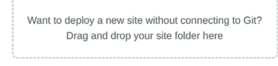

图 14.1 – Netlify 的拖放部署界面

然而，虽然它是托管网站的地方，但其功能远不止于此。

首先，在幕后，当我们最初创建 Sanity 和 Gatsby 生成的网站时，Sanity 和 Gatsby 博客模板提供的代码会自动运行它，从而在 Sanity 和 Netlify 之间建立集成。

Sanity Studio 和 Gatsby 生成的网站都被立即构建并托管在 Netlify 的服务器上，并且我们可以在需要时轻松自动地部署网站的新版本。通过连接 Sanity 的管理工具和 Netlify 的集成，当我们在 Sanity 中更改内容时，就可以构建新版网站。此外，通过 GitHub 设置了一个钩子或触发器，每当 Gatsby 源代码被推送到 GitHub 时，它都会自动部署新版网站。

其次，Netlify 是构建在 Amazon Web Services（AWS）之上的无服务器持续交付服务。这意味着 AWS 提供的所有基础设施都会自动融入 Netlify 的托管能力。也就是说，Netlify 在世界各地都有服务器（也称为云），以尽可能快的方式向所有网站用户提供内容。

然而，这两个方面只是故事的开始。在构建过程中，Netlify 可以通过脚本以多种语言运行许多不同类型的代码来增强你的网站，如以下截图所示：

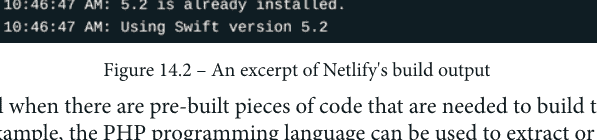

图 14.2 – Netlify 构建输出的摘录

当需要预构建的代码片段来构建静态页面时，这非常有用。例如，可以使用 PHP 编程语言提取或预处理格式化数据，甚至静态生成网站。因此，JavaScript 编程语言并不是部署期间的唯一选择。

重要的是要记住，代码只能在部署时在 Netlify 上运行。因此，像 WordPress 这样的传统内容管理系统无法在 Netlify 上运行，因为它需要服务器端代码在每次页面请求时运行。

一个不错的功能是能够进行 A/B 测试。这可以通过在 GitHub 中使用两个分支来实现。假设你想测试特定颜色对网站访问者需要点击的按钮性能的影响。你可以在 GitHub 中设置两个不同的分支，让 Netlify 随机选择其中一个。

Netlify 提供的另一个功能是一种将代码片段插入页面头部或正文的简单方法。这种用途的一个示例是粘贴 Google Analytics 在页面中正常工作所需的代码片段。

接下来，让我们了解如何利用 Netlify 通过其插件提供的各种功能。


### Netlify 插件

Netlify 的插件库将许多手动流程自动化，免去了开发者自行开发内部解决方案的麻烦。这个不断增长的库中包含许多插件。例如，一个插件可以获取并整合 RSS 订阅等外部资源；另一个插件还可以生成站点地图，甚至为网站内容建立索引以提供搜索功能。

### HTML 压缩

在本书中，我们要研究的这个插件会压缩 HTML，通过移除不必要的页面或代码内容，或者用单字符替换变量名来减小文件体积。这个过程称为**压缩**。

我们希望尽可能压缩 HTML 代码，因此可以使用 Netlify 的 `netlify-plugin-minify-html` 插件来压缩文件内容。当 Gatsby 构建静态页面时，它会压缩 HTML 文件的内容。

下面是一个示例，展示压缩前可读源代码的样子：

```html
<h1 hidden="">
  Welcome to <!-- -->My new blog
</h1>
<div class="blog-post-preview-list-module--root--2LgdR">
  <h2 class="blog-post-preview-list-module--headline--3j8kB">
    Latest blog posts
  </h2>
....
```

执行压缩后，文件总大小会减小。以下是压缩后 HTML 代码的样子：

```html
<h1 hidden="">Welcome to <!-- -->My new blog</h1><div class="blog-post-preview-list-module--root--2LgdR"><h2 class="blog-post-preview-list-module--headline--3j8kB">Latest blog posts</h2>
```

额外的空格已被移除，但 `netlify-plugin-minify-html` 插件还能让文件大小变得更小。每个字符都会计入需要通过互联网传输的页面数据总量，所以这是一个很棒的功能。

以下步骤将启用 Netlify Minify 插件：

- 1. 登录 `https://netlify.com`。在网站名称下方的水平菜单中，点击**插件**链接：
  
  图 14.3 – 水平菜单

- 2. 找到 Minify HTML 插件，点击灰色的**安装**按钮。

- 3. 然后，选择项目网站（名称通常以 `~web` 结尾）：
  
  图 14.4 – Netlify Minify 插件安装界面

- 4. 当被询问**“是否确定要安装 Minify HTML？”**时，点击绿色的**安装**按钮。
  
  此时，Netlify Web 界面应该会带你回到该网站的插件页面，并显示 **Minify HTML**。

- 5. 接下来，在网站名称下方的水平菜单中，点击**部署**链接。

- 6. 在界面右侧，点击灰色的**触发部署**按钮，此时会显示一个菜单，然后点击**部署站点**菜单项，如*图 14.5*所示：
  
  图 14.5 – 触发部署菜单


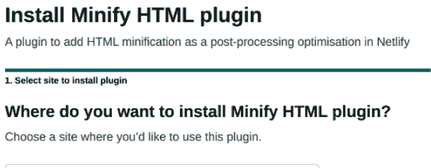

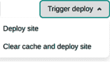

这将构建并部署新版本的网站。**部署进行中**页面会显示一个日志，输出内容将显示在其中。

日志输出对于了解部署期间执行的操作以及是否存在任何警告或错误非常有用。如果出现任何错误，Netlify 部署将停止，以确保不会部署任何网站。

以下是执行 Netlify Minify HTML 后的代码：

```
<h1 hidden>Welcome to My new blog</h1><div class=blog-post-preview-list-module--root--2LgDr><h2 class=blog-post-preview-list-module--headline--3j8kB>Latest blog posts</h2>
```

请将其与本章前面的压缩代码进行比较。Netlify Minify HTML 会在 HTML 标签属性为连续字符串（不含空格）时移除引号，同时也会删除注释，因此 `<!-- -->` 会被移除。最终结果是文件更小。这只是 Netlify 插件众多用途中的一个例子：通过使用 Netlify 插件，我们可以改进生成的静态内容并增强其功能。探索插件将带来许多新的可能性。

接下来，我们将开始更深入地探索 Netlify 功能可用的配置选项。

## 通过 netlify.toml 文件进行高级配置

Netlify Web 界面虽然易于使用，但为了对部署过程进行更多控制，可以使用 `netlify.toml` 文件，该文件使用 Tom's Obvious, Minimal Language 格式。

现在，让我们学习如何创建和使用此配置文件，以访问 Netlify 的高级功能。

在项目的根目录中创建一个名为 `netlify.toml` 的文件。以下是文件内容示例：

```toml
[[plugins]]
  package = "netlify-plugin-minify-html"

  # Specify which deploy contexts we'll minify HTML in.
  # Supports any Deploy Contexts available in Netlify.
  # https://docs.netlify.com/site-deploys/overview/#deploy-contexts
  [plugins.inputs]
    contexts = [
'production',
'branch-deploy',
'deploy-preview'
]

[plugins.inputs.minifierOptions]
    removeComments = false
    collapseInlineTagWhitespace = false
```

每个插件都使用 `[[plugins]]` 注解。接下来，`[[plugins.inputs]]` 用于确定插件将在哪些上下文中被激活。例如，在本地开发时，通常不需要压缩，因此插件只会在生产上下文和预览上下文中触发。

接下来，插件配置中的 `[plugins.inputs.minifierOptions]` 部分允许我们进一步自定义插件。由于默认情况下 `removeComments` 设置为 `true`，因此可以通过 `removeComments = false` 选项将其设置为 `false`。

我们可以再次使用 Netlify 命令行工具，但这次需要在项目的根目录中键入以下命令：

```shell
netlify build
```

上述命令会在本地触发构建，将 `netlify.toml` 配置与网站在 Netlify 插件列表中配置的插件结合起来。

以下是 `netlify build` 输出的相关片段：

```text
┌──────────────────────────────────────────────────────────────┐
│ 2. onSuccess command from netlify-plugin-minify-html         │
└──────────────────────────────────────────────────────────────┘

Minifying HTML in the deploy context: production
Minifying HTML with these options: { removeComments: false }

(netlify-plugin-minify-html onSuccess completed in 259ms)

┌───────────────────────────────┐
│       Netlify Build Complete  │
└───────────────────────────────┘

(Netlify Build completed in 19.8s)
```

在本节中，我们学习了如何使用 Netlify 配置文件。接下来，我们将学习如何使用命令行构建和部署 Netlify。

## 通过命令行部署 Netlify

运行 `netlify build` 命令后，Netlify 命令行工具还提供了一种很好的方式，无需部署即可预览网站。

在终端中，键入以下命令：

`netlify deploy`

输出将类似于以下内容：

```
Deploy path:	/home/chris/jumpstart-jamstack/web/public
Configuration path: /home/chris/jumpstart-jamstack /netlify. toml

Deploying to draft URL...
Finished hashing 49 files
CDN requesting 0 files
Finished uploading 0 assets
Draft deploy is live!

Logs:		https://app.netlify.com/sites/jumpstart- jamstack-web/deploys/5f3cad51bdd06713f5250887
Website Draft URL: https://5f3cad51bdd06713f5250887--jumpstart- jamstack-web.netlify.app

If everything looks good on your draft URL, deploy it to your main site URL with the --prod flag.
netlify deploy --prod
```

正如命令输出所示，会提供一个草稿部署预览 URL，以便无需实际部署就能预览生产网站。在示例中，该 URL 为 `https://5f3cad51bdd06713f5250887--jumpstart-jamstack-web.netlify.app`。

`--open` 是另一个可以添加的有用标志。它会在默认浏览器中打开该 URL。相关命令如下：

`netlify deploy --open`


最后，如输出所示，添加 `--prod` 标志后，如果部署成功，`deploy` 命令将部署并替换生产环境中的当前版本。

```
netlify deploy --prod
```

此外，若要在浏览器中打开 URL，请像之前一样添加 `--open` 标志：

```
netlify deploy --prod --open
```

此命令的输出将类似于以下内容：

```
Deploy path:          /home/chris/jumpstart-jamstack/hands-on-jamstack/web/public
Configuration path: /home/chris/jumpstart-jamstack/hands-on-jamstack/netlify.toml
Deploying to main site URL...
Finished hashing 1 files
CDN requesting 0 files
Finished uploading 0 assets
Deploy is live!
Logs:                 https://app.netlify.com/sites/jumpstart-jamstack-web/deploys/5f3cb84fbdd067963e250875
Unique Deploy URL: https://5f3cb84fbdd067963e250875--jumpstart-jamstack-web.netlify.app
Website URL:         https://jumpstart-jamstack-web.netlify.app
```

Unique Deploy URL 提供了一种将来回滚到该特定部署的方法，而 Website URL 顾名思义，就是新部署的网站版本。

在本节中，我们学习了如何使用命令行在 Netlify 上构建和部署。接下来，我们将学习使用 Azure 部署 Jamstack 网站的另一种方式。

## Azure 静态 Web 应用部署

Azure 静态 Web 应用服务的预览版已经推出，这为 Jamstack 托管和部署领域又增添了一位竞争对手。体验该服务的 URL 可以在 https://azure.microsoft.com/en-us/services/app-service/static/ 找到。

### 创建静态 Web 应用

要使用 Azure 创建静态 Web 应用，请按以下顺序执行步骤：

- 1. 首先创建一个 Azure 帐户。创建免费 Azure 帐户的步骤可能因国家/地区而异。以下 URL 可能会将你带到所在国家/地区的注册页面：https://azure.microsoft.com/free/。
- 2. 注册后，你最终应该会到达 Azure 门户位置（https://portal.azure.com/）。以下是此屏幕顶部导航的截图：

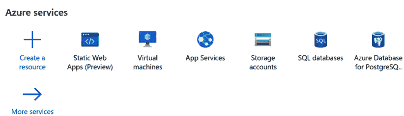

图 14.6 – Azure 门户顶部导航

其中列出了各种 Azure 服务。如图 14.6 所示，Static Web Apps (Preview) 是选项之一。

- 3. 将鼠标放在 **Static Web Apps (Preview)** 按钮上，将显示以下菜单：

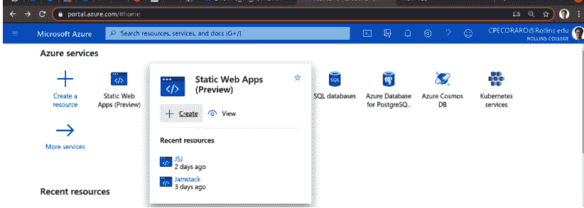

图 14.7 – 创建静态 Web 应用

- 4. 点击 **Create** 创建 jamstack 应用。

5. 接下来，我们将填写项目详细信息、静态 Web 应用详细信息和源代码控制详细信息字段：

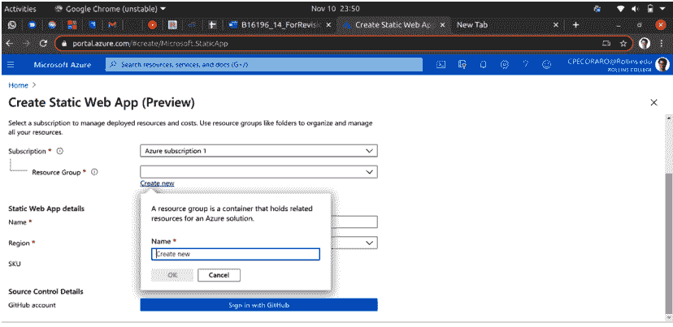

图 14.8 – 创建资源组

6. 创建一个新的资源组，为静态应用输入名称，然后选择合适的区域。

7. 接下来，对于源代码控制详细信息，单击蓝色的“Sign in with GitHub”按钮登录你的 GitHub 帐户。授权 Azure 访问你的 GitHub 帐户。

8. 在源代码控制详细信息中，为组织选择你的 GitHub 帐户名，并选择合适的分支，通常为 master：

> 如果你找不到组织或存储库，可能需要在 GitHub 上启用其他权限。

组织 *
chrispecoraro

存储库 *
hands-on-JAMstack

分支 *
main

图 14.9 – 在配置表单上选择组织、存储库和分支

9. 最后，在 **Build Details** 部分中，对于 **Build Presets** 选项，在 *Static site generator* 部分中选择 **Gatsby**：

#### 创建静态 Web 应用（预览版）

存储库 *  
`jumpstart-jamstack`

分支 *  
`production`

**构建详细信息**  
输入值以创建用于构建和发布的 GitHub Actions 工作流文件。你可以稍后在 GitHub 存储库中修改工作流文件。

构建预设  
`Gatsby`  
ℹ 这些字段将反映应用类型的默认项目结构。请更改这些值以适合你的应用。

应用位置 * ⓘ  
`/`

API 位置 ⓘ  
`api`

应用产物位置 ⓘ  
`public`

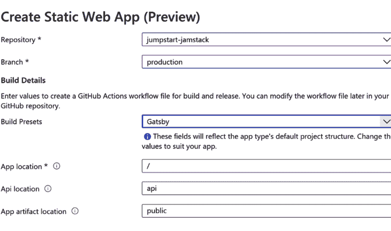

10. 最后，也是最重要的一点，将 **App location** 设置为 `/web/`，因为这是我们的项目中 Gatsby 应用所在的位置。**Api location** 留空（删除 `api`）。

11. 在底部，点击 **Review + create** 按钮，然后点击蓝色的 **Create** 按钮。如果一切正确，静态网站应该会被部署。部署开始时处于排队状态，然后开始构建，因此整个过程需要几分钟：

#### 创建静态 Web 应用（预览版）

基本信息   标签   查看 + 创建

App Service Static Web Apps 是一种精简、高效的解决方案，可将你的静态应用从源代码部署到全球高可用状态。预渲染文件从全球节点提供，无需 Web 服务器。了解更多

#### 项目详细信息

选择订阅以管理部署的资源和成本。使用资源组等文件夹来组织和管理所有资源。

订阅 *
Azure 订阅 无技术支持

资源组 *
（新建）JumpstartJamstack
新建

#### 静态 Web 应用详细信息

名称 *
JSJ

区域 *
美国东部 2

SKU
免费

#### 源代码控制详细信息

GitHub 帐户
chrispecoraro

> 如果你找不到组织或存储库，可能需要在 GitHub 上启用其他权限。

组织 *
chrispecoraro

存储库 *
jumpstart-jamstack

分支 *
production

#### 构建详细信息

输入值以创建用于构建和发布的 GitHub Actions 工作流文件。你可以稍后在 GitHub 存储库中修改工作流文件。

构建预设
Gatsby

这些字段将反映应用类型的默认项目结构。请更改这些值以适合你的应用。

应用位置 *
/web

API 位置
例如“api”、“functions”等……

输出位置
public

构建预设
Gatsby

这些字段将反映应用类型的默认项目结构。请更改这些值以适合你的应用。

应用位置 *
/web

API 位置
例如“api”、“functions”等……

输出位置
public

查看 + 创建   < 上一步   下一步：标签 >

## 静态 Web 应用持续部署

部署静态 Web 应用后，将显示如图 14.12 所示的屏幕：

- 1. 单击蓝色的 **Go to resource** 按钮，将我们带到 **Essentials** 屏幕：

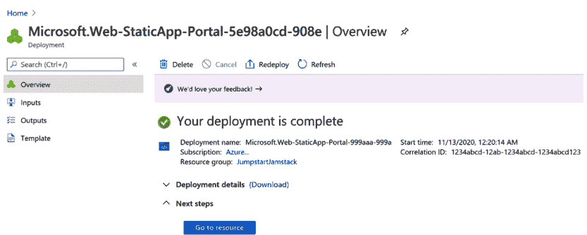

图 14.12 – Azure 静态 Web 应用服务部署确认屏幕

- 2. **Essentials** 屏幕，可通过左侧菜单中的 **Overview** 菜单项访问，显示以下信息：

**资源组**

**位置**（区域）

**订阅**和**订阅 ID**

**标签**（如果适用）

**URL**，可点击访问静态 Web 应用

**源**，即已部署的 GitHub 分支，此处为 **schema**

**部署历史记录**，用于访问 GitHub 中的部署

编辑工作流，用于编辑 .yml 格式的基于文本的工作流文件：

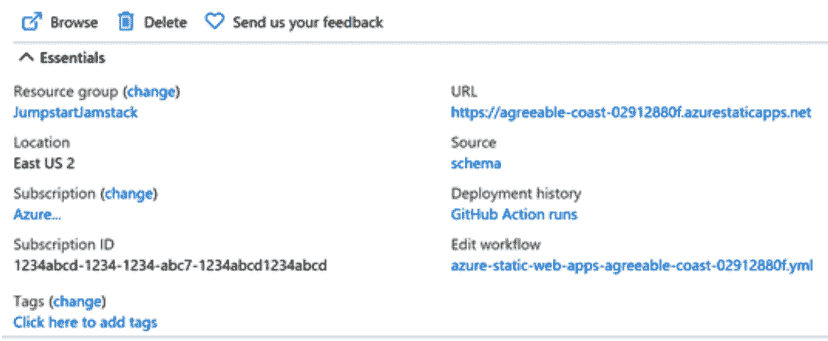

图 14.13 – Azure 静态 Web 应用服务 Essentials 屏幕

- 3. 单击 URL，或者单击顶部菜单中的“浏览”按钮，将在浏览器中启动 Web 应用程序。
- 4. 单击 GitHub Actions 运行，将我们带到工作流屏幕，如图 14.14 所示：

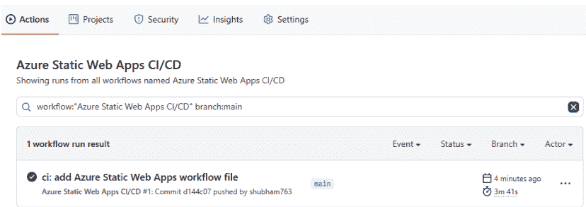

图 14.14 – Azure 静态 Web 应用 CI/CD 屏幕

所有部署都显示在前面的截图中。

5. 单击 Azure 静态 Web 应用 CI/CD 链接（以 ci: 开头）将把我们带到管理屏幕，以查看该工作流的部署详细信息：

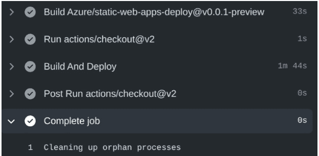

图 14.15 – Build and Deploy 作业屏幕的折叠视图

在左侧菜单中，单击 Build and Deploy 作业链接，可以查看部署的详细信息，如图 14.16 所示：

以下截图显示了展开后的视图：

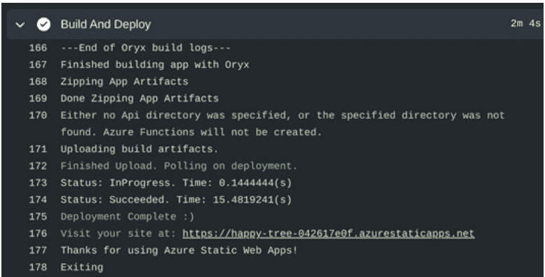

图 14.16 – Build and Deploy 作业屏幕展开视图的摘录

在 Build and Deploy 选项卡的展开视图中，显示了部署的实际输出。文本被漂亮地着色为红色、黄色和绿色，以显示警告和成功消息。

虽然撰写本文时 Azure 上的静态 Web 应用服务仍是预览版，但它无疑展示了 Netlify 的一个可行替代方案。


## 本章摘要

在本章中，我们学习了如何通过 Netlify 部署网站。我们还学习了如何安装和使用 Netlify 插件，以及如何使用 `netlify.toml` 配置文件与命令行工具。

此外，我们学习了如何通过 Azure 上的 Static Web Apps 服务创建和管理 Jamstack Web 应用，以及如何通过 GitHub 管理应用重新部署。

拥有多种 Jamstack 部署方案充分体现了其解耦特性。需要时，同一应用可以轻松利用多种服务。

在下一章中，我们将结束 Jamstack 世界的探索之旅，并讨论 Jamstack 社区的现在与未来、生态系统的其他工具与替代组件，以及正在书写未来的新兴技术与公司。
