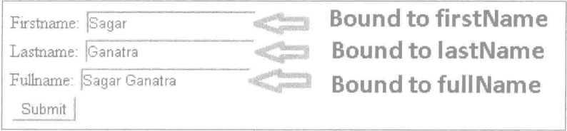
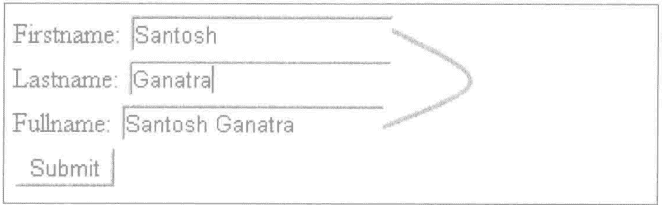

## 1 Kendo UI 应用程序框架

在本章中，我们将介绍以下配方：

- 使用客户端模板从 JSON 数据生成 HTML 标记
- 使用 **模型-视图-视图模型 (MVVM)** 模式在 `View` 元素和 JavaScript 对象之间创建双向绑定
- 使用 `ViewModel` 与 `source` 和 `template` 绑定生成 HTML 内容
- 使用内置验证器验证用户输入

### 简介

Kendo UI 库由各种小部件组成，这些小部件专为 Web 和移动平台构建。它还提供数据可视化组件，可用于构建丰富且交互式的图表。本章重点介绍 Kendo UI 应用程序框架。该框架包括客户端模板引擎、数据绑定和路由等工具，还可帮助用户验证表单字段。

## 使用客户端模板从 JSON 数据生成 HTML 标记

使用模板系统与某个数据源来生成动态 Web 内容的概念在 Web 开发中已经存在很长时间了。Java Server Pages (Java)、Smarty (PHP) 和 Django (Python) 是一些服务器端模板引擎的示例。生成运行时内容过去仅是服务器端的事。近年来，在客户端（浏览器）上生成内容已被广泛采用。

当今构建的动态应用程序要求用户界面频繁更新。这可以通过从服务器获取 HTML 片段并将其插入文档来实现。然而，这要求服务器生成此类片段，而不是提供完整的 Web 页面。在客户端模板引擎中，服务器只负责以 JSON 格式发送动态数据，然后在浏览器中使用静态客户端模板组装页面。此模板可以从 **内容分发网络 (CDN)** 提供，而不是从发送动态数据的同一服务器提供。以 JSON 数据形式发送记录而不在服务器端生成标记所花费的时间节省了更多 CPU 周期，从而极大地提高了应用程序的性能。考虑一个购物车应用程序，它列出购物车中的产品。购物车数据可以以 JSON 格式发送到客户端。然后，使用模板在客户端生成 HTML 标记。

有多种客户端模板引擎可供选择；其中一些是无逻辑的，例如 Mustache 和 Handlebars，一些基于 HAML 语法，例如 Jade，还有一些基于 John Resig 的微型模板，例如 `underscore.js`。

在 Kendo UI 中，使用一种称为哈希模板的微型模板库。在这些模板中，哈希符号用于标记模板中将在用于生成动态内容时执行的区域。

### 操作方法...

Kendo UI 库导出一个对象 `kendo`，它是各种其他对象和函数的命名空间。模板函数是其中之一。模板函数将基于哈希的模板编译为可用于渲染的函数。它对于从 JSON 数据源渲染复杂的 HTML 片段很有用。以下是三种基于哈希的语法：

- 渲染文本值的语法是 #= #
- 渲染 HTML 编码值的语法是 #: #
- 执行任意 JavaScript 代码的语法是 # `for (...)` #

让我们来看一个非常简单的示例，使用以下基于哈希的模板渲染某人的 firstName 和 lastName：

```
<script>

var template = kendo.template("Full Name: " +
"<span> #= lastName # </span>," +
"<span> #= firstName # </span>");
var data = {};

data.lastName = "Smith";
data.firstName = "Todd";

var result = template(data);

$(' .addressContainer').append(result);

</script>
```

## 下载示例代码

您可以从 http://www.packtpub.com 的帐户中下载已购买的所有 Packt 图书的示例代码文件。如果您在其他地方购买了本书，可以访问 http://www.packtpub.com/support 并注册，以便文件直接发送到您的电子邮件。

在这里，使用了 #= <literal> # 表达式。同样，我们也可以使用基于哈希的表达式来渲染 HTML 编码值：

```
<script>

var template = kendo.template("Full Name: <span> #= lastName ## </span>, <span> #= firstName # </span>");
var data = {};

data.lastName = "<b>Smith</b>";
data.firstName = "<i>Todd</i>";

var result = template(data);

$(' .addressContainer').append(result);

</script>
```


这里，`#: <literal> #` 表达式被使用。呈现 HTML 编码的值尤其有用，当你正在接受作为表单输入字符串一部分的 HTML 字符串时，它们在结果中显示相同。数据中存在的 HTML 字符/标签将被转义并呈现为字符串。

### 工作原理...

现在，让我们了解前面代码示例中正在发生什么。在第一个示例中，第一行如下：

```
var template = kendo.template("Full Name: " + "<span> #= lastName # </span>," + "<span> #= firstName # </span>");
```

这里，模板函数用于编译输入字符串。请注意，输入字符串包含带有基于哈希表达式的 HTML 标签。这将返回一个函数，然后可以使用数据来生成输出。在代码片段的以下四行中，创建了一个带有两个变量 lastName 和 firstName 的 JavaScript 数据对象：

```
var data = {};
data.lastName = "Smith";
data.firstName = "Todd";
var result = template(data);
```

前面代码片段中的最后一行调用编译的函数（分配给 template 变量），然后将 JavaScript 对象作为参数传递。这将替换基于哈希表达式内的文本值并生成以下输出字符串：

Full Name: <span> Smith </span>, <span> Todd </span>

在第二个示例中，代码非常相似，只是使用了 `#: <literal> #` 基于哈希的表达式。此表达式将转义 HTML 标签并生成包含 HTML 标签的输出，保持原样。

### 更多...

如前面示例所示，HTML 作为字符串传递给 kendo.template 函数。替代方案是在 script 标签中定义模板：

```
<script type="text/x-kendo-template" id="testTemplate">
    # for (var i=0; i < functions.length; i++) { #
        <li>#= functions[i] # </li>
    # } #
</script>
```

请注意前面代码中使用的基于哈希的语法；它包含一个 JavaScript for 语句，用于遍历数组并生成列表标签（<li> 标签）。现在，要编译此模板，我们将使用 id 属性引用 script 标签：

```
<script>
    var templateContent = $('#testTemplate').html();
    var template = kendo.template(templateContent);
    var functions = ["concat", "indexOf", "join", "lastIndexOf",
        "pop", "push", "reverse", "shift", "slice", "sort", "splice",
        "toString", "unshift", "valueOf"];
    var result = template(functions);
    $('ul.listContainer').append(result);
</script>
```

这里，模板通过 id 属性引用，#testTemplate。模板内容使用 $('#testTemplate').html() 检索。然后将内容与 kendo.template 函数一起用于生成标记。然后通过将内容附加到无序列表中，使用 $('ul.listContainer').append(result) 将其插入页面。

> 此处用于编写模板的 script 标签的 type 为 text/x-kendo-template。这是在客户端实现模板的常见方式。浏览器会简单地忽略其不认识 type 的 script 标签。

## 使用模型 - 视图 - 视图模型 (MVVM) 模式在视图元素和 JavaScript 对象之间创建双向绑定

大多数应用程序中使用了各种架构模式。三个非常重要的架构模式如下：

- 模型 - 视图 - 控制器 (MVC)
- 模型 - 视图 - 演示器 (MVP)
- 模型 - 视图 - 视图模型 (MVVM)

这些模式广泛用于构建桌面和服务器端应用程序。近年来，这些模式也已应用于客户端应用程序。AngularJS、BackboneJS 和 EmberJS 等框架提供了可随时用于构建遵循这些模式之一的应用程序的组件。前面提到的所有三种模式都试图将用户界面的开发与业务逻辑的开发分开。

**模型 - 视图 - 视图模型 (MVVM)** 模式是一种架构模式，基于 MVC 和 MVP。在这里，模型层表示特定于领域的数据。示例应用程序将包括银行账号、持卡人姓名、余额等。模型层表示需要格式化以供 `View` 使用的原始数据。`View` 层使用模型提供的数据并按要求格式化。另一方面，应用程序的行为或业务逻辑被封装在名为 `ViewModel` 的层中。

有几种框架，例如 KnockoutJS、KnockbackJS 和 Kendo UI，实现了 MVVM 模式。在 Kendo UI 中，MVVM 模式是应用程序框架的核心。该框架提供 API，使用这些 API 可以完成各种组件，例如模型、`ViewModel` 和数据绑定（将标记绑定到 `ViewModel` 对象）。

### 操作方法...

为了说明 Kendo UI 中如何实现 MVVM 模式，让我们看一个非常简单的示例，其中表单元素绑定到 `ViewModel` 对象。在此示例中，`ViewModel` 对象将定义模型数据以及元素之一的行为：

```
<form id="testView">
  Firstname: <input id="firstName" type="text"
data-bind="value: firstName">
<br/>
Lastname: <input id="lastName"
type="text"
data-bind="value: lastName">
<br/>
Fullname: <input id="fullName"
type="text"
data-bind="value: fullName"
readonly>
<br/>
<input type="submit">
</form>
```

在前面的代码片段中，创建了一个带有 id 属性 testview 的表单，包含三个输入元素（文本框）。请注意这些输入元素中的 data-bind 属性。data-bind 属性用于指定视图元素和 ViewModel 对象之间的绑定。

这里，第一个输入元素将 data-bind 属性的值指定为 value: firstName。这表明输入元素的值绑定到 firstName 模型属性。现在让我们定义 ViewModel，它封装了模型数据和行为：

```
var viewModel = kendo.observable({
firstName: "Sagar",
lastName: "Ganatra",
fullName: function() {
return this.get("firstName") +
' ' + this.get("lastName");
}
});
```

使用 kendo 对象上的 Observable 接口创建 ViewModel 对象。在此示例中，ViewModel 对象包含 firstName、lastName 和 fullName 属性。请注意，虽然 firstName 和 lastName 是字符串类型，但 fullName 属性是一个函数，它通过连接 firstName 和 lastName 返回一个字符串。

现在我们有了标记和 ViewModel，它们应该相互绑定。bind 方法用于将视图组件绑定到 ViewModel：

```
kendo.bind($('form#testView'), viewModel);
```

bind 函数的第一个参数是通过 $('form#testView') 引用的视图组件，第二个参数是 ViewModel 对象 viewModel。一旦视图和 ViewModel 绑定，对模型所做的任何更改都将更新视图，用户所做的任何更改都将反映在模型中。

### 工作原理...

当你执行前面提到的代码片段时，带有模型中提到的值的表单元素将被填充，如下面的屏幕截图所示：



请注意，在标记中，FullName 的最后一个输入元素是只读的。它绑定到 fullName 模型属性，该属性是一个函数，返回由 firstName 和 lastName 连接的字符串。当你更改 firstName 或 lastName 的值时，fullName 模型也会更新，并且相同内容会反映在 View 类中。



在前面的屏幕截图中，当 Firstname 输入元素的值更改时，Fullname 属性的值也会更新。请注意，模型属性在视图组件上的 blur 事件时更新。

### 更多...

在前面的屏幕截图中，我们看到了如何使用数据绑定来设置表单中输入元素的值。除了设置页面中某些元素的值之外，数据绑定还可以用于设置属性值 (attr)、设置 HTML 内容 (html)、隐藏或显示页面中的元素 (visible 和 invisible) 等等。


让我们来看看每个场景。attr 绑定用于在以下代码片段中将标签属性与模型属性绑定：

```
<a data-bind="attr: {href: websiteLink}"
target="_blank">
Click Here
</a>
```

在前面的代码片段中，data-bind 属性的值为 attr: {href: websiteLink}。这里，attr 表示标签属性绑定到 ViewModel。在此示例中，锚元素的 href 属性绑定到模型属性 websiteLink。相同的 ViewModel 对象如下面的代码片段所示：

```
<script>
var viewModel = kendo.observable({
websiteLink: 'http://www.packtpub.com',
});
kendo.bind($('a'),viewModel);
</script>
```

在代码片段中，ViewModel 对象仅包含一个属性 websiteLink。该模型属性的值是一个外部链接，即 http://www.packtpub.com。当 View 组件绑定到 ViewModel 对象时，锚元素会被更新，从而拥有一个指向 ViewModel 中提到的外部链接的 href 属性。

同样，可以通过使用绑定属性 visible 在页面上隐藏或显示 View 中的组件：

```
<div id="view">
<span id="container"
data-bind="visible: isVisible">
Some content here....
</span>
<br/>
<button id="toggleVisible"
data-bind="click: updateVisible">
Toggle Visible
</button>
</div>
```

在前面的代码片段中，span 元素的 data-bind 属性设置为 visible: isVisible。这里，isVisible 模型属性的值应为布尔类型。如果为 false，则 span 元素的 style 属性将设置为 display: none。此外，按钮的 data-bind 属性设置为 click: updateVisible。这里，按钮的 click 事件绑定到模型属性 updateVisible。前面标记的 ViewModel 对象如下面的代码片段所示：

```
var viewModel = kendo.observable({
isVisible: true,
updateVisible: function() {
this.set('isVisible', !this.get('isVisible'));
}
});
kendo.bind($('div#view'), viewModel);
```

ViewModel 中 isVisible 的初始值设置为 true，因此 span 内的文本 Some Content here... 将可见。当你点击 toggleVisible 按钮时，它会切换 isVisible 模型属性。这将显示或隐藏 span 元素。

## 使用 Source 和 Template 绑定与 ViewModels 生成 HTML 内容

在前面的示例中，探讨了 View 组件与 ViewModel 属性之间的数据绑定。绑定不仅可以在表单元素的值上执行，也可以在属性上执行，还可以用于隐藏或显示页面上的元素。在此示例中，我们将探讨 source 和 HTML 绑定的组合使用。
考虑一个下拉列表（用于选择元素），你希望用数据（option 标签）填充它。这些数据可以由 ViewModel 对象提供；使用模板生成这些 option 标签。

### 操作方法...

首先构建一个 ViewModel 对象：

```
var viewModel = kendo.observable({
 optionsData: [
 {optionValue:1, optionName: "Test1"},
 {optionValue:2, optionName: "Test2"},
 {optionValue:3, optionName: "Test3"}
 ]
});
```

此处的 ViewModel 对象包含一个 optionsData 属性，它是对象的集合（数组）。optionsData 中的每个对象包含两个属性，即 optionValue 和 optionName。optionValue 属性将用于 option 标签的 value 属性，而 optionName 将用于在下拉列表中显示的 HTML 内容。包含 option 标签绑定的模板如下面的代码片段所示：

```
<script id="select-template" type="text/x-kendo-template">
 <option data-bind=
 "attr: {value: optionValue}, html: optionName">
 </option>
</script>
```

这里，id 属性设置为 select-template 的模板包含一个 option 标签。option 标签包含 data-bind 属性，其值为 attr: {value: optionValue}, html: optionName。我们在前面的示例中已经看到属性绑定的实际效果。此处指定的另一个绑定是 html。此绑定用于为标签生成 HTML 内容。这些 option 标签应绑定到 ViewModel 对象，并封装在 select 标签内。

select 标签可以引用前面提到的模板，并使用 source 属性绑定到 ViewModel 对象：

```
<select data-template="select-template"
 data-bind="source: optionsData">
</select>
```

这里，select 标签指定了两个属性，即 data-template 和 data-bind。data-template 属性的值是我们先前定义的模板（script 标签）的 id 属性，即 select-template。这指示 kendo 将模板绑定到 select 标签，生成的内容将成为此 select 标签的 HTML 内容。

### Kendo UI 应用程序框架

data-bind 属性指定一个绑定源，该源引用 ViewModel 中的 optionData 模型属性。现在，唯一剩下的步骤是将 View 元素绑定到 ViewModel，这通过执行以下代码行来实现：

```
kendo.bind($('select'), viewModel);
```

#### 工作原理...

select 标签指定了引用 optionsData 模型属性的 source 绑定。这将使对象集合可供其内部的所有标签使用。

引用页面中模板的 data-template 属性会提供对象集合（optionsData），并且模板会针对数组中的条目数进行迭代。在此示例中，optionsData 集合包含三个对象，因此模板生成三次，并作为 select 标签的 HTML 内容插入。生成的内容将如下面的代码片段所示：

```
<select data-template="select-template" data-bind="source: optionsData"> <option data-bind=" attr: {value: optionValue}, html: optionName" value="1"> Test1 </option> <option data-bind=" attr: {value: optionValue}, html: optionName" value="2"> Test2 </option> <option data-bind=" attr: {value: optionValue}, html: optionName" value="3"> Test3 </option> </select>
```

data- 属性将保持不变，生成的内容现在具有 value 属性和 HTML 内容。请注意，前面的代码可以通过在基于哈希的模板中使用 for 语句，然后将生成的输出追加到 select 标签来完成。但是，使用 data-template 属性和 source 绑定可以让你无缝地完成此操作，并编写更直观的代码。

此模式可应用于各种情况。另一个示例包括生成列表标签（li 元素）并将其插入无序列表或有序列表中。

## 使用内置验证器验证用户输入

验证用户输入数据是任何项目中的常见任务。客户端验证包括检查表单输入数据的类型或缺失数据。这并不是说服务器端验证不重要。但是，客户端验证负责执行基本验证，并在将表单数据提交到服务器进行处理之前显示错误或验证消息。因此，它为用户提供即时反馈并改善整体用户体验。

随着 HTML5 的出现，表单中的输入字段可以为其定义类型。例如，只应接受电子邮件地址的输入字段可以指定为 type=email。同样，输入字段可以具有 URL、NUMBER、RANGE、DATE、SEARCH 和 COLOR 等类型。当用户为这些字段中的任何一个指定错误数据时，浏览器将显示适当的验证消息。除了类型之外，表单元素还可以通过向输入元素添加 required 等附加属性来标记为必填。但是，一些旧浏览器不支持 HTML5 功能，包括前面提到的表单验证。Kendo UI 库带有一个内置验证器，可用于执行客户端验证。

Kendo UI 验证器鼓励用户使用类似 HTML5 的语法，并提供开箱即用的支持，以使表单验证在旧浏览器上正常工作。

### 操作方法...

让我们来看一个示例，其中一个输入文本字段标记为必填，另一个电子邮件类型的输入字段也标记为必填。请注意，这非常是 HTML5 语法，用户不必更改标记来将字段标记为必填或不同类型：

```
<form id="testView">
<label for="firstName">First Name</label>
<input id="firstName"
name="First Name"
type="text"
required
validationMessage="Please specify First Name">
<br>
```


