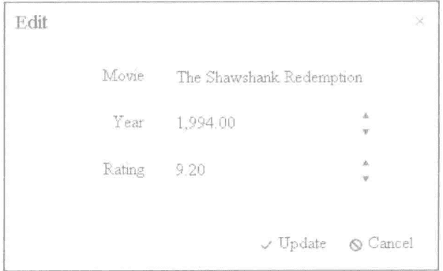
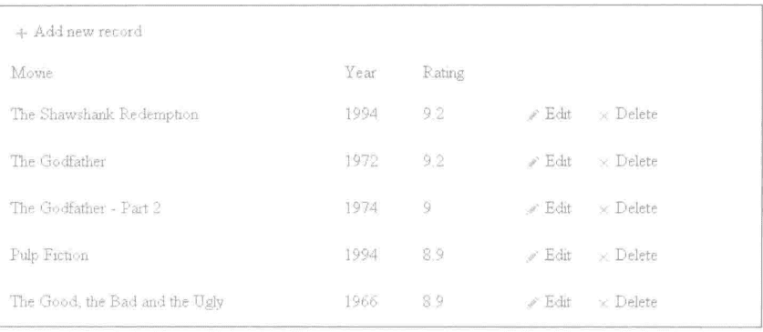

## 2 Kendo UI Grid

在本章中，我们将介绍以下配方：

- 创建 Grid 视图并显示表格数据
- 在 Grid 视图中显示来自本地或远程 `DataSource` 组件的数据
- 使用选定列对 Grid 中的数据进行排序
- 使用过滤器显示 Grid 中符合特定条件的数据
- 在 Grid 中创建、更新和删除内容
- 使用可视化机制提高 Grid 的性能
- 自定义 Grid 的外观和感觉

### 简介

Kendo UI 库附带了一个强大的 Grid 组件。当您想要显示表格数据并提供各种功能（例如基于选定列的排序、数据过滤、分页以及编辑表格数据）时，Grid 组件非常有用。Kendo UI Grid 组件提供了各种配置选项来自定义 Grid 的显示方式，并提供了各种 API 来操作 Grid 的内容。

### 创建 Grid 视图并显示表格数据

在 Kendo UI 中，可以通过以下两种方式创建 Grid：

- 从现有的 HTML 表格元素
- 从现有的 DIV 元素

### Kendo UI Grid

在此配方中，我们将介绍第一种方法，即使用现有的 HTML 表格元素创建 Grid。

### 如何操作...

使用现有表格元素创建 Grid 非常简单。让我们使用以下代码片段创建一个包含五行的表格：

```html
<table id="grid">
<thead>
<tr>
<th>Employee ID</th>
<th>Full Name</th>
<th>Year of Joining</th>
<th>Designation</th>
<th>Extension No.</th>
</tr>
</thead>
<tbody>
<tr>
<td>10001</td>
<td>Sagar H Ganatra</td>
<td>2008</td>
<td>Software Architect</td>
<td>49523</td>
</tr>
<tr>
<td>7008</td>
<td>Adam Wayne</td>
<td>2000</td>
<td>Engineering Manager</td>
<td>34890</td>
</tr>
<tr>
<td>10298</td>
<td>Nick Taylor</td>
<td>2012</td>
<td>Software Engineer</td>
<td>56823</td>
</tr>
<tr>
<td>10677</td>
<td>James Thompson</td>
<td>2010</td>
<td>Senior Software Engineer</td>
<td>48999</td>
</tr>
<tr>
<td>6745</td>
<td>Andrew Jones</td>
<td>2003</td>
<td>Senior Engineering Manager</td>
<td>48999</td>
</tr>
</tbody>
</table>
```

在前面的标记中，定义了一个包含五行的表格元素。请注意，所有数据都定义在表格本身中。下一步是在页面中包含样式表，可以使用以下代码片段实现：

```html
<link rel="stylesheet"
 type="text/css"
 href="../../styles/kendo.common.min.css">
<link rel="stylesheet"
 type="text/css"
 href="../../styles/kendo.default.min.css">
```

下载的 Kendo UI 库包含一个 styles 目录。该目录包含各种样式表。对于此示例，请包含 kendo.common.min.css 和 kendo.default.min.css。最后一步是初始化 Grid：

```javascript
<script>
    $('document').ready(function() {
        $("#grid").kendoGrid();
    });
</script>
```

在这里，通过对具有 grid ID 的表格元素调用 kendoGrid 函数来对其进行初始化。该函数接受其他参数，这些参数用于配置 Grid。我们将在即将到来的配方中介绍这些参数。


### How it works...

当你渲染页面时，你将看到先前提到的表格数据显示在 Grid 中，如下面的截图所示：

| Employee ID | Full Name | Year of Joining | Designation | Extension No. |
|-------------|-----------|-----------------|-------------|---------------|
| 10001       | Sagar H Ganatra | 2008 | Software Architect | 49523 |
| 7008        | Adam Wayne | 2000 | Engineering Manager | 34890 |
| 10298       | Nick Taylor | 2012 | Software Engineer | 56823 |
| 10677       | James Thompson | 2010 | Senior Software Engineer | 48999 |
| 6745        | Andrew Jones | 2003 | Senior Engineering Manager | 48999 |

如先前的截图所示，列会自动调整，且每个列的宽度相同。先前提到的 Grid 占据整个视口宽度，除非它被包裹在具有固定宽度的容器中。列的大小可以通过使用 colgroup 标签来更改：

```html
<table id="grid">
<colgroup>
<col style="width:130px" />
<col />
<col style="width:130px" />
<col />
<col style="width:130px" />
</colgroup>
<thead>
</table>
```

在这里，Employee ID、Year of Joining 和 Extension No 列的宽度被指定为 130px。现在，当 Grid 初始化时，这些列将具有指定的宽度，而另外两个列，即 Full Name 和 Designation，将共享剩余空间。更新后的 Grid 显示如下：

| Employee ID | Full Name | Year of Joining | Designation | Extension No. |
|---|---|---|---|---|
| 10001 | Sagar H Ganatra | 2008 | Software Architect | 49523 |
| 7008 | Adam Wayne | 2000 | Engineering Manager | 34890 |
| 10298 | Nick Taylor | 2012 | Software Engineer | 56823 |
| 10677 | James Thompson | 2010 | Senior Software Engineer | 48999 |
| 6745 | Andrew Jones | 2003 | Senior Engineering Manager | 48999 |

如前所述，Grid 中的第二列和第四列具有相同的宽度。

### There's more...

注意应用于 Grid 的外观和感觉。Grid 中的交替行具有不同的颜色；即使 Grid 标题也应用了颜色。这是因为包含了 kendo.default.min.css 样式表。该库带有多个主题，你可以通过移除对默认样式表的引用，然后添加对其中一个主题的引用来应用它们。例如，该库带有 moonlight 主题。通过添加对 kendo.moonlight.min.css 的引用，Grid 的外观和感觉将会改变。

| Employee ID | Full Name | Year of Joining | Designation | Extension No. |
|---|---|---|---|---|
| 10001 | Sagar H Ganatra | 2008 | Software Architect | 49523 |
| 7008 | Adam Wayne | 2000 | Engineering Manager | 34890 |
| 10298 | Nick Taylor | 2012 | Software Engineer | 56823 |
| 10677 | James Thompson | 2010 | Senior Software Engineer | 48999 |
| 6745 | Andrew Jones | 2003 | Senior Engineering Manager | 48999 |

该库还带有几个其他主题。也可以创建自己的主题；请参阅以下链接：
http://demos.kendoui.com/themebuilder/web.html

### 在 Grid 视图中显示来自本地或远程 DataSource 组件的数据

Grid 组件可以使用页面中存在的数据或引用模型数据（即 JSON 格式的数据）来创建。Kendo UI 库提供了一个 DataSource 组件，可用于存储模型数据。DataSource 组件可以绑定到本地数据源或返回 XML 或 JSON 格式数据的远程服务。

#### How to do it...

如前一配方中所述，我们可以使用 table 元素或 div 元素来构建 Grid：

```html
<div id="grid">
</div>
```

现在，当我们使用 kendoGrid 函数初始化 Grid 时，我们需要指定表格的配置和数据：

```javascript
$("#grid").kendoGrid({
    columns: [
        {
            field : 'movieName',
            title : 'Movie'
        },
        {
            field : 'year',
            title : 'Year'
        },
        {
            field : 'rating',
            title : 'Rating'
        }
    ],
    dataSource: [
        {
            movieName : 'The Shawshank Redemption',
            year      : 1994,
            rating    : 9.2
        },
        {
            movieName : 'The Godfather',
            year    : 1972,
            rating  : 9.2
        },
        {
            movieName : 'The Godfather - Part 2',
            year    : 1974,
            rating  : 9.0
        },
        {
            movieName : 'Pulp Fiction',
            year    : 1994,
            rating  : 8.9
        },
        {
            movieName : 'The Good, the Bad and the Ugly',
            year    : 1966,
            rating  : 8.9
        }
    ]
});
```

在前面的代码片段中，Grid 正在使用两个对象进行初始化，即 `columns` 和 `dataSource`。`columns` 对象是一组 JavaScript 对象，用于指定列配置。配置包含两个属性，`field` 和 `title`。`field` 属性指列绑定到的 `dataSource` 中的字段，而 `title` 指定在 Grid 中显示为标题的文本。

`dataSource` 对象也是一组 JavaScript 对象，包含将在 Grid 中显示的数据。在此示例中，有五个对象，因此 Grid 将包含五行。

> 请注意，`columns` 对象也可以是字符串数组：
> `columns: ['movieName', 'year', 'rating']`
> 在这种情况下，columns 数组中的条目应与 `dataSource` 对象中的字段名匹配。列的标题将与字段名相同。

### How it works...

如前所述，我们选择了一个 div 元素来创建 Grid。该元素将作为 Grid 的容器。在初始化 Grid 时，框架将查看提供的配置并生成标记，然后将其插入到 div 元素中。它创建两个 div 元素——一个用于标题，另一个用于内容。标题显示如下：

```html
<div class="k-grid-header" style="padding-right: 16px;">
<div class="k-grid-header-wrap">
<table role="grid">
<colgroup>
<col>
<col>
<col>
</colgroup>
<thead>
<tr>
<th role="columnheader"
data-field="movieName"
data-title="Movie"
class="k-header">
Movie
</th>
<th role="columnheader"
data-field="year"
data-title="Year"
class="k-header">
Year
</th>
<th role="columnheader"
data-field="rating"
data-title="Rating"
class="k-header">
Rating
</th>
</tr>
</thead>
</table>
</div>
</div>
```

基于 columns 对象中提供的配置，生成一个包含标题列的表格（thead 和 th 标签）。为了显示 Grid 数据，库会插入另一个 div 元素：

```html
<div class="k-grid-content">
<table role="grid">
<colgroup>
<col>
<col>
<col>
</colgroup>
<tbody>
<tr data-uid="d71ac3fd-9769-4161-9277-432f151490c3"
role="row">
<td role="gridcell">
The Shawshank Redemption</td>
<td role="gridcell">1994</td>
<td role="gridcell">9.2</td>
</tr>
<tr class="k-alt"
data-uid="3240f52d-f4bb-4a2c-9985-b6ce44d75be6"
role="row">
<td role="gridcell">The Godfather</td>
<td role="gridcell">1972</td>
<td role="gridcell">9.2</td>
</tr>
...
</tbody>
</table>
</div>
```

前面的代码包含一个带有显示 dataSource 对象中数据的行的表格。现在，当你在页面上查看 Grid 时，它将与先前配方中解释的 Grid 相同。如下面的截图所示：

| Movie | Year | Rating |
|---|---|---|
| The Shawshank Redemption | 1994 | 9.2 |
| The Godfather | 1972 | 9.2 |
| The Godfather - Part 2 | 1974 | 9 |
| Pulp Fiction | 1994 | 8.9 |
| The Good, the Bad and the Ugly | 1966 | 8.9 |

### There's more...

此示例中的 `dataSource` 对象包含了本地数据，即 Grid 的数据直接写在 JavaScript 对象中。然而，在大多数场景中，数据将从远程服务获取。`dataSource` 对象可以通过指定其 URL 来从远程服务获取数据：

```javascript
$("#grid").kendoGrid({
    columns: [
    {
    field : 'movieName',
    title : 'Movie'
    },
    {
    field : 'year',
    title : 'Year'
    },
    {
    field : 'rating',
    title : 'Rating'
    }
    ],
    dataSource: {
    transport: {
    read: 'http://localhost/kendo/code/chapter2/remote.json'
    }
    }
    });
```

在前面的代码片段中，`DataSource` 对象已更改。它现在包含对远程服务 URL 的引用（在 `transport` 选项下）。当 Grid 初始化时，会向指定的 URL 发送一个 `GET` 请求，并将收到的响应数据用于填充 Grid 的内容。

### 使用选定列对 Grid 中的数据进行排序

Kendo UI Grid 带有多个功能，例如按选定列排序、分页、分组和滚动。这些配置选项可以在 Grid 配置级别和列级别指定。


### 如何操作...

要启用按列排序功能，请将 sortable 配置选项设置为 true。这样将使 Grid 中的所有列都可用于排序。如果你希望 Grid 中的某些列不可用于排序，则可以在列级别添加相同的 sortable 属性，并将其值设置为 false：

```
$("#grid").kendoGrid({
    columns: [
    {
    field : 'movieName',
    title : 'Movie',
    sortable: false,
    },
    {
    field : 'year',
    title : 'Year'
    },
    {
    field : 'rating',
    title : 'Rating'
    }
    ],
    dataSource: {
    transport: {
    read: 'http://localhost/kendo/code/chapter2/remote.json'
    }
    },
    sortable: true
    });
```

在此，通过将 sortable 设置为 true，Grid 中的所有列都将可用于排序。在列级别，对于 movieName 字段，sortable 选项设置为 false。这将禁用第一列的排序功能。另外，请注意，为每个列添加 sortable 选项并非必需，因为这是在 Grid 级别指定的。

在许多场景中，你希望 Grid 列按多个列排序。在我们的示例中，Grid 可以先按 year 排序，然后再按 rating 排序。要使此选项可用，请将 mode 选项设置为 multiple：

```
sortable: {
    mode: 'multiple'
    }
```

默认情况下，mode 的值为 single，即列将基于选定的列进行排序。

### 工作原理...

当你将 Grid 的 sortable 模式设置为 single 或 multiple 时，Grid 将按原样显示。但是，当你将鼠标悬停在可排序列上时，光标将变为指针，当你单击它时，Grid 将按选定的列进行排序。在 single 模式下，Grid 将基于选定的列进行排序，如下图所示：

| Movie | Year | Rating * |
|---|---|---|
| Pulp Fiction | 1994 | 8.9 |
| The Good, the Bad and the Ugly | 1966 | 8.9 |
| The Godfather - Part 2 | 1974 | 9 |
| The Shawshank Redemption | 1994 | 9.2 |
| The Godfather | 1972 | 9.2 |

在此，Grid 按第三列 Rating 排序；向上箭头表示 Grid 按升序排序。基于此列，Grid 中的数据将进行排序。

现在，让我们看一个 sortable 模式设置为 multiple 的示例。如前所述，此模式允许用户按多个列排序。此示例允许 Grid 中的列按第一个选定的列，然后按第二个选定的列进行排序。

| Movie | Year * | Rating * |
|---|---|---|
| The Shawshank Redemption | 1994 | 9.2 |
| Pulp Fiction | 1994 | 8.9 |
| The Godfather - Part 2 | 1974 | 9 |
| The Godfather | 1972 | 9.2 |
| The Good, the Bad and the Ugly | 1966 | 8.9 |

在此，Grid 先按第二列 Year 排序，然后再按第三列 Rating 排序。向下箭头表示列按降序排序。在此，Grid 通过列出评分较高的近期电影进行排序。

### 在 Grid 中使用筛选器显示符合特定条件的数据

与在 Grid 中排序列类似，你可以通过应用筛选器来更新 Grid 内容。通过在列上应用筛选器，用户将能够在 Grid 中搜索符合某些条件的相关数据。

#### 如何操作...

要使 Grid 中的列可筛选，请将配置选项 `filterable` 设置为 `true`，如下面的代码行所示。与 `sortable` 选项类似，默认情况下 Grid 中的所有列都可用于筛选。如果你希望某些列不可用于筛选，则在 columns 下将 `filterable` 设置为 `false`。

```
filterable: true
```

#### 工作原理...

当你将列标记为可筛选时，你将看到 Grid 中每个列都有一个 **filter** 图标。

| Movie                 |   Year |   Rating |
|-----------------------|-------:|---------:|
| The Shawshank Redemption |   1994 |      9.2 |
| The Godfather         |   1972 |      9.2 |
| The Godfather - Part 2 |   1974 |      9   |
| Pulp Fiction          |   1994 |      8.9 |
| The Good, the Bad and the Ugly |   1966 |      8.9 |

### Kendo UI Grid

当你单击它时，将显示一组选项，这些选项将允许你获取筛选后的数据。

| Movie | Year | Rating |
|---|---|---|
| The Shawshank Redemption | Show items with value that | 9.2 |
| The Godfather | Is equal to | 9.2 |
| The Godfather - Part 2 | Godfather | 9 |
| Pulp Fiction | And | 8.9 |
| The Good, the Bad and the Ugly | Is equal to | 8.9 |
| | Filter | Clear |

默认情况下，用户将看到两个条件来输入搜索条件。在此示例中，用户从下拉菜单中选择了 **contain**，并指定了 **Godfather** 文本。单击 **Filter** 按钮后，Grid 将更新以显示包含名称 **Godfather** 的电影。在此示例中，将显示两行，如下图所示：

| Movie | Year | Rating |
|---|---|---|
| The Godfather | 1972 | 9.2 |
| The Godfather - Part 2 | 1974 | 9 |

应用筛选器后，你将看到 Grid 已更新且仅列出两行。列的 **filter** 图标现在具有白色背景，这表示已对该列应用筛选器。要清除筛选器，请单击相同的 **filter** 图标并选择 **Clear** 选项。这将清除筛选器并显示整个 Grid。在应用筛选器时，除了指定 **contains** 条件外，用户还可以选择将其指定为 **Is equal to**、**Is not equal to**、**Starts with**、**Does not contain** 和 **Ends with**。

现在，当你尝试在第二列（即 `Year`）上应用筛选器时，你将看到 Grid 不会更新，并且控制台会抛出 **Uncaught TypeError: Object 1994 has no method 'toLowerCase'** 错误。该库假设 Grid 中的所有列都是 `string` 类型，因此会出现此错误。

要解决此问题，请在 DataSource 对象中定义架构，如下面的代码片段所示：

```
dataSource: {
    transport: {
        read: 'http://localhost/kendo/code/chapter2/remote.json'
    },

    schema: {
        model: {
            fields: {
                movieName: { type: "string" },
                year: { type: "number" },
                rating: { type: "number" }
            }
        }
    }
}
```

这将指示框架在对列应用筛选器时使用正确的数据类型。

| Movie | Year | Rating |
|---|---|---|
| The Shawshank Redemption | 1994 | Show items with value that: |
| The Godfather | 1972 | Is equal to ▼ |
| The Godfather - Part 2 | 1974 | 1,994.00 ▲ ▼ |
| Pulp Fiction | 1994 | And ▼ |
| The Good, the Bad and the Ugly | 1966 | Is equal to ▼ ▲ ▼ |
| | | Filter Clear |

在此，框架发现 Year 字段为数字类型，并在下拉菜单中显示带有不同条件的筛选条件。列表包含 Is equal to、Is not equal to、Is greater than、Is greater than or equal to、Is less than 和 Is less than or equal to 条件。

### 更多内容...

在前面的示例中，当你单击列上的 **filter** 图标时，你将看到显示两个条件。除此之外，你可以指定要执行的逻辑操作（AND 或 OR）。大多数情况下，你可能只希望指定一个条件。筛选条件可以配置为仅显示一个条件，方法是将 **extra** 配置选项设置为 **false**：

```
filterable: {
    extra: false
}
```

现在，将仅显示一个列出条件的下拉菜单，如下图所示：

| Movie | Year | Rating |
| --- | --- | --- |
| The Shawshank Redemption | 1994 | Show items with value that |
| The Godfather | 1972 | Is equal to ▼ |
| The Godfather - Part 2 | 1974 | ▲ ▼ |
| Pulp Fiction | 1994 | Filter Clear |
| The Good, the Bad and the Ugly | 1966 | 8.9 |

另外，请注意搜索条件有各种运算符，如前所述。可以通过在 filterable 配置中指定来配置运算符集，如下面的代码片段所示：

```
filterable: {
    extra: false,
    operators: {
        number: {
            eq : 'Is equal to',
            neq: 'Is not equal to'
        }
    }
}
```

在此，**operators** 对象指定要为每种数据类型显示的运算符集。在此示例中，对于 **number** 数据类型，运算符集包括 **Is equal to** 和 **Is not equal to**，如下图所示：


### 在 Grid 中创建、更新和删除

直接在 Grid 中编辑记录是另一项常见任务。Kendo UI Grid 允许用户编辑 Grid 中的内容，这类似于编辑 Excel 表格中的单元格。有两种模式，即内联和弹出，可用于编辑 Grid 中的单行。内联编辑将单元格转换为文本输入字段，并提供更新记录的选项。在弹出编辑中，会显示一个包含相同字段的弹出窗口，并允许用户保存所选记录。

除了在 Grid 中编辑行之外，该库还允许你向 Grid 添加和删除记录。这些操作——创建、读取、更新和删除——映射到可处理这些请求的远程服务。Web 开发中常用的一种范式是提供 RESTful Web 服务。RESTful 服务提供单个端点 URL，并根据请求中提到的 HTTP 方法提供可调用的资源。

### 如何操作...

要启用 Grid 行的编辑，请将 editable 属性设置为 inline 或 popup：
editable: 'inline'

这将启用内联编辑。下一步是为每一行添加编辑和删除操作按钮。在列配置中，你可以定义可应用于 Grid 中每一行的命令。有两个内置命令，即 edit 和 delete。

edit 命令通过将行中的字段转换为输入字段来启用行的编辑。另一方面，delete 命令使用以下代码片段删除所选行：

```
columns: [{
field : 'movieName',
title : 'Movie',
}, {
field : 'year',
title : 'Year'
}, {
field : 'rating',
title : 'Rating'
}, {
command: ['edit', 'destroy']
}]
```

在这里，`columns` 配置列出了各个字段并提及了 `edit` 和 `destroy` 命令。这将为 Grid 中的每一行添加 **编辑** 和 **删除** 按钮。这些按钮应绑定到远程服务，以便当用户更新或删除记录时，服务会在数据库中更新相同内容。在早期的示例中，我们研究了使用带有 `transport` 属性的 `DataSource` 对象。在这里，你可以使用相同的属性来指定每个操作的端点，如以下代码片段所示：

```
dataSource: {
transport: {
read: '/test',
create: {
url: '/test',
type: 'POST'
},
update: {
url: '/test',
type: 'PUT'
},
destroy: {
url: '/test',
type: 'DELETE'
}
},
schema: {
model: {
id: "movieName",
fields: {
movieName: { type: "string" },
year: { type: "number" },
rating: { type: "number" }
}
}
}
}
```

在上述代码片段中，transport 对象为各种操作（如 read、create、update 和 delete）定义了端点 URL。create、update 和 delete 操作指定了端点 URL 以及发送请求时要使用的 HTTP 方法。如果你有一个接受请求并通过检查请求中的 HTTP 方法来调用正确资源的 RESTful 服务，则需要指定 HTTP 方法。如果未指定，则默认发送 GET 请求。

### 工作原理...

将 editable 属性设置为 inline 并在 columns 中添加其命令配置后，Grid 中的每一行都有两个按钮，即编辑和删除，如以下屏幕截图所示：

| Movie | Year | Rating | |
| --- | --- | --- | --- |
| The Shawshank Redemption | 1994 | 9.2 | Edit Delete |
| The Godfather | 1972 | 9.2 | Edit Delete |
| The Godfather - Part 2 | 1974 | 9 | Edit Delete |
| Pulp Fiction | 1994 | 8.9 | Edit Delete |
| The Good, the Bad and the Ugly | 1966 | 8.9 | Edit Delete |

当你点击 Edit 时，所选行将切换到编辑模式并显示文本输入字段。

| Movie | Year | Rating | |
| --- | --- | --- | --- |
| The Shawshank Redemption | 1994 | 9.2 | Edit Delete |
| The Godfather | 1972 | 9.2 | Edit Delete |
| The Godfather - Part 2 | 1974 | 9.00 | Update Cancel |
| Pulp Fiction | 1994 | 8.9 | Edit Delete |
| The Good, the Bad and the Ugly | 1966 | 8.9 | Edit Delete |

### Kendo UI Grid

更改值并点击 **Update** 后，将向提到的 URL 发送带有请求体中模型数据的 PUT 请求。在这里，用户也有取消操作的选项。同样，当你点击 **Delete** 按钮时，会显示一个询问用户确认删除操作的警告框。如果用户点击 **OK**，则会向提到的服务发送 `DELETE` 请求，并删除 Grid 中相应的行。当你将 editable 属性更改为 popup 时，点击 **Edit** 按钮后会显示一个弹出窗口。



#### 更多内容...

Kendo UI Grid 还允许用户向 Grid 添加记录。Grid 组件可以定义一个 `toolbar` 属性，其值是一个包含要显示的一组操作按钮的数组。在这种情况下，要向 Grid 添加新记录，请将值指定为 `create`：

```javascript
toolbar: ['create']
```

这将在 Grid 顶部添加一个 **添加新记录** 按钮，如以下屏幕截图所示：



点击 **添加新记录** 按钮后，将向 Grid 添加一行。

| Movie | Year | Rating | | |
|---|---|---|---|---|
| | 0.00 | 0.00 | ✓ Update | ⊗ Cancel |
| The Shawshank Redemption | 1994 | 9.2 | ✎ Edit | × Delete |
| The Godfather | 1972 | 9.2 | ✎ Edit | × Delete |
| The Godfather - Part 2 | 1974 | 9 | ✎ Edit | × Delete |
| Pulp Fiction | 1994 | 8.9 | ✎ Edit | × Delete |
| The Good, the Bad and the Ugly | 1966 | 8.9 | ✎ Edit | × Delete |

这是当 `editable` 属性设置为 `inline` 时的情况。如果将其设置为 `popup`，则会显示一个弹出窗口。点击 **Update** 后，将向服务发送一个 `POST` 请求（参考 `transport` 中的 `create`，如 _如何操作..._ 部分中最后一个示例所示），并在请求体中提及模型数据。

### 使用可视化机制提高 Grid 的性能

考虑这样一个场景：服务返回一个需要在 Grid 中显示的大型数据集。例如，假设数据集包含约 10,000 条记录。如前所述，`DataSource` 对象中的每条记录都会创建一个表格行。在这种情况下，有 10,000 条记录，为每条记录创建一个表格行（`tr`）会导致浏览器内存不足。创建 10,000 个 DOM 节点并将其追加到文档树中会消耗大量内存。解决此问题的一种方法是使用虚拟化。在虚拟化中，只创建一组固定的节点，当用户在 Grid 上滚动时，现有节点会更新以显示 `DataSource` 中的下一组记录。这样，我们不仅通过重用 DOM 节点优化了浏览器内存的使用，还在用户滚动浏览大型列表时提供了流畅的体验。

### 如何操作...

可视化的第一步是设置要显示的表格行数。这些表格行将被重用以显示 DataSource 对象中的大量记录。让我们先使用以下代码片段将 DataSource 对象中的 pageSize 属性设置为要显示的行数：

```
dataSource: {
transport: {
read: 'http://localhost/kendo/code/chapter2/remote.json',
},

pageSize: 4,
}
```

下一步是指定 scrollable 对象，并将 virtual 属性设置为 true：

```
scrollable: {
virtual: true
}
```

通过将 virtual 属性设置为 true，将启用数据的可视化。

> 为 pageSize 属性设置的值 4 仅用于演示目的。你应该根据记录数量以及最能匹配用户体验的值将其设置为较大的值。

### 工作原理...

当你将 pageSize 属性设置为 4 并将 virtual 设置为 true 时，将仅显示四行且仅创建四个节点，如以下屏幕截图所示：

| Movie | Year | Rating |
|---|---|---|
| The Shawshank Redemption | 1994 | 9.2 |
| The Godfather | 1972 | 9.2 |
| The Godfather - Part 2 | 1974 | 9 |
| Pulp Fiction | 1994 | 8.9 |


之前的截图向你展示了带有四行和滚动条的 Grid。当你滚动时，相同的 DOM 节点会被重复使用，也就是说，DOM 节点的内容和属性会使用 DataSource 对象中的新数据进行更新。让我们来查看 Grid 渲染时的 DOM 树，如下面的截图所示：

```
<tbody>
    <tr data-uid="bbcea6f3-5e2a-4879-9a72-65a6a716a40a" role="row">...</tr>
    <tr class="k-alt" data-uid="f3b539d9-431a-4808-92a7-029858b6ca5a" role="row">...</tr>
    <tr data-uid="1e87edde-e2af-4407-adba-0aa9fdb3d485" role="row">...</tr>
    <tr class="k-alt" data-uid="296d489d-8018-4155-85ef-eb0c1c19b4f9" role="row">...</tr>
</tbody>
```

现在，当你滚动时，相同的 DOM 节点会被重复使用。

```
<tbody>
    <tr data-uid="f3b539d9-431a-4808-92a7-029858b6ca5a" role="row">...</tr>
    <tr class="k-alt" data-uid="1e87edde-e2af-4407-adba-0aa9fdb3d485" role="row">...</tr>
    <tr data-uid="296d489d-8018-4155-85ef-eb0c1c19b4f9" role="row">...</tr>
    <tr class="k-alt" data-uid="ccea6e15-8af8-47dd-a106-4ce4f7060656" role="row">...</tr>
</tbody>
```

请注意前面两个截图中 DOM 节点的 data-uid 属性。当你滚动时，DOM 节点会向上移动一级，包含 DataSource 中第五个元素的最后一个节点被称为表格中的第四行（因为 pageSize 是四）。

### 更多内容...

使用远程数据源时，只会获取一组记录。当用户向下滚动时，下一组记录会从远程服务中获取。在这种情况下，无法在客户端执行排序或过滤等操作。这是因为浏览器只能对从服务接收到的数据进行操作。这些操作必须在服务器端执行。要启用它们，请在 DataSource 对象中将 serverSorting 和 serverFiltering 属性设置为 true，如下面的代码片段所示：

```
dataSource: {
    transport: {
        read: 'http://yourdomain.com/serviceName',
    },

    pageSize: 4,

    serverSorting: true,
    serverFiltering: true
}
```

现在，当你点击列标题时，记录会在服务器端排序，Grid 会更新以显示按所选列排序的记录列表。

## 自定义 Grid 的外观和感觉

在本示例中，我们将了解如何通过使用模板来自定义行的外观和感觉。我们还将了解 Grid 中列的重新排序和大小调整。

### 操作方法...

DataSource 对象中的每条记录都将由 Grid 中的表格行（tr 元素）表示。这些行可以通过向 rowTemplate 和 altRowTemplate 属性提供模板来自定义。rowTemplate 和 altRowTemplate 属性用于设置 Grid 中行的样式。让我们先定义这些模板。下面的代码片段是 rowTemplate 的模板：

```
<script id="gridRowTemplate" type="text/x-kendo-tmpl">
<tr>
<td class="details">
<span class="movieName"><h3>#: movieName #</h3></span>
<span class="rating">Rating : #: rating#</span>
</td>
<td class="year">
<h3>#: year #</h3>
</td>
</tr>
</script>
```

下面的代码片段是 altRowTemplate 的模板：

```
<script id="gridAltRowTemplate" type="text/x-kendo-tmpl">
<tr class="k-alt">
<td class="details">
<span class="movieName"><h3>#: movieName #</h3></span>
<span class="rating">Rating : #: rating#</span>
</td>
<td class="year">
<h3>#: year #</h3>
</td>
</tr>
</script>
```

两个模板之间的唯一区别是 altRowTemplate 中使用了 k-alt 类。请注意，第一列（td class='details'）包含 movieName 字段以及 rating。下一步是在初始化 Grid 时指定这些模板：

```
rowTemplate:kendo.template($('\'#gridRowTemplate\').html()),

altRowTemplate:kendo.template($('\'#gridAltRowTemplate\').html())
```

编译后的模板被分配给 rowTemplate 和 altRowTemplate 属性。

### 工作原理...

当你渲染 Grid 时，你会看到第一列包含 movieName 和 rating 字段，如下面的截图所示：

| Movie    | Year   |
|----------|--------|
| The Shawshank Redemption    | 1994   |
| Rating 9.2    |        |
| The Godfather    | 1972   |
| Rating 9.2    |        |
| The Godfather - Part 2    | 1974   |
| Rating 9    |        |
| Pulp Fiction    | 1994   |
| Rating 8.9    |        |
| The Good, the Bad and the Ugly    | 1966   |
| Rating 8.9    |        |

另外，请注意电影名称和年份的格式。在这里，不是使用标准模板生成表格行，而是使用用户指定的模板来创建这些行。文档中提到的基于哈希的模板将用于生成表格行。

### 更多内容...

Grid 中的列可以通过在初始化 Grid 时指定这些列的配置详细信息来调整大小和重新排序：

```
resizable: true,

reorderable: true
```

通过将 resizable 设置为 true，可以更改列的宽度，如下面的截图所示：

| Movie | Year | Rating |
|---|---|---|
| The Shawshank Redemption | 1994 | 9.2 |
| The Godfather | 1972 | 9.2 |
| The Godfather - Part 2 | 1974 | 9 |
| Pulp Fiction | 1994 | 8.9 |

可以在初始化 Grid 时提及此属性，使 Grid 中的列可重新排序。

| Movie | Year | Rating |
|---|---|---|
| The Shawshank Redemption | 1994 | 9.2 |
| The Godfather | 1972 | 9.2 |
| The Godfather - Part 2 | 1974 | 9 |
| Pulp Fiction | 1994 | 8.9 |

在这里，用户正在尝试通过将最后一列移动到第二列来重新排序它。
