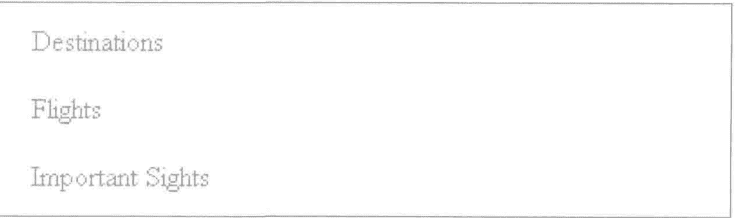
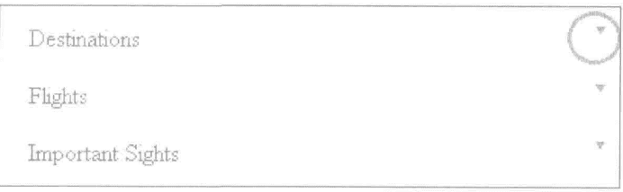
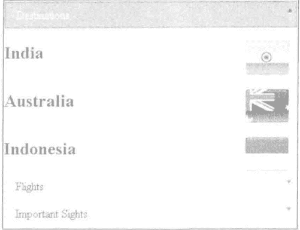
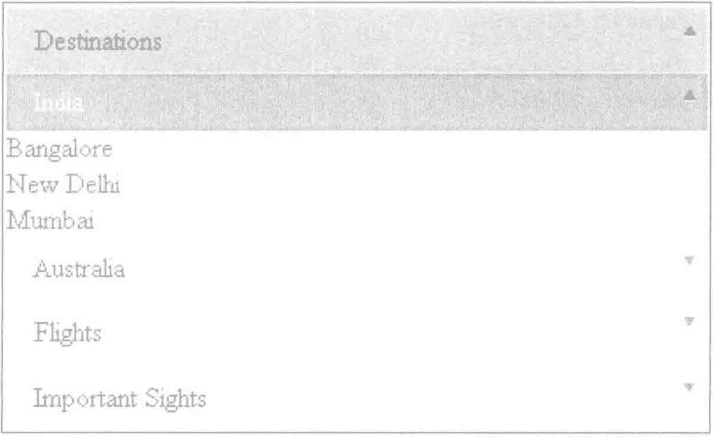
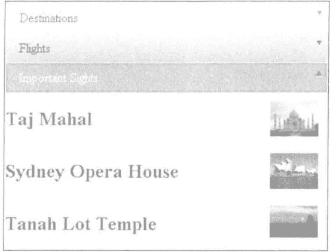
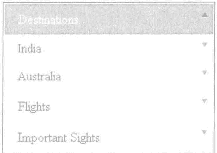
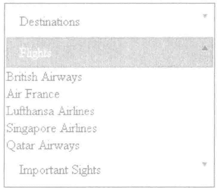

### Kendo UI PanelBar

在本章中，我们将介绍以下配方：

- 创建 PanelBar
- 使用 Ajax 加载 PanelBar 的内容
- 将 PanelBar 绑定到 DataSource 对象
- 自定义 PanelBar

#### 简介

Kendo UI PanelBar 小部件类似于包含分组在不同选项卡或窗格下的项目列表的选项卡式面板。在 PanelBar 中，这些项目列表是垂直堆叠的，每个列表项都可以展开以显示内容。当数据可以分组为多个部分且可用于显示这些数据的空间受到限制时，此小部件特别有用。例如，你的所有联系人都可以按某个类别（如 **Favourites**、**Family**、**Friends** 和 **Office Contacts**）分组；当你点击其中一个类别时，面板将展开以显示属于该类别的联系人列表。

#### 创建 PanelBar

PanelBar 可以通过在 HTML 标记中指定其结构，或通过使用 API 进行配置来创建。在本配方中，我们将介绍前一种方法。

#### 如何操作...

PanelBar 小部件包含垂直堆叠的项目列表。要创建 PanelBar，我们需要一个项目列表，因此使用 HTML 的有序列表或无序列表。在此示例中，我们将列出旅游目的地、航空公司和要参观的重要景点作为三个面板：

```
`<ul id="panelBar" style="width: 400px">
	<li>
	Destinations
	</li>
	<li>
	Flights
	</li>
	<li>
	Important Sights
	</li>
</ul>`
```

这里，列表包含三个项目，这些是我们希望每个面板的标题。此外，width 属性设置为 400px，这将设置 PanelBar 组件的宽度。如果未指定 width 属性，则 PanelBar 将占据整个屏幕宽度，这并不理想。

前面的面板尚未列出任何内容。让我们在 HTML 标记中为每个面板指定内容：

```
`<ul id="panelBar" style="width: 400px">
	<li>
	Destinations
	<div class="destinationData">
	<h2>India</h2>
	
	</div>
	<div class="destinationData">
	<h2>Australia</h2>
	
	</div>
	<div class="destinationData">
	<h2>Indonesia</h2>
	
	</div>
	</li>
	<li>
	Flights
	<div class="destinationData">
	British Airways
	</div>
	<div class="destinationData">
	Air France
	</div>
	<div class="destinationData">
	Lufthansa Airlines
	</div>
	<div class="destinationData">
	Singapore Airlines
	</div>
	<div class="destinationData">
	Qatar Airways
	</div>
	</li>
	<li>
	Important Sights
	<div class="destinationData">
	<h2>Taj Mahal</h2>
	
	</div>
	<div class="destinationData">
	<h2>Sydney Opera House</h2>
	
	</div>
	<div class="destinationData">
	<h2>Tanah Lot Temple</h2>
	
	</div>
	</li>
</ul>`
```

#### Kendo UI PanelBar

在前面的 HTML 标记中，每个列表项包含标题和内容，当用户单击 PanelBar 中的某个项目时，需要显示这些内容。

> 前面代码片段中使用的 destinationData 类仅用于样式设置。

最后一步是初始化 PanelBar 小部件。要初始化，请在列表上调用 kendoPanelBar 函数，如下所示：

```
$("#panelBar").kendoPanelBar();
```

#### 工作原理...

最初，当列表仅包含标题时，你将看到三个垂直堆叠的窗格，如下面的屏幕截图所示：



当你向列表中的每个项目添加内容时，你将看到列表中每个标题旁有一个向下箭头，如下面的屏幕截图所示：



现在，当你单击其中一个标题时，列表项将展开以显示其内容，如下面的屏幕截图所示：



#### 更多...

在前面的示例中，列表元素遵循单层级层次结构。PanelBar 可以自定义以处理多层级层次结构数据。前面的示例现在可以包含每个旅游目的地的重要城市。在这种情况下，国家名称将作为嵌套面板元素：

```
`<ul id="panelBar" style="width: 400px">
<li>
Destinations
<ul>
<li>
<span>India</span>
<div class="destinationData">
<span>Bangalore</span>
</div>
<div class="destinationData">
<span>New Delhi</span>
</div>
<div class="destinationData">
<span>Mumbai</span>
</div>
</li>
</ul>
</li>
</ul>
<ul>
<li>
<span>Australia</span>
<div class="destinationData">
<span>Sydney</span>
</div>
<div class="destinationData">
<span>Melbourne</span>
</div>
<div class="destinationData">
<span>Cairns</span>
</div>
</li>
</ul>
</li>
<li>
Flights
</li>
<li>
Important Sights
</li>
</ul>`
```

在前面的代码片段中，第一个列表项包含嵌套列表元素，每个嵌套列表元素包含一些内容，如下面的屏幕截图所示：



与它们的父列表元素一样，每个子列表元素都有一个标题，用户可以单击该标题以展开内容。

#### 使用 Ajax 加载 PanelBar 的内容

在前面的配方中，我们了解了如何使用页面中存在的标记创建 PanelBar 小部件。在本配方中，我们将了解如何通过从服务器使用 Ajax 获取内容来加载 PanelBar 中每个列表项的内容。

如前面的配方中所观察到的，每个列表项的内容都包裹在 div 元素内。这样做会增加页面大小，从而可能影响应用程序的性能。解决此问题的方法是在使用 Ajax 请求时加载每个列表项的内容。

##### 如何操作...

让我们考虑相同的示例；在这里，列表标题在标记中指定，div 元素用作占位符。这些占位符将在运行时包含从服务器获取的数据：

```
<ul id="panelBar" style="width: 400px">
  <li>
    Destinations
    <div></div>
  </li>
  <li>
    Flights
    <div></div>
  </li>
  <li>
    Important Sights
    <div></div>
  </li>
</ul>
```

这里，使用占位符 div 元素，以便在初始化 PanelBar 时，列表标题将显示向下箭头，指示它是可展开的。

下一步是创建包含列表中每个标题内容的 HTML 文件。例如，要填充前面列表中的 Destinations 列表，请创建 PanelBar_Destinations.html 文件：

```
<div class="destinationData">
  <h2>India</h2>
  
```


### 工作原理...

当页面执行时，只有带有标题的列表项会显示如下：


你可以检查 DOM，会发现这些列表项没有内容。但是，有一个向下的箭头，指示该列表项包含一些内容。

现在，当你点击其中任何一个列表项时，会向相应的 contentUrl 发送一个 Ajax 请求。该请求应返回应在列表项下显示的标记，如下面的屏幕截图所示：



在运行时加载内容（而非预先加载）的优势在于，服务器返回的响应大小减小，因此显示页面所需的时间也随之减少。在许多场景中，PanelBar 包含多个部分，用户可能不会点击所有部分。在这些情况下，在运行时加载内容是理想的。

### 更多内容...

在处理远程请求时，服务器可能需要更长时间来响应，或者服务可能不可用。在这些场景中，应向用户显示错误消息，或将其重定向到错误页面。

从用户点击列表标题到内容在相应面板中加载，会生成一系列事件。应用程序可以在初始化 PanelBar 小部件时为这些事件指定回调处理程序。

让我们为 PanelBar 添加事件处理程序，并在 div 元素（以下代码中的 logContainer）中记录事件：

```javascript
var $logContainer = $('#log');
$("#panelBar").kendoPanelBar({
    contentUrls: [
        "PanelBar_Destinations.html",
        "PanelBar_Flights.html",
        "PanelBar_Sights.html"
    ],
    select: function(event) {
        $logContainer.append($(event.item).find('> .k-link').text() + ' selected. <br>');
    },
    expand: function(event) {
        $logContainer.append($(event.item).find('> .k-link').text() + ' expanded. <br>');
    },
    activate: function(event) {
        $logContainer.append($(event.item).find('> .k-link').text() + ' activated. <br>');
    },
    contentLoad: function(event) {
        $logContainer.append($(event.item).find('> .k-link').text() + ' content loaded. <br>');
    },
    error: function(event) {
        $logContainer.append('Error occurred while loading, Status: ' + event.xhr.status);
    }
});
```

事件顺序如下：

- 1. 当用户点击列表项时：select。
- 2. 选中的列表项被展开：expand。
- 3. 发送 Ajax 请求并加载 Ajax 响应中的内容时：contentLoad。
- 4. 选中的列表项被激活：activate。
- 5. 如果从服务器加载内容时出错，则执行错误回调处理程序。

### 将 PanelBar 绑定到 DataSource 对象

PanelBar 还可以通过在 DataSource 对象中指定内容来构建。DataSource 可以是本地的，也可以指向返回 JSON 结构的远程服务。除了指定 PanelBar 中需要显示的数据外，DataSource 对象还可用于指定一些配置选项。在本示例中，我们将了解如何使用 DataSource 对象构建 PanelBar。

### 如何操作...

使用 kendoPanelBar 函数初始化 PanelBar 时，请指定 dataSource 选项：

```javascript
$("#panelBar").kendoPanelBar({
    dataSource: [
        {
            text: "Destinations",
            expanded: true,
            items: [
                {
                    text: "India",
                    imageUrl: "./images/India-Flag-icon.png",
                    cssClass: "destinationData"
                }, {
                    text: "Australia",
                    imageUrl: "./images/Australia-Flag-icon.png",
                    cssClass: "destinationData"
                }, {
                    text: "Indonesia",
                    imageUrl: "./images/Indonesia-Flag-icon.png",
                    cssClass: "destinationData"
                }
            ]
        }
    ]
});
```

在上述代码片段中，dataSource 配置选项指定了 PanelBar 中需要显示的数据。text 属性指定 PanelBar 标题中显示的文本；配置选项 expanded 设置为 true 时，将展开面板以显示项目列表。items 配置选项包含在面板展开时将显示的项目列表。items 配置中的每个对象除了应显示的文本外，还提及了 imageUrl 和 cssClass 属性。

在 DataSource 配置中，你还可以指定返回面板 HTML 内容的页面 URL：

```javascript
dataSource: [
    .
    .
    .
    {
        text: "Flights",
        contentUrl: "PanelBar_Flights.html"
    }
]
```

在这里，contentUrl 选项指定应从中获取面板内容的 URL。当用户点击面板时，会向指定的 URL 发送请求，并将响应中接收到的 HTML 内容插入到面板中。

### 工作原理...

当你渲染页面时，PanelBar 将使用你在 DataSource 中指定的数据填充。当你检查插入到 DOM 中的 HTML 标记时，你会看到 cssClass 属性中指定的类已添加到每个列表元素。此外，图像将插入到每个列表元素中，如下所示：

```html
<li role="menuitem" class="k-item k-state-default k-first destinationData">
    <span class="k-link">
        
        India
    </span>
</li>
```

### 自定义 PanelBar

有几个选项可用于自定义 PanelBar 小部件的行为。在本示例中，我们将了解如何设置 PanelBar 小部件的展开模式以及可以应用的动画效果。

### 如何操作...

PanelBar 小部件的设计旨在占用页面更少的空间，同时向你显示所需内容。当你点击 PanelBar 小部件中的任何列表项时，它会展开以显示内容。现在，当你点击另一个列表项时，它也会展开以显示其内容。此时，PanelBar 中有两个项目的内容正在显示。通过将 expandMode 属性设置为 single，列表中任何给定时间只能有一个项目保持展开状态：

```javascript
$("#panelBar").kendoPanelBar({
    expandMode: 'single'
});
```

默认情况下，expandMode 属性的值为 multiple，因此会发生上述行为。

> 如果展开的面板包含嵌套的元素列表，则展开模式不会应用于嵌套元素。

当 PanelBar 渲染时，所有面板都处于折叠状态。通过向列表项中的一个添加 k-state-active 类，可以将其中一个面板设置为展开状态：

```html
<ul id="panelBar">
  <li class="k-state-active">
    Destinations
    <li>
      .
      .
      .
    </li>
    .
    .
    .
  </li>
</ul>
```

下一个可以应用的配置选项是动画效果。在展开或折叠面板时可以应用动画效果。此外，你可以按如下方式指定动画效果的持续时间：

```javascript
$("#panelBar").kendoPanelBar({
    expandMode: 'single',
    animation: {
        collapse: {
            duration: 1000,
            effects: "fadeOut"
        },
        expand: {
            duration: 1000,
            effects: "fadeIn"
        }
    }
});
```

在上述代码片段中，指定了 animation 配置，详细说明了折叠和展开面板时应应用的动画效果。collapse 和 expand 均指定了 duration 属性，该属性以毫秒为单位指定动画效果的持续时间。它还包括 effects 属性，该属性指定需要应用的动画效果类型。对于折叠，只能应用 fadeOut 效果，而对于展开，可能的值为 fadeIn 和 expandVertical。


### 工作原理...

当 expandMode 属性设置为 single 时，PanelBar 小部件中只有一个面板可以处于展开状态，如下所示：



现在，当你点击其他面板，例如 **Flights** 时，第一个面板将折叠，所选面板将展开，如下图所示：


