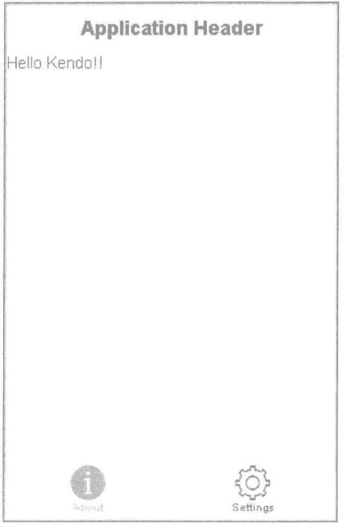
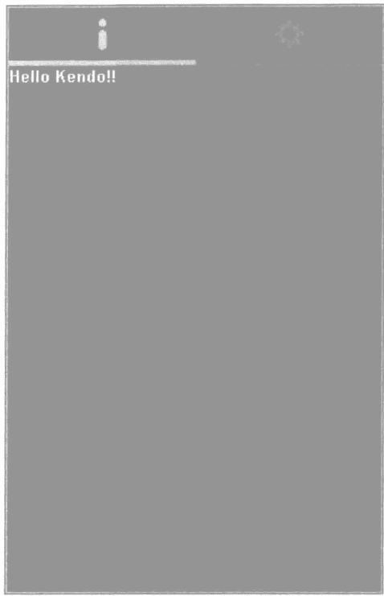
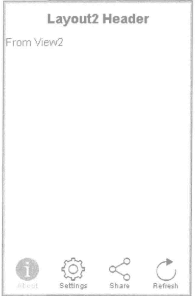
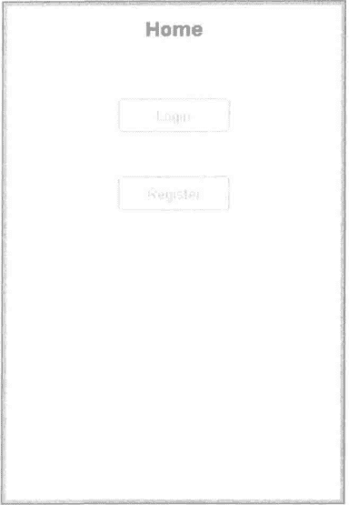
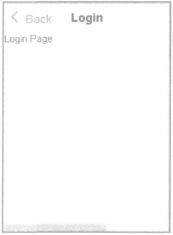
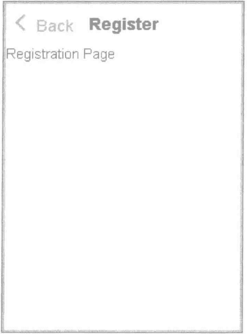

# 8 Kendo UI Mobile 框架

在本章中，我们将介绍以下配方：

- 创建布局并将视图添加到布局中
- 初始化应用程序时设置初始布局和视图
- 使用 Application 对象导航到各种视图
- 为移动应用程序添加触摸事件

## 简介

在早期的配方中，我们研究了 Kendo UI 库中可用于快速构建 Web 应用程序的各种组件。在即将介绍的配方中，我们将了解 Kendo UI Mobile 库，它提供了一个应用程序框架和一组小部件，使您能够快速构建移动应用程序。Kendo UI Mobile 框架通过在各种移动平台（包括 iOS、Android、Blackberry 和 Windows Phone 8）上提供原生外观和感觉来渲染应用程序。开发人员可以专注于提供功能，并依赖 Mobile 框架来提供各种平台的原生外观和感觉，从而减少开发工作量，并为所有平台维护相同的代码库。

## 创建布局并将视图添加到布局中

每个 Kendo Mobile 应用程序都有一个或多个布局以及添加到其中的多个视图。布局和视图都是小部件，即可用于构建移动应用程序的可视组件。有几个这样的小部件，我们将在下一章中探讨。在本配方中，我们将了解如何通过创建布局并添加多个视图来构建一个简单的应用程序。

## 入门

使用移动应用程序时，需要包含单独的 CSS 和 JS 文件。CSS 文件应引用位于 `styles` 目录中的 `kendo.mobile.all.min.css` 文件，JS 文件应引用位于 `js` 目录中的 `kendo.mobile.min.js` 文件。

此外，对 jQuery 库的引用应保持不变，即 Kendo UI Mobile 库（`kendo.mobile.min.js`）依赖于 jQuery。

## 操作方法...

如前一节所述，让我们首先在 HTML 页面中包含 CSS 和 JS 文件引用，如以下代码片段所示：

```html
<link rel="stylesheet" type="text/css" href="../styles/kendo.mobile.all.min.css">
<script src="../js/jquery.min.js"></script>
<script src="../js/kendo.mobile.min.js"></script>
```

> 您可能需要根据开发环境的目录结构调整文件路径。

下一步是创建布局。布局是应用程序中各种视图的容器。布局定义了应用程序的结构；它包含在用户与应用程序交互时保持不变的小部件。例如，大多数应用程序都有一个标题和一个页脚，在应用程序中导航时保持不变。标题和页脚小部件可以是布局的一部分，而动态部分（即根据应用程序状态变化的视图）将与布局关联。视图可以被视为应用程序中的单个页面，根据应用程序状态显示。例如，您可以有两个视图，即登录和注册。根据应用程序状态，将呈现其中一个视图。使用 `div` 元素并添加数据属性来创建布局小部件：

```html
<div
data-role="layout"
data-id="defaultLayout">
</div>
```

这里，`data-role` 属性设置为布局，将元素标识为布局小部件。Mobile 框架中的每个小部件都会将 `data-role` 属性设置为相应的小部件名称。`data-id` 属性用于在页面上标识小部件。页面上可以有多个布局小部件，每个小部件都需要有一个唯一的 ID 来在应用程序中标识该小部件。

现在让我们向布局添加几个小部件，例如包含 `navbar` 的 `header` 小部件，以及包含 `tabstrip` 的 `footer` 小部件：

```html
<div
data-role="layout"
data-id="defaultLayout">
<header data-role="header">
<div data-role="navbar">
Application Header
</div>
</header>
<footer data-role="footer">
  <div data-role="tabstrip">
    <a data-icon="about">About</a>
    <a data-icon="settings">Settings</a>
  </div>
</footer>
</div>
```

如前所述，小部件是通过为 `data-role` 属性分配适当值来创建的。在这种情况下，`header`、`navbar`、`footer` 和 `tabstrip` 值被分配给各种元素的 `data-role` 属性。

将布局添加到页面后，下一步是添加视图。视图小部件表示在呈现应用程序时需要显示的单个视图。页面上可以有多个视图，但任何给定时间点只能呈现一个视图，具体取决于应用程序的状态：

```html
<div data-role="view" data-layout="defaultLayout">
  Hello Kendo!!
</div>
```

这里，除了 `data-role` 属性外，`div` 元素还有一个 `data-layout` 属性。`data-layout` 属性用于将页面上的视图小部件与布局小部件关联。在这种情况下，`data-layout` 属性的值为 `defaultLayout`，即 `layout` 小部件的 `data-id` 属性的值。`layout` 中定义的 `header` 和 `footer` 小部件相应地定位，视图小部件在布局的可用空间内呈现。最后一步是初始化应用程序。要初始化它，请包含以下代码片段：

```html
<script>
var app = new kendo.mobile.Application();
</script>
```

前面的代码片段将初始化页面中的所有小部件，并在布局和视图之间建立关联。然后可以使用 Application 对象在页面中的多个视图之间进行路由，我们将在即将介绍的配方中讨论此场景。

## 工作原理...

执行页面时，您会看到页面标题和页脚中的导航栏和选项卡条。此外，**Hello Kendo!!** 消息将显示在页面的正文中。

以下屏幕截图显示了在运行 iOS7 的 iPhone 上查看页面时应用程序的外观：



请注意，没有编写额外代码来设置应用程序的外观和感觉。Mobile 框架开箱即用提供此功能，即它确定用户代理并将 CSS 类添加到页面中的元素。

检查页面时，您会看到添加到 body 标签的类，如以下代码行所示：

```
<body class="km-on-ios km-ios7 km-7 km-m0 km-web km-black-status-bar km-vertical km-widget km-pane" data-role="pane" style="">
```

请注意添加到 body 标签的 km-on-ios 和 km-ios7 类。如果在 Android 设备上查看同一页面，它将呈现不同的效果。



同样，框架确定用户代理并将 CSS 类添加到 body 标签。在这种情况下，它将如以下代码片段所示：

```html
<body class="km-on-android km-android km-4 km-m0 km-web km-black-status-bar km-vertical km-widget km-pane" data-role="pane" style="">
```

这里，添加了 km-on-android 和 km-android 类。

## 更多...

Mobile 框架根据访问它的设备呈现应用程序。但是，在您想要为给定平台自定义布局的场景中，可以指定 data-platform 属性。例如，您可以为前一个布局指定 data-platform 为 iOS，并将另一个布局添加到页面，其 data-platform 属性设置为 android：


### 设置应用程序初始化时的布局和视图

在处理复杂的移动应用程序时，页面中会有多个布局和视图。在这种情况下，无法确定在所选布局中渲染的初始视图。但是，可以将选项传递给 kendo.mobile.application 函数，以设置应用程序初始化时使用的布局和初始视图。

### 操作方法...

假设页面中有两个布局和两个视图。布局之间的区别在于 tabstrip 中的元素数量。在 layout1 中，让我们考虑标题文本，它读取为 Layout1 header，并且其 tabstrip 中有两个元素：

```
<div
data-role="layout"
data-id="layout1">
<!- - header here - ->
<footer data-role="footer">
<div data-role="tabstrip">
<a data-icon="about">About</a>
<a data-icon="settings">Settings</a>
</div>
</footer>
</div>
```

在同一页面中，还会有另一个布局，其 `data-id` 属性设置为 `layout2`。该布局的标题文本将读取为 `Layout2 header`，页脚将包含 tabstrip 中的四个元素：

```
<div
data-role="layout"
data-id="layout2">
<!- - header here - ->
<footer data-role="footer">
<div data-role="tabstrip">
<a data-icon="about">About</a>
<a data-icon="settings">Settings</a>
<a data-icon="share">Share</a>
<a data-icon="refresh">Refresh</a>
</div>
</footer>
</div>
```

下一步是向页面添加视图。让我们添加两个视图并为它们指定 id 属性：

```
<div
 data-role="view"
 id="view1">
 From View1
</div>

<div
 data-role="view"
 id="view2">
 From View2
</div>
```

请注意，此页面中的视图没有 data-layout 属性。当页面渲染时，您会看到页面中的第一个视图（id='view1'）在没有任何布局的情况下渲染。要更改此行为，您可以在初始化应用程序时指定要使用的布局和初始视图：

```
<script>
 var app = new kendo.mobile.Application(document.body, {
 layout: 'layout2',
 initial: 'view2'
 });
</script>
```

在这里，kendo.mobile.Application 函数的第一个参数是 document.body。此函数的第一个参数是目标元素。它通常是各种小部件的容器（带有 data-role 属性的元素）。第二个参数是一个对象，包含一组用于初始化应用程序的选项。在这里，我们将指定在渲染页面时要使用的布局和初始视图。

### 工作原理...

当您渲染页面时，您会看到在渲染 `view2` 时使用了 `layout2`。



如果您为视图元素指定了 `data-layout` 属性，则该视图将使用该布局进行渲染，而不是在初始化应用程序时提到的布局。

### 更多内容...

在之前的配方中，提到 `data-platform` 属性用于指定构建布局的平台。在许多场景中，您可能希望在所有平台上都出现相同的外观和感觉。例如，如果您使用 iOS 设备并希望强制使用 Android 的外观和感觉，那么您可以在初始化应用程序时指定 platform 属性：

```html
<script>
var app = new kendo.mobile.Application(document.body, {
    layout: 'layout2',
    initial: 'view2',
    platform: 'android'
});
</script>
```

现在，当您在任何设备上渲染页面时，您应该能够在所有平台上看到相同的外观和感觉。

### 使用 Application 对象导航到各种视图

在构建移动应用程序时，您将拥有代表应用程序中各种状态的多个视图，也就是说，每个状态都由应用程序中的 View 组件表示。例如，当您单击按钮时，当前视图将被销毁，新视图应显示。Application 对象用于在应用程序中导航到各种视图。这些视图可以定义在同一 HTML 文档中，也可以作为单独的文档（部分）存在。

### 操作方法...

构建代码的一个好方法是创建多个页面并分离视图。在同一页面中指定所有视图将增加响应的大小，从而影响性能。让我们创建一个包含两个按钮（即 Login 和 Register）的页面：

```
<div
data-role="layout"
data-id="layout1">
<header data-role="header">
<div data-role="navbar">
<span data-role="view-title"></span>
</div>
</header>
</div>
<div
data-role="view"
data-layout="layout1"
data-title="Home">

<a
data-role="button"
id="loginBtn"
class="button">
Login
</a>
<a
data-role="button"
id="registerBtn"
class="button">
Register
</a>
</div>
```

让我们称这个页面为 **Home** 页面。它包含一个布局小部件和一个视图小部件。视图包含两个按钮。请注意，布局的 navbar 小部件包含一个 data-role 属性设置为 view-title 的 span 元素。这允许各种视图提供将在 navbar 小部件中显示的标题。视图小部件指定了 data-title 属性，其值为 Home。这将把布局的 navbar 文本设置为相同的值。

视图包含两个按钮：**Login** 和 **Register**。下一步是定义单击其中一个按钮时将显示的视图；以下代码片段向您展示了 Login View 的描述：

```
<div
data-role="layout"
data-id="login-layout">
<header data-role="header">

<div data-role="navbar">
<a
class="nav-button"
data-role="backbutton"
data-align="left">
Back
</a>
<span data-role="view-title"></span>
</div>
</header>
</div>
<div
data-role="view"
data-layout="login-layout"
data-title="Login">
Login Page
</div>
```

前面的代码片段放在 login.html 文件中。在这里，布局与在 Home 页面中创建的布局类似，只是它现在包含一个返回按钮（data-role=backbutton）。backbutton 小部件用作导航小部件，用于导航回上一页。创建了一个类似的页面 register.html，包含相同的布局和视图。

下一步是将 Home 页面中的按钮绑定到这些页面。Application 对象用于在各种页面之间导航。让我们为页面上的 login 和 register 按钮添加事件处理程序：

```
<script>
var app = new kendo.mobile.Application();
$('#loginBtn').on('click', function () {
app.navigate('login.html');
});
$('#registerBtn').on('click', function () {
app.navigate('register.html');
});
</script>
```

navigate 方法用于导航到不同的页面。当用户单击其中任何按钮时，Application 对象上的 navigate 方法将被调用以导航到相应的页面。

### 工作原理...

当您渲染页面（**Home 页面**）时，有两个按钮，**Login** 和 **Register**。



单击 **Login** 按钮时，用户将被导航到 `login.html` 页面，当您单击 **Register** 按钮时，您将被导航到 `register.html` 页面。**Login** 页面的屏幕截图如下所示：



navbar 标题已更新，并且它有一个 **Back** 按钮。单击 **Back** 按钮时，用户将被导航到 **Home** 页面。在 **Home** 页面上，当您单击 **Register** 按钮时，将显示注册页面，即 `register.html` 页面，如下所示：



**Register** 视图也包含 **Back** 按钮，允许用户导航到 **Home** 页面。

在从一个视图导航到另一个视图时，您可以指定可以应用的过渡效果。

### 指定视图过渡

在从一个视图过渡到另一个视图时，您可以使用 `data-transition` 属性指定需要应用的过渡效果。以下值可以设置为 `data-transition` 属性的值：

- `slide`: 此过渡效果将旧视图内容向左滑动，并将新视图内容滑动到其位置。您可以使用 slide (direction) 指定方向。默认情况下，方向为左；另一个选项是右。
- `zoom`: 在这里，新视图内容从旧视图的中心缩放。旧视图内容将淡出，新视图内容将显示。


### Kendo UI Mobile 框架

- fade: 使用此效果时，新内容会淡入并覆盖在旧视图之上。旧视图内容会淡出，从而显示新视图的内容。

- overlay: 叠加效果与滑动效果类似，区别在于前一个视图仍保留在新视图下方。可以使用 overlay (direction) 指定过渡方向。默认方向为 left；其他支持的方向包括 right、up 和 down。

在上述所有过渡效果中，内容连同其标题和页脚均会显示。还可以为整个应用程序指定过渡效果，而无需为文档中的每个视图小部件指定 data-transition 属性。使用 Application 对象初始化应用程序时，请将 transition 属性指定为所需效果作为其值：

```javascript
var app = new kendo.mobile.Application(document.body, {
    transition: "zoom"
});
```

这使得过渡效果可以应用于整个应用程序。

### 为移动应用程序添加触摸事件

Kendo UI Mobile 框架提供了各种 API 来处理基于触摸的事件。你构建的应用程序不仅应允许用户在触摸界面上执行常规选择事件，还应处理各种触摸手势，例如双击、滑动和拖放。在本示例中，我们将查看可以添加的各种触摸事件。

### 操作方法...

为了本示例的目的，让我们考虑上一示例中使用的相同布局，并向页面添加一个视图。此视图的内容将是一个触摸小部件，用于指定视图中启用触摸事件的区域：

```html
<div
data-role="view"
data-layout="defaultLayout">
<div
id="touchSurface"
data-role="touch"
data-enable-swipe="1"
data-touchstart="touchstart"
data-swipe="swipe"
data-tap="tap"
data-doubletap="doubletap"
data-hold="hold"
style="height: 200px;">

Touch Surface

</div>
</div>
```

除了将 data-role 属性设置为 touch 之外，该小部件还包含各种 data 属性，用于指定触摸事件处理程序。这包括 touchstart、swipe、tap、双击和 hold。分配给这些 data 属性的值是事件处理程序的名称。这些事件处理程序将在 script 标记中定义。请注意，有一个属性 data-enable-swipe 设置为 1，表示启用了滑动功能：

```javascript
var app = new kendo.mobile.Application();

function touchstart(event) {
console.log('Event - Touch Start' + " X=" + event.touch.x.location + " Y=" + event.touch.y.location);
}
function tap(event) {
console.log('Event - Tap');
}
function doubletap(event) {
console.log('Event - Double tap');
}
function hold(event) {
console.log('Event - Hold');
}
function swipe(event) {
console.log('Swipe direction ' + event.direction);
}
```

### 工作原理...

当用户触摸表面时，会调用 `touchstart` 事件。`touchstart` 事件处理程序中可用的事件对象可用于确定触摸触发的 x 和 y 坐标。当用户在屏幕上轻点（即从触摸屏上抬起手指）时，会调用 `tap` 事件。同样，当用户快速连续在屏幕上轻点两次时，会调用 `doubletap` 事件。如果用户触摸屏幕并在几秒钟内不抬起手指，则会触发 `hold` 事件。当用户将手指从左向右或从右向左滑动时，会触发 `swipe` 事件。事件对象上可用的 `direction` 属性可用于确定用户发起滑动的方向。事件顺序如下：

- 当用户触摸屏幕时，将触发 `touchstart` 事件
- 当用户在屏幕上轻点时，将触发 `tap` 事件
- 当应用程序识别到第二次轻点时，将在 `tap` 之后调用 `doubletap` 事件

在 `hold` 的情况下，将执行以下顺序：

- 将触发 `touchstart` 事件
- 当用户长时间将焦点保持在同一点上时，将触发 `hold` 事件
