# 9 Kendo UI Mobile 小部件

在本章中，我们将介绍以下示例：

- 使用 ListView 小部件创建列表
- 将 ListView 小部件绑定到 DataSource 对象
- 当用户滚动列表时固定标题
- 筛选 ListView 小部件中的元素
- 使用 ListView 小部件构建分层列表
- 构建无限滚动列表
- 显示可使用 ActionSheet 小部件执行的操作列表
- 使用 ScrollView 小部件浏览图片集合
- 创建 SplitView 小部件以在平板电脑上显示多个窗格，并在窗格之间构建交互
- 使用 TabStrip 小部件显示不同的视图

## 简介

Kendo UI Mobile 库包含大量可直接在移动应用程序中使用的小部件。这些小部件允许您通过配置以匹配您的需求来构建一些常见的移动相关工作流。一些常用的小部件包括 ListView、ScrollView、ActionSheet、TabStrip 和 Navbar。该库还提供了一个 SplitView 小部件，可用于平板电脑应用程序。

### Kendo UI Mobile 小部件

在本章中，我们将了解如何创建显示扁平或分层数据集合的 ListView；然后，讨论可用于实现某些工作流的配置选项，例如构建无限滚动列表。然后将使用 ActionSheet 小部件对选定的列表元素执行操作。我们还将了解如何使用 ScrollView 小部件创建类似画廊的应用程序。SplitView 小部件用于平板电脑，在单个页面上显示两个不同的视图并绑定它们之间的交互。

### 使用 ListView 小部件创建列表

ListView 小部件允许您在页面上显示项目列表。此列表可以是扁平的或分组的。列表值可以在 HTML 标记中指定，或者 ListView 小部件可以绑定到 DataSource 对象。在本示例中，我们将了解如何创建一个 ListView 小部件，其中列表值在标记中指定。

### 操作方法...

可以使用无序列表或有序列表创建 ListView 小部件。要创建 ListView 小部件，请将 listview 值分配给 data-role 属性：

```html
<ul data-role="listview">
<li>
 <a href="her.html">
  
  Her
 </a>
</li>
<li>
 <a href="gravity.html">
  
 </a>
</li>
<li>
 <a href="12_years_a_slave.html">
  
  12 Years A Slave
 </a>
</li>
</ul>
```

前面的标记包含一个无序列表，其中每个列表元素包含一张图片和一段文本。当应用程序初始化时，页面中存在的小部件将根据分配给 `data-role` 属性的值进行初始化。

### 工作原理...

当您渲染页面时，ListView 小部件将在移动设备上构建和渲染，如下面的屏幕截图所示：

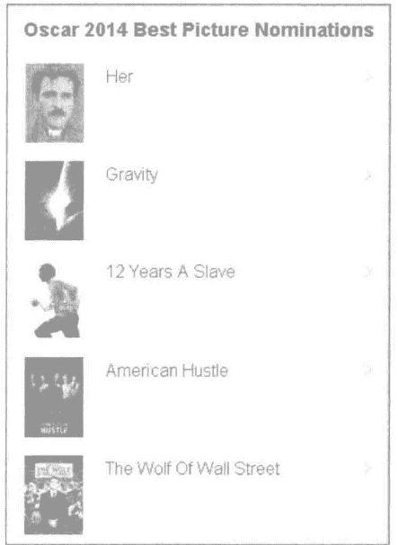

在这里，每个列表项包含一个 `anchor`（指向页面的超链接）元素，其 `href` 属性引用 `html` 页面。此外，它还包含一个右箭头，与列表中每个项目的右侧对齐。这表明用户可以单击以查看列表中特定项目的详细信息。

当您单击列表元素时，将导航到相应的页面。

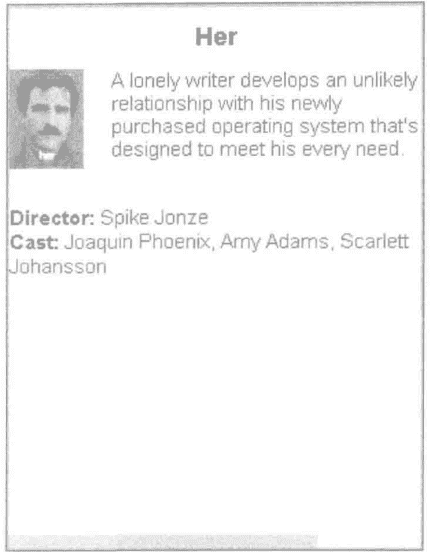

ListView 小部件与 DetailsButton 小部件集成，后者可用于在列表中每个元素的右侧添加图标。此图标用于说明可以在列表项上执行的操作。

要为列表元素添加 detailbutton，请插入一个 data-role 属性设置为 detailbutton 的锚元素。此外，您需要指定 data-style 属性，该属性指定正在添加的详细按钮类型。详细按钮支持四种样式：contactadd、detaildisclose、rowinsert 和 rowdelete。

您还可以通过指定 data-icon 属性而不是 data-style 来添加自定义图标：

```html
<ul data-role="listview">
<li>
Contact Add
</li>
</ul>
```


Detail Disclose
<a data-role="detailbutton"
data-style="detaildisclose">
</a>
</li>
<li>
Row Insert
<a data-role="detailbutton"
data-style="rowinsert">
</a>
</li>
<li>
Row Delete
<a data-role="detailbutton"
data-style="rowdelete">
</a>
</li>
<li>
Battery (Custom Icon)
<a data-role="detailbutton"
data-icon="battery">
</a>
</li>
</ul>

这里，ListView 小部件中的最后一个元素包含一个锚点，其 data-icon 属性设置为 battery。你可以为 data-icon 属性指定以下值：about、action、add、bookmarks、camera、cart、compose、contacts、details、downloads、fastforward、favorites、featured、toprated、globe、history、home、info、more、mostrecent、mostviewed、organize、pause、play、recents、refresh、reply、rewind、search、settings、share、stop 和 trash。

当你渲染页面时，你会看到每个列表元素右侧都添加了详情按钮。

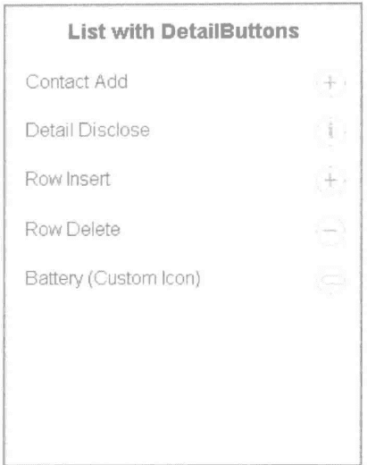

你还可以通过将 `data-icon` 属性的值指定为 `custom` 并将 `km-custom` 类添加到 CSS 样式表来添加自定义图标。

### 将 ListView 小部件绑定到 DataSource 对象

如前一节所述，ListView 小部件可以通过在标记中指定列表元素或将其绑定到 `DataSource` 对象来创建。在本节中，我们将了解如何使用 `DataSource` 对象填充 ListView。

#### 操作方法...

让我们创建一个空列表，然后使用来自 `DataSource` 对象的数据对其进行填充：

```html
<ul id="listViewContainer"> </ul>
```

请注意，无序列表未指定 `data-role` 属性。可以通过在 DOM 元素上调用 `kendoMobileListView` 函数来初始化 ListView 小部件：

```javascript
var listElements = ['Her', 'Gravity', '12 Years A Slave',
'Captain Phillips', 'American Hustle',
'The Wolf Of Wall Street', 'Nebraska',
'Dallas Buyers Club', 'Philomena'];
$('#listViewContainer').kendoMobileListView({
dataSource: listElements
});
```

**listElements** 数组包含一组字符串，这些字符串将用作 dataSource 来填充 ListView 小部件。`kendoMobileListView` 函数用于初始化列表元素。`dataSource` 选项在初始化小部件时指定。

或者，`dataSource` 也可以指向返回字符串数组的远程服务：

```javascript
$('#listViewContainer').kendoMobileListView({
dataSource: {
transport: {
read: '/services/listViewService'
}
}
});
```

#### 工作原理...

当你渲染页面时，ListView 小部件会被初始化，并使用数组中存在的数据进行填充。如果 `DataSource` 指向服务 URL，则会向服务发送 `GET` 请求，并使用服务返回的数据来填充 ListView 小部件。

| 2014 年奥斯卡最佳影片提名 |
|-------------------------------------|
| Her                                 |
| Gravity                             |
| 12 Years A Slave                    |
| Captain Phillips                    |
| American Hustle                     |
| The Wolf Of Wall Street             |
| Nebraska                            |
| Dallas Buyers Club                  |
| Philomena                           |

#### 更多...

在前一节中，我们使用数组中的值填充了 ListView 小部件。你还可以提供一个模板，在使用 DataSource 对象填充列表时使用该模板。

让我们创建一个对象数组，其中每个对象包含两个属性，name 和 image，如下所示：

```javascript
var listElements = [
{name: 'Her', image: 'her.jpg'},
{name: 'Gravity', image: 'gravity.jpg'},
{name: '12 Years A Slave', image: '12_years_a_slave.jpg'},
{name: 'Captain Phillips', image: 'captain_phillips.jpg'},
{name: 'American Hustle', image: 'american_hustle.jpg'},
{name: 'The Wolf Of Wall Street',
image: 'wolf_of_wall_street.jpg'},
{name: 'Nebraska', image: 'nebraska.jpg'},
{name: 'Dallas Buyers Club',
image: 'dallas_buyers_club.jpg'},
{name: 'Philomena', image: 'philomena.jpg'}
];
```

下一步是创建一个模板，在填充列表时将使用该模板：

```html
<script type="text/x-kendo-template" id="list-template">
<a>

#= name #
</a>
</script>
```

该模板为 image 和 name 属性指定了占位符。现在，当你初始化小部件时，除了指定 dataSource 属性外，还要指定 template 属性：

```javascript
$('#listViewContainer').kendoMobileListView({
 dataSource: listElements,
 template: $('#list-template').html()
});
```

这里的 template 属性包含对先前指定的模板（id=#list-template）的引用；该模板针对 dataSource 对象中存在的数据进行编译。对于 dataSource 对象中的每个对象，都会生成一个列表元素并将其追加到 ListView 小部件中。

### 当用户滚动列表时修复标题

ListView 小部件中的项目可以按属性分组。例如，假设列表包含你目录中的一组姓名或联系人。这些联系人可以按联系人名称开头的字母进行分组。当你渲染列表时，你会看到这些联系人已分组，并且在滚动时，标题是固定的。

#### 操作方法...

要创建固定标题，即按特定属性分组的数据，集合或数组中的每个对象都应包含该属性。让我们创建一个示例数组，其中每个对象包含两个属性，`name` 和 `startsWith`；`startsWith` 属性将用于对列表中的姓名进行分组：

```javascript
var actors = [
    { "name": "Leonardo DiCaprio", "startsWith": "L" },
    { "name": "Johnny Depp", "startsWith": "J" },
    { "name": "Al Pacino", "startsWith": "A" },
    { "name": "Bradley Cooper", "startsWith": "B" },
    { "name": "Tom Cruise", "startsWith": "T" },
    { "name": "Jude Law", "startsWith": "J" },
    { "name": "Robert Downey Jr.", "startsWith": "R" },
    { "name": "Will Smith", "startsWith": "W" },
    { "name": "Robert De Niro", "startsWith": "R" },
    { "name": "Antonio Banderas", "startsWith": "A" },
    { "name": "Christian Bale", "startsWith": "C" },
    { "name": "Brad Pitt", "startsWith": "B" },
    { "name": "Tom Hanks", "startsWith": "T" },
    { "name": "Robert Pattinson", "startsWith": "R" },
    { "name": "Ben Stiller", "startsWith": "B" }
];
```

请注意，列表不是按排序顺序排列的；我们将使用此列表作为 ListView 小部件的 `DataSource`：

```javascript
function mobileListViewInit() {
    $('#listViewContainer').kendoMobileListView({
        dataSource: kendo.data.DataSource.create({
            data: actors,
            group: 'startsWith'
        }),
        template: '#= name #',
        fixedHeaders: true
    });
}
```

在前面的代码片段中，mobileListViewInit 函数用于初始化 ListView 小部件。当包含 ListView 小部件的视图被初始化时，将调用此函数。视图应指定 data-init 属性，该属性引用 mobileListViewInit 函数作为其值。dataSource 属性用于提供输入数据（引用 actors 数组），并且还指定 group 属性，其值为 startsWith。除了 dataSource 属性外，列表视图的初始化还包含 template 和 fixedHeaders 属性。fixedHeaders 属性用于在用户滚动列表时修复每个列表组的标题。

#### 工作原理...

当 ListView 小部件被初始化时，数组中的姓名将按 startsWith 属性分组，你将看到姓名按升序排列，即按字母顺序列出，如下面的屏幕截图所示：

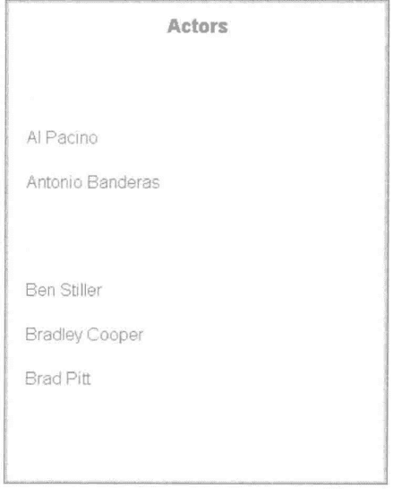

现在，当用户向下滚动时，你会看到相应的标题固定在顶部，指示列表顶部的当前列表是特定组的列表。

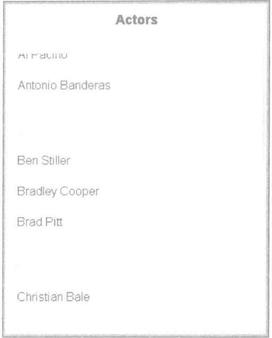

在前面的屏幕截图中，用户已向下滚动，但标题位于页面顶部，指示当前列表以字母 A 开头。fixedHeaders 属性将在用户向下滚动列表时修复标题。

### 筛选 ListView 中的元素

ListView 小部件可以包含多个列表元素，滚动整个列表以找到所需的列表元素会很耗时。例如，考虑你的联系人列表；要找到特定联系人，需要多次滚动。为了消除这一问题，你可以添加一个筛选器，并使用它来检索与输入文本匹配的所需列表元素。

#### 操作方法...

让我们考虑一个扁平数据源，即包含字符串列表的数组：

```javascript
var listElements = ['Leonardo DiCaprio', 'Johnny Depp',
'Bradley Cooper', 'Al Pacino',
'Tom Cruise','Jude Law',
```


'Robert Downey Jr.', 'Will Smith',
'Robert De Niro', 'Christian Bale',
'Brad Pitt','Tom Hanks',
'Robert Pattinson', 'Ben Stiller'];

现在初始化 ListView 小部件时，将前面的元素作为 dataSource 提供，并包含 filterable 属性并将其值设置为 true：

$('#listViewContainer').kendoMobileListView({
dataSource: listElements,
filterable: true
});

当将 filterable 属性设置为 true 时，列表顶部会添加一个搜索输入字段。当用户开始在搜索输入字段中键入时，列表会被过滤以显示与用户输入匹配的选项。在这里，用户输入字符串与列表中的元素进行比较，只有那些以输入字符串开头的元素才会显示在列表中。如果您想更改此逻辑，使其返回包含输入字符串的元素，而不是以它开头的元素，那么请按如下方式提及 operator 字段：

$('#listViewContainer').kendoMobileListView({
dataSource: listElements,
filterable: {
"operator": "contains"
}
});

operator 字段可以包含以下值之一：startsWith, endswith, contains, eq (等于), neq (不等于), lt (小于), lte (小于或等于), gt (大于), 和 gte (大于或等于)。

当使用包含对象的 dataSource 时，小部件将无法过滤列表，因为它不知道应将用户输入与哪个字段进行匹配。要修复此问题，您可以指定 field 选项：

$('#listViewContainer').kendoMobileListView({
dataSource: actors,
template: '#= name #',
filterable: {
"field": "name",
"operator": "contains"
}
});

前面的代码片段查找 name 字段并过滤列表中的元素。在所有先前的情况中，当用户开始在搜索输入字段中键入时，列表会被过滤。如果您希望用户单击搜索按钮，那么请指定 autoFilter 选项并将其设置为 false：

$('#listViewContainer').kendoMobileListView({
dataSource: actors,
template: '#= name #',
filterable: {
"field": "name",
"autoFilter": false,
"operator": "contains"
}
});

通过将 autoFilter 属性设置为 false，用户将不得不单击搜索按钮才能获取过滤后的列表。当您处理长列表且不希望列表在每次按键输入时刷新时，这很有用。

#### 工作原理...

当您渲染页面时，您将在列表顶部看到搜索输入字段。


当您开始在搜索字段中键入时，列表会被过滤，并且仅包含那些以输入文本开头的选项。

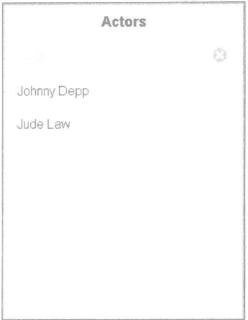

当您将 operator 更改为 `contains` 时，列表会被过滤，并且现在包含那些包含输入文本的选项。

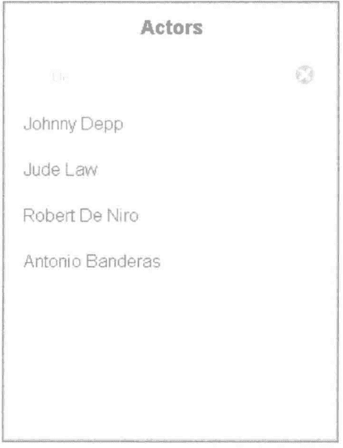

#### 更多...

搜索输入字段具有占位符文本 **Search**。您可以通过指定 `placeholder` 选项来自定义此文本：

$('#listViewContainer').kendoMobileListView({
dataSource: actors,
template: '#= name #',
filterable: {
"field": "name",
"autoFilter": false,
"placeholder": "Find...",
"operator": "contains"
}
});

当您渲染页面时，您将看到 `placeholder` 文本已更改为 **Find...**：

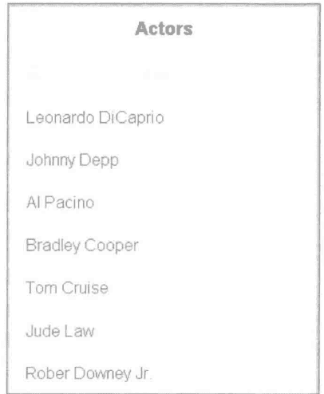

### 使用 ListView 小部件构建分层列表

在所有先前的示例中，服务返回的数据包含所有记录，并且相同的记录显示在列表中。当处理分层数据结构而不是扁平结构时，可以自定义 ListView 小部件，以便以分层方式显示数据，即显示层次结构第一级中的元素，然后遍历各个层级，直到到达层次结构中的叶子节点。

### 入门

要构建分层列表，服务应返回列出需要显示的第一组记录的数据。每条记录都应有一个字段，指示是否存在子记录，或者它是层次结构中的叶子节点。此信息将随后在 ListView 小部件中使用，从而使用户能够在层次结构中导航。

### 操作方法...

ListView 小部件应首先显示层次结构顶层中存在的记录。假设服务配置为在从客户端浏览器查询时返回相同数据：

[
{ "id": 1, "name": "Lamborghini", "hasModels": true },
{ "id": 2, "name": "Ferrari", "hasModels": true },
{ "id": 3, "name": "Aston Martin", "hasModels": true }
]

id 属性用于唯一标识分层结构中的每条记录。它还有一个 hasModels 属性，指示记录是否具有关联的子节点。下一步是创建 DataSource 对象并指定服务 URL 以及架构详细信息：

var cars = new kendo.data.HierarchicalDataSource({
transport: {
read: '/carService'
},
schema: {
model: {
id: 'id',
hasChildren: 'hasModels'
}
}
});

在前面的代码片段中，我们使用 kendo.data.HierarchicalDataSource 创建分层数据源的实例。定义包含架构对象，该对象指定 id 和 hasChildren 属性的映射。每当用户导航到层次结构中的各个层级时，都应使用渲染分层结构的视图：

```html
<div
id="hierarchicalView"
data-role="view"
data-title="Cars"
data-show="attachDataSource"
data-layout="defaultLayout">
<ul
id="listViewContainer"
data-role="listview"
data-template="hierachicalTemplate">
</ul>
</div>
```

前面的视图（id=hierarchicalView）包含一个 ListView 小部件。该视图指定了 data 属性 – show，其值引用每次渲染视图时将被调用的函数，即每次视图被重用以显示下一级元素时。ListView 小部件指定了 data-template 属性为 hierarchicalTemplate。模板可以在初始化小部件时指定，也可以作为 data- 属性指定：

```html
<script id="hierachicalTemplate" type="text/x-kendo-template">
 # if(data.hasModels) { #
 <a href="#hierarchicalView?parent=#: data.id #">
 #= name #
 </a>
 # } else { #
 #= name #
 # } #
</script>
```

模板首先检查当前模型对象（在 data 中引用）是否将 hasModels 属性设置为 true，然后添加一个指向同一视图（id=hierarchicalView）的超链接，并带有查询参数 parent，设置为模型对象的 id。如果当前模型对象是叶子节点，则将其添加到列表中，不带任何超链接。

当用户单击超链接时，视图应被重用以显示层次结构中的下一组元素。如前所述，data-show 属性指定每次使用视图显示内容时应调用的函数。attachDataSource 函数在每次显示视图时被调用：

function attachDataSource(e) {
var parentID = e.view.params.parent,
listView = $("#listViewContainer")
.data('kendoMobileListView');

if (!parentID) {
listView.setDataSource(cars);
} else {
cars.fetch(function () {
var item = cars.get(parentID);
listView.setDataSource(item.children);
});
}
}

每当用户单击链接时，视图被重用，前面的函数被调用。然后使用事件对象获取 parentID。最初，当视图用于渲染元素（即层次结构顶层中的元素）时，parentID 为 null。在这种情况下，ListView 被设置为我们先前定义的分层数据源。当用户导航视图时，parentID 将存在，并且 ListView 的 dataSource 被设置为相应父节点的子节点。

### 工作原理...

当您渲染页面时，层次结构顶层中的元素将如下面的屏幕截图所示显示：

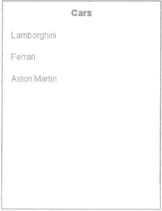


这里，由于 hasModels 属性设置为 true，列表中的所有元素都会显示一个右箭头（▶）。这表明用户可以点击它来导航到下一组节点。

当用户点击 ListView 中的任何元素时，将调用 attachDataSource 函数。点击元素的 id 将用于获取层次结构中的下一组元素。请注意，当你为 ListView 设置 DataSource 时，查询参数 parentID 会存在；会向服务发送一个 GET 请求，将 parentID 值指定给查询参数 id。远程服务会查找记录并将其返回。请求 URL 的形式如下：

```
/service?id=<parentID>
```

当你点击第一个元素（id = 1）时，服务将查找 parentID 为 1 的记录。假设服务返回以下记录：

```
[
  {"id": 11, "name": "Gallardo", "hasModels": false},
  {"id": 12, "name": "Aventador", "hasModels": false},
  {"id": 13, "name": "Huracan", "hasModels": false}
]
```

请注意，这三个对象中 hasModels 的值均为 false。现在，视图会更新以在 ListView 中显示上述记录，并且不包含右箭头。

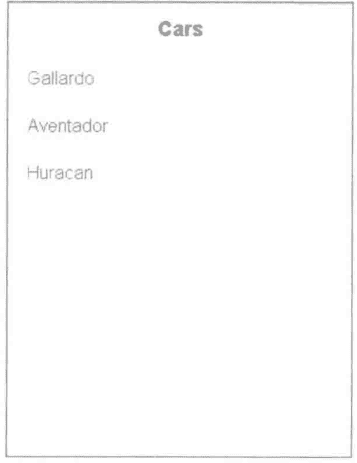

用于渲染列表元素的模板会检查 hasModels 属性的值，并且仅在该值设置为 true 时才添加锚元素。在此情况下，该值为 false，因此不显示右箭头。

### 构建无限滚动列表

ListView 小部件可以自定义以显示详尽的项目列表。实现此功能有多种方式，例如，在列表底部添加一个按钮，点击后将下一组元素添加到列表中。另一种方式是随着用户向下滚动而添加更多元素。这称为无限滚动，当用户浏览详尽列表时，它能提供无缝体验。在本示例中，我们将看到这两种方法，即添加按钮以加载更多元素，以及创建在用户向下滚动时加载的无限滚动列表。

#### 操作步骤...

在两种情况下，都必须配置 DataSource 对象，使其返回有限数量的记录。在为 ListView 小部件配置 DataSource 时，请指定 pageSize 属性：

```
dataSource: {
 transport: {
 read: '/movies/listService'
 },
 pageSize: 10
}
```

要在列表底部添加按钮，请指定 loadMore 选项并将其值设置为 true：

```
function initListView (e) {
 $('#listViewContainer').kendoMobileListView({
 dataSource: {
 transport: {
 read: '/movies/listService'
 },
 pageSize: 10
 },
 loadMore: true
 });
}
```

要启用无限滚动而不是添加加载更多按钮，请将 endlessScroll 属性设置为 true：

```
function initListView (e) {
    $('#listViewContainer').kendoMobileListView({
        dataSource: {
            transport: {
                read: '/movies/listService'
            },
            pageSize: 10
        },
        endlessScroll: true
    });
}
```

#### 工作原理...

渲染页面时，带有 **Press to load more** 文本的按钮会显示在列表底部，如下图所示：

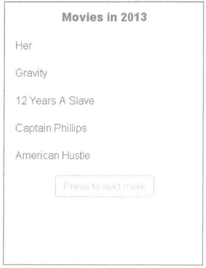

在无限滚动列表的情况下，当用户向下滚动时，会向服务发送请求。在加载列表期间，您将看到加载器显示，如下图所示：

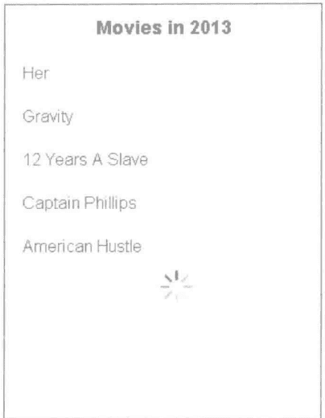

### 显示可使用 ActionSheet 小部件执行的操作列表

Kendo Mobile ActionSheet 小部件用于显示当用户点击屏幕上的元素时可以执行的操作列表。ActionSheet 小部件从底部滑出，并显示可针对屏幕上点击的元素执行的操作列表。

#### 操作步骤...

让我们创建一个包含 ListView 小部件和 ActionSheet 小部件的视图：

```html
<div
data-role="view"
data-title="Movies to watch"
data-layout="defaultLayout">
<ul>
```

```
id="listViewContainer">
</ul>
<ul
data-role="actionsheet"
id="optionActionSheet">
<li>
<a data-action="option1">Favourite</a>
</li>
<li>
<a data-action="option2">Watch</a>
</li>
<li>
<a data-action="option3">Remove</a>
</li>
</ul>
</div>
```

ListView 小部件的内容通过 DataSource 对象填充。ActionSheet 小部件（带有 data-role=actionsheet 的 ul）包含当用户点击 ListView 小部件中的任何元素时需要显示的操作列表。请注意，每个列表元素都包含带有 data-action 属性的锚元素。该属性用于指定当用户点击操作按钮时要调用的 JavaScript 函数。

下一步是将列表中的元素与 ActionSheet 小部件关联。要填充列表中的元素，可以使用模板，并且该模板可以指定对 ActionSheet 小部件的引用：

```
<script id="listViewTemplate" type="text/x-kendo-template">
<a
data-rel="actionsheet"
href="\\#optionActionSheet">
#= data #
</a>
</script>
```

这里，锚的 data-rel 属性设置为 actionsheet，href 属性引用 ActionSheet 小部件（id=optionActionSheet）。

#### 工作原理...

ListView 小部件中的每个元素都有一个右箭头（>），这表示可以在列表元素上调用操作：

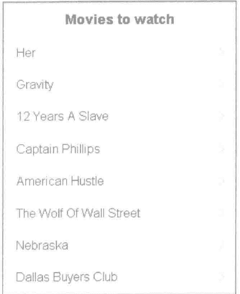

当您点击列表中的任何元素时，将显示 ActionSheet 小部件。小部件从屏幕底部滑出，并列出用户可以执行的选项或操作，如下图所示：

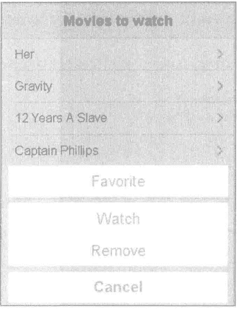

# 第 9 章

ActionSheet 小部件的覆盖层覆盖整个屏幕，并显示包含操作的列表。请注意，ActionSheet 小部件除了列出上述选项外，还包含 **Cancel** 按钮。

当用户点击之前的任何选项时，将调用关联的 JavaScript 函数。点击 **Cancel** 时，ActionSheet 小部件将隐藏并移除覆盖层。

## 更多内容...

在 Android 设备上，ActionSheet 小部件显示为 **Modal window**。如前所述，移动小部件已自定义以提供各种设备的原生外观和感觉。

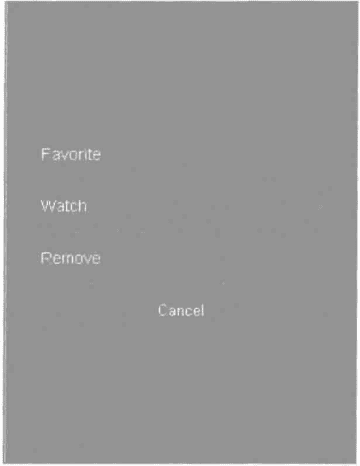

此处选项也列出了 **Cancel** 选项。

## 使用 ScrollView 小部件浏览图片集合

ScrollView 小部件用于图片画廊或类似轮播的应用程序，您希望滚动到下一页以查看画廊中的下一张图片。该小部件允许您通过从右向左或从左向右滑动来移动到下一页或上一页。

## 操作步骤...

让我们创建一个包含 ScrollView 小部件的 `view`：

```html
<div
data-role="view"
data-title="Gallery"
data-layout="defaultLayout">
<div
data-role="scrollview">
</div>
</div>
```

这里，通过将 data-role 属性设置为 scrollview，在视图内创建了一个 ScrollView 小部件。ScrollView 小部件现在需要包含可以通过从右向左或从左向右滑动来浏览的页面。要创建页面，请在 ScrollView 容器内添加 div 元素，并将 data-role 属性设置为 page。每个页面小部件随后可以包含需要显示的图片：

```
<div
data-role="scrollview">
<div
data-role="page">

</div><div
data-role="page">

</div><div
data-role="page">

</div><div
data-role="page">

</div><div
data-role="page">

</div>
.
.
.
</div>
```

## 工作原理...

渲染页面时，ScrollView 小部件会显示包含图片的第一页。


### Gallery

在这里，ScrollView 小部件还在屏幕底部包含一个分页器，用于高亮显示用户当前所在的页面。当你从右向左滑动时，下一页显示如下：

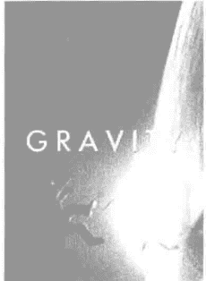

### 更多内容

当你渲染页面时，ScrollView 小部件默认显示页面集中的第一页。如果你想显示不同的页面，则为 ScrollView 小部件元素设置 `data-page` 属性：

```html
<div
    data-role="scrollview"
    data-page="4" >
</div>
```

页码从零开始索引，也就是说，当你将 `data-page` 属性指定为 4 时，列表中的第五页会被显示。

如果你想隐藏 ScrollView 小部件底部显示的分页器，则可以将 `data-enable-pager` 属性设置为 `false`：

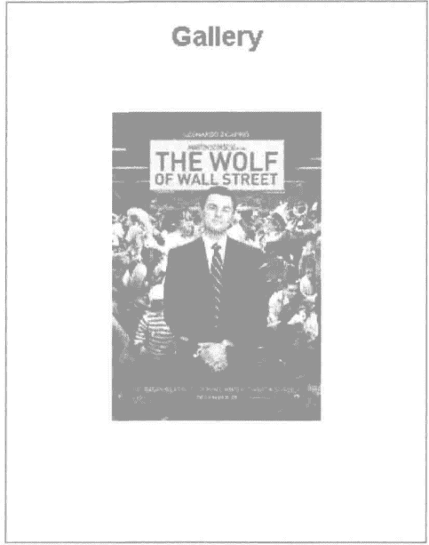

在前面的截图中，`pager` 已被移除；但是，用户仍然可以通过滑动来浏览页面集。当你有一个需要浏览的详尽页面列表，并且在屏幕底部显示分页器不是你想要提供的体验时，此选项很有用。

### 创建 SplitView 小部件以在平板电脑中显示多个窗格，并在窗格之间构建交互

Kendo UI 库提供了一个 SplitView 小部件，这是一个专用于平板电脑的小部件。SplitView 小部件由两个或多个窗格组成，每个窗格由一个或多个视图小部件组成。通常，SplitView 小部件用于在一个窗格的列表中选择一个项目，并更新显示所选项目更多数据的另一个窗格。

### 操作方法

让我们创建两个窗格，左窗格和右窗格，然后将这些窗格包含在 SplitView 小部件中。以下是左窗格的标记：

```html
<div data-role="pane" id="nav-pane" data-layout="left-navbar-layout">
  <div data-role="view" id="test">
    <ul id="moviesList" data-role="listview" data-template="navbar-template"></ul>
  </div>
  <script type="text/x-kendo-template" id="navbar-template">
    <a href="#movieDescription?movieID=#= data.id #" data-target="content-pane">#= data.name #</a>
  </script>
  <div data-role="layout" data-id="left-navbar-layout">
    <header data-role="header">
      <div data-role="navbar">Left Pane</div>
    </header>
  </div>
</div>
```

通过将 data-role 属性设置为 pane 来创建窗格小部件。窗格包含一个视图小部件，该视图列出使用 ListView 小部件的项目。视图与布局相关联，ListView 小部件使用以下 DataSource 对象填充：

```javascript
var listElements = [
  {id: 1, name: 'Her', image: 'her.jpg'},
  {id: 2, name: 'Gravity', image: 'gravity.jpg'},
  {id: 3, name: '12 Years A Slave', image: '12_years_a_slave.jpg'},
  {id: 4, name: 'Captain Phillips', image: 'captain_phillips.jpg'},
  {id: 5, name: 'American Hustle', image: 'american_hustle.jpg'},
  {id: 6, name: 'The Wolf Of Wall Street', image: 'wolf_of_wall_street.jpg'},
  {id: 7, name: 'Nebraska', image: 'nebraska.jpg'},
  {id: 8, name: 'Dallas Buyers Club', image: 'dallas_buyers_club.jpg'},
  {id: 9, name: 'Philomena', image: 'philomena.jpg'}
];
```

现在让我们考虑 **右窗格** 小部件，它将用于显示 **左窗格** 中所选项目的详细信息：

```html
<div data-role="pane" id="content-pane" data-layout="right-content-layout">
  <div data-role="view" data-show="displayOrders" id="movieDescription">
    <div id="movieDetails"></div>
  </div>
  <div data-role="layout" data-id="right-content-layout">
    <header data-role="header">
      <div data-role="navbar">Right Pane</div>
    </header>
  </div>
</div>
```

**右窗格** 小部件也包含视图；当用户在 **左窗格** 中选择一个项目时，会生成该视图的内容。请注意，左窗格模板中指定的锚元素将 href 属性指定为 `#movieDescription?movieID=#= data.id #`，它引用 **右窗格** 中的视图。此外，它将 data-target 属性指定为 content-pane，它引用 **右窗格** 本身。

下一步是将两个窗格包含在 SplitView 小部件中：

```html
<div data-role="splitview">
  <div data-role="pane" id="nav-pane" data-layout="left-navbar-layout">
    .
  </div>
  <div data-role="pane" id="content-pane" data-layout="right-content-layout">
    .
    .
  </div>
</div>
```

**右窗格** 中的视图小部件将 data-show 属性设置为 displayOrders；data-show 属性用于指定在视图用于显示内容时应调用的 JavaScript 函数。当用户单击 **左窗格** 中的任何项目时，**右窗格** 中的视图用于显示详细信息。让我们使用 **右窗格** 小部件显示 **左窗格** 中所选元素的图像。displayOrder 函数实现如下：

```javascript
function displayOrders(e) {
  var movieID = parseInt(e.view.params.movieID, 10);
  for (var i = 0; i < listElements.length; i++) {
    if (listElements[i].id == movieID) {
      $('#movieDetails').html('');
      break;
    }
  }
}
```

在这里，函数首先获取所选元素的 id，然后获取相应元素的图像。然后，此图像在 **右窗格** 中包含的视图中显示。

同样，每当用户选择 **左窗格** 中 ListView 的某个项目时，相应的图像就会在 **右窗格** 中显示。

### 工作原理

当你首次渲染页面时，**左窗格** 小部件会使用 DataSource 中的元素进行填充。

| 左窗格 | 右窗格 |
|-----------|------------|
| Her       |            |
| Gravity   |            |
| 12 Years A Slave |    |
| Captain Phillips |    |
| American Hustle |    |
| The Wolf Of Wall Street | |
| Nebraska   |            |
| Dallas Buyers Club |    |
| Philomena  |            |

最初，**右窗格** 不显示任何内容，因为 **左窗格** 中没有选择任何项目。当你从 **左窗格** 的 ListView 小部件中选择任何项目时，**右窗格** 小部件会更新以显示图像：

| 左窗格 | 右窗格 |
|-----------|------------|
| Her       |  |
| Gravity   |            |
| 12 Years A Slave |    |
| Captain Phillips |    |
| American Hustle |    |
| The Wolf Of Wall Street | |
| Nebraska   |            |
| Dallas Buyers Club |    |
| Philomena  |            |

### 更多内容

SplitView 小部件已将窗格水平堆叠；也可以通过将 `data-style` 属性指定为 `vertical` 来垂直堆叠这些窗格：

```html
<div data-role="splitview" data-style="vertical">
  .
  .
</div>
```

以下截图显示了窗格垂直堆叠时的外观：

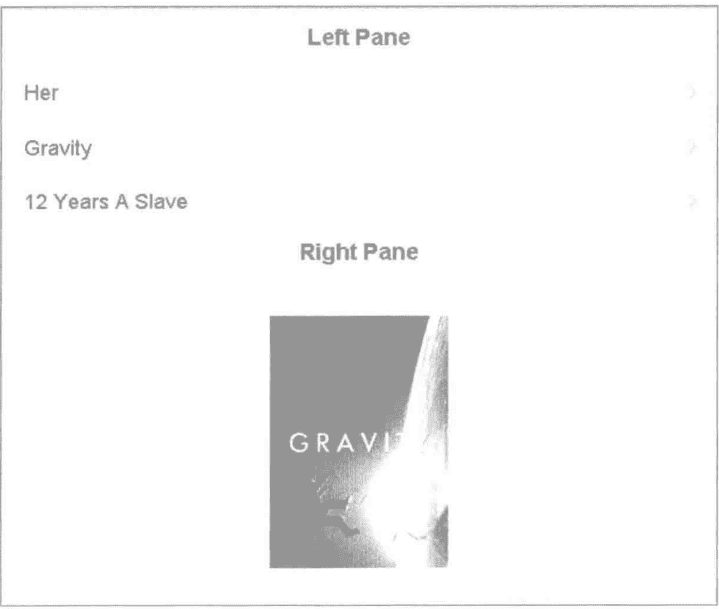

### 使用 TabStrip 小部件在应用程序视图之间选项卡切换

TabStrip 小部件用于在应用程序的各种视图之间导航。TabStrip 通常放置在布局的页脚中，单击 TabStrip 中的按钮时，会显示相应的视图。

#### 操作方法

让我们创建一个在页脚中包含 TabStrip 小部件的布局：

```html
<div data-role="layout" data-id="defaultLayout">
  <footer data-role="footer">
    <div data-role="tabstrip">
      <a href="#contactsView" data-icon="about">Contacts</a>
      <a href="#favoritesView" data-icon="favorites">Favorites</a>
      <a href="#settingsView" data-icon="settings">Settings</a>
    </div>
  </footer>
</div>
```

在前面的代码片段中，TabStrip 小部件 (data-role='tabstrip') 包含三个按钮：**Contacts**、**Favorites** 和 **Settings**。每个按钮都指定了 href 属性，其值与页面中定义的视图的 id 属性所赋的值相同。


下一步是定义视图，当你在 TabStrip 中选择任何按钮时，这些视图将被显示：

```html
<div
id="contactsView"
data-role="view"
data-layout="defaultLayout">

<ul
id="contactsViewContainer"
data-role="listview">
</ul>
</div>

<div
id="favoritesView"
data-role="view"
data-layout="defaultLayout">

<ul
id="favoritesViewContainer"
data-role="listview">
</ul>
</div>

<div
id="settingsView"
data-role="view"
data-layout="defaultLayout">

<ul
data-role="listview">
<li>Sorted
<input type="check" data-role="switch" checked>
</li>
<li>Show Images
<input type="check" data-role="switch">
</li>
</ul>
</div>
```

请注意，前面视图小部件定义的 id 属性在 TabStrip 小部件的锚元素的 href 属性中被引用。

### 工作原理...

当你渲染页面时，**Contacts** 视图会被显示，并且在 TabStrip 小部件中被高亮显示：

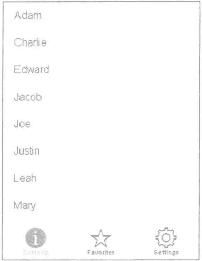

请注意，TabStrip 中的 **Contacts** 图标被高亮显示，表明当前视图显示的是 **Contacts** 列表。当你点击 **Favorites** 或 **Settings** 图标时，TabStrip 中对应的图标会被高亮显示，视图也会随之更新：

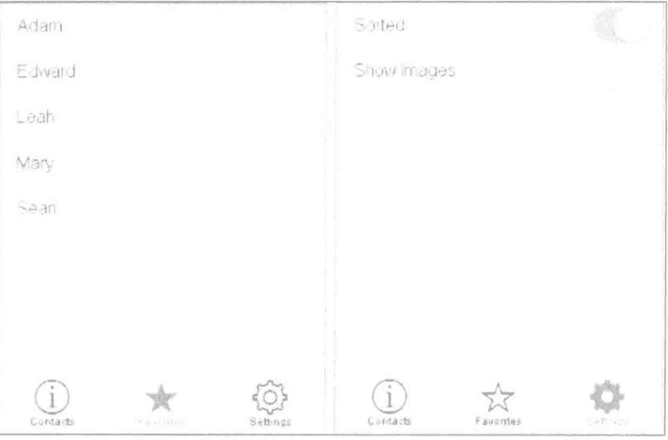
