# 10 Kendo UI DataViz

在本章中，我们将介绍以下配方：

- 使用 `kendoChart` 创建图表
- 将图表绑定到 `DataSource` 对象
- 创建多轴图表
- 显示一段时间内的数据并使用聚合函数
- 通过添加事件使图表具有交互性
- 动态更改图表类型

## 简介

Kendo UI 库提供了一组强大的可视化组件，可用于让数据生动起来。它使用现代浏览器技术（如 SVG 和 Canvas）来渲染这些图表。在旧版浏览器上，它会回退到 VML。浏览器支持范围从 IE7+ 到 Chrome、Firefox、Opera（15+）和 Safari。在本章中，我们将学习构建一些基本图表，例如面积图、饼图和柱状图，以及如何对其进行自定义。在下一章中，我们将学习一些用于构建仪表板类应用程序的高级数据可视化图表。

### 使用 kendoChart 创建图表

Kendo 数据可视化库提供了多个图表小部件，可以轻松构建。在本配方中，我们将首先构建一个柱状图，然后自定义其外观和感觉。柱状图显示垂直条形，直观地表示提供的数据。

#### 入门

kendo.all.min.js 文件包含所有组件，即 Web、Mobile 和 DataViz 小部件。但是，如果你只构建数据可视化组件，则应包含 kendo.dataviz.min.js 文件。

#### 操作步骤...

要创建图表，让我们向页面添加一个容器，指定图表区域的尺寸，如下面的代码行所示：

```html
<div id="chart" style="width:500px; height: 400px">
```

请注意，图表的宽度为 500 像素，高度为 400 像素。此区域将用于渲染图表。下一步是使用 kendoChart 函数初始化图表，如下面的代码行所示：

```javascript
$("#chart").kendoChart()
```

在前面的代码行中，通过在选中的 div 元素上调用 kendoChart 函数来初始化图表。当你渲染页面时，将显示仅包含坐标轴的图表。下一步是提供一些数据和一组选项，这些选项将用于显示图表。这些包括图表标题和你想要显示的图表类型，如下面的代码片段所示：

```javascript
$("#chart").kendoChart({
    title: {
        text: 'Browser Adoption'
    },
    categoryAxis: {
        categories: [2010, 2011, 2012, 2013, 2014]
    },
    series: [{
        name: 'Internet Explorer',
        data: ['32', '23', '17', '12', '9'],
        type: 'column'
    }],
    valueAxis: {
        labels: {
            format: '{0}%',
        }
    }
});
```

在前面的代码片段中，提供了多个选项来初始化图表小部件。让我们逐一查看：

- title：此选项用于指定应显示在图表顶部的标题文本。title 中指定的 text 选项将被显示。
- categoryAxis：此选项用于指定应显示在图表 x 轴上的类别。
- series：此选项用于指定需要在图表中显示的数据。name 选项用于显示图例信息。data 选项包括需要在图表上绘制的所有数据，type 指定需要显示的图表类型。
- valueAxis：此选项指 y 轴，在前面的示例中，它指定了 y 轴上的值应以何种格式显示。{0}% 值作为模板，其中 {0} 将被替换为基于提供的数据的值。

#### 工作原理...

在 kendoChart 函数中提供所有选项后，你会看到一个柱状图已添加到页面中，它还包含标题和图例信息，如下面的屏幕截图所示：

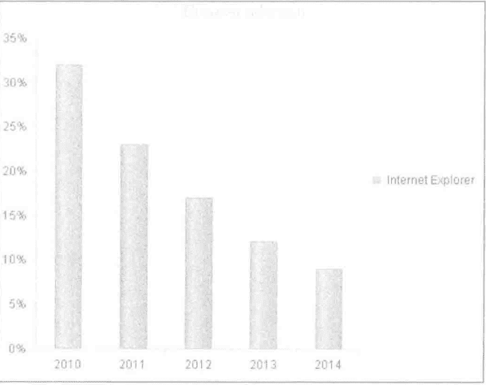

请注意，前面的柱状图在顶部显示标题，在右侧显示图例信息。应用的颜色主题是默认主题。

#### 在图表中显示多个类别

我们创建的图表只添加了一个系列；当你想要比较多个产品或类别时，系列数组可以包含它们：

```javascript
series: [{
 name: 'Internet Explorer',
 data: ['32', '23', '17', '12', '9']
}, {
 name: 'Firefox',
 data: ['45', '39', '34', '28', '26']
}, {
 name: 'Chrome',
 data: ['15', '26', '40', '52', '56']
}, {
 name: 'Safari',
 data: ['6', '5', '4', '4', '4']
}]
```

请注意，系列中删除了类型信息。构建图表时，你可以在 seriesDefault 下为系列指定通用选项：

```javascript
seriesDefaults: {
 type: 'column'
}
```

现在当你渲染页面时，将包含其他系列。

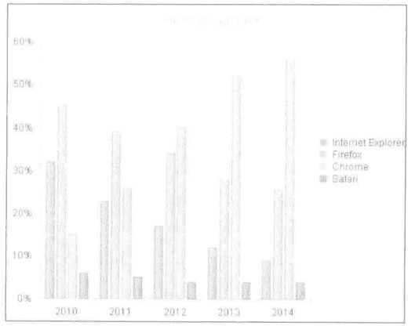

### 更改标题和图例信息的位置

可以自定义图表以更改标题和图例信息的位置：

```javascript
title: {
    text: 'Browser adoption',
    position: 'bottom'
},
legend: {
    position: 'bottom'
}
```

当你渲染页面时，图表将占据整个宽度，图例和标题信息将显示在图表下方。

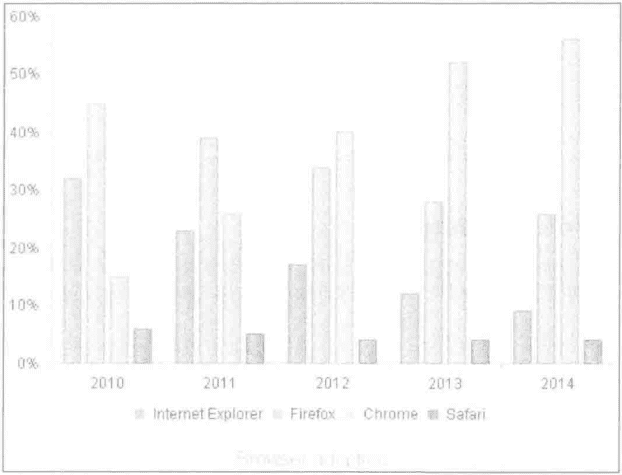

图表的高度受到影响，现在显示为图表中给定的 400 像素高度，以及图例和标题信息。你可以将位置指定为 top、bottom、right、left 或 custom。当位置为 custom 时，你还需要指定 `offsetX` 和 `offsetY` 选项：

```javascript
legend: {
    position: 'custom',
    offsetX: 50,
    offsetY: 20
}
```

### 更改默认主题

前面图表中应用的主题是默认主题。你可以通过指定 theme 选项来更改默认主题，如下面的代码行所示：

```javascript
theme: 'black'
```

将主题更改为 black 后，页面将如下面的屏幕截图所示进行渲染：

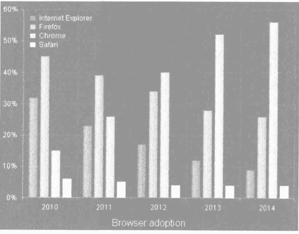

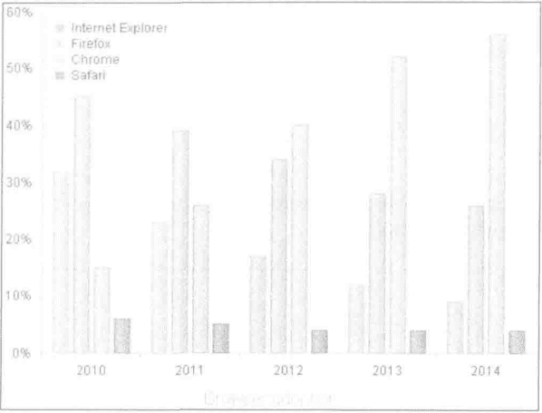

现在当你渲染页面时，你会注意到图例信息位于图表区域左侧 50 像素和顶部 20 像素处，如下面的屏幕截图所示：

可以分配给 theme 属性的其他值包括 blueopal、bootstrap、highcontrast、metro、metroblack、moonlight、silver 和 uniform。

### 将图表绑定到 DataSource 对象

Kendo 图表小部件可以绑定到 DataSource 对象。此 DataSource 对象可以是本地或远程 DataSource。使用 DataSource 对象时，series 和 configurationAxis 字段必须配置为引用 DataSource 对象中的字段。

#### 操作步骤...

让我们先创建一个本地 DataSource 对象，然后将其用于构建图表：

```javascript
var chromeBrowser = [{
'year': 2008,
'percentage': 0
}, {
'year': 2009,
'percentage': 4
}, {
'year': 2010,
'percentage': 15
}, {
'year': 2011,
'percentage': 26
}, {
'year': 2012,
'percentage': 40
}, {
'year': 2013,
'percentage': 52
}, {
'year': 2014,
'percentage': 56
}];
```

下一步是在构建图表时将前面的代码指定为 DataSource 引用：

```javascript
$("#chart").kendoChart({
 dataSource: {
  data: chromeBrowser
 },
 title: {
```


### 工作原理...

在本示例图表中，图表类型指定为 area，现在当你渲染页面时，将显示一个显示多年采用百分比的区域图，如下面的屏幕截图所示：

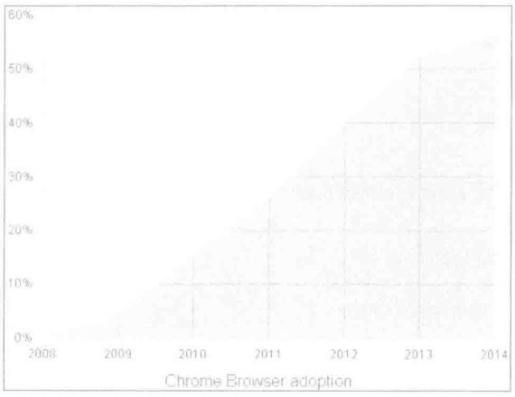

### 更多...

在前面的示例中，图表中只显示了一个系列。使用多个系列时，需要将远程服务配置为以特定格式返回数据。

### 使用 DataSource 对象显示多个系列

当你有多个系列要添加到图表时，`DataSource` 对象应包含按类别分组的数据。在本示例中，数据按年份分组，如下面的代码片段所示：

```
var browserAdoption = [{
    'year': 2011,
    'chrome': 40,
    'firefox': 30,
    'ie': 15,
    'safari': 15
}, {
    'year': 2012,
    'chrome': 45,
    'firefox': 25,
    'ie': 12,
    'safari': 18
}, {
    'year': 2013,
    'chrome': 50,
    'firefox': 22,
    'ie': 8,
    'safari': 20
}];
```

在我们的示例中，`categoryAxis` 选项将字段指定为 `year`；这将按此字段对数据进行分组。下一步是在构建图表时在 `series` 选项中指定前面提到的配置：

```
series: [{
    field: 'chrome',
    name: 'Chrome'
}, {
    field: 'firefox',
    name: 'Firefox'
}, {
    field: 'safari',
    name: 'Safari'
}, {
    field: 'ie',
    name: 'IE'
}],
```

现在当你渲染页面时，各种浏览器的系列将绘制在图表上，如下面的屏幕截图所示：

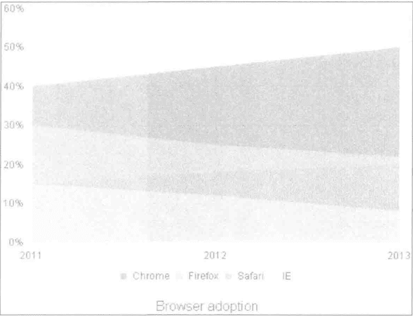

### 在图表上以标签形式显示值

图表可以自定义为在特定点上显示图表上的值。labels 选项用于在绘制的图表上显示值：

```
seriesDefaults: {
type: 'area',
labels: {
visible: true,
format: '{0}%'
}
}
```

在这里，`labels` 选项指定两个字段，即 `visible` 和 `format`。系列的 `labels` 选项将在 x 轴和 y 轴交叉处的值投影位置添加标签，如下面的屏幕截图所示：

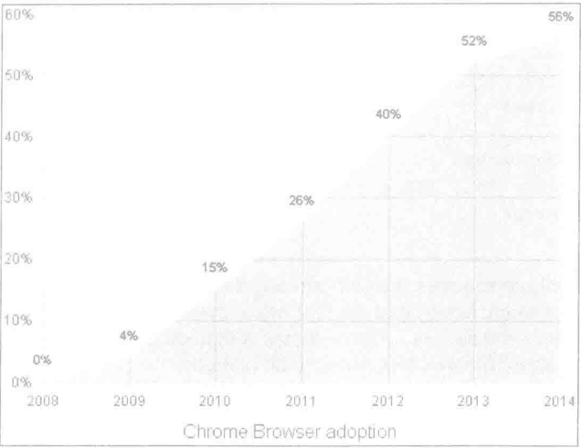

前面的屏幕截图显示了两个轴交叉处标签的精确值。

### 创建多轴图表

在许多场景中，你希望按多个字段对数据进行分组。在前面的示例中，浏览器采用数据按年份分组。现在，这些数据还可以按平台分组。例如，可以通过向图表添加多个轴来完成 2012 年 Windows 平台上 Chrome 浏览器的采用。

#### 操作方法...

第一步是定义系列数据，其中包含按平台分组的信息：

```
series: [{
 name: 'On Windows',
 data: ['15', '26', '40', '52', '56'],
 type: 'column',
}, {
  name: 'On Linux',
  data: ['8', '15', '28', '32', '38'],
  type: 'column',
}, {
  name: 'On Mac',
  data: ['12', '20', '33', '40', '45'],
  type: 'area'
}, {
  name: 'On Others',
  data: ['2', '8', '15', '18', '22'],
  type: 'area'
}]
```

在这里，name 属性指定平台，data 属性指定多年的采用百分比。请注意，系列中的前两个的 type 属性为 column，另外两个为 area。下一步是更新 valueAxis 选项并指定需要绘制的轴的详细信息：

```
valueAxis: [{
  title: {
    text: 'Windows'
  },
  min: 0,
  max: 60
}, {
  title: {
    text: 'Linux'
  },
  min: 0,
  max: 60
}, {
  title: {
    text: 'Mac'
  },
  min: 0,
  max: 45
}, {
  title: {
    text: 'Others'
  },
  min: 0,
  max: 45
}]
```

valueAxis 字段指定需要在图表上绘制的轴。这些轴的定义顺序与 series 字段中的顺序相同。min 和 max 属性用于调整 valueAxes 选项。在前面的代码片段中，Windows 和 Linux 平台的 min 和 max 属性分别为 0 和 60，这表示用于投影值的 y 轴将从 0 开始并延伸至 60。同样，对于其他两个平台，y 轴将从 0 到 45。

当你执行页面时，你会注意到有一个水平轴（x 轴），它指的是类别（年份数据），以及四个垂直轴（y 轴），它们指的是平台。所有四个指向平台的垂直轴都绘制在左侧。如果你想将其中一些垂直轴移动到右侧，则需要在 categoryAxis 选项中指定 axisCrossingValues 数组：

```
categoryAxis: {
    categories: [2010, 2011, 2012, 2013, 2014],
    axisCrossingValues: [0, 0, 5, 5]
}
```

在这里，axisCrossingValues 字段用于指定每个轴的交叉值。数组中的值用于指示每个系列的索引。零值表示轴对齐在左侧（无更改）；任何其他值都表示其从左侧开始的位置。在前面的示例中，值五用于将轴移动到右侧，因为索引零到四由类别 2010 到 2014 使用。

#### 工作原理...

当你执行页面而不指定 axisCrossingValues 字段时，各种轴将绘制在左侧，如下所示：

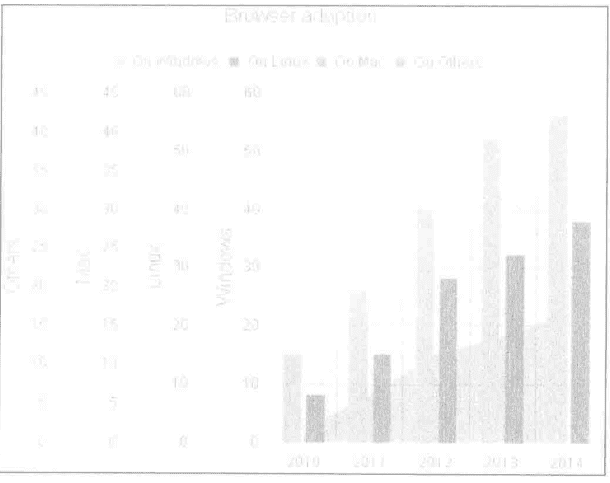

### Kendo UI DataViz

在这里，库开始按系列字段中定义的顺序绘制垂直轴，向左移动。在指定 axisCrossingValues 字段后，Mac 和 Others 系列的轴将移动到右侧，如下面的屏幕截图所示：

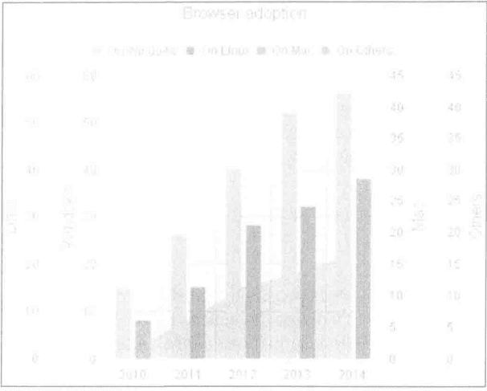

#### 更多...

使用多轴图表时，可以通过单击其图例来关闭系列。例如，当你单击 On Windows 图例时，相应的系列将被隐藏。

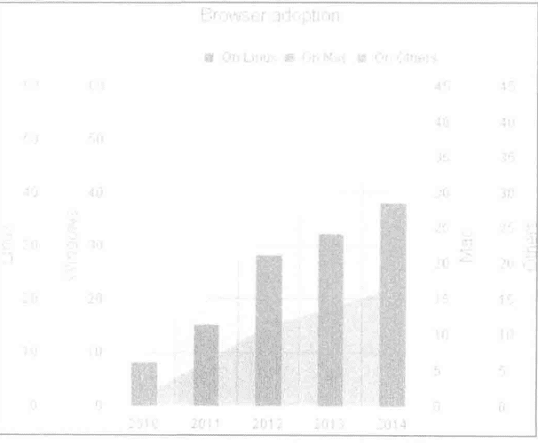

请注意，在前面的屏幕截图中，**On Windows** 图例变为灰色，相应的系列从图表中隐藏。这使用户或应用程序的使用者能够根据需要浏览各种系列并进行比较。

### 显示一段时间内的数据并使用聚合函数

当你从事数据分析项目时，通常会遇到绘制图表的用例，该图表显示一段时间内的某些数据。例如，在订单管理系统中，你希望显示订单数据并按一段时间进行绘制。这段时间可以是一天、一周、一个月或一年。此外，你希望以平均账单金额、订单数量或指定时间段内的总业务量等形式显示数据。

Kendo 图表库允许你根据给定的时间段投影数据，并在显示这些数据时应用一些聚合函数。

#### 操作方法...

让我们先考虑一个包含订单数据的示例数据集：

```
var orderStats = [{
    billAmount: 80,
    date: new Date('2014/01/01')
}, {
    billAmount: 95,
    date: new Date('2014/01/01')
}, {
    billAmount: 100,
    date: new Date('2014/01/01')
}, {
    billAmount: 85,
    date: new Date('2014/01/01')
}, {
    billAmount: 120,
    date: new Date('2014/01/02')
}, {
    billAmount: 130,
    date: new Date('2014/01/02')
}, {
    billAmount: 100,


date: new Date('2014/01/02')
},
.
.
. {
 billAmount: 80,
 date: new Date('2014/01/07')
}, {
 billAmount: 70,
 date: new Date('2014/01/07')
}
]

在前面的代码片段中提到的 DataSource 对象中，每个订单包含两个字段，即 billAmount 和 date。订单数据跨越 2014 年 1 月 1 日至 2014 年 1 月 7 日。这只是示例数据，您可以考虑跨越一个月或一年的数据。

我们希望在两个级别上显示分析：

- 一段时间内的数据
- 按日期分组并应用某些聚合函数（例如平均值、总计和计数）的数据

要显示一段时间内的数据，可以在 categoryAxis 字段中设置 baseUnit 值：

```
categoryAxis: {
 baseUnit: 'days'
}
```

这将按天对 DataSource 对象中的对象进行分组。其他可能的选项包括 weeks、months 和 years。aggregate 字段用于指定系列中要使用的聚合函数，如下面的代码片段所示：

```
series: [{
 type: 'area',
 aggregate: 'sum',
 field: 'billAmount',
 categoryField: 'date',
 labels: {
 visible: true,
 background: 'transparent'
 },
 color: '#0F0'
}]
```

在此处，在系列定义中，aggregate 字段指定 sum 作为要使用的聚合函数；这意味着图表将绘制餐厅在一段时间内的总营业额。可以分配给 aggregate 的其他可能值包括 avg、count、first、min 和 max。还有一个选项可以提供自定义聚合器函数，该函数将返回应用于投影数据的值。

series 选项指定系列的颜色，labels 选项用于在图表上显示数据值。当显示单个系列时，所有选项都可以在 series 选项中指定，而不是使用 seriesDefaults 选项。

### 工作原理...

执行页面时，订单数据将绘制在图表上，显示一段时间内的总营业额，如下面的屏幕截图所示：

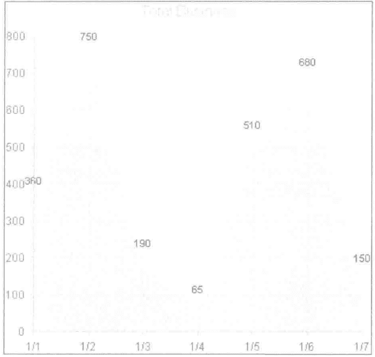

同样，您可以创建多个图表，使用其他聚合函数（例如 avg 和 count），分别显示一段时间内的平均账单金额和订单总数。

### Kendo UI DataViz

您可以通过在页面上创建多个 `div` 元素（每个图表一个）、绘制按日期分组的数据以及使用聚合函数来构建显示这些统计信息的仪表板。

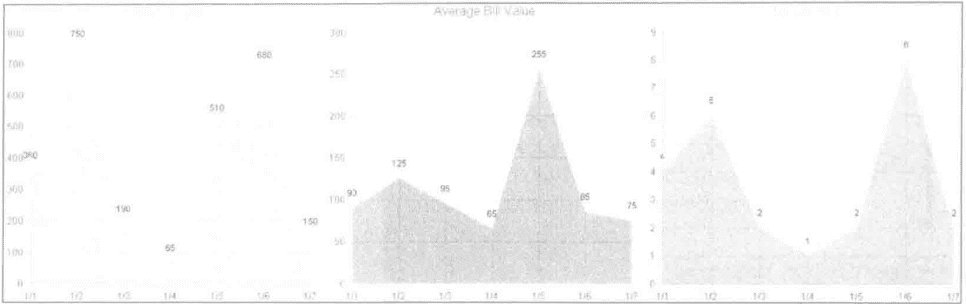

### 更多...

前面示例中构建的面积图通过直线连接数值。您可以通过指定要使用的线条样式来自定义此行为。可能的值为 step 和 smooth：

```
line: {
    style: 'smooth'
}
```

当您指定 `smooth` 时，图表中的数值将通过平滑线连接，即一条曲线，它连接两个点，使图表看起来像是一条连接所有点的曲线，如下所示：

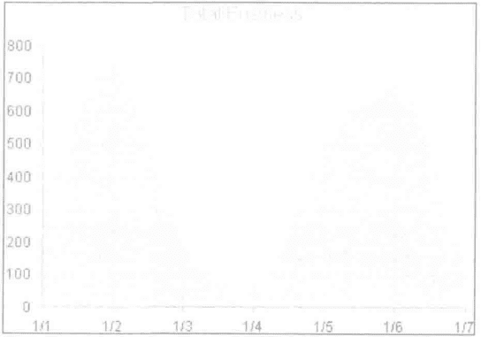

当您将线条样式指定为 `step` 时，图表上的数值将通过直角线连接。

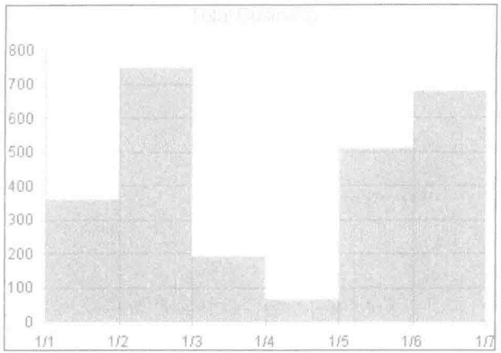

### 通过添加事件使图表具有交互性

Kendo UI Chart 库可以定义各种事件处理程序，当用户将鼠标悬停在系列中的数据项上或单击该数据项时，这些处理程序将被触发。在此示例中，当用户将鼠标悬停在图表中的数据项上时，我们将显示一个工具提示；在另一个示例中，当用户单击某个列时，我们将更改所选列的颜色。

### 操作步骤...

让我们考虑与我们用于展示 Chrome 浏览器多年来采用率的相同 `DataSource` 对象。在此示例中，让我们添加另一个字段 `feature`，我们将使用它来显示 `tooltip`：

```
var chromeBrowser = [{
'year'   : 2008,
'percentage': 0,
'feature'   : 'First stable release'
}, {
'year'   : 2009,
'percentage': 4,
'feature'   : 'HTML5 Video and Audio tag support'
}, {
'year'   : 2010,
'percentage': 15,
'feature'   : 'Support for WebM videos'
}, {
'year'   : 2011,
'percentage': 26,
'feature'   : 'Hardware accelerated 3D CSS'
}, {
'year'
: 2012,
'percentage' : 40,
'feature' : 'New Extensions API'
}, {
'year'
: 2013,
'percentage' : 52,
'feature' : 'Web Speech API'
}, {
'year'
: 2014,
'percentage' : 56,
'feature' : 'Different look for Win8 metro mode'
}];
```

下一步是指定 tooltip 选项，该选项包含将在用户将鼠标悬停在系列中的数据项上时用于显示工具提示的字段，使用以下代码片段：

```
tooltip: {
visible: true,
template: '#= dataItem.feature #',
background: '#0F0'
}
```

在此处，template 字段包含 dataItem.feature 值。dataItem 字段指用于在图表中绘制列的对象。其他可能的值包括 category，它指 categoryAxis 中的类别，在此情况下将是 year 字段；value，它指用于绘制列的 percentage 值；以及 series，它指整个系列对象。

要处理单击事件，请指定 seriesClick 选项：

```
seriesClick: function (e) {
//iterate over series data and set the color for each series
for (var i = 0, j = e.series.data.length; i < j; i++) {
e.series.data[i].color = '#00F';
}
//change the color of the selected series
e.dataItem.color = '#F00';
//redraw the graph - required for the changes to get reflected
this.redraw();
}
```

前面函数中的第一条语句遍历系列中的所有对象并重置颜色；然后，系列中的选定项被分配不同的颜色。图表需要刷新或重新绘制才能使这些更改生效；因此，最后一行在此对象上调用 redraw 函数。this 对象指上下文；在此情况下，this 是系列对象。

订阅事件的另一种方法是在图表对象上使用 bind 方法添加监听器：

```
var chart = $('#chart').data('kendoChart');
chart.bind('seriesClick', function (e) {
    for (var i = 0, j = e.series.data.length; i < j; i++) {
        e.series.data[i].color = '#00F';
    }
    e.dataItem.color = '#F00';
    this.redraw();
});
```

前面代码片段中的第一行获取对图表对象的引用。然后使用图表对象订阅 seriesClick 事件。现在，当用户单击系列中的特定列时，将调用回调函数。

> 刷新或重新绘制图表时，在绘制图表时会显示动画。要禁用动画，请将 transitions 属性指定为 false。

### 工作原理...

当您将鼠标悬停在绘制区域上时，您将看到数据项中的 feature 值显示为工具提示，如下面的屏幕截图所示：

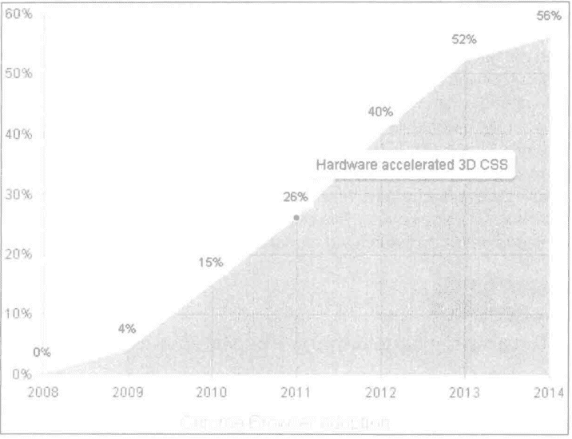

### Kendo UI DataViz

现在将系列类型更改为 `column` 并刷新页面；您将看到图表中所有列的颜色相同。当您单击图表中的任何列时，所选列的颜色将更改并重新绘制。

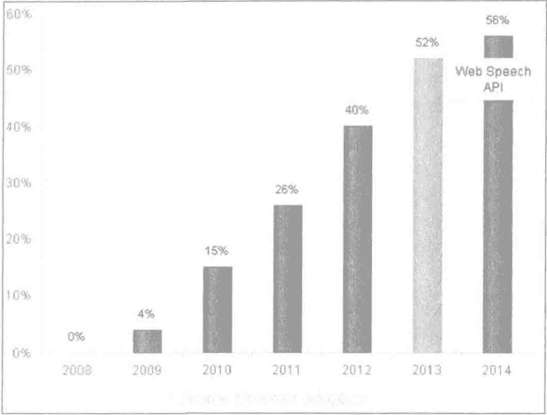

在前面的屏幕截图中，所选列的颜色已更改并在图表中突出显示。

### 动态更改图表类型

在此示例中，我们将了解如何在运行时更改图表的类型和皮肤。例如，如果您已投影一个列图表并希望将其更改为，例如，折线图，则可以对系列进行更改，图表将更新。当您希望以多种形式直观地表示数据但由于空间限制无法做到时，这很有用。在此示例中，我们将使用 `data` 属性而不是使用 `kendoChart` 函数来构建图表。这是构建图表的另一种方式。此外，我们将使用模型-视图-视图模型模式，当用户更改图表类型或皮肤时，对图表进行更改。此模式消除了添加事件处理程序的需求，而是依赖于监听模型更改以动态更新图表。

### 操作步骤...

让我们通过指定各种选项作为 data 属性来创建图表：

```
<div id="chartArea" data-role="chart" data-title="{text: 'Browser adoption', position: 'bottom'}" data-category-axis="{field: 'year'}" data-series-defaults="{type: 'area'}" data-theme="blueopal" data-legend="{position: 'bottom'}" data-series="[


在前面的代码片段中，所有选项均作为数据属性指定。数据属性 role，其值设置为 chart，将 div 元素初始化为图表小部件。它还具有 data-bind 属性，该属性指定其源为 dataset。data-bind 属性用于指定模型绑定值。在此示例中，指定了源绑定，即此图表绑定到的 DataSource 对象。我们即将构建的 ViewModel 对象将指定 dataset 属性。

下一步是创建两个下拉列表，一个列出图表类型，另一个列出应应用的各种主题或皮肤。我们还添加一个复选框，表示图表是否应堆叠，如下面的代码片段所示：

```html
<select id="chartTypeDropdown" data-bind="value: chartType,
events: {change: onChangeHandler}">
<option value="area">Area</option>
<option value="line">Line</option>
<option value="column">Column</option>
</select>
<select id="chartSkin" data-bind="value: chartSkin,
events: {change: onChangeHandler}">
<option value="default">Default</option>
<option value="blueopal">BlueOpal</option>
<option value="bootstrap">Bootstrap</option>
<option value="highcontrast">HighContrast</option>
<option value="metro">Metro</option>
<option value="metroblack">MetroBlack</option>
<option value="silver">Silver</option>
<option value="uniform">Uniform</option>
</select>
<input type="checkbox" data-bind="checked: isStacked,
events: {change: onChangeHandler}" />Stacked
```

在此，select 元素和 input 元素均指定了 data-bind 属性。该属性分别指定 value 和 checked 的模型绑定，并指定 change 事件的事件绑定。所有这些都应在 ViewModel 中指定。

下一步是指定将用于绘制图表的数据源。让我们使用之前示例中使用的同一数据源：

```javascript
var browserAdoption = [{
'year': 2011,
'chrome': 40,
'firefox': 30,
'ie': 15,
'safari': 15
}, {
'year': 2012,
'chrome': 45,
'firefox': 25,
'ie': 12,
'safari': 18
}, {
'year': 2013,
'chrome': 50,
'firefox': 22,
'ie': 8,
'safari': 20
}];
```

最后一步是创建一个 ViewModel 对象，该对象包含先前提到的元素将使用的所有模型属性。它还应指定 onChangeHandler 函数，当用户更改下拉列表中的值或选择堆叠复选框时将调用该函数，如下面的代码片段所示：

```javascript
var viewModel = kendo.observable({
chartType: 'area',
chartSkin: 'blueopal',
isStacked: false,
onChangeHandler: function (e) {
var chart = $('#chartArea').data('kendoChart');
chart.setOptions({
seriesDefaults: {
type: this.chartType,
stack: this.isStacked
},
theme: this.chartSkin
});
chart.refresh();
},
dataSet: new kendo.data.DataSource({
data: browserAdoption
})
});
```

在此，指定了 chartType、chartSkin、isStacked、dataset 和 onChangeHandler 等各种模型属性的绑定。onChangeHandler 函数是一个事件处理程序，用于处理来自下拉列表和输入复选框的 change 事件。当其中任何值更改时，图表将被更新。setOptions 函数用于在 seriesDefaults 字段中指定类型和 stack 值，以及要用于图表的主题。然后调用 refresh 函数来更新图表。dataSet 属性指定绘制图表时要使用的 DataSource 对象。

### 工作原理...

当您呈现页面时，您将看到应用了 **BlueOpal** 皮肤的 **area** 图表，如下面的屏幕截图所示：

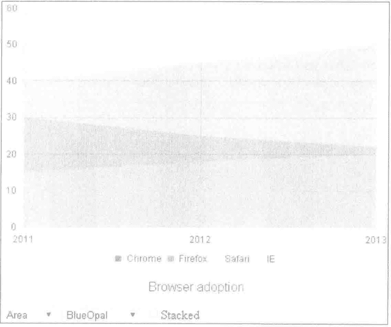

现在，让我们将图表类型更改为 **Line**，主题更改为 **Silver**；这将触发 ViewModel 对象中的 onChangeHandler 函数，图表将使用所选选项进行更新。

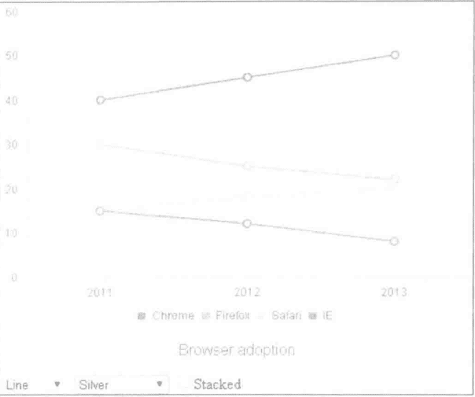

现在，让我们更改所有三个选项，即类型更改为 **Column**，主题更改为 **Bootstrap**，并选择 **Stacked** 选项。当您选择复选框时，stack 选项设置为 true，系列数据现在将堆叠，而不是为每个浏览器显示四个不同的列。

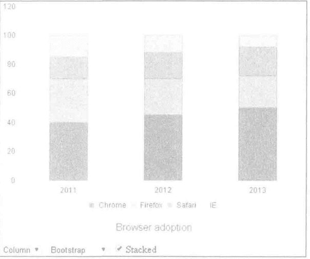

在前面的屏幕截图中，各系列的值相互堆叠。
