## 11 Kendo UI DataViz – 高级图表

在本章中，我们将介绍以下示例：

- 创建显示股票历史的图表
- 使用径向仪表小部件
- 使用线性仪表小部件
- 使用各种编码方法生成条形码图像
- 生成表示 URL、电子邮件、电话和地理位置的二维码图像
- 使用 Kendo Diagram 创建流程图
- 使用 `layouts` 创建层次结构图
- 使用 OpenStreet 地图创建显示地理空间信息的地图
- 通过将其绑定到 GeoJSON 数据创建地图

### 简介

Kendo UI 库提供了多种高级图表小部件，可用于可视化数据。这些包括显示特定股票股票价格历史的 Stock Chart 小部件、在地图上可视化数据的 Map 小部件、创建包含仪表图表的仪表板的 Gauge 小部件、允许您创建可用于识别产品的代码的 Barcode 和 QRCode 小部件，以及创建显示各种实体之间嵌套关系的图表的 Diagram 小部件。这些是除了前一章中提到的基本图表之外的一些高级图表。

### 创建显示股票历史的图表

Kendo UI 库提供了一个专用的图表小部件，可用于显示特定股票在一段时间内的股票价格数据。在此示例中，我们将了解如何创建 Stock 图表并对其进行自定义。

### 开始使用

在 head 部分中包含 CSS 文件 kendo.dataviz.min.css 和 kendo.dataviz.default.min.css。这些文件用于样式化股票历史图表的某些部分。

### 操作方法...

Stock 图表由两个图表组成：一个显示股票历史的窗格，以及一个用于通过更改日期范围来浏览图表的另一个窗格。

特定股票在某一天的股票价格可由以下五个属性表示：

- Open：显示交易开始当天的股票价值
- Close：显示交易结束当天的股票价值
- High：显示股票当天能够达到的最高值
- Low：显示股票当天达到的最低值
- Volume：显示当天交易的该股票的总股数

假设服务以以下格式返回此数据：

```json
[
    {
        "Date" : "2013/01/01",
        "Open" : 40.11,
        "Close" : 42.34,
        "High" : 42.5,
        "Low" : 39.5,
        "Volume": 10000
    }
    .
    .
    .
]
```

我们将使用前面的数据创建 Stock 图表。kendoStockChart 函数用于创建 Stock 图表，并使用与区域图或柱形图类似的一组选项进行配置，如前一章中所述。除了系列数据外，您还可以指定 navigator 选项，以在图表下方显示包含完整股票历史的导航窗格：

```javascript
$("#chart").kendoStockChart({
    title: {
        text: 'Stock history'
    },

    dataSource: {
        transport: {
            read: '/services/stock?q=ADBE'
        }
    },

    dateField: "Date",

    series: [{
        type: "candlestick",
        openField: "Open",
        closeField: "Close",
        highField: "High",
        lowField: "Low"
    }],

    navigator: {
        series: {
            type: 'area',
            field: 'Volume'
        }
    }
});
```

在前面的代码片段中，DataSource 对象指的是将返回一组天数股票数据的远程服务。series 选项指定系列类型为 candlestick；此处使用烛台图来指示特定日期的股票价格。指定了 openField、closeField、highField 和 lowField 的映射；它们将用于绘制图表，并在用户将鼠标悬停在其上时显示提示。navigator 选项指定用于创建区域图，该区域图使用 volume 数据来绘制图表。dateField 选项用于指定图表中的日期字段与响应中的日期字段之间的映射。


### 工作原理...

加载页面时，您将看到显示两个窗格；导航器位于主图表下方。默认情况下，图表显示 `DataSource` 对象中所有日期的数据，如下面的屏幕截图所示：

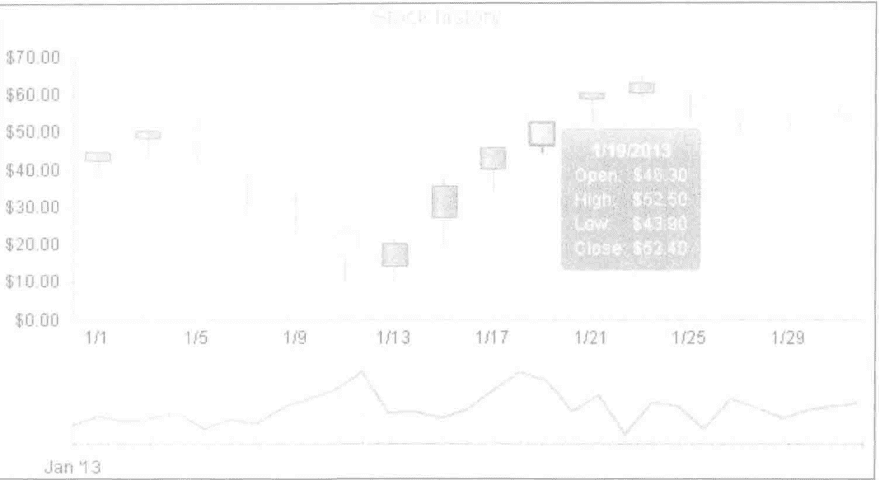

在前面的屏幕截图中，创建了一个蜡烛图，它显示了一段时间内的股票价格。另外，请注意，在导航器窗格中，默认情况下会选择所有日期范围，因此，它们也会反映在图表（蜡烛图）中。当您将鼠标悬停在系列上时，您会注意到所选日期的股票报价会显示出来。这包括日期以及 **Open**、**High**、**Low** 和 **Close** 等其他字段。

图表区域会调整以显示各种日期的股票价格，使日期均匀分布。在前面的情况中，日期范围从 2013 年 1 月 1 日到 2013 年 1 月 31 日。但是，当您将鼠标悬停在系列上时，您会注意到某些日期被省略了。为了解决这个问题，您可以增加图表区域的宽度，或者使用导航器来减小日期范围。如果日期范围跨越数月和数年，则不建议采用前一种选项。

要减小导航器中的日期范围，请将两个日期范围选择器相互移动以缩小日期范围，如下面的屏幕截图所示：

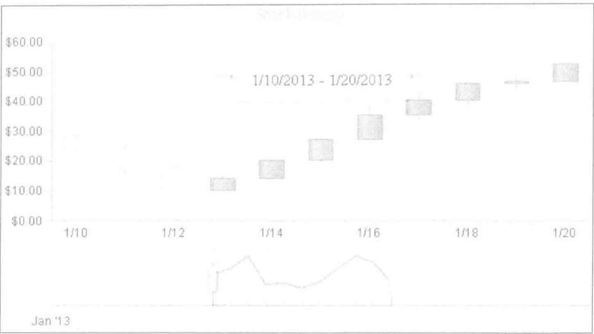

当您尝试缩小日期范围时，您会在图表中看到一个工具提示，指示您正在尝试选择的日期范围。蜡烛图会调整以显示所选日期范围的股票价格。另外，请注意，导航器中所选日期范围的不透明度保持不变，而其余区域的不透明度会降低。选择日期范围后，所选窗格可以在导航器中移动。

### 更多内容...

有几个选项可用于自定义 Stock Chart 小部件的行为和外观。

### 在初始化图表时指定导航器中的日期范围

默认情况下，图表中会选择所有日期范围，用户将不得不在导航器窗格中将其缩小。当您处理大型数据集时，您希望在渲染图表时显示特定日期范围的股票数据。为此，请在导航器中指定 select 选项：

```
navigator: {
    series: {
        type: 'area',
        field: 'Volume'
    },
    select: {
        from: '2013/01/07',
        to: '2013/01/14'
    }
}
```

在前面的代码片段中，指定了 from 和 to 日期范围。现在，当您渲染页面时，您将看到导航器窗格中选择了相同的日期。

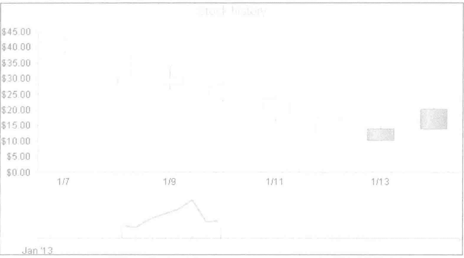

### 自定义 Stock Chart 小部件的外观

有多个选项可用于自定义 Stock Chart 小部件中的导航器窗格。让我们增加窗格的高度，并为其添加标题文本：

```
navigator: {
    pane: {
        height: '50px',
        title: {
            text: 'Stock Volume'
        }
    }
}
```

现在，当您渲染页面时，您将看到导航器窗格的标题和高度已增加。

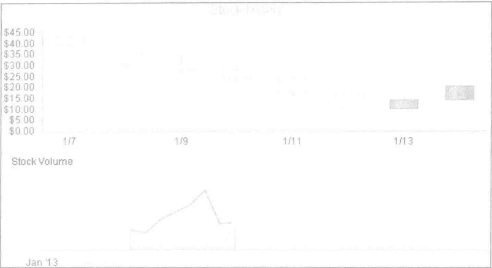

### 使用 Radial Gauge 小部件

Radial Gauge 小部件允许您构建类似仪表板的应用程序，其中您希望指示一个位于特定范围内的值。例如，汽车仪表板可以包含几个 Radial Gauge 小部件，用于指示当前速度和转速。

### 操作方法...

要创建 Radial Gauge 小部件，请在所选 DOM 元素上调用 kendoRadialGauge 函数。Radial Gauge 小部件包含一些组件，可以通过提供选项进行配置，如下面的代码片段所示：

```
$("#chart").kendoRadialGauge({
    scale: {
        startAngle: 0,
        endAngle: 180,
        min: 0,
        max: 180
    },
    pointer: {
        value: 20
    }
});
```

### Kendo UI DataViz - 高级图表

此处使用 scale 选项来配置 Radial Gauge 小部件的范围。`startAngle` 和 `endAngle` 选项用于指示 Radial Gauge 小部件范围应开始和结束的角度。默认情况下，它们的值分别为 30 和 210。另外两个选项，即 `min` 和 `max`，用于指示可以绘制值的范围值。`pointer` 选项用于指示 Radial Gauge 小部件中的当前值。

有多个选项可用于配置 Radial Gauge 小部件；这些选项包括标签的定位和配置小部件的外观。

### 工作原理...

当您渲染页面时，您将看到一个 Radial Gauge 小部件，它显示从 **0** 到 **180** 的刻度，指针指向值 **20**。

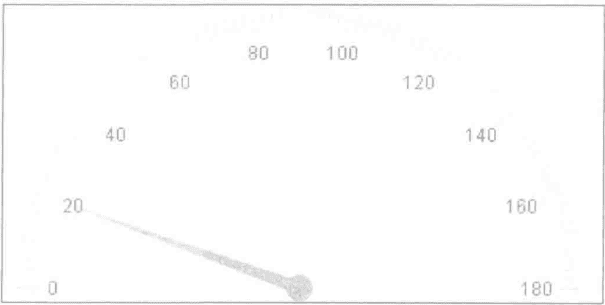

此处，**0** 到 **180** 的值均匀分布，即主刻度以 **20** 为单位。有 10 个次要刻度，即两个主刻度之间的刻度。小部件以顺时针方向显示值。另外，指针值 **20** 在刻度中被选中。

### 更多内容...

Radial Gauge 小部件可以在初始化小部件时包含各种选项，从而进行很大程度的自定义。

### 更改主刻度和次要刻度值

在 scale 中指定 `majorUnit` 和 `minorUnit` 选项：

```
scale: {
    startAngle: 0,
    endAngle: 180,
    min: 0,
    max: 180,
    majorUnit: 30,
    minorUnit: 10
}
```

scale 选项将 majorUnit 值指定为 30（而不是默认的 20），minorUnit 为 10。这将在每 30 个单位处添加标签，并在两个主刻度之间显示两个次要刻度，每个刻度间距为 10 个单位，如下面的屏幕截图所示：

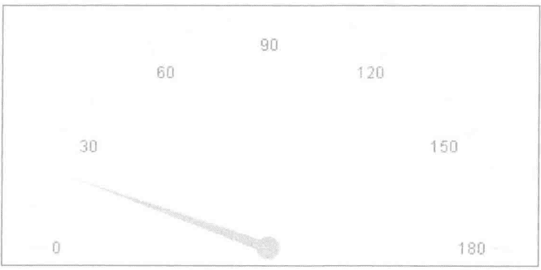

前面的屏幕截图中显示的刻度也可以自定义：

```
scale: {
    minorTicks: {
        size: 30,
        width: 1,
        color: 'green'
    },
    majorTicks: {
        size: 100,
        width: 2,
        color: 'red'
    }
}
```

此处，size 选项用于指定刻度标记的长度，width 用于指定刻度的厚度，color 选项用于更改刻度的颜色。

现在，当您渲染页面时，您将看到主刻度和次要刻度的更改。

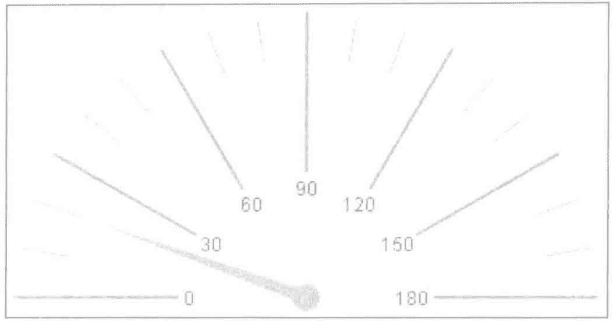

### 使用 ranges 选项更改径向颜色

`scale` 属性可以包含 `ranges` 选项，以指定 Radial Gauge 小部件上各个范围的径向颜色：

```
scale: {
    ranges: [
        {
            from: 0,
            to: 60,
            color: '#00F'
        }, {
            from: 60,
            to: 130,
            color: '#0F0'
        }, {
            from: 130,
            to: 200,
            color: '#F00'
        }
    ]
}
```

在前面的代码片段中，`ranges` 数组包含三个对象，用于指定应用于小部件圆周上的颜色。`from` 和 `to` 值用于指定应用颜色的刻度值范围。

现在，当您渲染页面时，您将看到 Radial Gauge 小部件沿着小部件圆周显示各个范围的颜色，如下面的屏幕截图所示：

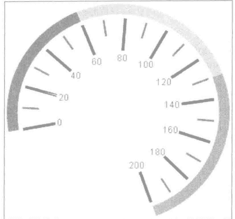

在前面的屏幕截图中，`startAngle` 和 `endAngle` 字段分别更改为 10 和 250。可以通过将标签移到外部来进一步自定义小部件。这可以通过指定 `labels` 属性并将 `position` 设置为 `outside` 来完成。

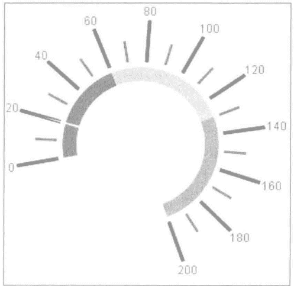

在前面的屏幕截图中，标签位于外部，因此，径向位于内部。

### 使用 Slider 小部件更新指针值

`pointer` 值在初始化 Radial Gauge 小部件时设置。可以在运行时使用 Slider 小部件更改小部件的 `pointer` 值。可以观察到 Slider 小部件的变化，并相应地更新 Radial Gauge 的 `pointer` 值。

让我们使用前面配方中提到的同一个 Radial Gauge 小部件。使用输入元素创建一个 Slider 小部件：

```
<input id="slider" value="0" />
```

下一步是将前面提到的输入元素初始化为 Slider 小部件：

```
$('#slider').kendoSlider({
    min: 0,
    max: 200,
    showButtons: false,
    smallStep: 10,
    tickPlacement: 'none',
    change: updateRadialGuage
});
```

`min` 和 `max` 值指定可以为滑块设置的值范围。`smallStep` 属性指定滑块的最小增量值。`change` 属性指定当 `slider` 值变化时应调用的函数。

然后，`updateRadialGuage` 函数应更新 Radial Gauge 小部件中指针的值：

```
function updateRadialGuage() {
    $('#chart').data('kendoRadialGauge')
        .value($('#slider').val());
}
```

该函数获取小部件的实例，然后将其值设置为从 Slider 小部件获得的值。


### 使用线性度量器小部件

线性度量器小部件也用于指示某个值在给定范围内的位置。它与径向度量器小部件类似，并采用相同的选项集。它用于在线性刻度上显示值。

#### 操作方法...

线性度量器是通过在 DOM 元素上调用 kendoLinearGauge 函数创建的。它使用与径向度量器小部件相同的选项：

```javascript
$("#chart").kendoLinearGauge({
    pointer: {
        value: 20,
    },
    scale: {
        min: 0,
        max: 200,
        majorUnit: 20,
        minorUnit: 10
    }
});
```

这将显示指针位于 **20** 的线性度量器小部件。默认情况下，小部件垂直显示，即值投影在 y 轴上。要水平显示小部件，请在 `scale` 选项下将 `vertical` 指定为 `false`。这将水平显示小部件。

#### 工作原理...

渲染页面时，线性度量器垂直显示，如下图所示：

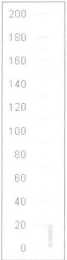

将 `vertical` 设置为 `false` 后，小部件水平显示。

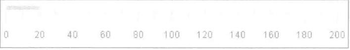

与径向度量器一样，线性度量器也可以包含 ranges 选项。包含 ranges 选项后，您将看到小部件沿其刻度显示此选项。

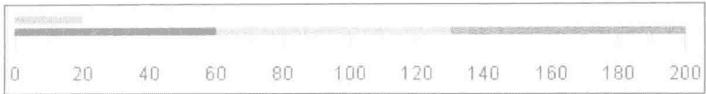

#### 更多内容...

线性度量器上显示的指针默认是 barIndicator。另一个可用选项是 arrow。要更改指针，请在 pointer 选项下将 shape 设置为 arrow：

```javascript
pointer: {
    value: 20,
    shape: 'arrow'
}
```

现在渲染页面时，您将看到一个箭头。

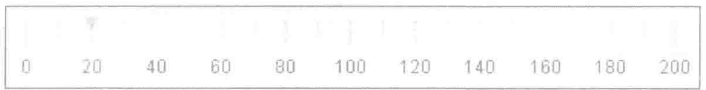

### 使用各种编码方法生成条形码图像

Kendo UI 库提供可用于为给定值生成条形码图形图像的 API。例如，超市中的每个产品都可以关联一个条形码。当客户购买产品时，条形码将用于获取产品价格和其他详细信息。该库可以通过引用唯一标识符来生成条形码。

#### 操作方法...

可以通过在 DOM 元素上调用 kendoBarcode 函数来生成条形码图像：

```javascript
$("#chart").kendoBarcode({
    value: '1234567'
});
```

这里，1234567 值将使用默认编码（即 code39）进行编码。您也可以通过指定 type 字段来指定要使用的编码方法：

```javascript
$("#chart").kendoBarcode({
    value: '1234567',
    type: 'ean8'
});
```

在前面的代码片段中，编码类型设置为 ean8。其他可能的值包括 EAN13、UPCE、UPCA、Code11、Code39、Code39Extended、Code93、Code93Extended、Code128、Code128A、Code128B、Code128C、GS1-128、MSIMod10、MSIMod11、MSIMod1010、MSIMod1100 和 POSTNET。value 属性是必需的，条形码将使用该值和指定的编码类型生成。

#### 工作原理...

当您不指定编码类型时，将使用 code39 编码来生成条形码，如下图所示：

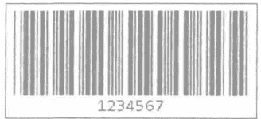

值显示在前面的条形码中。要隐藏值，请指定 text 属性并将 visible 选项设置为 false：

```javascript
$("#chart").kendoBarcode({
    value: '1234567',
    text: {
        visible: false
    }
});
```

当您使用其他编码类型时，例如 ean8，条形码将相应生成。

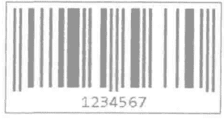

### 生成 QR 码图像以表示 URL、电子邮件、电话和地理位置

**快速响应码（QR 码）**通常用于通过编码数据来高效存储数据。它默认使用 ISO_8859_1 作为编码方法来存储数据。生成的代码由排列在白色背景上的方形网格中的黑色模块（方形点）组成。然后可以通过摄像头读取该代码，并由应用程序处理。

在此示例中，我们将看到如何将各种形式的数据（如 URL、电子邮件地址、电话号码和地理位置）存储在 QR 码中。

#### 操作方法...

要生成 QR 码，请在 DOM 元素上调用 `kendoQRCode` 函数：

```javascript
$("#chart").kendoQRCode({
    value: 'http://www.kendoui.com'
});
```

在前面的示例中，指定了 `http://www.kendoui.com` URL。该值将使用 ISO_8859_1 进行编码，并在方形网格中表示。扫描 QR 码时，将识别其中存储的值。由于该值带有协议名称前缀 `http://`，因此该值被识别为 URL。同样，电子邮件地址应带有 `mailto:` 前缀，电话号码应带有 `tel` 前缀，地理位置应带有 `geo` 并随后跟随纬度和经度信息。地理位置可以按以下方式编码：

```javascript
$("#chart").kendoQRCode({
    value: 'geo: 12.9667, 77.5667, 100'
});
```

默认情况下，QR 码的颜色为黑色，并在白色背景上绘制。可以通过指定 `color` 和 `background` 属性来更改此设置：

```javascript
$("#chart").kendoQRCode({
    value: 'geo: 12.9667, 77.5667, 100',
    color: 'red',
    background: 'yellow'
});
```

#### 工作原理...

渲染页面时，您将看到一个方形网格，显示代表 URL 的 QR 码的点和线。

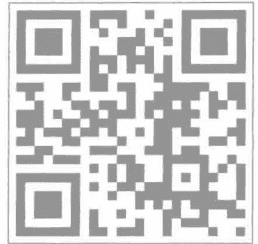

当您将值更改为地理位置并指定 color 和 background 属性时，生成的 QR 码将如下所示：

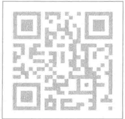

#### 更多内容...

QR 码具有错误纠正功能，允许您在代码损坏或脏污时恢复数据。有四种可应用于 QR 码的错误纠正级别，即 L、M、Q 和 H。每个级别指示可以恢复的数据百分比，即 L 恢复 7% 的数据，M 恢复 15%，Q 恢复 25% 的数据，H 恢复 30%。初始化 QR 码时，可以通过设置 errorCorrection 属性来更改错误纠正级别：

```javascript
$("#chart").kendoQRCode({
    value: 'geo: 12.9667, 77.5667, 100',
    errorCorrection: 'Q'
});
```

在前面的示例中，errorCorrection 属性设置为 Q，并用于编码该值。

### 使用 Kendo Diagram 创建流程图

随着 Kendo UI 库中引入图表，现在可以轻松地将工作流程图或层次结构添加到网页中。在此示例中，我们将通过创建形状来构建流程图，然后使用连接器将它们连接起来。该库还提供一组布局，可用于表示层次结构或树状结构。

#### 操作方法...

流程图用于表示算法中的步骤；这些步骤显示为形状（矩形和圆形）。然后使用连接器连接形状并描述流程。Kendo UI 中的图表是通过在选定的 DOM 节点上调用 kendoDiagram 函数创建的：

```javascript
var diagram = $("#chart").kendoDiagram({
    connectionDefaults: {
        stroke: {
            color: '#F00'
        },
        startCap: 'FilledCircle',
        endCap: 'ArrowEnd',
    }
}).getKendoDiagram();
```

在前面的代码片段中，创建了一个空图表，并为连接指定了一些默认属性。连接用于连接图表中的两个或多个形状。connectionDefaults 选项指定要应用的描边颜色；startCap 和 endCap 选项用于指定要应用的装饰。在此示例中，startCap 选项的值为 FilledCircle，这将在连接的起始处显示一个圆形。可以分配给 startCap 的另一个值是 ArrowStart。这将添加一个指向形状的箭头。endCap 选项的值设置为 ArrowEnd。在此示例中，发起连接的形状将附带一个填充圆形，并显示一个指向第二个形状的箭头。

getKendoDiagram 函数将在初始化后返回图表的实例。图表就像一个画布，您可以在其中添加多个形状并将它们连接起来。


现在让我们创建一个函数，该函数将接受形状详细信息，包括需要显示的文本、形状类型以及形状在图表上的位置：

```javascript
function createShape(textData, type, positionX, positionY) {
    return new kendo.dataviz.diagram.Shape({
        x: positionX,
        y: positionY,
        width: 100,
        height: 50,
        type: type,
        content: {
            text: textData,
            color: '#FFF'
        },
        background: '#00B'
    });
}
```

在前面的代码片段中，createShape 函数接受上述参数并返回一个形状实例，即 kendo.dataviz.diagram.Shape。现在让我们创建几个形状并将它们添加到图表中：

```javascript
var shape1 = diagram.addShape(
    createShape('Start', 'circle', 400, 20));
var shape2 = diagram.addShape(
    createShape('counter = 0', 'rectangle', 400,
    100));
var shape3 = diagram.addShape(
    createShape('counter < 5', 'rectangle', 400,
    190));
var shape4 = diagram.addShape(
    createShape('Stop', 'circle', 600, 290));
var shape5 = diagram.addShape(
    createShape('Print (counter)', 'rectangle',
    200, 290));
var shape6 = diagram.addShape(
    createShape('counter++', 'rectangle', 200,
    390));
```

在前面的代码片段中，通过指定内容文本和位置数据创建了六个形状对象。你可以创建两种类型的形状：矩形和圆形。一旦形状被创建，它们就通过在图表对象上调用 addShape 函数被添加到图表中。

一旦形状被添加，就可以在它们之间建立连接：

```javascript
diagram.connect(shape1, shape2);
diagram.connect(shape2, shape3);
diagram.connect(shape3.getConnector('Right'),
 shape4.getConnector('Top'), {
 points: [
 new kendo.dataviz.diagram.Point(650, 215)
 ]
 });
diagram.connect(shape3.getConnector('Left'),
 shape5.getConnector('Top'), {
 points: [
 new kendo.dataviz.diagram.Point(250, 215)
 ]
 });
diagram.connect(shape5, shape6);
diagram.connect(shape6.getConnector('Bottom'),
 shape3.getConnector('Bottom'), {
 points: [
 new kendo.dataviz.diagram.Point(250, 470),
 new kendo.dataviz.diagram.Point(450, 470)
 ]
 });
```

connect 函数接受两个形状对象和一个可选的配置对象。在两个形状之间添加一个连接；形状实例上有四个可用的连接点，即 Top、Bottom、Right 和 Left。框架识别形状在图表上的位置，并从 Shape 实例中选择正确的连接点。在前面的示例中，shape2 位于 shape1 正下方，因此两者之间的连接将从 shape1 的底部连接点到 shape2 的顶部连接点。

在第三个示例中，要使用的连接点是通过调用 shape3.getConnector('Right') 和 shape4.getConnector('Top') 明确提及的。另外，第三个参数是用于配置连接器的配置对象。前面代码片段中的第三个参数指定了 points 配置。这用于设置连接的中间点。这将在初始化小部件时指定的 connectionDefaults 的基础上应用。

### How it works...

当你不指定连接器时，即当你使用 `diagram.connect(shape1, shape2)`，框架将确定要使用的连接器并添加连接，如下面的截图所示：

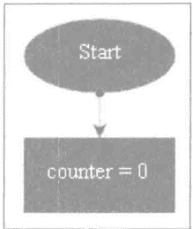

在前面的情况下，`shape2` 位于 `shape1` 下方，并从形状中选择了适当的连接器。当第二个形状位于右侧时，将使用第一个形状的右连接器和第二个形状的左连接器来连接这两个形状。

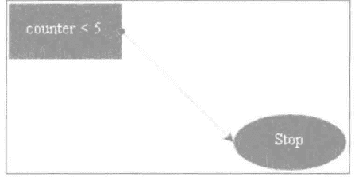

在前面的截图中，连接两个形状的线是倾斜的。这可以通过在每个形状上选择连接器并在两个形状之间添加中间点来纠正，即第三个参数，指定点对象的数组。

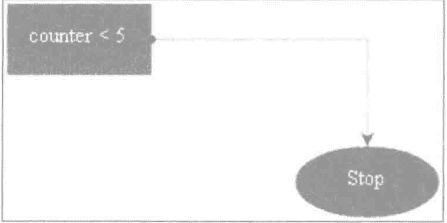

一旦所有连接都添加完毕，一个连接各种形状的流程图就创建了。

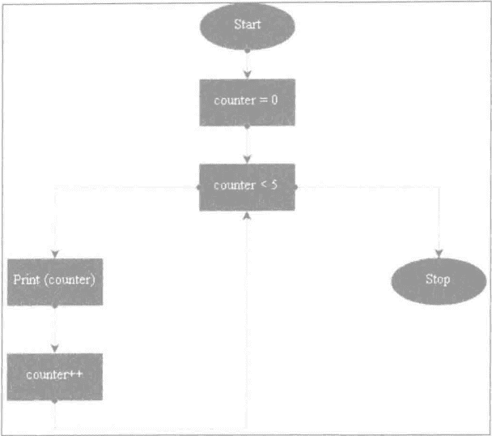

注意，带有 **counter++** 和 **counter<5** 文本的形状之间的连接有两个中间点。`points` 数组用于指定在添加连接时应使用的各种中间点对象。

### Creating hierarchical structural diagrams using layouts

在这个配方中，我们将探讨使用 `kendoDiagram` 中的 `layout` 选项构建层次结构图或树状图。层次结构可以用 JSON 格式表示，并可以在构建图表时用作 `DataSource` 对象。

#### How to do it...

让我们创建一个 JSON 格式的层次结构，然后可以将其用作构建树形图的 `DataSource` 对象：

```javascript
var data = [
 {
 "designation": "CEO",
 "name": "Mitchell Johnson",
 "manages": [
 {
 "designation": "Vice President",
 "name": "Smith Cooper",
 "manages": [
 {
 "designation": "Director",
 "name": "Andrew Walker"
 },
 {
 "designation": "Director",
 "name": "Robert Thompson"
 }
 ],
 },
 {
 "designation": "Vice President",
 "name": "Harris Jones",
 "manages": [
 {
 "designation": "Director",
 "name": "Edward Collins"
 },
 {
 "designation": "Director",
 "name": "Thomas Wang"
 }
 ]
 }
 ]
 }
];
```

在前面的代码片段中，我们正在创建一个层次结构，其中每个对象包含三个字段：designation、name 和 manages。manages 字段表示特定节点的子节点。每个节点将显示名称和职位字段，然后将添加连接器来表示 manages 集合中提到的节点。

下一步是在创建图表时指定 DataSource 对象的详细信息。在 DataSource 选项中，你还应该指定架构详细信息，以让框架知道哪个属性应被视为添加子节点，如下面的代码片段所示：

```javascript
$("#chart").kendoDiagram({
dataSource: {
data: data,
schema: {
model: {
children: "manages"
}
},
.
.
});
```

在指定 `DataSource` 选项后，下一步是指定 `layout` 详细信息。`layout` 选项用于指定图表中形状和连接的排列。它将解析数据，然后根据指定的布局类型和子类型排列这些形状：

```javascript
$("#chart").kendoDiagram({
.
.
layout: {
type: "tree",
subtype: "down",
horizontalSeparation: 50,
verticalSeparation: 50
},
.
});
```

在 `layout` 选项中，type 指定为 `tree`，subtype 为 `down`。这将创建一个树状结构，根节点位于图表顶部，后面跟着各种子节点。subtype 的其他可能值包括以下内容：

+   - up：在此值中，根节点位于底部，其子节点向上添加，即树将被反转
+   - left：在此值中，根节点放置在左侧，其子节点添加到右侧
+   - right：在此值中，根节点放置在右侧，其子节点添加到左侧
+   - mindmapVertical：在此值中，根节点位于中心，其子节点在根节点上下均匀分布
+   - mindmapHorizontal：在此值中，根节点位于中心，其子节点在根节点左右两侧均匀分布
+   - radial：在此值中，根节点位于中心，所有子节点以径向形式围绕它展开
+   - tipOver：此值类似于 tree-down 子类型，其中直接子节点水平排列，孙子节点垂直排列


其他两个属性 horizontalSeparation 和 verticalSeparation 用于指定水平和垂直排列的两个节点之间的距离。

下一步是在 DataSource 对象中为节点创建形状。在本示例中，我们将使用 shapeDefaults 选项向图表添加形状，如以下代码片段所示：

```
$("#chart").kendoDiagram({
.
.
shapeDefaults: {
visual: function (data) {
var group = new kendo.dataviz.diagram.Group();

//create a rectangle shape
group.append(new kendo.dataviz.diagram.Rectangle({
width: 130,
height: 75,
background: '#1696d3',
stroke: {
width: 0
}
})); //add text 'name' inside the rectangle
group.append(new kendo.dataviz.diagram.TextBlock({
text: data.dataItem.name,
x: 10,
y: 10,
color: '#fff'
})); //add text 'designation' inside the rectangle
group.append(new kendo.dataviz.diagram.TextBlock({
text: data.dataItem.designation,
x: 10,
y: 30,
color: '#fff'
}));
return group;
}
},
.
});
```

这里，visual 属性的值是一个函数，该函数返回需要在图表上呈现的可视元素。在我们的示例中，我们将创建一个包含模型中 name 和 designation 属性的可视元素。该函数首先通过创建 kendo.dataviz.diagram.Group 的实例来创建一个组元素。Group 属性是一个不可见的可视元素，用于包含和分组其他可视元素。然后，我们创建 kendo.dataviz.diagram.Rectangle 和 kendo.dataviz.diagram.TextBlock 的实例并将其追加到组中。该函数随后返回组对象。该函数被递归调用，节点被添加到图表中。

### 工作原理...

当布局子类型为 down 时，根节点位于顶部，子节点被添加，树向下生长，如以下屏幕截图所示：

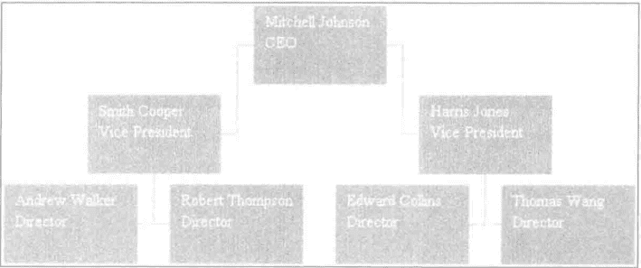

当将子类型更改为 left 时，根节点位于右侧，节点被添加，使树从右向左生长。

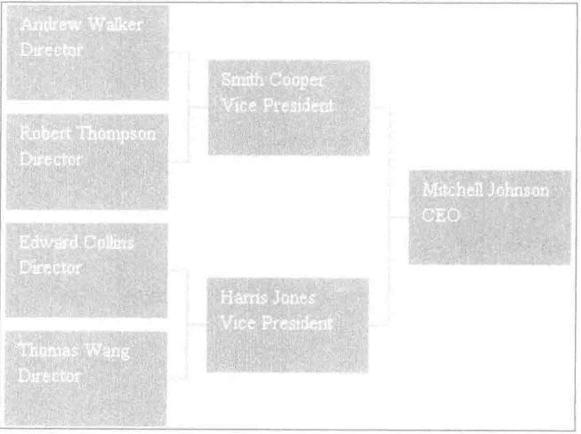

将子类型更改为 mindmapHorizontal 后，根节点位于中心，子节点被添加到两侧。

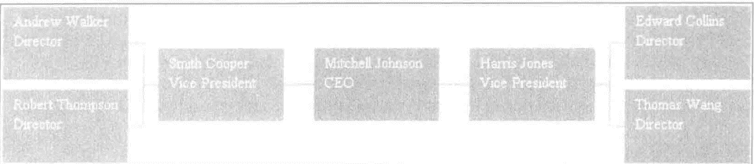

您可以尝试将子类型更改为 radial 和 tipOver，以查看图表中节点的位置。

### 使用 OpenStreet 地图创建显示地理空间信息的地图

该库提供了 API，您可以使用它在页面上显示特定位置的地图。在本示例中，我们将使用 kendoMap 函数创建地图，并提供一些配置详细信息。我们将使用 OpenStreet 地图来获取地图图像。

### 操作方法...

要创建地图，请在选定的 DOM 节点上调用 kendoMap 函数，并提供以下代码片段中提到的配置选项：

```
$('#chart').kendoMap({
    center: [30.2681, -97.7448],
    zoom: 4,
    layers: [{
        type: 'tile',
        urlTemplate: "http://#= subdomain #.tile2.opencyclemap.org/transport/#= zoom #/#= x #/#= y #.png",
        subdomains: ['a', 'b', 'c'],
        attribution: '&copy; <a href="http://osm.org/copyright">OpenStreetMap contributors</a>.' +
            'Tiles courtesy of <a href="http://www.opencyclemap.org/">Andy Allan</a>'
    }],
    ...
});
```

在前面的代码片段中，center 选项用于指定地图中心位置的坐标。纬度和经度信息，连同提供的地图宽度和高度，用于在地图容器中居中地图。zoom 选项用于设置地图的缩放级别。layers 属性用于指定将在地图上显示的各种图层；在前面的示例中，图层类型指定为 tile，用于显示来自 OpenStreet 地图的数据。type 的其他可能值包括 bing，用于从 Bing 地图检索地图；marker，用于向地图添加标记；以及 shape，用于显示矢量形状图层。当数据绑定到 geoJSON 数据时，会使用这些值。urlTemplate 属性指定从中检索地图数据的 URL。它会考虑地图设置的缩放级别以及 x 和 y 坐标，即 center 属性和 subdomains 属性中指定的纬度和经度信息。请注意，在 urlTemplate 选项之后，指定了 subdomains 属性。它是一个数组，提及应用于获取地图图像的子域。浏览器对每个域可并行检索的图像数量有限制。使用子域时，图像会并行获取；因此，缩短了呈现整个地图所需的时间。attribution 字段用于指定图层的归属信息。

现在让我们向地图添加一些标记。标记是另一种可以添加的图层类型：

```
$('#chart').kendoMap({
.
.
layers: [{
type: 'tile',
.
.
}, {
type: 'marker',
locationField: 'latlng ',
tooltip: {
content: function (e) {
return e.sender.marker.dataItem.tooltip;
}
},
dataSource: {
data: [{
latlng: [40.6700, -73.9400],
tooltip: 'New York'
}, {
latlng: [34.0500, -118.2500],
tooltip: 'Los Angeles'
}]]
}});
```

### Kendo UI DataViz - 高级图表

在前面的代码片段中，图层类型指定为 `marker`，`locationField` 属性指定的值为 `latlng`。这引用了 `dataSource` 选项中的属性。`dataSource` 属性指定标记详细信息，即必须添加标记的纬度和经度信息，以及用户将鼠标悬停在标记上时显示的提示信息。`tooltip` 选项包含一个 `content` 属性，其值是一个函数，用于从 `dataSource` 属性返回提示信息。

### 工作原理...

当您呈现页面时，会显示地图。地图数据从指定的 URL 获取，即从 OpenStreet 地图使用各种子域获取。

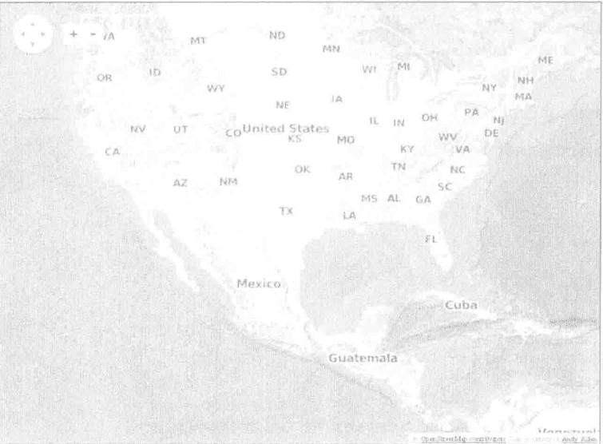

请注意，地图在左上角显示了导航器和缩放控件。此外，归属文本显示在地图的右下角。添加图层标记后，地图现在将在指定的纬度和经度坐标处包含图钉，如以下屏幕截图所示：

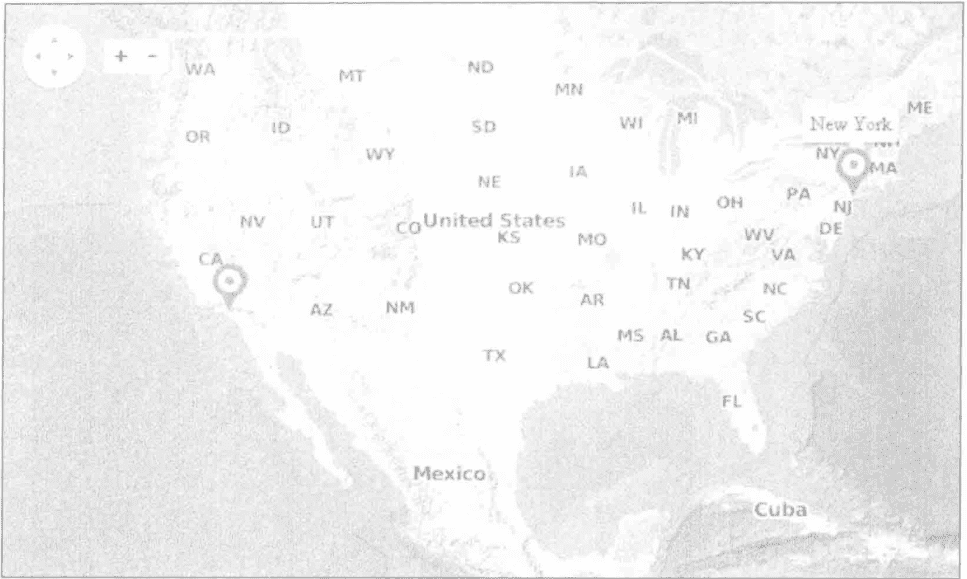

在前面的屏幕截图中，当用户将鼠标悬停在标记上时，会显示提示信息。

### 更多...

在前面的示例中，导航器、缩放和归属控件位于屏幕的左上角和右下角。可以通过包含 controls 选项并指定这些控件的位置来更改这些控件的位置：

```
$('#chart').kendoMap({
.controls: {
navigator: {
position: "bottomRight"
},
zoom: {
position: "bottomLeft"
},
},
```

```
attribution: {
    position: "topRight"
},
.
});
```

现在当您呈现页面时，控件将相应地定位。

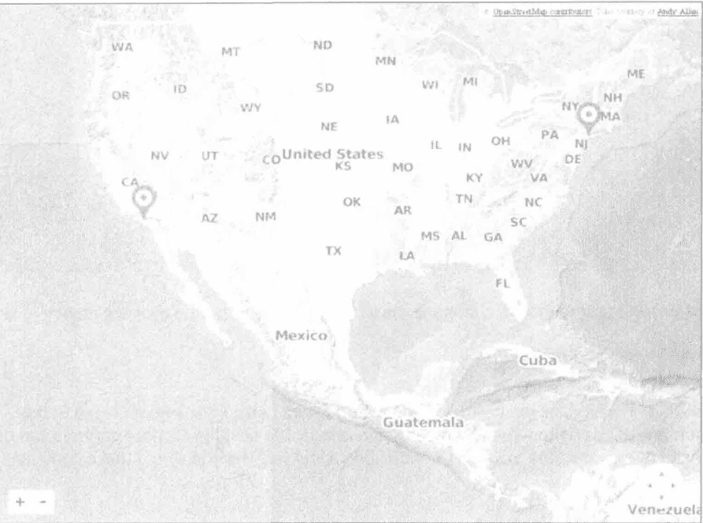

position 属性可以具有以下值之一：topLeft、topRight、bottomLeft 和 bottomRight。也可以通过将其值设置为 false 来隐藏控件：

```
controls: {
    navigator: false
},
```

通过将指定的控件设置为 false，该控件将不会在页面上显示。

### 通过绑定 GeoJSON 数据创建地图

GeoJSON 是一种对多种地理数据结构进行编码的格式。它是一种开放标准格式，用于使用 JSON 对一组简单地理特征及其非空间属性进行编码。在本示例中，我们将创建一个绑定到 geoJSON 数据的地图，该数据不仅包含坐标，还包含该区域的其他非空间信息。

### 操作方法...

要创建与点或坐标对应的形状，请将图层类型设置为 shape。让我们先参考包含坐标和其他非空间数据的 geoJSON 数据：

```
{
"type": "FeatureCollection",
"features": [
{
"type": "Feature",
"properties": {
"GEO_ID": "0400000US23",
"STATE": "23",
"NAME": "Maine",
"LSAD": "",
"CENSUSAREA": 30842.923
},
"geometry": {
"type": "MultiPolygon",
"coordinates": [
[
[-67.619761, 44.519754],
[-67.61541, 44.521973],
[-67.587738, 44.516196],
.
.
.
],
.
.
.
]
}
}
]
}
```


提到的 geoJSON 数据包含与地图上的点对应的坐标。这些点将用于构建矢量形状。geoJSON 数据还列出了 NAME 和 CENSUSAREA 等其他属性。让我们使用之前的 JSON 数据作为 DataSource 对象，通过 kendoMap 函数构建地图：

```javascript
$('#chart').kendoMap({
center: [30.2681, -97.7448],
zoom: 4,
layers: [{
type: 'shape',
dataSource: {
type: 'geojson',
transport: {
read: './geojson-us.json'
}
}
}]
});
```

在这里，type 属性设置为 shape，并指定了 dataSource，它指向包含 geoJSON 数据的文件。框架将解析 geoJSON 数据，并引用坐标来构建地图。

我们可以使用 geoJSON 数据中存在的其他属性，并为地图添加一些功能。例如，我们可以将 CENSUSAREA 字段转换为十六进制数，并使用它来填充形状：

```javascript
$('#chart').kendoMap({
center: [30.2681, -97.7448],
zoom: 4,
layers: [{
type: 'shape',
dataSource: {
type: 'geojson',
transport: {
read: './geojson-us.json'
}
}
}]),
shapeCreated: function (e) {
var shapeColor = parseInt(e.shape.dataItem.properties.
CENSUSAREA, 16).toString();
shapeColor = '#' + ('FFFFFF' + shapeColor).slice(-6);
e.shape.fill(shapeColor);
}
});
```

在前面的代码片段中，添加了 shapeCreated 函数，每当向地图添加形状时都会调用该函数。

### 工作原理...

当你渲染页面时，你将看到一个包含形状的地图，如下面的屏幕截图所示：

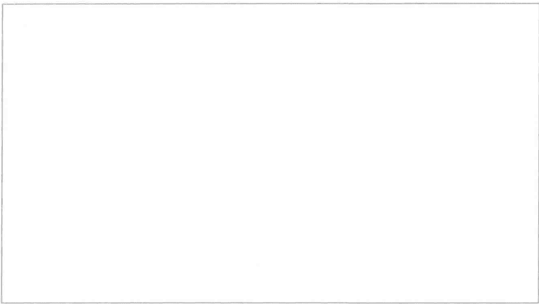

在使用 shapeCreated 函数为形状添加颜色后，你将看到一张彩色地图。

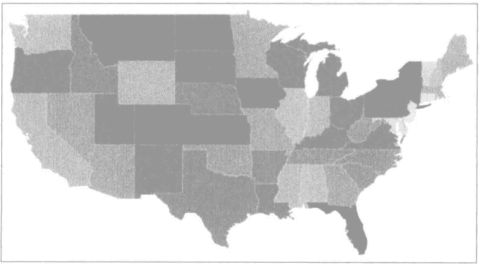

形状是通过将 CENSUSAREA 字段值转换为十六进制数，然后添加前缀使其成为固定长度来计算的。
