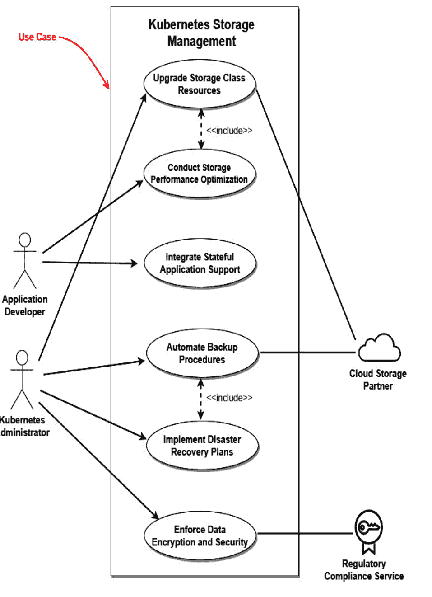
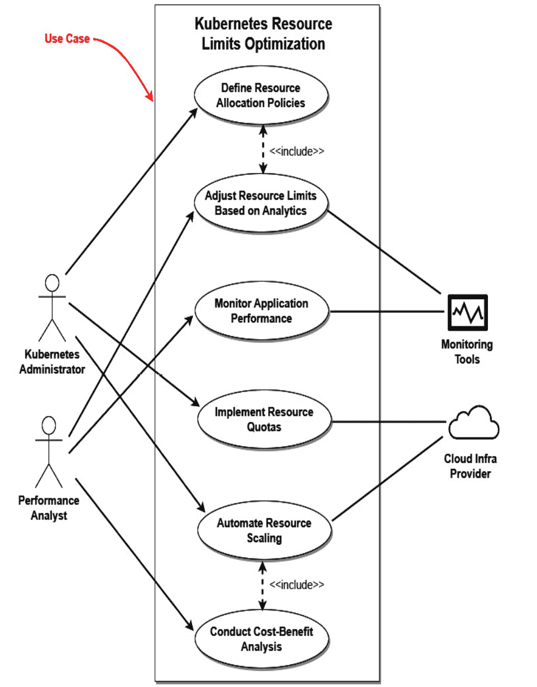
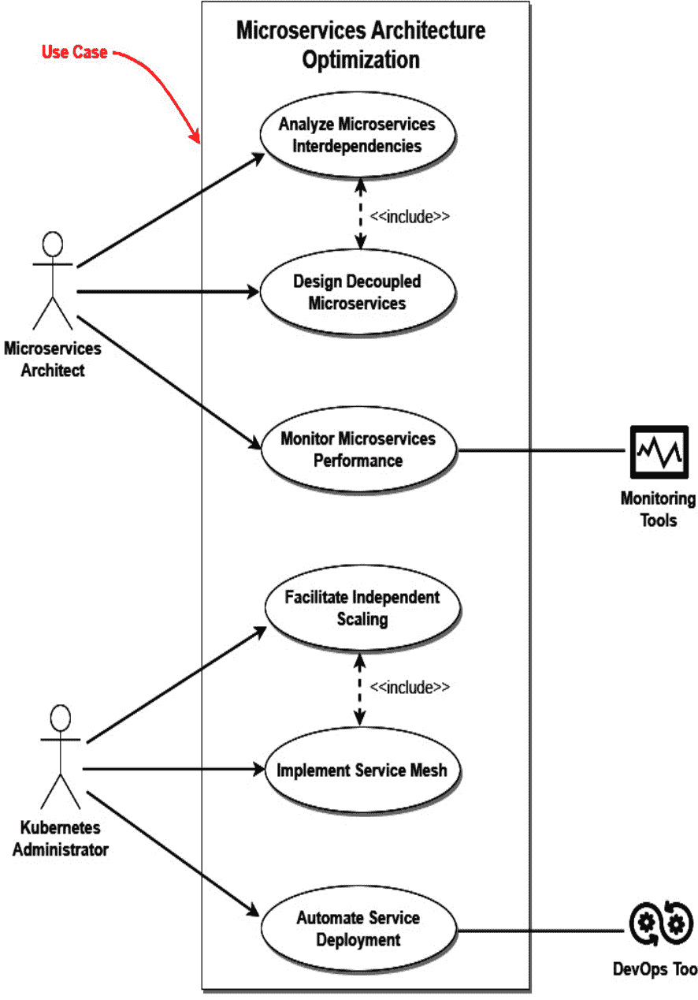
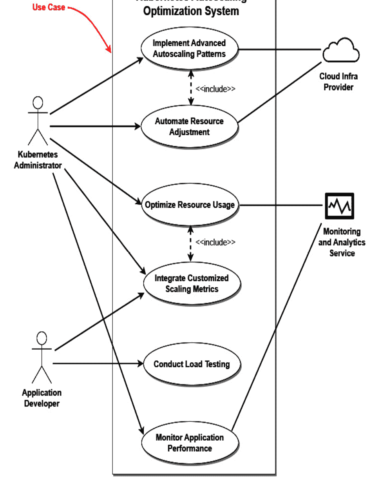

## 原因和后果

本章深入探讨了 Kubernetes 反模式的根本原因和广泛后果，强调了其对系统运营的影响。它提供了对 Kubernetes 历史发展的详细分析，解决了从业者中常见的误解和知识空白。文本强调了架构和组织因素在 Kubernetes 部署中的重要作用，以及技能、培训和沟通等人文因素在有效管理中的重要性。此外，它还评估了工具和技术选择对 Kubernetes 环境运营效率的影响。总体而言，本章旨在全面理解 Kubernetes 反模式，重点关注确保运营稳定性和功能性的主动策略。

本章将涵盖以下主题：

- 剖析 Kubernetes 反模式的根本原因
- 追踪 Kubernetes 反模式影响
- 理解反模式原因的价值

## 剖析 Kubernetes 反模式的根本原因

理解 Kubernetes 中反模式的根本原因是掌握平台复杂性并优化其使用的关键。这种探索揭示了导致运营挑战的复杂因素，从 Kubernetes 的演进及其对当前实践的影响，到组织动态、技术技能和工具选择的细微差别。

### 在 Kubernetes 中定义根本原因

一个关键方面需要我们关注：反模式的根本原因。这些不仅仅是表面的故障，而是触发一系列运营挑战的基础性问题。为了有效解决这些问题，我们必须理解在 Kubernetes 生态系统中什么构成了根本原因。

Kubernetes 中的根本原因通常隐藏在复杂性之下。例如，资源的过度使用最初可能看起来只是工作负载管理不当的直接问题。但实际的根本原因可能追溯到对 Kubernetes 资源管理功能的基本误解，例如 pod 和容器的 requests 和 limits。

在 Kubernetes 环境中，有效地区分症状和根本原因至关重要。这是在应用临时修复和从根本上解决问题之间的区别。这种区分不仅解决了眼前的问题，还增强了系统的长期健康和稳定性。

这是一种调查工作与技术能力的结合。它涉及剖析系统架构和运营实践，然后应用系统化的问题解决方式。日志分析器、监控系统和 Kubernetes 特定诊断工具在此过程中非常宝贵。

根本原因分析的重要性在现实场景中得以凸显。考虑 Kubernetes 部署频繁停机的情况。简单地重启服务或重新分配资源可能只提供暂时的缓解。然而，更深入的调查可能会揭示更复杂的问题，例如有缺陷的部署策略或网络策略配置错误。直接解决这些根本原因将带来更可持续和更有效的解决方案。

下表展示了特定的反模式如何追溯到更深层次的根本原因：


| Kubernetes反模式 | 潜在根本原因 |
|---|---|
| **资源过度利用** | 资源限制与请求配置错误 |
| **频繁停机** | 部署策略缺陷 |
| **安全漏洞** | 安全策略和实践不足 |
| **可扩展性问题** | 架构局限性 |
| **工作负载分配低效** | 对Kubernetes调度理解不足 |

表3.1 – Kubernetes反模式及其根本原因

在Kubernetes中进行根本原因分析时，采用系统且全面的方法至关重要。这涉及几个关键步骤：

- 1. **事件日志记录和初步分析**：首先全面记录事件。收集所有相关数据，包括日志、指标和用户报告。此阶段涉及识别问题的症状。
- 2. **数据收集与工具利用**：利用Kubernetes专用工具获得更深入的洞察。这可能包括日志分析器（如ELK Stack（Elasticsearch、Logstash、Kibana））、监控工具（如Prometheus）以及Kubernetes诊断工具（如**kubectl**）来检查正在运行的Pod和工作负载。
- 3. **假设提出**：基于初步数据，针对潜在根本原因提出假设。此阶段具有推测性，但以所收集的数据和实践者对Kubernetes运维的了解为指导。
- 4. **测试假设**：这涉及在Kubernetes环境中进行实验，以验证或反驳每个假设。可能包括复制场景、调整配置或模拟工作负载。
- 5. **引入跨职能团队**：鉴于Kubernetes的复杂性，应在RCA（根本原因分析）过程中引入跨职能团队。这可能包括开发人员、系统架构师和运维团队，他们各自为问题带来独特的视角。
- 6. **识别根本原因**：经过充分测试和协作后，将范围缩小到具体根本原因需要多种分析技术的结合：
  1. **关联分析**：将日志、指标和告警中的数据模式联系起来，以识别潜在原因
  2. **对比分析**：将配置和指标与正常运行的系统进行对比
  3. **因果推断**：在观察到的变化与问题之间建立因果关系
  4. **专家咨询**：借鉴资深Kubernetes专业人员的知识和经验
  5. **回溯分析**：使用Kubernetes审计日志等工具，追踪导致问题的事件或变更序列
- 7. **记录并分享发现**：一旦确定根本原因，全面记录发现结果。与相关团队分享此文档，以确保知晓并防止再次发生。
- 8. **实施纠正措施**：最后，实施必要的纠正措施。这可能涉及配置变更、部署实践更新或架构方法的修订。
- 9. **审查与持续改进**：RCA后，审查流程，总结学习要点和潜在改进领域。这有助于为未来事件优化RCA流程。

在Kubernetes中，成功的RCA不仅是技术演练；它是一种战略方法，结合了技术专长、协作式问题解决和对持续学习的承诺。通过掌握这种方法，Kubernetes实践者可以将运营挑战转化为优化和增长的机会，从而打造更稳定、更高效的Kubernetes环境。

## Kubernetes发展的历史视角

Kubernetes的历史演进为理解当前使用中普遍反模式的根本原因提供了重要背景。这远非单纯的回顾，历史视角对于理解Kubernetes如何随时间发展以及某些反模式为何根深蒂固至关重要。

Kubernetes诞生于谷歌内部的Borg系统，后来捐赠给**云原生计算基金会（CNCF）**，其开发目的是大规模编排容器化应用。早期，重点在于创建一个能够高效管理复杂应用的稳健平台。那时，Kubernetes主要围绕可扩展性以及跨主机集群的部署、扩展和运维自动化。该平台擅长管理无状态应用，这类应用在其早期阶段构成了绝大多数工作负载。

然而，随着Kubernetes开始流行，其功能集不断扩大。这种扩展在丰富平台的同时，也带来了前所未有的复杂性。Kubernetes开始支持有状态应用和更广泛的工作负载类型。从持久化存储到网络策略，每个新功能都引入了配置和管理的新维度。这种增长，虽然是一种

这种理解不仅关乎识别现有反模式的根本原因；更关乎获得洞察，帮助预测和应对Kubernetes持续发展并塑造容器编排格局时可能出现的未来挑战。

## 常见误解与知识差距

在理解和纠正Kubernetes反模式的过程中，我们必须面对一个常成为这些问题催化剂的关键因素：实践者中普遍存在的误解和知识差距。我们旅程的这一部分将深入探讨这些误解，揭示它们如何促成常见Kubernetes陷阱的根本原因。

### 误解1 – Kubernetes是万能解决方案

最普遍的误解之一是将Kubernetes视为万能的解决方案。这种观点源于其广泛的流行度和成功案例，常常导致在并非最合适选择的场景中采用它，无意中为反模式埋下伏笔。理解Kubernetes虽然强大，但并非每个用例的最优解决方案，对于避免误用至关重要。

### 误解2 – 对自动化的高估

Kubernetes常因其自动化能力而备受赞誉，但人们往往高估其开箱即用的自动化程度。这种高估可能导致对必要定制和人工监督的投资不足，从而造成配置错误的环境和运营问题。认识到自动化与人工干预之间的平衡是有效利用Kubernetes的关键。

### 误解3 – 对Kubernetes复杂性的简单化看法

许多实践者往往低估Kubernetes的复杂性，这可能导致重大挑战。新采用者通常受其用户友好的前端和高层抽象的影响，可能会忽视其设置和维护中的复杂细节。这种理解差距可能导致简单化的实现，无法考虑到稳健Kubernetes部署的细微差别。

### 误解4 – 将Kubernetes与其工具等同

Kubernetes与配合其使用的各种工具和插件之间的界限常常模糊。诸如Helm、Istio或Prometheus等工具虽然很有价值，但不同于Kubernetes本身。这种混淆可能导致对这些第三方工具的过度依赖，掩盖了对Kubernetes机制基本理解的需求，并可能导致配置无法充分利用Kubernetes的核心优势。

### 误解5 – “设置后不再干预”的谬误

人们常常认为Kubernetes一旦设置好，就只需极少的维护。这种“设置后不再干预”的心态忽视了Kubernetes环境的动态特性以及它们所需的持续监控、更新和优化。这种态度可能导致系统过时、安全漏洞和性能退化。

### 知识差距1 – 对Kubernetes架构理解不足

一个重要的知识差距往往在于对Kubernetes架构的全面理解。其组件（如Pod、Service、Deployment等）及其交互的细微差别有时未被完全掌握，导致配置欠佳，进而演变为反模式。

### 知识差距2 – 误解Kubernetes网络

Kubernetes中的网络是一个常被误解的复杂领域。诸如网络策略、服务网格以及入站和出站规则等概念可能令人望而生畏。对这些概念的不完全掌握


未被检测到或识别得太晚。全面理解可观测性实践对于主动的系统健康管理至关重要。

为防止和纠正 Kubernetes 反模式，教育和持续学习至关重要。从业者应努力理解平台的局限性和优势，投入时间理解其复杂性，并及时了解最佳实践，特别是在网络和安全等领域。

## 架构和设计陷阱

掌握 Kubernetes 架构和设计的细微差别是任何从业者的重要组成部分。这些方面不仅仅是技术细节；它们代表了一系列决策和策略的迷宫，如果不谨慎应对，就可能导致 Kubernetes 环境中出现重大挑战。这些挑战的性质往往根深蒂固，源于 Kubernetes 初始设置阶段以及其持续开发过程中做出的基础性选择。

进入 Kubernetes 架构的旅程通常始于对其能力的热情。然而，许多人遇到的第一个陷阱就是过度设计。这是一个常见场景：在试图利用 Kubernetes 的强大功能时，倾向于创建过于复杂的系统。这些系统具有多层和错综复杂的组件，可能变得难以驾驭、难以管理且容易出错。简洁的原则在这里至关重要。不必要的复杂架构不仅会阻碍运营，还会掩盖问题出现时的根本原因。挑战在于在利用 Kubernetes 强大的功能和保持系统可管理且不因其复杂性而负担过重之间找到平衡。

另一个关键领域是集群规模和可扩展性。Kubernetes 架构的这一方面就像走钢丝。一边是低估集群所需规模的风险，导致资源短缺、性能瓶颈，以及系统在工作负载的重压下呻吟。另一边是高估的危险，导致资源浪费和不必要的支出。此外，可扩展性规划经常被忽视或低估。Kubernetes 环境必须以未来的增长为目标进行设计；未能做到这一点可能会导致系统无法应对日益增长的需求，从而抵消 Kubernetes 的主要优势之一。

Pod 和服务的设计需要仔细思考。Kubernetes 在编排能力方面表现出色，但 Pod 和服务设计的失误会迅速削弱其优势。例如，将太多容器塞入单个 Pod，或错误定义服务的边界，都可能导致性能下降和复杂性增加。每个容器、Pod 和服务都需要经过深思熟虑的配置，以确保它们共同努力提升性能，而非削弱性能。

在 Kubernetes 中处理有状态组件，主要以管理无状态应用程序而闻名，会带来自己的一系列挑战。结合数据库等元素需要对有状态集和持久卷采取战略性方法。此处的管理不善可能导致数据持久性问题，影响整个系统的可靠性和有效性。在以无状态为主的环境中确保数据完整性和可用性，需要深入理解 Kubernetes 的存储能力以及对其实施的细致方法。

一个经常在为时已晚之前未得到足够考虑的陷阱是灾难恢复和高可用性。在没有集成故障转移机制和可靠备份策略的情况下设计 Kubernetes 系统，会使其暴露于潜在故障和停机风险中。特别是在生产环境中，缺乏强大的灾难恢复规划可能产生灾难性后果。高可用性和灾难恢复需要在 Kubernetes 架构的初期就融入其中。

最后，Kubernetes 架构中安全性的集成是一个经常处理不当的领域。安全通常被视为事后考虑，但它需要成为 Kubernetes 设计的基础组成部分。这包括从网络分段到有效使用 Kubernetes 的 RBAC 以及保护集群内通信的一切。一个忽视这些元素的架构可能容易受到各种安全威胁。

通过组建拥有正确技能的团队，确保持续和全面的培训，并促进开放和有效的沟通，组织可以为 Kubernetes 部署和管理创建坚实的基础。这种方法不仅最大限度地降低了反模式的风险，还使团队能够充分利用 Kubernetes 的能力，将挑战转化为创新和成长的机会。

## 工具和技术选择

选择和集成合适的工具和技术是管理 Kubernetes 环境中的关键流程。这些决策不仅仅是常规选择；它们塑造了 Kubernetes 运行的本质，影响运营效率、可扩展性和安全性。此过程涉及在一个充满多样化工具的领域中导航，每个工具都承诺为容器编排带来特定的增强和优化。

面对如此广泛的选择，关键挑战是辨别哪些工具最符合部署的特定需求和目标。这项任务需要对每个工具如何融入现有系统进行深入分析，了解学习和有效实施它们所需的资源和时间，评估 Kubernetes 社区内的可用支持，并考虑其长期可维护性。

采用新颖先进工具的诱惑很常见，但必须以对其在给定 Kubernetes 环境中适用性的全面评估来制衡。例如，引入复杂的服务网格解决方案可能看起来是进步之举，但如果对特定用例并非必要，它会给运营增加不必要的复杂性。同样，选择与 Kubernetes 配合不佳的监控工具可能导致重大的盲点，削弱环境的管理和监控能力。

除了辅助工具之外，与 Kubernetes 集成的更广泛技术栈也需要仔细考虑。这包括需要与 Kubernetes 架构和谐工作的存储、网络和安全解决方案。技术栈中的不兼容选择可能导致数据持久性挑战或网络流量瓶颈等问题，严重影响整个系统的性能和可靠性。

此外，这些工具和技术在 Kubernetes 内部的实现方式至关重要。即使是最强大的工具，如果配置不正确且未针对 Kubernetes 环境进行优化，也会大打折扣。配置错误或效率低下设置会抵消这些工具的好处，导致效率低下和漏洞。因此，必须深入了解工具和 Kubernetes，以确保这些工具的集成能够增强 Kubernetes 生态系统。

因此，在 Kubernetes 中选择和实施工具和技术的过程需要深思熟虑和明智的决策。这是一个在新技术进步的兴奋与 Kubernetes 环境的实际需求和具体情况之间取得平衡的过程。通过深思熟虑的选择和细致的实施，从业者可以创建一个不仅功能齐全，而且针对效率、安全性和可扩展性进行优化的 Kubernetes 生态系统。

## 追踪 Kubernetes 反模式影响

追踪 Kubernetes 反模式的影响对于揭示它们如何微妙而显著地影响平台的运营效率和有效性至关重要。本节深入探讨了这些反模式以各种方式影响平台的途径，这些反模式经常被忽视或误解，会扭曲和挑战 Kubernetes 使用的规范。从不一致的做法到配置错误的设置，了解这些反模式的广度和深度为 Kubernetes 的复杂性以及如何最好地驾驭它们以获得最佳性能提供了宝贵见解。

## 开发文化的微妙转变

Kubernetes 反模式，通常源于对 Kubernetes 能力的误用或误解，微妙地影响着


以各种方式影响开发文化。其中最显著的变化之一是过度依赖 Kubernetes 自动化功能的出现。开发人员可能会开始严重依赖 Kubernetes 来处理应用程序部署和扩展的各个方面，假设平台会自动解决任何配置或架构上的低效问题。这种错误的自信可能导致核心软件工程原则被忽视，因为团队越来越多地依赖 Kubernetes 来 *修复* 欠佳的做法。

Kubernetes 反模式引发的另一个文化转变是专业知识和知识的集中化。随着团队遇到更复杂的 Kubernetes 环境，而这些环境又因不当使用资源或服务配置错误等反模式而加剧，团队内部的一小部分人往往会成为事实上的 Kubernetes 专家。这种情况造成了知识孤岛，少数团队成员掌握了与 Kubernetes 运维相关的绝大部分理解。因此，其他团队成员可能会觉得自己与项目中与 Kubernetes 相关的方面脱节，导致整体团队效率下降，并且由于沟通不畅或缺乏理解而可能增加错误。

Kubernetes 反模式还倾向于鼓励一种被动而非主动的问题解决文化。当团队反复遇到源于这些反模式的问题时，例如由于负载均衡不当导致的资源争用或服务中断，重点就会转向灭火而不是预防。这种被动的方法可能在团队文化中根深蒂固，优先考虑即时解决方案而非对根本问题的彻底分析和理解。这种心态往往导致快速修复的循环，虽然提供了暂时的缓解，但并未解决问题的根源。

此外，Kubernetes 反模式的存在可能导致对持续改进和学习的自满文化。随着这些反模式带来的复杂性，团队成员可能会感到不知所措或 resigned 于 Kubernetes 环境本身存在问题的观念。这种态度会扼杀创新，并阻止团队成员寻求利用 Kubernetes 更有效的新方法。它还可能导致技能停滞，因为团队成员变得不愿意更新知识或探索 Kubernetes 使用中不断发展的最佳实践。

此外，这些反模式会微妙地改变团队对风险管理和测试的方法。在健康的 Kubernetes 环境中，团队通常会进行彻底的测试，包括负载测试、故障转移场景和恢复程序。然而，当反模式盛行时，往往存在一种虚假的安全感，即 Kubernetes 会有效地管理这些方面。因此，团队可能会跳过全面的测试，导致系统存在漏洞，这些漏洞只有在生产环境中失败时才会被发现。

Kubernetes 反模式的采用会微妙地影响团队对架构和设计的方法。Kubernetes 功能的诱惑可能导致团队设计出过于复杂且与 Kubernetes 特定功能紧密交织的系统。这种对 Kubernetes 的过度依赖会使系统变得僵化，难以适应变化，将架构锁定在难以扩展或修改的模式中。

当面临管理不当的 Kubernetes 环境带来的复杂性和挑战时，团队成员可能变得不太可能有效协作。这种日益增长的复杂性可能导致缺乏透明度和对系统的共同理解，使得团队成员难以在解决问题或开发新功能时高效地协同工作。

## 工作流程中断和低效

Kubernetes 反模式深刻地影响了开发团队的日常工作流程，这些模式虽然在技术上起源，但导致了各种低效和中断。这些模式的影响并不直接；相反，它表现为相互关联的挑战网络，每一个都以不同且常常出乎意料的方式影响团队。驾驭这种复杂性成为有效管理 Kubernetes 环境的关键部分。

当 Kubernetes 未被正确利用时，最直接的影响之一是对应用程序的部署和管理。反模式，例如资源限制配置错误或不当使用 Kubernetes 对象，可能导致频繁的部署失败。团队被迫从计划任务中抽身来处理这些紧急问题，导致一种破坏常规工作流程并降低生产力的被动问题解决循环。

由于这些反模式，故障排除和维护变得越来越复杂。例如，过于复杂的网络配置或过度使用自定义资源定义会掩盖问题的根本原因。这种复杂性迫使团队花费大量时间来理清这些问题，这会延迟其他关键工作和项目开发的进展。

资源利用效率低下是 Kubernetes 反模式的另一个后果。诸如忽视设置适当资源限制的做法可能导致资源分配过多或不足。这不仅会影响应用程序性能，还会导致运营成本更高和资源浪费，这需要频繁的调整和监控。

在存在 Kubernetes 反模式的情况下，有效扩展应用程序变得具有挑战性。对扩展策略的误解可能导致应用程序在不同负载下无法正确扩展。因此，团队经常发现自己需要手动管理应用程序扩展，这耗时且分散了他们对其他开发方面的关注。

团队内部的协作和沟通也受到了影响。Kubernetes 环境配置错误可能导致误解和沟通开销增加，因为团队成员努力澄清配置和部署策略。这种低效的沟通会减慢开发过程，并可能导致挫败感和士气下降。

**持续集成和持续部署 (CI/CD)** 流程的集成可能因 Kubernetes 反模式而受阻。次优配置或复杂的部署策略可能导致 CI/CD 管道频繁失败，延迟软件交付并将注意力从功能开发转移到管道故障排除。

在存在 Kubernetes 反模式的情况下，系统可靠性和可预测性会受到损害。管理不当和配置不当的系统更容易出现故障和不可预测的行为，需要团队保持持续警惕。这种不可预测性阻碍了有效规划和执行工作的能力，导致工作环境更加混乱和充满压力。

## 部署和运营指标的改变

Kubernetes 中的常见陷阱会微妙而显著地影响在整个 Kubernetes 生态系统中用于评估部署和运营效率的指标。这些常常微妙的转变会改变对生态系统性能的常规认知。

部署频率是一个常被等同于敏捷性的指标，当反模式存在时可能会具有误导性。部署频率的增加可能看起来是一个积极的指标，但也可能表明发布仓促、测试不足或生产就绪度不足，导致生态系统不稳定和潜在的停机。

变更失败率也经历了类似的转变。虽然 Kubernetes 可以掩盖即时部署失败，从而导致变更失败率看似改善，但这可能隐藏了更深层次的问题。诸如配置漂移或资源争用等不会立即显现的问题，可能会逐渐侵蚀系统的稳定性和弹性，影响 Kubernetes 生态系统的长期健康。

**平均恢复时间 (MTTR)** 是另一个受 Kubernetes 反模式影响的指标。平台快速回滚更改并恢复之前状态的能力可能会给人一种系统具有弹性的印象。然而，这也可能阻止团队解决问题的根本原因


failures, leading to a cycle of recurring issues that can destabilize the ecosystem over time.

Furthermore, the necessity to monitor new, Kubernetes-specific operational metrics becomes evident. Metrics related to container orchestration, pod performance, and node health become crucial. Properly tracking and interpreting these metrics requires a deep, nuanced understanding of Kubernetes, and failing to do so can lead to misjudged system performance and health.

The complexity that’s introduced by these anti-patterns also complicates the interpretation of operational metrics. Teams must navigate a more intricate data landscape, understanding not just the metrics themselves but also how Kubernetes’ features and anti-patterns might be influencing them. This complexity makes it challenging to draw accurate conclusions about the system’s performance and to make informed decisions regarding improvements and resource management.

Therefore, in the Kubernetes ecosystem, the influence of anti-patterns extends to altering key operational metrics, necessitating a more refined approach to measurement and analysis to ensure a true understanding of the system’s health and efficiency.

## Increased monitoring noise and alert fatigue

Kubernetes anti-patterns can inadvertently cause a surge in monitoring noise and alert fatigue, which poses a significant challenge for teams overseeing complex, dynamic systems. This scenario unfolds as the system begins generating an overwhelming number of alerts and logs, many of which might be trivial or misleading, yet they still require assessment and management.

Anti-patterns such as misconfigured resource thresholds or health checks, and the inappropriate use of alerts, often lead to a flood of notifications. For example, if the alert thresholds are set too sensitively or without proper context for the specific Kubernetes environment, teams may find themselves inundated with alerts for normal system behavior or minor deviations. This constant influx of alerts can create a background noise, making it difficult to discern genuinely critical issues.

The consequence of this incessant stream of alerts is a growing desensitization among team members. Continuously bombarded with notifications, individuals start to experience alert fatigue, where they might overlook or undervalue significant alerts, mistaking them for routine false positives. This condition is dangerous as it allows real, potentially system-critical issues to go unnoticed or unaddressed, increasing the risk of major system failures or performance issues.

This issue extends to the realm of log management as well. Kubernetes environments, especially those with embedded anti-patterns, tend to produce an extensive amount of log data. When this data is inflated with entries stemming from these anti-patterns, it not only strains the storage and processing capacities but also complicates the task of sifting through logs to extract actionable insights. Teams are forced to spend disproportionate amounts of time filtering through this data, trying to identify relevant information amid a sea of logs.

Excessive alerts and logs demand a more thoughtful approach to monitoring. Teams are compelled to refine their alerting systems, ensuring that the thresholds and conditions for alerts truly reflect critical issues in the system. Similarly, advanced log management strategies become necessary, typically those that utilize tools and techniques that can effectively parse through large volumes of data, filter out the noise, and highlight key information that requires attention.

It is crucial for teams to continuously evaluate and adjust their monitoring setups to ensure they are both effective in catching real issues and efficient in not overwhelming the team with unnecessary noise. This careful management of monitoring systems is vital for maintaining the health and stability of Kubernetes environments, ensuring that teams can focus on genuine issues and maintain optimal system performance.

## Degradation of service reliability

The degradation of service reliability in a Kubernetes environment is often a direct result of various anti-patterns in configuration and usage. When resources are misallocated or improperly managed, it can lead to services being either resource-starved or over-provisioned. The former results in frequent crashes or slowdowns under load, while the latter leads to wasted resources and increased operational costs. This mismanagement directly affects the dependability of services, with them failing to meet user expectations and service-level agreements.

Configuring liveness and readiness probes inaccurately can also significantly impact service stability. If these probes are not tuned correctly, Kubernetes may terminate healthy containers unnecessarily or fail to restart those that are malfunctioning. This can result in increased downtime or poor service response as Kubernetes struggles to accurately assess the state of running containers.

Network configuration within Kubernetes is crucial for service reliability, especially in microservices architectures where communication between services is key. Issues, such as misconfigured network policies or service ingress, can lead to services being unreachable or experiencing erratic network behavior. This can manifest as increased latency, packet loss, or total service outages, further eroding the reliability of the system.

Load balancing and auto-scaling rules that are not optimally configured can disrupt service reliability as well. Imbalanced traffic distribution can

## Complications in automation and orchestration

The complexities of automating and orchestrating tasks can lead to significant operational challenges. These challenges often stem from the delicate balance that must be maintained between automated processes and the need for tailored orchestration strategies. Let’s take a closer look:

- **Challenges with over-reliance on automation**: Automation intends to ease the management of application deployment, scaling, and maintenance. However, teams may fall into the trap of *automation complacency*, a state where too much dependence is placed on automated processes. This over-reliance can be detrimental, particularly in scenarios that automated workflows are not equipped to handle. It often results in overlooked issues and inadequate resource management as manual intervention and customization are underutilized.
- **Tailoring orchestration to application needs**: Efficient orchestration in container management requires each application’s unique requirements to be considered carefully. A common misstep occurs when the orchestration process is uniformly applied across diverse applications, disregarding their operational characteristics. Such a one-size-fits-all approach can lead to inefficient use of resources and diminished application performance. For example, imbalances in load balancing or inadequate pod deployment strategies can cause an uneven distribution of resources, directly impacting application effectiveness.
- **Complexities in network orchestration:** Orchestrating network configurations is a critical yet intricate aspect of container management. Network policies, which are essential for operational efficiency and security, need to be meticulously crafted. Improperly designed network policies can create excessive complexity, leading to difficult-to-manage interdependencies and unintentional access limitations. These issues not only degrade performance but also introduce substantial security risks.
- **Handling stateful applications:** Managing stateful applications presents unique challenges, especially since the platform is primarily optimized for stateless applications. Effectively managing StatefulSets and persistent volumes is crucial. Common errors include applying stateless strategies to stateful applications, which can result in significant data consistency issues and potential data loss, both of which pose major risks in environments where data integrity is critical.
- **Pitfalls in CI/CD processes:** Implementing CI/CD processes often emphasizes speed, sometimes at the expense of stability and thorough testing. This can lead to updates being deployed prematurely and unstable or untested code being introduced to production. Such practices compromise the reliability and efficiency of the system, leading to potential instability and disruptions.

Addressing these complexities requires a nuanced approach where automation benefits are balanced with necessary human insights,

编排策略是按应用定制的，并且快速部署流程与系统的稳定性和安全需求保持一致。优化这些方面对于防止运营效率低下以及容器编排环境中反模式的产生至关重要。

## 性能调优中的障碍

在 Kubernetes 环境中进行性能调优的复杂性往往因反模式的存在而加剧，这些反模式造成了一系列阻碍最佳性能的障碍。这些反模式根植于 Kubernetes 的各个方面，会显著扭曲本应稳健高效的系统的有效性。

在资源分配方面，反模式通常表现为资源过度配置或配置不足。受这些反模式困扰的 Kubernetes 环境难以高效分配 CPU 和内存，导致某些容器消耗不必要的资源，而其他容器则资源饥饿，从而导致应用性能不稳定。这种管理不善在动态环境中尤其成问题，因为在系统未能根据变化的需求调整资源分配时，工作负载会发生变化。

Kubernetes 中的负载分布也会因反模式而严重受损。相反于在集群中均匀分配工作负载，这些反模式通常会导致分配不平衡，使某些节点过载而其他节点利用不足。这不仅会使过载的节点承受压力，可能导致故障，而且也表明对可用基础设施的利用存在严重低效。

Kubernetes 中的网络性能是反模式可能产生不利影响的另一个领域。网络策略配置错误或网络策略低效会导致延迟增加和吞吐量降低。这通常是由于缺乏对 Kubernetes 网络能力的理解或网络设计中的疏忽，导致瓶颈阻碍应用的顺畅运行。

就存储而言，Kubernetes 中的反模式表现为设计不良的存储解决方案。这可能导致数据访问缓慢并造成瓶颈，尤其对于有状态应用而言，快速可靠的存储访问至关重要。此类问题通常源于所选存储解决方案与应用特定存储需求不匹配。

可扩展性是 Kubernetes 的关键特性，但会因反模式而严重受损。受这些反模式影响的系统表现出较差的可扩展性，难以根据工作负载变化高效地扩展或缩减。这通常源于缺乏适当的可扩展性规划或自动扩展参数配置错误，导致高峰负载期间性能下降。

监控和性能管理对于维护系统健康至关重要，但往往因反模式而受损。无效的监控策略或缺乏全面监控会使性能瓶颈未被检测和解决。这导致性能管理采取被动而非主动的方法，问题仅在变得关键后才被处理。

最后，如果管理不当，缓存本身也可能成为反模式。不当的缓存策略会导致内存使用效率低下，要么分配过多缓存，要么分配过少，从而对系统整体性能产生负面影响。这通常是由于不了解应用特定的缓存需求或未能根据这些需求调整缓存设置所致。

Kubernetes 性能调优中由反模式造成的每个障碍都凸显了对系统能力和应避免的陷阱进行透彻理解的必要性。这强调了对资源分配、负载平衡、网络设置、存储管理、可扩展性、监控和缓存采取战略性方法的重要性，以确保 Kubernetes 环境最佳运行。

## 理解反模式成因的价值

理解反模式的原因可带来切实且长期的益处，使组织能够做出明智决策、预见问题并构建弹性、优化的 Kubernetes 环境。让我们深入探讨这些宝贵的见解。

## 使预测和预防策略成为可能

组织若能把握 Kubernetes 中反模式的细微差别，便可建立系统以提醒他们注意新兴问题。例如，先前部署中导致系统压力的模式可成为未来监控的指标。这种前瞻性允许及时干预，在资源或配置导致系统退化前进行调整。

同样的理解也为预防措施的制定提供了依据。通过识别反模式的早期迹象，组织可以执行最佳实践并将其检查集成到流程中，尤其是在部署和配置方面。这些措施针对组织的特定 Kubernetes 环境量身定制，解决独特挑战并避免泛化。

基于此知识实现自动化响应成为战略资产。自动化不再是笼统的，而是细致入微，针对过去经验中识别为有问题的特定方面。因此，自动化成为动态工具，能够适应 Kubernetes 环境不断变化的需求，并持续优化性能和稳定性。

专注的培训和发展源于这种理解。团队不仅接受 Kubernetes 操作培训，还接受识别和规避潜在陷阱的培训。这种有针对性的培训方法确保团队不仅技术熟练，而且善于应对 Kubernetes 环境的复杂性。

持续重新评估并从过去的 Kubernetes 部署中学习的做法，培养了成长和适应的环境。团队不仅解决当前问题，还建立抵御未来挑战的韧性，确保其 Kubernetes 操作不仅在当下有效，而且为未来做好准备。

通过充分理解 Kubernetes 反模式，组织可以从被动解决问题转向主动立场，增强其 Kubernetes 操作的效率、稳定性和适应性。

## 培养明智的决策流程

当组织认识并理解 Kubernetes 反模式的复杂性时，他们就能更好地做出避免这些常见陷阱的决策。这种意识成为 Kubernetes 管理各个方面的指导力量，从初始设置和配置到持续维护和扩展。

流程始于规划和战略制定。掌握可能出错的原因和原因后，团队可以更有效地规划 Kubernetes 部署。关于架构、资源分配和服务配置的决策都是在充分意识到潜在问题的情况下做出的，从而做出不仅适合当前状态而且能抵御未来需求的选择。

资源管理决策是 Kubernetes 的关键方面，受此方法影响很大。团队不仅善于高效分配资源，而且善于预见需要调整的场景。这种预见性思维有助于避免资源成为瓶颈或未被充分利用的情况，确保平衡且具有成本效益的运营。

选择补充 Kubernetes 操作的工具和技术是另一个明智决策发挥关键作用的领域。决策不再受趋势或供应商偏好左右，而是基于对不同工具如何与 Kubernetes 交互以及反模式潜力的清晰理解。这导致更具战略性的工具选择，与组织的具体需求和目标保持一致。

Kubernetes 环境中的安全实践也受益于这种明智的方法。了解某些配置的安全影响以及常见反模式相关的风险，使组织能够实施更强大的安全措施。关于访问控制、网络策略和数据加密的决策都是在对潜在漏洞进行全面审视的情况下做出的。

这影响了组织如何应对和从事件中学习。事件后审查不仅是修复当前问题，更是剖析情况以了解出了什么问题以及原因。这些学习随后反馈到决策过程中，不断完善和改进 Kubernetes 实践。

## 指导战略规划和长期愿景

当组织考虑到从 Kubernetes 反模式中吸取的教训时，他们对技术架构的方法变得更加细致和前瞻。他们更能设计出不仅能抵御当前


operational challenges but also flexible enough to adapt to future technological shifts. This foresight in architectural decisions helps in avoiding rigid structures and overly complex configurations that might hamper scalability and adaptability down the line.

Resource management, a critical component of Kubernetes strategy, is profoundly influenced by the awareness of anti-patterns. Strategic planning that incorporates this knowledge leads to more effective and efficient resource utilization. Organizations develop a keen sense of balancing resources to avoid both over-provisioning, which can be costly, and underutilization, which can lead to performance bottlenecks. This balanced approach is vital not just for current efficiency but also for ensuring cost-effective growth and expansion in the future.

The rapid evolution of technology presents constant challenges and opportunities. A strategic vision informed by an understanding of Kubernetes anti-patterns equips organizations to remain agile and responsive to these changes. They can quickly adapt their Kubernetes strategies to new technologies and industry trends, maintaining relevance and effectiveness in a dynamic tech landscape.

## Promoting sustainable and scalable Kubernetes practices

The essence of sustainability in Kubernetes practices is rooted in resource efficiency. An informed approach, mindful of past missteps, guides organizations in optimizing resource use. This means creating Kubernetes environments that are precisely calibrated to use just the right amount of resources – not so much that it leads to wastage, and not so little that it impedes performance. Such efficiency is critical not only for operational cost savings but also for aligning with environmental sustainability goals.

Scalability is another pillar of sustainable Kubernetes practices. By understanding how previous configurations may have limited or hindered scalability, organizations can design systems that are inherently more flexible. This flexibility allows Kubernetes environments to expand or contract resource allocation seamlessly, accommodating fluctuating demands without necessitating a complete overhaul of the system. Scalability, in this sense, is not just a technical feature but a strategic approach that ensures Kubernetes can support the organization’s growth and changing needs over time.

A key factor in achieving sustainable and scalable Kubernetes practices is integrating automation. Automation, tailored by insights from anti-patterns, becomes a tool for maintaining system health and efficiency. It involves automating routine tasks, sure, but it goes beyond that to include the automation of performance optimizations, resource scaling, and even some aspects of security management. This level of automation ensures

consistency in operations and frees up valuable resources to focus on strategic initiatives rather than maintenance.

Another aspect is the continuous monitoring and refinement of Kubernetes environments. Promoting sustainability and scalability means regularly evaluating how the system is performing and making adjustments as needed. This ongoing process allows for the early detection of potential issues and the opportunity to optimize configurations before they become problematic. It’s an approach that keeps the Kubernetes environment in a state of continual improvement, ensuring it remains efficient, effective, and aligned with the organization’s evolving objectives.

## Improving organizational resilience to future challenges

Resilience in Kubernetes is, first and foremost, about building systems that can withstand and quickly recover from disruptions. This resilience is cultivated through a deep understanding of Kubernetes anti-patterns, which often highlight vulnerabilities and potential points of failure in the system. By identifying these areas, organizations can implement strategies such as robust failover mechanisms, effective disaster recovery plans, and comprehensive backup solutions. These strategies ensure that even in the face of unexpected failures or disruptions, the Kubernetes environment remains stable and recoverable.

Another key aspect of resilience is the ability to adapt to change, both in terms of technological advancements and evolving business requirements. Organizations improve their resilience by staying informed about the latest developments in Kubernetes and related technologies. This continuous learning enables them to adapt their Kubernetes strategies and practices to leverage new features and improvements, keeping their systems at the forefront of technological efficiency.

Resilience also involves fostering a culture of agility within the organization. Kubernetes teams should be encouraged to experiment, learn from their experiences, and continuously refine their skills and practices. This culture of agility and continuous improvement means that the organization is always ready to respond to new challenges, experiment with new solutions, and adapt its Kubernetes environment to meet changing demands.

Effective risk management is integral to organizational resilience. This involves not only identifying and mitigating risks associated with Kubernetes deployments but also having plans in place for dealing with potential future risks. Organizations can conduct regular risk assessments, stay alert to new security threats, and update their practices in line with best security practices to protect their Kubernetes environments from potential vulnerabilities.

Lastly, improving resilience is about developing a deep understanding of the organization’s unique operational context and how Kubernetes fits within it. This understanding helps in tailoring the Kubernetes strategy to align with the organization’s long-term goals and operational realities. It ensures that the Kubernetes environment is not just robust in a general sense but is specifically designed to support the unique needs and challenges of the organization.

By focusing on these aspects, organizations can significantly improve their resilience to future challenges in their Kubernetes environments. This resilience ensures that they are not only prepared to handle current operational demands but are also well-equipped to adapt and succeed in the face of future changes and challenges.

## Summary

This chapter focused on the root causes of Kubernetes anti-patterns and their impacts on system operations. It explored the historical evolution of Kubernetes, addressing misconceptions and knowledge gaps, and the role of architectural and organizational factors in Kubernetes deployments. This chapter also emphasized the human aspect of Kubernetes management, including the importance of skills, training, and communication.

Then, it examined how tooling and technology choices affect Kubernetes operations and highlighted the impact of anti-patterns on operational

## Part 2: Implementing Best Practices

In this part, you will acquire practical solutions, best practices, and insights from real-world case studies to effectively address Kubernetes anti-patterns throughout the Kubernetes ecosystem.

This part contains the following chapters:

- *Chapter 4*, Practical Solutions and Best Practices
- *Chapter 5*, Real-World Case Studies
- *Chapter 6*, Performance Optimization Techniques

## 4

## Practical Solutions and Best Practices

This chapter offers concise yet comprehensive guidance that targets the mitigation of Kubernetes anti-patterns through a series of effective strategies and recognized best practices. It directly addresses common issues such as suboptimal resource use, misconfigurations, and operational inefficiencies, offering practical solutions for each.

The chapter emphasizes the importance of making sound architectural decisions, implementing robust monitoring, and efficiently managing clusters to prevent these anti-patterns. Additionally, it highlights the critical role of skills development and clear communication among Kubernetes practitioners. This guide is designed not only to solve existing challenges but also to proactively enhance Kubernetes environments, making them more efficient, stable, and resilient against future operational complexities.

In this chapter, we will cover the following topics:

- Strategies to mitigate Kubernetes anti-patterns
- Implementing proven best practices
- Enhancing the Kubernetes environment


## 缓解 Kubernetes 反模式的策略

要缓解这些反模式，组织需要采取全面方法，涵盖 Kubernetes 部署和管理各个方面。这包括深入了解这些问题的根本原因，这些原因可能源于过时的实践、配置不佳，或随着 Kubernetes 的演进而与最佳实践缺乏一致性。

缓解策略还涉及更深入地理解 Kubernetes 如何影响现有工作流程和组织动态。成功应对 Kubernetes 反模式需要技术专长、有效的工具选择以及与组织目标和文化的契合。

在本次探索中，我们将深入探讨导致 Kubernetes 反模式的复杂因素，并提供可操作的应对策略。

## 为多样化的 Kubernetes 环境定制解决方案

为多样化的 Kubernetes 环境定制解决方案需要一种详细且细致的方法，考虑每个环境的独特特征和需求。这一过程对于有效缓解 Kubernetes 反模式至关重要，因为每个部署都可能呈现出不同的挑战和需求。

制定定制化解决方案的第一步，也是最关键的一步，是深入了解 Kubernetes 环境的具体情况。这种理解涵盖多个维度：部署规模、运行的应用性质、现有网络基础设施、安全要求以及整体组织目标。例如，为大规模全球分布式应用部署的 Kubernetes 环境需要不同的考量，而小型本地化部署则不同。理解这些细微差别是识别正确解决方案的关键。

在明确了解环境后，重点转向识别该环境中普遍存在的特定反模式。在较大环境中，常见问题可能包括资源分配管理不当导致成本效率低下，或扩展策略实施不佳导致性能瓶颈。相比之下，较小环境可能因过度工程化或不必要的复杂性而阻碍敏捷性。识别这些模式对于有效解决它们至关重要。

一旦识别出特定的反模式，开发量身定制的策略就是下一步关键步骤。这可能涉及广泛的解决方案，例如微调资源分配以优化成本和性能、修订网络策略以增强安全性和连接性，或甚至重构 Kubernetes 架构以更好地满足工作负载需求。例如，转向微服务架构可能对某些环境有益，而其他环境可能更受益于无服务器方法。

定制解决方案的一个重要方面是确保它们能与现有工具和运营工作流程良好集成。这意味着任何解决方案不仅应解决即时问题，还应无缝融入组织的**持续集成和部署 (CI/CD)** 流水线、监控系统和其他运营流程。这种集成对于保持顺畅高效的工作流程、最大限度减少干扰并确保长期可持续性至关重要。

以下是一些示例解决方案，针对 Kubernetes 部署中的不同场景进行定制：

- **对于高流量应用**：在 Kubernetes 用于管理高流量应用的环境中，定制化解决方案通常侧重于确保可扩展性和性能。一个例子是实施高级自动扩缩容策略。该策略可能涉及使用**水平 Pod 自动扩缩器 (HPAs)** 结合集群自动扩缩器。HPAs 根据当前流量和资源利用率调整 Pod 数量，而集群自动扩缩器管理集群中节点的数量。这种双重扩缩机制可确保应用能够高效处理流量峰值，而不会过度利用资源。

- **对于以安全为中心的部署**：在金融服务或医疗保健等安全至关重要的环境中，定制化解决方案可能涉及实施增强的网络策略和严格的访问控制。利用 Kubernetes 网络策略控制 Pod 之间的通信，并实施 Istio 等服务网格，可以提供对网络流量的精细控制。此外，将强大的**身份和访问管理 (IAM)** 解决方案（如 OAuth2 和 **OpenID Connect (OIDC)**）与 Kubernetes **基于角色的访问控制 (RBAC)** 集成，可确保只有授权用户和服务才能访问敏感资源。

- **对于多云环境**：在多个云提供商上使用 Kubernetes 的组织面临保持一致性和优化成本的独特挑战。此处的定制化解决方案可能涉及使用 Terraform 或 Crossplane 等工具实施统一的部署策略，这些工具允许在不同云中以声明方式配置资源。这种方法简化了管理并确保环境之间的一致性。此外，集成专为多云环境设计的成本监控工具有助于跟踪和优化资源利用率和支出。

- **对于数据密集型工作负载**：在大数据处理或**机器学习 (ML)** 工作流等数据密集型应用的环境中，定制化解决方案可能侧重于优化存储和数据处理能力。这可能包括将 Kubernetes 与 Ceph 或 Portworx 等高性能存储解决方案集成，这些解决方案提供可扩展且有弹性的存储选项。在 Kubernetes 中实施 StatefulSets 可确保数据密集型应用在 Pod 重启后保持其状态。此外，使用 Kubernetes Operator 为特定数据库或数据处理框架设置高效的数据处理管道，可以自动化并优化这些工作流。

- **对于小规模或开发环境**：在小规模环境或开发设置中，重点可能放在简洁性和成本效益上。此处的定制化解决方案可能涉及使用 Minikube 或 K3s 等解决方案设置轻量级 Kubernetes 部署，这些解决方案针对资源有限和简洁性进行了优化。此外，使用 Jenkins 或 GitLab CI 等工具集成简单的 CI/CD 流水线可以简化开发和部署流程，使小型团队更易于有效管理其 Kubernetes 部署。

- **对于边缘计算场景**：在边缘计算环境中，资源通常受限且延迟是关键因素，定制化解决方案可能涉及使用 K3s 等轻量级 Kubernetes 发行版，这些发行版专为资源受限环境而设计。此外，实施本地化数据处理和缓存策略，可能使用边缘优化的数据库和存储解决方案，可以降低延迟和带宽需求。

这些示例中的每一个都展示了 Kubernetes 环境中的解决方案如何根据不同场景的特定需求进行定制。通过根据每个部署的独特需求定制策略，组织可以优化其 Kubernetes 环境的性能、安全、成本效益和可扩展性。

## 精简 DevOps 流程以避免陷阱

精简 DevOps 流程以避免陷阱涉及旨在提高 Kubernetes 环境中效率、可靠性和一致性的具体行动和方法。

以下是组织如何定制其 DevOps 流程的一些具体方法：

- **自动化 CI/CD 流水线**：实施完全自动化的 CI/CD 流水线是 Kubernetes 中精简 DevOps 的基石。自动化确保部署一致且无错误。可以使用 Jenkins、GitLab CI 和 Argo CD 等工具来自动化部署流程。例如，Argo CD 与 Kubernetes 集成，


允许基于 Git 仓库对应用程序进行自动部署和同步。

- **基础设施即代码 (IaC)：** 使用 Terraform 或 Ansible 等 IaC 工具来配置和管理 Kubernetes 基础设施可确保一致性并减少人为错误。IaC 允许 DevOps 团队使用代码定义和管理 Kubernetes 集群及其相关资源，从而更轻松地实施更改、复制环境，并在需要时回滚。
- **用于配置管理的 GitOps：** 采用 GitOps 方法管理 Kubernetes 配置可以简化部署流程。在 GitOps 中，Git 仓库充当系统配置的 **单一事实来源 (SSOT)**，确保更改可追溯且可逆。这种方法不仅简化了 Kubernetes 配置的管理，还增强了团队之间的协作和可见性。
- **容器镜像管理：** 简化构建、存储和管理容器镜像的过程至关重要。实施 Harbor 或 Docker Hub 等强大的容器注册表，并设置漏洞自动扫描，可确保只有安全且合规的镜像部署到 Kubernetes。
- **监控和日志记录：** 将全面的监控和日志解决方案集成到 DevOps 流水线中对于及早发现问题和性能优化至关重要。诸如 Prometheus 用于监控以及 Elasticsearch 与 Kibana 用于日志记录之类的工具可提供 Kubernetes 环境的实时洞察，使团队能够快速识别和解决潜在问题。

- **自动化测试：** 在 CI/CD 流水线中纳入自动化测试对于确保应用程序的可靠性至关重要。这包括单元测试、集成测试和 **端到端 (E2E)** 测试。可使用 Kubernetes 原生测试框架如 Testcontainers 或 Sonobuoy 来实现此目的，提供与生产环境高度相似的环境。
- **反馈循环和持续改进：** 在 DevOps 流程中建立反馈循环可实现持续改进。这涉及定期审查和分析部署实践、性能指标和事件报告以识别改进领域。实施 Slack 集成用于警报等持续反馈工具可确保团队保持知情并能快速响应问题。
- **简化回滚：** 确保在部署失败时能够快速轻松地回滚部署至关重要。这可以通过 CI/CD 流水线中的自动化回滚机制来实现，使团队能够以最少的停机时间恢复到上一个稳定版本。

## 实施有效的沟通渠道

有效的沟通渠道对于缓解 Kubernetes 反模式至关重要。建立一个系统，在其中关于部署、配置更改和 Kubernetes 更新的信息能够清晰、及时地传达，这是第一步。将 Slack 或 Microsoft Teams 等工具与 Kubernetes 环境集成可以自动化此类更新，确保每个人都能实时了解信息。

创建专门的技术讨论平台至关重要。这可以是一个专门的论坛或聊天群组，供团队成员讨论 Kubernetes 特定问题、分享见解并协作排除故障。该平台不仅促进知识共享，还有助于在问题升级为更大问题之前解决它们。

定期的利益相关者会议对于保持对 Kubernetes 环境的整体视野至关重要。这些会议涉及开发、运维和管理团队，应重点审查 Kubernetes 基础设施的当前状态、解决挑战并规划未来更改。这种定期同步可确保潜在的反模式得到识别并得到协作解决。

维护全面且可访问的文档是另一个关键方面。这包括详细的架构描述、配置指南、更新日志和故障排除手册。最新的文档减少了因信息缺乏或依赖过时实践而导致的误解和错误。

| 实践 | 小型组织 | 中型组织 | 大型组织 |
|---|---|---|---|
| 实时更新 | 使用 Slack 等工具的免费或基础版本。 | 投资企业版以获得更好的集成。 | 利用自定义集成和企业解决方案。 |
| 专用讨论平台 | 利用开源论坛或基础聊天工具。 | 设置功能更丰富的专用论坛。 | 使用具有广泛支持的企业级解决方案。 |
| 定期会议 | 每月或按需会议。 | 双周冲刺回顾。 | 每周跨部门会议。 |
| 文档 | 在云服务上维护基本文档。 | 开发全面的指南和更新日志。 | 实施具有访问控制的完整文档系统。 |

| 实践 | 小型组织 | 中型组织 | 大型组织 |
|---|---|---|---|
| 反馈机制 | 简单的在线表单或直接邮件。 | 结构化调查和定期反馈会议。 | 具有分析功能的综合反馈系统。 |
| 跨职能沟通 | 与全体员工不定期举行联合会议。 | 定期跨部门项目和会议。 | 结构化跨职能团队和领导小组。 |

## 基于角色的培训和技能发展

基于角色的培训和技能发展是缓解 Kubernetes 反模式战略中的关键组成部分。通过根据 Kubernetes 团队内部的具体角色量身定制培训计划，组织可以确保每个团队成员都具备有效管理和在 Kubernetes 环境中运营所需的技能和知识。

对于开发人员，培训侧重于容器化的最佳实践、高效使用 Kubernetes 对象如 Pod、服务和部署，以及了解如何设计 Kubernetes 友好的应用程序。这不仅涉及技术知识，还包括对 Kubernetes 哲学及其对应用程序架构影响的理解。

运维团队需要不同的技能集。他们的培训强调 Kubernetes 集群管理、监控、故障排除以及确保 **高可用性 (HA)**。运维人员需要熟练使用 Prometheus 等监控工具，精通 Kubernetes Dashboard 的导航，并熟练实施 **灾难恢复 (DR)** 策略。

对于安全人员，Kubernetes 培训包括了解网络策略、管理 RBAC、保护容器镜像以及在 Kubernetes 堆栈的每个层面集成安全。这在安全至关重要的时代至关重要，而 Kubernetes 环境因其在基础设施中的关键作用而经常成为攻击目标。

**质量保证 (QA)** 专业人员也受益于 Kubernetes 专用培训。他们的重点是了解 Kubernetes 如何影响测试策略、在 Kubernetes 中设置有效的测试环境，并确保应用程序在 Kubernetes 环境中可靠运行。

根据每个角色的需求定制这些培训计划可确保整个团队不仅在其各自领域熟练，而且了解其角色如何融入更大的 Kubernetes 生态系统。这种整体理解对于防止孤岛式工作方法至关重要，而孤岛式工作方法往往会导致反模式和低效。

除了正式培训之外，创造动手实践的机会也至关重要。这可以通过内部研讨会、黑客马拉松或让团队成员在 Kubernetes 环境中轮换不同角色来实现。此类经验鼓励对 Kubernetes 的更深入理解并培养持续学习的文化。

鼓励 Kubernetes 认证，如 **Certified Kubernetes Administrator (CKA)** 或 **Certified Kubernetes Application Developer (CKAD)**，是确保团队成员具备标准化知识和技能水平的另一种有效方式。

此外，提供持续学习资源，如在线课程、网络研讨会和参加行业会议，可使团队了解 Kubernetes 及相关技术的最新发展。


以下是一个 Kubernetes 环境的基于角色的培训矩阵示例。该矩阵概述了 Kubernetes 运营中涉及的关键角色以及每个角色推荐的培训领域：

| Role | Core Training Areas | Additional Skills |
|---|---|---|
| Developers | - Kubernetes basics<br>- Containerization with Docker<br>- Designing Kubernetes-friendly applications<br>- Using Kubernetes API<br>- Implementing CI/CD pipelines | - Microservices architecture<br>- Serverless on Kubernetes<br>- Application performance optimization |
| Operations team | - Kubernetes cluster management<br>- Monitoring and logging<br>- Network configuration<br>- DR and backup strategies<br>- Security best practices | - Automation and scripting<br>- Cloud provider-specific Kubernetes services<br>- Advanced troubleshooting techniques |
| Security personnel | - Kubernetes network policies<br>- RBAC<br>- Securing container images<br>- Integrating security tools with Kubernetes<br>- Security auditing and compliance | - Vulnerability assessment<br>- Security in DevOps (DevSecOps)<br>- Encryption and data protection techniques |
| QA | - Testing strategies in Kubernetes<br>- Setting up Kubernetes testing environments<br>- Performance and load testing<br>- Automated testing frameworks | - Chaos engineering<br>- User experience testing in containerized applications<br>- Continuous testing in CI/CD pipelines |
| DevOps engineers | - Implementing Kubernetes in DevOps workflows<br>- CI/CD tools<br>- IaC<br>- Kubernetes scalability and optimization<br>- Cross-functional collaboration techniques | - Cloud-native development practices<br>- Advanced CI/CD techniques<br>- Observability and analysis in Kubernetes |

## Structuring teams for efficient Kubernetes management

Structuring teams for efficient Kubernetes management calls for a thoughtful approach that aligns with the complexities and dynamic nature of Kubernetes. The focus is on crafting teams that are versatile, well informed, and highly collaborative.

At the core of this structure are cross-functional teams. These teams combine diverse expertise, drawing from development, operations, and security. Developers in these teams are not just code focused; they need to understand how their applications will be deployed and managed in Kubernetes. They work closely with operations experts, who bring in-depth knowledge of managing Kubernetes clusters, ensuring smooth deployments and handling the intricacies of cluster management. Security experts in the team are responsible for embedding security practices into the deployment pipeline, safeguarding applications right from their development stages.

The composition of these teams reflects the diversity of tasks in Kubernetes management. It’s not just about having experts in individual fields; it’s about fostering a culture where these experts collaborate seamlessly. For instance, in deploying a new application, a developer, operations specialist, and security expert would work in tandem to ensure that the application is not only functionally sound but also optimally configured and secure.

A critical aspect of this team structure is flexibility in roles. While each member has their primary area of expertise, they are encouraged to have a working understanding of other aspects of Kubernetes. This cross-training ensures that the team can pivot quickly in response to various challenges. For example, when a security expert understands the basics of application development, they can foresee potential security issues earlier in the development cycle.

Defining clear roles and responsibilities is essential in avoiding overlaps and ensuring that every critical aspect of Kubernetes management is attended to. This clarity is about knowing who is responsible for which part of the Kubernetes ecosystem, from deploying applications to monitoring and maintaining cluster health. Such a defined structure brings a sense of accountability and order, critical in managing complex systems such as Kubernetes.

Training and development are embedded into the team’s routine. Given the ever-evolving nature of Kubernetes, staying updated with the latest features, best practices, and emerging trends is non-negotiable. Regular training sessions, whether through external courses or internal workshops, are scheduled. Knowledge sharing is encouraged, with team members presenting insights from recent projects or learnings from external training. This continuous learning approach ensures that the team remains adept and agile in handling the Kubernetes environment.

A psychologically safe work environment complements this structural approach. In such an environment, team members feel comfortable sharing ideas, discussing challenges openly, and learning from mistakes. This aspect is crucial in a field that is as fast-paced and complex as Kubernetes management. It fosters an atmosphere where innovative problem-solving thrives, and continuous improvement is a collective goal.

Regular strategy sessions are a staple. These sessions provide a forum for teams to review their workflows, discuss challenges faced, brainstorm solutions, and plan for future projects. It’s a time for reflection and proactive planning, where the team’s structure and processes are reassessed and realigned with the evolving demands of Kubernetes management.

Communication within and between these teams is streamlined. Regular meetings, clear documentation of processes and decisions, and established communication protocols ensure that everyone stays on the same page. This streamlined communication is vital in a domain where a small miscommunication can lead to significant issues in the Kubernetes environment.

In crafting teams for effective Kubernetes management, the focus is on creating a balance between individual expertise and collaborative synergy. It’s about structuring teams in a way that they are greater than the sum of their parts, capable of navigating the complexities of Kubernetes with competence and confidence. This approach not only ensures efficient management of Kubernetes environments but also contributes to the professional growth and satisfaction of each team member.

## Embracing Agile methodologies in Kubernetes projects

Implementing Agile methodologies in Kubernetes projects transforms the management and deployment of these systems. It begins with the adoption of iterative development cycles or sprints, which break down complex Kubernetes tasks into manageable segments. This approach, crucial in handling the inherent complexities of Kubernetes, allows teams to focus on specific areas such as updating clusters, enhancing security, or optimizing resource allocation in distinct phases. Each phase or sprint brings its own set of goals, deliverables, and timelines, making the process more organized and manageable.

Regular feedback loops and sprint reviews are integral to this Agile integration. After each development cycle, the team assesses the work against predetermined objectives. This step is more than just a progress check; it’s an opportunity to gather valuable feedback, identify areas for improvement, and refine strategies for subsequent sprints. In Kubernetes projects, these adjustments might involve reconfiguring resources, updating automation scripts, or modifying security protocols based on real-time feedback and observations.

Collaboration takes a front seat in Agile methodologies. Cross-functional teams comprising developers, operations staff, and QA professionals collaborate closely, ensuring that Kubernetes deployments are not only developed efficiently but are also seamlessly integrated into existing systems and workflows. This collaborative approach is essential in Kubernetes environments, where the success of the application depends on how well it’s integrated and managed within the Kubernetes ecosystem.

A user-centric focus is another hallmark of Agile methodologies. By continuously releasing and updating features and gathering user feedback, teams can ensure that their Kubernetes applications meet user needs and expectations more accurately. This approach might involve using Kubernetes features such as canary deployments, where new application versions are gradually rolled out to a subset of users, allowing teams to gather user feedback and make adjustments before a full-scale launch.

Daily stand-up meetings keep the team aligned and informed. In these brief, focused meetings, team members discuss their progress and any obstacles they are facing. Given the dynamic nature of Kubernetes, where changes are frequent and rapid, these daily meetings are crucial in maintaining project momentum and addressing issues promptly.

Simplicity and sustainability in system design and processes are encouraged in Agile. This means creating Kubernetes configurations and workflows that


处理服务中断。例如，要求所有部署都必须通过 CI/CD 流水线，并纳入自动化测试，可以显著降低与部署相关的问题风险。

监控和 **事件响应 (IR)** 也受特定策略的管辖。组织通常会定义应收集哪些指标和日志、如何进行监控，以及响应事件的程序。诸如 Prometheus 用于监控和 ELK Stack 用于日志管理的工具，通常在这些治理策略中被指定。

为了更清晰地说明，以下是 Kubernetes 治理策略的示例表格：

| 策略领域 | 示例策略 |
|---|---|
| 集群配置 | 所有集群必须配置网络策略以隔离命名空间。 |
| 访问控制 | 实施 RBAC 并遵循 **最小权限原则 (PoLP)**。所有用户访问必须每季度进行审查。 |
| 容器安全 | 所有容器镜像在部署前必须扫描漏洞。 |
| 密钥管理 | 使用 Kubernetes Secrets 管理敏感数据，并进行静态加密和传输中加密。 |
| 合规性 | 确保日志记录和监控实践符合处理用户数据的 **通用数据保护条例 (GDPR)**。 |
| 资源管理 | 为命名空间设置资源配额，以防止单个团队或应用程序过度消耗。 |
| 部署实践 | 所有应用程序部署必须通过具有必需测试阶段的自动化 CI/CD 流水线。 |
| 监控和报告 | 使用 Prometheus 监控集群性能，并为关键阈值设置警报。 |
| IR | 建立 IR 协议，包括立即通知和事件后分析。 |
| 定期策略审查 | 每半年或在发布重大 Kubernetes 更新时审查和更新治理策略。 |

## 高级错误跟踪和报告机制

Kubernetes 环境中的高级错误跟踪和报告机制对于维护稳健可靠的系统至关重要。这些机制涉及一系列复杂的工具和方法，旨在实时捕获、分析和响应错误。

该设置的核心是集成强大的日志工具，如 Elasticsearch、Fluentd 和 Kibana，通常称为 EFK 堆栈。Elasticsearch 作为搜索和分析引擎，存储和索引日志以便轻松检索。Fluentd 从 Kubernetes 集群中的各种来源收集日志，包括节点和 Pod，并将其送入 Elasticsearch。Kibana 然后提供用户友好的界面用于查询日志和可视化数据。此设置使团队能够快速筛选海量日志数据，以识别和理解错误的根本原因。

**应用性能监控 (APM)** 工具，如 New Relic、Datadog 或 Dynatrace 也至关重要。这些工具提供运行在 Kubernetes 中的应用程序性能的洞察。它们有助于识别性能异常、跟踪响应时间，并了解错误对应用程序行为的影响。APM 工具特别有价值，因为它们提供对应用程序的精细可见性，通常能将问题定位到特定的代码行或 API 调用。

警报机制是另一个关键组成部分。诸如 Prometheus 之类的工具可用于监控 Kubernetes 集群的各种指标。当与警报管理器集成时，这些工具可以根据预定义标准或检测到的异常触发通知。这些警报可确保相关团队成员及时获知问题，从而实现快速响应和解决。

在 Kubernetes 中常见的微服务架构中，分布式追踪对于诊断错误至关重要。诸如 Jaeger 或 Zipkin 之类的工具可追踪请求在各个服务中的流向，提供故障或性能问题发生的清晰图景。这种级别的追踪在复杂环境中不可或缺，因为在其中精确定位问题位置可能具有挑战性。

除了检测之外，Kubernetes 中的高级错误跟踪通常还包括对某些类型错误的响应自动化。例如，Kubernetes

可能会自动扩展资源以响应性能瓶颈，或在检测到关键错误时回滚部署。自动化不仅加快了对问题的响应速度，还减少了人为错误的可能性。

有效管理和分析日志是另一个关键方面。由于 Kubernetes 环境中产生的日志数据量很大，因此设置日志保留和分析策略至关重要。决定保留哪些日志、以何种详细程度保留以及保留多长时间都是重要考虑因素。可以采用高级日志分析技术，如 ML 算法，来筛选这些数据，识别模式并在问题变得严重之前预测潜在问题。

使用 Grafana 等工具创建全面的仪表板也是高级错误跟踪的一部分。这些仪表板提供 Kubernetes 环境健康状况和性能的视觉概览。可定制的仪表板特别有用，因为它们可以根据不同角色的需求进行定制，从需要详细应用程序洞察的开发人员到监控集群整体健康的运维团队。

在 Kubernetes 环境中整合这些高级错误跟踪和报告机制可确保不仅检测到问题，还能对其进行深入分析和及时解决。这种方法对于维护现代 Kubernetes 部署中期望的高可靠性与性能标准至关重要。

## 从开发阶段集成安全

在 Kubernetes 项目中从开发阶段集成安全涉及一种整体方法，即将安全考虑嵌入到应用程序生命周期的各个方面，从初始设计开始。这种方法通常称为 *将安全左移*，对于创建安全的 Kubernetes 环境至关重要。

集成始于规划和架构设计阶段。在此阶段，安全是微服务、数据流和 Kubernetes 集群内组件隔离设计中的主要考虑因素。在此阶段采用最小权限和零信任原则可确保每个应用程序组件仅以执行其功能所需的最小权限运行。

随着开发的进展，集成代码分析工具至关重要。**静态应用程序安全测试 (SAST)** 和 **动态应用程序安全测试 (DAST)** 工具被集成到开发工作流程中。这些工具主动扫描代码库是否存在潜在安全漏洞，例如不安全的编码实践或依赖项中的已知漏洞，使开发人员能够在早期阶段纠正问题。

容器安全是这种方法的重要组成部分。它涉及在构建过程中以及之后持续扫描容器镜像是否存在漏洞。诸如 Clair 和 Trivy 之类的工具可以集成到 CI/CD 流水线中进行自动化扫描，确保容器镜像在部署前是安全的。

Kubernetes 中的 IAM 也至关重要。有效实施 RBAC 可管理对 Kubernetes API 的访问。安全地管理凭据和密钥，并确保其定期轮换，是保持对 Kubernetes 资源访问的严格控制和监控的基本实践。

Kubernetes 内的网络安全需要早期集成。设置网络策略以控制 Pod 之间的流量流，确保服务仅对必要的组件可访问。诸如 Calico 或 Cilium 之类的工具可强制执行这些策略，在集群内提供防止未经授权访问和横向移动的安全层。

安全考虑延伸到部署过程。诸如滚动更新和金丝雀部署之类的技术可在更新期间最大限度地降低风险。部署过程必须可逆，以便在出现安全问题时回滚更改。对运行时环境进行持续监控以实时检测和响应安全事件是一项关键实践。

开发团队的教育和意识同样重要。关于安全编码实践的定期培训，保持


团队了解最新的安全威胁，以及关于有效使用安全工具的工作坊培养了团队内部的安全意识文化。

通过将安全嵌入 Kubernetes 环境中应用程序生命周期的每个阶段，组织可以显著降低漏洞风险并增强其安全态势。这种主动的安全方法确保 Kubernetes 部署不仅功能齐全且高效，而且从设计上就是安全的。

在总结我们最初的讨论时，我们已经研究了在 Kubernetes 环境中常见挑战的广泛解决方案。这涵盖了从加强团队内部沟通到利用 Kubernetes 社区集体智慧的一切。我们的目标是为个人和团队提供所需的知识和工具，以改善他们对 Kubernetes 项目的管理和监督。

展望未来，我们将从减轻风险过渡到主动增强我们的 Kubernetes 运营。我们将探索资源管理的<|message|> 基础设计原则和战略方法，确保系统弹性并最大化性能。通过实施这些经过验证的做法，您将更好地优化 Kubernetes 设置，在部署中提升安全性和效率。

## 实施经过验证的最佳实践

在 Kubernetes 中实施经过验证的最佳实践超越了单纯的运营效率；它是掌握平台广泛能力的必经之路。此次探索深入研究了构成有效 Kubernetes 管理基石的精炼和经过验证的策略。涵盖从架构设计原则到运营程序的广泛内容，这些最佳实践是 Kubernetes 社区集体智慧的结晶。它们作为导航 Kubernetes 复杂性的指南，确保环境不仅稳健且安全，而且针对峰值性能和可扩展性进行了优化。[content]

团队了解最新的安全威胁，以及关于有效使用安全工具的工作坊培养了团队内部的安全意识文化。

通过将安全嵌入 Kubernetes 环境中应用程序生命周期的每个阶段，组织可以显著降低漏洞风险并增强其安全态势。这种主动的安全方法确保 Kubernetes 部署不仅功能齐全且高效，而且从设计上就是安全的。

在总结我们最初的讨论时，我们’ve examined a broad spectrum of methods to address challenges commonly encountered in Kubernetes environments. This has covered everything from enhancing communication within teams to leveraging the collective wisdom of the Kubernetes community. Our goal has been to empower both individuals and teams with the knowledge and tools needed to improve their management and oversight of Kubernetes projects.

Looking ahead, we will transition from mitigating risks to actively enhancing our Kubernetes operations. We’ll explore foundational design principles and strategic approaches for resource management, ensuring system resilience, and maximizing performance. By implementing these well-established practices, you’ll be better equipped to optimize your Kubernetes setup, boosting both security and efficiency across your deployments.

## Implementing proven best practices

Implementing proven best practices in Kubernetes transcends mere operational efficiency; it is an essential pathway to mastering the platform’s vast capabilities. This exploration delves into the refined and validated strategies that form the cornerstone of effective Kubernetes management. Covering a broad spectrum from architectural design principles to operational procedures, these best practices are the culmination of collective wisdom from the Kubernetes community. They serve as a guide to navigating the intricacies of Kubernetes, ensuring environments are not just robust and secure but also optimized for peak performance and scalability. Embracing these practices paves the way for mastering Kubernetes, turning its complexities into strategic advantages.

## Core principles of Kubernetes architecture design

Implementing proven best practices in Kubernetes architecture design revolves around several core principles. Each of these principles plays a critical role in shaping robust, scalable, and efficient Kubernetes environments.

Here’s a detailed breakdown of these core principles:

- **Declarative configuration and automation:** In Kubernetes, the management of resources is done declaratively. Users define the desired state of their application or component within a configuration file. Kubernetes continually works to maintain this state, automating deployment and recovery processes. This approach reduces manual interventions, minimizes errors, and streamlines management.
- **Modularity and microservices architecture:** Kubernetes is ideally suited for a microservices architecture. It encourages breaking down applications into smaller, independent modules (microservices). This modularity enhances scalability, as each microservice can be scaled independently based on specific needs. It also facilitates easier updates and faster development cycles.
- **HA and fault tolerance (FT):** Kubernetes architecture is built to support HA and FT. Features such as replication controllers and replica sets ensure applications are always running and accessible. If a pod fails, Kubernetes automatically replaces it, and if a node goes down, pods are rescheduled on healthy nodes. Designing stateless applications further reinforces this, as they are easier to manage and scale in distributed systems.
- **Efficient resource management:** Kubernetes offers sophisticated tools for managing computing resources such as CPU and memory. Administrators can set resource requests and limits for pods, ensuring optimal resource allocation. This approach prevents resource contention and maximizes infrastructure utilization, leading to better application performance.
- **Load balancing and service discovery:** Kubernetes provides in-built mechanisms for load balancing and service discovery. It automatically distributes network traffic to pods and offers stable endpoints for services through its service abstraction. This ensures that services are easily discoverable within the cluster and traffic is efficiently managed.
- **Inherent security measures:** Security in Kubernetes is not an afterthought but is integrated into its architecture. It involves setting up robust access controls such as RBAC, securing intra-cluster communication with TLS encryption, and ensuring container images are secure. Kubernetes’ design encourages a security-first approach in all aspects of cluster management.
- **Observability:** Effective monitoring, logging, and tracing are fundamental in Kubernetes. These observability tools provide vital insights into the cluster’s operations, helping administrators to quickly diagnose issues, understand application performance, and make informed decisions regarding scaling and resource allocation.

Each of these principles contributes to creating a Kubernetes environment that is not only tailored to current operational needs but is also prepared for future scalability and adaptability challenges. By adhering to these core principles, organizations can harness the full potential of Kubernetes, ensuring their deployments are robust, efficient, and secure.

## Effective load-balancing strategies

Effective load-balancing strategies are crucial in Kubernetes to ensure optimal distribution of network traffic and efficient resource utilization. Implementing these strategies involves several approaches, each tailored to manage traffic flow to applications running within a Kubernetes cluster.

Here’s a detailed look at these strategies:

- **Service-based load balancing:** Kubernetes uses Services as an abstract way to expose applications running on a set of Pods. Services manage load balancing and provide a single point of entry for accessing Pods. This approach decouples the frontend exposure from backend workloads, ensuring that clients are not affected by changes in Pods.
- **Ingress Controllers and load balancers:** For external traffic, Kubernetes Ingress Controllers are used. They provide HTTP and HTTPS routing to services based on defined rules. Ingress resources are configured to manage external access to the services, often integrating with cloud provider load balancers or using internal load balancers for more control and customization.
- **NodePort and ClusterIP services:** Kubernetes offers NodePort and ClusterIP services for internal load balancing. NodePort exposes services on each Node’s IP at a static port, allowing external traffic access through these node ports. ClusterIP, on the other hand, provides internal load balancing within the cluster, making services reachable within the cluster network.
- **HPA:** To dynamically handle varying loads, the HPA automatically scales the number of Pods in a deployment, replication controller, or replica set based on observed CPU utilization or other selected metrics. The HPA ensures that the load is spread across enough Pods to handle it efficiently.
- **Pod affinity and anti-affinity:** Kubernetes allows setting up pod affinity and anti-affinity rules. These rules control how Pods are grouped together or separated across different nodes in the cluster. By intelligently placing Pods based on the workload, you can enhance load balancing and improve resource utilization.
- **Network policies for traffic control:** Implementing network policies in Kubernetes can control how Pods communicate with each other and with other network endpoints. By defining appropriate network policies, you can direct traffic flow more effectively, ensuring that it is balanced and secure.
- **Session affinity:** For certain applications, it’s crucial to maintain client session affinity (also known as sticky sessions). Kubernetes Services can be configured for session affinity, ensuring that all requests from a particular client are sent to the same Pod, as long as it is available.
- **Custom load-balancing algorithms:** Kubernetes allows the use of custom load-balancing algorithms through external or third-party load balancers. These can be tailored to specific application needs, such as


least connections, IP hash, or custom hashing methods, providing more granular control over traffic distribution.

By implementing these effective load-balancing strategies, Kubernetes ensures that applications are not only highly available but also resilient to fluctuations in traffic, maintaining optimal performance and user experience. These strategies contribute significantly to the robustness and efficiency of applications running in Kubernetes environments.

## Implementing comprehensive backup and recovery plans

Implementing comprehensive backup and recovery plans in Kubernetes is crucial for ensuring data integrity and availability, particularly in the event of failures, data corruption, or other unforeseen incidents. A well-thought-out backup and recovery strategy encompasses various components of the Kubernetes environment, from the application data to the cluster state.

Let’s break down backup and DR plans into two distinct sections and explore different types of DR strategies in Kubernetes environments.

## Backup plans in Kubernetes

- **Application data backup**: This involves regularly backing up the data of stateful applications running in Kubernetes. Tools such as Velero or Stash can be used to automate the backup of data stored in **Persistent**
strategy.

- **Data retention policies:** Specify how long backups are kept before they are deleted. This ensures compliance with legal and regulatory requirements and optimizes storage usage. Setting clear retention rules helps manage the lifecycle of backup data systematically, preventing unnecessary storage consumption and maintaining a clean backup environment.
- **Automatic pruning of outdated backups:** Reduces storage costs and management overhead, ensuring that only relevant backups are retained. Implementing automatic pruning involves configuring backup tools to delete old backups at regular intervals, thus maintaining an efficient and cost-effective backup repository.
- **Incremental backup implementation:** Capture only changes made since the last backup, reducing the backup size and minimizing storage requirements to enhance backup efficiency and decrease the time needed for backups. Configuring backup systems to perform incremental rather than full backups can significantly optimize resource use and improve recovery times.

## DR strategies

- **Multi-zone/region availability:** Deploying Kubernetes clusters across multiple zones or regions provides resilience against zone-specific failures. If one zone goes down, the other can continue to operate, minimizing downtime.

- **Active-passive configuration**: In this strategy, one Kubernetes cluster is active (handling production traffic) while another is passive (on standby). The passive cluster can be brought online in case the active cluster fails. Regular synchronization and backup restoration are used to keep the passive cluster updated.
- **Active-active configuration**: Here, two or more clusters run simultaneously, handling production traffic. They are often geographically distributed. This setup provides HA as traffic can be rerouted to the other active cluster(s) in case of a failure.
- **Cloud-based DR solutions**: Utilizing cloud providers’ DR solutions can offer added layers of resilience. These solutions often come with built-in tools for data replication, backup, and quick recovery.
- **On-premises-to-cloud DR**: For on-premises Kubernetes environments, replicating critical data and configurations to a cloud environment can provide an effective DR solution. In case of major on-premises failures, the cloud environment can take over.
- **Regular DR testing**: Conducting regular DR drills ensures that the **DR plan (DRP)** is effective and the team is prepared to execute it in case of an actual disaster.

## Kubernetes versioning and upgrade best practices

services, and integrations to ensure they work as expected with the new version.

- **Automated backup before upgrading:** Ensure that you have automated backups of critical components, such as cluster data, configurations, and application data. This step is crucial for recovery in case the upgrade introduces unexpected issues.
- **Phased rollout of upgrades:** For large and complex environments, consider a phased rollout of the upgrade. Start with less critical clusters or namespaces to gauge the impact before proceeding to more critical parts of your environment.
- **Utilizing canary deployments:** Canary deployments involve upgrading a small portion of your cluster first. This approach allows you to monitor the performance and stability of the new version before rolling it out to the entire cluster.
- **Monitoring post-upgrade:** After an upgrade, closely monitor the cluster for any anomalies. This includes checking system logs, application performance, and resource utilization to ensure everything is functioning as expected.
- **Rollback strategy:** Have a clear rollback strategy in case the upgrade doesn’t go as planned. This should include steps to revert to the previous stable version without impacting running applications.
- **Compliance and compatibility checks:** Ensure that the new version complies with your organizational policies and maintains compatibility with existing tools and integrations.

## Securing Kubernetes Secrets management

Securing the management of Secrets in Kubernetes is a critical aspect of safeguarding sensitive data such as passwords, tokens, and keys within your Kubernetes environment. Effective Secrets management not only protects against unauthorized access but also ensures the integrity and confidentiality of the data throughout its lifecycle. Here’s a comprehensive approach to securing Kubernetes Secrets management:

- **Understanding Kubernetes Secrets**: Begin by familiarizing yourself with the Kubernetes Secrets object. Secrets in Kubernetes are used to store and manage sensitive information, such as passwords, OAuth tokens, and SSH keys. Understanding how Secrets are used and accessed by Pods in Kubernetes is foundational to implementing effective security measures.
- **Encrypting Secrets at rest**: Ensure that Secrets are encrypted at rest within the `etcd` database. By default, Secrets are stored as plaintext in `etcd`; enabling encryption at rest is vital to prevent unauthorized access to sensitive data, especially in case of a breach or compromised `etcd` access.
- **Using namespaces wisely**: Leverage Kubernetes namespaces to limit the scope of Secrets. Namespaces can be used to isolate Secrets within specific areas of your cluster, reducing the risk of accidental exposure or unauthorized access from other parts of the cluster.

- **RBAC**: Implement RBAC to control which users and Pods have access to Secrets. RBAC policies should follow PoLP, ensuring that users and applications have only the permissions necessary for their function.
- **Audit logging and monitoring**: Enable audit logging to track access and changes to Secrets. Monitoring access logs helps in detecting unauthorized attempts to access Secrets and ensures compliance with auditing requirements.
- **Secrets rotation and expiry**: Regularly rotate Secrets and set expiry dates where applicable. Automated rotation of Secrets minimizes the risk associated with long-term exposure or compromise of a Secret.
- **Using external secrets management tools**: Consider integrating external secrets management systems such as HashiCorp Vault, AWS Secrets Manager, or Azure Key Vault. These systems offer advanced features for secrets management, such as dynamic secrets, fine-grained access policies, and automatic rotation.
- **Avoid hardcoding Secrets**: Never hardcode Secrets in application code or Docker images. Instead, use Kubernetes Secrets to inject sensitive data into Pods at runtime.
- **Secure Secret injection into Pods**: Use mechanisms such as environment variables or volume mounts to securely inject Secrets into Pods. When using environment variables, be cautious as they can be exposed to any process within the Pod and might appear in logs or error messages.


- **定期审查和审计 Secrets**：定期审计您的 Secrets，以确保它们仍在使用中，具有正确的访问策略，并符合组织的安全策略。应删除未使用或孤立的 Secrets 以减少攻击面。

## 高效的日志管理和分析

在 Kubernetes 中高效的日志管理和分析对于保持运营洞察力、排查问题以及确保符合审计要求至关重要。鉴于 Kubernetes 的分布式特性，处理日志可能很复杂。以下是高效管理和分析 Kubernetes 中日志的详细方法：

- **集中式日志**：实施集中式日志系统，以聚合 Kubernetes 集群所有组件的日志。这包括 Kubernetes 主节点、节点、Pod 以及在这些 Pod 内运行的应用程序的日志。集中式日志提供了集群状态和行为的整体视图，对于有效的故障排除和分析至关重要。

- **选择合适的工具**：Elasticsearch、Fluentd 和 Kibana（EFK 堆栈）等工具，或 Prometheus 和 Grafana 的组合，是 Kubernetes 日志流行的选择。Elasticsearch 作为强大的搜索和分析引擎，Fluentd 从各种来源收集日志，Kibana 提供用户友好的界面用于查询和可视化日志。Prometheus 结合 Grafana 对于监控和可视化时间序列数据非常出色。

- **结构化日志**：在应用程序中实施结构化日志。与纯文本日志相比，结构化日志更容易查询和分析。它们包含一致且可机器读取的数据，通常采用 JSON 格式，这使得自动化分析和查询更加直接。

- **日志轮转和保留策略**：设置日志轮转并定义保留策略，以高效管理日志存储。日志轮转可防止文件变得过大，而保留策略可确保日志存储适当的时间，在运营需求和存储限制之间取得平衡。

- **实时监控和告警**：将实时监控和告警集成到您的日志系统中。诸如 Prometheus 之类的工具可以根据特定的日志模式或异常触发告警，从而能够快速响应潜在问题。

- **高效存储管理**：日志可能消耗大量存储空间。利用高效的存储解决方案并考虑压缩日志以减少存储需求。使用云服务时，利用提供可扩展性和成本效益的云存储选项。

- **日志分析和可视化**：采用日志分析工具和技术，从日志数据中提取有意义的见解。可视化工具如 Grafana 可用于创建仪表板，提供日志数据的概览视图，使发现趋势、异常或问题变得更容易。

- **安全和访问控制**：保护您的日志数据并控制对其的访问。确保日志中的敏感数据已加密，并且对日志的访问通过 RBAC 进行控制。

- **合规和审计**：确保您的日志管理策略符合合规要求。这包括捕获所有相关的日志数据、安全存储它，并使其可用于审计目的。

- **定期审查和优化**：定期审查您的日志管理和分析实践。随着 Kubernetes 环境的演变，您的日志策略也应随之演变，以确保其保持高效和有效。

在探索了一系列完善 Kubernetes 运营的最佳实践后，我们涵盖了从架构基础到 Kubernetes API 和安全的先进管理等各个方面。这些见解旨在不仅防止问题，还提升 Kubernetes 部署的运营标准，确保其既稳健又可扩展。

接下来，我们将探索专门用于增强 Kubernetes 系统整体环境的技巧。这将包括优化集群性能、采用尖端的监控解决方案，以及探索 Kubernetes 在边缘环境和物联网等多样化计算环境中的集成。通过在最佳实践的基础上进行构建，这些即将展开的讨论旨在培养您 Kubernetes 策略中持续改进和创新的文化。

## 增强 Kubernetes 环境

增强 Kubernetes 运营的整体稳定性和效率是现代云原生基础设施管理的关键方面，尤其是在处理反模式时。该计划深入研究了一系列旨在加强 Kubernetes 环境的稳健性和运营效能的战略方法和方法。它涵盖了系统优化的整体视角，从性能调优到高级资源管理等各个方面。

## 环境健康检查和诊断

在 Kubernetes 中进行健康检查和诊断是一个技术过程，涉及特定的工具和方法，旨在确保集群高效可靠地运行。该过程对于问题的早期检测和解决至关重要，对 Kubernetes 环境的整体健康贡献显著。

## Kubernetes 中的健康检查

Kubernetes 通过各种健康检查机制确保应用程序的正常运行和可用性。这些检查有助于监控和维护集群内组件的健康状况。以下是 Kubernetes 管理这些检查的关键实例：

- **存活探针和就绪探针**：Kubernetes 使用存活探针和就绪探针来检查 Pod 的健康状况。存活探针确定 Pod 是否正在运行且功能正常。如果存活探针失败，Kubernetes 会重启容器。就绪探针评估 Pod 是否准备好接收流量，确保服务不会将流量路由到未准备好的 Pod。

- **容器健康检查**：Pod 中的容器可以使用命令或 HTTP 请求配置健康检查。这些检查会定期执行以确保容器正在运行。如果容器未能通过健康检查，Kubernetes 可以自动重启它。

- **节点健康状态**：Kubernetes 会定期检查集群中节点的健康状况。Kubernetes 控制平面中的节点控制器负责监控节点的状态。如果节点变得无响应，节点控制器会将其标记为不可达，调度器将开始将受影响的 Pod 重新调度到其他节点。

- **Kubernetes 中的诊断**：在 Kubernetes 中进行诊断是一个多方面的技术过程，涉及监控、日志记录、事件跟踪以及与集群组件的直接交互。这些活动对于识别和解决问题至关重要，确保集群保持健康并达到最佳性能。

- **日志记录和日志分析**：Kubernetes 不提供原生的日志存储解决方案，但它支持在集群级别进行日志聚合。诸如 Fluentd 之类的工具可用于从各种组件和 Pod 收集日志。然后可以使用 Elasticsearch 和 Kibana 等解决方案分析这些日志以识别问题和趋势。

- **监控工具**：诸如 Prometheus 之类的工具用于收集和记录来自 Kubernetes 控制平面和集群上运行的工作负载的实时指标。这些数据对于诊断至关重要，可以使用 Grafana 等平台进行可视化。

- **事件跟踪**：Kubernetes 会为重要的状态更改和错误生成事件。跟踪这些事件有助于诊断问题。事件可以通过 Kubernetes 仪表板或通过 `kubectl` 命令行工具查看。

- **跟踪和剖析**：对于深入诊断，尤其是在微服务架构中，可以使用 Jaeger 或 Zipkin 等分布式跟踪工具。这些工具有助于跟踪请求在微服务中的流向并识别瓶颈或故障。

- **调试 Pod 和服务**：Kubernetes 提供了多个命令，例如 `kubectl logs` 用于获取容器的日志，`kubectl describe` 用于获取 Kubernetes 对象的详细信息，以及 `kubectl exec` 用于在容器中执行命令。这些工具对于实时诊断至关重要。


- **网络诊断：** 诸如 Cilium 或 Calico 等提供网络可观测性功能的工具可用于诊断集群内的网络问题。它们提供对网络策略、流量流以及潜在网络相关问题的可见性。
- **性能监控：** 持续监控 Kubernetes 中应用程序和资源的性能至关重要。这涉及跟踪 CPU 和内存使用、磁盘 I/O 以及网络带宽等指标。

## 稳定性增强

Kubernetes 中的稳定性增强对于确保系统在各种运行条件下保持弹性和可靠至关重要。这些增强涉及一系列旨在加强 Kubernetes 环境以抵御潜在故障、中断和性能问题的技术策略和配置。目标是创建一个不仅运行高效，而且即使在面临意外挑战时也能保持稳定的 Kubernetes 部署。

## Pod 和应用程序稳定性

Kubernetes 提供了多种机制来促进在 Pod 中运行的应用程序的稳定性和可靠性。通过利用这些工具，Kubernetes 可以确保应用程序在各种负载和潜在故障下保持可用和高效。以下是 Kubernetes 实现此目标的方式：

- **ReplicaSets 和 Deployments：** 使用 ReplicaSets 和 Deployments 是维护应用程序稳定性的关键。它们确保始终运行指定数量的 Pod 副本。如果某个 Pod 失败，ReplicaSet 会自动创建新的 Pod 来替换它。
- **存活探针和就绪探针：** 配置存活探针和就绪探针有助于 Kubernetes 确定在 Pod 中运行的应用程序的健康状况和运行状态。这些探针确保流量仅发送到健康的 Pod，并重启变得无响应的 Pod。

## 集群级稳定性

Kubernetes 提供了全面的工具和机制来增强整个集群的稳定性。通过主动管理基础设施和资源，Kubernetes 有助于确保系统保持弹性且高效，能够适应各种运行需求和条件。以下是其实现方式：

- **节点健康监控：** 定期监控节点的健康状况至关重要。Kubernetes 执行节点健康检查以检测和处理失败的节点。在不健康节点上运行的 Pod 会自动重新调度到健康的节点上。
- **自动扩缩容：** 实施 HPA 和集群自动扩缩容可确保集群根据需求适当扩展资源，通过防止资源耗尽来促进整体稳定性。

## 网络和通信稳定性

维护稳健且安全的网络操作对于 Kubernetes 集群中服务的无中断运行至关重要。通过设置严格的网络策略并利用复杂的服务网格，Kubernetes 确保服务之间的通信无缝且稳定：

- **稳健的网络策略：** 在 Kubernetes 中实施全面的网络策略有助于控制流量流，并可防止网络过载或中断。
- **服务网格实施：** 利用诸如 Istio 或 Linkerd 等服务网格可极大地增强稳定性。它们提供高级流量管理功能，包括重试、熔断和复杂的负载均衡，这对于稳定的服务间通信至关重要。

## 运行和流程稳定性

确保 Kubernetes 集群的运行和流程完整性对于持续的稳定性和安全性至关重要。定期更新、全面的灾难恢复计划和主动管理是稳健运行策略的重要组成部分：

- **定期更新和修补：** 保持 Kubernetes 集群及其应用程序使用最新补丁对于稳定性至关重要。定期更新可确保集群免受已知漏洞和错误的影响。
- **灾难恢复规划：** 制定可靠的灾难恢复计划，包括定期备份和明确定义的恢复程序，可确保集群在任何破坏性事件后能够迅速恢复到稳定状态。

Kubernetes 环境可以通过增强稳定性来实现改进。这不仅涉及技术配置和工具，还涉及遵循运行管理的最佳实践。目标是构建能够承受工作负载波动、基础设施变化和潜在故障的 Kubernetes 生态系统，从而确保不间断且稳定的运行。

## 增强数据管理和存储

增强 Kubernetes 中的数据管理和存储是确保应用程序高效可靠运行的关键方面。随着 Kubernetes 环境变得更加复杂，特别是使用有状态应用程序时，对复杂的数据管理和稳健的存储解决方案的需求变得至关重要。此增强侧重于优化数据存储、确保数据持久性并在 Kubernetes 生态系统中维护数据完整性。

## 持久存储和动态配置

Kubernetes 通过提供持久存储和动态配置的稳健解决方案来支持复杂的存储需求。这些功能允许应用程序高效管理存储资源，确保数据在 Pod 重启和部署后仍然持久：

- **PV 和持久卷声明 (PVC)：** 有效利用 PV 和 PVC 是管理 Kubernetes 中存储的关键。PV 提供在集群中分配存储资源的方式，而 PVC 允许应用程序声明此存储。这种设置将存储配置与其使用分离，提供灵活性和易于管理。
- **动态卷配置：** 实施动态配置允许 Kubernetes 根据需要自动创建存储资源。这是通过 StorageClasses 实现的，StorageClasses 定义了集群中提供的不同类型的存储。

## 存储性能优化

优化存储性能对于需要高吞吐量和低延迟的应用程序至关重要。Kubernetes 提供了各种选项和配置，可根据应用程序的特定需求微调存储性能：

- **选择合适的存储后端：** 根据应用程序的需求，选择合适的存储后端。选项包括数据库的块存储或共享文件系统的文件存储。云原生环境通常利用云提供商特定的存储解决方案以获得更好的集成和性能。
- **微调存储参数：** 通过微调诸如 **每秒输入/输出操作数** (**IOPS**) 和吞吐量等参数来优化存储性能。这涉及了解应用程序的存储访问模式并相应地配置存储系统。

## 数据冗余和复制

为了确保数据可用性和可靠性，Kubernetes 支持各种数据冗余和复制策略。这些策略有助于保护数据免受硬件故障的影响，并确保数据在需要时可用：

- **高可用性配置：** 通过实施复制策略确保数据的高可用性。这可以在存储层完成，例如使用 **独立磁盘冗余阵列 (RAID)** 配置，或在应用程序层完成，例如跨多个 Pod 的数据库复制。
- **跨区域数据复制：** 在云环境中，考虑跨多个区域复制数据以实现灾难恢复和数据本地化。

## 备份和恢复机制

定期备份和高效的恢复流程是保护 Kubernetes 环境中数据的基础。Kubernetes 支持各种工具和策略用于备份和恢复数据，确保 **业务连续性 (BC)**：

- **定期数据备份：** 为关键数据实施定期备份流程。诸如 Velero 等工具可用于备份 Kubernetes 资源和 PV。
- **高效恢复流程：** 确保备份解决方案支持高效可靠的恢复流程。定期测试这些流程以保证数据在需要时能够快速准确地恢复。

## 数据安全和合规

维护数据安全和合规性是 Kubernetes 部署中的首要任务。Kubernetes 提供了功能来帮助加密数据和管理访问，确保敏感信息免受未经授权的访问：

- **加密：** 在静态和传输中加密敏感数据。Kubernetes 支持在 `etcd` 中静态加密数据，许多存储后端提供内置加密功能。
- **访问控制：** 使用 Kubernetes RBAC 和网络策略实施对存储资源的适当访问控制，以限制对敏感数据的访问。


解决方案和运营最佳实践旨在提高 Kubernetes 部署的效率、稳定性和弹性。

本章强调了通过将技术技能与战略规划相结合来实现整体管理方法的重要性。它强调了持续监控和适应 Kubernetes 不断发展的生态系统的重要性。此外，它还关注高效管理以及深入了解 Kubernetes 以充分发挥其能力的必要性。

在下一章中，重点将转向在各个行业中实施从这些案例研究中得出的见解和解决方案。它探讨了确保可持续 IT 实践的先进策略，并讨论了这些改进的长期影响。

## 真实案例研究

本章介绍了一系列真实案例研究，说明了与 Kubernetes 反模式相关的挑战和解决方案。通过实际组织经验的视角，它强调了必须经历的旅程，从遇到运营陷阱到实施战略解决方案。叙述涵盖了从科技初创公司的资源过度配置到银行的安全增强等一系列行业和问题，提供了 Kubernetes 最佳实践实际应用的见解。每个案例都强调了制定量身定制的策略以克服特定障碍的重要性，为 Kubernetes 环境中的运营卓越铺平了道路，并树立了先例。

本章将涵盖以下主题：

- 从真实组织的经验中学习
- 反模式和解决方案的案例研究
- 未来方向

## 从真实组织的经验中学习

我作为 Kubernetes 顾问的经历让我亲眼目睹了解决这些反模式所带来的变革性影响。我讲述了那些认识到其初始 Kubernetes 策略陷阱的企业的故事——这些故事充满了适应一个系统所带来的挑战，该系统承诺的复杂性与其实用性一样多。

我记得与一家初创科技公司初次接触的早期日子。他们热情洋溢，却陷入了过度配置的常见陷阱。在指导他们进行战略性缩减的过程中，我们发现了资源可用性与成本效益之间的微妙平衡。这是在 Kubernetes 中进行资源管理的细微艺术方面的一个奠基性教训。

然后是那家在旺季流量压力下苦苦挣扎的大型零售公司。我们共同解开了他们的负载均衡困境，制定了一个不仅稳定了其在线平台，还提升了客户满意度的解决方案。这次经历加深了我对 Kubernetes 环境中响应式负载管理关键作用的理解。

我与医疗行业的合作凸显了在 Kubernetes 管理的存储系统中数据完整性和合规性的极端重要性。与他们密切合作重新设计持久存储策略，我学习到了将技术基础设施与严格的监管要求相协调的复杂性。

每个组织的故事都是我职业成长中的一章，为我至今仍在汲取的知识库做出了贡献。从增强银行业的安全措施到简化制造业的部署流程，我克服的每一个挑战都是通往更大专业知识的垫脚石。

当我们逐一分析每个案例时，我们会看到模式的出现——将这些不同经历联系在一起的共同线索。这些就是锻造更强架构师、开发人员和管理员的经验，使他们具备预见和消除反模式在扎根前的能力。

在分享这些经验时，我的目标不仅是传授所学到的经验教训，还要展示每个 Kubernetes 部署中蕴藏的成长潜力。无论是在电信中减少微服务依赖，还是在教育机构中改进自动扩缩容，这些真实世界的经验都磨练了我的技能并塑造了我作为 Kubernetes 专家的方法。它们提醒我们，除了技术解决方案之外，正是学习和适应的旅程真正改变了组织。

## 反模式和解决方案的案例研究

为了保持其竞争优势和财务健康，这家初创公司需要解决资源过度配置的反模式。挑战在于实施一种资源分配策略，该策略能够动态适应波动的工作负载、优化成本，并保持金融服务标准所需的最高服务水平。

问题是多方面的：

- **成本低效：** 维持盈余容量的财务开销是不可持续的，尤其对于一家在资本密集型金融科技行业运营的初创公司而言
- **资源利用不足：** 大部分计算资源未得到充分利用，导致浪费支出而没有相应的业务价值
- **可扩展性滞后：** 无法及时响应变化的负载进行资源扩展，在关键时期损害了性能
- **管理复杂性：** 手动干预扩缩容和资源分配容易出现人为错误，并且随着公司旨在扩展其运营，长期来看不可行

## 解决方案实施：

## 动态资源管理系统

用例

Kubernetes 管理员

评估资源利用率

<<include>>

配置自动扩缩容参数

<<include>>

优化成本节约

建立性能基线

监控资源消耗

<<include>>

自动化扩缩容活动

自动扩缩容服务

监控服务

图 5.1 – 动态资源管理系统解决方案 前述用例图中描绘的解决方案围绕一个动态资源管理系统展开，该系统解决了金融科技初创公司 Kubernetes 集群中的资源分配效率低下问题。Kubernetes 管理员通过评估系统各处的当前资源利用率来启动此过程。此评估对于了解资源在何处得到有效使用以及在何处未得到有效使用至关重要。

然后配置自动扩缩容参数，以使资源配置与实际工作负载需求保持一致。这些参数使系统能够在高流量期间自动扩展资源，确保客户交易得到高效处理。相反，在活动低迷期间，系统会缩减规模以防止对空闲资源的不必要支出。这种扩缩容由自动扩缩容服务管理，该服务根据工作负载实时调整资源。

监控服务通过提供对资源消耗的持续监督来支持这些操作。它确保自动扩缩容服务拥有有关系统需求的最当前信息，从而实现精确的扩缩容操作。

**结果：** 这些组件协同工作，创建了一个响应迅速且成本高效的基础设施，能够动态适应初创公司运营的波动需求，而无需持续手动

## 动态负载均衡系统

用例

Kubernetes 管理员

评估流量分布

实施负载均衡器更新

模拟流量进行测试

调整负载均衡算法

监控负载均衡器性能

分析负载均衡日志

负载均衡服务

流量分析工具

<<include>>

<<include>>

图 5.2 – 动态负载均衡系统 Kubernetes 管理员是此解决方案的核心，领导着改善在线平台处理传入流量的方式的举措。此人首先评估流量分布，以了解瓶颈形成的位置以及哪些节点处于欠载或过载状态。

在此评估之后，Kubernetes 管理员实施负载均衡器的更新，可能涉及引入更动态和响应更快的负载均衡算法，这些算法能够实时适应流量。此任务对于防止用户活动意外激增期间的服务器过载至关重要。

为了确保这些新算法按预期工作，管理员会模拟流量，创建一个受控的测试环境，以观察更新后的负载均衡器在各种条件下的表现。此步骤对于在负载均衡策略上线前验证其有效性至关重要。

负载均衡服务是一个自动化的系统，主动管理平台各节点之间的流量分配。它与 Kubernetes 管理员的配置协同工作，确保资源得到高效分配。

监控性能是一个持续的过程，如用例图所示。负载均衡器的性能会被跟踪，以确保新实施的策略有效缓解了之前缓慢响应时间和停机的问题。

最后，流量分析工具通过提供有关流量模式的详细见解来发挥支持作用。该工具能够收集数据并将其反馈到负载均衡策略的持续改进中。

结果：通过分析负载均衡日志，系统可以从过去的性能中学习，识别成功的配置和进一步优化的领域。这种数据驱动的方法确保系统能够逐步更好地适应公司特定的流量模式和需求。




Figure 5.3 – Kubernetes 持久化存储策略 上述用例图说明了改造持久化存储策略的全面方法。目标是创建一个确保高可用性、可扩展性并符合患者护理所需严格数据管理法规的系统。

在此策略的核心，Kubernetes 管理员负责升级存储类资源以满足不断增长的数据需求，并确保存储解决方案能够有效扩展。此次升级是维护数据完整性的关键步骤，并确保医疗提供者能够快速访问医疗记录。

管理员还致力于优化存储性能，这对于处理医疗行业每天处理的海量敏感数据至关重要。此优化有助于解决此前导致性能问题的可扩展性瓶颈。

集成对有状态应用的支持是另一个关键要素，确保需要持久化存储的应用能够在 Kubernetes 环境中可靠运行。此集成对于处理电子健康记录和患者护理系统的应用至关重要，其中数据持久性不容妥协。

实施自动化备份程序以防止数据丢失。这些自动化流程旨在确保数据复制和备份能够一致执行，从而保护数据完整性。

制定灾难恢复计划作为预防措施。这些计划为系统故障时恢复数据和服务提供了明确的协议，这对于维持持续的患者护理至关重要。

**Results:** 强制执行数据加密和安全是策略中不可或缺的一部分，以遵守医疗法规并保护患者信息。此步骤确保所有数据，无论是静态还是传输中，都得到安全加密，解决了合规问题并防止未经授权的访问。

云存储合作伙伴和监管合规服务是提供支持和监督的外部实体。云存储合作伙伴提供可扩展的存储解决方案和备份服务，而监管合规服务则确保存储策略符合医疗法规。

## Use case 4 – enhancing cluster security in a small finance bank

**Background:** 安全是银行业的基石，该行业越来越依赖技术来管理资产、交易和客户数据。行业内的一个显著趋势是采用 Kubernetes 来编排容器化应用。然而，这一转变并非没有挑战。其中最紧迫的问题之一是需要增强集群安全，以防范外部入侵和内部漏洞。

**Problem statement:** 银行的 Kubernetes 集群面临着若干安全问题：

+   - **Vulnerability to cyber threats:** 随着网络攻击的日益复杂，集群内的现有安全措施已证明不足，危及财务数据和客户信任
+   - **Compliance and regulatory hurdles:** 银行须遵守严格的监管要求，而现有的 Kubernetes 配置并未完全合规，可能导致法律和财务后果
+   - **Insider threats and misconfigurations:** 迫切需要缓解因内部配置错误和内部威胁而产生的风险，这可能导致未经授权的访问或数据泄露
+   - **Incident response and forensics:** 现有基础设施缺乏强大的事件响应和取证分析机制，而这对于应对入侵和了解攻击路径至关重要

风险极高；任何安全漏洞都可能导致重大财务损失、客户信心受损以及严重的监管处罚。银行面临的挑战是实施一个全面、敏捷且与 Kubernetes 动态特性完全集成的集群安全框架，同时保持金融服务的持续不中断。

## Solution implementation:

## Kubernetes Security Enhancement System

Use Case

Automate Security Patch Deployment

<<include>>

Perform Real-time Threat Detection

Enforce Access Controls

Integrate Intrusion Detection Systems

Carry Out Forensic Analysis

<<include>>

Regularly Update Firewall Rules

Execute Compliance Reporting

<<include>>

Conduct Regular Security Audits

IT Security Team

Compliance Manager

Cybersecurity Tools

Regulatory Compliance Service

Figure 5.4 – Kubernetes security system enhancement 上述用例图说明了增强 Kubernetes 集群安全框架的战略方法。它代表了一项行动计划，旨在防范网络威胁、确保符合严格的监管标准并建立强大的事件响应协议。

IT 安全团队首先通过自动化安全补丁部署，确保系统能够及时、一致地抵御已知漏洞。实时威胁检测也被实施，为团队提供潜在安全漏洞的即时警报，从而允许迅速采取行动。

严格执行访问控制以维护安全环境，限制未经授权的访问并缓解内部威胁。这通过集成入侵检测系统得到补充，后者监控网络是否存在被入侵迹象，并推动银行的主动安全态势。

开发取证分析能力以深入调查安全事件，查明根本原因并防止再次发生。这种取证准备确保银行能够从事件中快速恢复，并为任何所需的法律程序提供证据。

合规经理监督合规报告的执行，这是确保银行满足所有监管义务的关键方面。定期进行安全审计以审查安全措施的有效性和合规性遵循情况。

**Results:** 支持这些活动的外部网络安全工具为威胁检测、分析和响应提供先进能力。监管合规服务发挥顾问作用，确保所有安全措施与最新法规和行业最佳实践保持一致。

## Use case 5 – addressing inadequate monitoring in an e-commerce giant

**Background:** 对于一家电子商务巨头而言，保持系统可靠性和客户满意度至关重要，而这取决于有效监控复杂分布式系统的能力。不幸的是，该企业在其 Kubernetes 环境中陷入了几种监控反模式。依赖传统监控工具、警报配置不当以及缺乏对收集数据的可操作见解，导致其对系统健康和性能采取的是被动而非主动的方法。

**Problem statement:** 以下关键反模式困扰着该电子商务巨头的 Kubernetes 设置：

+   - **Silent failures**: 关键故障未被检测到，只有通过客户投诉才显现出来，而不是内部警报
+   - **Alert fatigue**: 非关键警报的泛滥使运营团队对警告麻木，导致重大问题在噪音中未被识别
+   - **Manual correlation**: 缺乏智能自动化迫使团队手动在各系统间关联数据以诊断问题，导致延迟和潜在人为错误
+   - **Performance blind spots**: 关键绩效指标未得到充分监控，造成对客户体验和系统效率理解上的盲点

该电子商务巨头面临双重挑战：彻底改造其监控基础设施以摆脱这些反模式，并在不中断正在进行服务的全球运营规模下进行。

## **Solution implementation:**


# 电商监控系统

用例

运营团队

实施高级监控工具

配置智能告警系统

<<include>>

云监控服务

DevOps 工程师

自动化异常检测

集成日志分析

<<include>>

可观测性与可视化工具

数据分析师

建立实时性能仪表盘

增强客户体验跟踪

<<include>>

开发预测性维护模型

客户反馈系统

图 5.5 – 电商监控系统 前述用例图说明了针对一家电商巨头的升级监控系统，该系统正在应对在 Kubernetes 环境中有效监控其分布式系统的复杂挑战。该策略侧重于从被动监控转向主动监控，解决影响系统可靠性和客户满意度的静默故障、告警疲劳、手动关联和盲点问题。

运营团队处于前沿，集成提供对系统运行更深入可见性的高级监控工具。这种集成允许对问题进行更细致的检测，理想情况下可在问题影响客户之前进行预防。

为应对导致告警疲劳的非关键告警泛滥，团队设置了智能告警系统，旨在对告警进行优先级排序。这确保最关键的问题被标记以立即处理，减少噪音并帮助团队专注于真正有影响的系统事件。

DevOps 工程师负责实施异常检测自动化，这对于快速识别和响应意外的系统行为至关重要，而无需耗费大量的人工数据分析。

通过集成全面的日志分析，系统获得了跨不同服务执行日志深入分析和关联的能力，这对于诊断可能跨越基础设施多个组件的复杂问题至关重要。这种集成对于摆脱之前手动且容易出错的关联流程至关重要。

数据分析师通过建立实时性能仪表盘发挥其专业知识，提供系统健康和效率的实时视图。这些仪表盘对于阐明以前未得到充分监控的性能指标至关重要，有助于识别和解决影响客户体验的任何问题。

+   - **停机风险增加：**每次部署都存在高错误风险，可能扰乱制造运营，导致昂贵的停机时间
+   - **资源管理不当：**低效的部署模式导致计算资源利用率低下，造成不必要的开销
+   - **运营开销：**IT 团队的运营负担增加，因为他们需要应对繁琐的部署流程，分散了创新和优化工作的注意力

面对简化 Kubernetes 部署流程的需求，制造公司启动了一项战略举措，以重新设计其部署管道。目标是采用更简单、自动化且防错的部署策略，与现代制造的准时制原则保持一致。

# 解决方案实施：

# Kubernetes 部署优化

用例

实施 CI/CD

<<include>>

自动化部署管道

CI/CD 工具

DevOps 工程师

监控部署流程

监控服务

优化部署期间的资源分配

Kubernetes 管理员

进行部署测试和验证

<<include>>

建立回滚机制

图 5.6 – Kubernetes 部署自动化 计划从 DevOps 工程师开始，他实施**持续集成/持续部署（CI/CD）**，这是一种自动化部署管道的方法。这种自动化确保新应用程序和更新能够更高效地交付，有助于防止之前出现的减速问题。

为支持这一点，自动化的部署管道至关重要，因为它们能够实现一致且无错误的部署，直接解决生产中断的可能性。

监控服务是该策略不可或缺的一部分，为每个部署流程提供可见性。这种可见性对于防止停机至关重要，因为它允许在部署期间出现问题时立即检测和解决。

Kubernetes 管理员专注于优化部署期间的资源分配，这对于计算资源的高效使用和避免不必要的支出至关重要。

为确保每次部署符合质量标准，团队进行彻底的测试和验证。此步骤对于在问题影响生产环境之前捕获任何问题至关重要。

**结果：**这建立了安全功能，允许系统在部署引入错误时回滚到稳定状态，确保制造运营的连续性和稳定性。

# 用例 7 – 在一家全国性媒体公司管理资源限制

**背景：**一家拥有庞大数字存在和大量日常内容更新的全国性媒体公司，面临 Kubernetes 反模式，即资源限制管理不当。这种管理不当导致其 Kubernetes 环境中出现多个问题，从资源利用效率低下到高峰新闻周期期间的关键应用程序故障。在没有明确定义的资源请求和限制的情况下，Kubernetes 调度程序无法在公司的 Pod 和节点之间有效分配资源，导致资源饥饿和过度承诺。

**问题陈述：**Kubernetes 资源限制管理不当的后果是多方面的：

+   - **服务不稳定：**资源限制设置不当导致 Pod 因超出限制而被杀死，或因资源不足而性能低下，导致服务中断
+   - **应用程序性能不一致：**缺乏适当的资源分配导致应用程序性能不可预测，一些服务运行缓慢，而其他服务则囤积未使用的资源
+   - **成本效率低下：**公司通过过度配置资源以避免服务中断而产生不必要的成本，导致重大财务浪费
+   - **可扩展性受损：**根据收视需求动态扩展服务的能力受阻，影响公司对突发新闻事件的敏捷性和响应能力

全国性媒体公司的挑战是实施一种资源管理策略，该策略能够动态适应突发新闻和波动收视率带来的负载，同时优化成本并保持高服务可用性。

# **解决方案实施：**



图 5.7 – Kubernetes 资源限制优化 Kubernetes 管理员负责定义明确的资源分配策略。这些策略将指导资源如何在公司应用程序之间分配，确保每个组件都能获得所需的资源，而不会浪费任何资源。

根据性能分析提供的见解，管理员可以根据实际使用模式调整资源限制。这种灵活性在新闻高峰期至关重要，此时收视率可能剧烈波动，需要快速分配或释放资源。

监控应用程序性能是一个持续进行的过程，并得到复杂的监控工具的帮助。这些工具提供应用程序性能和资源使用情况的实时洞察，使资源分配能够进行主动管理。

实施资源配额是管理员采取的另一项措施。配额可防止任何单个应用程序或服务使用超过必要的资源，这有助于避免过度承诺，并确保资源可供可能需要它们的其他服务使用。

自动化资源扩展是该策略的重要组成部分。这种自动化使系统能够迅速响应需求变化，在高收视期间扩展，在需求下降时缩减规模，确保资源的高效使用并有助于控制成本。

性能分析师进行成本效益分析，以评估资源分配策略的财务影响。

**结果：**这种分析有助于避免财务浪费，确保资源使用与公司的预算和资源支出带来的价值保持一致。

外部服务，例如云基础设施提供商，提供可扩展的资源选项，可以在需要时快速扩展公司的容量。


## 用例 8 – 在电信领域减少微服务依赖

**背景：** 在快节奏的电信世界中，快速适应和扩展服务的能力至关重要。 一家知名电信公司利用 Kubernetes 管理其微服务架构，遇到了一个重大的反模式：其微服务之间存在过度的相互依赖。

**问题陈述：** 这种错综复杂的依赖网络导致系统架构复杂且脆弱，其中一个服务的更改可能会无意中影响其他服务，造成稳定性问题并阻碍新功能部署。

以下是源于这些微服务依赖的挑战：

- **部署复杂性**：服务的相互依赖使得部署变得繁琐且风险高，因为一次更改可能会潜在地破坏多个服务
- **难以隔离故障**：出现问题时，由于错综复杂的依赖链，很难精确定位和隔离故障，导致停机时间延长
- **可扩展性障碍**：扩展单个服务变得棘手，因为需要仔细协调以确保依赖服务不会受到不利影响
- **扼杀创新**：担心造成广泛问题导致不愿更新或改进单个服务，从而扼杀创新和进步

面对简化并解耦微服务的需要，该电信公司决定对其 Kubernetes 环境进行战略性转变。 目标是重构微服务架构以减少依赖，从而增强系统稳定性、可扩展性和敏捷性。

**解决方案实施：**

### 微服务架构优化



用例

微服务架构师

分析微服务相互依赖

设计解耦微服务

<<include>>

监控微服务性能

监控工具

Kubernetes 管理员

促进独立扩展

实施服务网格

<<include>>

自动化服务部署

DevOps 工具

图 5.8 – 微服务架构优化 微服务架构师通过分析微服务之间现有的相互依赖开始优化过程。 这种分析对于理解复杂的交互网络以及识别哪些服务过度依赖彼此至关重要。

在此分析之后，架构师设计了解耦的微服务。 通过分离这些服务并减少其相互依赖，系统的整体架构变得更加稳健，不太容易出现级联故障，即一个服务影响另一个服务时可能发生的故障。

Kubernetes 管理员在此策略中发挥着关键作用。 他们促进微服务的独立扩展，允许根据每个服务的负载需求独立进行扩展或缩减，而不会影响其他服务。 这种独立性对于解决先前面临的可扩展性障碍至关重要。

管理员还实施了服务网格，这是一个基础设施层，允许不同微服务之间进行安全高效的通信。 服务网格有助于管理服务交互，提供更精细的控制和可观察性。

**结果：** 为了简化部署流程，借助 DevOps 工具实现服务部署自动化。 自动化确保部署一致、可重复且不易受人为错误影响，从而降低部署复杂性和与手动部署相关的风险。

微服务的性能通过复杂的监控工具持续监控。 这些工具提供每个微服务性能的见解，使能够快速识别和隔离任何故障。

## 用例 9 – 改善教育机构中效率低下的自动扩缩容

**背景：** 一家利用 Kubernetes 的教育机构面临其现有自动扩缩容设置的一个重大挑战。 现有的自动扩缩容机制效率低下，在在线报名或电子学习课程等关键时期经常导致扩容延迟。

**问题陈述：** 这种低效率不仅影响用户体验，还导致非高峰时段的资源浪费。

该机构 Kubernetes 自动扩缩容的主要问题如下：

- **对流量激增的响应延迟：** 自动扩缩容系统对需求突然增加的响应缓慢，在高峰使用时段造成性能瓶颈
- **低流量期间过度配置：** 相反，系统在需求下降时缩减资源缓慢，导致不必要的资源利用和相关成本
- **缺乏自定义扩缩容指标：** 自动扩缩容主要基于 CPU 和内存使用等基本指标，这并不能准确反映该机构运行的不同应用程序的需求
- **运营挑战：** IT 团队在管理扩缩容流程方面面临困难，需要频繁的手动干预和调整

该教育机构认识到需要完善其自动扩缩容策略，以确保其数字学习平台能够可靠地处理可变负载，同时优化资源使用。

**解决方案实施：**



图 5.9 – Kubernetes 自动扩缩容优化系统 Kubernetes 管理员准备实施先进的自动扩缩容模式。 这些模式比基本的 CPU 和内存指标更复杂，旨在迅速响应需求变化。 这种响应能力在在线报名或电子学习课程等时期至关重要，此时系统必须在没有延迟的情况下处理用户活动的激增。

资源调整自动化是该策略的关键要素。 通过自动化，系统可以在需求激增时迅速扩展资源，并在需求下降时缩减资源，优化资源使用并防止在低流量期间过度配置。

管理员还集成了针对教育机构应用程序特定需求量身定制的扩缩容指标。 与之前使用的基本指标不同，这些自定义指标更准确地反映了每个应用程序的资源需求。

应用程序开发人员参与进行负载测试。 这种测试对于确保自动扩缩容系统在各种负载条件下按预期运行至关重要。 负载测试有助于模拟高峰和非高峰场景，验证自动扩缩容是否正确响应。

**结果**：监控和分析服务持续跟踪应用程序的性能，提供可用于进一步优化自动扩缩容系统的见解。

## 用例 10 – 纠正一家大型能源公司的配置漂移

**背景**：一家领先的能源公司利用 Kubernetes 管理其多样化且庞大的数字基础设施，面临着配置漂移的常见问题。 这种现象，即配置随着时间推移而分歧或变得不一致，鉴于公司运营的规模和复杂性，问题尤为严重。

**问题陈述**：这种漂移不仅危及系统稳定性和性能，还在监管合规性和安全性方面带来重大风险，这两者在能源行业都是至关重要的关注点。

配置漂移在该公司 Kubernetes 环境中带来的挑战如下：

- **部署不一致：** 环境配置差异导致应用程序在不同阶段，从开发到生产的行为不可预测
- **暴露于安全威胁：** 在集群间不一致地应用安全更新和补丁增加了漏洞和潜在入侵的风险
- **合规偏差：** 公司在严格的监管标准下运营，由于这些配置不一致而面临严重的合规风险
- **资源密集型纠正：** 识别、排除故障和纠正配置差异所需的工作消耗了大量资源，影响了运营效率

面对这些挑战，能源公司开始系统地解决其 Kubernetes 环境中的配置漂移问题。 目标是建立一种机制，确保所有部署的一致性、安全性和合规性。

**解决方案实施：**


# 配置管理与合规系统

用例

标准化配置模板

<<include>>

自动化配置部署

配置管理工具

Kubernetes 管理员

应用安全补丁管理

安全服务

实施持续合规监控

<<include>>

定期审计 Kubernetes 配置

合规经理

进行配置漂移分析

图 5.10 – 配置管理与合规系统 Kubernetes 管理员首先通过标准化配置模板。这些模板作为部署的蓝图，确保公司数字基础设施的统一性。这种标准化是减少部署不一致性的关键，并确保应用程序从开发到生产的行为可预测。

为了简化流程，配置部署得到自动化，这有助于在基础设施演进时保持一致性。自动化确保安全更新和补丁在所有集群中统一应用，降低可能导致安全漏洞的风险。

合规经理实施持续合规监控，以确保遵守能源行业严格的监管标准。这种持续监控对于及时识别和解决合规偏差至关重要。

定期审计 Kubernetes 配置也已安排。这些审计对于检测配置漂移并识别当前状态与标准化模板之间的差异至关重要。

进行配置漂移分析是另一个关键操作。它涉及详细检查以了解漂移的根本原因，并为制定防止未来发生的策略提供信息。

**结果：** 这项工作产生了提供必要技术来大规模管理配置的工具，以及提供在 Kubernetes 环境中维护安全态势的专业知识的安全服务。

在探索了组织成功应对 Kubernetes 反模式的各种现实场景后，我们亲眼见证了战略解决方案如何将潜在的挫折转变为运营成功。从科技初创公司到大型零售公司，每个案例研究都提供了通过创新方法和定制解决方案克服特定 Kubernetes 挑战的独特视角。

展望未来，我们将把重点转移到这些挑战得到解决后的未来方向。下一节将讨论组织如何继续发展和调整其 Kubernetes 环境以保持领先地位。我们将探索新兴趋势、潜在的新挑战以及 Kubernetes 能力的持续发展，以确保您的基础设施不仅满足当前需求，而且为未来需求做好准备。

## 未来方向

在克服过去案例中的挑战之后，展望未来，随着 Kubernetes 如今强大而稳定，公司可以期待令人兴奋的可能性。

Kubernetes 将很快成为数字化转型的关键参与者。改进运营的企业现在可以使用 Kubernetes 实现更具创新性。它将成为 DevSecOps 的基础，安全是整个过程的一部分，而不仅仅是事后考虑。

使用微服务向我们展示了模块化和分离不仅是关于设计；它也是一个明智的商业举措。Kubernetes 将继续帮助公司单独扩展这些服务。这意味着更快、更有针对性的更新，可以更快地适应市场。

数据将是大事。Kubernetes 将帮助组织复杂的数据工作，驱动分析和机器学习。解决了资源问题的公司将使用 Kubernetes 使其数据系统更适合实时洞察。

在技术方面，Kubernetes 社区将添加更多工具。将有新的插件和工具使管理集群和控制更新变得更容易。这些将用户友好，并使 Kubernetes 对每个人都更易于使用。

最后，Kubernetes 将与云服务紧密合作。这将创造新的使用公共和私有云的方式，提供更多灵活性和强度。Kubernetes 在单个公司中展示了其出色表现，现在将在云为中心的运营中变得重要。

这条道路表明，Kubernetes 正从仅仅管理基础设施转变为在云优先世界中成为使公司更好、更具创新性的重要组成部分。

## 摘要

本章通过现实案例研究展开了 Kubernetes 反模式的复杂性，为各种组织部署的实际挑战和创新解决方案提供了窗口。它说明了定制策略以解决独特运营问题的重要性，从资源分配到安全漏洞。它甚至强调了 Kubernetes 在以专业知识使用时适应多样化运营需求的能力。它展示了精确问题识别的价值以及针对特定行业需求量身定制的最佳实践的应用。通过提供这些案例研究的全景视图，它强化了 Kubernetes 不仅仅是一个工具，而是一个多功能平台的概念，当掌握后，可以显著增强系统运营和效率。

在下一章中，我们将探讨优化 Kubernetes 性能的多样化技术，并涵盖集群资源分配、镜像管理和网络调优。之后，我们将探讨通过无状态设计原则和采用微服务架构来增强可扩展性的策略。最后，我们将研究通过与云原生生态系统集成、利用持续部署和优化多云策略来最大化 Kubernetes 的潜力。下一章还涉及成本管理、人工智能的使用以及安全最佳实践。

# 6

## 性能优化技术

本章探讨在 Kubernetes 环境中提升性能和效率的实用方法。它涵盖了广泛的主题，从改进资源使用和管理到充分利用容器系统。讨论包括优化网络和存储性能，这对于平稳运行 Kubernetes 至关重要。

本章还探讨了如何有效扩展系统，涉及微服务、云原生技术以及 GitOps 等现代方法。每个领域都被分解为易于理解的策略和实践，为希望构建更强大、更高效 Kubernetes 设置的人提供宝贵见解。本指南是任何希望改进 Kubernetes 运营并实现高水平性能和效率的人的重要工具。

我们将在本章中涵盖以下主题：

- 优化 Kubernetes 性能的技术
- 确保效率和可扩展性
- 最大化 Kubernetes 的潜力

## 优化 Kubernetes 性能的技术

本节探讨通过专注于优化资源分配、容器管理、网络和数据性能以及系统健康来增强 Kubernetes 性能的策略。它强调高效的日志记录、监控和负载均衡，以提高整体集群功能和效率。

## 评估集群资源分配

Kubernetes 集群资源分配评估涉及对集群中资源如何分配和使用的详细分析。这是一个确保应用程序获得有效运行所需资源的过程，而不会过度负担集群或浪费资源。

以下是评估 Kubernetes 中集群资源分配过程的简化分解：

- 1. **了解资源需求**：评估资源分配情况，以确保应用程序运行良好且不过量。
  **它是什么：** 它涉及评估 Kubernetes 集群中 CPU 和内存等资源的使用情况。


**为什么重要：** 它确保每个应用程序都有足够的资源良好运行，而不会浪费容量或使集群过载。

- 2. **收集数据：** 收集资源使用数据以识别低效情况和优化机会。

**使用的工具：** Kubernetes Metrics Server 用于基本指标，Prometheus 和 Grafana 用于更详细的洞察和可视化。

**目的：** 跟踪资源当前的使用情况，帮助发现任何问题，例如资源争用（应用程序争夺资源）或资源利用不足（资源未被充分使用）。

- 3. **分析资源分配：** 审查和调整资源设置，以优化应用程序需求与集群资源之间的平衡。

**检查设置：** 审查为 Pod 和容器设置的资源请求和限制：

- 1. **请求：** 确保每个应用程序拥有运行所需的最小资源
- 2. **限制：** 防止任何应用程序使用超过其公平份额，保护其他应用程序

**重要性：** 适当的设置有助于 Kubernetes 调度器高效地将 Pod 放置在节点上，在应用程序需求与可用集群资源之间取得平衡。

- 4. **优化性能：** 优先分配资源以增强应用程序性能和集群效率。

**服务质量（QoS）类别：** Kubernetes 使用这些类别（Guaranteed、Burstable 和 BestEffort）来决定如何分配资源。

**分配：** 根据每个 Pod 的重要性和资源需求匹配正确的 QoS 类别，以确保最佳性能。

- 5. **适应需求：** 实施动态扩缩容以持续满足应用程序不断变化的需求。

**集群自动扩缩容的作用：** 它根据 Pod 的需求和资源的可用性自动调整 Kubernetes 集群的大小。

**好处：** 这使集群在资源可用性和成本效率方面保持平衡。

- 6. **持续改进：** 定期更新和完善资源管理策略，以跟上不断发展的应用程序和工作负载。

**持续过程：** 随着应用程序和工作负载的演变，定期监控和调整资源分配设置。

**目标：** 保持高效、经济且稳定的集群。

## 优化容器镜像大小和管理

优化容器镜像大小和管理围绕着以最大化部署和运行时环境效率的方式创建和处理镜像。容器镜像的大小显著影响 Kubernetes 集群中的部署速度和资源利用率。更小的镜像从注册表中拉取速度更快，需要的存储更少，并且可以提高系统的整体性能。

该过程始于选择最小的基础镜像。仅包含应用程序所需组件的基础镜像可减少整体镜像大小。例如，使用轻量级基础镜像如 Alpine Linux 而不是功能齐全的 Ubuntu 或 CentOS 镜像可以大幅减小大小。

在镜像构建过程中，消除不必要的文件和依赖项至关重要。此步骤涉及在最终镜像创建之前删除临时构建文件、多余的构建依赖项和未使用的库。这种方法不仅精简了镜像大小，还通过最小化攻击面增强了安全性。

利用多阶段构建是关键策略。这种方法允许使用一个镜像构建应用程序，而使用另一个更精简的镜像运行它。这意味着最终镜像仅包含运行应用程序所需的组件，省略了构建工具和中间产物。

有效的镜像版本控制在镜像管理中起着关键作用。实施系统化的版本控制策略可确保镜像的正确部署并简化回滚程序。定期从开发和生产注册表中清理未使用的镜像有助于高效的存储管理和减少混乱。

层缓存是一种提高构建效率的技术。通过缓存经常使用的层，可减少构建时间并节省网络带宽。在某些层发生变化而其他层保持不变的情况下，可重用缓存的层，从而加快构建过程。

将安全扫描集成到镜像构建和部署过程中至关重要。定期扫描容器镜像中的漏洞有助于识别和缓解安全风险。自动扫描工具可以集成到 **持续集成和持续部署（CI/CD）** 流水线中用于此目的。

优化 Kubernetes 集群中镜像的检索也很重要。使用位于 Kubernetes 集群附近的私有容器注册表可以减少镜像拉取时间。在 Kubernetes 中实施审慎的镜像拉取策略，例如 **IfNotPresent**，可以防止不必要的镜像下载，节省网络资源并加快 Pod 启动时间。

为了提供使用多阶段构建优化 Dockerfile 的清晰上下文，让我们考虑一个开发简单 Node.js 应用程序的场景。

多阶段构建允许您使用单独的阶段构建应用程序并运行它，从而生成明显更小的最终镜像。

### 第 1 步 – 定义构建的基础镜像

从包含所有必要构建工具的基础镜像开始。在这种情况下，我们将使用包含完整 Node.js 运行时和 npm 包管理器的 Node.js 镜像，两者都需要在安装依赖项和构建应用程序时使用：

```dockerfile
# Stage 1: Build the application
FROM node:16 as builder
# Set the working directory
WORKDIR /app
# Copy package.json and package-lock.json
COPY package.json package-lock.json ./
# Install dependencies
RUN npm install
# Copy the rest of your application code
COPY . .
# Build the application (if applicable)
RUN npm run build
```

### 第 2 步 – 使用最小的基础镜像用于运行时

构建应用程序后，切换到运行时阶段的更轻量级基础镜像。Alpine Linux 是一个不错的选择，因为其体积最小：

```dockerfile
# Stage 2: Setup the runtime environment
FROM node:16-alpine
# Set the working directory
WORKDIR /app
# Copy only the built artifacts and necessary files
COPY --from=builder /app/build ./build
COPY --from=builder /app/node_modules ./node_modules
# Set the command to start your app
CMD ["node", "build/app.js"]
```

让我们更仔细地查看每个步骤：

- 1. **构建阶段：**
  - 1. **`FROM node:16 as builder`** 语句使用 Node.js 16 镜像启动第一个阶段（builder）
  - 2. 使用 **`npm install`** 安装应用程序的依赖项
  - 3. 运行所有必要的构建命令以编译应用程序或执行准备应用程序部署所需的任何任务
- 2. **运行时阶段：**
  - 1. **`FROM node:16-alpine`** 使用更小的基础镜像 Alpine Linux 启动第二个阶段
  - 2. 从构建阶段复制必要文件。**`COPY --from=builder`** 语法表示从之前的构建阶段复制

- 2. **边缘情况**：更小或不太常见的基础镜像在性能方面可能提供优势，但有时会导致与应用程序所需的库或工具的兼容性问题。

- **安全：**
  - 1. **漏洞**：更大的镜像可能包含更多软件包，从而可能增加攻击面。选择经常更新的镜像并最小化已安装的软件包是在维护安全方面必不可少的步骤。
  - 2. **维护和更新**：选择提供定期可靠安全更新的存储库中的基础镜像以减轻新发现的漏洞至关重要。

### 管理层：

- **层优化：**
  - 1. **更少的层**：减少镜像中的层数可以提高拉取时间和存储效率。使用多阶段构建将构建环境与运行时环境分离有助于最小化最终镜像的层数。
  - 2. **层缓存**：在 Dockerfile 中对步骤进行周密排序，确保更稳定的命令（不太可能更改）位于顶部，而更动态的命令（更可能更改）位于底部。这


strategy leverages Docker’s caching mechanism effectively, reducing build times during development.

- **可重用性与特异性：**
  1. **通用层：** 跨多个镜像的通用层，例如操作系统基础层，可以被重用，节省存储空间并在多个容器使用相同基础的环境中加快镜像拉取速度。
  2. **自定义层：** 针对应用程序独特需求的特定层可确保容器仅包含运行所需的内容，从而减小体积并可能提高安全性。

- **构建时间与运行时效率：**
  1. **构建优化：** 虽然优化层数可以减少构建时间和存储需求，但有时在构建阶段增加层数（例如在开发中将依赖安装与代码复制分离）可以由于更好地利用缓存而加快后续构建。
  2. **运行时优化：** 确保运行时镜像尽可能精简通常意味着牺牲部分构建时效率，以换取更小、更高效的运行时环境。

**决策过程**：在决策过程中，你应考虑以下方面：

- **应用程序需求**：你的应用程序在库、工具和运行时环境方面需要什么？
- **安全策略**：你的组织对安全有什么要求？这可能会决定使用某些基础镜像而非其他镜像。
- **资源效率**：你的容器部署的尺寸和速度有多关键？
- **维护和支持**：你考虑的基础镜像支持和维护情况如何？

## 网络性能调优

为了确保集群中运行的应用程序能够高效可靠地通信，网络性能调优是一个关键方面。这涉及优化 Kubernetes 环境中的各种网络组件和设置。

首要关注的领域是网络插件。Kubernetes 支持不同的 **容器网络接口 (CNI)** 插件，选择合适的插件会显著影响网络性能。某些插件针对特定用例进行了优化，例如高吞吐量或低延迟，选择与集群需求相符的插件至关重要。

另一个关键方面是调优网络策略。Kubernetes 中的网络策略控制 Pod 之间以及与其它网络端点之间的通信。优化这些策略有助于减少不必要的网络流量、提高安全性并可能增强网络性能。定义清晰简洁的规则，仅允许所需的流量，减少网络开销非常重要。

实施服务网格技术也有助于网络性能。诸如 Istio 或 Linkerd 之类的服务网格提供高级网络功能，例如负载均衡、细粒度控制和监控，这些对于管理复杂的微服务应用程序至关重要。这些工具可以优化流量流并提高网络通信的可靠性和效率。

监控和分析网络流量对于调优至关重要。可以利用 Wireshark、tcpdump 等工具，或更专注于 Kubernetes 的工具如 Cilium 来监控网络数据包。这种监控有助于识别瓶颈、异常流量模式或诸如丢包和延迟等问题，然后可以加以解决。

DNS 性能经常被忽视，但在 Kubernetes 中却至关重要。优化 DNS 解析时间和确保 Kubernetes 内部 DNS 服务的可扩展性可以极大地影响整体网络效率。这可能涉及调优 DNS 配置、使用更高效的 DNS 服务器或优化缓存。

Kubernetes 内部的负载均衡策略也在网络性能中发挥着重要作用。高效的负载均衡可确保没有任何单个节点或 Pod 被流量压垮，从而获得更好的响应时间和更低的延迟。这可能涉及调优 Ingress 控制器或集群内使用的负载均衡器的设置。

确保节点上的 TCP/IP 设置最佳可以产生显著差异。诸如 TCP 窗口大小、保活设置等参数可以根据集群特定的网络特征和需求进行调优。

除此之外，实施网络 **服务质量 (QoS)** 并考虑物理网络基础设施（例如使用高带宽连接、确保正确路由等）也很重要。网络 QoS 可确保关键流量得到优先处理，而强大的物理网络基础设施则支持集群整体网络性能。

通过关注这些领域，Kubernetes 管理员可以显著增强集群的网络性能，确保应用程序在通信需求方面具有响应性、可扩展性和可靠性。

## 增强数据存储性能

在 Kubernetes 环境中，数据密集型应用程序的效率和速度在很大程度上取决于优化数据存储层。这涉及选择合适的存储选项、配置持久卷以及实施性能增强策略的结合。

存储解决方案的选择至关重要。Kubernetes 支持多种类型，例如块、文件和对象存储，每种类型对不同工作负载类型都有其优势。影响此选择因素包括应用程序的性能需求、可扩展性要求和数据持久性特征。

配置 **持久卷 (PVs)** 和 **持久卷声明 (PVCs)** 是关键步骤。调整存储供应器、访问模式和存储类可以带来显著的性能提升。对于 I/O 密集型工作负载，使用高性能存储选项，例如 SSD 是有益的。

数据缓存机制在提升性能方面发挥着重要作用。通过将频繁访问的数据存储在内存或更快的存储介质上，读写操作变得更高效，特别是对于具有重复访问模式的应用程序。

调优存储 I/O 对于实现最佳数据吞吐量和最小延迟至关重要。调整队列深度和缓冲区大小等参数以匹配应用程序需求，可以使存储性能与工作负载需求保持一致。

诸如快照和复制等高级存储功能不仅有助于数据保护，还能促进性能。快照通过时间点数据副本提供快速恢复选项，而复制则确保数据可用性和弹性。

使用 Prometheus 和 Grafana 等工具监控存储性能对于保持最佳运行至关重要。这些工具有助于识别使用模式、瓶颈和需要改进的领域。

针对存储的网络优化也能带来性能提升。采用高速网络用于存储流量并优化网络协议可以减少数据传输时间并提高效率。

平衡存储容量与性能需要动态方法。基于当前需求调整资源的自动扩展存储解决方案可确保应用程序始终拥有足够的存储，而不会浪费资源。

保持存储驱动程序和固件更新对于在 Kubernetes 环境中保持兼容性和性能至关重要。定期更新可防止与性能下降相关的问题并确保平稳运行。

总体而言，Kubernetes 中优化数据存储的重点在于仔细选择和管理存储解决方案、微调配置和性能参数，以及持续的监控和维护制度。这可确保存储基础设施支持 Kubernetes 应用程序的多样化需求。

## 有效利用资源配额和限制

有效利用资源配额和限制是管理集群可用资源并防止任何单个应用程序或用户消耗超过其公平份额的关键策略。这种管理在多租户环境中至关重要，在该环境中集群资源在不同团队或项目之间共享。

资源配额在命名空间级别应用。它们充当给定命名空间内所有 Pod 可消耗的总资源的上限。配额可以涵盖各种资源类型，包括 CPU、内存和存储，以及资源计数，例如 Pod、服务和持久卷声明。通过设置配额，管理员可以控制每个命名空间对整体集群的影响，防止任何单个命名空间过度消耗资源并影响其他操作。

在 Pod 或容器级别，资源限制定义了每个容器可使用的 CPU 和内存的最大量。Kubernetes 强制执行这些限制以确保容器不会超出其分配份额。如果容器尝试使用超过其限制的 CPU，Kubernetes 会限制 CPU

使用。如果容器超过其内存限制，它可能会被终止，这种机制可以保护其他容器免受资源匮乏的影响。

设置这些配额和限制需要深入了解应用的资源需求。这种了解是通过监控和分析获得的。如果设置得过低，配额和限制可能会扼制应用，导致性能问题甚至服务中断。如果设置得过高，则可能导致资源利用不足。目标是取得平衡，使资源得到公平有效的分配，既不过度配置，也不造成浪费。

通常，Kubernetes 管理员通过在命名空间中创建 **ResourceQuota** 对象来设置资源配额。该对象指定了各种资源类型的限制。例如，它可以限制命名空间中所有 Pod 可以消耗的内存和 CPU 总量，也可以限制可以创建的持久卷声明（Persistent Volume Claim）数量。

**LimitRange** 对象用于为命名空间中的 Pod 和容器设置默认的资源请求和限制。这确保了每个 Pod 或容器都有一定的基础 CPU 和内存分配，并防止任何单个 Pod 垄断资源。**LimitRange** 对象还有助于维持 Pod 的服务质量（QoS），确保关键应用获得所需的资源。

竞争。

## 高效的日志记录与监控策略

在 Kubernetes 环境中建立高效的日志记录与监控策略，对于维护应用和集群的运行健康与性能起着至关重要的作用。这些策略能够跟踪活动、检测异常并快速解决问题。

在 Kubernetes 这类分布式系统中，集中式日志记录是关键。它涉及将所有组件（包括 Pod、节点和 Kubernetes 系统组件）的日志聚合到中央存储库中。使用 **Elasticsearch、Fluentd、Kibana（EFK）** 技术栈或类似解决方案（如 Graylog），有助于高效管理和分析来自各种来源的日志。这种集中式方法简化了日志数据的搜索、筛选和分析，使得定位问题更加容易。

设置适当的日志级别对于有效记录日志至关重要。日志级别控制日志消息的详细程度。微调这些级别可确保日志捕获必要信息，而不会用不相关的数据塞满存储。例如，**DEBUG** 或 **INFO** 级别可能适合开发环境，而 **ERROR** 或 **WARN** 级别则可能更适合生产环境。

在 Kubernetes 中使用存活探针（liveness probe）和就绪探针（readiness probe）实施适当健康检查，有助于维护应用的可靠性。存活探针检测并修复失败的容器，确保应用正常运行。就绪探针确定容器何时准备好开始接收流量，防止请求被路由到尚未完全运行的容器。

对于组织而言，可以通过调整解决方案的复杂性和可扩展性来定制日志聚合与分析工具，以满足其特定需求。

以下是以更简洁形式呈现的指南：

| 考虑因素 | 小型组织 | 中型组织 | 大型组织 |
|---|---|---|---|
| 集中式日志记录 | 使用轻量级开源解决方案（如 Loki 或 EFK），并限制保留期 | 实施稳健的解决方案（如 EFK），并具有应对不断增长流量的可扩展性 | 部署企业级 EFK 技术栈，具备高可用性和长期存储 |
| 日志级别 | 由于资源较少，设置为更高的详细程度以进行深入监控 | 优化日志级别，在详细程度和存储效率之间取得平衡 | 为生产环境配置较低的详细程度，重点关注错误和警告，以管理大量日志 |
| 系统级日志 | 关注关键组件日志以减少开销 | 监控更多组件以获取更深入的洞察 | 实现跨所有组件的全面日志记录，可能使用分层存储解决方案 |
| 指标与监控 | 基本指标收集，配有简单仪表盘以获得关键洞察 | 高级指标收集，为不同用户角色提供详细仪表盘 | 集成提供预测分析和复杂查询的先进监控解决方案 |
| 告警机制 | 基于关键阈值的简单告警规则 | 结合趋势和模式的更复杂告警 | 高度自定义的告警，与事件管理系统集成以实现自动化响应 |
| 健康检查 | 实施必要的存活和就绪检查 | 使用高级健康检查并配备自动化恢复解决方案 | 将健康检查与自动扩缩容和自我修复机制集成，以实现最佳性能 |

## 负载均衡与服务发现优化

在 Kubernetes 中优化负载均衡和服务发现，对于确保流量在应用和服务之间高效分配至关重要。这种优化可提高应用的响应速度和可靠性。

Kubernetes 中的负载均衡通常由 Service 和 Ingress 控制器处理。Service 提供内部负载均衡机制，将传入请求分发到正确的 Pod。根据具体用例在 **ClusterIP**、**NodePort** 和 **LoadBalancer** 类型之间进行选择，微调 Service 配置至关重要。对于外部流量，Ingress 控制器扮演关键角色。它们通常通过 HTTP/HTTPS 管理对服务的外部访问，并可配置为支持更复杂的负载均衡、SSL 终止和基于名称的虚拟主机。

优化这些 Ingress 控制器至关重要。选择符合您的性能和路由要求的合适 Ingress 控制器是必不可少的。配置选项，例如设置高效的负载均衡算法（轮询、最少连接、IP 哈希等）和调整会话亲和性参数，会显著影响性能和用户体验。

Kubernetes 中的服务发现允许 Pod 相互定位并高效通信。它使用 DNS 进行服务发现，即服务被分配 DNS 名称，Pod 可将这些名称解析为 IP 地址。确保 Kubernetes 中的 DNS 系统得到优化对于服务发现性能至关重要。这包括正确配置 DNS 缓存以减少 DNS 查找时间，以及高效管理 DNS 查询流量。

实施服务网格技术（如 Istio 或 Linkerd）可以进一步增强负载均衡和服务发现。服务网格提供了超越标准 Kubernetes 服务和 Ingress 控制器的复杂流量管理能力。它们可以通过金丝雀部署、熔断器和详细指标等功能对流量进行细粒度控制，这些对于优化性能和可靠性非常宝贵。

另一个需要考虑的方面是网络策略的有效管理。Kubernetes 中的网络策略控制 Pod 之间以及 Pod 与其他网络端点之间的通信方式。通过定义精确的网络策略，可以确保高效的流量流动并增强应用的安全性。

对于高可用性场景，设置多可用区或多区域负载均衡非常重要。这可以确保流量分布在不同地理位置，提高应用的弹性，并为分布在不同地区的用户提供更好的体验。

定期监控负载均衡和服务发现机制的性能也是关键。这涉及跟踪请求延迟、错误率和吞吐量等指标，有助于识别瓶颈和改进领域。

在实践中，优化 Kubernetes 中的负载均衡和服务发现涉及选择正确的工具和技术、微调配置以及持续监控和调整相结合。这种方法可确保流量得到高效分配，并且服务易于


可发现性，从而提高在 Kubernetes 中运行的应用程序的性能和可靠性。

在优化 Kubernetes 中的 Ingress 控制器时，您将为其配置高效的负载均衡和高级流量管理。

常见的 Ingress 控制器包括 NGINX 和 Traefik。让我们学习如何优化它们。

以下 YAML 提供了设置 NGINX Ingress 控制器并使用会话亲和性和最少连接负载均衡算法的示例：

```
apiVersion: networking.k8s.io/v1
kind: Ingress
metadata:
  name: nginx-example-ingress
  annotations:
    nginx.ingress.kubernetes.io/load-balance: "least_conn"
    nginx.ingress.kubernetes.io/affinity: "cookie"
    nginx.ingress.kubernetes.io/session-cookie-name: "route"
    nginx.ingress.kubernetes.io/session-cookie-hash: "sha1"
spec:
  ingressClassName: nginx
  tls:
  - hosts:
    - myapp.example.com
    secretName: myapp-tls-secret
  rules:
  - host: myapp.example.com
    http:
      paths:
      - path: /
        pathType: Prefix
        backend:
          service:
            name: myapp-service
            port:
              number: 80
```

确保您为 NGINX Ingress 设置使用了正确的 **ingressClassName**，如果使用 HTTPS，则需要 **myapp-tls-secret** TLS 密钥。

以下是使用轮询负载均衡策略和用于基本身份验证的中间件的 Traefik IngressRoute 的完整 YAML：

```
apiVersion: traefik.containo.us/v1alpha1
kind: IngressRoute
metadata:
  name: traefik-example-ingressroute
spec:
  entryPoints:
  - web
  routes:
  - match: Host(`myapp.example.com`)
    kind: Rule
    services:
    - name: myapp-service
      port: 80
      strategy: RoundRobin
    middlewares:
    - name: auth-middleware
---
apiVersion: traefik.containo.us/v1alpha1
kind: Middleware
metadata:
  name: auth-middleware
spec:
  basicAuth:
    secret: myapp-basic-auth-secret
```

用于基本身份验证的中间件引用了一个名为 **myapp-basic-auth-secret** 的 Kubernetes 密钥，您需要在之前创建它，因为它包含编码后的凭据。

## 应用配置：

将您选择的配置保存到文件中——例如 **nginx-ingress.yaml** 或 **traefik-ingress.yaml**。

使用 **kubectl** 应用配置：

```
kubectl apply -f nginx-ingress.yaml
```

以下是 Traefik 的操作方式：

```
kubectl apply -f traefik-ingress.yaml
```

## 实现主动节点健康检查

Kubernetes 中主动节点健康检查对于及早发现和解决问题的至关重要，这反过来又保持了集群的可靠性和性能。这些检查侧重于持续监控节点的状态和健康状况，预先防止可能影响集群的潜在问题。

这种方法关键在于使用 Kubernetes 的内置功能，例如 Node Condition 和 Node Problem Detector。Node Condition 提供了有关节点状态各个方面的见解，包括 CPU、内存、磁盘使用率和网络可用性。通过密切监控这些条件，管理员可以快速识别面临资源限制或操作问题的节点。

Node Problem Detector 增强了这些功能。它旨在检测特定问题，例如内核错误、硬件故障和关键系统服务故障。通过将这些问题报告为节点条件，它引起了人们对可能在造成重大中断之前仍未被注意到的问题的关注。

将 Prometheus 等额外监控工具集成到 Kubernetes 环境中，可以更全面地了解节点健康状况。Prometheus 可以收集广泛的指标，从而详细跟踪资源使用情况、系统性能和每个节点的运行健康状况。这些指标为识别趋势、诊断问题以及就资源管理和容量规划做出明智决策提供了重要数据点。

自动化响应机制是主动节点健康检查的重要组成部分。为常见场景配置自动操作，例如排空和重新启动无响应的节点，可确保以最少的人工干预快速解决问题。这种自动化可以通过集成 Kubernetes 功能例如 Cluster Autoscaler 来进一步增强，后者会自动替换持续健康检查失败的节点，保持集群的弹性和容量。

定期维护和更新节点基础设施对于防止问题至关重要。保持操作系统、Kubernetes 组件和其他关键软件为最新状态有助于避免可能导致节点健康问题的漏洞和兼容性问题。

定期对节点进行负载测试是主动识别潜在性能问题的一种有效方法。这些测试模拟高负载条件，揭示节点在压力下的行为，并突出可能需要性能改进的领域。

因此，在 Kubernetes 中实施主动节点健康检查涉及利用内置工具进行监控、集成高级监控解决方案、自动化对检测到问题的响应、维护节点基础设施以及进行定期负载测试的结合。这种全面的方法可确保节点保持健康并能够有效地支持集群的工作负载。

至此，我们已彻底研究了各种提高 Kubernetes 环境性能的技术，从微调资源分配到优化网络和数据存储性能。这些策略对于维护强大且响应迅速的 Kubernetes 基础设施至关重要，确保每个组件都以最佳效率运行。

现在，我们将把重点转向确保这些系统不仅性能良好，而且在长期内具有可扩展性和效率。下一节将深入探讨架构决策和扩展策略，这些策略可以支持 Kubernetes 环境中可持续的增长和适应性。从采用微服务架构到探索集群联邦，我们将探讨如何设计能够

无状态的一个关键好处是它为扩展和负载均衡带来的简单性。由于应用程序的任何实例都可以响应任何请求，Kubernetes 可以轻松地在应用程序的多个实例之间分配流量，而无需复杂的逻辑来维护会话或用户状态。

实现无状态架构通常涉及将状态管理移出应用程序。这可以通过使用外部数据存储（如数据库或缓存服务）来实现，以维护会话数据、用户配置文件或其他事务数据。这些外部服务必须具有可扩展性和高可用性，以确保它们在应用程序扩展时不会成为瓶颈。

容器化本身就支持无状态设计。容器是短暂的，可以轻松启动、停止或替换。这与无状态原则很好地契合，即单个容器的丢失不会影响应用程序的整体状态或功能。

在 Kubernetes 中，Deployments 和 ReplicaSets 是管理无状态应用程序的理想选择。它们确保在任何给定时间运行指定数量的 Pod 副本，从而便于根据需求轻松扩展或缩减。Kubernetes 中的 **Horizontal Pod Autoscaler (HPA)** 可以根据观察到的 CPU 利用率或其他选定指标自动扩展 Pod 副本数量，进一步增强应用程序的可扩展性。

微服务使应用程序的各个组件能够独立扩展。与单体架构不同，单体架构的扩展通常需要复制整个应用程序堆栈，微服务可以根据其特定需求进行扩展。这导致资源利用率更高效，并且可以更有效地解决瓶颈问题。

开发和部署的敏捷性是微服务的一个重要好处。团队可以专注于应用程序的特定领域，从而实现更快的开发周期、更轻松的测试和更快的部署。这种模块化方法还促进了对各个组件的更频繁更新和快速迭代，而不会影响整个应用程序。

Kubernetes 为编排微服务提供了强大的环境。其管理容器化应用程序的能力非常适合微服务架构，处理诸如服务部署、扩展、负载均衡和服务的自我修复等复杂任务。

然而，微服务引入了复杂性，特别是在服务到服务通信方面。确保微服务之间高效且安全的通信至关重要。Kubernetes 提供了服务发现和网络工具来促进这种通信，但这些工具需要经过深思熟虑的配置以优化性能并保持安全性。

数据管理是微服务设置的另一个关键方面。理想情况下，每个微服务都管理自己的数据，这有助于在


Implementing cluster autoscaling techniques in Kubernetes is crucial for managing the dynamic resource requirements of applications efficiently. Autoscaling ensures that the cluster adjusts its size automatically based on workload demands, adding or removing nodes as necessary.

Cluster Autoscaler is a key component for achieving autoscaling. It monitors the resource usage of pods and nodes and automatically adjusts the size of the cluster. When it detects that pods cannot be scheduled due to resource constraints, it triggers the addition of new nodes. Conversely, if nodes are underutilized and certain conditions are met, it can remove nodes to reduce costs and improve efficiency.

The effectiveness of cluster autoscaling heavily depends on the right configuration and tuning of parameters. It involves setting appropriate thresholds for scaling up and down. These thresholds are based on metrics such as CPU utilization, memory usage, and custom metrics that reflect the workload’s specific needs.

One important aspect is predicting and handling demand spikes. The autoscaler should be configured to respond quickly to increased demand to ensure that applications have the resources they need. However, it should also avoid overly aggressive scaling that can lead to unnecessary costs.

Integrating HPA with Cluster Autoscaler enhances these auto-scaling capabilities. While HPA adjusts the number of pod replicas within a node based on resource utilization, Cluster Autoscaler adjusts the number of nodes. Together, they ensure both efficient pod distribution and optimal node count.

**Pod disruption budgets (PDBs)** are crucial in maintaining application availability during scaling operations. They prevent the autoscaler from evicting too many pods from a node at once, which could lead to service outages.

In multi-tenant environments, balancing the needs of different applications and teams is a challenge for auto-scaling. Implementing namespace-specific resource quotas and priorities can help ensure fair resource allocation among different tenants when the cluster scales.

Cost management is another aspect of cluster autoscaling. While scaling up ensures that applications have the necessary resources, scaling down during periods of low demand can significantly reduce cloud infrastructure costs.

Regularly monitoring and analyzing autoscaling events and patterns is important. This data can provide insights for further tuning and optimization of the autoscaling parameters.

In essence, effectively implementing cluster autoscaling techniques requires a careful balance between responsiveness to workload demands and cost-efficiency. It involves configuring the autoscaler with appropriate thresholds, integrating it with pod-level scaling mechanisms, considering application availability, and regularly reviewing scaling patterns for ongoing optimization.

## Horizontal versus vertical scaling strategies

Understanding and choosing between horizontal and vertical scaling strategies is crucial for optimizing the performance and resource utilization of applications. These two strategies offer different approaches to handling increased workload demands, and selecting the right one depends on the specific needs of the application and the underlying infrastructure.

Horizontal scaling, also known as scaling out or in, involves adding or removing instances of pods to match the workload demand. This strategy is well-suited for stateless applications, where each instance can operate independently. Kubernetes facilitates horizontal scaling through ReplicaSets and Deployments, which allow for the easy addition or removal of pod instances. HPA can automate this process by adjusting the number of pod replicas based on observed CPU utilization or other select metrics.

The key advantage of horizontal scaling is that it can provide high availability and resilience. By distributing the load across multiple instances, it reduces the risk of a single point of failure. This approach also allows for more granular scaling as resources can be added incrementally, closely matching the demand.

On the other hand, vertical scaling, also known as scaling up or down, refers to adding or removing resources to or from an existing instance. In a Kubernetes context, this means increasing or decreasing the CPU and memory that’s allocated to a pod. Vertical scaling is typically used for stateful applications or those that are difficult to partition into multiple instances.

Vertical scaling can be simpler to implement as it doesn’t require the architectural considerations of horizontal scaling. However, it has its limitations. There are upper limits to how much a single instance can be scaled, and increasing resources often requires a restart of the pod, which can lead to downtime. Furthermore, vertical scaling doesn’t address the issue of a single point of failure.

Deciding between horizontal and vertical scaling involves considering the nature of the application. Stateless applications, such as web servers, are generally good candidates for horizontal scaling due to their ability to run multiple instances simultaneously without conflict. Stateful applications, such as databases, might benefit more from vertical scaling, as they often rely on a single instance maintaining its state.

Another consideration is the cost and resource availability. Horizontal scaling can be more cost-effective in cloud environments where resources are billed based on usage, as additional instances can be added or removed to match the demand precisely. Vertical scaling, while simpler, might lead to underutilization or overutilization of resources as adjusting the size of instances is less granular.

In practice, a combination of both strategies might be employed in a Kubernetes environment. Some components of an application might scale horizontally, while others scale vertically, depending on their specific requirements and characteristics. This blended approach allows for both flexibility and efficiency in managing application scaling.

## Utilizing cluster federation for scalability

Utilizing cluster federation in Kubernetes is a strategy to enhance scalability and manage multiple Kubernetes clusters as a single entity. This approach is particularly useful in scenarios where applications are deployed across different regions, cloud providers, or data centers.

Cluster federation involves linking several Kubernetes clusters together, allowing for coordinated management of resources, services, and applications across these clusters. This setup enables central control while maintaining the autonomy of individual clusters. It’s especially beneficial for organizations that require high availability, global distribution, and cross-region disaster recovery.

The primary advantage of cluster federation is the ability to spread workloads across multiple clusters and regions. This distribution can significantly improve application performance by bringing services closer to users, reducing latency, and ensuring compliance with data sovereignty requirements. Additionally, it provides a mechanism for failover, where workloads can be shifted from one cluster to another in case of a failure or maintenance in a particular region.

In a federated setup, deploying and managing applications across different clusters becomes more streamlined. You can deploy an application to multiple clusters simultaneously, ensuring consistency in configuration and deployment. This approach simplifies the complexity involved in managing deployments across multiple environments.

Resource sharing and balancing across clusters is another aspect of federation. It allows for more efficient use of resources by moving workloads to clusters with spare capacity. This capability ensures that no single cluster is overburdened while others are underutilized.

DNS-based global load balancing can be integrated with cluster federation. This involves using a global DNS service that routes user requests to the nearest or best-performing cluster. Such a setup improves user experience by reducing response times and increasing service reliability.

However, cluster federation in Kubernetes also introduces complexity. Managing multiple clusters requires careful planning and robust infrastructure. There is a need for strong network connectivity between


clusters，安全问题变得更加突出，尤其是在数据分布在多个环境中时。

在联邦环境中管理有状态应用程序具有挑战性。跨地理分布集群的数据复制和一致性需要精确处理，以避免数据冲突并确保可靠性。

在联邦环境中，监控和日志记录需要采用全面的方法。集中式的监控和日志解决方案对于保持对所有联邦集群中应用程序和基础设施的健康状况和性能的可见性至关重要。

总体而言，在 Kubernetes 中利用集群联邦为可扩展性、高可用性和全球分发提供了显著优势。它能够高效管理多集群环境，优化资源利用并提升应用程序性能。然而，它需要谨慎实施，并且必须考虑网络连接、安全、数据管理和集中监控等方面。

## 使用命名空间实现高效资源分段

使用命名空间实现高效资源分段是组织和管理集群内资源的一种策略。命名空间提供了一种在多个用户、团队或项目之间划分集群资源的方式，从而能够更高效、更安全地管理 Kubernetes 环境。

命名空间充当单个物理 Kubernetes 集群内的虚拟集群。它们允许资源隔离，使不同的团队或项目能够在同一集群中工作而互不干扰。每个命名空间都可以包含自己的资源集，包括 Pod、服务、复制控制器和部署，从而更轻松地管理权限和配额。

使用命名空间的主要好处之一是能够实施资源配额和限制。管理员可以为每个命名空间分配特定的资源配额，控制该命名空间内资源可消耗的 CPU、内存和存储的最大量。这可防止任何单个团队或项目消耗超出其公平份额的集群资源，确保公平分配并防止资源竞争。

命名空间还增强了 Kubernetes 集群内的安全性和访问控制。**基于角色的访问控制 (RBAC)** 可与命名空间结合使用，为用户或组在其分配的命名空间内授予特定权限。这种细粒度的访问控制有助于维护安全性和运营完整性，因为用户只能管理其指定命名空间内的资源。

将资源组织到命名空间中简化了在 Kubernetes 中运行应用程序相关成本的管理和跟踪。通过将特定命名空间与不同的团队或项目关联，更容易监控和报告资源使用情况并据此分配成本。

命名空间在 Kubernetes 中的服务发现中也发挥作用。同一命名空间内的服务可以使用短名称相互发现，这简化了逻辑分组的微服务之间的通信。然而，如果需要，不同命名空间中的服务仍可使用完全限定域名相互通信。

在多租户环境中，命名空间对于隔离不同租户的工作负载至关重要。这种隔离对于资源管理和计费至关重要，同时也确保不同租户应用程序之间的隐私和安全。

实施命名空间需要仔细规划并考虑整体集群架构。关于如何划分资源、分配配额和配置访问控制的决策需要与组织结构和要求保持一致。

使用命名空间进行高效资源分段是有效管理和分配资源的有力方法。它支持多租户，增强安全性，简化资源管理并有助于成本分配。然而，它需要深思熟虑的实施，以确保命名空间的结构和管理方式与组织的需求和目标保持一致。

## 优化 Pod 间通信

为了实现 Kubernetes 集群中服务之间高效可靠的交互，优化 Pod 之间的通信至关重要。这种优化是提升容器化应用程序性能和可扩展性的关键因素。

核心在于 Kubernetes 服务的配置，它提供了一种稳定且抽象的方式来公开在 Pod 中运行的应用程序。通过正确设置诸如 **ClusterIP**、**NodePort** 或 **LoadBalancer** 等服务，管理员可以定义 Pod 在集群内部以及与外部实体之间的通信方式，从而影响 Pod 间交互的整体效率。

实施网络策略对于管理 Pod 之间的流量流至关重要。这些策略允许管理员指定哪些 Pod 可以相互通信，通过将连接限制为仅必要且授权的连接来增强安全性。这种有针对性的通信方法不仅增强了安全性，还简化了网络流量。

高效的服务发现和 DNS 配置也是关键组件。Kubernetes 会自动为服务分配 DNS 名称，从而简化 Pod 查找和相互通信的过程。确保集群的 DNS 服务正确配置并以最佳方式运行对于无缝服务发现至关重要。

高级负载均衡技术在将网络流量均匀分布到多个 Pod 中发挥着重要作用，防止任何单个 Pod 不堪重负。这可以通过 Kubernetes Ingress 控制器或诸如 Istio 或 Linkerd 之类的服务网格解决方案来实现，这些解决方案提供复杂的流量管理功能，包括 SSL 终止和基于路径的路由。

监控 Pod 之间的网络性能是另一个重要方面。利用 Prometheus 等工具进行指标收集和 Grafana 进行数据可视化，管理员可以跟踪和分析网络延迟、吞吐量和错误率。这种持续监控能够识别和解决通信瓶颈或低效问题。

CNI 插件和网络驱动程序的选择会影响容器网络性能。选择最适合应用程序特定需求的 CNI 插件可以实现更高效的数据包处理并降低通信延迟。

在具有多样化和繁重网络流量的场景中，实施网络 QoS 可帮助优先处理关键或敏感流量。这确保了即使在高负载条件下，高优先级通信也能得到维护。

应用程序设计也会影响 Pod 间通信的效率。避免微服务之间过于频繁或复杂的交互，并设计服务尽可能自治，可以显著降低 Kubernetes 环境中通信的开销和复杂性。

通过这些策略——配置服务和网络策略、优化 DNS 和负载均衡、监控网络性能、选择合适的网络接口以及遵循应用程序设计的最佳实践——Kubernetes 管理员可以有效优化 Pod 间通信。这种优化对于确保 Kubernetes 集群内通信的速度和效率以及其可靠性和安全性至关重要。

## 负载测试和容量规划

负载测试和容量规划是管理 Kubernetes 环境不可或缺的组成部分，对于确保应用程序能够处理预期流量并且集群拥有满足需求的足够资源至关重要。

负载测试涉及模拟真实世界流量以评估应用程序在各种条件下的性能。这一过程对于识别在正常使用下可能不明显的潜在瓶颈和问题至关重要。通过逐渐增加应用程序的负载并监控其性能，管理员可以确定其在响应时间或可靠性开始下降之前能够处理的最高容量。

在 Kubernetes 上下文中，负载测试应涵盖应用程序本身以及底层基础设施，包括 Pod 可扩展性、数据库性能和网络能力。Apache JMeter、Locust 或自定义脚本等工具可用于为应用程序生成所需负载。Prometheus 等监控工具配合 Grafana 用于可视化，可用于在测试期间跟踪关键性能指标。

负载测试的结果为容量规划提供信息，容量规划是预测未来资源需求以处理预期负载增加的过程。Kubernetes 中的容量规划涉及确定适当数量和大小的节点、Pod 的正确扩缩策略，以及确保足够的网络和存储资源。

有效的容量规划需要全面了解当前资源利用情况以及流量和应用程序复杂性预期的增长。它通常涉及分析历史使用数据和


traffic patterns to forecast future needs. This data can be used to create models that predict how additional load will affect the system.

Autoscaling strategies in Kubernetes, both HPA and Cluster Autoscaling, play a critical role in capacity planning. These strategies allow the cluster to automatically adjust the number of running pod replicas and nodes based on the current load, ensuring that the application has the resources it needs while minimizing unnecessary resource usage.

Considering peak traffic times is important in capacity planning. The system should be capable of handling sudden spikes in traffic without performance degradation. This often involves over-provisioning resources to some extent to accommodate unexpected surges in demand.

Capacity planning also involves considering the trade-offs between cost and performance. While it’s important to have enough resources to handle peak loads, over-provisioning can lead to unnecessary expenses. Finding the right balance is key to efficient resource utilization.

Regularly revisiting and updating the capacity plan is essential as application requirements and traffic patterns can change over time. Continuous monitoring, regular load testing, and analysis of traffic trends help maintain an up-to-date understanding of capacity needs.

It’s an ongoing process that helps ensure applications are robust and responsive. It involves testing applications under realistic load scenarios, runtime optimization, data management, hybrid and multi-cloud strategies, and the adoption of GitOps for effective Kubernetes management.

## Harnessing Kubernetes extensibility with custom resources

Kubernetes’ extensibility through custom resources is a powerful feature that allows developers to add new functionalities and resources to the Kubernetes API. This capability enables the creation of declarative APIs that are as easy to use as built-in Kubernetes resources.

Custom resource definitions (CRDs) are used to define custom resources in Kubernetes. They provide a way for developers to define the structure of their own resources and API objects. Once a CRD is created, users can create and access instances of this new resource with kubectl, just like they would with built-in resources such as Pods and Services.

The use of custom resources opens up a world of possibilities for extending Kubernetes’ functionalities. They allow new types of services, applications, and frameworks to be integrated into the Kubernetes ecosystem, making the platform more adaptable to specific needs and use cases.

Operators are a key pattern in leveraging custom resources. An Operator is a method of packaging, deploying, and managing a Kubernetes application. It builds upon custom resources and custom controllers. Operators use the Kubernetes API to manage resources and handle the operational logic, automating complex tasks that are typically done by human operators.

Custom controllers are another aspect of Kubernetes’ extensibility. They watch for changes to specific resources and then trigger actions in response. When combined with custom resources, custom controllers can manage entire life cycles of services, from deployment to scaling to monitoring.

The implementation of custom resources and controllers can enhance automation within Kubernetes. For example, a custom resource could be created to manage a database cluster, with a custom controller that handles backups, scaling, and updates automatically based on the specifications defined in the custom resource.

Security is a vital consideration when extending Kubernetes with custom resources. It’s important to ensure that custom resources and controllers are designed with security in mind, following best practices such as least privilege and regular auditing.

Extending Kubernetes with custom resources also involves careful consideration of cluster performance and stability. Custom controllers should be designed to be efficient and responsive, avoiding excessive API calls that could overwhelm the Kubernetes API server.

Kubernetes’ extensibility with custom resources enables the creation of tailored solutions that fit specific operational needs. By defining new resource types and automating their management with custom controllers and operators, developers can significantly enhance the functionality and efficiency of their Kubernetes environments. This extensibility makes Kubernetes a versatile platform that can adapt to a wide range of applications and workflows.

## Integrating with cloud-native ecosystems

The integration of Kubernetes with cloud-native ecosystems is a vital step in leveraging the full potential of modern infrastructure and services. Kubernetes, being a cornerstone of the cloud-native landscape, is designed to work seamlessly with a variety of tools and platforms that adhere to cloud-native principles.

Cloud-native ecosystems are composed of various tools and technologies that work together to provide a comprehensive environment for building, deploying, and managing containerized applications. These ecosystems typically include CI/CD tools, monitoring and logging solutions, service meshes, and cloud-native storage systems.

Integrating CI/CD pipelines with Kubernetes is essential for automating the deployment process. Tools such as Jenkins, GitLab CI, and Spinnaker can be used to build, test, and deploy applications automatically to Kubernetes, making the process faster, more reliable, and less prone to human error.

enforcing security policies, and ensuring compliance with security standards.

The integration process also involves adapting Kubernetes applications to be cloud-agnostic, ensuring that they can run on any cloud platform without significant changes. This is particularly important for organizations that operate in multi-cloud or hybrid cloud environments.

Automation plays a key role in managing the Kubernetes ecosystem. Tools such as Terraform or Ansible can be used for automating the deployment and management of Kubernetes clusters and the associated cloud-native infrastructure.

Integrating Kubernetes with cloud-native ecosystems requires a strategic approach that combines selecting the right tools and technologies, configuring them to work together seamlessly, and continuously monitoring and optimizing their performance. This integration is key to building a robust, scalable, and efficient Kubernetes environment that fully leverages the benefits of cloud-native technologies.

## Leveraging Kubernetes for continuous deployment

The implementation of continuous deployment within Kubernetes environments transforms how organizations approach software releases, versions, providing an option to switch over once the new version is verified.

Autoscaling capabilities in Kubernetes align well with continuous deployment practices. The platform can dynamically adjust the number of running instances based on the current load, ensuring optimal performance even as new versions are rolled out.

Effective monitoring and logging, enabled by Kubernetes-compatible tools such as Prometheus for performance metrics and the EFK stack for logging, are vital. They provide visibility into the application’s performance and help quickly pinpoint issues in new releases.

Kubernetes namespaces offer a way to segregate environments within the same cluster, such as development, staging, and production. This separation helps manage deployments across different stages of development without risk to the production environments.

In the event of deployment issues, Kubernetes facilitates automated rollbacks. This feature quickly reverts the application to its previous stable version, minimizing the impact of any deployment-related problems.

By harnessing these features, Kubernetes becomes an enabler of continuous deployment, allowing development teams to release updates more frequently and with greater confidence. The platform’s ability to automate deployment processes, manage application states, and ensure high


availability makes it an ideal choice for organizations looking to embrace a more agile and responsive software delivery approach.

## 利用高级调度功能

Kubernetes 提供了高级调度功能，可实现在集群节点上更精确、更高效地放置 Pod。这些功能允许管理员和开发人员控制 Pod 的调度方式，同时考虑工作负载的具体需求以及集群节点的特性。

Kubernetes 中关键的高级调度功能之一是节点亲和性和反亲和性。节点亲和性允许您根据节点属性指定 Pod 放置规则。例如，您可以确保某些 Pod 被放置在具有特定硬件（如 SSD 或 GPU）的节点上，或位于特定地理位置。另一方面，节点反亲和性可确保 Pod 不会共置于同一节点，这对于高可用性设置和负载均衡至关重要。

Pod 亲和性和反亲和性将这些功能扩展到 Pod 级别。它们允许您定义 Pod 相对于其他 Pod 的放置规则。例如，您可以配置 Pod 与来自相同或不同服务的其他 Pod 一起调度在同一节点上，这对于降低延迟或确保相关组件共置非常有用。

污点和容忍度是其他强大的调度功能。污点应用于节点并将其标记为不适合某些 Pod，而容忍度应用于 Pod 并允许它们调度到具有特定污点的节点上。这种机制对于将节点专用于特定类型的工作负载或防止某些工作负载调度到特定节点非常有用。

Pod 优先级和抢占使 Kubernetes 能够基于优先级级别调度 Pod。优先级较高的 Pod 可以在优先级较低的 Pod 之前调度，如果必要，还可以触发对优先级较低的 Pod 的抢占以释放节点上的资源。此功能对于确保关键工作负载获得所需的资源至关重要。

资源配额和限制范围在高级调度中也至关重要。它们允许管理员更有效地管理集群 CPU 和内存等资源的消耗。通过在命名空间级别设置配额和限制，您可以控制多个团队或项目之间的资源分配，确保公平使用并防止资源饥饿。

Kubernetes 调度器还可以通过自定义调度器进行扩展。这允许创建可解决独特需求或针对特定类型工作负载优化调度的自定义调度逻辑，例如数据密集型应用程序或具有特定相互依赖性的微服务。

DaemonSet 可确保在集群中的所有或部分节点上运行特定 Pod 的副本。这对于在每个节点上运行提供系统服务（如日志收集器或监控代理）的 Pod 特别有用。

要有效地利用 Kubernetes 中的高级调度功能，了解应用程序的具体需求以及集群中可用的资源非常重要。这些功能提供了优化 Pod 放置以提高性能、可用性和资源利用率的灵活性，确保 Kubernetes 集群高效、有效地运行。

## 容器运行时优化

优化 Kubernetes 中的容器运行时对于提高容器化应用程序的整体性能和效率至关重要。容器运行时负责管理 Kubernetes 集群中容器的生命周期，包括其创建、执行和终止。

选择合适的容器运行时会对性能产生重大影响。Kubernetes 支持多个运行时，包括 Docker、containerd 和 CRI-O。每个运行时都有其自己的功能和性能特征，选择取决于特定的工作负载要求、安全考虑以及与现有系统的兼容性。

高效的镜像管理是运行时优化的关键方面。这涉及使用更小、更高效的容器镜像以减少启动时间和节省带宽。例如，Docker 中的多阶段构建有助于通过将构建环境与运行时环境分离来创建更精简的镜像。

优化容器资源分配对于运行时性能至关重要。这包括为每个容器设置适当的 CPU 和内存请求和限制。正确配置的资源限制可确保容器拥有足够的资源以实现最佳性能，同时防止其垄断系统资源。

运行时安全也是一个重要考虑因素。保护容器运行时涉及实施安全最佳实践，例如使用受信任的基础镜像、定期扫描镜像中的漏洞，以及使用 AppArmor、seccomp 或 SELinux 等工具强制执行运行时安全策略。

网络性能优化是容器运行时优化的另一个方面。这涉及为最佳吞吐量和延迟配置网络插件和设置。Kubernetes 提供各种 CNI 插件，每个插件都有不同的网络功能和性能特征。

存储性能优化至关重要，尤其对于 I/O 密集型应用程序。这包括选择合适的存储驱动程序并配置存储选项以在性能和可靠性之间取得平衡。Kubernetes 中的持久存储解决方案应根据其性能特征和与容器运行时的兼容性进行选择。

监控和日志记录对于识别和解决运行时性能问题至关重要。诸如 Prometheus 用于监控以及 Fluentd 或 Logstash 用于日志记录之类的工具可以提供有关运行时性能的见解，帮助检测和排除故障。

定期更新和维护容器运行时及其组件对于性能和安全很重要。保持运行时及其依赖项为最新可确保您受益于最新的性能改进和安全补丁。

因此，优化 Kubernetes 中的容器运行时涉及选择合适的运行时、高效管理容器镜像、适当分配资源、确保安全、优化网络和存储性能、实施有效的监控和日志记录，以及定期维护和更新运行时环境。这些步骤对于最大化 Kubernetes 集群中容器化应用程序的性能和效率至关重要。

## 有效的数据管理和备份策略

确保 Kubernetes 集群中数据的完整性、可用性和持久性在很大程度上依赖于针对容器化应用程序需求量身定制的数据存储、备份和恢复解决方案的细致规划和执行。

对于数据存储，Kubernetes 支持多种持久存储选项，例如 PV 和 PVC，它们可以由不同的存储解决方案支持，例如云存储、**网络附加存储 (NAS)** 或块存储系统。选择合适的存储解决方案对于在性能、可扩展性和成本之间取得平衡至关重要。I/O 性能、数据量大小和访问模式等因素应指导选择过程。

使用 Kubernetes 中的 StorageClass 实现存储的动态配置可简化存储资源的管理。StorageClass 允许管理员定义具有特定特征的不同类型的存储，并且 PVC 可以按需自动配置所需类型的存储。

Kubernetes 中的备份策略应全面，不仅涵盖数据，还涵盖集群配置和状态。定期备份应用程序数据、Kubernetes 对象和配置可确保您能够从数据丢失或损坏场景中快速恢复。


选择备份工具和解决方案时，应考虑 Kubernetes 环境的特定需求。Velero、Stash 和 Kasten K10 等解决方案旨在处理 Kubernetes 备份和恢复的复杂性，包括备份整个命名空间、应用程序和持久卷。

对于有状态应用程序，例如数据库，实现应用一致性备份很重要。这可确保备份捕获应用程序的一致状态，包括正在进行的事务。可采用快照和预写日志等技术来实现应用一致性备份。

灾难恢复规划是备份策略的延伸。它不仅涉及定期备份数据，还要确保备份可以在不同的环境中恢复。这可能涉及跨区域或跨云备份，即使在整个区域发生故障的情况下也能实现恢复。

定期测试备份和恢复流程至关重要。频繁测试可确保备份正确执行，并且数据能够在预期时间内可靠恢复。此测试应作为常规操作流程的一部分。

数据加密，无论是在静态还是在传输中，都是 Kubernetes 中数据管理的关键方面。加密数据可防止未经授权的访问并确保符合监管要求。Kubernetes 支持多层次的加密，包括存储级加密和传输中数据的网络加密。

通过 Kubernetes 原生功能或第三方工具自动化数据管理和备份流程，可以显著降低人为错误的风险并确保策略得到一致应用。

在 Kubernetes 中实施有效的数据管理和备份策略需要合适的存储解决方案、全面备份和恢复计划、定期测试、数据加密和自动化相结合。这些组件协同工作，以防止数据丢失或损坏，并确保在 Kubernetes 中运行的应用程序能够可靠、安全地管理其数据。

## 混合和多云部署策略

在 Kubernetes 中以混合或多云环境部署应用程序是一种日益流行的策略，它提供了灵活性、弹性以及资源优化。这种方法允许组织利用不同云环境和本地基础设施的优势，以满足多样化的运营需求和业务需求。

在混合云设置中，Kubernetes 集群分布在本地数据中心和公有云中。这种安排将私有基础设施的安全性和控制性与公有云服务的扩展性和创新性相结合。对于那些在本地拥有传统系统但又希望利用云能力的组织来说，这是理想的选择。

多云部署涉及在不同的公有云平台上运行 Kubernetes 集群。这种策略可避免供应商锁定，在不同地理位置提供高可用性，并允许组织使用最符合其应用程序需求的特定云服务。

成功混合和多云部署的关键组件是一致且统一的管理层。Rancher、Google Anthos 和 Azure Arc 等工具可实现对托管位置无关的多个 Kubernetes 集群的集中管理。这些工具通过为部署应用程序、监控性能以及在所有环境中执行安全策略提供单一操作视图来简化操作。

网络是混合和多云策略的关键方面。确保不同环境中集群之间可靠且安全的通信可能具有挑战性。实施网络覆盖或使用云原生网络服务可以提供无缝连接。

此外，Istio 和 Linkerd 等服务网格可以管理集群间通信，在云之间提供一致的流量管理和安全策略。

数据管理和存储策略也必须针对混合和多云环境进行调整。考虑因素包括数据本地性、遵守数据主权法律，以及确保跨云边界的高可用性和灾难恢复。使用云无关的存储解决方案或 **容器存储接口 (CSIs)** 可以在不同云之间提供一致的存储体验。

工作负载可移植性是另一个重要因素。容器本身支持可移植性，但设计应用程序及其依赖项以实现云无关性至关重要。这可能涉及使用容器化微服务、抽象云特定服务或使用不同云提供商兼容的 API。

安全性和合规性在混合和多云环境中是更令人担忧的问题。实施强大的安全实践，例如身份和访问管理、网络安全策略以及定期安全审计至关重要。遵守各种监管标准可能还需要在不同的云环境中实施特定的控制和措施。

成本管理和优化在混合和多云部署中具有挑战性但至关重要。用于监控和优化云支出的工具和实践对于确保资源得到高效使用和成本得到控制至关重要。

采用 Kubernetes 的混合和多云部署策略在灵活性、可扩展性和弹性方面提供了显著优势。然而，它也带来了与管理、网络、数据存储、可移植性、安全性和成本相关的复杂性。仔细规划并使用适当的工具和实践对于应对这些挑战并充分发挥这些部署模型的优势至关重要。

## 采用 GitOps 进行 Kubernetes 管理

GitOps 方法通过将 Git 的熟悉原则——版本控制、协作和 CI/CD 自动化——应用于基础设施和部署流程，从而彻底改变了 Kubernetes 管理。这种方法以使用 Git 作为管理维护 Kubernetes 集群期望状态的基础工具为中心。

在 GitOps 工作流中，Kubernetes 集群的整个状态，包括配置和环境定义，都存储在 Git 仓库中。对集群的更改是通过更新这些仓库中的清单或配置文件来进行的。这种方法确保所有更改都可追溯、可审计，并且像任何代码更改一样受版本控制。

Argo CD、Flux 和 Jenkins X 等工具在自动化 Git 仓库与 Kubernetes 集群之间的同步方面发挥着关键作用。这些工具会持续监控仓库的更改并将其应用到集群，确保集群的实际状态与 Git 中定义的目标状态相匹配。

采用 GitOps 最显著的优势之一是部署可靠性的增强。通过 Git 合并请求或拉取请求自动化部署，创建了一个一致、可重复且不易出错的过程。这种简化的方法显著降低了手动部署可能出现的错误风险。

GitOps 还促进了团队成员之间的更好协作。由于所有更改都是通过 Git 进行的，因此可以进行协作审查、评论和批准。这种开放性不仅提高了更改的质量，还促进了团队内部的知识共享和透明度。

GitOps 的版本控制方面提供了对 Kubernetes 环境所做所有更改的详细审计跟踪。团队可以轻松追踪谁在何时做了什么更改，这对于维护安全和合规标准非常宝贵。如果出现任何问题，团队可以快速回滚到之前的状态，从而增强系统的弹性。

通过将一切编排化，GitOps 本身就促进了更好的安全实践。它鼓励左移方法，即在部署流程早期集成安全和合规检查，从而降低生产环境中出现漏洞的可能性。

监控和警报是 GitOps 方法不可或缺的一部分。由于期望状态被声明并存储在 Git 中，实时环境中与该状态的任何偏差都可被检测并自动纠正。这种持续监控确保了 Kubernetes 环境的稳定性和一致性。

对于踏上 GitOps 之旅的团队来说，对 Git 工作流、Kubernetes 清单和 CI/CD 流程的全面理解至关重要。在这些领域的充分培训和技能发展对于顺利过渡到该方法至关重要。

## 总结

本章涵盖了 Kubernetes 的广泛性能优化技术，提供了关于有效资源管理、容器优化和网络调优的见解。它讨论了数据存储、资源配额、日志记录、监控和高级


strategies for load balancing and node health checks. The narrative also touched upon the scalability of Kubernetes, exploring stateless architectures, microservices, cluster scaling, and balancing horizontal and vertical scaling strategies. Additionally, this chapter discussed Kubernetes’ potential for integration with cloud-native ecosystems, highlighting continuous deployment, advanced scheduling, container runtime optimization, and effective data management. It underscored Kubernetes’ adaptability to various operational needs, emphasizing its role as a versatile platform for enhancing system operations and efficiency.

In the next chapter, we will explore the concept of continuous improvement in Kubernetes, discover its importance, and learn how to apply iterative practices while adapting to the evolving Kubernetes ecosystem for sustained excellence.
