## Mantaflow 简介

在过去五年中，**Blender** 的流行度呈惊人增长。2019 年 7 月 2.8 版本的推出吸引了大量新用户想要了解这个免费开源程序的全部内容。每天都有更多用户加入，2022 年，Blender 的下载量超过 1700 万次，另外从 Microsoft Store、Steam 和 Snap 等其他来源下载了 160 万次！

该软件包括创建 3D 模型、纹理、动画、绑定、合成、运动跟踪、游戏设计、视频编辑以及本书主题——物理模拟的完整 3D 工作流程！我们将介绍 Blender 提供的所有模拟，从液体和烟雾模拟开始。

在 Blender 中创建液体或烟雾模拟很复杂，而且刚开始时有时会相当令人沮丧。根据个人经验，通过反复试验弄清楚 Blender 中所有设置的工作原理很困难，可能需要花费大量时间。

如果您对 Blender 流体模拟器中数百个设置和值感到不知所措，请不用担心！本章的目标是让您逐步熟悉 **Mantaflow** 的使用，并帮助您基本了解创建模拟的过程。

如果您不知道，Mantaflow 是 Blender 的默认液体和烟雾模拟器。在本章中，我们将讨论它的开发过程、使用它可以创建什么内容，以及开始创建模拟所需的条件。最后，我们将一起创建一个火模拟。逐步地，我们将[content]
当我们希望引起您对代码块中某一部分的注意时，相关行或项目会以粗体显示：

```
[default]
exten => s,1,Dial(Zap/1|30)
exten => s,2,Voicemail(u100)
exten => s,102,Voicemail(b100)
exten => i,1,Voicemail(s0)
```

任何命令行输入或输出都写成如下形式：

```
$ mkdir css
$ cd css
```

**粗体：** 表示新术语、重要词语或您在屏幕上看到的词语。例如，菜单或对话框中的词语以 **粗体** 显示。以下是一个示例：“在 **第 1 帧** 上，按 K 并为画笔添加一个 **位置** 关键帧。”

> **提示或重要说明**
> 如下所示。

## 联系我们

我们非常欢迎读者的反馈。

**总体反馈：** 如果您对本书的任何方面有疑问，请发送电子邮件至 `customercare@packtpub.com`，并在邮件主题中提及书名。

**勘误：** 虽然我们已尽一切努力确保内容的准确性，但错误难免。如果您在本書中发现错误，我们将不胜感激您向我们报告。请访问 `www.packtpub.com/support/errata` 并填写表格。

**盗版：** 如果您在互联网上发现我们作品的任何形式的非法复制，我们将不胜感激您提供位置地址或网站名称。请通过 `copyright@packt.com` 联系我们并附上材料链接。

**如果您有兴趣成为作者：** 如果您在某个领域有专业知识，并且有兴趣撰写或为一本书做出贡献，请访问 `authors.packtpub.com`。

## 分享您的想法

一旦您阅读了 *以正确的方式学习 Blender 模拟*，我们很想听听您的想法！请点击此处直接前往本书在亚马逊的评论页面并分享您的反馈。

您的评论对我们和技术社区都很重要，将帮助我们确保提供优质的内容。

## 下载本书的免费 PDF 副本

感谢您购买本书！

您喜欢随时阅读，但无法随身携带印刷书籍吗？

您的电子书购买与您选择的设备不兼容吗？

不用担心，现在每本 Packt 书籍都附带一本免费的无 DRM PDF 版本。

随时随地在任何设备上阅读。从您喜爱的专业技术书籍中直接搜索、复制和粘贴代码到您的应用程序中。

福利还不止于此，您还可以每天通过电子邮件独家获取折扣、新闻通讯和优质免费内容

按照以下简单步骤获取福利：

- 1. 扫描二维码或访问下面的链接
- 2. 提交您的购买证明
- 3. 就这样！我们会直接将您的免费 PDF 和其他福利发送到您的电子邮件

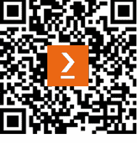

https://packt.link/free-ebook/9781836200055

# 第 1 部分：使用 Mantaflow 进行火焰、烟雾和流体模拟

为了开始我们学习 Blender 模拟的旅程，我们将研究一个名为 Mantaflow 的流体和烟雾模拟系统。逐步地，我们将学习基础知识以及创建火焰、烟雾和液体模拟所需的条件。从篝火到爆炸再到瀑布，我们将学习有关 Mantaflow 的所有知识以及如何在 Blender 中使用它。

本部分包含以下章节：

- 第 1 章，Mantaflow 简介
- 第 2 章，了解域、流和效应器
- 第 3 章，创建逼真的篝火模拟
- 第 4 章，使用 Mantaflow 创建瀑布
- 第 5 章，创建逼真的爆炸

## Mantaflow 简介

在过去五年中，**Blender** 的流行度呈惊人增长。2019 年 7 月 2.8 版本的推出吸引了大量新用户想要了解这个免费开源程序的全部内容。每天都有更多用户加入，2022 年，Blender 的下载量超过 1700 万次，另外从 Microsoft Store、Steam 和 Snap 等其他来源下载了 160 万次！

该软件包括创建 3D 模型、纹理、动画、绑定、合成、运动跟踪、游戏设计、视频编辑以及本书主题——物理模拟的完整 3D 工作流程！我们将介绍 Blender 提供的所有模拟，从液体和烟雾模拟开始。

在 Blender 中创建液体或烟雾模拟很复杂，而且刚开始时有时会相当令人沮丧。根据个人经验，通过反复试验弄清楚 Blender 中所有设置的工作原理很困难，可能需要花费大量时间。

如果您对 Blender 流体模拟器中数百个设置和值感到不知所措，请不用担心！本章的目标是让您逐步熟悉 **Mantaflow** 的使用，并帮助您基本了解创建模拟的过程。

如果您不知道，Mantaflow 是 Blender 的默认液体和烟雾模拟器。在本章中，我们将讨论它的开发过程、使用它可以创建什么内容，以及开始创建模拟所需的条件。最后，我们将一起创建一个火模拟。逐步地，我们将[content]
当我们希望引起您对代码块中某一部分的注意时，相关行或项目会以粗体显示：

```
[default]
exten => s,1,Dial(Zap/1|30)
exten => s,2,Voicemail(u100)
exten => s,102,Voicemail(b100)
exten => i,1,Voicemail(s0)
```

任何命令行输入或输出都写成如下形式：

```
$ mkdir css
$ cd css
```

**粗体：** 表示新术语、重要词语或您在屏幕上看到的词语。例如，菜单或对话框中的词语以 **粗体** 显示。以下是一个示例：“在 **第 1 帧** 上，按 K 并为画笔添加一个 **位置** 关键帧。”

> **提示或重要说明**
> 如下所示。

## 联系我们

我们非常欢迎读者的反馈。

**总体反馈：** 如果您对本书的任何方面有疑问，请发送电子邮件至 `customercare@packtpub.com`，并在邮件主题中提及书名。

**勘误：** 虽然我们已尽一切努力确保内容的准确性，但错误难免。如果您在本書中发现错误，我们将不胜感激您向我们报告。请访问 `www.packtpub.com/support/errata` 并填写表格。

**盗版：** 如果您在互联网上发现我们作品的任何形式的非法复制，我们将不胜感激您提供位置地址或网站名称。请通过 `copyright@packt.com` 联系我们并附上材料链接。

**如果您有兴趣成为作者：** 如果您在某个领域有专业知识，并且有兴趣撰写或为一本书做出贡献，请访问 `authors.packtpub.com`。

## 分享您的想法

一旦您阅读了 *以正确的方式学习 Blender 模拟*，我们很想听听您的想法！请点击此处直接前往本书在亚马逊的评论页面并分享您的反馈。

您的评论对我们和技术社区都很重要，将帮助我们确保提供优质的内容。

## 下载本书的免费 PDF 副本

感谢您购买本书！

您喜欢随时阅读，但无法随身携带印刷书籍吗？

您的电子书购买与您选择的设备不兼容吗？

不用担心，现在每本 Packt 书籍都附带一本免费的无 DRM PDF 版本。

随时随地在任何设备上阅读。从您喜爱的专业技术书籍中直接搜索、复制和粘贴代码到您的应用程序中。

福利还不止于此，您还可以每天通过电子邮件独家获取折扣、新闻通讯和优质免费内容

按照以下简单步骤获取福利：

- 1. 扫描二维码或访问下面的链接
- 2. 提交您的购买证明
- 3. 就这样！我们会直接将您的免费 PDF 和其他福利发送到您的电子邮件


https://packt.link/free-ebook/9781836200055

# 第 1 部分：使用 Mantaflow 进行火焰、烟雾和流体模拟

为了开始我们学习 Blender 模拟的旅程，我们将研究一个名为 Mantaflow 的流体和烟雾模拟系统。逐步地，我们将学习基础知识以及创建火焰、烟雾和液体模拟所需的条件。从篝火到爆炸再到瀑布，我们将学习有关 Mantaflow 的所有知识以及如何在 Blender 中使用它。

本部分包含以下章节：

- 第 1 章，Mantaflow 简介
- 第 2 章，了解域、流和效应器
- 第 3 章，创建逼真的篝火模拟
- 第 4 章，使用 Mantaflow 创建瀑布
- 第 5 章，创建逼真的爆炸

## Mantaflow 简介

在过去五年中，**Blender** 的流行度呈惊人增长。2019 年 7 月 2.8 版本的推出吸引了大量新用户想要了解这个免费开源程序的全部内容。每天都有更多用户加入，2022 年，Blender 的下载量超过 1700 万次，另外从 Microsoft Store、Steam 和 Snap 等其他来源下载了 160 万次！

该软件包括创建 3D 模型、纹理、动画、绑定、合成、运动跟踪、游戏设计、视频编辑以及本书主题——物理模拟的完整 3D 工作流程！我们将介绍 Blender 提供的所有模拟，从液体和烟雾模拟开始。

在 Blender 中创建液体或烟雾模拟很复杂，而且刚开始时有时会相当令人沮丧。根据个人经验，通过反复试验弄清楚 Blender 中所有设置的工作原理很困难，可能需要花费大量时间。

如果您对 Blender 流体模拟器中数百个设置和值感到不知所措，请不用担心！本章的目标是让您逐步熟悉 **Mantaflow** 的使用，并帮助您基本了解创建模拟的过程。

如果您不知道，Mantaflow 是 Blender 的默认液体和烟雾模拟器。在本章中，我们将讨论它的开发过程、使用它可以创建什么内容，以及开始创建模拟所需的条件。最后，我们将一起创建一个火模拟。逐步地，我们将[content]
当我们希望引起您对代码块中某一部分的注意时，相关行或项目会以粗体显示：

```
[default]
exten => s,1,Dial(Zap/1|30)
exten => s,2,Voicemail(u100)
exten => s,102,Voicemail(b100)
exten => i,1,Voicemail(s0)
```

任何命令行输入或输出都写成如下形式：

```
$ mkdir css
$ cd css
```

**粗体：** 表示新术语、重要词语或您在屏幕上看到的词语。例如，菜单或对话框中的词语以 **粗体** 显示。以下是一个示例：“在 **第 1 帧** 上，按 K 并为画笔添加一个 **位置** 关键帧。”

> **提示或重要说明**
> 如下所示。

## 联系我们

我们非常欢迎读者的反馈。

**总体反馈：** 如果您对本书的任何方面有疑问，请发送电子邮件至 `customercare@packtpub.com`，并在邮件主题中提及书名。

**勘误：** 虽然我们已尽一切努力确保内容的准确性，但错误难免。如果您在本書中发现错误，我们将不胜感激您向我们报告。请访问 `www.packtpub.com/support/errata` 并填写表格。

**盗版：** 如果您在互联网上发现我们作品的任何形式的非法复制，我们将不胜感激您提供位置地址或网站名称。请通过 `copyright@packt.com` 联系我们并附上材料链接。

**如果您有兴趣成为作者：** 如果您在某个领域有专业知识，并且有兴趣撰写或为一本书做出贡献，请访问 `authors.packtpub.com`。

## 分享您的想法

一旦您阅读了 *以正确的方式学习 Blender 模拟*，我们很想听听您的想法！请点击此处直接前往本书在亚马逊的评论页面并分享您的反馈。

您的评论对我们和技术社区都很重要，将帮助我们确保提供优质的内容。

## 下载本书的免费 PDF 副本

感谢您购买本书！

您喜欢随时阅读，但无法随身携带印刷书籍吗？

您的电子书购买与您选择的设备不兼容吗？

不用担心，现在每本 Packt 书籍都附带一本免费的无 DRM PDF 版本。

随时随地在任何设备上阅读。从您喜爱的专业技术书籍中直接搜索、复制和粘贴代码到您的应用程序中。

福利还不止于此，您还可以每天通过电子邮件独家获取折扣、新闻通讯和优质免费内容

按照以下简单步骤获取福利：

- 1. 扫描二维码或访问下面的链接
- 2. 提交您的购买证明
- 3. 就这样！我们会直接将您的免费 PDF 和其他福利发送到您的电子邮件


https://packt.link/free-ebook/9781836200055

# 第 1 部分：使用 Mantaflow 进行火焰、烟雾和流体模拟

为了开始我们学习 Blender 模拟的旅程，我们将研究一个名为 Mantaflow 的流体和烟雾模拟系统。逐步地，我们将学习基础知识以及创建火焰、烟雾和液体模拟所需的条件。从篝火到爆炸再到瀑布，我们将学习有关 Mantaflow 的所有知识以及如何在 Blender 中使用它。

本部分包含以下章节：

- 第 1 章，Mantaflow 简介
- 第 2 章，了解域、流和效应器
- 第 3 章，创建逼真的篝火模拟
- 第 4 章，使用 Mantaflow 创建瀑布
- 第 5 章，创建逼真的爆炸

## Mantaflow 简介

在过去五年中，**Blender** 的流行度呈惊人增长。2019 年 7 月 2.8 版本的推出吸引了大量新用户想要了解这个免费开源程序的全部内容。每天都有更多用户加入，2022 年，Blender 的下载量超过 1700 万次，另外从 Microsoft Store、Steam 和 Snap 等其他来源下载了 160 万次！

该软件包括创建 3D 模型、纹理、动画、绑定、合成、运动跟踪、游戏设计、视频编辑以及本书主题——物理模拟的完整 3D 工作流程！我们将介绍 Blender 提供的所有模拟，从液体和烟雾模拟开始。

在 Blender 中创建液体或烟雾模拟很复杂，而且刚开始时有时会相当令人沮丧。根据个人经验，通过反复试验弄清楚 Blender 中所有设置的工作原理很困难，可能需要花费大量时间。

如果您对 Blender 流体模拟器中数百个设置和值感到不知所措，请不用担心！本章的目标是让您逐步熟悉 **Mantaflow** 的使用，并帮助您基本了解创建模拟的过程。

如果您不知道，Mantaflow 是 Blender 的默认液体和烟雾模拟器。在本章中，我们将讨论它的开发过程、使用它可以创建什么内容，以及开始创建模拟所需的条件。最后，我们将一起创建一个火模拟。逐步地，我们将[content]
当我们希望引起您对代码块中某一部分的注意时，相关行或项目会以粗体显示：

```
[default]
exten => s,1,Dial(Zap/1|30)
exten => s,2,Voicemail(u100)
exten => s,102,Voicemail(b100)
exten => i,1,Voicemail(s0)
```

任何命令行输入或输出都写成如下形式：

```
$ mkdir css
$ cd css
```

**粗体：** 表示新术语、重要词语或您在屏幕上看到的词语。例如，菜单或对话框中的词语以 **粗体** 显示。以下是一个示例：“在 **第 1 帧** 上，按 K 并为画笔添加一个 **位置** 关键帧。”

> **提示或重要说明**
> 如下所示。

## 联系我们

我们非常欢迎读者的反馈。

**总体反馈：** 如果您对本书的任何方面有疑问，请发送电子邮件至 `customercare@packtpub.com`，并在邮件主题中提及书名。

**勘误：** 虽然我们已尽一切努力确保内容的准确性，但错误难免。如果您在本書中发现错误，我们将不胜感激您向我们报告。请访问 `www.packtpub.com/support/errata` 并填写表格。

**盗版：** 如果您在互联网上发现我们作品的任何形式的非法复制，我们将不胜感激您提供位置地址或网站名称。请通过 `copyright@packt.com` 联系我们并附上材料链接。

**如果您有兴趣成为作者：** 如果您在某个领域有专业知识，并且有兴趣撰写或为一本书做出贡献，请访问 `authors.packtpub.com`。

## 分享您的想法

一旦您阅读了 *以正确的方式学习 Blender 模拟*，我们很想听听您的想法！请点击此处直接前往本书在亚马逊的评论页面并分享您的反馈。

您的评论对我们和技术社区都很重要，将帮助我们确保提供优质的内容。

## 下载本书的免费 PDF 副本

感谢您购买本书！

您喜欢随时阅读，但无法随身携带印刷书籍吗？

您的电子书购买与您选择的设备不兼容吗？

不用担心，现在每本 Packt 书籍都附带一本免费的无 DRM PDF 版本。

随时随地在任何设备上阅读。从您喜爱的专业技术书籍中直接搜索、复制和粘贴代码到您的应用程序中。

福利还不止于此，您还可以每天通过电子邮件独家获取折扣、新闻通讯和优质免费内容

按照以下简单步骤获取福利：

- 1. 扫描二维码或访问下面的链接
- 2. 提交您的购买证明
- 3. 就这样！我们会直接将您的免费 PDF 和其他福利发送到您的电子邮件


https://packt.link/free-ebook/9781836200055

# 第 1 部分：使用 Mantaflow 进行火焰、烟雾和流体模拟

为了开始我们学习 Blender 模拟的旅程，我们将研究一个名为 Mantaflow 的流体和烟雾模拟系统。逐步地，我们将学习基础知识以及创建火焰、烟雾和液体模拟所需的条件。从篝火到爆炸再到瀑布，我们将学习有关 Mantaflow 的所有知识以及如何在 Blender 中使用它。

本部分包含以下章节：

- 第 1 章，Mantaflow 简介
- 第 2 章，了解域、流和效应器
- 第 3 章，创建逼真的篝火模拟
- 第 4 章，使用 Mantaflow 创建瀑布
- 第 5 章，创建逼真的爆炸

## Mantaflow 简介

在过去五年中，**Blender** 的流行度呈惊人增长。2019 年 7 月 2.8 版本的推出吸引了大量新用户想要了解这个免费开源程序的全部内容。每天都有更多用户加入，2022 年，Blender 的下载量超过 1700 万次，另外从 Microsoft Store、Steam 和 Snap 等其他来源下载了 160 万次！

该软件包括创建 3D 模型、纹理、动画、绑定、合成、运动跟踪、游戏设计、视频编辑以及本书主题——物理模拟的完整 3D 工作流程！我们将介绍 Blender 提供的所有模拟，从液体和烟雾模拟开始。

在 Blender 中创建液体或烟雾模拟很复杂，而且刚开始时有时会相当令人沮丧。根据个人经验，通过反复试验弄清楚 Blender 中所有设置的工作原理很困难，可能需要花费大量时间。

如果您对 Blender 流体模拟器中数百个设置和值感到不知所措，请不用担心！本章的目标是让您逐步熟悉 **Mantaflow** 的使用，并帮助您基本了解创建模拟的过程。

如果您不知道，Mantaflow 是 Blender 的默认液体和烟雾模拟器。在本章中，我们将讨论它的开发过程、使用它可以创建什么内容，以及开始创建模拟所需的条件。最后，我们将一起创建一个火模拟。逐步地，我们将[content]
当我们希望引起您对代码块中某一部分的注意时，相关行或项目会以粗体显示：

```
[default]
exten => s,1,Dial(Zap/1|30)
exten => s,2,Voicemail(u100)
exten => s,102,Voicemail(b100)
exten => i,1,Voicemail(s0)
```

任何命令行输入或输出都写成如下形式：

```
$ mkdir css
$ cd css
```

**粗体：** 表示新术语、重要词语或您在屏幕上看到的词语。例如，菜单或对话框中的词语以 **粗体** 显示。以下是一个示例：“在 **第 1 帧** 上，按 K 并为画笔添加一个 **位置** 关键帧。”

> **提示或重要说明**
> 如下所示。

## 联系我们

我们非常欢迎读者的反馈。

**总体反馈：** 如果您对本书的任何方面有疑问，请发送电子邮件至 `customercare@packtpub.com`，并在邮件主题中提及书名。

**勘误：** 虽然我们已尽一切努力确保内容的准确性，但错误难免。如果您在本書中发现错误，我们将不胜感激您向我们报告。请访问 `www.packtpub.com/support/errata` 并填写表格。

**盗版：** 如果您在互联网上发现我们作品的任何形式的非法复制，我们将不胜感激您提供位置地址或网站名称。请通过 `copyright@packt.com` 联系我们并附上材料链接。

**如果您有兴趣成为作者：** 如果您在某个领域有专业知识，并且有兴趣撰写或为一本书做出贡献，请访问 `authors.packtpub.com`。

## 分享您的想法

一旦您阅读了 *以正确的方式学习 Blender 模拟*，我们很想听听您的想法！请点击此处直接前往本书在亚马逊的评论页面并分享您的反馈。

您的评论对我们和技术社区都很重要，将帮助我们确保提供优质的内容。

## 下载本书的免费 PDF 副本

感谢您购买本书！

您喜欢随时阅读，但无法随身携带印刷书籍吗？

您的电子书购买与您选择的设备不兼容吗？

不用担心，现在每本 Packt 书籍都附带一本免费的无 DRM PDF 版本。

随时随地在任何设备上阅读。从您喜爱的专业技术书籍中直接搜索、复制和粘贴代码到您的应用程序中。

福利还不止于此，您还可以每天通过电子邮件独家获取折扣、新闻通讯和优质免费内容

按照以下简单步骤获取福利：

- 1. 扫描二维码或访问下面的链接
- 2. 提交您的购买证明
- 3. 就这样！我们会直接将您的免费 PDF 和其他福利发送到您的电子邮件


https://packt.link/free-ebook/9781836200055

# 第 1 部分：使用 Mantaflow 进行火焰、烟雾和流体模拟

为了开始我们学习 Blender 模拟的旅程，我们将研究一个名为 Mantaflow 的流体和烟雾模拟系统。逐步地，我们将学习基础知识以及创建火焰、烟雾和液体模拟所需的条件。从篝火到爆炸再到瀑布，我们将学习有关 Mantaflow 的所有知识以及如何在 Blender 中使用它。

本部分包含以下章节：

- 第 1 章，Mantaflow 简介
- 第 2 章，了解域、流和效应器
- 第 3 章，创建逼真的篝火模拟
- 第 4 章，使用 Mantaflow 创建瀑布
- 第 5 章，创建逼真的爆炸

## Mantaflow 简介

在过去五年中，**Blender** 的流行度呈惊人增长。2019 年 7 月 2.8 版本的推出吸引了大量新用户想要了解这个免费开源程序的全部内容。每天都有更多用户加入，2022 年，Blender 的下载量超过 1700 万次，另外从 Microsoft Store、Steam 和 Snap 等其他来源下载了 160 万次！

该软件包括创建 3D 模型、纹理、动画、绑定、合成、运动跟踪、游戏设计、视频编辑以及本书主题——物理模拟的完整 3D 工作流程！我们将介绍 Blender 提供的所有模拟，从液体和烟雾模拟开始。

在 Blender 中创建液体或烟雾模拟很复杂，而且刚开始时有时会相当令人沮丧。根据个人经验，通过反复试验弄清楚 Blender 中所有设置的工作原理很困难，可能需要花费大量时间。

如果您对 Blender 流体模拟器中数百个设置和值感到不知所措，请不用担心！本章的目标是让您逐步熟悉 **Mantaflow** 的使用，并帮助您基本了解创建模拟的过程。

如果您不知道，Mantaflow 是 Blender 的默认液体和烟雾模拟器。在本章中，我们将讨论它的开发过程、使用它可以创建什么内容，以及开始创建模拟所需的条件。最后，我们将一起创建一个火模拟。逐步地，我们将[content]
当我们希望引起您对代码块中某一部分的注意时，相关行或项目会以粗体显示：

```
[default]
exten => s,1,Dial(Zap/1|30)
exten => s,2,Voicemail(u100)
exten => s,102,Voicemail(b100)
exten => i,1,Voicemail(s0)
```

任何命令行输入或输出都写成如下形式：

```
$ mkdir css
$ cd css
```

**粗体：** 表示新术语、重要词语或您在屏幕上看到的词语。例如，菜单或对话框中的词语以 **粗体** 显示。以下是一个示例：“在 **第 1 帧** 上，按 K 并为画笔添加一个 **位置** 关键帧。”

> **提示或重要说明**
> 如下所示。

## 联系我们

我们非常欢迎读者的反馈。

**总体反馈：** 如果您对本书的任何方面有疑问，请发送电子邮件至 `customercare@packtpub.com`，并在邮件主题中提及书名。

**勘误：** 虽然我们已尽一切努力确保内容的准确性，但错误难免。如果您在本書中发现错误，我们将不胜感激您向我们报告。请访问 `www.packtpub.com/support/errata` 并填写表格。

**盗版：** 如果您在互联网上发现我们作品的任何形式的非法复制，我们将不胜感激您提供位置地址或网站名称。请通过 `copyright@packt.com` 联系我们并附上材料链接。

**如果您有兴趣成为作者：** 如果您在某个领域有专业知识，并且有兴趣撰写或为一本书做出贡献，请访问 `authors.packtpub.com`。

## 分享您的想法

一旦您阅读了 *以正确的方式学习 Blender 模拟*，我们很想听听您的想法！请点击此处直接前往本书在亚马逊的评论页面并分享您的反馈。

您的评论对我们和技术社区都很重要，将帮助我们确保提供优质的内容。

## 下载本书的免费 PDF 副本

感谢您购买本书！

您喜欢随时阅读，但无法随身携带印刷书籍吗？

您的电子书购买与您选择的设备不兼容吗？

不用担心，现在每本 Packt 书籍都附带一本免费的无 DRM PDF 版本。

随时随地在任何设备上阅读。从您喜爱的专业技术书籍中直接搜索、复制和粘贴代码到您的应用程序中。

福利还不止于此，您还可以每天通过电子邮件独家获取折扣、新闻通讯和优质免费内容

按照以下简单步骤获取福利：

- 1. 扫描二维码或访问下面的链接
- 2. 提交您的购买证明
- 3. 就这样！我们会直接将您的免费 PDF 和其他福利发送到您的电子邮件


https://packt.link/free-ebook/9781836200055

# 第 1 部分：使用 Mantaflow 进行火焰、烟雾和流体模拟

为了开始我们学习 Blender 模拟的旅程，我们将研究一个名为 Mantaflow 的流体和烟雾模拟系统。逐步地，我们将学习基础知识以及创建火焰、烟雾和液体模拟所需的条件。从篝火到爆炸再到瀑布，我们将学习有关 Mantaflow 的所有知识以及如何在 Blender 中使用它。

本部分包含以下章节：

- 第 1 章，Mantaflow 简介
- 第 2 章，了解域、流和效应器
- 第 3 章，创建逼真的篝火模拟
- 第 4 章，使用 Mantaflow 创建瀑布
- 第 5 章，创建逼真的爆炸

## Mantaflow 简介

在过去五年中，**Blender** 的流行度呈惊人增长。2019 年 7 月 2.8 版本的推出吸引了大量新用户想要了解这个免费开源程序的全部内容。每天都有更多用户加入，2022 年，Blender 的下载量超过 1700 万次，另外从 Microsoft Store、Steam 和 Snap 等其他来源下载了 160 万次！

该软件包括创建 3D 模型、纹理、动画、绑定、合成、运动跟踪、游戏设计、视频编辑以及本书主题——物理模拟的完整 3D 工作流程！我们将介绍 Blender 提供的所有模拟，从液体和烟雾模拟开始。

在 Blender 中创建液体或烟雾模拟很复杂，而且刚开始时有时会相当令人沮丧。根据个人经验，通过反复试验弄清楚 Blender 中所有设置的工作原理很困难，可能需要花费大量时间。

如果您对 Blender 流体模拟器中数百个设置和值感到不知所措，请不用担心！本章的目标是让您逐步熟悉 **Mantaflow** 的使用，并帮助您基本了解创建模拟的过程。

如果您不知道，Mantaflow 是 Blender 的默认液体和烟雾模拟器。在本章中，我们将讨论它的开发过程、使用它可以创建什么内容，以及开始创建模拟所需的条件。最后，我们将一起创建一个火模拟。逐步地，我们将[content]
当我们希望引起您对代码块中某一部分的注意时，相关行或项目会以粗体显示：

```
[default]
exten => s,1,Dial(Zap/1|30)
exten => s,2,Voicemail(u100)
exten => s,102,Voicemail(b100)
exten => i,1,Voicemail(s0)
```

任何命令行输入或输出都写成如下形式：

```
$ mkdir css
$ cd css
```

**粗体：** 表示新术语、重要词语或您在屏幕上看到的词语。例如，菜单或对话框中的词语以 **粗体** 显示。以下是一个示例：“在 **第 1 帧** 上，按 K 并为画笔添加一个 **位置** 关键帧。”

> **提示或重要说明**
> 如下所示。

## 联系我们

我们非常欢迎读者的反馈。

**总体反馈：** 如果您对本书的任何方面有疑问，请发送电子邮件至 `customercare@packtpub.com`，并在邮件主题中提及书名。

**勘误：** 虽然我们已尽一切努力确保内容的准确性，但错误难免。如果您在本書中发现错误，我们将不胜感激您向我们报告。请访问 `www.packtpub.com/support/errata` 并填写表格。

**盗版：** 如果您在互联网上发现我们作品的任何形式的非法复制，我们将不胜感激您提供位置地址或网站名称。请通过 `copyright@packt.com` 联系我们并附上材料链接。

**如果您有兴趣成为作者：** 如果您在某个领域有专业知识，并且有兴趣撰写或为一本书做出贡献，请访问 `authors.packtpub.com`。

## 分享您的想法

一旦您阅读了 *以正确的方式学习 Blender 模拟*，我们很想听听您的想法！请点击此处直接前往本书在亚马逊的评论页面并分享您的反馈。

您的评论对我们和技术社区都很重要，将帮助我们确保提供优质的内容。

## 下载本书的免费 PDF 副本

感谢您购买本书！

您喜欢随时阅读，但无法随身携带印刷书籍吗？

您的电子书购买与您选择的设备不兼容吗？

不用担心，现在每本 Packt 书籍都附带一本免费的无 DRM PDF 版本。

随时随地在任何设备上阅读。从您喜爱的专业技术书籍中直接搜索、复制和粘贴代码到您的应用程序中。

福利还不止于此，您还可以每天通过电子邮件独家获取折扣、新闻通讯和优质免费内容

按照以下简单步骤获取福利：

- 1. 扫描二维码或访问下面的链接
- 2. 提交您的购买证明
- 3. 就这样！我们会直接将您的免费 PDF 和其他福利发送到您的电子邮件


https://packt.link/free-ebook/9781836200055

# 第 1 部分：使用 Mantaflow 进行火焰、烟雾和流体模拟

为了开始我们学习 Blender 模拟的旅程，我们将研究一个名为 Mantaflow 的流体和烟雾模拟系统。逐步地，我们将学习基础知识以及创建火焰、烟雾和液体模拟所需的条件。从篝火到爆炸再到瀑布，我们将学习有关 Mantaflow 的所有知识以及如何在 Blender 中使用它。

本部分包含以下章节：

- 第 1 章，Mantaflow 简介
- 第 2 章，了解域、流和效应器
- 第 3 章，创建逼真的篝火模拟
- 第 4 章，使用 Mantaflow 创建瀑布
- 第 5 章，创建逼真的爆炸

## Mantaflow 简介

在过去五年中，**Blender** 的流行度呈惊人增长。2019 年 7 月 2.8 版本的推出吸引了大量新用户想要了解这个免费开源程序的全部内容。每天都有更多用户加入，2022 年，Blender 的下载量超过 1700 万次，另外从 Microsoft Store、Steam 和 Snap 等其他来源下载了 160 万次！

该软件包括创建 3D 模型、纹理、动画、绑定、合成、运动跟踪、游戏设计、视频编辑以及本书主题——物理模拟的完整 3D 工作流程！我们将介绍 Blender 提供的所有模拟，从液体和烟雾模拟开始。

在 Blender 中创建液体或烟雾模拟很复杂，而且刚开始时有时会相当令人沮丧。根据个人经验，通过反复试验弄清楚 Blender 中所有设置的工作原理很困难，可能需要花费大量时间。

如果您对 Blender 流体模拟器中数百个设置和值感到不知所措，请不用担心！本章的目标是让您逐步熟悉 **Mantaflow** 的使用，并帮助您基本了解创建模拟的过程。

如果您不知道，Mantaflow 是 Blender 的默认液体和烟雾模拟器。在本章中，我们将讨论它的开发过程、使用它可以创建什么内容，以及开始创建模拟所需的条件。最后，我们将一起创建一个火模拟。逐步地，我们将[content]
当我们希望引起您对代码块中某一部分的注意时，相关行或项目会以粗体显示：

```
[default]
exten => s,1,Dial(Zap/1|30)
exten => s,2,Voicemail(u100)
exten => s,102,Voicemail(b100)
exten => i,1,Voicemail(s0)
```

任何命令行输入或输出都写成如下形式：

```
$ mkdir css
$ cd css
```

**粗体：** 表示新术语、重要词语或您在屏幕上看到的词语。例如，菜单或对话框中的词语以 **粗体** 显示。以下是一个示例：“在 **第 1 帧** 上，按 K 并为画笔添加一个 **位置** 关键帧。”

> **提示或重要说明**
> 如下所示。

## 联系我们

我们非常欢迎读者的反馈。

**总体反馈：** 如果您对本书的任何方面有疑问，请发送电子邮件至 `customercare@packtpub.com`，并在邮件主题中提及书名。

**勘误：** 虽然我们已尽一切努力确保内容的准确性，但错误难免。如果您在本書中发现错误，我们将不胜感激您向我们报告。请访问 `www.packtpub.com/support/errata` 并填写表格。

**盗版：** 如果您在互联网上发现我们作品的任何形式的非法复制，我们将不胜感激您提供位置地址或网站名称。请通过 `copyright@packt.com` 联系我们并附上材料链接。

**如果您有兴趣成为作者：** 如果您在某个领域有专业知识，并且有兴趣撰写或为一本书做出贡献，请访问 `authors.packtpub.com`。

## 分享您的想法

一旦您阅读了 *以正确的方式学习 Blender 模拟*，我们很想听听您的想法！请点击此处直接前往本书在亚马逊的评论页面并分享您的反馈。

您的评论对我们和技术社区都很重要，将帮助我们确保提供优质的内容。

## 下载本书的免费 PDF 副本

感谢您购买本书！

您喜欢随时阅读，但无法随身携带印刷书籍吗？

您的电子书购买与您选择的设备不兼容吗？

不用担心，现在每本 Packt 书籍都附带一本免费的无 DRM PDF 版本。

随时随地在任何设备上阅读。从您喜爱的专业技术书籍中直接搜索、复制和粘贴代码到您的应用程序中。

福利还不止于此，您还可以每天通过电子邮件独家获取折扣、新闻通讯和优质免费内容

按照以下简单步骤获取福利：

- 1. 扫描二维码或访问下面的链接
- 2. 提交您的购买证明
- 3. 就这样！我们会直接将您的免费 PDF 和其他福利发送到您的电子邮件


https://packt.link/free-ebook/9781836200055

# 第 1 部分：使用 Mantaflow 进行火焰、烟雾和流体模拟

为了开始我们学习 Blender 模拟的旅程，我们将研究一个名为 Mantaflow 的流体和烟雾模拟系统。逐步地，我们将学习基础知识以及创建火焰、烟雾和液体模拟所需的条件。从篝火到爆炸再到瀑布，我们将学习有关 Mantaflow 的所有知识以及如何在 Blender 中使用它。

本部分包含以下章节：

- 第 1 章，Mantaflow 简介
- 第 2 章，了解域、流和效应器
- 第 3 章，创建逼真的篝火模拟
- 第 4 章，使用 Mantaflow 创建瀑布
- 第 5 章，创建逼真的爆炸

## Mantaflow 简介

在过去五年中，**Blender** 的流行度呈惊人增长。2019 年 7 月 2.8 版本的推出吸引了大量新用户想要了解这个免费开源程序的全部内容。每天都有更多用户加入，2022 年，Blender 的下载量超过 1700 万次，另外从 Microsoft Store、Steam 和 Snap 等其他来源下载了 160 万次！

该软件包括创建 3D 模型、纹理、动画、绑定、合成、运动跟踪、游戏设计、视频编辑以及本书主题——物理模拟的完整 3D 工作流程！我们将介绍 Blender 提供的所有模拟，从液体和烟雾模拟开始。

在 Blender 中创建液体或烟雾模拟很复杂，而且刚开始时有时会相当令人沮丧。根据个人经验，通过反复试验弄清楚 Blender 中所有设置的工作原理很困难，可能需要花费大量时间。

如果您对 Blender 流体模拟器中数百个设置和值感到不知所措，请不用担心！本章的目标是让您逐步熟悉 **Mantaflow** 的使用，并帮助您基本了解创建模拟的过程。

如果您不知道，Mantaflow 是 Blender 的默认液体和烟雾模拟器。在本章中，我们将讨论它的开发过程、使用它可以创建什么内容，以及开始创建模拟所需的条件。最后，我们将一起创建一个火模拟。逐步地，我们将[content]
当我们希望引起您对代码块中某一部分的注意时，相关行或项目会以粗体显示：

```
[default]
exten => s,1,Dial(Zap/1|30)
exten => s,2,Voicemail(u100)
exten => s,102,Voicemail(b100)
exten => i,1,Voicemail(s0)
```

任何命令行输入或输出都写成如下形式：

```
$ mkdir css
$ cd css
```

**粗体：** 表示新术语、重要词语或您在屏幕上看到的词语。例如，菜单或对话框中的词语以 **粗体** 显示。以下是一个示例：“在 **第 1 帧** 上，按 K 并为画笔添加一个 **位置** 关键帧。”

> **提示或重要说明**
> 如下所示。

## 联系我们

我们非常欢迎读者的反馈。

**总体反馈：** 如果您对本书的任何方面有疑问，请发送电子邮件至 `customercare@packtpub.com`，并在邮件主题中提及书名。

**勘误：** 虽然我们已尽一切努力确保内容的准确性，但错误难免。如果您在本書中发现错误，我们将不胜感激您向我们报告。请访问 `www.packtpub.com/support/errata` 并填写表格。

**盗版：** 如果您在互联网上发现我们作品的任何形式的非法复制，我们将不胜感激您提供位置地址或网站名称。请通过 `copyright@packt.com` 联系我们并附上材料链接。

**如果您有兴趣成为作者：** 如果您在某个领域有专业知识，并且有兴趣撰写或为一本书做出贡献，请访问 `authors.packtpub.com`。

## 分享您的想法

一旦您阅读了 *以正确的方式学习 Blender 模拟*，我们很想听听您的想法！请点击此处直接前往本书在亚马逊的评论页面并分享您的反馈。

您的评论对我们和技术社区都很重要，将帮助我们确保提供优质的内容。

## 下载本书的免费 PDF 副本

感谢您购买本书！

您喜欢随时阅读，但无法随身携带印刷书籍吗？

您的电子书购买与您选择的设备不兼容吗？

不用担心，现在每本 Packt 书籍都附带一本免费的无 DRM PDF 版本。

随时随地在任何设备上阅读。从您喜爱的专业技术书籍中直接搜索、复制和粘贴代码到您的应用程序中。

福利还不止于此，您还可以每天通过电子邮件独家获取折扣、新闻通讯和优质免费内容

按照以下简单步骤获取福利：

- 1. 扫描二维码或访问下面的链接
- 2. 提交您的购买证明
- 3. 就这样！我们会直接将您的免费 PDF 和其他福利发送到您的电子邮件


https://packt.link/free-ebook/9781836200055

# 第 1 部分：使用 Mantaflow 进行火焰、烟雾和流体模拟

为了开始我们学习 Blender 模拟的旅程，我们将研究一个名为 Mantaflow 的流体和烟雾模拟系统。逐步地，我们将学习基础知识以及创建火焰、烟雾和液体模拟所需的条件。从篝火到爆炸再到瀑布，我们将学习有关 Mantaflow 的所有知识以及如何在 Blender 中使用它。

本部分包含以下章节：

- 第 1 章，Mantaflow 简介
- 第 2 章，了解域、流和效应器
- 第 3 章，创建逼真的篝火模拟
- 第 4 章，使用 Mantaflow 创建瀑布
- 第 5 章，创建逼真的爆炸

## Mantaflow 简介

在过去五年中，**Blender** 的流行度呈惊人增长。2019 年 7 月 2.8 版本的推出吸引了大量新用户想要了解这个免费开源程序的全部内容。每天都有更多用户加入，2022 年，Blender 的下载量超过 1700 万次，另外从 Microsoft Store、Steam 和 Snap 等其他来源下载了 160 万次！

该软件包括创建 3D 模型、纹理、动画、绑定、合成、运动跟踪、游戏设计、视频编辑以及本书主题——物理模拟的完整 3D 工作流程！我们将介绍 Blender 提供的所有模拟，从液体和烟雾模拟开始。

在 Blender 中创建液体或烟雾模拟很复杂，而且刚开始时有时会相当令人沮丧。根据个人经验，通过反复试验弄清楚 Blender 中所有设置的工作原理很困难，可能需要花费大量时间。

如果您对 Blender 流体模拟器中数百个设置和值感到不知所措，请不用担心！本章的目标是让您逐步熟悉 **Mantaflow** 的使用，并帮助您基本了解创建模拟的过程。

如果您不知道，Mantaflow 是 Blender 的默认液体和烟雾模拟器。在本章中，我们将讨论它的开发过程、使用它可以创建什么内容，以及开始创建模拟所需的条件。最后，我们将一起创建一个火模拟。逐步地，我们将[content]
当我们希望引起您对代码块中某一部分的注意时，相关行或项目会以粗体显示：

```
[default]
exten => s,1,Dial(Zap/1|30)
exten => s,2,Voicemail(u100)
exten => s,102,Voicemail(b100)
exten => i,1,Voicemail(s0)
```

任何命令行输入或输出都写成如下形式：

```
$ mkdir css
$ cd css
```

**粗体：** 表示新术语、重要词语或您在屏幕上看到的词语。例如，菜单或对话框中的词语以 **粗体** 显示。以下是一个示例：“在 **第 1 帧** 上，按 K 并为画笔添加一个 **位置** 关键帧。”

> **提示或重要说明**
> 如下所示。

## 联系我们

我们非常欢迎读者的反馈。

**总体反馈：** 如果您对本书的任何方面有疑问，请发送电子邮件至 `customercare@packtpub.com`，并在邮件主题中提及书名。

**勘误：** 虽然我们已尽一切努力确保内容的准确性，但错误难免。如果您在本書中发现错误，我们将不胜感激您向我们报告。请访问 `www.packtpub.com/support/errata` 并填写表格。

**盗版：** 如果您在互联网上发现我们作品的任何形式的非法复制，我们将不胜感激您提供位置地址或网站名称。请通过 `copyright@packt.com` 联系我们并附上材料链接。

**如果您有兴趣成为作者：** 如果您在某个领域有专业知识，并且有兴趣撰写或为一本书做出贡献，请访问 `authors.packtpub.com`。

## 分享您的想法

一旦您阅读了 *以正确的方式学习 Blender 模拟*，我们很想听听您的想法！请点击此处直接前往本书在亚马逊的评论页面并分享您的反馈。

您的评论对我们和技术社区都很重要，将帮助我们确保提供优质的内容。

## 下载本书的免费 PDF 副本

感谢您购买本书！

您喜欢随时阅读，但无法随身携带印刷书籍吗？

您的电子书购买与您选择的设备不兼容吗？

不用担心，现在每本 Packt 书籍都附带一本免费的无 DRM PDF 版本。

随时随地在任何设备上阅读。从您喜爱的专业技术书籍中直接搜索、复制和粘贴代码到您的应用程序中。

福利还不止于此，您还可以每天通过电子邮件独家获取折扣、新闻通讯和优质免费内容

按照以下简单步骤获取福利：

- 1. 扫描二维码或访问下面的链接
- 2. 提交您的购买证明
- 3. 就这样！我们会直接将您的免费 PDF 和其他福利发送到您的电子邮件


https://packt.link/free-ebook/9781836200055

# 第 1 部分：使用 Mantaflow 进行火焰、烟雾和流体模拟

为了开始我们学习 Blender 模拟的旅程，我们将研究一个名为 Mantaflow 的流体和烟雾模拟系统。一 步一步地，我们将学习基础知识以及创建火焰、烟雾和液体模拟所需的条件。从篝火到爆炸再到瀑布，我们将学习有关 Mantaflow 的所有知识以及如何在 Blender 中使用它。

本部分包含以下章节：

- 第 1 章，Mantaflow 简介
- 第 2 章，了解域、流和效应器
- 第 3 章，创建逼真的篝火模拟
- 第 4 章，使用 Mantaflow 创建瀑布
- 第 5 章，创建逼真的爆炸

## Mantaflow 简介

在过去五年中，**Blender** 的流行度呈惊人增长。2019 年 7 月 2.8 版本的推出吸引了大量新用户想要了解这个免费开源程序的全部内容。每天都有更多用户加入，2022 年，Blender 的下载量超过 1700 万次，另外从 Microsoft Store、Steam 和 Snap 等其他来源下载了 160 万次！

该软件包括创建 3D 模型、纹理、动画、绑定、合成、运动跟踪、游戏设计、视频编辑以及本书主题——物理模拟的完整 3D 工作流程！我们将介绍 Blender 提供的所有模拟，从液体和烟雾模拟开始。

在 Blender 中创建液体或烟雾模拟很复杂，而且刚开始时有时会相当令人沮丧。根据个人经验，通过反复试验弄清楚 Blender 中所有设置的工作原理很困难，可能需要花费大量时间。

如果您对 Blender 流体模拟器中数百个设置和值感到不知所措，请不用担心！本章的目标是让您逐步熟悉 **Mantaflow** 的使用，并帮助您基本了解创建模拟的过程。

如果您不知道，Mantaflow 是 Blender 的默认液体和烟雾模拟器。在本章中，我们将讨论它的开发过程、使用它可以创建什么内容，以及开始创建模拟所需的条件。最后，我们将一起创建一个火模拟。一 步一步地，我们会[content]
当我们希望引起您对代码块中某一部分的注意时，相关行或项目会以粗体显示：

```
[default]
exten => s,1,Dial(Zap/1|30)
exten => s,2,Voicemail(u100)
exten => s,102,Voicemail(b100)
exten => i,1,Voicemail(s0)
```

任何命令行输入或输出都写成如下形式：

```
$ mkdir css
$ cd css
```

**粗体：** 表示新术语、重要词语或您在屏幕上看到的词语。例如，菜单或对话框中的词语以 **粗体** 显示。以下是一个示例：“在 **第 1 帧** 上，按 K 并为画笔添加一个 **位置** 关键帧。”

> **提示或重要说明**
> 如下所示。

## 联系我们

我们非常欢迎读者的反馈。

**总体反馈：** 如果您对本书的任何方面有疑问，请发送电子邮件至 `customercare@packtpub.com`，并在邮件主题中提及书名。

**勘误：** 虽然我们已尽一切努力确保内容的准确性，但错误难免。如果您在本書中发现错误，我们将不胜感激您向我们报告。请访问 `www.packtpub.com/support/errata` 并填写表格。

**盗版：** 如果您在互联网上发现我们作品的任何形式的非法复制，我们将不胜感激您提供位置地址或网站名称。请通过 `copyright@packt.com` 联系我们并附上材料链接。

**如果您有兴趣成为作者：** 如果您在某个领域有专业知识，并且有兴趣撰写或为一本书做出贡献，请访问 `authors.packtpub.com`。

## 分享您的想法

一旦您阅读了 *以正确的方式学习 Blender 模拟*，我们很想听听您的想法！请点击此处直接前往本书在亚马逊的评论页面并分享您的反馈。

您的评论对我们和技术社区都很重要，将帮助我们确保提供优质的内容。

## 下载本书的免费 PDF 副本

感谢您购买本书！

您喜欢随时阅读，但无法随身携带印刷书籍吗？

您的电子书购买与您选择的设备不兼容吗？

不用担心，现在每本 Packt 书籍都附带一本免费的无 DRM PDF 版本。

随时随地在任何设备上阅读。从您喜爱的专业技术书籍中直接搜索、复制和粘贴代码到您的应用程序中。

福利还不止于此，您还可以每天通过电子邮件独家获取折扣、新闻通讯和优质免费内容

按照以下简单步骤获取福利：

- 1. 扫描二维码或访问下面的链接
- 2. 提交您的购买证明
- 3. 就这样！我们会直接将您的免费 PDF 和其他福利发送到您的电子邮件


https://packt.link/free-ebook/9781836200055

# 第 1 部分：使用 Mantaflow 进行火焰、烟雾和流体模拟

为了开始我们学习 Blender 模拟的旅程，我们将研究一个名为 Mantaflow 的流体和烟雾模拟系统。一 步一步地，我们将学习基础知识以及创建火焰、烟雾和液体模拟所需的条件。从篝火到爆炸再到瀑布，我们将学习有关 Mantaflow 的所有知识以及如何在 Blender 中使用它。

本部分包含以下章节：

- 第 1 章，Mantaflow 简介
- 第 2 章，了解域、流和效应器
- 第 3 章，创建逼真的篝火模拟
- 第 4 章，使用 Mantaflow 创建瀑布
- 第 5 章，创建逼真的爆炸

## Mantaflow 简介

在过去五年中，**Blender** 的流行度呈惊人增长。2019 年 7 月 2.8 版本的推出吸引了大量新用户想要了解这个免费开源程序的全部内容。每天都有更多用户加入，2022 年，Blender 的下载量超过 1700 万次，另外从 Microsoft Store、Steam 和 Snap 等其他来源下载了 160 万次！

该软件包括创建 3D 模型、纹理、动画、绑定、合成、运动跟踪、游戏设计、视频编辑以及本书主题——物理模拟的完整 3D 工作流程！我们将介绍 Blender 提供的所有模拟，从液体和烟雾模拟开始。

在 Blender 中创建液体或烟雾模拟很复杂，而且刚开始时有时会相当令人沮丧。根据个人经验，通过反复试验弄清楚 Blender 中所有设置的工作原理很困难，可能需要花费大量时间。

如果您对 Blender 流体模拟器中数百个设置和值感到不知所措，请不用担心！本章的目标是让您逐步熟悉 **Mantaflow** 的使用，并帮助您基本了解创建模拟的过程。

如果您不知道，Mantaflow 是 Blender 的默认液体和烟雾模拟器。在本章中，我们将讨论它的开发过程、使用它可以创建什么内容，以及开始创建模拟所需的条件。最后，我们将一起创建一个火模拟。一 步一步地，我们会[content]
在本章中，我们将介绍以下主题：

- 什么是 Mantaflow？
- 气体和液体模拟
- 创建模拟所需的条件
- 创建您的第一个模拟

### 技术要求

本章要求您已安装 Blender 4.2 或更高版本。要下载 Blender，请访问 www.blender.org。

您可以在本书的 GitHub 仓库中找到本章的资源：https://github.com/PacktPublishing/Learn-Blender-4-Simulations-the-Right-Way/tree/main/Chapter%201。

### 什么是 Mantaflow？

Mantaflow 是 Blender 中用于模拟气体和液体的框架。Mantaflow 于 Blender 2.82 中引入，此后不断更新。它最早于 2009 年在 ETH 计算机图形实验室开发。现在，它由慕尼黑工业大学 Thurey 小组维护和开发。

在 Blender 2.81 及更早版本中，烟雾和流体模拟是两个完全不同的东西，并且彼此兼容性不佳。2.82 发布时，Blender 开发者移除了这两个模拟并引入了 Mantaflow。这是一个更好的系统，因为它将流体和烟雾模拟合并为一个。

要在对象上启用 Mantaflow，您需要前往物理属性区域（它看起来像中间有一个点的圆圈）并选择流体：

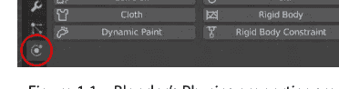

图 1.1 – Blender 的物理属性区域

不要在 Blender 的物理面板中只看到流体时感到困惑。流体只是用于整体模拟的名称。一旦选择它，您就可以在气体或液体之间进行选择。

现在我们已经介绍了什么是 Mantaflow，让我们看看在 Blender 中可以使用它创建哪些模拟！

### 气体和液体模拟

您可能已经听我说过气体、液体和流体这些术语，但它们有什么区别？如前所述，流体用于描述整个模拟。在模拟内部，有两个选项可供选择：

- 气体：用于创建烟雾、火焰或空气中固体等事物
- 液体：用于模拟水或蜂蜜等事物

让我们分别讨论每一种，以便您了解它们之间的差异以及各自的工作原理。

### 气体模拟

气体模拟允许您在 Blender 中创建烟雾和火焰。但您能用它做什么呢？例如，您可以结合火焰和烟雾创建大规模爆炸。其他示例可能包括火焰喷射器、篝火、蒸汽、薄雾或雾。

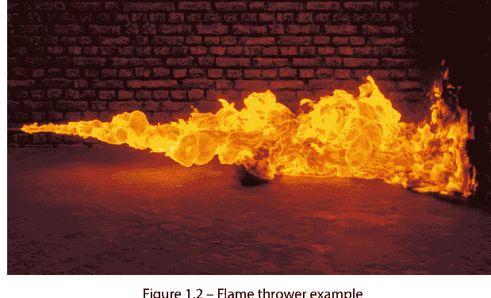

图 1.2 – 火焰喷射器示例

您可以创建的东西非常多，可能性几乎无穷无尽。下图显示了我们在 *第 5 章* 中将学习创建的内容：

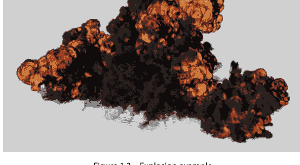

图 1.3 – 爆炸示例


烟雾和火焰模拟由我们所称的 **体素** 组成。你可以把体素想象成模拟的 3D 像素。像素越小，模拟看起来越好。你可以通过提高模拟的 **分辨率** 来改变这些体素的大小。较高的数值会使模拟更详细，但会导致模拟运行更慢、烘焙时间更长：

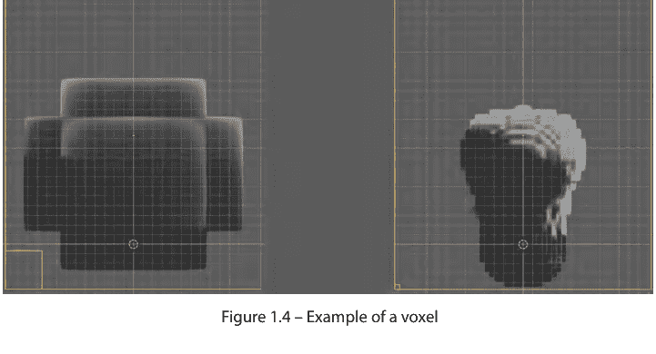

图 1.4 – 体素示例

在前面的截图中，左侧模拟的分辨率为 8。这个数值相当小，所以体素非常大。右侧的模拟分辨率为 64，如你所见，体素尺寸小得多。你也可以通过查看 **域** 对象的左下角来判断体素的大小：

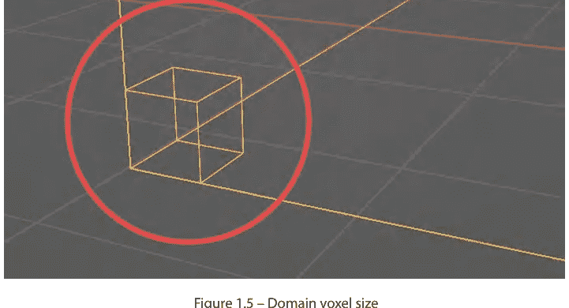

图 1.5 – 域体素大小

域是整个模拟的容器。我们将在 *创建模拟所需的内容* 部分详细介绍它们。

这些体素代表模拟的所有属性，如热量、密度、温度和速度，仅举几例。

> **什么是属性？**
> 
> 属性只是一个用来描述正在存储的数据的术语。你可以取用这些数据来影响材质、修改器等。

域中产生的烟雾可以来自 **网格** 或 **粒子系统**。这些发射烟雾的对象称为 **流**。流用于向域中添加或移除烟雾。使用粒子系统作为发射器，你可以轻松创建爆炸，我们将在 *第 5 章* 中学习。

烟雾或流体的运动由气流控制。这种气流可以通过以下属性进行控制：

- **密度和热量**：这些值在域对象的设置中。这些值控制烟雾上升的速度。
- **影响器**：这些是网格对象，会与烟雾发生碰撞，限制其运动。
- **流**：这些对象会影响流体运动的快慢。
- **力场**：这些也提供了一种影响烟雾运动的方式。根据添加的力场，你可以让模拟看起来更具动态性和趣味性！例如，**风** 力场会在你指向的方向上施加恒定力。这对于为烟雾添加一点运动，使其看起来更有趣非常有用！

现在我们已经介绍了气体模拟，让我们谈谈液体模拟。

## 液体模拟

液体模拟非常强大，你可以用它们做很多事情。你想让玻璃落地时爆炸，导致液体到处飞溅吗？如何创建瀑布、波浪、熔岩或蜂蜜？所有这些都可以用液体模拟实现：

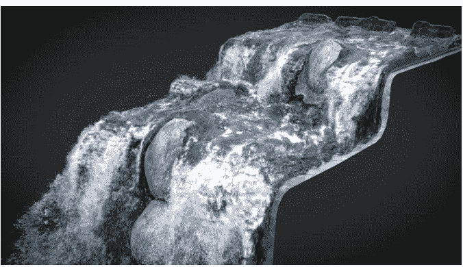

图 1.6 – 瀑布示例

这些模拟用于模拟流体的真实物理和行为。与气体模拟不同，如果你提高流体的分辨率，它会在场景中添加几何体：

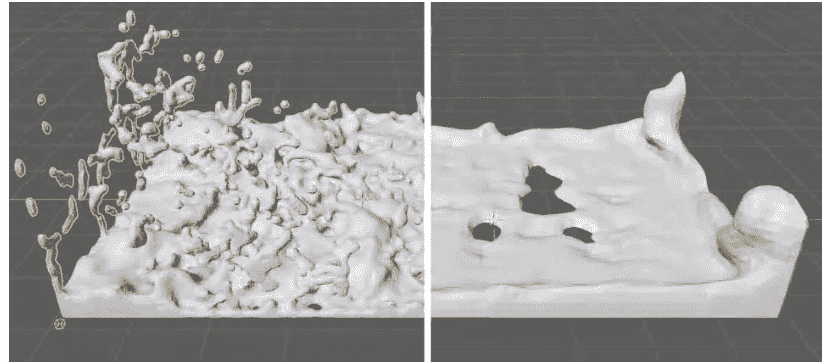

图 1.7 – 流体分辨率示例

在前面的截图中，左侧的分辨率为 96；右侧设置为 32。左侧看起来细节丰富，几何体众多，产生了大量飞溅。然而，右侧细节较低，给人低面数的外观。有时，较低的分辨率可能正是你想要的；一切取决于你想要创建的内容。

流体只能使用网格对象（如立方体、球体或平面）发射到域中。粒子系统不适用于流体模拟。

> **提高流体的分辨率会极大地改变顶点数**
> 仅将分辨率从 64 提高到 96，顶点数就从大约 8,000 增加到 200,000。这会增加场景的总内存，使 Blender 运行稍慢。你可以通过右键单击屏幕底部的 **状态栏** 区域并选择 **系统内存** 来查看场景的总内存。

气体和液体模拟都很强大，它们能让你非常轻松地创建许多不同的东西。现在我们已经介绍了它们之间的区别，让我们来看看创建模拟需要什么！

## 创建模拟所需的内容

简而言之，对于 Mantaflow 模拟，你始终需要以下两件事：

- 一个域对象
- 一个流对象

我们将更详细地介绍每一种，以及影响器，虽然不是强制性的，但仍然很有用。

## 域对象

域对象是整个模拟的容器。气体或液体不会被允许在该域之外。当模拟接近边缘时，它会根据你设置的设置发生碰撞或消失。

> **域越大，需要的分辨率就越高**
> 这会导致模拟烘焙时间更长。一般规则是让域刚好足够容纳模拟。

域对象始终是立方体的形状。即使域不是立方体，模拟也会将其视为立方体，并在原始网格之外进行模拟：

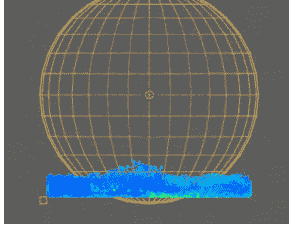

图 1.8 – 域示例

此示例中的球体是域，如你所见，流体正在网格外流动。最好只使用立方体作为任何模拟的域。正如我之前所说，你也可以通过查看左下角的小方框大小来看到模拟的分辨率。

要将域分配给网格对象，请选中它，进入物理面板，并选择 流体 | 类型 | 域。

## 流对象

流对象用于在模拟中向域添加或移除流体。需要注意的是，流对象需要在域内才能正确模拟；放在域外将不起作用。

与域不同，流对象可以是任何形状，但它必须是网格对象。这意味着曲线、metaballs、空对象或类似的对象将无法工作：

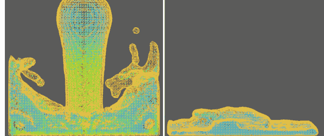

图 1.9 – 流示例

我们将在 *第 2 章* 中详细介绍流对象，但我想提供这个示例，以便你了解它们的工作原理。在流的属性中，你可以更改其 **行为**。你可以从三个选项中选择。这会影响烟雾/流体如何发射到域中：

- **流入**：这将不断向模拟中添加流体（*图 1.9* 左侧）。
- **几何体**：添加的流体基于网格本身的确切几何体量（*图 1.9* 右侧）。
- **流出**：这将删除流体。

要分配流对象，请前往 **物理** | **流体** | **类型** | **流**。

## 影响器

影响器对象可用于与液体或烟雾发生碰撞，限制模拟的运动，并在过程中产生有趣的结果。另一种使用影响器的方式是将其设置为 **引导影响器**。引导基本上允许你改变模拟的速度和运动。它们有点复杂，所以我们将留到 *第 2 章* 再说。影响器不是创建模拟所必需的，但它们可以为场景增添另一层细节和趣味。

要分配影响器对象，请确保已选中一个网格对象，然后前往 **物理属性** | **流体** | **类型** | **影响器**。

总之，使用 Mantaflow 你可以创建两种类型的模拟：气体或液体模拟。当你决定想要哪一种时，下一步是添加你需要的所有对象，即域和流对象。你想要多个流对象吗？你想要添加任何碰撞对象来增加模拟的趣味性吗？你可以创建的模拟数量无穷无尽，具体取决于你想做什么。

在本章的最后一部分，我们将一起创建一个火焰模拟。逐步学习，使用 Blender 和 Mantaflow 创建火焰所需的确切步骤。所以，系好安全带，打开 Blender，让我们开始吧！

## 创建你的第一个模拟

现在我们了解了在 Blender 中创建 Mantaflow 模拟的样子，让我们一起创建一个。在本节中，我们将完整介绍在 Blender 中创建火焰模拟的整个过程；该过程包括以下内容：

- 添加对象
- 创建模拟
- 为火焰创建材质


- 设置相机
- 渲染动画

这听起来可能很多，但不要感到不知所措。我会逐步讲解，每一步我们一起完成，并创造出很棒的东西！本节面向初学者，但也假设你对 Blender 的界面及其使用方法有基本了解。

准备就绪后，让我们开始吧！

## 添加对象

让我们先添加场景中需要的对象。请记住，每个模拟都需要一个域对象和一个流对象。在 Blender 中打开默认场景时，我们已经有一个可以作为域对象使用的立方体。目前它有点小，所以让我们放大它：

1. 在 Blender 中缩放对象时，确保已选中它并按 S。现在你可以移动鼠标来缩放立方体，或输入数字。让我们将立方体按 2 倍缩放，然后按 Enter。我觉得它也可以高一点，所以让我们沿 Z 轴缩放。为此，按 S，然后按 Z，再输入 1.5 作为数值。
2. 当你对对象的缩放比例满意后，就可以添加流了。你可以使用任何你喜欢的对象，但对于我的模拟，我将添加一个 UV 球体。按 Shift + A，然后选择 网格 | UV 球体。将其缩小到约 0.5 并放置在域底部附近。

如果你正确完成了以上操作，它应该看起来像这样：

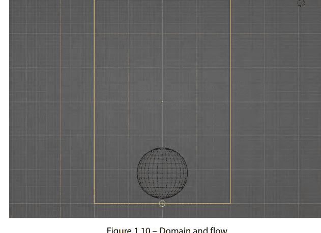

图 1.10 – 域和流

3. 最后一步是对我们的对象应用缩放。如果选择域对象并通过按 N 查看 **属性** 选项卡，你会看到以下缩放数值：

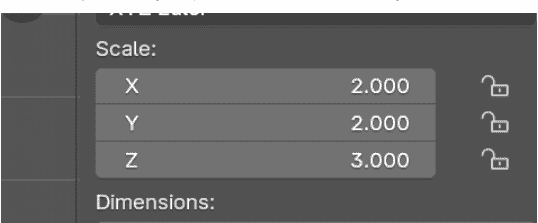

图 1.11 – 域缩放值

在我们更改域对象大小之前，这些值对于 **X**、**Y** 和 **Z** 每个都是 1。但由于我们在步骤 1 中将域按 2 倍缩放并将 **Z** 按 1.5 倍缩放，因此这些值变成了图 1.11 中显示的样子。一般来说，你总是希望这些值设置为 1。这将确保修改器、纹理、UV 贴图和物理计算的准确性。

4. 要将这些值更改为 1 并保持对象的当前大小，我们需要应用缩放。我们可以通过按 Ctrl + A 和 Cmd + A 并在同时选中域和流的情况下选择 **缩放** 来实现。现在，这些 **缩放** 值应该恢复到 1，一切都会正常工作！

现在对象已经就位，是时候开始处理域和流了！

## 创建模拟

一切就绪，下一步是将立方体指定为域对象并更改设置。之后，我们将创建流并编辑一些数值。

### 设置域对象

让我们开始设置我们的域对象：

1. 选择你的域，然后前往右侧的 **物理属性** 面板（它看起来像一个里面还有一个圆的圆）：

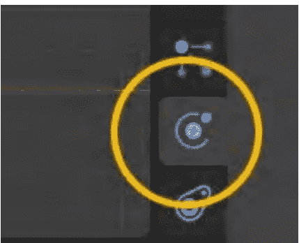

图 1.12 – 物理属性面板

2. 到达后，点击 流体，并将 类型 选择为 域。（是的，设置相当多；让我们一步一步来。）

3. 我们首先应该做的是更改缓存类型。向下滚动直到看到 缓存 面板。我们不需要烘焙 250 帧，所以让我们将模拟的 结束帧 属性设置为 150。至于 类型，让我们选择 模块化，并勾选 允许恢复 复选框。这样如果需要，我们可以在烘焙中途停止。

缓存面板应如下所示：

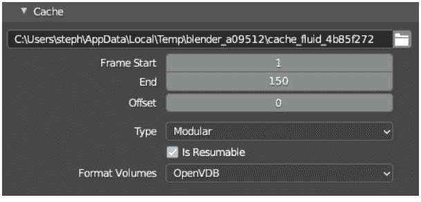

图 1.13 – 缓存

4. 现在，让我们设置其他域设置。从最顶部开始，将 分辨率细分 设置为 128。这将为我们提供漂亮的高质量火焰：


图 1.14 – 分辨率细分

5. **CFL 数** 基本上改变每帧的模拟步数。较高的值会减少步数，从而加快计算时间。当然，较低的值会增加步数，使其更准确但更慢。对于此模拟我们不需要值为 2，所以让我们使用值为 4，这将有助于加快烘焙时间。

6. 勾选 **自适应域** 框。这将根据火焰所在位置改变域的大小，从而减少烘焙时间：


图 1.15 – 自适应域

我们可以保持所有默认设置不变。

7. 在 **气体** 面板中，打开 **火焰** 部分。**反应速度** 控制火焰的高度。较高的值意味着火焰较低，而较低的值意味着火焰更高。让我们将其稍微调低至 0.5：

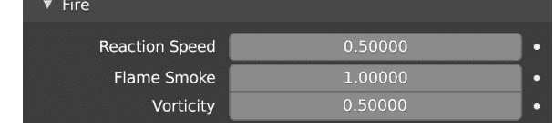

图 1.16 – 火焰设置

8. （可选）如果你想要火焰中更多的漩涡，可以将火焰的 **涡度** 量调高到 0.6 或 0.7。不要设置得太高，否则你的火焰会变得疯狂！

域设置已完成；下一步是流对象！

### 设置流对象

按照以下步骤设置你的流对象：

1. 选择你的球体，并在 **物理属性** 面板中选择 **流体**。正如你可能猜到的那样，将 **类型** 设置为 **流**。
2. 至于 **流类型**，将其从 **烟雾** 改为 **火焰**。
3. 将 **流行为** 设置为 **几何体** 会使火焰在播放动画时很快消失。然而，我们希望它不断添加火焰，所以让我们将其更改为 **流入**。
4. 我们可以将 **燃料** 提高到 1.2。这会使火焰稍微更高并移动得更快。
5. 在 **流源** 部分，**表面发射** 当前设置为 1.5。这意味着火焰会稍微远离网格表面发射。我更希望它更靠近网格，所以让我们将此值设置为 1。

6. 完成以上设置后，我们就可以烘焙模拟了！选择你的域，然后点击顶部的 **烘焙数据** 大按钮开始烘焙模拟。请记住，这可能需要一些时间，具体取决于你的电脑速度。

现在，我们只需坐下来等待它完成烘焙。一旦完成，我们就可以创建火焰材质了！

### 创建材质

创建一个基本的火焰材质非常简单：

在选中域对象的情况下，让我们跳到 **材质** 属性面板（它看起来像一个红色圆圈）：

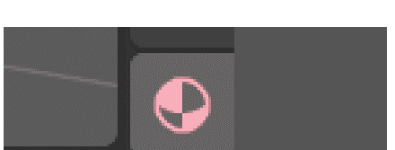

图 1.17 – 材质属性

1. 基础 **Principled Shader** 我们称之为 **表面着色器**。它控制网格表面的颜色、纹理和光线反射。由于火焰不是网格，这不起作用，所以让我们将其删除。点击 **Surface Principled BSDF**（它旁边会有绿色点）并选择 **删除**。

2. 我们需要的是 **体积着色器**。这类着色器用于网格内部或火焰和烟雾。所以，让我们添加一个。打开 **体积** 面板并选择 **Principled Volume**：

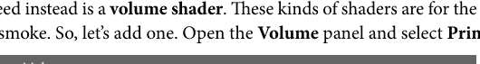

图 1.18 – 体积着色器

3. 第一个颜色选项用于烟雾。让我们将其设置为稍暗的灰色。

4. 如果你想要更浓密的烟雾，也可以将 **密度** 属性调高。让我们使用值为 8。

5. 创建火焰的方法有很多。最基本的方法是提高 **黑体** 强度。你会注意到，如果拖动 **黑体** 值，只能到 1；然而，如果手动输入数字，则可以更高。设置得越高，火焰看起来就越亮。让我们使用值为 4！

就这样！你已经创建了火焰材质。现在，让我们设置相机以便可以看到火焰！如果你对外观不满意，随时可以回来稍后更改。

我们的火焰看起来不错！现在，我们需要一种方式来看到它！

## 设置相机

让我们设置相机并将其放置在我们想要的位置：

1. 按数字键盘上的 0 进入 **相机视图**，或前往 **视图 | 相机 | 活动相机**。
2. 为了轻松移动相机，进入 **属性** 面板（N）部分，并在 **视图** 选项卡中勾选 **相机对齐视图** 复选框。现在，你可以像在 3D 空间中移动一样移动相机：
3. 将相机移动到可以看到整个模拟的位置。然后，确保取消勾选 **相机对齐视图**；否则，你可能会在不经意间移动相机。
4. 至于场景的灯光，让我们跳到 **世界** 设置并将 **颜色** 设置为黑色：

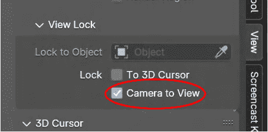

图 1.19 – 相机

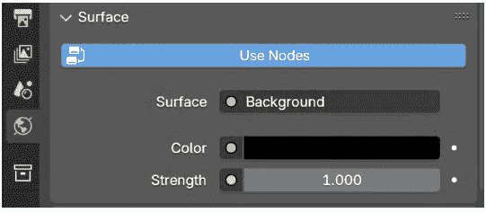

图 1.20 – 世界灯光

现在相机、灯光和材质都已完成，是时候设置渲染设置了！


## 渲染动画

现在是把模拟与结束帧匹配的好时机。由于我们已经烘焙了 150 帧，让我们也将时间轴中的结束帧属性设置为 150：

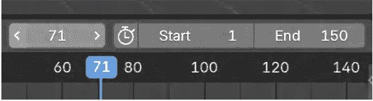

图 1.21 – 时间轴示例

接下来，让我们选择要使用的渲染引擎。Blender 中有两种默认渲染引擎可供选择：EEVEE 和 Cycles。两者各有优缺点。例如，EEVEE 的渲染速度比 Cycles 快得多，但火焰看起来不会那么好。如果你有较慢的电脑，我建议使用 EEVEE，因为在 Cycles 中渲染烟雾/火焰会非常占用 GPU/CPU。要选择渲染引擎，请前往渲染属性部分并点击渲染引擎：

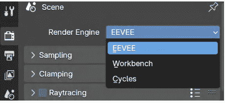

图 1.22 – 渲染引擎

对于我的动画，我使用了 EEVEE，但如果你想使用 Cycles，我会为两者都提供说明！

## Cycles

在选择了 Cycles 引擎后，让我们更改一些设置，以便 Blender 渲染更快并获得更好的结果：

- 1. 打开采样面板，并在渲染选项卡中将最大采样数设置为 20。
- 2. 打开色彩管理选项卡，将视图转换设置为 Filmic，并将外观设置为高对比度。这将使火焰更突出，看起来不会那么暗淡。

现在你已经完成了 Cycles 渲染的步骤，可以跳过 EEVEE 说明，直接前往设置输出部分！

## EEVEE

在接下来的章节中，我们将学习更多关于在 EEVEE 中渲染体积的内容！现在，让我们先回顾一些基本设置，以帮助火焰看起来更好。切换到 EEVEE 渲染引擎，开始吧：

- 1. 在采样面板中，将渲染采样数设置为 16。在 16 到 128 采样之间差异不大，因此降低它有助于加快渲染时间。
- 2. 在体积选项卡中，将分辨率设置为 1.1。这将使火焰更具细节，看起来更好。
- 3. 打开色彩管理选项卡，将视图转换设置为 Filmic，并将外观设置为高对比度。

如果你想为火焰添加一些辉光，可以切换到顶部的合成工作区。勾选使用节点，然后按 Shift + A 并前往过滤器 | 辉光。将节点放置在渲染层和合成节点之间。你可以随意自定义这些值以找到自己喜欢的效果，也可以复制以下值：

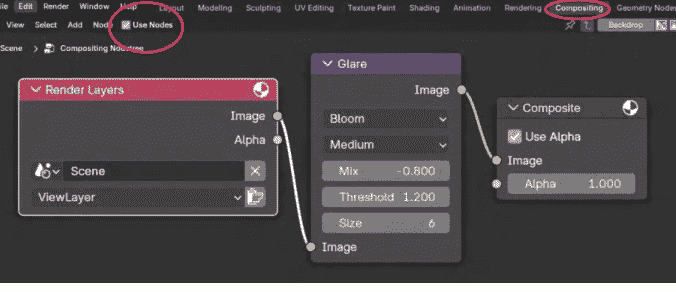

图 1.23 – 添加辉光

本教程的最后一步是为我们的动画设置输出。

## 设置输出

每当你在 Blender 中渲染动画时，你都需要设置一个输出文件夹。为此，请前往输出属性部分，通过点击右侧的小打开文件夹图标来设置你希望动画渲染到的目录。

之后，设置你选择的输出文件格式。我将我的设置为 FFmpeg 视频，容器为 MPEG-4。完成后应该看起来像这样：

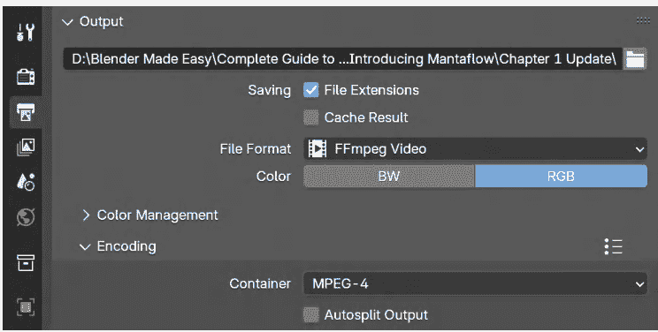

图 1.24 – 输出

现在，你可以开始渲染了！转到渲染 | 渲染动画或按 Ctrl + F12 或 Cmd + F12。渲染完成后，它将位于你设置的输出目录中！

要查看我的结果并下载此 .blend 文件，你可以访问 https://github.com/PacktPublishing/Learn-Blender-4-Simulations-the-Right-Way。

以下是我模拟的一帧：

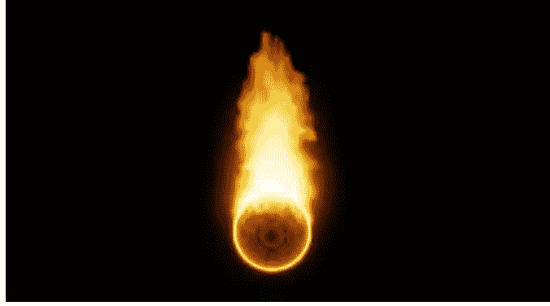

图 1.25 – 最终结果

就是这样！你已经完成了本书的第一个教程。希望你能轻松完成并在过程中学到了新东西！

## 总结

如果你直到今天才接触 Blender 中的 Mantaflow 模拟，恭喜你完成了本章并创建了你的第一个火焰模拟！

本章涵盖了相当多的主题，让我们回顾一下！首先，我们了解了 Mantaflow 是什么以及它是如何引入 Blender 的。我们了解了创建模拟的内容以及可供选择的两种类型——气体和液体。我们还涵盖了你可以添加到模拟中的所有对象——即域、流和效应器。

之后，我们一起创建了一个很棒的火焰模拟。使用 Mantaflow 有时会有点具有挑战性，但希望本章能让你清楚地理解并增强信心去创建模拟！

我鼓励你打开 Blender，尝试创建模拟并享受乐趣！你可以做一些有趣的事情，比如点燃一个自定义文本对象并让火焰颜色为紫色！或者你可以做一些更严肃的事情，比如使用力场创建龙卷风效果！用 Mantaflow 可以创建的东西几乎是无穷无尽的！

下一章全部关于域、流和效应器。我们将详细查看每个部分并讨论其设置，以便你完全了解要更改哪些值来获得所需的模拟！

## 加入我们的 Discord 社区

加入我们社区的 Discord 空间，与作者和其他读者讨论：
https://packt.link/learn-blender-simulations-discord-invite


