## 了解域、流和效应器

现在我们已经涵盖了 Mantaflow 的基础知识，是时候更深入一些了！在本章中，我们将深入 Blender，了解域、流和效应器——构成模拟的所有对象。

有数百个设置和值可以按你的喜好调整，不知道它们是什么或如何在实践中使用可能会令人沮丧。

本章的目标是让你对 Blender 中的液体和火焰模拟有技术上的理解。这样，你就能确切知道所有设置和值的作用，而无需猜测。你将始终能够回来参考本章，如果你忘记了什么。我们将逐一介绍每个设置，并附上简短说明，解释它在模拟中的作用，并配有截图以便轻松学习！

虽然我们在上一章简要提到了域、流和效应器对象，但在本章中，我们将更详细地探讨并学习所有细节，从域对象开始。

在本章中，我们将涵盖以下主题：

- 域
- 流对象
- 效应器

本章内容很多，让我们直接开始吧！

## 技术要求

本章要求你已安装 Blender 4.2 或更高版本。

要下载 Blender，请访问 www.blender.org。

## 域

我们在 *第 1 章* 的 *创建模拟所需的内容* 部分已经了解了一些关于域的知识，但让我们快速回顾一下！

域对象是整个模拟的容器，流体或烟雾无法离开其边界。这个容器的形状始终是立方体。即使你使用非立方体的对象，Blender 也会使用该对象的包围盒作为域大小。

另一个需要注意的是域的大小。它越大，你就需要更高的分辨率才能使模拟看起来好。这会导致烘焙时间更长、文件更大以及需要更多的计算能力。

要添加域，首先添加一个新的立方体对象，然后前往 **物理** 面板并选择 **流体** | **类型** | **域**。

有两种类型的域：*气体* 和 *液体*。气体用于火焰和烟雾模拟，而液体用于流体模拟。域内部存在许多可以调整以影响模拟外观的设置和值。这些面板和设置的大部分对气体和液体域都是相同的：

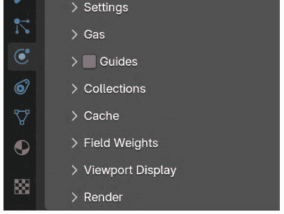

图 2.1 – 气体域设置

让我们逐一介绍不同的面板并分别讨论它们。为了完全理解它们，我强烈建议你在讨论每个设置时打开 Blender 并跟随操作。

## 设置

当你将一个网格指定为域对象时，你会看到以下设置：

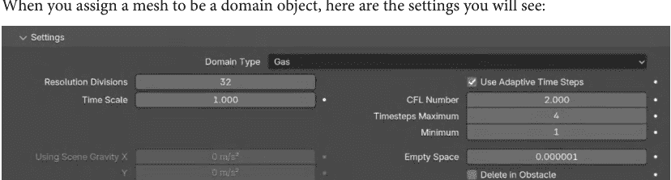

图 2.2 – 域设置

让我们逐一查看；我会准确描述它的作用：

- **域类型**：这允许你在 **气体** 和 **液体** 之间进行选择。
- **分辨率细分**：这控制模拟看起来有多好。我们在 *第 1 章* 中提到过这个设置，但让我们再回顾一下。值越高，体素越小，模拟看起来越好但运行越慢。域越大，你就需要设置得越高。如果你将域的大小加倍，也需要将分辨率的大小加倍才能获得相同的效果。
- **时间比例**：这控制模拟的速度。值越高模拟越快，值越低则呈现慢动作效果。如果你将此设置设为 0，模拟不会完全停止；仍会有极少量的运动。
- **CFL 数**：它代表 Courant–Friedrichs–Lewy；有点技术性。当烘焙模拟时，有一定数量的 *每帧时间步长*。时间步长是指求解器每帧计算模拟的次数。物体的速度越大，就需要越多的时间步长才能在物理上准确。值越高会导致时间步长越少，烘焙时间越快，但模拟的准确性会降低。数值越低会给模拟提供更多的时间步长，从而增加烘焙时间但得到更好的结果。将其保持在默认值 2 对大多数模拟都有效。
- **使用自适应时间步长**：此复选框会让 Blender 自动决定每帧提供多少步。通常最好勾选它；这样，当有快速移动的流体时，Blender 会添加更多的时间步长，而当有缓慢移动的流体时，就不需要那么多时间步长。这有助于减少烘焙时间。

- **时间步长最大值和最小值**：这些值控制模拟每帧会有多少步。通常，如果碰撞无法正常工作或烟雾/流体移动过快，你需要调高这些数值。
- **使用场景重力**：这就像现实生活一样，给场景一些物理效果并允许流体下落。你可以在这里控制数值，这样流体就不会下落，而可能向侧面下落，甚至如果你将 Z 设为正值时倒立下落。

你会注意到在图 2.2 中它目前是灰色的。这是因为场景正在使用 Blender 的默认重力。你可以通过前往场景面板并取消勾选 **重力** 来关闭它：

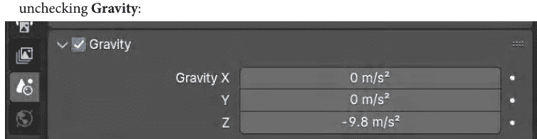

图 2.3 – 重力

现在，你可以在域设置中更改重力。这在你想要多个具有不同重力设置的域时很有用。请记住，如果你在场景面板中取消勾选 **重力**，其他物理效果，如粒子系统和刚体，也不会有重力。

- **空空间**：仅适用于气体域。它用于在烟雾变得非常稀薄时将其消除。这有助于渲染时间和烘焙时间：

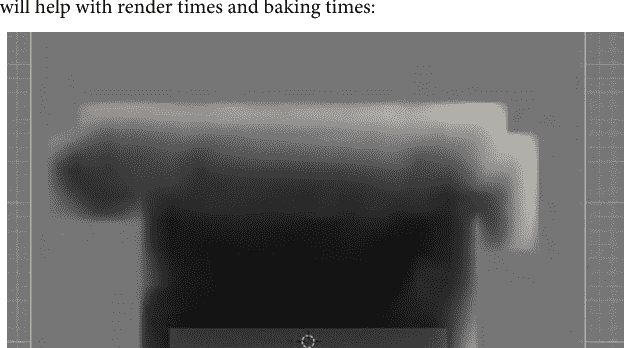

图 2.4 – 空空间示例

你会注意到当 **空空间** 设为 0.7 时，模拟的顶部和两侧已被裁剪掉。请确保将其设置得非常低；否则，你可能会删除不想要的烟雾。

- **障碍物中删除**：如果勾选此项，会删除障碍物内部的任何流体/烟雾。
- **边界碰撞**：这是一种让烟雾/流体与域边缘发生碰撞的方式。此选项卡中可以勾选和取消勾选的选项有 **前**、**后**、**右**、**左**、**上** 和 **下**。如果未勾选，烟雾将穿过域而不发生碰撞并消失。
- **自适应域**：仅适用于气体域。此选项非常好，几乎总是应该勾选。它允许域的大小动态变化以适应模拟：

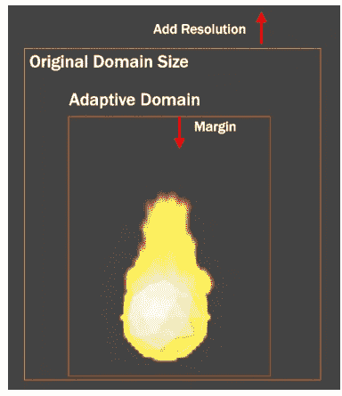

图 2.5 – 自适应域示例

这里有三个可以更改的设置：

- **添加分辨率**：如果烟雾到达边缘，这将使域在其原始大小之外扩展。
- **边距**：这是域与烟雾之间的空间量。值越低会使域边缘更靠近，而值越高会将其推开。
- **阈值**：这是另一种裁剪烟雾的方式。如果烟雾的密度小于阈值，**自适应域** 将剪切它，删除该烟雾。

**自适应域** 非常有用，在烘焙模拟时可以节省大量时间！在极少数情况下，此选项可能会导致烟雾裁剪问题或导入 OpenVDB 时出现问题，但大多数情况下你希望将其打开。

这就是域第一个面板的所有设置。现在，在我们进入烟雾和液体选项之前，我想提到缓存面板！

## 缓存

缓存面板是用于设置所有烟雾/流体数据在烘焙时存储位置的目录。默认目录是临时文件夹。这意味着在你关闭项目后，模拟数据将被删除。在某些情况下，这可能很有用，因为模拟会占用大量硬盘空间。在其他情况下，每次重新打开项目时都要重新烘焙模拟可能会很烦人。

要保存数据使其不被删除，你需要点击小文件夹图标并选择不同的文件夹。通常，将缓存放在与项目 blend 文件相同的文件夹中是一个不错的选择：

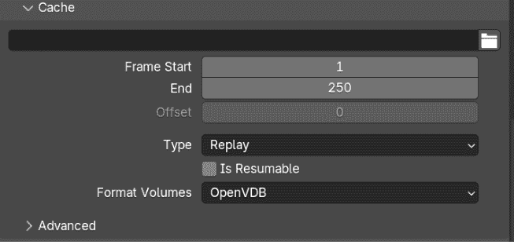

图 2.6 – 缓存面板

在目录下方，我们有帧开始和结束，它们分别控制模拟开始和结束的时间。偏移参数允许你延迟模拟的开始。例如，将偏移设为 50 将使模拟从第 50 帧开始而不是第 1 帧。这也可以在模拟烘焙完成后更改。

在类型下拉菜单中，有三种烘焙模拟的方式：

- **重放**：这会在视口中播放时实时烘焙模拟。这在低分辨率下测试设置时很有用。
- **模块化**：这将域拆分为需要分别烘焙的不同模块。如果你选择此类型，噪音、引导、网格和粒子面板都需要单独烘焙。这在你想更改这些面板中的某项而不重新烘焙整个模拟时也很有用。
- **最终**：这与模块化不同，会一次性烘焙所有内容。

选择 **模块化** 或 **最终** 类型时，**烘焙** 按钮会出现。一旦你点击 **烘焙**，模拟将开始烘焙过程，你可以通过查看屏幕底部的百分比来看到进度：

图 2.7 – 烘焙进度

模拟烘焙完成后，设置将被变灰，你将无法更改任何内容。但是，你可以点击 **释放数据**，这将删除烘焙，使你能够更改设置。

**可恢复** 复选框允许你在烘焙过程中途取消并稍后恢复。我几乎总是保持此选项开启，以防我需要停止烘焙。需要注意的是，启用它会导致写入更多模拟数据，从而增加烘焙大小。

最后，存储所有数据的两个 **体积格式** 选项是 **Uni 缓存** 和 **OpenVDB**：

- **Uni 缓存**：这是 Blender 存储模拟数据的方式。模拟中的每个对象都将拥有自己的 Uni 缓存文件（`.uni`）。
- **OpenVDB**：这将以每帧一个 OpenVDB 文件的形式存储模拟中的所有对象，而不是让每个对象都有自己的 `.uni` 文件。这更高效，大多数时候我会使用此格式。

现在我们了解了在 Blender 中烘焙模拟的样子，让我们讨论气体和液体域的所有设置！

## 气体域

创建气体域时，有很多与液体域不同的选项，例如烟雾的密度、烟雾何时溶解以及火焰的高度。在接下来的章节中，我们将学习如何使用气体域创建逼真的火焰和爆炸。

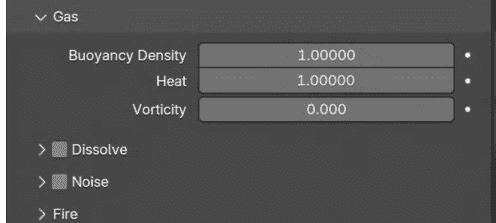

图 2.8 – 气体设置

**气体** 面板位于 **设置** 面板下方。所有这些选项都会影响模拟时烟雾的外观和行为！让我们一起逐一了解：

- **浮力密度**：这控制烟雾是上升还是下沉。数值越高，烟雾上升越快，负值则会使烟雾下沉。
- **热量**：这控制烟雾的温度。这也会影响烟雾是上升还是下沉。需要提及的一点是，此设置基于 **流体对象** 设置中的 **初始温度** 属性，我们将在 *流体对象* 部分更详细地讨论。

如果流体的初始温度设为负值而热量设为正值，烟雾将下沉。如果两个值均为正值或负值，烟雾将上升。这样设置的原因是为了让你可以拥有多个会上升或下沉的流体对象。
- **涡度**：这控制烟雾的漩涡和随机性！使用此设置时需谨慎，因为如果值过高，烟雾会填满整个域。我建议保持在 0.5 以下。

在下图中，涡度值从左到右依次为 0、0.1 到 0.4。如你所见，即使只有少量涡度，也会为你的模拟增加大量漩涡和随机性：

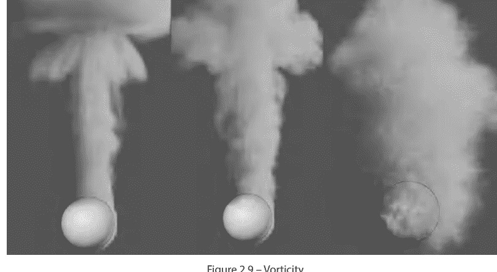

图 2.9 – 涡度

- **溶解**：勾选此选项时，烟雾会随时间溶解。其溶解速度基于 **时间** 值。例如，如果 **时间** 设为 10，烟雾将被发射，并在 10 帧后开始溶解。**慢速** 复选框可让烟雾溶解得更平滑、更缓慢：

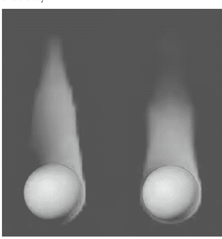

图 2.10 – 溶解示例

在图 2.10 中，左侧模拟的时间为 20，**慢速** 设置为 **关闭**。右侧模拟的时间为 5，但 **慢速** 设置为 **开启**。如你所见，右侧的更平滑。

- **噪声**：需要提及的一点是，如果你在 **设置** 面板中提高分辨率细分，这会改变烟雾的形状和外观。**噪声**，另一方面，非常适合在不改变整体形状的情况下为烟雾添加精细细节。因此，如果你喜欢模拟的外观但想增加更多细节，**噪声** 是最佳选择！

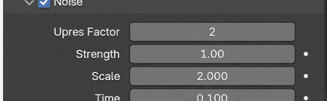

图 2.11 – 噪声设置

让我们讨论一下每个设置：

- **Upres 因子**：它将你的分辨率细分乘以你设定的数值来增加细节。数值越高，添加的细节层级就越多：

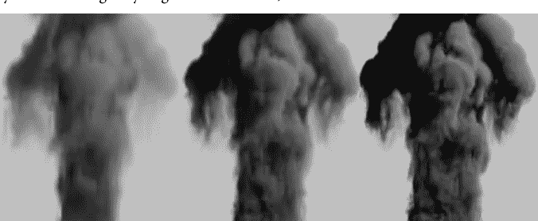

图 2.12 – 噪声 upres 示例

在前一图中，左侧示例没有噪声，中间的 **Upres** 值为 2，右侧的 **Upres** 值为 4。

- **强度**：这控制噪声在烟雾中出现的强度：

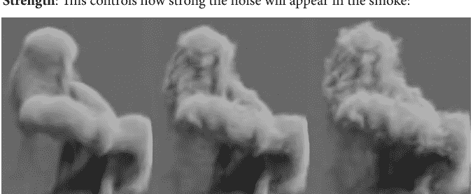

图 2.13 – 强度示例

在前一图中，**强度** 值从左到右依次为 0.2、1 和 2。数值越低，噪声看起来越细微；数值越高，看起来越强、越嘈杂！

- **比例**：这是控制噪声大小的设置。数值越高，漩涡越大；数值越低，漩涡越小：

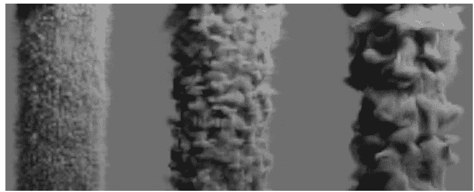

图 2.14 – 比例示例

- **时间** 是一个设置，可让你在烟雾中获得不同的噪声图案。更改此值会移动噪声图案并产生略有不同的结果。

使用不同的 **分辨率细分** 和 **Upres 因子** 值会产生很多不同的结果。例如，让我们查看下图。分辨率为 64 且 upres 为 4（左）的模拟看起来会与分辨率为 256 且无噪声（右）的模拟截然不同：

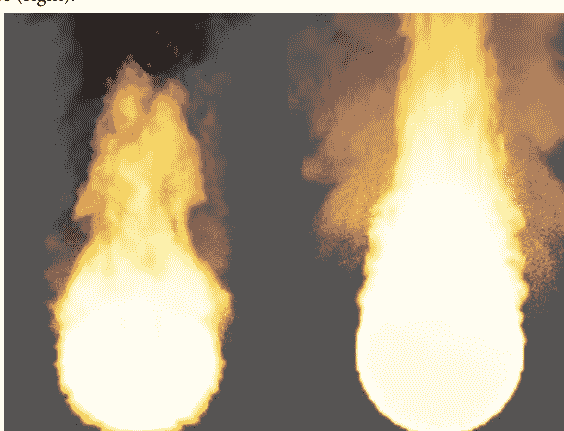

图 2.15 – 噪声与分辨率

总的来说，**噪声** 是为模拟添加小细节的好方法。通常，低细分和高 upres 的模拟会使烟雾/火焰看起来很小，基于真实世界的比例。

- **火焰**：它有六个设置可以改变火焰的外观。让我们逐一了解：

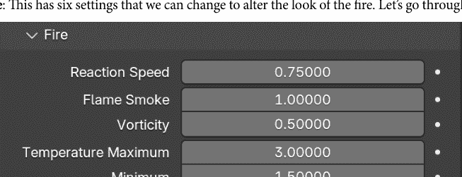

图 2.16 – 火焰设置

- **反应速度**：这控制燃料燃烧的速度。数值越低，火焰越高；数值越高，燃料燃烧越快，导致火焰变小。
- **火焰烟雾**：这控制火焰产生的烟雾量。在下图中，数值分别为 0、0.25、1 和 4：

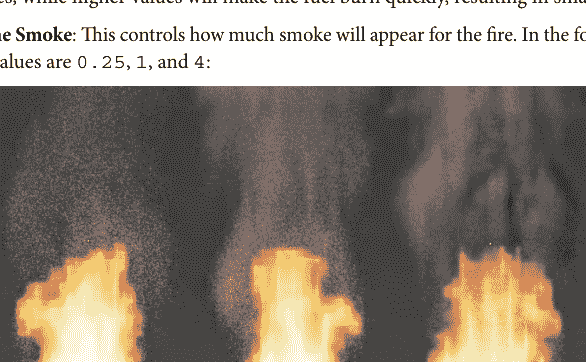

图 2.17 – 火焰烟雾示例

- **涡度**：这为火焰增加随机性和漩涡！请注意不要让此值过高；否则，火会填满整个域，看起来很奇怪。下图中显示的值为 0.1、0.7 和 1.5：
- **温度最大值** 和 **最小值**：这些控制火焰上升的速度。数值越高，模拟越快；数值越低，火焰上升非常缓慢。
- **烟雾颜色**：这会改变发射的烟雾颜色。

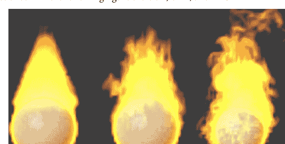

图 2.18 – 火焰涡度

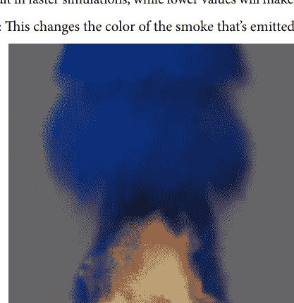

图 2.19 – 烟雾颜色

就这样！我们已经涵盖了气体域的所有设置！在下一章，我们将更深入地了解火焰以及如何创建逼真的篝火！现在，让我们切换到液体域，讨论流体模拟的所有设置。

## 液体域

液体域类型有许多设置会影响流体的外观和行为；这些包括厚度、粒子密度、飞溅、泡沫、气泡粒子和网格，仅举几例。

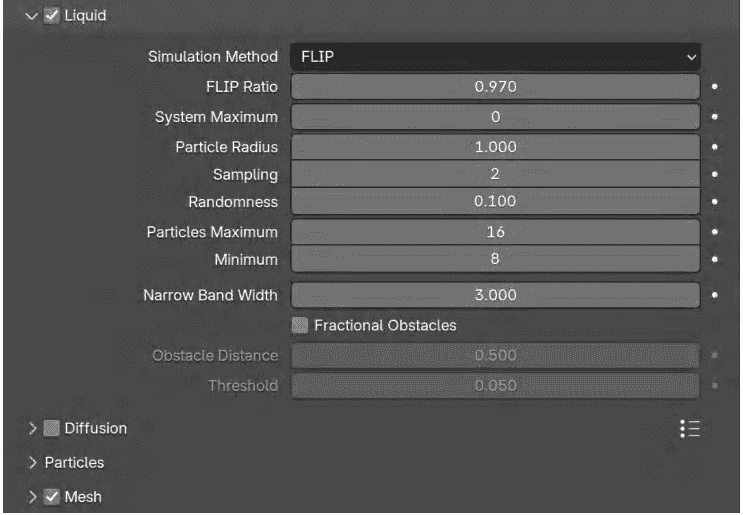

图 2.20 – 液体设置

如果勾选液体，Blender 将创建一个粒子系统来帮助可视化模拟的流动。液体域还有更多设置和值需要介绍，所以让我们直接开始吧：

- **模拟方法**：有两个方法可供选择 – **FLIP** 和 **APIC**。查看下图可了解这些方法：

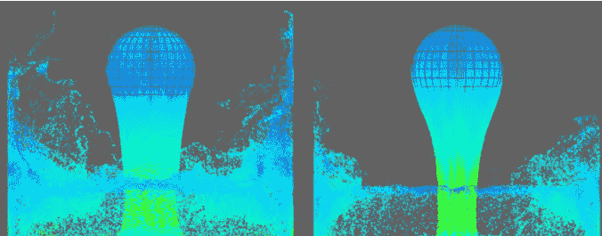

图 2.21 – FLIP（左）和 APIC（右）示例

**FLIP**（左）会产生更多飞溅和四处飞溅的流体，而 **APIC**（右）会稍微平静一些并保留大量飞溅。

- **FLIP 比率**：这仅适用于 **FLIP** 方法。它控制粒子将具有的速度。数值越高，飞溅越大；数值越低，飞溅越小、越细微。
- **系统最大值**：这控制模拟中的粒子数量。将其设为 0 时，Blender 会在需要时自动添加更多粒子。
- **粒子半径**：这是每个液体粒子周围的空间。有时，在高分辨率下，模拟似乎会增加体积。如果发生这种情况，你需要调低此值。如果相反，流体似乎消失了，尝试调高此值！
- **采样**：这类似于烟雾的 upres 因子。数值调得越高，模拟中添加的粒子就越多。在下图中，左侧的值为 1，右侧为 5：

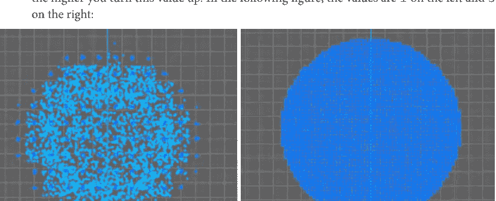

图 2.22 – 粒子采样示例

- **随机性**：这正如其名。当新粒子添加到模拟中时，它们的位置会带有一些随机性。数值设置得越高，看起来就越随机。下图显示了左侧值为 0、右侧为 1.0 的结果：

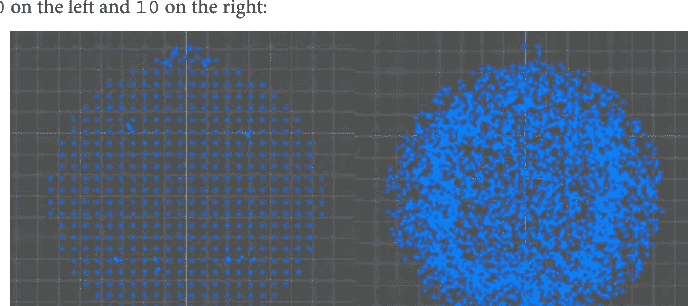

图 2.23 – 粒子随机性

- **粒子最大值** 和 **最小值**：这些控制每个网格单元中的粒子数量。还记得我们在上一章讨论过体素吗？就像烟雾被分解为体素一样，流体被分割成我们所说的网格单元。这些单元的大小基于分辨率细分。你可以通过查看域左下角的立方体来看到大小。为了更好地可视化 **粒子最大值** 和 **最小值** 选项，请查看下图，其中两个值均设为 1000：

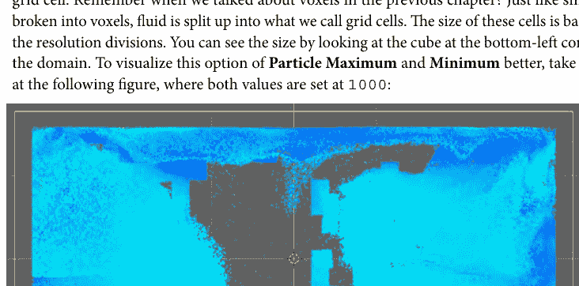

图 2.24 – 粒子最大值和最小值

-   **窄带宽度** 是流体顶部附近粒子带的厚度。提高此值可能会导致整个模拟被粒子填满。如果这正是你想要创建的效果，这可能很有用！否则，建议不要提高此值，因为它会减慢模拟速度。在下图中，数值分别为 2（上）和 15（下）：

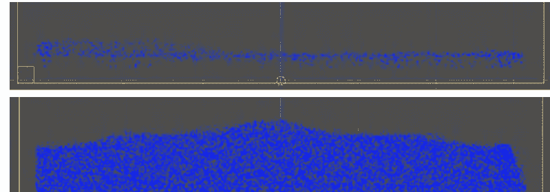

图 2.25 – 窄带宽度

将 **窄带宽度** 增加到 15 并为每个粒子分配一个对象，可以让你创建非常有趣的模拟。例如，在下图中，已将二十面体指定为粒子，并且颜色会根据每个粒子的速度而变化！你可以通过观看 https://youtu.be/y2KvuDgRMS4 的视频来学习如何创建此效果：

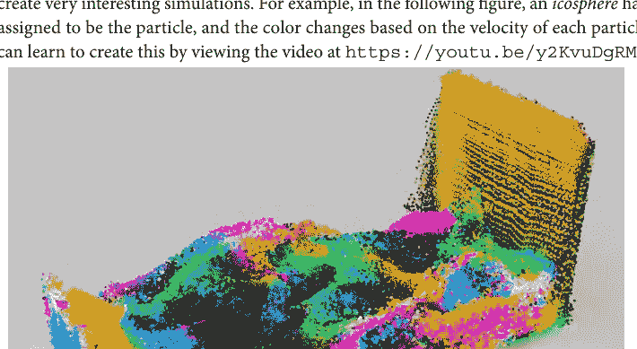

图 2.26 – 窄带宽度模拟

-   **分数障碍**：这可以实现更高质量的障碍碰撞。在某些模拟中，流体可能会粘在障碍物上。启用 **分数障碍** 将有助于防止这种情况并确保碰撞时流动更顺畅：
  -   **障碍距离** 是流体与碰撞之间的距离。在某些情况下，改变此值会使流体流动更好，但在其他情况下，它会导致流体消失或与障碍物相交等问题。将此值设为负值将允许部分流体进入障碍物内部。
  -   **阈值** 是流体在障碍物上移动的平滑程度。较低的值会导致部分流体粘在障碍物上。

现在我们已经介绍了液体粒子，让我们来了解 Blender 中所有其他流体选项和值。接下来，我们将讨论 **扩散**、**粒子** 和 **网格** 设置！

## 扩散

扩散是增加厚度并改变流体行为的一种方式。

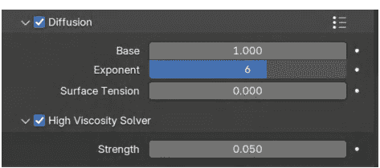

图 2.27 – 扩散设置

真实世界中流体的粘度以 **帕斯卡-秒（Pa.S）** 或更常见的 **厘泊（cP）** 单位来衡量。Blender 不使用 cP，而是使用运动粘度，即 Pa.S 除以流体的密度（kg/m³）。

我将给出两个方程来帮助你理解此操作的原理。

首先，我们需要了解如何将 cP 转换为 Pa.S。你只需将 cP 除以 1,000 即可得到 Pa.S 数值。水的 cP 为 1.002，因此 Pa.S 为 0.001002；水的密度约为 1,000 kg/m³。

综合以上信息，我们可以列出方程：0.001002/1000 = 0.000001002，换句话说，1.002×10⁻⁶。在 Blender 中，我们需要将 **基数** 设为 1 和 **指数** 设为 6 即可得到水的粘度！

在下面的示例中，我们将使用熔岩。熔岩有不同种类，但我们创建的这种熔岩的 cP 为 3,500,000，或 3,500 Pa.S，密度约为 3,100 kg/m³。我们的方程为 3,500/3,100 = 1.129，我们可以将其四舍五入为 1.0。在 Blender 中，我们只需将 **基数** 设为 1 和 **指数** 设为 0 即可得到熔岩的厚度！

提高 **表面张力** 会使流体表面张力更大，看起来更僵硬。我们刚刚讨论的内容比较技术性，但了解 Blender 中扩散的工作原理是很有帮助的。

然而，有一种更简单的方法可以增加流体的厚度，那就是使用 **高粘度求解器** 选项。此设置通过添加 **强度** 值简化了所有内容。此值使创建蜂蜜、油、熔岩或其他任何液体变得非常容易。

请记住，启用此选项会增加一些粘度，即使强度设为 0 也是如此。如果不想有任何粘度，请确保未勾选。在下图中，**粘度** 值左侧为 0，中间为 0.1，右侧为 0.4。

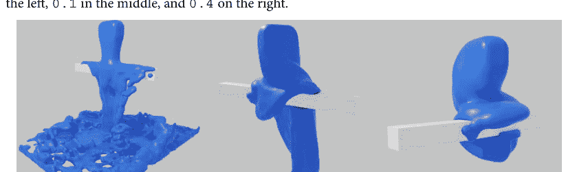

图 2.28 – 粘度示例

此设置也可以进行动画。例如，你可以让模拟开始时像史莱姆一样厚，然后逐渐变成像水一样稀薄的东西！

## 粒子

我们接下来要查看的面板是 **粒子**。

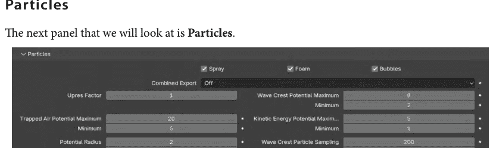

图 2.29 – 粒子设置

这些粒子与我们已经了解的液体粒子不同。它们处理模拟的特定部分。我们可以添加三种粒子类型：

-   **喷溅**：当模拟中出现大飞溅时，会创建这些粒子。
-   **泡沫**：这些粒子位于流体表面并随其移动。
-   **气泡**：这类粒子在内部创建并在流体表面下方移动：

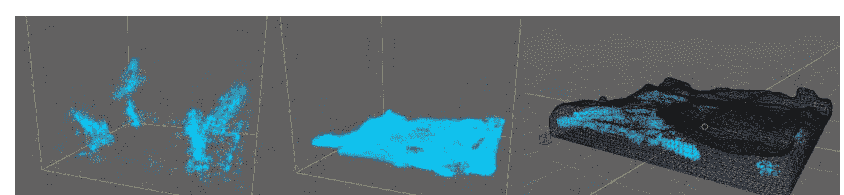

图 2.30 – 喷溅、泡沫和气泡

现在我们了解了不同类型的粒子，让我们讨论它们的设置：

-   勾选 **喷溅**、**泡沫** 或 **气泡** 中的任意一项时，将会创建一个新的粒子系统。当 **合并导出** 设为 **关闭** 时，Blender 将为你选择的每种类型创建三个独立的粒子系统；此设置允许你将多个系统合并为一个：

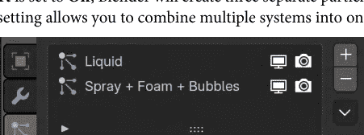

图 2.31 – 导出示例

-   **分辨率提升因子**：它正如你所期望的那样工作：它会根据分辨率细分乘以粒子数量。你设置的值越高，创建的粒子就越多。
-   接下来的三个设置类似，所以我们一次性全部介绍。每个值都有可能在流体的特定位置创建粒子。在这里，你可以控制将创建的粒子的最大和最小数量：
  -   **波峰**：这是用于飞溅或波浪顶部的粒子。
  -   **被困空气**：当流体重叠时，有时会形成空气袋。此设置用于该空间中的粒子数量。
  -   **动能**：它根据粒子的速度来确定是否应发射粒子。

我们对这三个设置进行了大量测试，它们对模拟的影响非常微小。对于大多数模拟，你可能可以将最大值和最小值保留为默认值，看起来会很不错。

-   **势半径** 和 **更新粒子半径**：这些值决定粒子移动的平滑程度。这两个设置的区别在于，**势半径** 会平滑网格单元，而 **更新粒子半径** 会平滑模拟中的单个粒子。较低的值会导致粒子到处乱飞，而较高的值会最小化移动，使其不那么混乱。下图左侧 **势半径** 和 **更新粒子半径** 的值均为 1，右侧为 4：

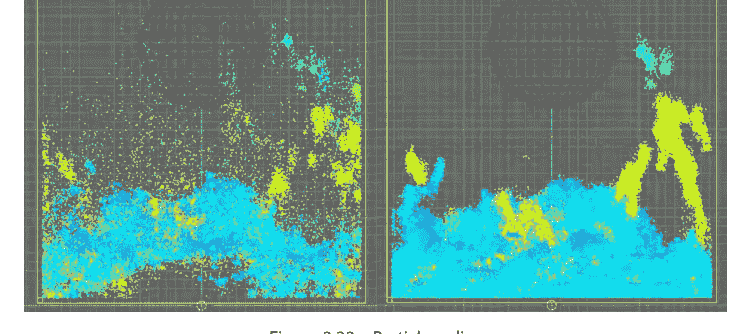

图 2.32 – 粒子半径

-   **波峰粒子采样** 和 **被困空气粒子采样**：这些仅适用于 **喷溅** 粒子。这两个值决定了在波峰以及流体在空中飞行的地方将生成多少粒子。较高的值当然会向这些区域添加更多粒子。

-   **粒子生命最大值** 和 **最小值**：这些控制粒子在模拟中存活多长时间后才会消亡并消失。

-   **气泡浮力**：这控制粒子向上升起的力。较高的值会导致更多粒子停留在流体表面。

-   **气泡阻力**：这控制粒子随流体移动的强度。较高的值会导致粒子非常紧密地跟随流体的运动。

-   **边界内粒子**：这是当粒子卡在障碍物内部时使用的。你可以将其设置为 **推出** 或 **删除**。

这些都是流体模拟中粒子的所有设置！接下来，让我们来看一下网格的设置。

## 网格

网格是可视化流体模拟的另一种方式。当选择模块化缓存类型并勾选“可恢复”框时，你可以启用网格并进行烘焙！让我们逐一查看设置并讨论每个设置：

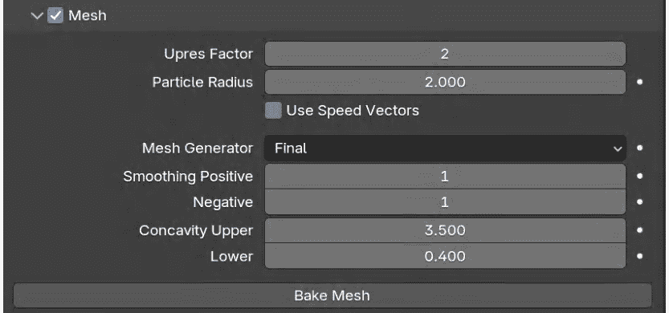

图 2.33 – 网格设置

- Upres Factor：这会根据为分辨率细分设置的值来乘以网格的分辨率。以下图示展示了使用 1、2 和 4 作为值的结果：

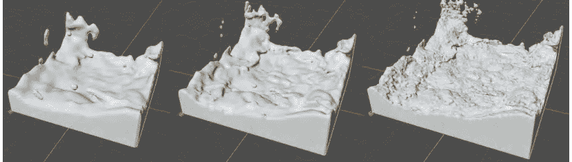

图 2.34 – 网格 Upres Factor 示例

- **粒子半径**：这与**液体**面板中的**粒子半径**非常相似。它控制每个粒子周围的网格大小。值越高，模拟看起来越像 blobs，而值越低则结果更逼真。以下图示展示了使用 1 和 8 作为值的结果：

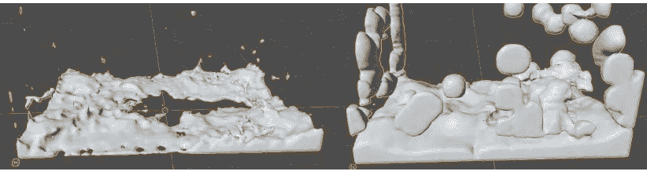

图 2.35 – 网格粒子半径

- **速度向量**：用于为流体添加运动模糊。勾选后，它会创建 Blender 的合成器（后期处理编辑器）用于运动模糊的数据。有三点需要注意：
  - 你需要使用 Cycles，因为 EEVEE 不支持此功能。
  - 你还需要在**缓存**面板的**体积格式**下使用**统一缓存**选项。**OpenVDB** 在这里无法使用。
  - 接下来，你需要在**渲染图层**面板中启用**向量**：

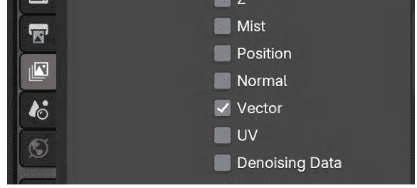

图 2.36 – 向量

渲染图像后，你可以跳到**合成器**区域并添加一个**向量模糊**节点。从**渲染图层**节点取出**向量输出**并将其连接到**向量模糊**节点的**速度**输入。这样做后，你应该会得到类似以下的结果：

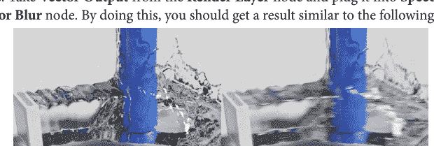

图 2.37 – 速度向量示例

这是对速度向量工作原理的简要概述。别担心——我们在*第 4 章*创建瀑布时将学习如何使用它。

- **网格生成器**：这控制网格的准确度。**最终**会给你最好的结果并提供更高质量的网格。另一方面，**预览**的准确度较低，但在烘焙时更快。为了获得更逼真的结果，你应该使用**最终**。
- **正向平滑**：这会使流体的外观更平滑。请记住，增加它也会消除小细节。
- **负向**：这与之完全相反。不是平滑表面，而是会增加流体的锐度，使边缘看起来参差不齐且细节丰富。

如果你查看以下图示，你会看到左图的**正向平滑**值为 1，**负向**值为 1；中间图的**正向平滑**值为 8，**负向**值为 1；右图的**正向平滑**值为 1，**负向**值为 10：

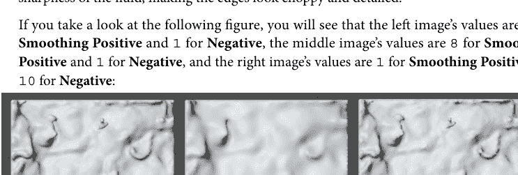

图 2.38 – 平滑

- **凹度上**和**下**：这些决定流体凹陷区域的平滑程度。值越高往往会使流体更平滑，而值越低可能会得到更锐利的结果。

需要注意的是，如果将**下**值设在 0.5 到 1 之间，可能会导致网格出现一些奇怪的扭曲。如果值高于 1，它会再次平滑：

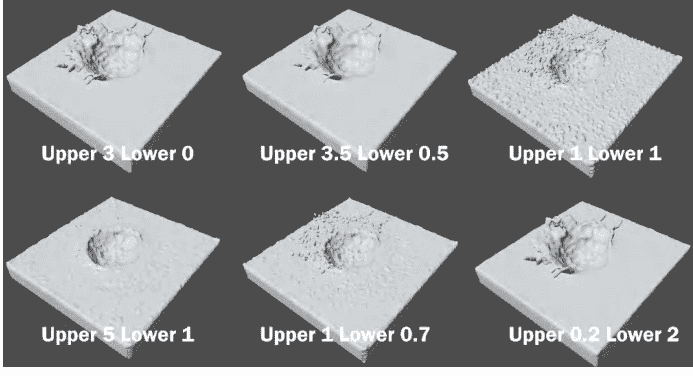

图 2.39 – 凹度

要烘焙网格，只需将缓存类型设为**模块化**并点击大的**烘焙网格**按钮！如果**烘焙网格**变灰，请确保也在**缓存**面板中打开**可恢复**。如果你不喜欢网格的外观或想更改设置，只需点击**释放烘焙**。

这涵盖了**网格**面板中的所有设置！接下来，我们将学习关于向导的内容。

## 向导

向导是为模拟添加力的另一种方式。与力场不同，向导用于帮助*引导*模拟的流动。这可以通过一个效应器对象或另一个域来实现。

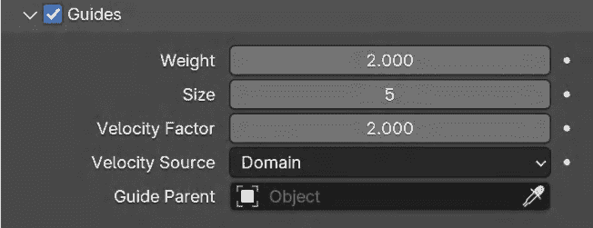

图 2.40 – 向导设置

需要注意的是，**自适应域**与向导配合使用时无法正常工作。烘焙前请确保关闭**自适应域**；否则你可能会遇到崩溃。

> **启用向导会给模拟带来大量额外计算**
> 
> 即使你没有使用任何向导，只要启用了它们，模拟仍会计算算法。这会增加烘焙时间，因此建议仅在需要使用时才启用向导。

向导通过获取对象或模拟的速度并将其添加到当前模拟中来工作。这与力场的工作方式类似。例如，如果你将一个立方体设为向导并让它穿过烟雾，它会添加一些速度并带动烟雾移动，如下图所示：

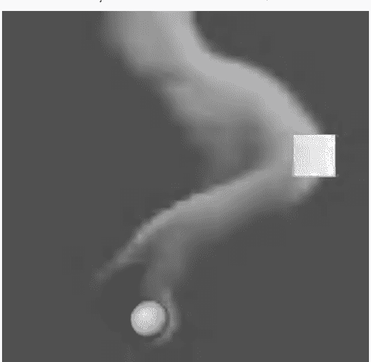

图 2.41 – 向导示例

选择**模块化**缓存类型后，你可以通过在**向导**面板中点击相应的复选框来启用向导。从这里开始，我们有几个设置需要介绍：

- **权重：** 这控制向导的“滞后”量。值越高，向导越不强，烟雾会滞后。
- **大小：** 这决定由向导产生的漩涡和气流有多大。值越高，涡流越大：

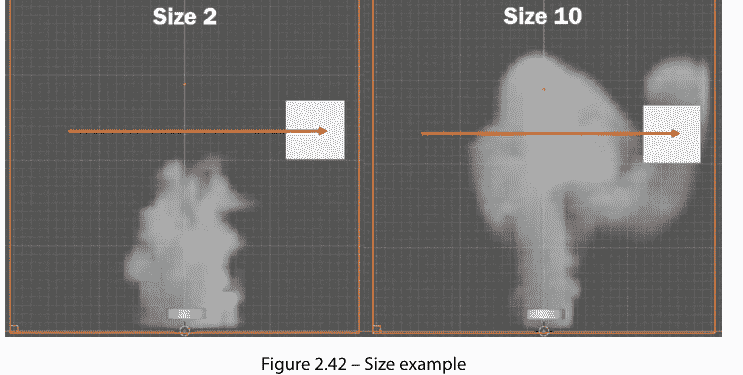

图 2.42 – 大小示例

- **速度因子：** 这会将向导的速度乘以此值。数值越高，烟雾/流体移动越快。
- **速度来源：** 这可以是效应器对象或另一个域。如果你选择**域**，则需要创建一个另一个模拟作为引导速度，并在**向导父级**菜单中选择它：

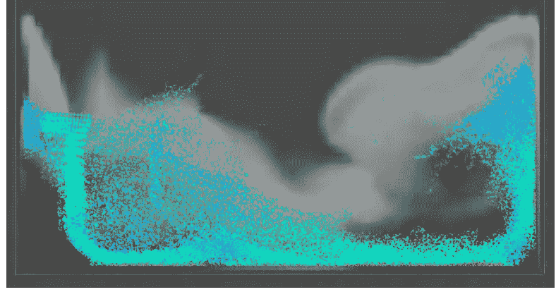

图 2.43 – 域向导示例

在前面的图示中，我设置了一个流体模拟作为烟雾模拟的向导。如你所见，烟雾表现得像流体。

为此，首先你需要创建并烘焙一个流体模拟。然后，你可以创建另一个模拟，这次使用烟雾。确保使用不同的域和不同的缓存目录，以免相互覆盖。

最后，启用**向导**，并为**向导父级**选择流体域。烘焙后，你将得到一个表现得像流体的烟雾模拟！

**烘焙**和**释放烘焙**仅在你使用**效应器**类型且缓存类型为**模块化**时可用。

要将对象添加为效应器向导，选择一个网格并选择**流体** | **类型** | **效应器** | **效应器类型** | **向导**。你需要确保效应器具有一定的移动/速度；否则它对模拟的影响不大。

我们将在本章的**效应器**部分介绍前四个设置，但现在让我们讨论**速度因子**和**向导模式**：

- **速度因子**：这是向导的强度。值越高，烟雾移动越快。**效应器**设置和**域**设置中都有速度因子值的原因是为了让你能够单独控制模拟中的每个向导。
- **向导模式**：这决定向导效应器应如何根据**速度因子**的值影响模拟的速度：
  - **最大值**：这取上一帧和当前帧的速度并保留最大值。
  - **最小值**：这取上一帧和当前帧的速度并保留最小值。
  - **覆盖**：这可能是你最常使用的选项。它会为每一帧始终写入新的引导速度。
  - **平均值**：这取上一帧和当前帧的速度并取平均值。

向导非常独特，可以创建一些非常有趣的模拟！我建议尝试不同的设置，看看你能创造出什么。

## 集合
集合面板允许你选择某些集合作为该域中的流或效应器。例如，如果你在不同的集合中有多个流，并且你只想使用其中一个集合，你可以在这里选择它：

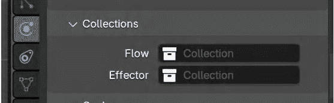

图 2.44 – 集合示例

现在，只有该集合中的流才会与模拟交互。对效应器对象也是同样的方式。

## 字段权重
字段权重允许你更改力场对模拟的影响程度。

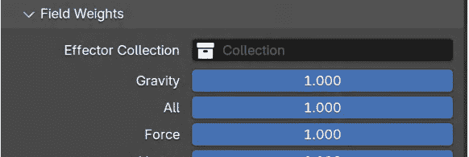

图 2.45 – 字段权重

如果场景中有风力场，并且你将风值调至 0，该力就不会影响该域。这在你有多个域且不希望力影响所有域时很有用。

当你设置效应器集合时，只有该集合中的力场才会影响模拟。

All 值会影响模拟中的所有力场。

## 视口显示
**Viewport Display** 是另一种查看模拟的方式，它仅影响视口，不影响渲染。**Viewport Display** 允许你可视化烟雾的速度、密度、X、Y 或 Z 力、热量、燃料等。

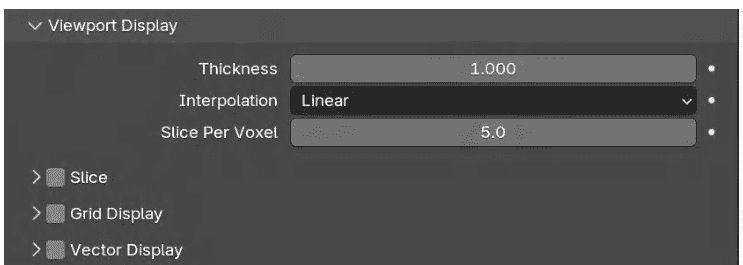

图 2.46 – 视口显示

- **Thickness**：这会改变烟雾的密度，让你看到厚烟或薄烟的效果。
- **Interpolation**：这决定烟雾的显示方式。有三个选项可供选择：
  - **Closest**：显示原始体素。
  - **Linear**：平滑且快速。
  - **Cubic**：提供最佳质量，但会运行稍慢一些。

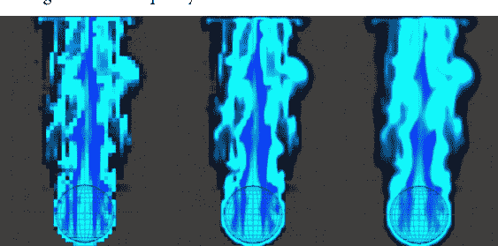

图 2.47 – 插值模式示例

- **Slice**：这允许你切片模拟以查看其平面版本。你可以更改显示位置的 **Axis** 值，以及其位置！
- **Grid Display**：显示模拟的不同属性：
  - **Field**：这是可从中选择要在烟雾中可视化属性的菜单。其中包括 **Density**、**Velocity** 和 **Fuel**。
  - **Scale**：控制 **ColorRamp** 的显示方式。在 **ColorRamp** 中设置不同颜色会产生一些有趣的结果。
- **Vector Display**：提供烟雾方向和速度的信息。**Scale** 会改变显示速度的针的大小：

Viewport Display 很适合玩弄，它是帮助可视化模拟某些方面的好工具。再次说明，它仅影响视口——不会改变渲染的外观。

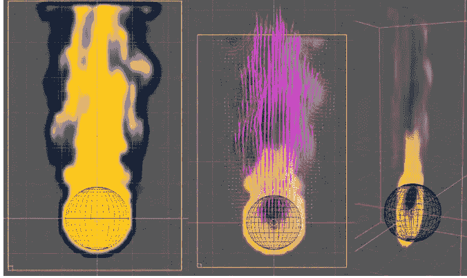

图 2.48 – 视口显示示例

现在让我们来看一下域中的最后一个设置！

## 渲染
使用气体类型域时，最底部还有一个名为 Render 的选项卡。

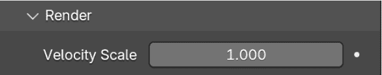

图 2.49 – 渲染选项卡

**Velocity Scale** 是火焰和烟雾出现运动模糊量的乘数。为此工作，首先需要在 **Render** 面板中勾选 **Motion Blur** 框以启用运动模糊。在此选项卡中，**Shutter** 值设置场景模糊的强度，而 **Velocity Scale** 值将该值乘以火焰或烟雾。在下图中，**Shutter** 量设置为 0.5，**Velocity Scale** 从左到右为 0、1 和 2。

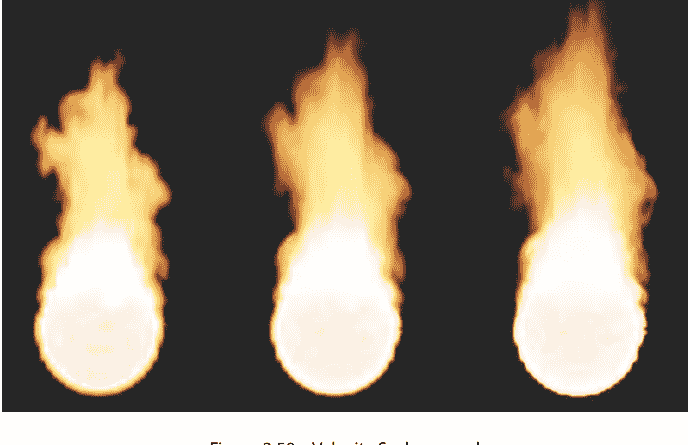

图 2.50 – Velocity Scale 示例

你会看到，使用值为 2 时，火焰中的细节会丢失很多，一切看起来都被拉伸了。在这种情况下，你可以降低 **Velocity Scale** 和 **Shutter** 量来减少模糊。另一个需要注意的是，此设置仅在 Cycles 中有效。目前 EEVEE 不支持体积的运动模糊。

就这样——我们已经完成了域中所有设置的讲解！内容相当多，但希望你学到了新东西。如果以后忘记某个设置的作用，只需回来参考本章即可。最后，让我们谈谈流对象和效应器对象！

## 流对象
流对象用于向模拟中添加烟雾/流体或将其移除，并且必须位于域边界框内才能正常工作。要向模拟中添加流对象，只需选择任何网格。然后，在 **Physics** 面板中选择 **Fluid** | **Type** | **Flow**。

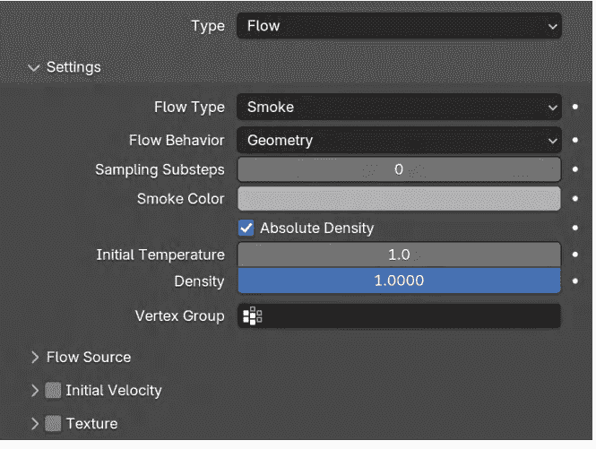

图 2.51 – 流设置

让我们逐一介绍流对象的设置并了解每个设置：

- 有四种流类型可以添加：
  - **Smoke**：这只会在域中发射烟雾。
  - **Smoke + Fire**：这会在域中同时发射烟雾和火焰。
  - **Fire**：这只会发射火焰。请记住，燃烧的燃料会产生少量烟雾。如果你只想要火焰，请将域中的 **Flame Smoke** 设置为 0。
  - **Liquid**：这当然会向域中发射流体。
- **Flow Behavior**：控制流如何与模拟交互：
  - **Inflow**：这会不断向模拟中添加流体/烟雾。
  - **Outflow**：这会从模拟中移除任何接触流对象的流体/烟雾。这对于创建排水口或真空，或防止整个域被流体填满很有用。你还可以动画化这些对象的移动以创建有趣的效果。
  - **Geometry**：这会采用网格的大小并将其添加到模拟中。
- **Use Flow**：用于启用或禁用流对象。此值也可以动画化。这对于打开或关闭流出或流入非常有用。
- **Sample Substeps**：用于快速移动的流。如果你有移动非常快的流对象，你需要将其调高。如果不这样做，你的烟雾看起来会像跳过了某些帧：

图 2.52 – 采样子步示例

- **Smoke Color**：用于为不同流设置不同颜色的烟雾。混合时会产生组合颜色：

图 2.53 – 烟雾颜色示例

- **Absolute Density**：勾选时，流对象会发射烟雾，但仅在有空间时。如果未勾选，流会继续向域中发射烟雾，即使它已经填满。
- **Initial Temperature**：控制烟雾是上升还是下降。此值也与域中的 **Heat** 值相关联。如果 **Heat** 设置为 1 而 **Initial Temperature** 设置为 -1，烟雾会保持在原地，几乎不移动。但如果 **Initial Temperature** 设置为 -1.5，则烟雾会下沉，因为初始温度的值高于热量。记住，如果两个值都是负数，烟雾会上升；如果一个为正一个为负，烟雾会下沉。这在你希望不同流对象上升或下沉时很有用。
- **Density**：这是发射的烟雾量及其密度：

图 2.54 – 密度示例

- **Fuel**：控制火焰的高度和狂野程度。较高的值会产生更高、更嘈杂的火焰：

图 2.55 – 燃料示例

- **Vertex Group**：允许你选择特定的顶点组来确定在网格上的哪个位置发射火焰或烟雾。这对于创建火焰轨迹或其他酷炫效果非常有用。我们将在 *Chapter 6* 中了解更多关于顶点组的内容。
- **Flow Source**：流的来源。对于烟雾模拟，有两个选项可供选择：
  - 如果选择 **Mesh**，则整个对象会发射烟雾。
  - 如果选择 **Particle System**，你需要从下拉菜单中选择一个粒子系统。现在，每个粒子都会向模拟中发射烟雾。下图显示了粒子飞向空中并在后面拖着烟雾：

图 2.56 – 粒子系统示例

这对于创建爆炸非常有用，我们将在 *Chapter 5* 中学习。你还可以通过更改 **Size** 值来设置每个粒子周围烟雾的半径。

创建流体模拟时，**Mesh** 是唯一可用的选项。

- **Is Planar**：如果你的流对象是非流形的，请确保勾选 Is Planar。这将帮助 Blender 获得最准确的结果。

> **什么是非流形网格？**
> 非流形网格是不能在现实世界中存在的网格。例如，一个平面会被视为非流形网格。

-   **表面发射：** 这是烟雾/流体将从网格表面发射出来的距离。
-   **体积发射：** 这是网格内部将被发射的烟雾/流体量。1 将填满整个物体。
-   如果将 **流体源** 改为 **粒子系统**，你还可以设置从每个粒子发射烟雾/火焰的 **大小** 值。
-   **初始速度：** 如果勾选此项，将使烟雾/流体保持由流动产生的动量并将其应用于模拟。如下图所示，顶部的立方体已勾选 **初始速度**；当它移动时，烟雾会随之移动：

Figure 2.57 – 初始速度示例

在 **初始速度** 面板中，我们还有几种控制烟雾/流体发射位置的方法：

-   **源：** 这是烟雾/流体继承动量的系数。1 表示它将与流动物体具有相同的速度。值为 2 表示在流体/烟雾发射时其移动速度为两倍。
-   **法线：** 这是烟雾/流体沿网格法线方向的速度大小。

### 什么是法线？
在几何学中，法线是指面所指向的方向。例如，如果你将一个立方体设置为发射烟雾并提高 **法线** 值，烟雾将沿着立方体的每个面射出。

-   **初始速度**：这可以设置在某个轴上——无论是 **X**、**Y** 还是 **Z**。这对于快速朝一个方向发射流体非常有用。
-   **纹理**：这允许你将纹理映射到流动物体（仅限烟雾/火焰流动）。要创建新纹理，请前往 **纹理属性** 面板并选择 **新建**。你可以从大量生成的纹理中选择，也可以选择 **图像/电影** 来使用自己的纹理。完成后，返回 **物理** 面板并从下拉菜单中选择它！

你可以在流动物体上设置纹理的 **大小** 和 **偏移** 值。**偏移** 值也可以被动画化，以使火焰看起来更逼真：

Figure 2.58 – 纹理示例

这就是流动物体的所有设置。在结束本章之前，让我们看看可以添加到模拟中的最后一个物体。

## 效应器

效应器物体提供了一种为模拟添加碰撞的方式。这类物体可以是任何网格。要添加效应器物体，请选择任意网格。然后在 **物理** 面板中选择 **流体** | **类型** | **效应器**。

Figure 2.59 – 效应器设置

Mantaflow 中有两种效应器：**碰撞** 和 **引导**。我们之前学习过引导，所以让我们选择 **碰撞**。让我们回顾一下四个设置：

-   **采样子步长**：这与流动物体的 **子步长** 非常相似。如果有快速移动的碰撞，建议提高此值；否则可能会出现一些不准确的情况。
-   **表面厚度**：这是将被视为碰撞的物体周围区域。值越高，流体与表面的碰撞距离就越远。
-   **使用效应器**：这会启用或禁用效应器。这对于动画化碰撞并将其打开和关闭非常有用。
-   **是否为平面**：同样，如果你的效应器是非流形，则确保勾选 **是否为平面**。这将帮助 Blender 获得更准确的碰撞：

Figure 2.60 – 碰撞示例

如果你有多个想要添加效应器碰撞的物体，最简单的方法是全部选中。然后在选中活动物体后，点击 **流体 | 类型 | 效应器**。然后按 *Ctrl + L* 或 *Cmd + L* 并选择 **复制修改器**。这样会复制你的设置并将其应用到所有选中的物体。

就是这样；这些就是 Mantaflow 中效应器碰撞中的所有设置！

## 摘要

我们在本章中涵盖了相当多的内容，所以让我们快速回顾一下。首先，我们学习了域、一些设置（分辨率细分和时间步长），以及不同缓存模式的重要性，包括 **回放**、**模块化** 和 **最终**。我们讨论了烟雾设置、密度、热量、涡度、自适应域以及溶解烟雾。我们还介绍了如何使用 **噪声** 轻松为烟雾添加更多细节，以及如何在 **火焰** 面板中更改火焰的外观。

之后，我们转向了液体设置，并详细讨论了液体粒子；网格；泡沫、喷雾和气泡粒子；速度矢量模糊；以及许多其他选项。引导是另一个我们涵盖的话题，我们看到了如何将另一个物体的速度添加到模拟中。最后，我们介绍了流动物体和效应器以及它们附带的所有设置。

希望本章能让你深入了解 Mantaflow 中的所有设置。记住，如果你忘记了某个设置的作用，可以回来参考本章！

在进入 *第 3 章* 之前，我建议你打开 Blender 并根据本章学到的内容创建一个模拟。这样一切都会深入人心，也更容易记住。你可以创建一个照亮洞穴的火把、公园里的喷泉，或是酷炫的从天而降的流星！发挥你的想象力，放开手脚去做吧！

我们已经讨论完了设置。现在，让我们利用刚刚学到的知识创造点什么。在下一章中，我将向你展示如何使用 Blender 中的 Mantaflow 制作逼真的篝火！
