## 创建逼真的篝火模拟

是时候检验我们刚刚学到的技能了。在本章中，我们将创建一个逼真的篝火模拟，并学习如何在 Blender 中创建火花！创建火焰很容易，但创建看起来逼真的火焰则是另一回事。你需要考虑域、流动物体、任何碰撞、灯光和材质的设置。不仅仅是把域中的分辨率设为 1,000 然后点击 **烘焙** 就行了。记住，将分辨率设得超高并不一定意味着火焰会好看；而且我敢肯定，如果你这样做，Blender 会崩溃。

在本章中，我们将涵盖以下主题：

-   创建篝火模拟
-   创建火焰材质
-   使用粒子系统创建火花
-   创建粒子材质
-   添加最终细节

本章有很多内容要讲，所以让我们直接开始吧！

## 技术要求

本章要求你已安装 Blender 4.2 或更高版本。要下载 Blender，请访问 www.blender.org。

本教程稍微进阶一些，我们不会涵盖所有内容。我们假设你知道 Blender 的基础知识以及如何渲染动画。

请确保下载 `Campfire Setup.blend` 以跟随本章学习。它可以从 `https://github.com/PacktPublishing/Learn-Blender-4-Simulations-the-Right-Way/tree/main/Chapter%203` 下载。

## 创建篝火模拟

如 *技术要求* 部分所述，为了在本章开始时领先一步，请确保下载名为 `Campfire Setup.blend` 的篝火 3D 模型。此 `.blend` 文件中已有一些原木、岩石和材质；因此我们可以直接开始创建模拟。

当你打开 `Campfire Setup.blend` 文件时，你会注意到篝火模型非常大，宽度超过 2.6 米。如果我们将模型缩放到真实大小并尝试模拟它，效果不会很好。这是因为 Blender 在小尺度下模拟起来很困难。我们遇到过火焰填满整个域的问题，这使得火焰看起来非常嘈杂，而且烘焙需要非常长的时间。一般来说，以较大尺度模拟通常是个好主意。

如果你已经在小尺度下创建了场景呢？解决办法是，在另一个 `.blend` 文件中创建模拟，然后将该模拟作为体积物体导入。然后，你就可以缩小火焰并将其移动到场景中的任何位置。

现在，让我们创建域物体并开始设置模拟！

## 设置域

在打开 `Campfire Setup.blend` 文件后，让我们创建一个域物体并更改一些设置以获得理想的外观：

1.  首先，添加一个立方体物体作为我们的域，并将其缩放以适应篝火。你只需要将其缩放以适应原木，不需要适应岩石。然后，再次确认立方体的高度足以容纳你想要的火焰：

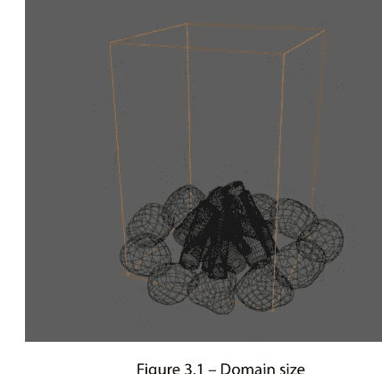


- 2. 如果你对它满意，就前往 **物理** 标签并选择 **流体**。然后，对于 **类型**，选择 **域**。
- 3. 至于域设置，让我们先将 **分辨率细分** 改为 96。这将为我们提供高质量的火焰。
- 4. 使用当前设置，火焰在模拟中会移动得非常快，因此让我们通过将 **时间比例** 改为 0.5 来抵消这一点。这将减慢火焰速度。
- 5. 将 **CFL 数** 设置为 4。这将减少模拟步数，从而减少烘焙时间。
- 6. 勾选 **自适应域** 旁边的框，以帮助减少烘焙时间。
- 7. 在 **气体** 标签中，将 **涡度** 设置为 0.1，以便烟雾具有一点随机性。
- 8. 打开 **火焰** 标签并将 **反应速度** 改为 0.50。使用默认值 0.750，火焰对于我们的场景来说可能有点太短了。请记住 **反应速度** 控制火焰的高度。值越低火焰越高，值越高火焰越短。随意自定义此值！
- 9. 现在，让我们设置 **缓存** 面板，以便我们可以烘焙模拟：
  - 首先，将 **类型** 改为 **模块化**，以便我们可以烘焙模拟。
  - 将 **结束帧** 设置为你想要模拟的长度；150 帧对于此模拟来说是合适的长度。
  - 最后，勾选 **可恢复**，以防你需要停止烘焙。我们不需要此模拟中的任何 **噪声**，因为我们发现启用它时火焰看起来太凌乱了。
- 10. 最后，打开最底部的 **渲染** 标签并将 **速度缩放** 设置为 0.1。此值控制火焰上会出现多少运动模糊。请记住，即使在烘焙模拟后也可以更改此值。

就这样——我们已经设置好了域。现在，是时候创建所有 **流** 对象了！

## 设置流入

现在域已经设置好并准备就绪，让我们创建流对象。如果你看看真实的篝火，你会注意到并不是所有的木棍和原木都在燃烧；只有底部附近的才在燃烧：

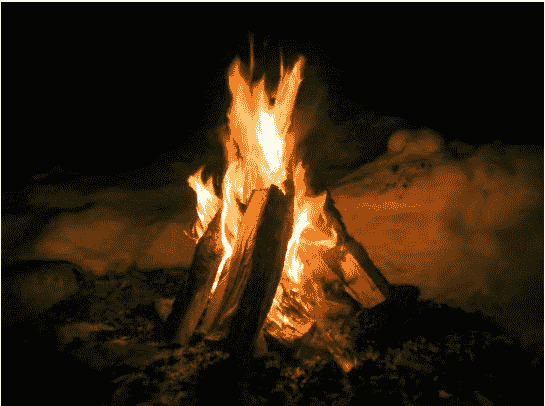

图 3.2 – 真实篝火示例

让我们通过仅选择火焰底部的原木并将其设置为流入对象来复制这一点。可以选择作为流入对象的对象是 Cylinder.001 到 Cylinder.006。你可以通过查看 Blender 右上角的 Outliner 区域来查看它们的名字，如下所示：

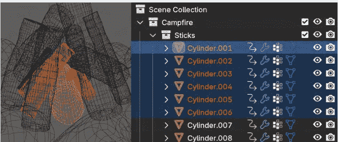

图 3.3 – 流入选择

一旦我们创建了第一个流入，我们就可以将相同的设置应用到其余对象。让我们开始吧：

- 1. 跳到 **物理** 面板（如果它尚未显示，选择 **流体**）。
- 2. 对于 **类型**，选择 **流**。
- 3. 将 **流类型** 设置为 **火焰**，将 **行为** 设置为 **流入**。
- 4. 让我们将 **燃料** 值增加到 1.2，只是为了让火焰看起来更混乱一些。
- 5. 在 **源** 标签中，将 **表面发射** 设置为较低的值 1。这将使火焰更接近网格表面。以下图为例：

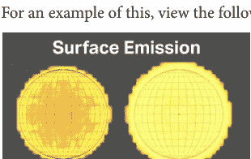

图 3.4 – 表面发射示例

- 6. 现在，让我们启用纹理。这将允许我们控制火焰在对象上发射的位置。勾选 **纹理** 框，然后前往 **纹理** 面板（它看起来像棋盘格图案）：

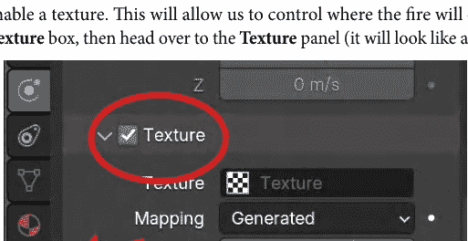

图 3.5 – 纹理示例

这是我们创建和设置对象纹理的地方：

- I. 点击大的 **新建** 按钮创建新纹理。
- II. 为了保持井井有条，让我们将此新纹理命名为 *Inflow Texture*。
- III. 对于 **类型**，选择 **云**。这将为我们提供非常嘈杂的图案，当火焰从 **流入** 对象发射时看起来会很漂亮。

- IV. 目前，纹理对于我们的对象来说有点太大了，所以让我们将 Size 设置为 0.1。

- V. 使用纹理作为流入时，它们充当火焰发射位置的遮罩。纹理的白色部分会发射火焰，黑色部分不会。为了在纹理的白黑部分之间获得更多定义，让我们在颜色标签中将对比度设置为 2。这将使纹理边缘更清晰。

现在你的纹理应该看起来像这样：

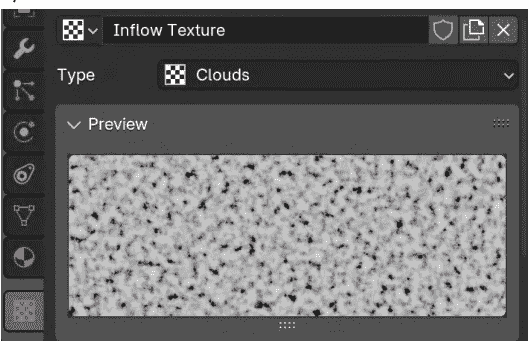

图 3.6 – 纹理预览

- 7. 让我们将刚刚创建的纹理分配给流入。返回物理面板并从下拉菜单中选择纹理。你可能会看到很多其他纹理——这是因为岩石。只需输入 Inflow，我们的纹理（Inflow Texture）就会弹出！

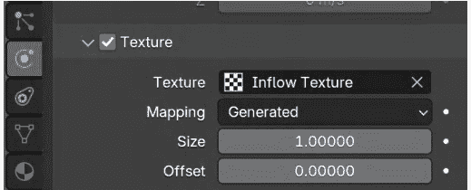

图 3.7 – 流入纹理选择

- 8. 我们想要做的另一件事是在模拟时移动对象上的纹理。这将为火焰提供随机变化，使其看起来更逼真。我们可以通过在纹理标签中使用 Offset 来实现。不要为此值设置动画，让我们只需创建一个驱动程序自动为我们完成此操作。点击此 Offset 字段，输入 #frame/250，然后按 Enter！

现在，纹理将在动画播放时移动。

- 9. 现在我们已经创建了第一个流入，让我们复制所有这些设置并将其应用到其余对象。确保你想要分配的对象已被选中，并且具有流入设置的对象最后被选中。如果操作正确，最后一个对象将以不同的黄色/橙色单独高亮显示。这将确保它是 *活动对象*。

> **活动对象是什么？**
> 当你在 Blender 中选择多个对象时，其中一个会有黄色轮廓。
> 这就是你的活动对象。其余对象将具有橙色轮廓。

然后，按 *Ctrl + L* 或 *Cmd + L* 并点击 **复制修改器**。现在，所有这些对象都将具有我们刚刚创建的相同设置！另一种方法是转到 **对象 | 关联/传输数据 | 复制修改器**。

- 10. 前一步仅复制了流入的设置——它没有复制我们在 *第 8 步* 为纹理偏移创建的驱动程序。我们需要做的是复制纹理的动画数据。按 *Ctrl + L* 或 *Cmd + L* 并选择 **关联动画数据**。现在，所有对象都将具有我们之前创建的相同驱动程序。

就这样；我们已成功创建了所有流入对象。接下来我们需要做的是分配一些效应器对象。我们不希望火焰穿过原木，所以让我们分配一些碰撞！

## 添加效应器

这部分很简单——我们需要做的就是为所有不是流入的原木分配效应器碰撞，如下所示：

- 1. 在 **大纲** 区域（屏幕右上角）中选择 **Cylinder.007** 到 **Cylinder.014**，如下所示：

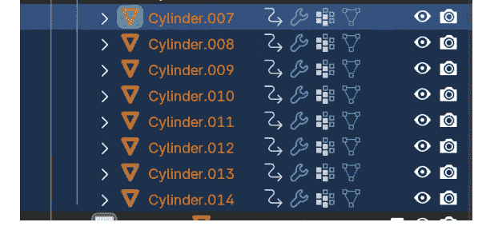

图 3.8 – 效应器选择

- 2. 在 **物理** 面板中，选择 **流体**，对于 **类型**，选择 **效应器**。
- 3. 只需通过按 *Ctrl + L* 或 *Cmd + L* 并选择 **复制修改器** 来重复我们为流入对象所做的过程。现在，每个对象都将分配效应器碰撞！

我们不需要为岩石分配碰撞，因为火焰不会到达那里！完成之后，我们就可以烘焙模拟了。为此，选择你的域对象并点击 **烘焙数据**。查看以下图，看看你的模拟目前应该是什么样子！

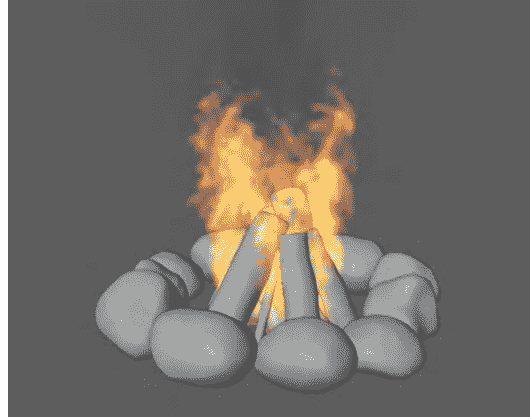

图 3.9 – 已烘焙模拟

现在模拟已完成，我们准备创建漂亮的火焰材质！

## 创建火焰材质

现在模拟已经完成，我们准备创建火焰材质。这里有一件事我们想提一下，对于这个场景，我们将使用 Cycles 来渲染动画。这有几个原因。

主要原因之一是使用 EEVEE 时，体积不会发射光。这意味着火焰看起来只是发光，而不会照亮场景的其余部分。由于我们追求逼真的模拟，我们希望使用 Cycles，以便火焰向周围区域发射光。

另一个原因是材质中有几个功能仅在 Cycles 渲染引擎中有效。因此，前往 **渲染** 面板并将引擎切换为 **Cycles**。完成此操作后，你就可以开始了！


完成以上步骤后，让我们来创建这种充满火焰的材料：

1. 让我们先在屏幕顶部选择 **着色** 工作区。以下图示显示了您可以创建火焰材质的位置：

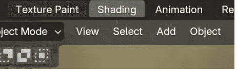

图 3.10 – 着色工作区

2. 要创建新材质，请点击屏幕中间的大 **新建** 按钮：

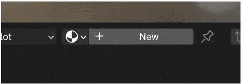

图 3.11 – 新材质

3. 我们不需要 **Principled BSDF** 着色器，所以请继续删除它。然后，用 **Principled Volume** 着色器替换它。要添加新节点，请按 *Shift + A*，然后前往 **着色器** 并选择 **Principled Volume**。从那里，取 **Volume** 输出并将其插入 **材质输出** 节点中的 **Volume**，如下所示：

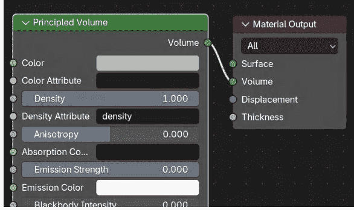

图 3.12 – Principled Volume

4. 将 **密度** 设置为大约 5 的值，以使烟雾更浓密。

5. 在 *第 1 章* 中，我们使用 **Blackbody Intensity** 来添加火焰。虽然这种方法确实有效，但使用这种方法会产生一些尖锐的边缘，使火焰看起来质量较低。相反，我们将使用 **Heat** 属性来添加火焰。

## 属性

**Heat** 以及许多其他属性都可以带入材质并按您喜欢的方式使用。例如，您可以取速度属性并将其插入发射值。然后，您将能够在模拟中看到速度的值。*火焰、密度、温度,* 和 *速度* 只是您可用的属性中的几个。此外，**Heat** 属性仅在 Cycles 渲染引擎中有效。

要使其工作，我们需要添加 **属性** 节点。要执行此操作，请按 *Shift + A* 并选择 **输入 | 属性**。

6. 在 **名称** 字段中，输入小写的单词 *heat*。然后，将 **Fac** 输出插入 **发射强度**。

7. 为了更好地控制，让我们添加一个 **颜色渐变** 节点。要执行此操作，请点击 *Shift + A*，前往 **转换器**，然后选择 **颜色渐变** 并将其放置在 **属性** 节点和 **Principled Volume** 之间。如果将 **颜色渐变** 的黑色手柄向白色手柄滑动，它将限制这些值，赋予您火焰的外观。您还可以将 **颜色渐变** 从 **线性** 切换到 **缓和** 以获得更平滑的过渡。

如果您进入 **渲染视图**，您将看到节点设置目前应有的样子：

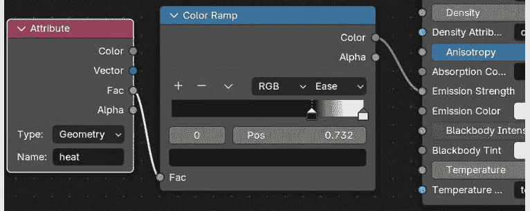

图 3.13 – 热属性

8. 让我们让火焰更亮一些吧？为此，添加一个 **数学** 节点。按 *Shift + A*，前往 **转换器**，并选择 **数学**。然后，将节点放置在 **颜色渐变** 和 **Principled Volume** 之间。如果您将模式从 **加** 更改为 **乘**，底部值现在将控制发射的强度。让我们将其设置为 50 的值。

9. 现在，添加一些颜色。通过按 Ctrl + Shift + D 复制颜色渐变；这将保持与属性节点的连接（仅按 Shift + D 将断开连接）。然后，将新的颜色渐变节点插入 Principled Volume 中的发射颜色。

如果我们观察真实的火焰，您会注意到边缘带有这种红色色调，并且随着您更接近火焰底部，它会变成橙色然后是白色：

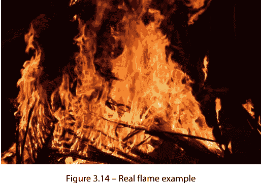

图 3.14 – 真实火焰示例

要获得相同的外观，请选择颜色渐变节点的黑色手柄并将其设置为红色，然后将白色手柄设置为橙色。随意调整位置直到看起来不错。您始终可以在以后更改颜色以获得火焰的不同外观！

10. 最后，为了让火焰更具细节，让我们回到第一个颜色渐变节点并通过点击 + 按钮添加另一个手柄。将我们刚刚添加的手柄移动到最右侧并将颜色设置为黑色。double-check 白色手柄稍微靠左。查看以下图示作为示例：

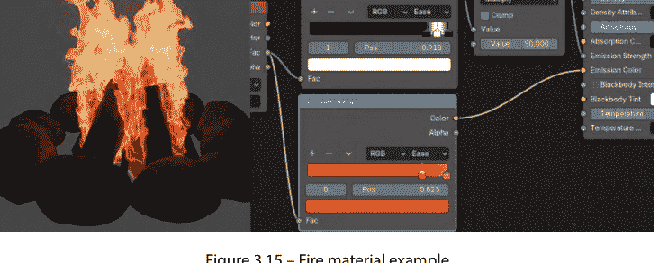

图 3.15 – 火焰材质示例

请记住，随着 **颜色渐变** 节点的移动，其周围的黑色手柄会限制火焰值。考虑到这一点，在右侧添加一个黑色手柄会去除底部最部分的火焰。反过来，这会使火焰看起来更详细、更有趣。查看 *图 3.15*。

就是这样！我们已经完成了火焰材质的创建。万一您在这一节中感到困惑，以下图示提供了所有节点的完整预览：

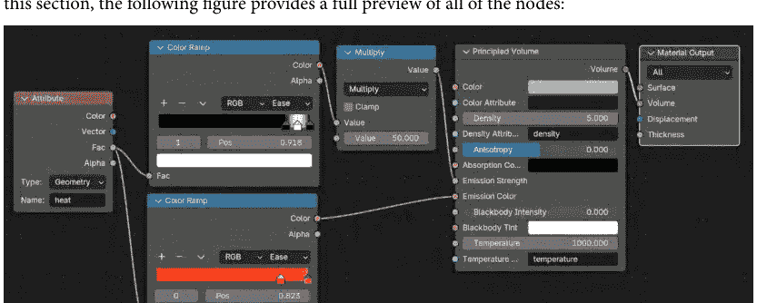

图 3.16 – 完整材质预览

在下一节中，我们将学习如何使用粒子系统为火焰添加火花！

## 使用粒子系统创建火花

现在模拟已配有材质，是时候着手创建从火焰中飞出的火花了。这使用粒子系统非常容易完成。在 Blender 中使用粒子系统非常有用，与手动添加对象相比可以节省大量时间。该系统通过从网格对象发射粒子，通常数量很大。诸如火花、灰尘、头发、草等许多东西都可以使用粒子轻松创建！

现在，让我们创建火花：

- 1. 首先，我们需要为粒子发射添加一个新的网格对象。对于这个场景，圆形效果会很好。让我们通过按 *Shift + A* 然后前往 **网格** 并选择 **圆形** 来添加一个。
- 2. 添加圆形后，查看屏幕左下角；您应该会看到一个 **添加圆形** 菜单。打开它；在这里我们设置圆形的属性。我们需要确保此网格具有面并且足够小以适应火焰。将 **填充类型** 设置为 **N-Gon**，将 **半径** 设置为 0.25。然后，将其放置在火焰下方：

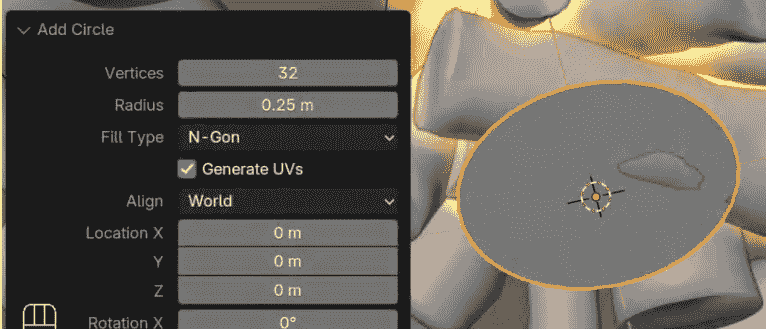

图 3.17 – 添加圆形

3. 前往粒子系统面板并通过点击 + 按钮创建一个新的粒子系统：

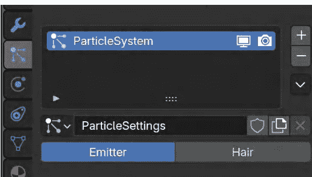

图 3.18 – 创建粒子系统

4. 我们不需要 1,000 个火花，所以让我们将数量设置为 50。随意尝试此值，直到找到您喜欢的效果！

5. 由于动画只有 100 帧长，请将结束帧也设置为 150。

6. 如果您播放我们的动画，您会注意到出现了大白点。这些被称为光晕。这些光晕可以用在许多方面，包括从每个粒子发射火焰/烟雾，我们将在第 5 章学习到这一点。对于本教程，我们需要使用实际对象代替。让我们添加 Icosphere，将其移动到篝火左侧以便不碍事，并将其缩放到 0.5。

7. 现在再次选择圆形对象。要将每个粒子指定为 Icosphere，请打开渲染选项卡并将渲染为设置为对象。然后，对于实例对象，选择我们刚刚添加的 Icosphere 对象。

8. 随意调整比例值，直到粒子足够小。您还可以增加随机比例为每个粒子赋予随机大小。

9. 我们不希望这个圆形出现在渲染中，所以关闭显示发射器：

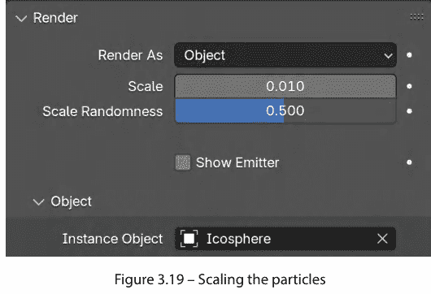

10. 目前，粒子正在下落，这不是很好。让我们打开力场权重并将重力设置为 0：

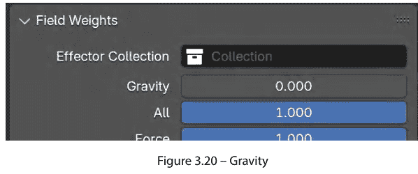

11. 下一个问题是，我们如何让粒子跟随火焰的流动？好吧，有一个力场正好可以做到这一点！让我们通过按 Shift + A 然后前往力场并选择流体流动来添加它。

选择力场后，我们需要跳到物理面板并将域对象设置为场景中的域，在本例中为立方体对象。现在，粒子将随火焰流动而移动！如果您希望粒子移动更快，可以增加强度值：

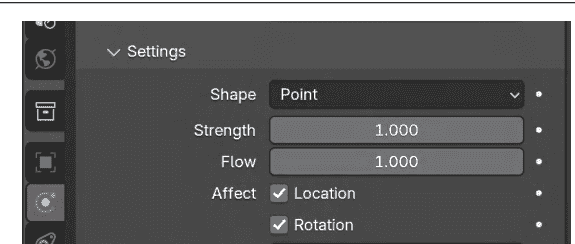

图 3.21 – 流体流动设置

这样，我们就完成了粒子系统的创建！随意调整粒子数量、力场的强度以及您喜欢的其他内容以获得所需的外观！在讨论渲染之前，我们需要为火花创建一个材质。

## 创建粒子材质

列表中的下一件事是创建粒子材质。在现实生活中，火花刚从火焰中发射出来时，它们非常明亮的白色。随着它们上升并冷却，它们会变成更偏橙红色。我们可以通过向材质添加几个不同的节点来创建相同的外观：

- 1. 选择 **Icosphere** 并再次打开 **着色器编辑器**。然后，通过点击 **新建** 按钮创建一个新材质。
- 2. 删除 **Principled BSDF** 并用 **发射着色器** 替换它，然后将 **强度** 设置为 20 的值。
- 3. 将 **发射** 输出插入 **材质输出** 中的 **表面**。
- 4. 接下来，我们将添加一个名为 **粒子信息** 的新节点。要添加此新节点，请按 *Shift + A*，前往 **输入**，并选择 **粒子信息**。

> **粒子信息节点**
> 此节点允许我们从粒子系统中获取某些数据并使其影响材质。例如，您可以取 **随机** 输出并将其插入 **颜色渐变**。现在，每个粒子将基于 **颜色渐变** 具有随机颜色。需要注意的一点是，此节点仅在 **Cycles** 渲染引擎中有效。

5. 我们需要从 **粒子信息** 节点中取出 **年龄** 和 **生命周期** 输出，并使用 **数学** 节点将它们相除。这将允许颜色随着粒子变老并上升到空中而改变。要执行此操作，请按 *Shift + A* 并前往 **转换器 | 数学**。将 **数学** 节点设置为 **除** 并将 **年龄** 和 **生命周期** 插入 **除** 节点的两个输入中。如果您感到困惑，请参考图 3.22。


6. 最后，只需添加 **Color Ramp** 并将颜色更改为明亮的黄色和红色，然后将其连接到 **Emission Color** 插槽。**Color Ramp** 的左侧控制粒子开始时的颜色。随着粒子上升，它会变为右侧显示的颜色。

试着调整手柄位置来控制粒子何时变色。以下图示显示了完整的节点设置：

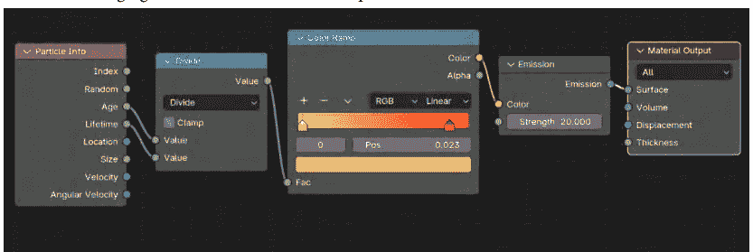

图 3.22 – 粒子材质

到此为止，本教程已接近完成。最后一步是放置摄像机并设置一些渲染设置！

## 添加最终细节

恭喜你坚持到教程的这一部分！希望你在途中学到了一些新的技巧和技术。

在本教程的最后一部分，我们将添加一个地面平面和一盏灯来帮助照亮火焰。我们还将启用运动模糊。让我们开始吧：

- 1. 让我们先添加一个 **Plane** 对象；它将作为地面层。这样，火焰就不会悬浮在 3D 空间中。
- 2. 接下来，跳转到 **Render** 面板并启用 **Motion Blur**。这会让火花看起来更逼真！**Shutter** 值越高，运动模糊就越多。0.2 的值适用于大多数情况：

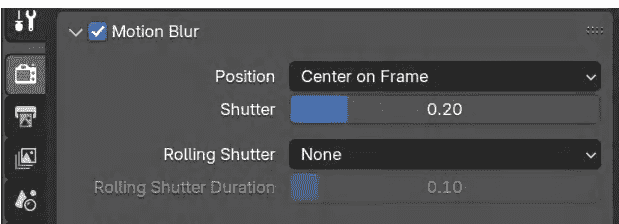

图 3.23 – 运动模糊

请记住，域设置中 **Render** 选项卡里的 **Velocity Scale** 值也会影响火焰上出现的运动模糊程度。因此，如果你想为场景中的其他物体添加更多运动模糊但不影响火焰，则需要增加 **Shutter** 值并减小 **Velocity Scale** 值。在渲染动画之前，建议先做几次测试渲染，以查看运动模糊的效果：

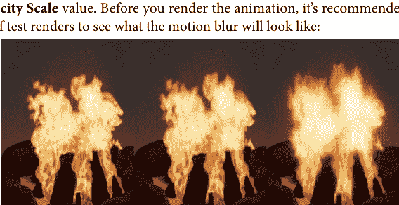

图 3.24 – 运动模糊示例

- 3. 接下来，打开 **Render Sampling** 选项卡并将 **Max Sampling** 设置为大约 50。确保 **Denoising** 也已勾选；这会让你的渲染看起来干净整洁，没有噪点！
- 4. 为了让颜色更突出一些，打开 **Color Management** 选项卡并将 **Look** 设置为 **High Contrast**。
- 5. 最后，在时间线上更改 **End Frame**，使其与你的模拟时长相匹配。对于这个场景，我们特别选择了 150。

就这些了。我们鼓励你对场景做一些额外的添加。也许在地面周围散落一些树叶，设置一个背景，在火边添加几根树枝和原木，甚至让一个角色坐下来——一切都由你决定！如果你想让火焰周围有一点光晕，你也可以在 **Compositor** 中添加一些 **Glare**。

一旦你对场景满意，只需设置好摄像机，选择一个 **Output** 目录，然后点击 **Render Animation!** 如果你想全面了解如何在 Blender 中正确渲染动画，请查看 *第 4 章* 结尾处的 *渲染动画* 部分。

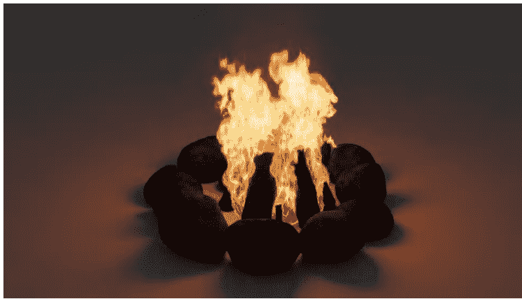

图 3.25 – 最终场景帧

要查看最终结果或下载此场景的 blend 文件，请访问 https://github.com/PacktPublishing/Learn-Blender-4-Simulations-the-Right-Way/tree/main/Chapter%203

## 总结

本教程到此结束。我们希望你学到了很多，并在过程中制作出了很酷的东西！

本章内容相当丰富，让我们做个回顾。首先，我们学习了如何创建火焰模拟，为流体对象添加纹理以在火焰中创造变化，并将相同的设置同时应用于多个对象。之后，我们讨论了如何使用 **Shader Editor** 中的 **Heat** 属性为火焰添加大量细节。我们还创建了一个粒子系统，并学习了如何使用 **Fluid Flow** 力场使粒子跟随火焰流动。最后，我们制作了一个粒子材质，使其在上升到空中时颜色发生变化！

在下一章，我们将远离烟雾和火焰。相反，我们将学习如何使用液体模拟在 Blender 4.2 中创建一个漂亮的瀑布！

## 练习

跟随教程学习如何做事固然很好，但自己尝试创作也很重要。不仅是很好的练习，还能帮助你记住我们刚刚学到的所有内容！所以，请看下面的图示并尝试思考你将如何创建它：

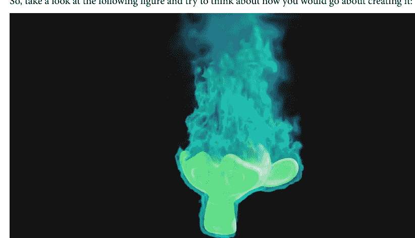

图 3.26 – 绿色火焰示例

## 在 Discord 上加入我们的社区

加入我们的 Discord 社区空间，与作者和其他读者进行讨论：

```
https://packt.link/learn-blender-simulations-discord-invite
```

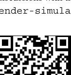
