## 使用 Mantaflow 创建瀑布

如果你曾经尝试创建逼真的液体模拟，你会知道这有多令人沮丧——95% 的时间都花在等待模拟烘焙完成上。然后，当你终于开始渲染时，才发现模拟存在问题。你又回到了原点，不得不重新开始整个过程。

为了解决这种反复试验的问题，我们将学习使用 Mantaflow 在 Blender 中创建逼真瀑布的整个过程。你还将了解为自己的模拟使用哪些设置，以便不必花费数小时（甚至数天）测试设置和弄清楚该怎么做。

我们首先将通过添加域、创建流体和效应器对象以及添加泡沫粒子来开始。然后，我们将创建逼真的水材质并学习如何为流体添加“假”运动模糊。

在本章中，我们将涵盖以下主题：

- 设置模拟
- 添加流入和效应器
- 创建泡沫粒子
- 创建材质
- 添加矢量模糊
- 渲染动画

## 技术要求

本章要求你安装 Blender 4.2 或更高版本。

要下载 Blender，请访问 www.blender.org。

另外，请确保在 https://github.com/PacktPublishing/Learn-Blender-4-Simulations-the-Right-Way/tree/main/Chapter%204 下载 Waterfall Setup.blend 文件以跟随本章学习。

## 设置模拟

在开始创建模拟之前，请确保下载 Waterfall Setup.blend 文件。该文件包含一个基本的瀑布模型，其中带有岩石材质、天空纹理以及一些已设置好的渲染设置。如果你想创建自己的瀑布模型，也完全可以！

我们首先通过添加域对象并设置所有流体设置来获得最佳模拟效果！继续打开 Waterfall Setup.blend 文件，让我们开始吧。我们将按照以下步骤进行：

- 1. 我们已经在本书中创建了一些模拟，过程类似。首先需要添加的是一个适合瀑布模型的域。按 Shift + A 并添加一个 Cube 对象。记住让域的大小刚好足以容纳瀑布模型。以下屏幕截图显示了域对象的侧视图：
- 2. 如果我们按 N 打开属性面板，你会注意到比例值与我们最初缩放立方体以匹配瀑布大小的程度成比例。

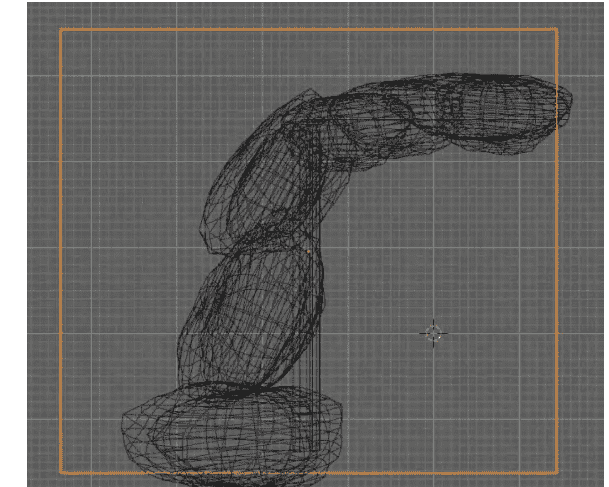

图 4.1 – 域的侧视图

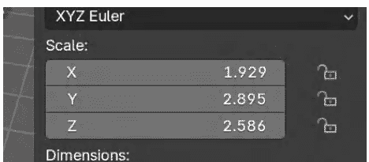

图 4.2 – 属性比例

使用当前的比例值，可能会导致模拟出现问题，因此让我们应用比例设置，使所有数字都恢复为 1 的值。要做到这一点，请选择域对象，进入 Object | Apply，并选择 Scale，或按 Ctrl + A 或 Cmd + A 快捷键并选择 Scale。

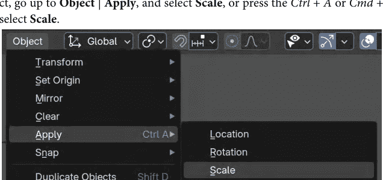

图 4.3 – 应用比例

**为什么要应用比例设置？**
通常在添加对象并更改其大小后应用比例设置是个好主意。当该设置未应用时，修改器、UV 贴图和其他操作可能会有点异常，并且不会按预期工作，因为 Blender 会根据比例值拉伸这些操作。应用比例会将所有值重置回默认值 1，这意味着操作会按正确的比例进行缩放。

- 3. 现在，让我们创建一个模拟！选择立方体对象后，前往 Physics 面板并选择 Fluid。对于 Type 设置，选择 Domain，当然，将 Domain Type 设置设为 Liquid。

4. 流体模拟烘焙起来往往需要很长时间，并且计算密集。如果你的电脑比较慢，我建议仅将 **分辨率细分** 设置为 96 或 128。这样仍然可以得到不错的模拟效果。如果你的电脑能够承受，也可以将 **分辨率细分** 设置为 160。

5. 让我们将 **时间比例** 改为 0.6。通常情况下，流体模拟看起来会非常快，因此将此值调低会减慢模拟速度，使其看起来更逼真一些。

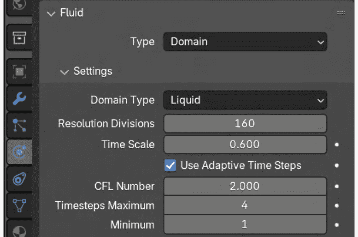

图 4.4 – 域设置

6. 接下来是 **边界碰撞** 设置。目前，域的所有侧面都有碰撞。这意味着流体会积聚并最终填满整个域。相反，我们希望流体到达底部时消失。让我们取消选中 **底部** 和 **前面**，如下图所示，这样流体就不会 *不* 撞击这些边缘，而是像什么都没有一样直接消失：

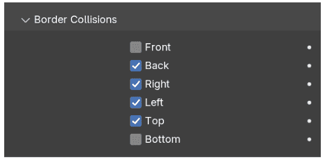

图 4.5 – 边界碰撞

- 7. 在 **液体设置** 中，将 **窄带宽度** 设置为 8。这将增加模拟中的粒子数量，使结果更好。此外，启用 **分数障碍**。这将确保流体不会粘在任何 **效应器** 对象上。
- 8. 现在，让我们添加泡沫粒子！向下滚动直到看到 **粒子** 面板并勾选 **泡沫**。我们不需要 **喷雾** 或 **气泡** 粒子；我发现仅使用 **泡沫** 对此模拟效果最好。
- 9. 将 **势半径** 和 **粒子更新半径** 都设置为 3。这将有助于平滑粒子网格，使结果更好。有时粒子会闪烁，将此值调高有助于防止这种情况。
- 10. 接下来，让我们将 **波峰粒子采样** 设置为 300。这将在波峰处提供更多粒子。以下截图概述了设置：

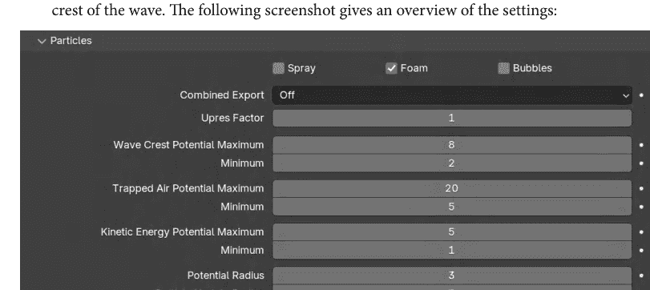

图 4.6 – 泡沫粒子

剩余设置和值可以保持其默认状态。

- 11. 现在，打开 **网格** 面板并确保 **细分因子** 的值为 2。这在此模拟中效果很好，但如果发现网格看起来有点 **低多边形**（**低模**），你可以增加此值。
- 12. 在 **网格** 面板启用后，每个 **液体** 粒子周围都会创建一个小网格。当 **粒子半径** 值为 2 时，网格看起来会有些圆润且不很真实。让我们将此值降至 1.2。现在，每个粒子周围的半径会小得多，这将产生更好的结果。查看以下截图作为示例。左侧的 **粒子半径** 值为 3，右侧的值为 1.2：

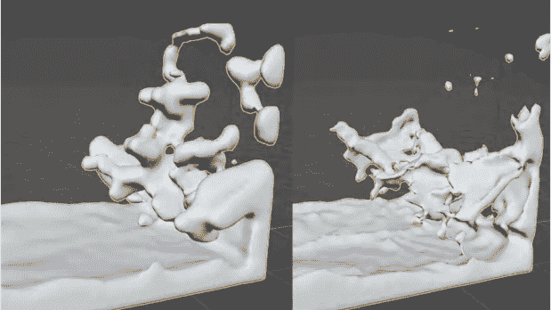

图 4.7 – 粒子半径示例

13. 最后，勾选 Use Speed Vectors。这将使我们能够在本章后面添加运动模糊！你可以在此处看到此选项已勾选：

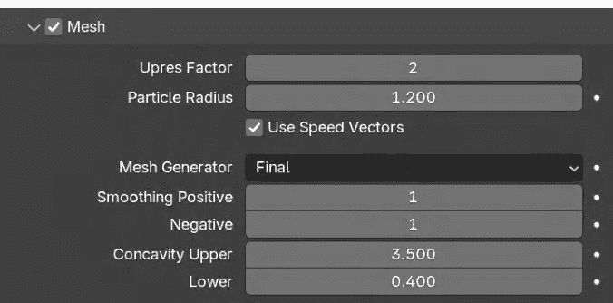

图 4.8 – 网格设置

14. 我们需要做的最后一件事是打开 Cache panel。将 Type 设置为 Modular 并勾选 Is Resumable，以防我们需要停止烘焙。一个非常重要步骤是把 Format Volumes 从 OpenVDB 改为 Uni Cache。Use Speed Vectors only works with the Uni Cache format。

15. 如果你想增加或减少模拟的长度，可以更改 End frame。对于此模拟，我们使用 200 帧。设置如下图所示：

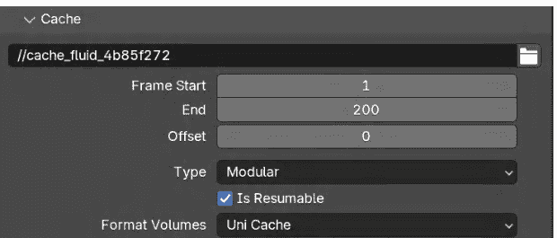

图 4.9 – 缓存设置

好了！我们已经创建了一个具有所需所有设置的域。接下来，我们将添加 **Inflow** 和 **Effector** 对象并烘焙模拟！

## 添加流入和效应器

域现在已完全设置好并准备就绪！我们现在需要添加一个 **Inflow** 对象向模拟中发射流体。我们还需要设置所有岩石和地面对象以具有碰撞效应器，否则流体将直接穿过它们。

让我们从 **Inflow** 对象开始：

- 1. 首先，添加一个 **Plane** 对象并将其放置在瀑布顶部。
- 2. 沿 **X** 轴将其旋转 90°，并按需缩放其宽度和高度。你可以在此处看到示例：

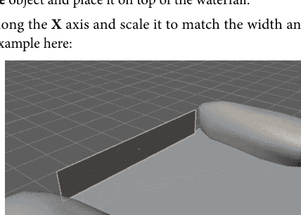

图 4.10 – 流入缩放

改变流动对象的形状和大小会改变流体的外观。你可以有两个较小的流动相互碰撞，或将流动向上移动，使流体下落并产生飞溅。在这里尽情发挥创意，为河流创造不同的外观吧！

- 3. 由于我们现在已旋转并缩放了平面，让我们应用 **Rotation** 和 **Scale** 设置以确保模拟正确运行。按下 *Ctrl + A* 或 *Cmd + A* 并选择 **Rotation & Scale**。
- 4. 现在，让我们将此对象设为流入。前往 **Physics** 面板并选择 **Fluid**。对于 **Flow Type**，选择 **Liquid**，对于 **Behavior**，选择 **Inflow**。
- 5. 接下来，打开 **Flow Source** 对象。由于此对象是平面，我们需要确保已启用 **Is Planar**。这告诉 Blender 将此流入视为未封闭的网格，意味着即使它没有厚度也会发射流体。
- 6. 现在，启用 **Initial Velocity**。为了给模拟带来更多速度和流体，让我们将 **Source** 设置为 1.5。我们还希望流体沿瀑布方向移动。在这种情况下是 -Y 方向，因此让我们将 **Y** 轴的 **Initial** 值设置为 -6。你将此值调得越高，流体移动得越快。

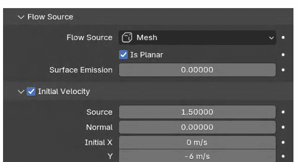

图 4.11 – 流入设置

完成之后，让我们为岩石和瀑布中间部分添加碰撞。

- 7. 选择岩石和瀑布中间部分。在 **Physics** 面板中点击 **Fluid**，对于 **Type**，选择 **Effector**。
- 8. 这样做只会将 **Effector** 值应用于 **active object**。因此，按下 *Ctrl + L* 或 *Cmd + L*，或前往 **Object | Link/Transfer Data** 并选择 **Copy Modifiers**。现在，这些对象都将应用 **Effector** 碰撞。
- 9. 最后，选择瀑布中间部分。由于此对象本质上是平面，我们需要在 **Effector** 设置中确保已启用 **Is Planar**。你可以在此处看到设置的概览：

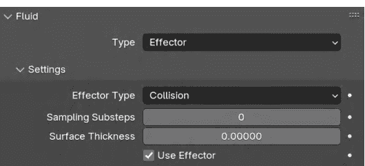

图 4.12 – 效应器设置

完成之后，我们现在就可以烘焙模拟了！返回 Domain settings 并点击 Bake Data 顶部。记住——如果你想保存缓存不被删除，请确保在 Cache panel 中设置自定义目录。

初始烘焙完成后，你需要向下滚动到 Particles panel 和 Mesh panel 并同样烘焙它们。全部三个烘焙完成后，请播放动画片刻并仔细检查一切是否看起来良好。如果是，请继续烘焙粒子和网格。当所有烘焙完成后，我们将创建泡沫粒子！另外，别忘了通过按下 Ctrl + S 或前往 File | Save 来保存 Blender 文件！

## 添加泡沫粒子

现在模拟已烘焙完成，我们可以设置泡沫粒子。泡沫粒子为模拟增添了另一层细节。这些粒子将添加到流体顶部附近，像泡沫或白水一样作用。正如现实生活中一样，泡沫或白水是在流体的急流或湍流中产生的，而这正是我们要复制的效果。

目前，粒子只是光晕，这意味着它们只是三维（3D）空间中的点，在渲染中不会显示。你可以在此处看到示例：

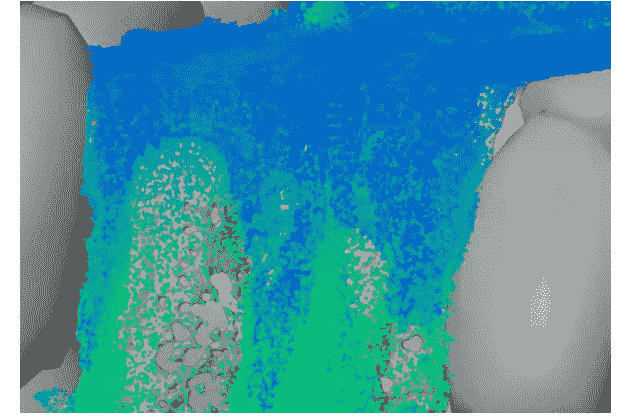

Figure 4.13 – 光环示例

然而，我们需要一个实际的对象作为粒子。我们还希望确保所选对象的几何体尽可能少，否则会大大减慢 Blender 的速度。UV 球体上的几何体很多，所以不适用。相反，让我们使用一个细分非常低的锥体。以下是实现方法：

- 1. 首先，选择你的域对象，右键单击并选择 **Shade Smooth**。这将以平滑的方式着色网格表面，使我们看不到单个面。
- 2. 添加一个 **Cone** 对象，然后打开左下角的 **Add Cone** 菜单，将 **Vertices** 设置为 3，如以下截图所示。这将为我们提供一个非常低面数的网格：

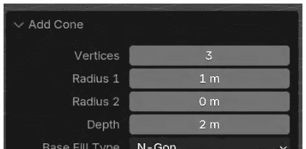

Figure 4.14 – 添加锥体

- 3. 锥体目前太大了，所以让我们使用 **Scale** 将其缩放到 0.02 的值。
- 4. 现在，我们准备将该 **Cone** 对象指定为粒子。选择你的域并前往 **Particle System** 面板。你应该会看到两个系统：**Liquid** 和 **Foam**，如下截图所示。在分配粒子之前，我建议通过点击两个监视器图标来关闭视口中的可见性。现在，你的视口应该很流畅：

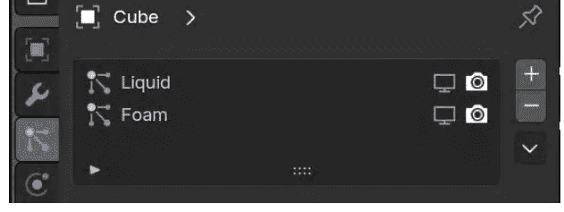

Figure 4.15 – 粒子系统

- 5. 接下来，选择 Foam 粒子系统，并在 Render As 下方选择 Object。对于 Instance Object，在下拉菜单中选择 Cone！现在，每个粒子都将是我们几步之前添加的那个锥体！记住——你将无法看到它，因为我们关闭了粒子系统的可见性；不过它仍会在渲染中显示。
- 6. 接下来，让我们稍微放大粒子一些，以便它们在渲染中更明显。为此，将 Scale 值设置为 0.075。

*Optional:* 如果你想要大小上的一些随机变化，可以增加 Scale Randomness。我们建议不要将 Scale Randomness 设置高于 0.5，否则部分粒子会太小而看不见。

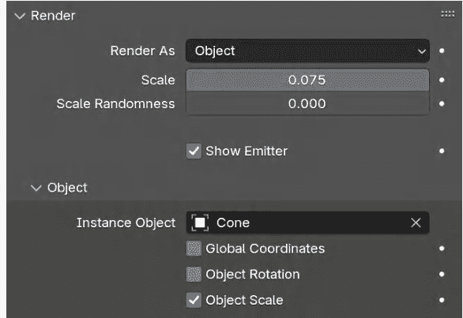

Figure 4.16 – 渲染标签

如果你想检查粒子的大小并确保它们足够小，可以重新打开监视器图标。这可能会导致场景出现明显卡顿，因此请确保打开 **Viewport Display** 面板并将 **Amount** 值设置为 1%。现在你应该可以在不大幅减慢场景的情况下看到一些粒子。

完成后，关闭可见性（监视器图标）并将 **Amount** 恢复为 100%，否则渲染中也只会得到 1%。设置如下截图所示：

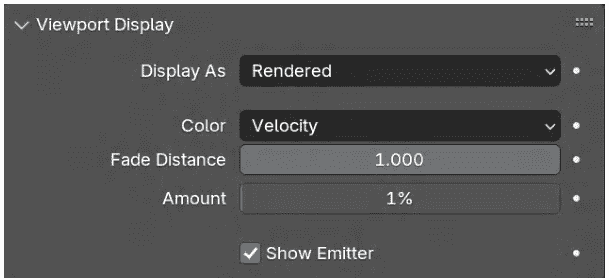

Figure 4.17 – 视口显示

好了——我们现在已将泡沫粒子添加到模拟中。以下是所有粒子可见时的样子。由于粒子数量以千计，这会严重减慢你的 blend 文件，因此我们建议保持它们不可见（按照 *step 4* 的做法）：

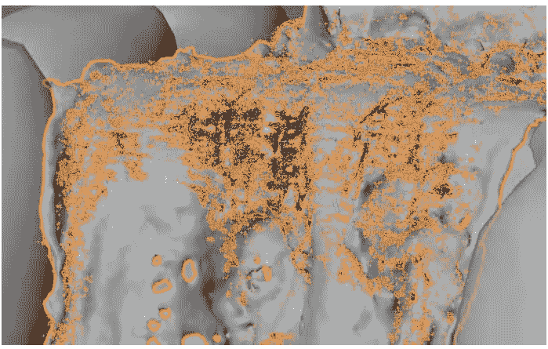

Figure 4.18 – 泡沫粒子

本章的下一步是为粒子和流体本身设置材质。

## 创建材质

到目前为止，本章我们已经涵盖了很多内容。我们学习了如何为域创建逼真的设置，添加了流体对象，并创建了泡沫粒子！在创建材质之前，我们需要决定使用哪个渲染引擎。对于这个场景，我建议继续使用 Cycles，原因在于 EEVEE 在处理透明材质、粒子以及场景中几何体较多时存在局限。

对于大多数场景，EEVEE 的渲染速度比 Cycles 快得多，因为它是一个实时引擎。但对于这个场景，我发现 Cycles 的渲染速度比 EEVEE 快约 80%。这是因为粒子数量太多，EEVEE 在计算它们时很吃力。如果你关闭粒子，那么 EEVEE 会更快。由于我们要渲染粒子，我建议切换到 Cycles 进行渲染。此外，Cycles 会提供更好的反射和阴影。

搞定这些后，让我们开始创建材质：

- 1. 让我们先创建水材质。选择你的域，跳到 Material 面板，通过点击大 New 按钮创建一个新的材质。
- 2. 我们不需要 Principled BSDF 着色器，所以选择它并将其更改为 Glass BSDF 着色器。
- 3. 对于玻璃的 Color 设置，选择一种非常淡的蓝色。不要过度使用 Color 设置，否则看起来会有些奇怪。如果你想使用我使用的相同颜色，十六进制（hex）代码是 F8FFFF。
- 4. Roughness 设置控制玻璃看起来有多粗糙。我们希望将其设置为 0，以便玻璃看起来光滑美观。
- 5. IOR（代表折射率）基本上控制光线穿过玻璃的方式。水的 IOR 为 1.333，所以让我们将该值设为此数值。设置如下截图所示：

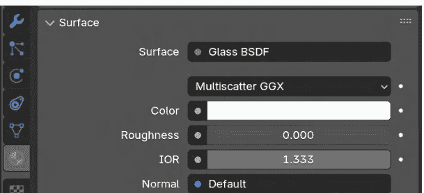

Figure 4.19 – 玻璃材质

### IOR

IOR 表示光线穿过物体的速度。数值越高，光线通过的速度越慢。例如，空气的 IOR 值为 1.000277，而冰的 IOR 值为 1.31。光线穿过冰的速度远慢于穿过空气的速度，因此会导致光线弯曲更多，产生那种扭曲的外观。你可以在这里找到不同真实材质的 IOR 值大列表：https://pixelandpoly.com/ior.html。

- 6. 最后，让我们给水增加一些体积。河流并不完全干净——它们含有泥土、岩石和其他被带起的东西。为此，前往 Volume 选项卡，点击 None，然后选择 Principled Volume。
- 7. 将 Color 设置为偏蓝的颜色，并将 Density 设置为 0.5，如下截图所示：

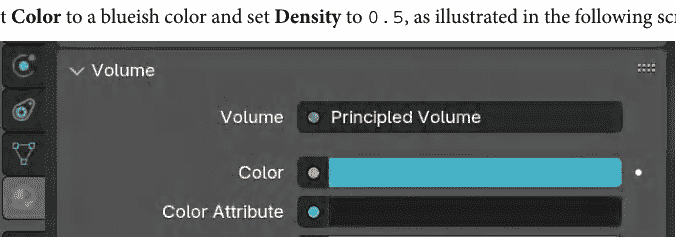

Figure 4.20 – 体积着色器

水材质现在完成了！让我们快速创建泡沫材质；然后我们可以继续为流体添加运动模糊。

- 8. 在 Outliner 中选择 Cone 对象并为其赋予一个 New 材质。
- 9. 将 Principled BSDF 着色器中的 Roughness 值设置为 0.1。这将为我们提供一个漂亮的反射材质。严格来说，这并不完全准确。泡沫本应具有更透明的外观。如果我们添加的话，会大大减慢渲染速度。所以，让我们保持原样，它看起来仍然会非常好！

好了！所有材质现在都已完成，我们准备开始渲染过程。本章下一节，我们将学习如何使用合成器中的一个非常简单的技巧为流体添加运动模糊！

## 添加矢量模糊

运动模糊为你的渲染增添了很好的效果。它可以让你的动画脱颖而出，看起来更逼真。它赋予流体运动感，使模拟看起来更好！当物体移动非常快时，所有摄像机都会有一点模糊，如果不添加，动画看起来会有些奇怪。现在，我们可以前往 Render 面板并勾选 Motion Blur 框，但我们不会这样做。相反，我们将添加矢量模糊！

在这里，你可以看到一个有无模糊的动画示例：

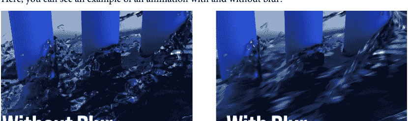

Figure 4.21 – 有无模糊的示例

矢量模糊是使用合成器在渲染中模拟运动的一种快速方法！它使用来自渲染通道的矢量数据在 2D 中模糊图像，呈现出运动的外观。所以，严格来说，这是一种假模糊，但它看起来仍然很棒，并且可以比真正的运动模糊渲染得更快。

要为渲染添加矢量模糊，我们首先需要告诉 Blender 从流体中提供该速度矢量信息。还记得我们之前在域中勾选 Use Speed Vectors 时吗？那就是我们将用来模糊流体的矢量信息。让我们直接开始：

- 1. 前往 Render Layers 面板并启用 Vector 和 Z 通道，如下截图所示。这些是我们需要添加模糊的通道：

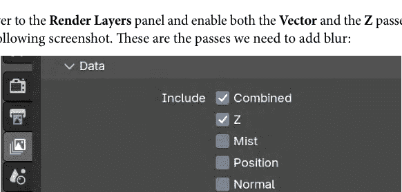

Figure 4.22 – 向量通道

2. 接下来，让我们渲染一张图像。如果您使用的是 `Waterfall Setup.Blender` 文件，渲染设置应该已经就位。您可以随意更改渲染、背景或灯光以满足您的喜好，然后在 **Timeline** 中选择一个看起来不错的帧。一旦您有了满意的帧，请前往 **Render** 设置并选择 **Render Image** 或按 *F12* 快捷键。

渲染完成后，跳转到屏幕顶部的 **Compositing** 工作区，如以下屏幕截图所示：

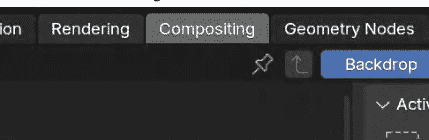

Figure 4.23 – 合成

3. 选择 **Use Nodes**。您应该会看到 **Render Layers** 和 **Composite** 节点出现，如以下屏幕截图所示（如果没有，则只需添加它们）：

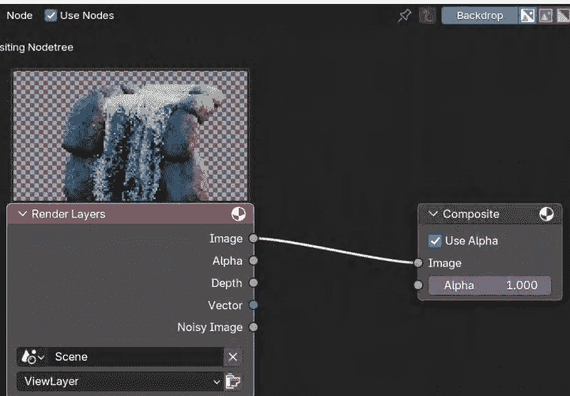

Figure 4.24 – 使用节点和渲染层

4. 要查看我们正在做什么，请在 **Output | Viewer** 下按 *Shift + A* 添加一个 **Viewer** 节点。然后从 **Render Layers** 节点取出 **Image** 并将其插入 **Viewer** 节点的 **Image** 插槽中。

另一种自动执行此操作的方法是按住 Shift + Ctrl 或 Shift + Cmd 并左键单击 Render Layers 节点。这将自动添加一个 Viewer 节点并允许我们查看渲染。要放大图像，请按 V，Alt/Option + V 放大回原状。

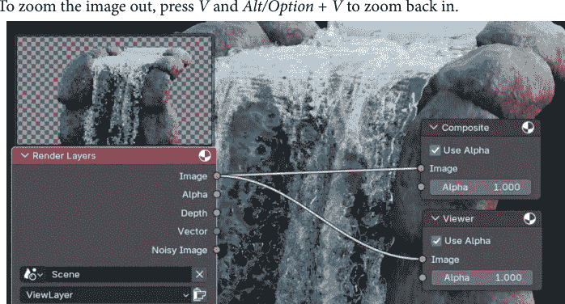

Figure 4.25 – 查看器节点

5. 目前，背景是透明的，所以让我们添加一个 Alpha Over 节点来修复它。按 Shift + A 并进入 Color，然后选择 Alpha Over。此节点允许您将透明图像叠加在其他图像之上。

将其放置在 Render Layers 和 Composite 节点之间，并确保 Render Layers 节点已插入到底部的 Image 插槽中。查看以下屏幕截图：

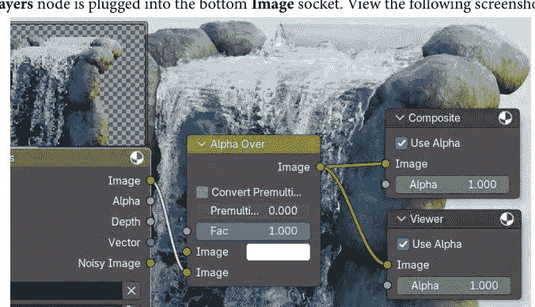

Figure 4.26 – Alpha Over 示例

6. **Alpha Over** 节点中的顶部 **Image** 颜色插槽现在控制背景颜色！让我们将其设置为漂亮的深灰色！

现在就是你一直在等待的时刻……让我们添加矢量模糊！

7. 按 **Shift + A**，进入 **Filter | Blur**，并选择 **Vector Blur**。将其放置在 **Render Layers** 和 **Alpha Over** 节点之间。

8. 从 **Render Layers** 节点取出 **Vector** 输出并将其插入 **Speed** 输入中。这将为我们提供添加运动模糊的信息！有时使用矢量模糊时，图像某些区域会出现渗色。这是因为我们还没有 **Depth** 信息。所以，取出 **Depth** 插槽并将其插入 **Z** 输入中。现在，它应该看起来好多了。查看以下屏幕截图：

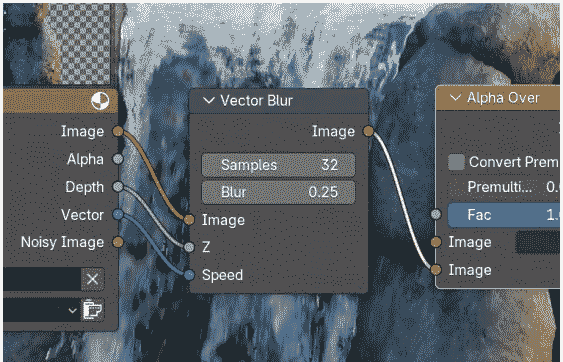

Figure 4.27 – 矢量模糊

9. **Samples** 设置与模糊质量有关。较高的值会以渲染时间为代价提供更好的模糊质量。值 32 对此场景来说是完美的。

10. **Blur** 控制场景中模糊的程度。0.25 的值可能有点多，所以让我们将其降低到 0.15。

11. 在渲染之前最后一点——确保关闭流入对象的可见性，否则渲染中会出现一个白色的平面，看起来不会很好。您可以通过在 **Outliner** 中切换 **Eye** 图标和 **Camera** 图标来执行此操作。

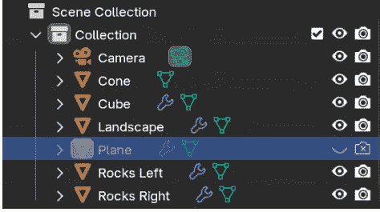

Figure 4.28 – 流入可见性

在本次教程结束之前，让我们了解一下在 Blender 中正确渲染动画的方法！

## Rendering animations

一切都已设置完毕，我们现在准备好渲染瀑布动画了！无论在 Blender 中渲染何种类型的动画，您都应始终将其导出为图像序列，而不是电影文件。

原因在于，如果您将动画渲染为 MP4 文件，并且由于某种原因 Blender 崩溃或发生其他情况，文件可能会损坏，您将不得不重新渲染整个内容。以图像序列渲染允许您在任何时候停止渲染，而无需担心重新启动或损坏。

一旦动画渲染完成，您可以导入所有这些图像并将其转换为电影文件。让我们开始吧：

- 1. 在 Timeline 中将 End frame 设置为与模拟时长相匹配。在本例中为 200 帧。
- 2. 前往 Output 面板并选择一个文件夹以渲染图像序列。查看以下屏幕截图：

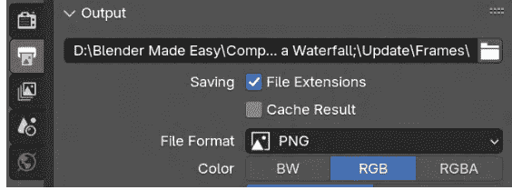

Figure 4.29 – 输出

3. 一旦设置了文件夹，请前往 **Render** 并选择 **Render Animation** 或按 *Ctrl + F12* 或 *Cmd + F12* 快捷键！现在，我们所要做的就是等待它完成！如果由于某种原因您决定停止渲染，请在恢复时确保在 **Output** 面板中取消选中 **Overwrite**。这样，它不会重新开始，而是从离开的帧继续渲染。

4. 当所有图像都已渲染完成后，让我们回到 Blender。屏幕顶部，您应该会在工作区旁边看到一个 + 号。点击它然后选择 **Video Editing | Video Editing**，如以下屏幕截图所示。这将打开 **Video Sequence Editor** 工作区：

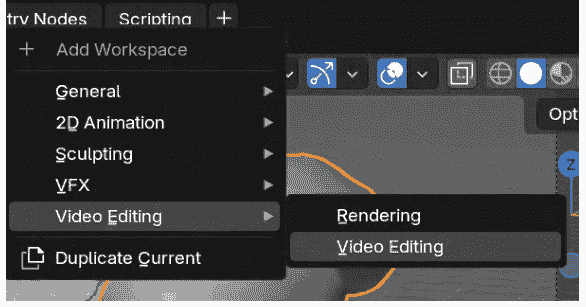

Figure 4.30 – 工作区

5. 现在，我们需要导入所有已渲染的图像。确保蓝色光标位于 **Frame 1**，按 *Shift + A*，并选择 **Image/Sequence**。导航到图像保存的位置，按 *A* 选择所有内容，然后导入它们。

6. 如果由于某种原因动画播放方向相反，那可能是导入时动画按 **Date** 而非 **Name** 排序。解决此问题的简单方法是转到右侧的 **Properties** 面板。您可以通过按 *N* 打开此面板（如果尚未打开），然后在 **Strip** 选项卡下，在 **Video** 选项卡中选择 **Reverse Frames**，如以下屏幕截图所示：

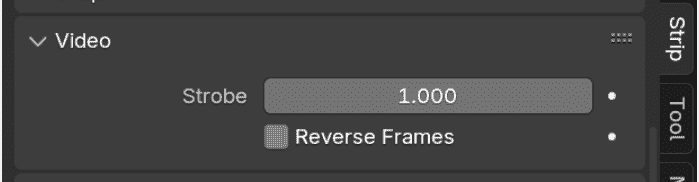

Figure 4.31 – 反转帧

7. 最后一步是确保 **Timeline** 中的 **End Frame** 值与动画长度相匹配，然后再次前往 **Output** 面板。如果您想将其渲染为 MP4 文件，请选择 **FFmpeg Video**，对于 **Container** 类型，选择 **MPEG - 4**。设置如下所示：

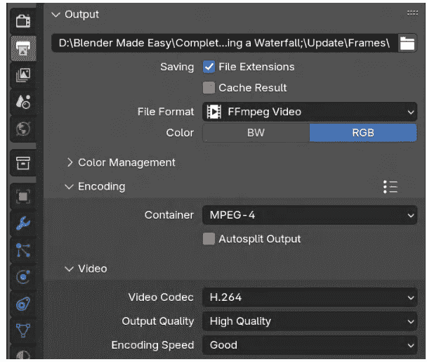

Figure 4.32 – 输出文件格式

然后，只需再次渲染动画，这次它会将这些图像转换为 MP4！文件应位于所有已渲染图像的同一目录中！以下屏幕截图是我动画中的一帧！（如果您想下载本章的项目文件，只需访问此链接：https://github.com/PacktPublishing/Learn-Blender-4-Simulations-the-Right-Way/tree/main/Chapter%204）

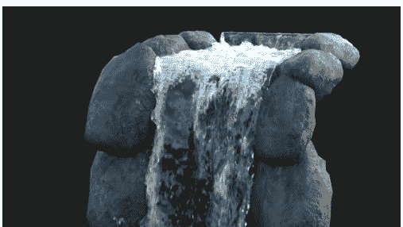

Figure 4.33 – 已渲染的瀑布

恭喜您完成本教程！希望您学到了新东西，并在过程中制作出了很酷的东西！这个场景也不必到此结束——请随意在此瀑布上添加更多内容，也许添加第二层、创建环境并添加树木！您还可以添加另一个瀑布，使其溅入此瀑布中！一切都由您决定！如果您不想自己创建树木或资源，有许多网站可以免费获取模型。CGTrader (https://www.cgtrader.com/) 和 Poly Haven (https://polyhaven.com/) 是两个获取模型和其他资源的绝佳网站！以下是您可以创建的灵感：

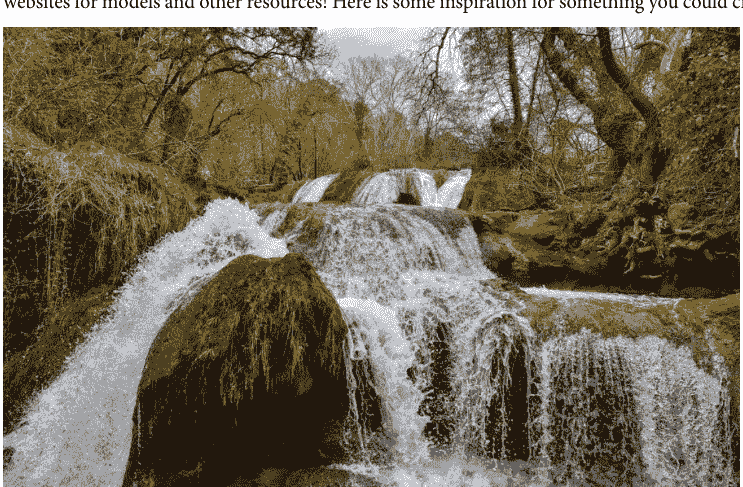

Figure 4.34 – 真实瀑布

这就结束了本章！

## Summary

好了！我们已完成本章并创建了一个漂亮、逼真的瀑布模拟。我们涵盖了很多内容，所以让我们快速回顾一下。

首先，我们学习了创建逼真流体的域设置，添加了流入对象，并为流体设置了碰撞障碍物。然后我们学习了泡沫粒子如何工作以及如何将其添加到模拟中。我们介绍了 Blender 中逼真的水材质以及如何在 **Compositor** 中添加运动模糊！最后，我们学习了如何在 Blender 中正确渲染动画并在 **Compositor** 中对其进行序列组合。对于本书其余的教程，我将不再介绍如何渲染动画，因此请记住参考本章以快速回顾！

流体模拟相当复杂且制作时间较长，但希望本章能让您理解，以便您能够创建自己的逼真模拟！我希望您喜欢爆炸，因为在下一章中，我们将使用粒子系统和气体模拟在 Blender 中炸毁一些东西！

