## 创建逼真的爆炸

为了让爆炸看起来逼真，有很多因素需要考虑。首先，你需要决定要创建哪种类型的爆炸。主要分为三种：化学、机械和核。机械爆炸发生在气体迅速膨胀并产生超过其当前容器承受能力的压力时。核爆炸发生在发生聚变或裂变反应时；这种爆炸会产生标志性的蘑菇云外观。最后是化学爆炸，这正是本章中我们将要创建的类型。这类爆炸发生在某些气体发生分解或结合时。

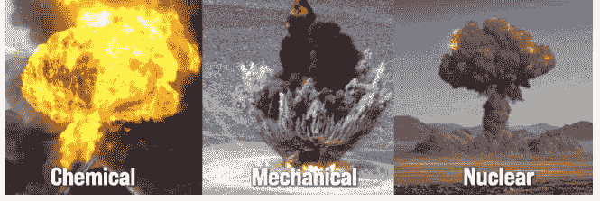

图 5.1 – 爆炸示例

无论你想制作哪种爆炸，我都建议在打开 Blender 之前先查看此类爆炸的参考图像。这将帮助你了解需要为爆炸添加哪些对象、粒子系统、模拟设置和材质，以达到你想要的效果。

本章的目的是为你提供一个基础，帮助你了解如何在 Blender 中模拟爆炸以及如何自定义以获得想要的外观。我们在过程中也会提供一些故障排除技巧！

本章将涵盖以下主题：

- 创建粒子系统
- 创建模拟
- 创建材质
- 在 Cycles 和 EEVEE 中渲染

### 技术要求

本章要求你已安装 Blender 4.2 或更高版本。

要下载 Blender，请访问 www.blender.org。

要查看最终结果或下载此项目的 .blend 文件，请访问 https://github.com/PacktPublishing/Learn-Blender-4-Simulations-the-Right-Way/tree/main/Chapter%205。

### 创建粒子系统

有几种方法可以模拟爆炸。更简单的方法是快速缩放一个流对象，使火焰或烟雾迅速膨胀。虽然这可以产生不错的结果，但通常看起来过于均匀，缺乏真实感。更有效的方法是我们将使用的方法，涉及粒子系统。该系统将定义爆炸的初始形状，因此正确设置对于获得更动态、更逼真的爆炸至关重要。如果你从未使用过粒子系统，不用担心。我们将逐步讲解创建粒子系统的过程，并学习其工作原理！打开 Blender，开始吧：

- 1. 首先，让我们删除所有默认对象，以便拥有一个空白场景来工作。接下来，我们需要一个用于粒子发射的对象。按 Shift + A，选择 Mesh | Icosphere，并将其缩放到 0.125。确保你也应用了缩放。为此，按 Ctrl + A 或 Cmd + A 并选择 Scale。
- 2. 要创建粒子系统，请前往粒子系统面板并点击 + 图标：

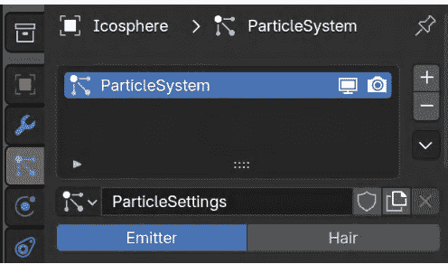

图 5.2 – 创建粒子系统

- 3. 如果你按空格键播放动画，你会注意到所有粒子都在发射并直直向下掉落。为了解决这个问题，进入 Velocity 选项卡并将 Normal 设置为 7 m/s。这将增加粒子沿面法线的速度。为了使其不那么均匀，将 Randomize 设置为 6.000。现在，粒子应该向四面八方射出：

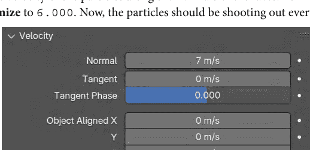

图 5.3 – 速度选项卡

- 4. 这开始看起来像爆炸，但还不完美。现在，我们需要设置粒子何时发射以及持续多长时间。进入 Emission 选项卡并将 Frame Start 设置为 10，End 设置为 14。这意味着在 4 帧内将发射 1,000 个粒子。但我们想要的粒子远不止这些，所以让我们将 Number 设置为 5000。
- 5. 粒子在动画中的持续时间也太长了。让我们将 Lifetime 设置为 5。这样它们只持续五帧然后消失。

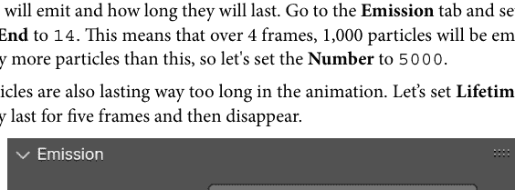

图 5.4 – 发射设置

现在第 15 帧的模拟看起来是这样的：

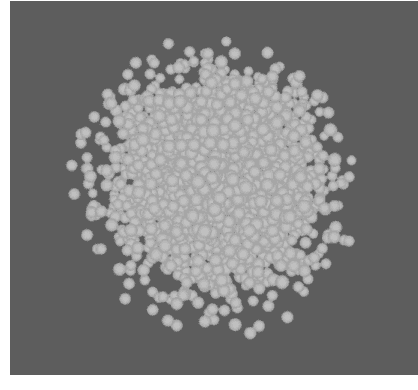

图 5.5 – 粒子系统示例

- 6. 如果我们向这个粒子系统添加烟雾模拟，它不会很有趣。原因在于现在我们有一个完美的粒子圆圈。我们需要更多的随机性和变化。为了实现这一点，让我们添加一个带有另一个粒子系统的新对象。按 Shift + A，然后进入 Mesh 并选择 Circle。在做任何其他操作之前，打开底部的 Add Circle 菜单。将 Fill Mode 设置为 N-Gon；这将确保圆圈有一个面。
- 7. 缩小圆圈，旋转约 90 度，并将其放置在 icosphere 的右侧。

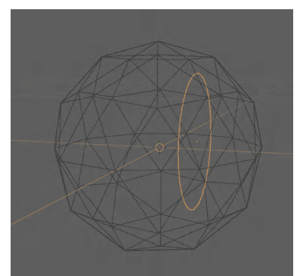

图 5.6 – 添加圆圈

- 8. 现在，让我们通过在 **粒子系统** 面板中点击 + 号来为其添加一个新的粒子系统，就像之前一样。
- 9. 我们将做与之前系统非常相似的操作。将 **数量** 设置为 2000，**帧开始** 设置为 10，**结束** 设置为 14，**生命周期** 设置为 5。
- 10. 在 **速度** 选项卡中，再次将 **法线** 设置为 7，但将 **随机化** 设置为 3。这将使粒子分布更紧密。第一个粒子系统存在时可能很难看出效果，因此你可以通过点击右上角 **大纲** 中的 *眼睛* 图标暂时隐藏 icosphere：

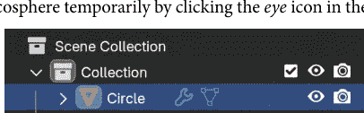

图 5.7 – 隐藏对象

现在圆圈粒子系统应该看起来像这样：

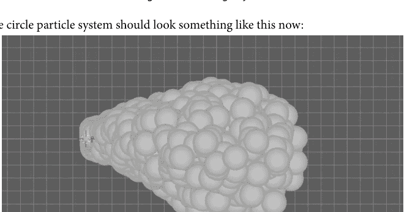

图 5.8 – 圆圈粒子系统

- 11. 让我们复制圆圈两次 (*Shift + D*)，并将一个向上旋转，另一个放置在 icosphere 左侧。随意调整这些圆圈的位置、旋转和缩放以获得更多变化。
- 12. 除非你在空中创建爆炸，否则我们需要一个供粒子撞击的地面。按 *Shift + A* 并添加一个平面。将其放大并确保它位于所有对象下方。
- 13. 要为此平面添加碰撞，请前往 **物理** 面板并选择 **碰撞**。在 **粒子** 选项卡中，将 **摩擦** 设置为 0.9；这将确保粒子不会在平面上滑动。

另外，将 **阻尼** 设置为 0.9；此值控制碰撞的弹性。值越高，弹跳越少。为了获得更多变化，你可以将两个设置的 **随机化** 设置为 0.3：

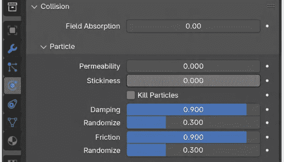

图 5.9 – 碰撞设置

- 14. 最后，让我们烘焙粒子系统！选择 icosphere 并返回 **粒子系统** 面板。在 **缓存** 选项卡下，点击 **烘焙所有动态**。这将自动烘焙全部四个粒子系统！

到目前为止，粒子应该看起来像这样：

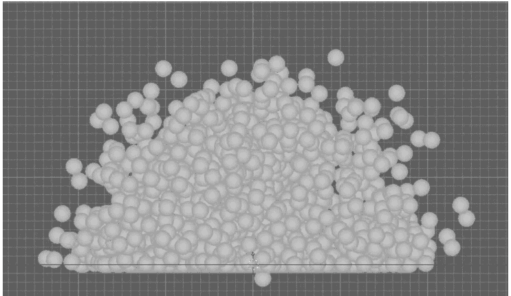

图 5.10 – 粒子的正面视图

我们现在已经完成了爆炸粒子的创建！如果你想更改粒子的任何设置，请确保在缓存选项卡中点击删除所有烘焙。这将释放所有设置，你可以随意更改。

随意调整速度和随机性以获得不同的结果。你也可以添加更多发射器对象以获得更大的爆炸！一旦对结果满意，我们就可以开始创建烟雾和火焰模拟了！

### 创建模拟

现在，我们需要将刚刚创建的粒子系统用作模拟的流入。这意味着每个粒子都会向场景中发射烟雾和火焰。让我们设置模拟的所有设置和值并进行烘焙！

### 设置域

按以下步骤操作：

- 1. 当然，我们需要一个域对象。一种快速简便的方法是选择 icosphere 并选择 Object | Quick Effects | Quick Smoke：
- 2. 目前域的大小和位置都不对。让我们将其向上移动，使其位于平面上方并放大。由于我们正在创建爆炸，我们希望域相当大：

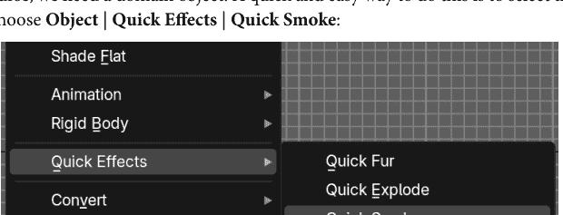

图 5.11 – 快速烟雾

这将自动为我们添加一个具有默认烟雾设置的域！

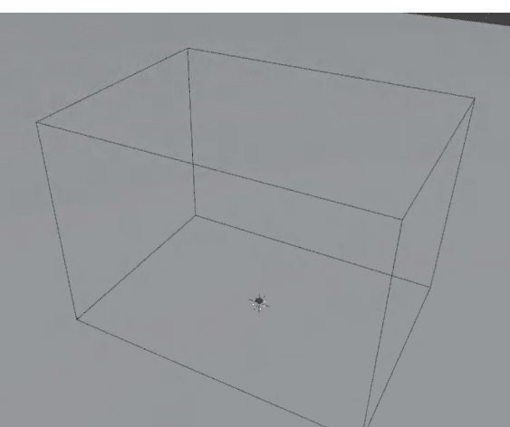

图 5.12 – 域大小

我使用的尺寸如下：

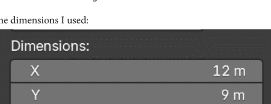

图 5.13 – 域尺寸

- 3. 现在，我们可以设置模拟设置！选中域后，前往缓存面板并将类型设为模块化。同时启用可恢复。至于结束帧，将其设置为 150 或你想要模拟持续的时间。
- 4. 向上滚动到顶部并将分辨率细分设为 256。请记住这是一个很高的分辨率。如果你有一台稍慢的电脑，我建议将其设为 128，否则你可能会花费很长时间烘焙和渲染动画。

- 5. 接下来，让我们将 **CFL Number** 设为 4。这将有助于改善烘焙时间，并在我看来让模拟看起来稍好一些。
- 6. 继续，前往 **Border Collisions**。勾选 **Bottom** 复选框，以便烟雾与域的地面发生碰撞。

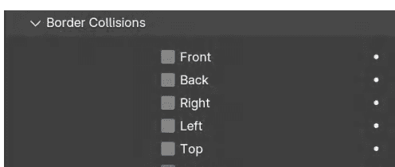

图 5.14 – 边框碰撞

- 7. 之后，启用 **Adaptive Domain**。这将大幅改善烘焙时间。不过要小心——有时此设置会在你不希望时删除烟雾。如果发生这种情况，你可能需要调低 **Adaptive Domain** 设置中的 **Threshold** 值。
- 8. 在 **Gas** 选项卡中，将 **Vorticity** 设为 0.1。这将为烟雾增加更多的漩涡和随机性。
- 9. 现在是启用 **Noise** 的时候了。这将为烟雾提供更多细节。同样，如果你的电脑能够处理，将 **Upres Factor** 设为 2，但如果不能，我建议保持为 1。其余设置可以保持不变。

完成这些后，我们现在就可以开始处理流入对象了！

## 添加流入

现在域已准备就绪，让我们开始为模拟设置流入：

- 1. 选择二十面体。 由于我们使用了 **Quick Smoke** 功能，它应该已经具有基本的流设置。我们需要更改的第一件事是 **Flow Type**。将其设为 **Fire + Smoke**。
- 2. 由于粒子移动非常快，增加 **Sampling Substeps** 到 5 也是一个好主意。
- 3. 目前，烟雾来自二十面体本身而不是粒子。为此，打开 **Flow Source** 选项卡，将 **Flow Source** 设为 **Particle System**，并从下拉菜单中选择我们创建的那个。参考 *图 5.15*。
- 4. 最后，也是非常重要的步骤是勾选 **Initial Velocity**。这将在粒子射出时保持烟雾的动量。如果未勾选，烟雾将在粒子达到最大距离时立即停止移动。这看起来会非常奇怪且不真实，因此请确保已勾选 **Initial Velocity**！

- 5. **Source** 值会乘以当前速度。值为 1 表示烟雾将以与粒子相同的速度移动。这也意味着你设置得越高，烟雾的速度就越大。让我们将其提高到 15。如果发现烟雾移动过快，请将此值调回。

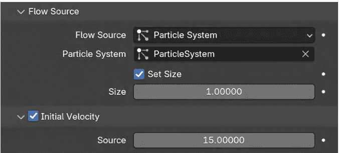

图 5.15 – 流源

- 6. 现在，让我们选择其余的流入（我们添加的另外三个圆圈），然后最后选择二十面体，使其成为活动对象。按 Ctrl + L 或 Cmd + L 并选择 Copy Modifiers。现在，这些圆圈将具有与二十面体相同的设置！你也可以前往 Object | Link/Transfer Data | Copy Modifiers 来执行此操作。
- 7. 完成这些后，我们就可以烘焙模拟了！请记住，如果你尚未保存项目，缓存数据将被放入临时文件夹。这意味着在关闭此 .blend 文件后它将被删除。你可以为缓存设置自定义文件夹，或者如果你在执行 Quick Smoke 之前保存了项目，缓存将自动放入与你的 .blend 文件相同的文件夹中：

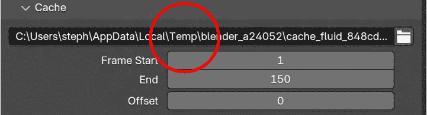

图 5.16 – 临时缓存文件夹

保存项目后，选择你的域对象并点击 Bake Data。这可能需要一段时间，但完成后，请前往噪声选项卡并同样点击 Bake Noise！

现在，只需等待烘焙完成。此时，我们可以开始为爆炸创建材质了！

## 创建材质

现在模拟已完成，我们准备为烟雾和火焰设置材质！这时你可能想再次查看参考图像。当你查看化学爆炸时，你会注意到烟雾非常黑暗且浓密。火焰是一种非常明亮的橙色和黄色，所以让我们在材质中复制这一点！

## 创建烟雾

让我们开始创建烟雾：

- 1. 要查看我们的爆炸效果，请转到第 25 帧并按 Z，然后选择 **Rendered View**。场景灯光也有些单调，所以按 *Shift + A* 添加一个太阳灯，前往 **Light | Sun**。放置并旋转它，使其面向前方。在 **Object Data** 面板中，在 **Light** 选项卡下，将 **Strength** 设为 10：
- 2. 接下来，让我们前往顶部的 **Shading** 工作区。
- 3. 选择域后，由于我们使用了 **Quick Smoke** 功能，你应该已经看到一个基本的材质。在开始处理材质之前，你需要决定使用哪个渲染引擎。处理烟雾材质时，我喜欢使用 Cycles，只是因为它看起来更好，并且能更清晰地看到烟雾和火焰。本章后面我们将学习如何使用两种引擎进行渲染，但现在，请在 **Render** 面板中选择 **Cycles**。
- 4. 现在，让我们开始创建材质。让我们添加三个节点以便连接所有内容。我们将添加的第一个节点是 **Volume Info** 节点。此节点允许我们从烟雾模拟中获取属性并将其插入材质。按 *Shift + A* 并选择 **Input | Volume Info**。暂时将其放置在 **Principled Volume** 着色器的左侧。

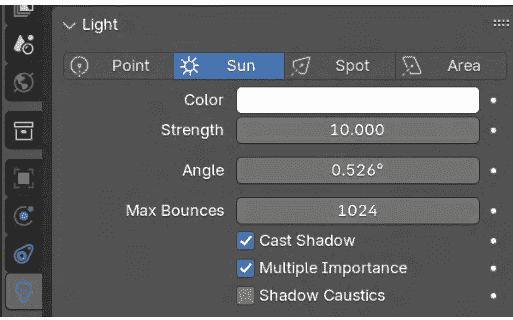

图 5.17 – 灯光属性

- 5. 接下来，按 Shift + A 添加一个 Color Ramp 节点并前往 Converter | Color Ramp。此节点非常棒，它将使你在材质中实现许多功能。在这种情况下，它将允许我们控制密度的衰减。将它放置在 Principled Volume 和 Volume Info 节点之间。
- 6. 最后，让我们添加一个 Math 节点来控制烟雾的密度。按 Shift + A 并前往 Converter | Math。你可以将它放置在 Color Ramp 和 Principled Volume 之间。
- 7. 将 Math 节点的模式从 Add 改为 Multiply。连接好一切后，下方的 Value 将控制烟雾的密度。
- 8. 现在，为了连接所有内容，让我们取 Volume Info 节点的 Density 输出并将其插入 Color Ramp。然后，取 Color Ramp 节点的 Color 输出并将其插入 Math 节点的顶部输入。最后，将 Math 节点插入 Principled Volume 的 Density。要查看整个设置，请查看以下图示：

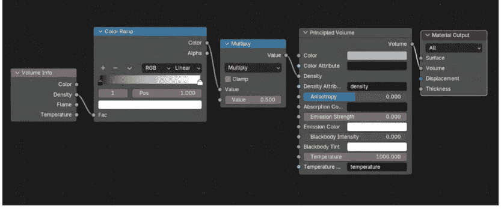

图 5.18 – 烟雾密度节点设置

- 9. 现在，让我们更改一些值以使烟雾看起来好得多！首先，将 Math 节点底部的 Value 设为 100。这将使烟雾更浓密。目前，烟雾越接近边缘越不浓密。我们可以通过取 Color Ramp 的白色手柄并将其拖动得更靠近黑色手柄来改变这一点。现在，模拟的边缘将更浓密，给人一种非常厚的烟雾的外观。
- 10. 最后，让我们将 Principled Volume 的 Color 属性设为更深的灰色，以获得爆炸烟雾的外观。确保在 3D 视口区域进入 Rendered View 以查看烟雾的外观。以下是场景目前应有的外观：

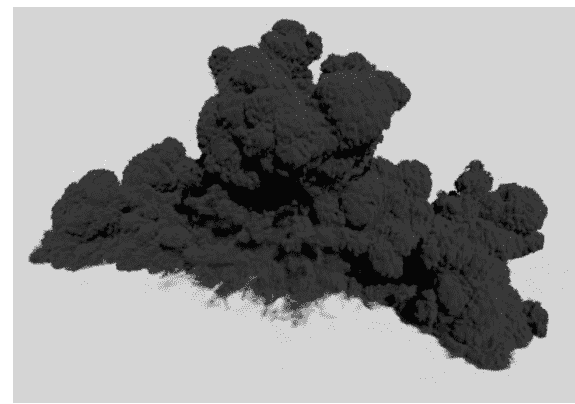

图 5.19 – 爆炸的第 48 帧

现在烟雾看起来不错了，让我们继续完善材质并创建火焰！

## 创建火焰

本教程的下一步是从爆炸中创建火焰。让我们通过添加所有节点、连接好一切，然后更改数值来进行同样的操作：

- 1. 要将火焰放入烟雾中，我们将使用 **原则体积** 区域中的 **发射** 值。如果将 **强度** 向上拖动，是不会起作用的，因为我们需要告诉 Blender 火焰放置的位置。
- 2. 让我们先创建火焰的颜色。添加一个新的 **颜色渐变** 节点，并将其放置在第一个 **颜色渐变** 节点下方。
- 3. 在 **体积信息** 节点中，有一个 **火焰** 输出，但我们不会使用它，因为我发现它看起来并不好。相反，我们将使用 **热** 属性，就像我们在 *第3章* 中所做的那样。
按 *Shift + A*，添加一个 **输入 | 属性** 节点，并将其放置在左侧。在 **名称** 字段中，输入单词 heat（不要大写），并将 **Fac** 插入 **颜色渐变** 的 **Fac** 属性中。然后，取 **颜色渐变** 并将其插入 **发射颜色**。
需要注意的是，**热** 属性在 EEVEE 中不起作用。如果决定使用 EEVEE，请改取 **体积信息** 中的 **密度** 输出。它与 **热** 属性的工作方式非常相似。
- 4. 现在，让我们让这团火看起来好看！将 **发射强度** 设置为 100，以便我们可以看到正在进行的操作。

- 5. 接下来，取 **颜色渐变** 节点的黑色手柄并将其向右拖动约四分之一。这将限制烟雾中发射量的大小。

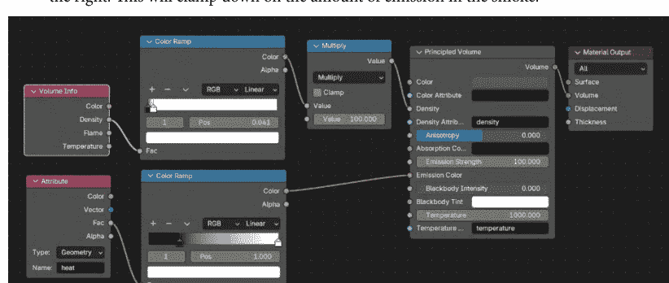

图 5.20 – 火焰节点预览

- 6. 至于颜色，让我们在 **颜色渐变** 中点击 + 号添加一个新的手柄。将此手柄设置为漂亮的红/橙色。然后选择白色手柄并将其设置为明亮的黄色。在位置和颜色上多尝试，直到满意为止。你也可以添加更多手柄；这样你就能更好地玩转颜色！以下是完整的节点设置，如果你想看的话：

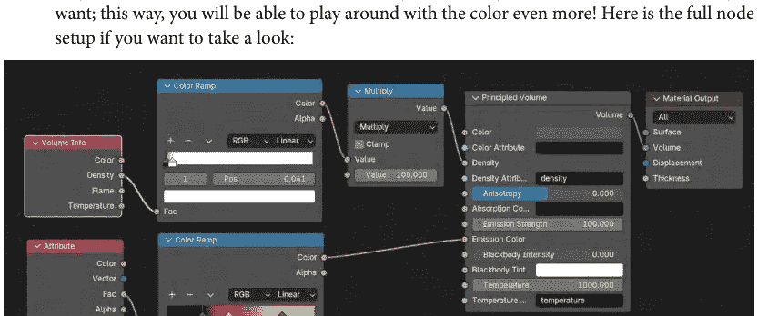

图 5.21 – 完整材质预览

这样，材质就完成了！随意调整数值、颜色和手柄以获得你想要的外观。以下图示显示了目前爆炸的结果：

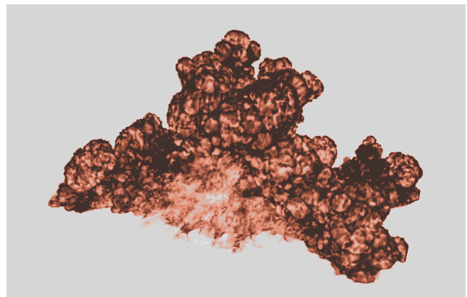

图 5.22 – 爆炸结果

如果颜色看起来有点暗淡且不饱和，不用担心；我们将在下一节中修复这个问题，在那里我们将学习如何使用 Cycles 和 EEVEE 正确渲染火焰！

## 在 Cycles 和 EEVEE 中渲染爆炸

本教程的最后一步是设置相机和渲染设置。

### 在 Cycles 中渲染

那么，让我们先开始设置相机并使用 Cycles 渲染爆炸：

- 1. 首先，在 **时间轴** 中，将 **结束** 帧设置为与你的模拟时长相匹配。在本例中，我们的是 150。
- 2. 由于我们在开始时删除了相机，我们需要添加一个新的。按 Shift + A 并选择 **相机**。将其放置在你想要观看爆炸的位置。我们认为从高处俯视的角度看起来很不错。
- 3. 接下来，进入 **渲染** 面板并向下滚动到 **色彩管理** 选项卡。将 **视图转换** 设置为 Filmic，将 **外观** 设置为 **高对比度**。这会让你的颜色更突出：

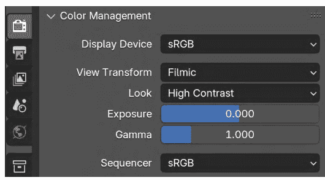

图 5.23 – 色彩管理选项卡

- 4. 最后，如果你使用的是 Cycles，将 **渲染最大采样数** 设置为 100，然后直接渲染动画。我们建议将动画导出为 PNG 文件，然后像我们在 *第4章* 结尾所做的那样将它们拼接在一起。我的模拟在第 35 帧看起来是这样的：

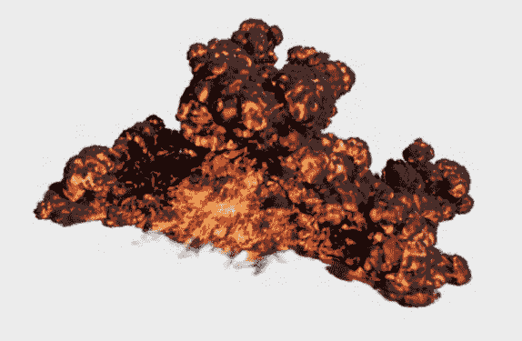

图 5.24 – Cycles 渲染预览

如果你想为渲染添加一些运动模糊，可以在域设置中将 **速度比例** 设置为 0.1，并在渲染设置中勾选 **运动模糊** 旁边的框。这与我们在 *第3章* 中所做的非常相似。然而，添加运动模糊的缺点是渲染时间会显著增加约 300%。最终看起来会更好，但你需要付出渲染时间的代价。

使用 Cycles 渲染时就这么多。另一方面，EEVEE 有点不同，需要更多的设置。让我们继续切换引擎到 EEVEE 并讨论其工作原理！

### 在 EEVEE 中渲染

一旦切换到 EEVEE，你会注意到烟雾看起来很糟糕。它过于像素化，而且火焰现在消失了。原因在于 **热** 属性在 EEVEE 中不起作用。因此，我们需要回到材质并将其切换为 **密度** 属性。让我们开始吧：

- 1. 这里的前三个步骤与在 Cycles 中渲染相同。在 **时间轴** 中，将 **结束** 帧设置为与你的模拟时长相匹配。在本例中，我们的是 150。
- 2. 由于我们在开始时删除了相机，我们需要添加一个新的。按 **Shift + A** 并选择 **相机**。将其放置在你想要观看爆炸的位置。我们认为从高处俯视的角度看起来很不错。
- 3. 接下来，进入 **渲染** 面板并向下滚动到 **色彩管理** 选项卡。将 **视图转换** 设置为 **Filmic**，将 **外观** 设置为 **高对比度**。这会让你的颜色更突出。参考 *图5.23*。再次打开 **着色** 工作区，取 **体积信息** 中的相同 **密度** 输出，然后将其插入底部的 **颜色渐变**。如果火焰出现过多，你可能需要调整黑色手柄。

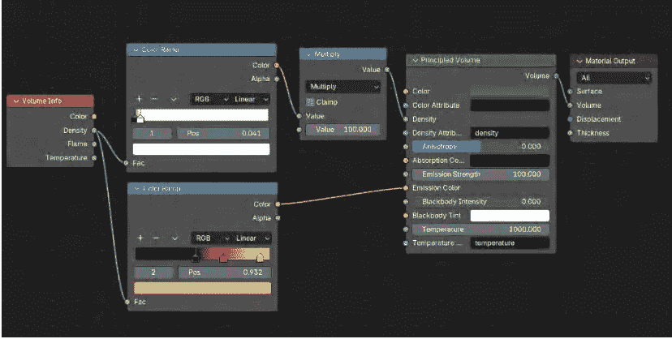

图 5.25 – EEVEE 材质节点

- 4. 现在，让我们恢复烟雾的细节。打开 **渲染属性** 面板中的 **体积** 选项卡。这里是我们恢复所有细节的地方。让我们先将 **分辨率** 设置为 1.1。这将恢复大量细节，并使下一步更容易看到。

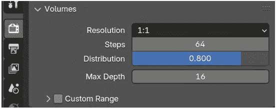

图 5.26 – 体积

- 5. 现在，我们的模拟应该具有更多细节。下一步是启用 **体积阴影**。这将为烟雾提供阴影，使其看起来更逼真。为此，向上滚动到 **阴影** 选项卡并勾选 **体积阴影** 旁边的框，然后将 **步数** 调高到 32 以获得更多细节。

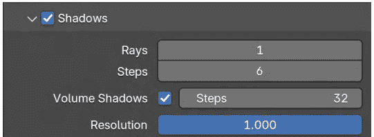

图 5.27 – 阴影

- 6. 最后，如果你觉得烟雾在太阳灯下看起来太亮，可以通过选择太阳打开 **灯光属性** 面板，并在 **影响** 选项卡下将 **体积散射** 设置为约 0.3。这会使烟雾看起来更暗，减少光线反弹。

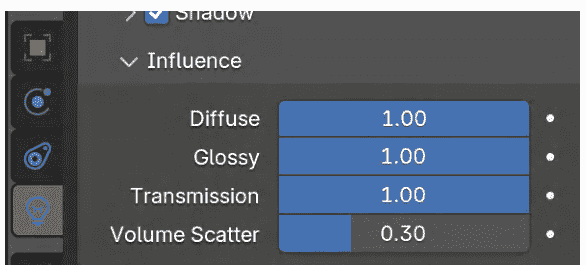

图 5.28 – 体积散射

使用 EEVEE 时需要注意的一点是，你不会从太阳灯获得烟雾下方的阴影。这是 EEVEE 的局限性之一——你可以在体积内部获得阴影，但它不会在场景中的其他物体上投射阴影。

因此，如果你想要获得带阴影的逼真效果，就必须在 Cycles 中渲染此场景。但如果你不太在意这一点，EEVEE 的渲染速度会更快！

- 7. 最后一步是设置输出并渲染动画。如前所述，建议将动画渲染为 PNG 或其他图像格式，然后稍后进行序列合成。参考 *第4章* 查看如何操作。以下图示显示了使用 EEVEE 渲染引擎后的一个帧：

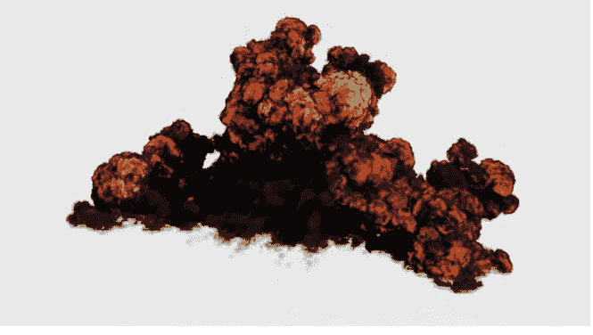

图 5.29 – EEVEE 最终结果

如你所见，在 EEVEE 中看起来相当不错，但再次注意，你会发现烟雾下方没有阴影。因此，使用哪个渲染引擎由你决定。它们各有优缺点，但结果仍然会很棒！

这个场景不必到此结束。你还可以为其添加很多内容！例如，你可以创建一个环境，让爆炸来自装满油的桶。你也可以设置一个雨天天空来营造氛围。一切都由你决定！

## 总结

好了！我们已成功使用粒子系统和 Mantaflow 在 Blender 中创建了一个爆炸。希望你在过程中学到了新东西并创造出了很酷的东西！

本章涵盖了很多主题，让我们回顾一下。首先，我们使用粒子系统创建了爆炸的初始形状。然后，我们添加了另外三个粒子系统，以为模拟提供变化和随机性。

之后，我们开始处理烟雾和火焰。我们使用了 **快速烟雾** 功能自动添加域，然后为流入对象设置了所有设置。我们学习了如何创建浓密的烟雾材质以及如何向烟雾中添加火焰。最后，我们讨论了如何在 Cycles 和实时渲染引擎 EEVEE 中渲染。

本书的第一部分到此结束！我们迄今为止已经涵盖了四个 Mantaflow 教程，现在，是时候转向不同的模拟了。在本书的 *第 2 部分* 中，我们将深入研究软体和布料模拟，并学习如何高效地使用这些模拟。

## 在 Discord 上加入我们的社区

加入我们社区的 Discord 空间，与作者和其他读者讨论：

https://packt.link/learn-blender-simulations-discord-invite

