## 开始使用软体

软体模拟是什么？软体模拟是一种可视化软物体运动或变形的手段。这可能是枕头和靠垫、海滩球、果冻、摆动的绳子、服装，或任何可以从原始形状变形的物体。你甚至可以使用软体模拟来创建汽车碰撞！尽管汽车在技术上并不是“软体”，但你可以使用该系统来创建碰撞中会发生的变形。

软体模拟也用于为物体添加次要运动。如果有一个行走的角色，你可能希望添加软体模拟来为身体赋予一些物理效果。这样角色看起来就不会那么僵硬，角色的肌肉、脂肪、头发和服装在行走时也会一起移动。虽然你可以使用软体模拟来处理服装，但通常最好使用布料模拟。这是因为它就是专门为此设计的，结果通常更准确、更逼真。

在本章中，我们将学习软体模拟在 Blender 中的工作原理，并涵盖其所有设置。在接下来的章节中，我们将更深入地探讨如何实用地使用该系统来创建独特且令人满意的动画。

在本章中，我们将涵盖以下主题：

- 软体模拟简介
- 了解碰撞对象
- 了解软体设置和数值
- 与多个软体交互

### 技术要求

本章要求你安装 Blender 4.2 或更高版本。

要下载 Blender，请访问 www.blender.org。

本章的配套文件可在以下位置获取：https://github.com/PacktPublishing/Learn-Blender-4-Simulations-the-Right-Way/tree/main/Chapter%206。

### 软体模拟简介

正如本章开头提到的，软体用于使物体变形并使其看起来柔软。软体模拟计算重力、力场以及连接顶点的内部力的强度，并据此应用变形。这会产生一种逼真的外观，仿佛物体内部填充了某种东西。例如，想想一个水球。

要为物体添加软体模拟，你需要前往物理面板并选择软体，如以下屏幕截图所示：

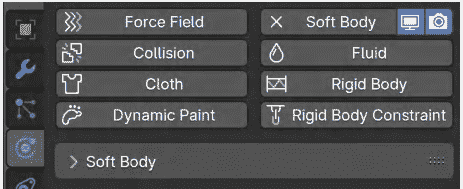

图 6.1 – 创建软体模拟

与 Mantaflow 模拟不同，你可以使用任何具有控制点或顶点的物体进行软体模拟。这包括网格、曲线、曲面和晶格。物体上的顶点数量也会与模拟的外观相关。例如，如果你尝试模拟一个只有八个顶点的立方体，那效果不会很好，因为它多边形太少（低模）。

另一方面，当你模拟一个顶点数量很高的软体物体时，Blender 会明显变慢。因此，在处理软体模拟时，通常最好使用顶点数量较少的物体。这也适用于碰撞对象。如果你的碰撞对象多边形很高，模拟的烘焙和计算时间会很长。如果不想降低碰撞对象的顶点数量怎么办？解决办法是创建一个不可见的低模版本并使用它。这样你仍然保留高模物体，但它不会与模拟交互。

一旦你为物体添加了软体模拟，你可以前往时间轴播放动画以实时查看。你甚至可以在播放时添加其他物体和碰撞并与模拟交互，这对于快速测试很有用。

软体和布料模拟的一个共同点是，你希望该物体的几何分布均匀。例如，如果一个物体在某一区域的顶点数量很多，而在另一区域顶点很少，软体模拟在这两个区域的表现会不同。高顶点区域可能松弛，而低顶点区域会非常僵硬。因此，除非你 specifically 追求那种动画效果，否则通常最好在整个物体上保持均匀的几何结构。

以下图表说明了良好的几何结构和不良的几何结构：

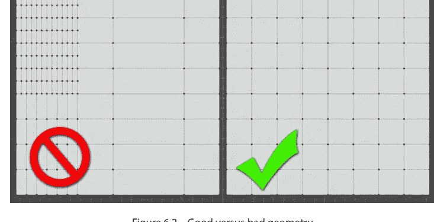

图 6.2 – 良好与不良几何结构

软体模拟很棒，可以节省你尝试为物体变形或与碰撞交互而动画制作的大量时间，但如果你在错误的情况下尝试使用它，也会浪费时间。因此，只有在适合你的场景时才使用软体模拟。你可以在这里看到一个示例：

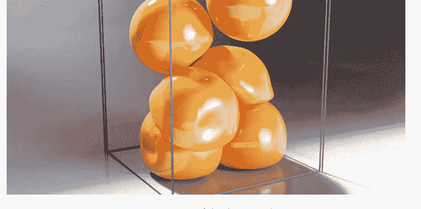

图 6.3 – 软体示例

在我们深入讨论软体的所有设置之前，让我们先花点时间谈谈碰撞对象！

### 了解碰撞对象

如果你希望软体物体与另一个网格发生碰撞，你需要为该网格添加碰撞。否则，软体将直接穿过该物体，并且不会与模拟交互。

你可以通过前往修改器面板并添加碰撞修改器，或在物理面板中选择碰撞来启用碰撞。这些碰撞对象在处理软体、衣服甚至粒子系统时经常使用！你甚至可以为软体物体本身添加碰撞；这样软体也会与其他软体交互（我们将在本章末尾更详细地讨论）。要禁用碰撞设置，你可以单击 X 来移除它，或在视口中通过切换眼睛图标来禁用它，如以下屏幕截图所示：

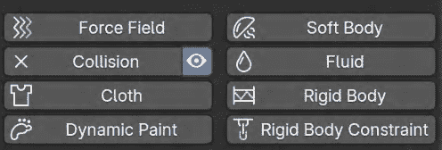

图 6.4 – 启用和禁用碰撞

当你第一次为物体添加碰撞时，你会在设置中看到两个选项卡：粒子 和 软体和布料，如以下屏幕截图所示：

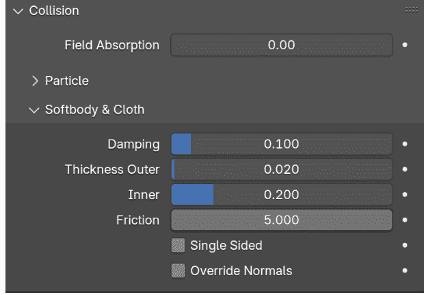

图 6.5 – 碰撞对象

**粒子** 设置用于粒子与碰撞的交互方式；这对软体没有影响，所以我们先跳过。**软体和布料** 选项卡中的设置确实有影响，所以让我们逐一介绍并讨论它们如何改变模拟！它们包括以下内容：

- **场吸收**：这允许你吸收力场强度的一定百分比。例如，如果一个风力场穿过一个 **场吸收** 值设置为 0.2 的碰撞，它将吸收力场强度的 20%。如果值设置为 1，它将吸收 100% 的力场，风将无法通过。注意，要使此设置生效，你还需要在 **力场** 物理面板中启用 **吸收** 复选框。

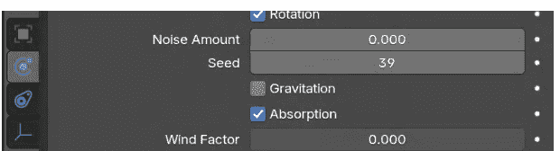

图 6.6 – 场吸收

- **阻尼**：这是软体在碰撞时弹跳的程度。0 表示无阻尼，因此会有大量弹跳。1 表示最大阻尼，几乎没有弹跳。

- **外部厚度**：这是碰撞外部区域的大小。值为 0.5 时，碰撞与软体之间会有相当大的间隙。此设置也充当碰撞的填充。不是撞到它并弹起，而是看起来像软体撞到了枕头。在某些情况下，这有助于防止物体之间的穿透。你可以在这里看到它的表示：

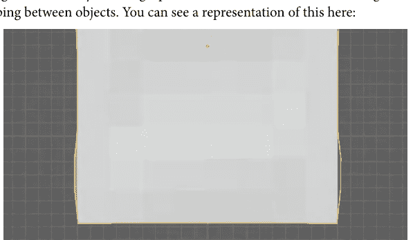

图 6.7 – 外部厚度示例

-   **内部：** 这是物体的内部碰撞区域。这基本上是填充距离，如果柔性体进入此区域，它会尝试将其推出。你可以在这里看到它的说明：

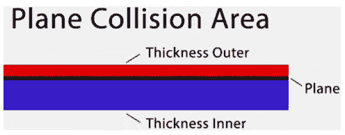

Figure 6.8 – 平面碰撞区域

举例来说，可以将一个柔性体放置在平面的中间。由于柔性体的半部分位于**内部**区域内，它会将其向上推出。请记住，这对布料模拟不起作用，仅适用于柔性体。以下是此情况的视觉示例：

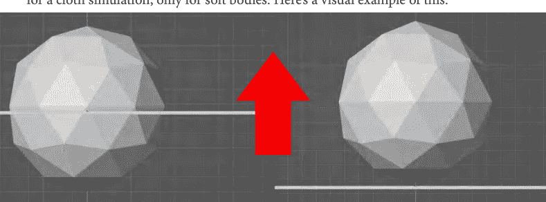

Figure 6.9 – 内部区域示例

还需要注意的是，碰撞是基于**法线**的方向。物体的法线是指面朝向的方向。如果发现碰撞物体无法正常工作，你可能需要重新计算法线并查看法线指向的方向。

要重新计算法线，请在选中物体的情况下进入**编辑模式**。然后按 A 选择网格上的所有顶点，之后前往**网格 | 法线 | 重新计算外部**或按 *Shift + N* 快捷键。你也可以在**覆盖**菜单中打开**面朝向**，以查看面朝向的方向，如以下屏幕截图所示：

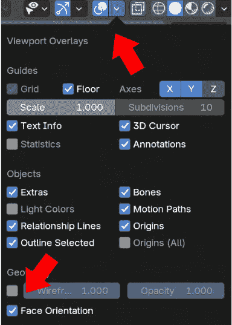

Figure 6.10 – 覆盖菜单

**摩擦**、**单面**和**覆盖法线**设置仅用于布料模拟，我们将在*第8章*学习相关内容。

说完这些，让我们进入柔性体模拟，学习所有设置和细节！

## 理解柔性体设置和数值

现在你已经了解 Blender 中柔性体模拟和碰撞物体的工作原理，是时候深入技术细节，学习所有设置和数值以及它们如何影响模拟了。在阅读本章时，我建议你自己测试这些设置，以便直观了解它们的工作方式。你可以从 https://github.com/PacktPublishing/Learn-Blender-4-Simulations-the-Right-Way/tree/main/Chapter%206 下载我为此目的创建的基础 .blend 文件。打开此文件后，你会发现只有一个基础场景，其中包含一个二十面体和一个碰撞物体。

现在，让我们谈谈设置！

### 对象设置

当你首次在物理面板中选择柔性体时，右侧会出现许多设置，如下所示：

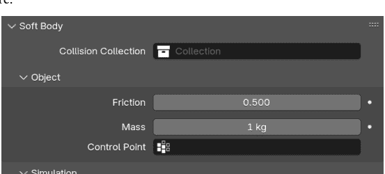

Figure 6.11 – 对象设置

让我们从顶部开始逐步向下进行，如下所示：

-   **碰撞集合**：这允许你控制哪些集合与模拟交互。将其设置为无时，每个集合中的每个碰撞都会与柔性体交互。
-   **摩擦**：这与你预期的有点不同。这是整个区域的整体摩擦力。如果增加此值，它会减缓柔性体的运动，使其看起来像是在慢动作中移动。
-   **质量**：这控制物体上每个顶点的重量。在下面的屏幕截图中，左侧示例的质量值为 1 kg，而右侧的质量值为 10 kg。你会注意到它在自身内部坍塌，因为重量太重而无法维持物体的结构：

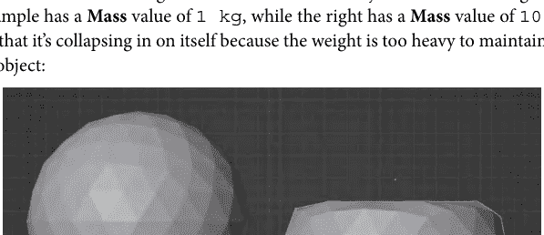

Figure 6.12 – 质量示例
-   **控制点**：这允许你使用**顶点组**来控制物体的**质量**值。如果你从未使用过顶点组，它基本上允许你在每个顶点上绘制 0 到 1 的值。在此示例中，我将立方体的左侧设置为 1，显示为红色，因此使用完整质量。右侧设置为蓝色，即 0，因此不重。如你所见，它在自身内部坍塌，因为左侧更重（我们将在本章后面更详细地讨论顶点组）：

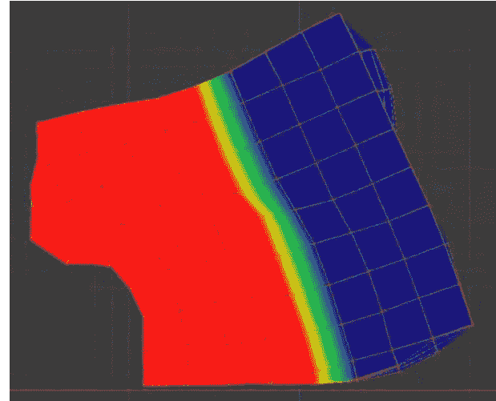

Figure 6.13 – 控制点示例
-   **速度**：最后，我们有控制模拟速度的选项。此值基于场景的**每秒帧数 (FPS)**。例如，如果帧率为 60 且**速度**值设为 1，模拟看起来会以两倍速度播放，因此你需要降低速度以匹配帧率。考虑你想要制作的内容、场景的比例和帧率，并相应调整速度。

完成这些后，让我们继续到**缓存**选项卡，学习如何烘焙模拟！

### 缓存

在**对象**设置下方，我们有**缓存**选项卡。这就是烘焙模拟的地方。其中一些选项应该很熟悉，因为它们与 Mantaflow 模拟相同。

不同之处在于能够拥有多个缓存。例如，你可以点击 + 按钮创建另一个缓存，如下图所示。双击缓存以重命名它。然后你可以选择其中一个，按自己的意愿更改设置并烘焙它，而不会影响其他缓存：

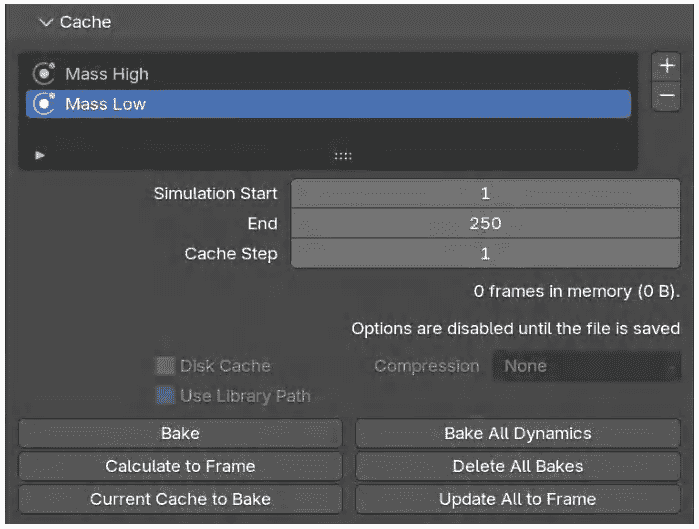

Figure 6.14 – 多个缓存示例

这对于快速预览模拟中的某些设置非常有用。要在两个缓存之间切换，请确保重新启动时间轴，然后选择要预览的缓存并按播放。

我们还应讨论缓存和烘焙之间的区别。缓存是动画在播放时的结果。在下面的屏幕截图中，你会在时间轴底部看到一条橙色线——这就是缓存：

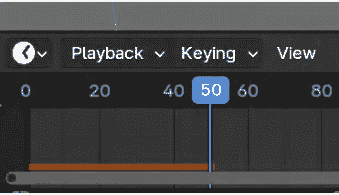

Figure 6.15 – 缓存示例

每当你在模拟中更改设置时，缓存就会消失，你需要重新播放动画才能恢复。当你烘焙时，模拟的结果会被锁定，除非你点击释放烘焙，否则无法更改设置。时间轴底部也会填满那条橙色线。以下屏幕截图提供了此示例：

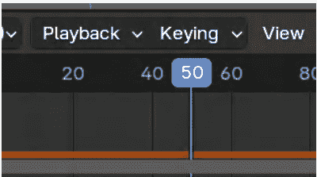

Figure 6.16 - 烘焙示例

这就是区别——缓存是临时结果，如果你做出任何更改就会重置，而烘焙是锁定后的结果。现在，让我们查看缓存选项卡的其余设置：

-   **模拟开始和结束**：这些只是允许你为烘焙设置模拟的帧范围。
-   **缓存步长**：这允许你在烘焙时跳过模拟的帧。如果此值设为 2，它将每隔一帧烘焙一次。这可以节省存储空间，但模拟可能不够准确。
-   **烘焙**：这会烘焙模拟。
-   **计算到帧**：这允许你在时间轴中选择任意帧，Blender 将计算到你选择的帧为止的动画。
-   **当前缓存烘焙**：这允许你将临时缓存用作烘焙结果。
-   **烘焙所有动力学**：这会烘焙场景中的所有模拟。如果有多个柔性体、粒子系统或布料模拟，它们将一次性全部烘焙。
-   **删除所有烘焙**：这个很简单明了。它会删除场景中的所有烘焙。
-   **更新全部到帧**：这会将所有模拟更新到你选择的当前帧。

有时，如果你尝试在未烘焙的情况下渲染动画，模拟可能无法正常工作。因此，在渲染之前最好先烘焙模拟；这样一切都能正常工作，不会出现问题。

### 柔性体目标

你可能会注意到，刚创建柔性体对象并播放动画时，物体只是漂浮并上下浮动。这是因为设置中已勾选**目标**。目标选项基本上是一种固定顶点位置的方法。这在尝试创建从线上悬挂的毯子、固定在杆上的旗帜角落或角色行走时很有用。你可以在这里看到一个示例：

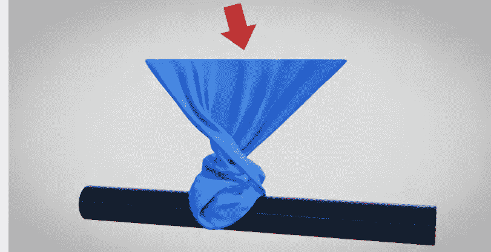

Figure 6.17 – 目标示例

由于**目标**试图固定顶点位置，这意味着任何动画数据都适用于柔性体模拟。你可以让物体在场景中飞行，同时仍具有柔性体物理效果！当**目标**启用时，整个物体将被*固定*。如果你只想让物体的某些部分使用**目标**，可以创建一个顶点组并绘制你想要固定的位置。

让我们再多了解一些关于顶点组以及它们在 Blender 中的工作原理。如前所述，顶点组用于为顶点分配 0 到 1 范围内的值。要创建新的顶点组，你可以通过按 *Tab* 并选择**权重绘制**手动绘制顶点。现在，你可以在顶部选择想要的值并开始在网格上绘制。

就像创建软体模拟时一样，使用权重绘制需要有几何体。如果尝试在仅有四个顶点的平面上绘制，这效果会很差，因为中间没有几何体可供绘制。因此，在物体上绘制时，请确保有足够的几何体。你可以在以下截图中看到一个高多边形平面的示例：

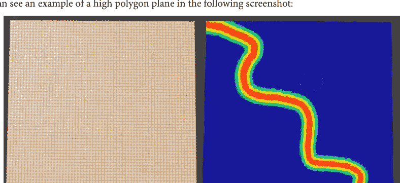

图 6.18 – 权重绘制几何体

另一种创建顶点组的方法是前往“对象数据属性”面板并点击顶点组旁边的 +，如下截图所示：

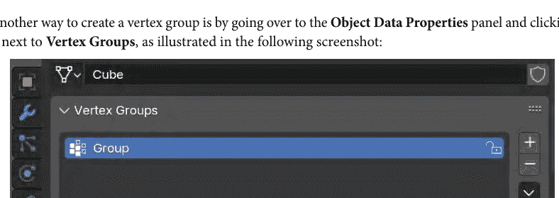

图 6.19 – 顶点组

此时，你可以进入**编辑模式**并选择想要作为顶点组一部分的网格部分。从 0 到 1 的范围内选择你的**权重**值，然后点击**分配**。你也可以通过选择网格部分并点击**移除**来移除顶点组。如果想删除顶点组，只需点击 – 号。创建组后，你可以通过在**顶点组**下拉菜单中选择它，将其分配给软体模拟，如下截图所示：

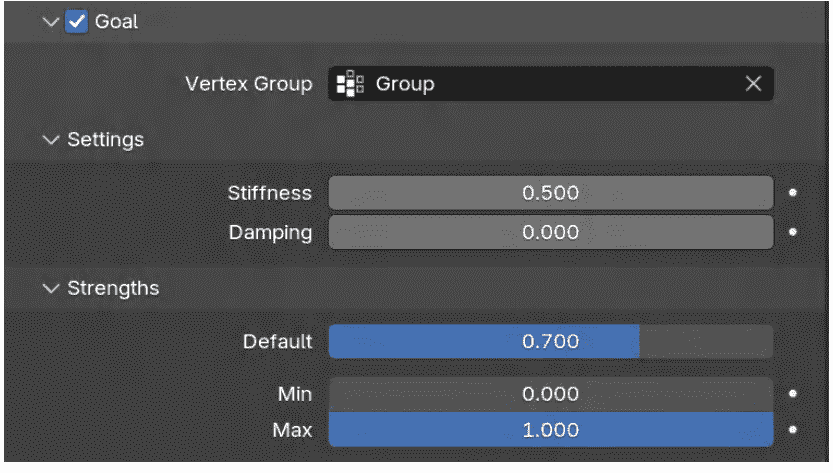

图 6.20 – 软体目标

让我们回到设置中，了解每个选项的作用如下：

- **强度**：先跳过**刚度**和**阻尼**一会儿，谈谈**强度**。播放模拟时物体上下浮动的原因是目标的**默认值**设为 0.7，因此它只将顶点固定在约 70%。如果此值设为 1，则整个物体/固定的顶点将被卡住，无法移动。
- **最小值和最大值**：这些值提供了一种微调顶点组对模拟影响的方法。**最小值**将是最低顶点权重的最小强度。假设你为整个物体分配顶点组权重为 0，并将**最小值**设为 1。你觉得会发生什么？物体将被完全卡住，因为它现在为目标使用强度值为 1。毕竟那是最小值。**最大值**的工作方式相同——它控制所有权重为 1 的顶点的固定强度。
- **刚度**：回到**刚度**，此设置控制固定的刚硬程度。在以下截图中，左侧的**刚度**设为 0.2，右侧设为 0.999（最高值）。正如你所见，左侧非常松散，固定并不很刚硬：

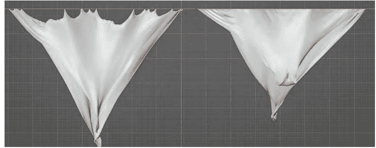

图 6.21 – 刚度示例
- 最后，**阻尼**值会减弱软体的运动，直到它停止移动。你设置的值越高，物体停止移动的速度就越快。

**目标**非常有用，在尝试创建某些模拟时可以派上用场，例如旗帜以及需要固定的任何其他东西。接下来，我们将讨论**边**选项卡。

## 边

**边**选项赋予软体物体一定的结构。因此它不会坍缩到自身，而是会保持形状。基本上，启用**边**时，它会在物体的所有边上添加虚拟弹簧。你可以在这里看到一个示例：

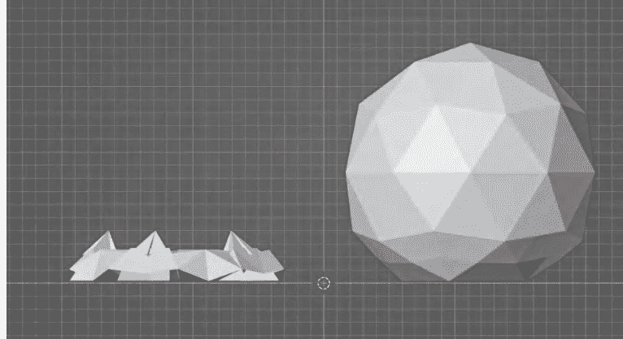

图 6.22 – 边示例

这里可以看到**边**设置：

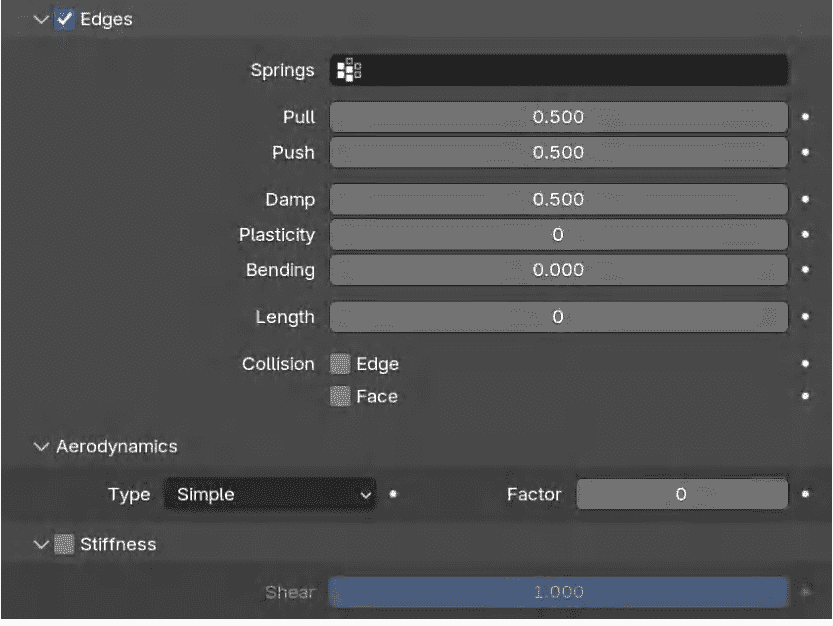

图 6.23 – 边选项卡设置

让我们现在依次介绍设置：

- **弹簧**：就像在**目标**选项卡中一样，我们有**弹簧**选项，可以分配顶点组来控制它们的位置以及作用强度。
- **拉力**：此值基本上充当模拟的橡皮筋。值越高，*橡皮筋*越强，这意味着边会粘在一起而不是被拉伸。在以下截图中，左图**拉力**值为 0.1，右图为 0.999。正如你所见，左侧示例被拉伸得更多：

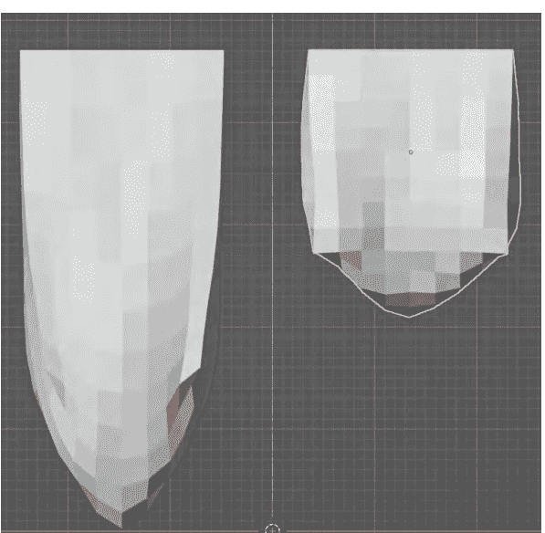

图 6.24 – 拉力示例
- **推力**：另一方面，此值控制软体抵抗被压碎的程度。你可以把它想象成物体内部弹簧的强度。值越高，阻力越大。在以下截图中，左侧**推力**值设为 0.6，右侧为 0.9：

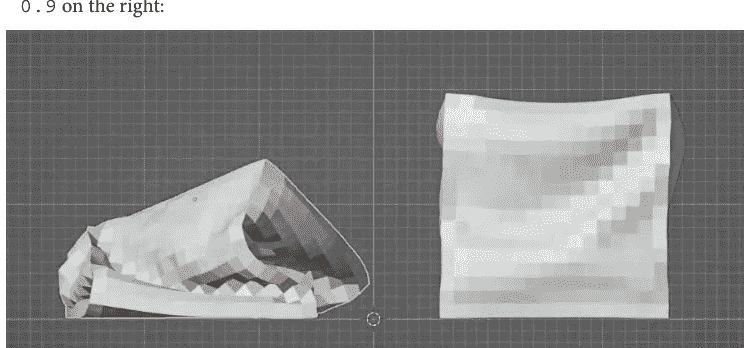

图 6.25 – 推力示例
- **阻尼**：有时创建软体模拟时，物体会有很多细小的移动和抖动。**阻尼**值有助于平静物体并消除大部分细微运动。当然，值越高效果越明显。
- **塑性**：这是一个很有趣的值可以尝试。它允许网格在发生碰撞时永久变形。值为 100 时，它将永远保持变形状态，但如果设为较低值，它会慢慢恢复到原始形状。

你可以在以下截图中看到，**塑性**设为 100。球体与立方体碰撞后发生变形，并且保持不变：

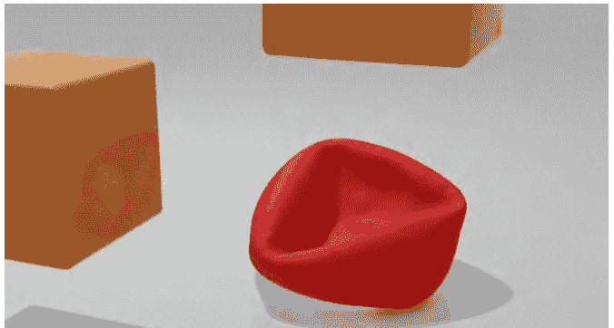

图 6.26 – 塑性示例
- **弯曲**：这控制模拟中弯曲的程度。值为 0 时，网格会坍缩到自身，但值越高，网格会保持其结构。你可以在这里看到一个示例：

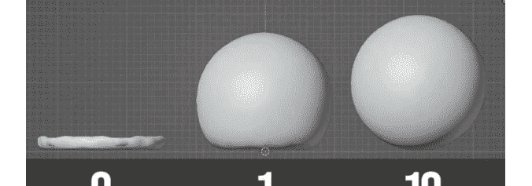

图 6.27 – 弯曲示例
- **长度**：此值会根据你设置的值缩小或扩大网格。例如，如果**长度**设为 70，则网格会缩小到其大小的 70%。如果值设为 150，则网格会扩展到原始大小的 150%。
- **碰撞**
  - **边和面**：这些复选框允许软体模拟与边或面发生碰撞。通常只有顶点会与碰撞发生碰撞，但启用**边**或**面**也会允许它们发生碰撞。启用**面**时请注意，这可能比较耗计算，你可能会在物体上看到很多抖动，因为**阻尼**设置不会影响它。
- **空气动力学**：此值允许软体物体在场景中具有一定的空气阻力。**系数**值控制空气阻力的大小。要看到效果，你需要将**系数**值设得相当高，例如 2000 左右。这会使物体周围的空气非常稠密，从而使物体下落变慢并变形。
- **刚度**：这会在面的边上添加虚拟弹簧，而**剪切**值控制这些弹簧的刚硬程度。启用**刚度**后，立方体不会坍缩到自身。在以下截图中，左侧立方体未启用**刚度**，右侧已启用：

有两种不同的空气动力学类型：**简单**和**升力**。**简单**计算速度更快但精度较低。**升力**计算速度较慢，但模拟会更接近现实世界场景。

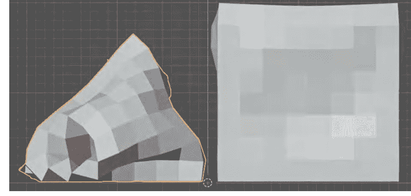

图 6.28 – 刚度示例

需要注意的是，**刚度**仅适用于四边面。四边面是具有四个顶点的面。具有三个顶点的面将不起作用，**刚度**设置不会产生任何效果。

这就是**边**选项卡中的所有设置。接下来，让我们讨论如何使用**自碰撞**使软体与自身发生碰撞！

## 自碰撞

**自碰撞**就是字面意思。如果启用，软体会与自身发生碰撞。这在创建毯子或服装时很有用。如果未启用，软体会直接穿过自身而不发生碰撞。在以下截图中，你会看到左侧有一个启用了**自碰撞**的软体示例。正如你所见，它在向下摆动时与自身发生碰撞，而右侧示例未启用**自碰撞**：

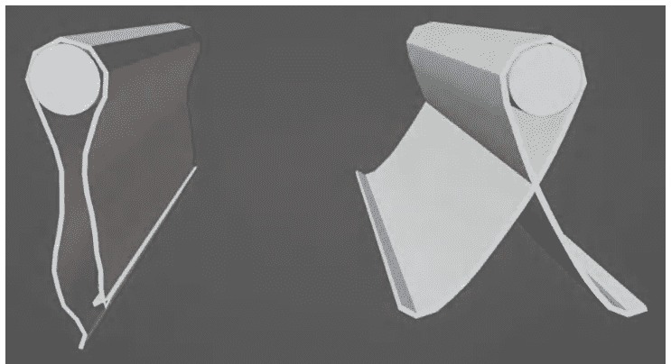

图 6.29 – 自碰撞示例

现在，让我们进入**自碰撞**的设置并了解其工作原理。你可以在这里看到它们：

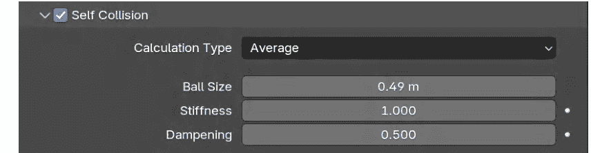

图 6.30 – 自碰撞设置

**自碰撞**通过在每个顶点周围创建一个小的虚拟球并用其进行碰撞来实现。 该虚拟球的大小可以通过**自碰撞**标签页中的**球体大小**设置来控制。 当此值设置得很高时，一个顶点的碰撞区域可能会与另一个相交。 这会导致软体为了补偿碰撞区域而被拉伸。 如果你在启用**自碰撞**时发现软体对象在膨胀，你可能需要降低**球体大小**值。

在以下屏幕截图中，你将看到如果**球体大小**碰撞可见时会是什么样子的示例：

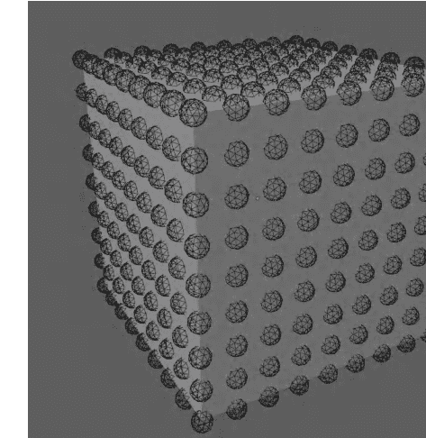

图 6.31 – 球体碰撞示例

现在，让我们来谈谈设置！

- **计算类型**：这决定了碰撞球大小将如何设置。 你可以从以下选项中选择：
  - **手动**：你手动设置碰撞球的大小。
  - **平均**：取每条边的平均长度并乘以**球体大小**值。
  - **最小**：取对象上最小的边并乘以**球体大小**值。
  - **最大**：做相反的操作。 它取最大的边并乘以**球体大小**值来计算碰撞。
  - **平均最小值和最大值**将两者相加，除以 2，然后将结果乘以**球体大小**值。

在大多数情况下，你不需要更改这些设置，所以只需坚持使用**平均**即可。

- **刚度**：这控制当一个顶点进入另一个顶点碰撞球时**自碰撞**的工作方式。 当其值设置得很高时，它会非常快地将顶点推出。 当其值设置得较低时，它会缓慢地将顶点推出。
- **阻尼**：这用于在顶点接近另一个顶点碰撞球时减慢其速度。 高值会使其非常快速地减速。

大多数情况下，你所要做的就是启用**自碰撞**，所有默认设置都会正常工作。 请记住，模拟计算所需的时间会更长，因此只有在需要时才启用**自碰撞**。

## 求解器

**求解器**标签有助于使模拟更准确。 有时，在快速移动的碰撞中，模拟在计算时会遇到困难，你可能会遇到一些错误和碰撞问题。 然而，在此标签中，你将能够更改设置以获得更准确的模拟。 你可以在以下屏幕截图中看到这些设置：

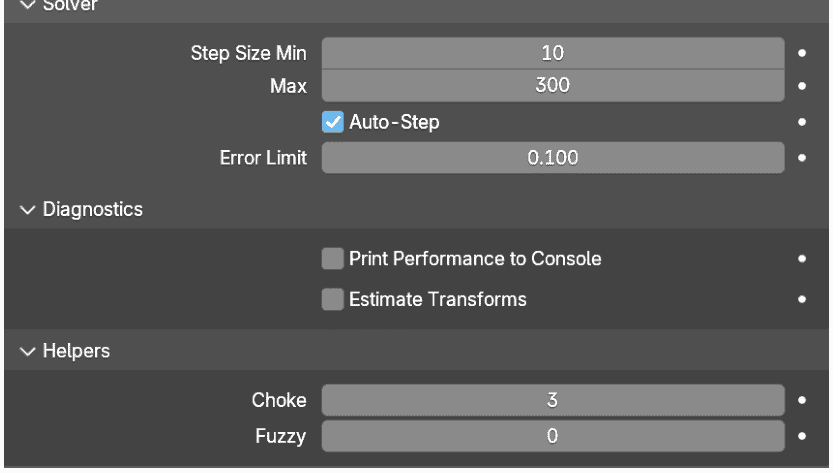

图 6.32 – 求解器设置

让我们逐一介绍每个选项并讨论它们如何帮助提高模拟的准确性：

- **最小步长**：当模拟出现错误或碰撞无法正常工作时，你需要提高此设置。 此值是模拟每帧将被计算的次数。 如果你遇到碰撞问题，请增加此值。
- **最大**：这是每帧将被计算的最大步数。
- **自动步长**：启用后，Blender 将根据物体的速度自动设置每帧的步数。
- **误差限制**：此值决定模拟的质量和准确性。 如果你在模拟中看到很多错误，你可能需要降低此设置。
- **打印性能到控制台**：这正是字面意思。 它将模拟的性能打印到 Blender 控制台，并给出模拟需要准确的步数。 要打开控制台，你可以前往**窗口 | 切换系统控制台**。 要关闭控制台，请使用相同的选项。
- **估计变换**：此选项允许你在模拟设置中存储软体对象所具有的所有变换（移动、旋转和缩放）。
- **阻塞**：如果软体对象穿透碰撞，模拟会尝试将其推出。 在此过程中，软体对象会具有一定的速度。 此速度由**阻塞**值控制。 较高的值会在软体穿出碰撞时减慢其速度。
- **模糊**：此值设置碰撞的准确性。 高值速度更快但准确性较低，而较低的值会给出更准确的结果但运行速度较慢。

求解器标签非常棒，可以帮助解决模拟中的许多错误。

## 力场权重

软体模拟中的最后一个标签是**力场权重**。 这与流体模拟的工作方式完全相同。 你可以为某些力场设置特定的强度，并自定义哪些力场将在你的模拟中工作。

如果场景中有多个力场，你可以在**效果器集合**菜单中选择要使用的集合。 现在，只有该集合中的力场才会影响模拟。

在这一章结束之前，让我们快速谈谈如何使多个软体对象相互交互。

## 多个软体的交互

对于某些模拟，你可能希望多个软体相互交互。 如果你添加多个对象并仅使用软体模拟来模拟它们，它们将直接穿过彼此。 原因在于你需要确保每个软体也应用了碰撞修改器——这样它们才会发生碰撞。 同样重要的是要确保碰撞修改器在修改器堆栈中位于软体修改器下方，如以下屏幕截图所示：

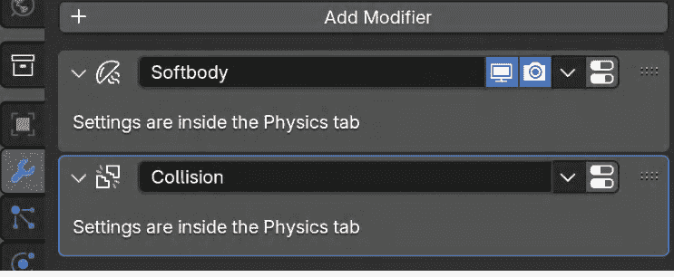

图 6.33 – 修改器堆栈示例

如果尝试在软体修改器上方使用碰撞修改器进行模拟，碰撞将在模拟开始时的原始位置发生，而不是软体对象所在的位置。 你可以通过拖动修改器右侧的点来上下移动修改器。

如果操作正确，你应该会看到你的软体相互碰撞和交互，如下所示：

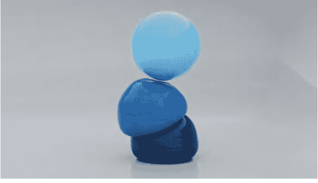

图 6.34 – 交互的软体

就是这样！ 我们已经涵盖了软体模拟的每一个设置！

## 总结

本章的目标是让你了解软体模拟，以便你可以在不必测试每个设置来查看其作用的情况下创建自己的模拟！ 我们学到了很多东西，所以让我们快速回顾一下！

首先，我们讨论了软体模拟的工作原理以及开始所需的内容。 然后，我们了解了碰撞对象以及它们如何与模拟交互。 接下来是软体对象的所有设置。 我们讨论了顶点组以及它们如何与目标交互。 我们回顾了边、自碰撞、求解器和力场权重的所有设置，最后我们学习了如何使多个软体对象相互交互。

软体模拟非常有用，可以在动画和建模时节省大量时间。 不过，请确保正确使用它，因为有时做一个快速动画比完整的软体模拟更简单。

在下一章中，我们将通过为软体对象创建一个完整的障碍赛道来检验我们所学的内容！

## 加入我们的 Discord 社区

加入我们社区的 Discord 空间，与作者和其他读者进行讨论：
https://packt.link/learn-blender-simulations-discord-invite

