## 创建软体障碍赛道

在上一章中，我们涵盖了关于软体模拟所需了解的一切。 在本章中，我们将在为一个球体创建障碍赛道的同时检验这些技能。 知道一个设置的作用是好的，但我们也应该知道如何在项目中正确使用它。 因此，本章的目标是让你在创建令人满意的动画的过程中，对如何使用软体模拟有一个实用的理解。

我们将首先打开设置文件并熟悉场景。 之后，我们将开始创建模拟并为每个对象添加所有物理属性。 接下来，我们将创建一个玻璃材质并学习如何在 EEVEE 中正确渲染它。 在本章中我们将涵盖很多技巧和技术，到最后，你将制作出一个漂亮的障碍赛道动画！ 你还能够将在这里学到的内容应用于你自己的未来软体模拟项目！

在本章中，我们将涵盖以下主题：

- 创建模拟
- 使用软体目标
- 在 EEVEE 中创建玻璃材质
- 设置摄像机跟踪

## 技术要求

本章要求你安装 Blender 4.2 或更高版本。

要下载 Blender，请访问 www.blender.org。

请确保也下载设置文件，其中包含障碍赛道的[content]
请确保也下载设置文件，其中包含障碍赛道的[content]
请确保也下载设置文件，其中包含障碍赛道的[content]
请确保也下载设置文件，其中包含障碍赛道的[content]
请确保也下载设置文件，其中包含障碍赛道的[content]
请确保也下载设置文件，其中包含障碍赛道的[content]
请确保也下载设置文件，其中包含障碍赛道的[content]
请确保也下载设置文件，其中包含障碍赛道的[content]
测试

5. 接下来，返回到 **Physics** 面板，并在 **Pin Group** 菜单中选择新的顶点组。

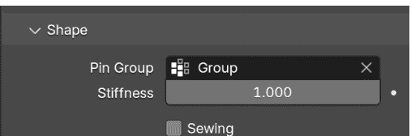

Figure 7.14 – 布料固定组

6. 确保将 **Cloth** 修改器移动到 **Collision** 修改器之上。这样可以确保软体与布料发生碰撞，并且会考虑布料的形变。

7. 最后，选择 **Soft Body Sphere** 对象，并同样添加一个 **Collision** 修改器。现在布料和球体会相互作用。再次确保 **Soft Body** 修改器位于 **Collision** 之上。

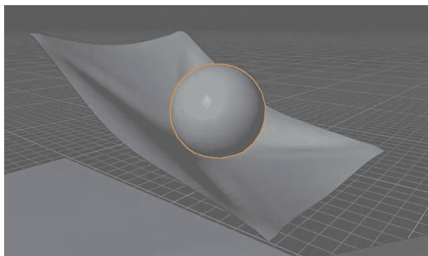

Figure 7.15 – 布料碰撞

8. 不必重复我们刚才为 **Cloth 2** 对象所做的所有步骤，直接删除它并复制 **Cloth 1** 对象即可。你可以通过选择它并按下 *Shift + D* 来复制对象。然后旋转并将复制的对象放置在 **Cloth 2** 对象原本所在的位置。

现在让我们继续学习使用 **Soft Body Goal**！

## 使用 Soft Body Goal

在最后一步，在烘焙此模拟之前，我们将学习如何使用 **Soft Body Goal** 使球体跟随曲线。如果你还记得上一章，**Goal** 允许你固定并动画化软体。软体的“目标”是尝试回到其原始位置，或原点所在的位置。这就是为什么启用 **Goal** 时，物体只会上下浮动：它正试图回到原点。

那么，我们要做的是在软体球体进入 **Glass Tube** 对象时打开 **Goal**。然后球体会跟随内部的曲线，弹跳并撞击墙壁，直到从另一侧掉落。让我们开始吧：

- 首先，我们需要找到球体进入玻璃管的时间。从头开始播放动画来确定这一点。在我的模拟中，大约是 **Frame 420**。你的可能略有不同。

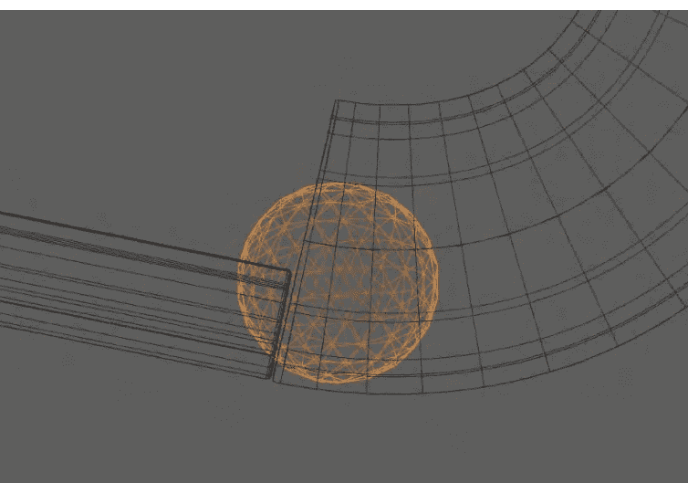

Figure 7.16 – 第 432 帧

- 在 **Physics** 面板中为 **Soft Body Sphere** 对象启用 **Goal**。

3. 不幸的是，Blender 不允许对 **Default** 强度值进行动画化。（你可以在 *Figure 7.17.* 中看到设置旁边没有动画按钮。）因此，我们将使用 **Min** 和 **Max** 值：

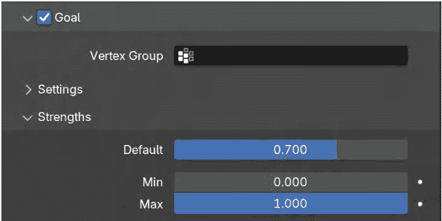

Figure 7.17 – Goal 强度设置

让我们将这两个值都设为 0 for **Frame 419** 并为每个值添加关键帧。你可以通过点击值旁边的那个小点，或在鼠标悬停在值上时按 I 来实现。这应该会将设置变为高亮的黄色。

4. 跳到下一帧，即 **Frame 420**。将 **Min** 和 **Max** 值都设为 0.5 并添加另一个关键帧：

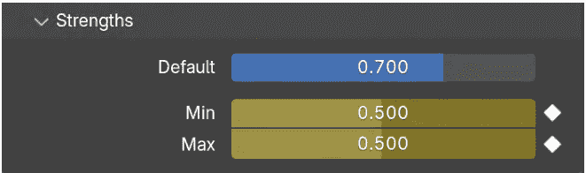

Figure 7.18 – 动画化的 Min 和 Max 值

5. 现在我们可以设置球体跟随曲线！为此，前往 **Constraints** 面板并添加一个 **Follow Path** 约束。

6. 在 Target 菜单中，选择 Goal Guide，即 Glass Tube 内部的曲线。Offset 控制对象开始跟随曲线的时间。我们需要将其设为 420。然后点击 Animate Path。

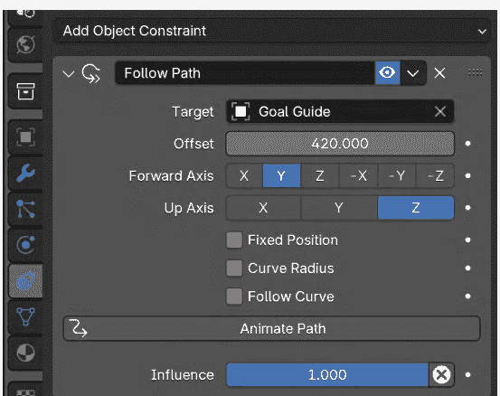

Figure 7.19 – Follow Path 约束

7. 你可能会遇到一个问题，即球体移动得非常远！这是由于 Follow Path 约束造成的。别担心，很容易修复！

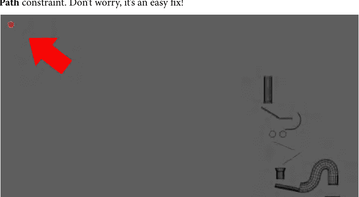

Figure 7.20 – 球体位置

我们需要在 **Soft Body Sphere** 对象上设置一些 **Location** 关键帧。当我们对其进行动画使其跟随曲线时，球体的原点需要位于曲线的起点才能正常工作：

- 8. 首先，确保你在 **Frame 1**；然后通过点击约束顶部的 **Eye** 图标来隐藏 **Follow Path** 约束。查看 *Figure 7.19*。这将使球体弹回其原始位置。

- 9. 接下来，让我们将光标放置在球体的位置。我们可以通过选择球体，按下 *Shift + S*，然后选择 **Cursor to Selected** 来实现。

- 10. 通过点击 **Eye** 图标重新启用 **Follow Path** 约束。球体应该再次移得非常远。要将其带回，按下 *Shift + S*，这次选择 **Selection to Cursor**。这将使球体弹回其原始位置。

我们采用这种方法而不是手动移动球体的原因是，它可能不会与本章开始时完全相同的位置。即使是极小的位移差异也可能改变模拟结果，导致我们在 *step 4* 中添加的关键帧无法正确对齐。

- 11. 现在让我们添加一个 **Location** 关键帧！在 **Frame 1** 球体位于起始管内时，按下 *K* 并添加一个 **Location** 关键帧。

- 12. 接下来，跳到 **Frame 420** 并将球体完全向下移动到曲线的起点。然后添加另一个 **Location** 关键帧。

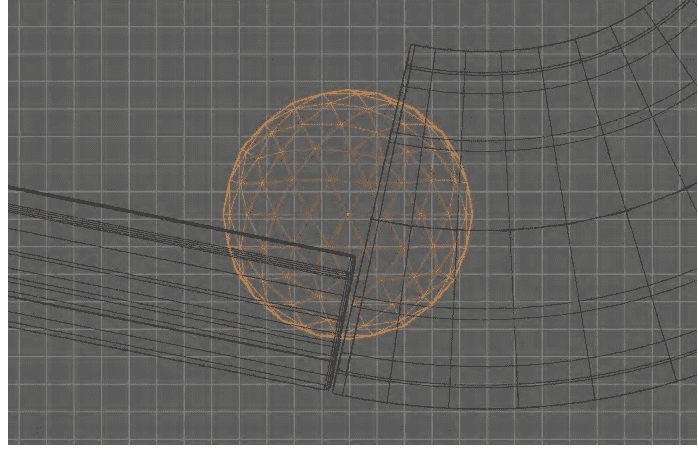

Figure 7.21 – 曲线的起点

13. 完成以上操作后，**Soft Body Sphere** 对象应在 **Frame 420** 跟随曲线并穿过 **Glass Tube** 对象。然而，我们也希望在它到达末端时关闭 **Goal**。为此，播放动画直到球体即将退出管子。

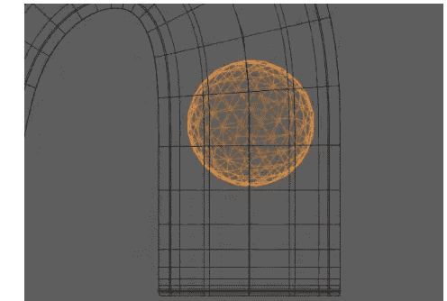

Figure 7.22 – 末端位置

为 **Min** 和 **Max** 都添加一个值为 0.5 的关键帧。

14. 然后，在下一帧，让我们将 **Min** 和 **Max** 值设为 0 并添加另一个关键帧。现在 **Goal** 将关闭，球体将像普通的软体一样表现。

15. 你可能会注意到播放动画时，球体稍微向右跳了一下。这是因为原点在模拟开始时向右移动。

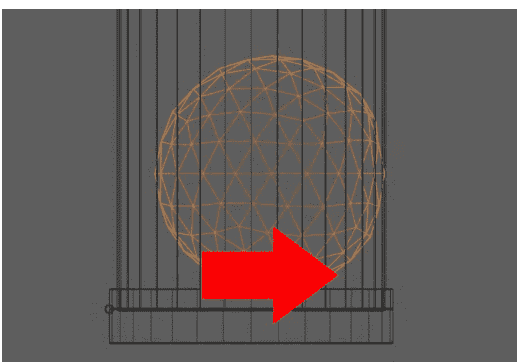

Figure 7.23 – 球体起始

要修复这个问题，只需将 **Cache** 选项卡中的 **Simulation Start** 值设为 0 而不是 1 即可。

完成此操作后，点击 Bake All Dynamics，这将烘焙所有内容，包括布料模拟。好了，模拟完成！确保播放并仔细检查是否有任何问题。一旦你满意，我们就可以继续在 EEVEE 中创建漂亮的玻璃材质！

## 在 EEVEE 中创建玻璃材质

如果你进入渲染视图，你会看到一些已有的材质。这些只是带有深色的基本金属材质。随意更改它们。接下来我们要做的是学习如何在 EEVEE 中创建玻璃着色器！

在 EEVEE 中创建漂亮的玻璃材质比仅仅添加玻璃着色器要复杂一些。我们需要设置一些渲染设置，然后向材质添加几个节点使其看起来更好！让我们开始吧：

- 1. 首先，前往 Render 面板并打开 Raytracing。这将允许物体相互反射，这是创建玻璃所需的。此外，将 Resolution 设为 1:1 以获得更好的效果！
- 2. 在 Color Management 选项卡中，将 Look 设为 High Contrast 以增加场景的对比度。现在让我们创建材质！
- 3. 选择 Cylinder 1 并前往屏幕顶部的 Shading 工作区。

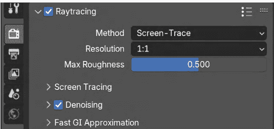

Figure 7.24 – 光线追踪

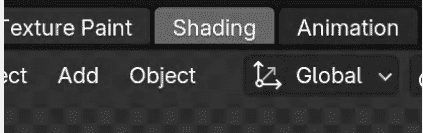

Figure 7.25 – 着色工作区

- 4. 点击 **New** 创建新材质。将材质命名为 `Glass`，以便以后轻松找到。
- 5. 在 **Material** 面板中，向下滚动到 **Settings** 选项卡，勾选 **Raytraced Transmission**，并将 **Thickness** 设为 **Slab**。这将有助于玻璃看起来更好。
- 6. 在 **Node Editor** 工作区，让我们删除 **Principled BSDF** 着色器并添加一个 **Glass** 着色器。为此，按下 *Shift + A*，然后前往 **Shader | Glass BSDF**。

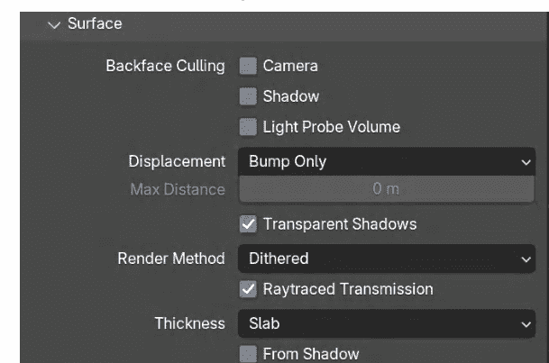

Figure 7.26 – 材质设置

我们开始得到反射了，但仍然无法透过玻璃看到，所以让我们修复这个问题！

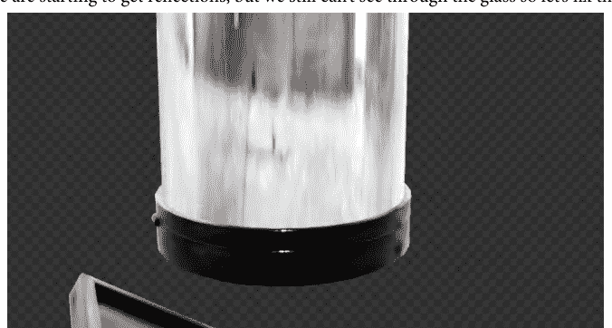

Figure 7.27 – 基本玻璃材质

7. 我们将通过使玻璃正面透明来实现这一点，但侧面仍会有反射。按 Shift + A 添加一个透明着色器，然后前往 Shader | Transparent BSDF。

8. 接下来，添加一个 Mix Shader 节点，以便我们可以混合 Transparent 和 Glass BSDF 着色器。查看以下图示：

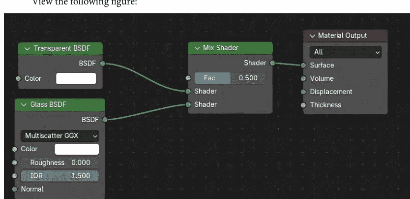

9. 为了控制物体上透明度的位置，让我们添加一个 Fresnel 节点并将其连接到 Mix Shader 的 Fac 输入。按 Shift + A，然后点击 Input | Fresnel。A Fresnel 节点基本上会使表面的边缘变亮，同时保持中间变暗。你可以通过更改 IOR 值来控制这一点。让我们将此值设置为 1.100。你可以在以下图示中看到此示例：

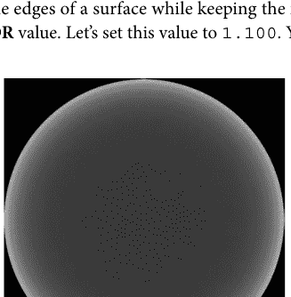

在这种情况下，我们在 **圆柱体 1** 的中间添加透明度，但边缘仍会保留玻璃着色器。

10. 最后，为了控制玻璃中透明度的程度，添加一个 **颜色渐变** 节点并将其放置在 **菲涅尔** 节点和 **混合着色器** 节点之间。

11. **颜色渐变** 节点的左侧控制玻璃中间的透明度，右侧控制边缘。由于默认情况下左侧完全是黑色，这意味着玻璃是 100% 透明的。我们确实想要一点反射，所以让我们将左侧手柄设置为更灰的颜色。查看以下图示以了解完整的节点设置。

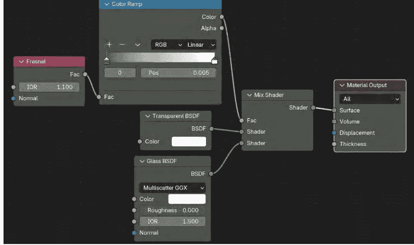

图 7.30 – 玻璃材质节点设置

12. 玻璃材质完成后，让我们将其应用到 **玻璃圆柱体**、**玻璃管** 和 **盒子** 物体上！为此，选择每个物体，然后最后选择 **圆柱体 1** 使其成为活动物体。

13. 前往 **对象 | 链接/传输数据 | 链接材质**。或者，你可以按 *Ctrl + L* 或 *Cmd + L* 快捷键并点击 **链接材质**。现在，你所选择的每个物体都将应用相同的玻璃材质！

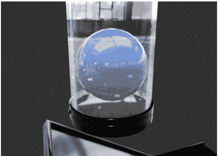

图 7.31 – 玻璃预览

Soft Body Sphere 物体已经由漂亮的反射蓝色材质制成，但随意更改它！完成之后，让我们设置相机并渲染此动画！

## 设置相机跟踪

本教程的最后一步是设置相机，使其在球体通过障碍赛道时跟随球体。这很容易做到：

1. 选择 Camera 物体。我们将添加另一个约束。这次是 Copy Location 约束。
2. 在 Target 菜单中，选择 Soft Body Sphere 并取消勾选 Y Axis。我们只想跟随 Z 和 X 位置。
3. 接下来，勾选 Offset。这将允许你将相机的位置偏移到你喜欢的任何位置，但在播放动画时它仍会跟随球体。

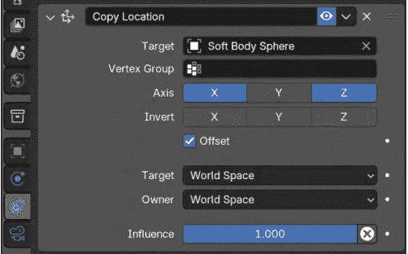

图 7.32 – 复制位置约束

4. 你可能会注意到在播放动画时它并没有真正起作用。那是因为相机跟随的是球体的原点而不是网格的位置。

在 Copy Location 约束中，有一个 Vertex Group 选项。你大概能猜到我们要做什么！让我们为球体创建一个新的顶点组，然后在这里选择它。这样，相机将跟随网格而不是原点。

为此，选择 Soft Body Sphere 并在 Object Data 面板中创建一个新的顶点组。

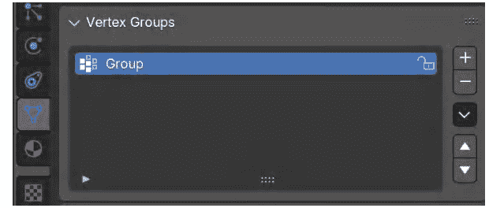

图 7.33 – 顶点组

5. 在选择 Soft Body Sphere 的情况下进入编辑模式，并将所有顶点分配给权重设置为 1 的 Vertex Group。

6. 最后，在 Copy Location 约束中，在 Vertex Group 菜单中选择该组。

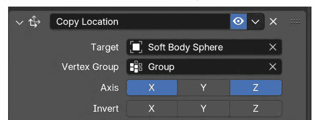

图 7.34 – 复制位置顶点组

你可以通过在数字键盘上按 0 或前往 View | Viewport | Camera 进入相机视图。从那里，你可能需要移动相机到面向球体的正确位置。

7. 场景的背景目前设置为灰色。如果你想更改背景颜色，请前往顶部的 **合成** 工作区。**Alpha Over** 节点的顶部 **图像** 输入将更改场景的背景颜色。

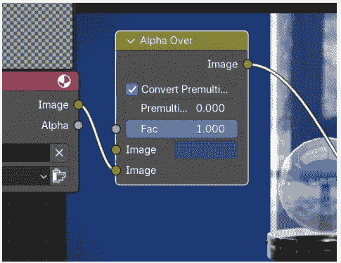

图 7.35 – Alpha Over 节点

从这里，只需设置 **输出** 设置并点击 **渲染动画**！如果你忘了如何渲染动画，只需查看 *第 4 章*。以下图示是我结果中的一帧！

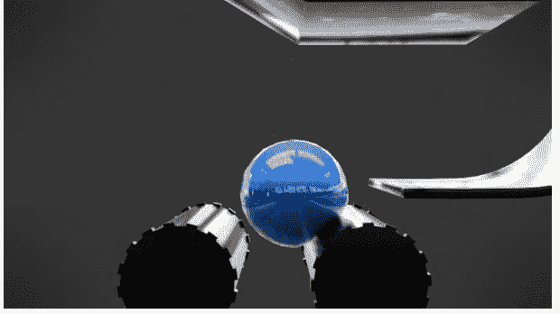

图 7.36 – 帧 163 结果

就是这样！我们现在已完成此项目！我鼓励你更改障碍物并为其添加自己的创意。也许添加一个旋转的立方体？或者让球体绕行的东西？甚至是一个摆动并撞击软体的 wrecking ball？可能性无穷无尽，全看你了！

## 总结

创建软体模拟非常有趣，你可以用它们做很多事情！希望到现在为止，你对软体模拟有了良好的理解，可以去创建自己的动画！

本章我们涵盖了相当多的内容，所以让我们再次快速回顾一下！首先，我们讨论了障碍赛道以及如何熟悉物体。从那里开始，我们通过创建软体开始了模拟，然后为物体添加了碰撞。我们学习了碰撞的 **内部** 和 **外部** 厚度区域以及如何正确使用它们。之后，我们开始研究 **软体目标**，并学习了如何使用它让球体跟随曲线。我们还在 EEVEE 中创建了一个漂亮的玻璃材质并学习了如何设置它。最后，我们讨论了约束以及如何让相机在整个障碍赛道中跟随球体。

本章前面我们简要讨论了布料模拟以及如何固定顶点。如果你喜欢那部分，接下来的内容你一定会喜欢！在下一章中，我们将更详细地研究布料模拟以及所有设置和属性，以及如何有效地使用此模拟！
