## 布料模拟简介

我们接下来要讨论的模拟类型是布料模拟。这是最容易使用的模拟之一，但由于其内部和外部交互的数量，它也相当复杂。这样的模拟使原本非常难以建模的东西——例如桌布、旗帜和毯子——变得超级简单易于创建！通常，我们使用布料模拟来创建 **二维 (2D)** 物体，如前面提到的示例，但它们也可以用来创建 **三维 (3D)** 物体，如枕头、毛绒动物，甚至气球！

本章的目标是让你了解布料模拟在 Blender 中如何工作以及所有设置和值的作用。就像之前的章节一样，我们将首先学习布料模拟是什么，然后直接进入设置和值。在后面的章节中，我们将利用本章学到的知识，使用布料模拟创建实用的动画。

在本章中，我们将涵盖以下主题：

- 什么是布料模拟？
- 理解碰撞物体
- 理解布料模拟设置和值

### 技术要求

本章要求你安装 Blender 4.2 或更高版本。

要下载 Blender，请访问 www.blender.org。

### 什么是布料模拟？

Blender 中的布料模拟用于模拟现实世界中布料的行为和交互。它非常适合创建织物、毯子、枕头、旗帜等。尽管你可以使用软体模拟获得类似的结果，但布料模拟是为此类事物设计且更合适的，你通常会获得更好的结果。你可以在这里看到一个布料模拟的示例：

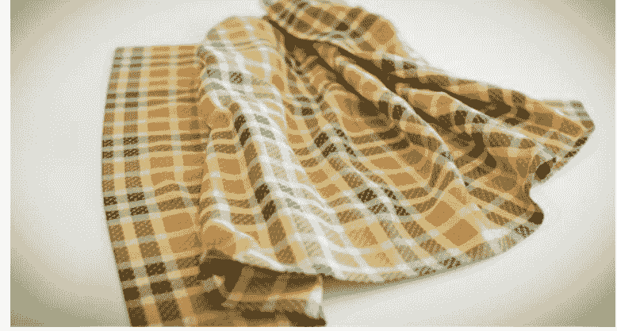

图 8.1 – 布料模拟示例

Blender 通过计算其物理属性并创建连接到物体每个顶点的虚拟弹簧来模拟布料。这些弹簧控制布料的硬度、弯曲程度或抵抗坍塌的程度。你需要记住四种类型，如下所述：

- **张力弹簧**：用于控制布料的硬度以及抵抗拉伸的程度。
- **压缩弹簧**：用于控制布料的整体结构。
- **剪切弹簧**：用于控制角度变形。
- **弯曲弹簧**：用于控制布料的弯曲和折叠程度。

我们将在稍后更深入地介绍这些弹簧，你将在本章后面看到它们如何工作的示例！


为对象添加布料模拟时，首先前往物理面板，然后选择布料，如以下屏幕截图所示：

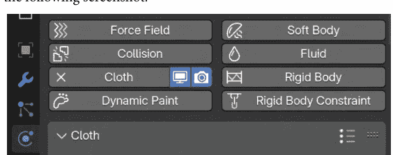

图 8.2 – 物理布料模拟

开始模拟前需要注意的一点是对象上的几何体数量。网格上需要有足够的几何体才能让布料进行模拟和变形。如果你尝试对仅有四个顶点的平面添加布料模拟，那效果不会很好。同样，如果几何体太多，模拟会变慢，计算和烘焙所需的时间也会更长。

一个好主意是拥有足够的几何体以获得不错的模拟效果，然后在其上添加细分曲面修改器。这样可以使布料变得平滑，看起来好得多，同时不会影响性能。你可以通过查看以下屏幕截图来观察差异：

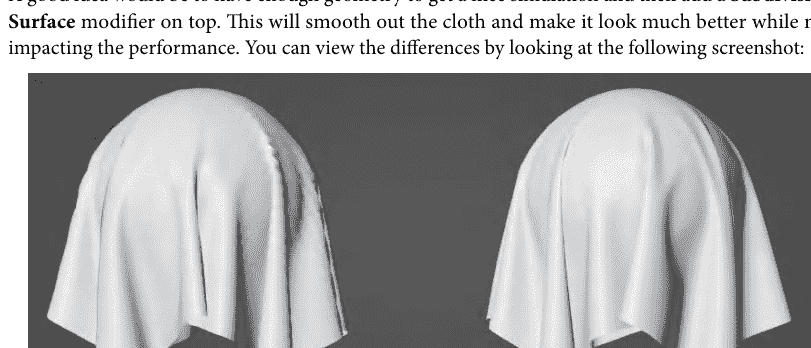

图 8.3 – 无细分（左）带细分（右）

如果你在布料修改器上方添加细分曲面修改器，模拟时会将这些额外几何体纳入考虑。因此，请确保将细分曲面修改器添加到布料修改器下方，如以下屏幕截图所示：

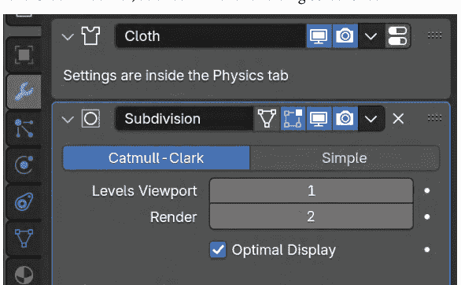

图 8.4 – 布料和细分曲面修改器

另外需要注意的是，当你应用布料修改器时，它会将布料固定在原位，从这里你可以进入编辑模式并查看几何体。这也会移除修改器，你将无法再进行模拟。为什么要应用修改器呢？嗯，当你想要创建动画但希望布料保持静止时，这非常有用，例如盖在沙发上的毯子或挂在挂钩上的毛巾。

现在，在直接进入布料设置之前，讨论碰撞对象及其如何与模拟交互非常重要！

## 了解碰撞对象

我们在第 6 章讨论过碰撞，布料对象的工作方式基本相同。首先需要选择要添加碰撞的网格，然后前往物理面板并选择碰撞。这也会在修改器面板中添加碰撞修改器。

处理碰撞时请牢记修改器堆栈。你需要确保碰撞修改器位于堆栈的最底部；这样 Blender 在模拟时就能准确计算碰撞边界。在下图中，两个对象都是带有细分曲面修改器的立方体，这使它们变得圆润，像球体：

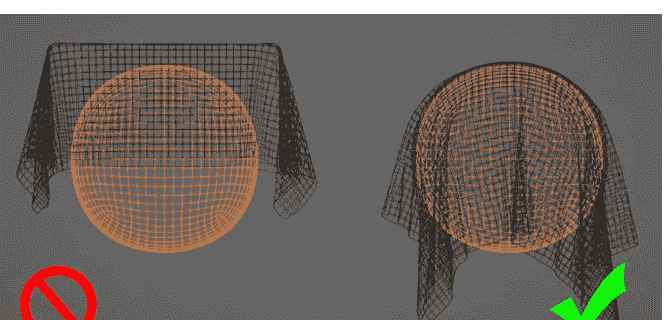

图 8.5 – 碰撞修改器堆栈

左侧示例中碰撞修改器位于细分曲面修改器之上。这意味着碰撞边界将是网格的原始形状，忽略细分曲面的修改。因此，请确保碰撞修改器始终位于堆栈底部，除非你 specifically 想要忽略某些修改器，在某些情况下这可能是有益的。例如，倒角修改器会使网格的边缘和角变得圆润，从而为对象添加更多几何体。如果碰撞修改器位于倒角修改器下方，由于这些额外几何体，模拟烘焙所需的时间会更长。在这种情况下，无论碰撞修改器在上还是在下，模拟结果基本相同。因此，为了节省烘焙时间，最好将碰撞修改器放在倒角修改器之上。

选择碰撞对象后，你可以在物理面板中看到设置，如下所示：

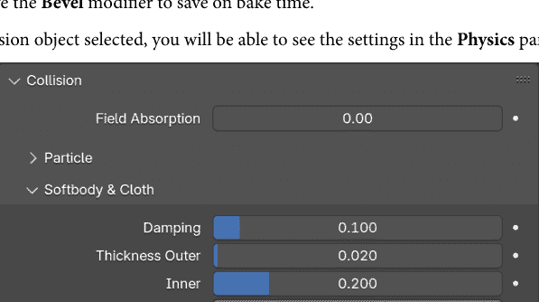

图 8.6 – 碰撞设置

让我们逐一介绍并讨论它们：

- **场吸收**：这允许碰撞对象吸收力场强度的一部分。例如，如果风力场穿过碰撞对象，而**场吸收**值设置为 0.2，则只有 20% 的力场强度能够穿过碰撞。如果值设置为 1，它将吸收 100% 的力场，风将无法通过。同样重要的是，在**力场**对象的设置中，确保已勾选**吸收**，以便正常工作。
- **粒子**：此选项卡仅处理粒子系统，不会影响布料，所以我们先跳过。
- **阻尼**：此选项也不影响布料模拟。它仅用于软体。
- **外部厚度**：此选项代表碰撞的边界。增加此值会使碰撞边界延伸到对象表面之外。
- **内部**：此选项代表对象内部的碰撞边界。如果布料进入此区域，它将被推出。
- **摩擦**：这表示布料对物体的滑动程度。值为 0 时，碰撞会像冰一样，布料会滑动。值越高，越能防止滑动并增加碰撞的粘性。
- **单面**：打开时，碰撞将基于法线的方向。关闭时，法线将被忽略，碰撞边界将覆盖整个对象。这意味着如果在**单面**关闭的情况下将平面翻转过来，布料会与平面的底部发生碰撞，而不是像**单面**打开时那样穿过。
- **覆盖法线**：这适用于快速移动的碰撞。当此设置启用且碰撞击中布料时，布料会沿着碰撞体的法线方向弹出。通过大量测试，这个设置似乎对模拟结果的影响非常小。

请记住——如果你的碰撞似乎行为异常，请再次检查修改器堆栈并确保它位于最底部！搞定之后，让我们直接进入**布料**设置和属性！

## 了解布料模拟设置和值

现在我们了解了布料模拟是什么以及碰撞对象如何工作，是时候深入了解所有设置和值了。你可以在这里看到**布料**设置的概览：

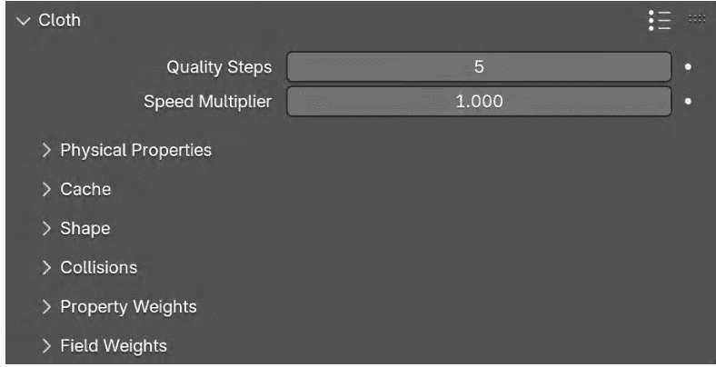

图 8.7 – 布料设置

我们将从最顶部开始，逐步向下进行：

- 如果你点击**质量步数**上方带三个点和线的图标，你将看到可供选择的预设列表，如以下屏幕截图所示：

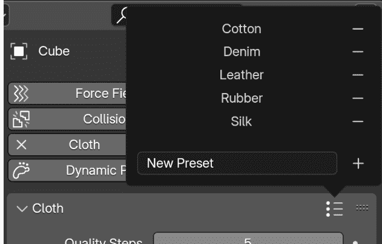

图 8.8 – 预设

这是快速轻松地创建不同类型布料的方法。你也可以通过为其命名并点击 + 按钮来创建自己的预设。

- **质量步数**：此选项控制 Blender 每帧计算的模拟步数。值越高，模拟越准确，但烘焙所需的时间也会更长。如果布料或碰撞对象无法正常工作，或者你有非常快速移动的碰撞，建议提高此值。
- **速度倍数**：此选项当然控制播放动画时布料模拟的速度。值越高速度越快，值越低模拟越慢。

现在，让我们继续了解布料模拟的不同子菜单，从**物理属性**开始！在这里我们将学习布料如何表现以及如何与碰撞交互！

### 物理属性

布料的**物理属性**设置正如其名。这些设置和值会改变布料的硬度、重量等等。当你更改这些设置时，需要考虑你想要创建哪种布料（例如，皮革的硬度会远高于丝绸，床上用品的被子会比薄毯重）。你可以在这里看到设置的概览：

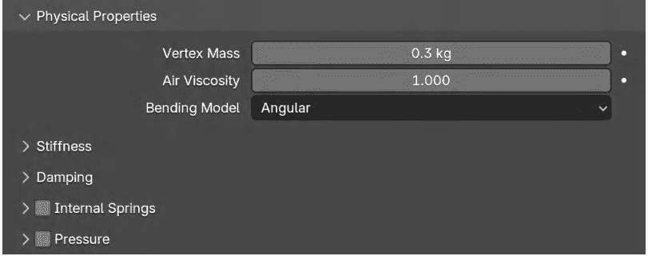

图 8.9 – 物理属性

再次，让我们从最顶部开始，逐步向下，并讨论每个值，如下所示：

- **顶点质量**：这控制布料的重量。每个顶点都将具有你在此处设置的质量。这很重要，因为如果几何体很多，布料会更重。重量也会影响力场与布料的交互方式。如果**顶点质量**值很高，你需要更高的强度值才能使力场与布料交互并推动它。一般来说，最好将此值设置得较低。
- **空气粘度**：此选项设置对象周围空气的厚度。增加此值会使布料在空气中下落得更慢。


**弯曲模型**：这基本上决定了布料中弹簧的弯曲和变形方式。**弯曲模型**有两个选项：**角度**和**线性**。两者之间的差异很小，但我注意到在大多数情况下**角度**看起来更好一些。在下面的截图中，左侧是**角度**，右侧是**线性**：

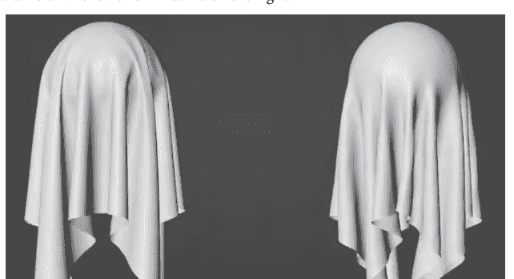

图 8.10 – 弯曲模型

接下来，让我们讨论物理属性子菜单中的其他选项卡，从刚度开始！

## 刚度

下方是**弯曲模型**，我们有**刚度**选项卡，如下所示：

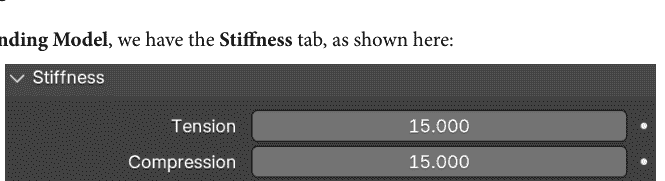

图 8.11 – 刚度设置

这里有四个可以更改的选项：

- **张力**：这控制布料抵抗拉伸的程度。值越高，布料会变得有点更硬、弹性更小。如果你的**顶点质量**值很高但**张力**值很低，你可能会看到一些拉伸，因为布料太重了；这对于创建橡皮筋和有弹性的织物非常有用！

- **压缩**：这决定布料抵抗塌陷的程度。值越高，有助于布料保持其结构，而值越低会使布料塌陷。以下截图中的值分别为 1（左）和 25（右）：

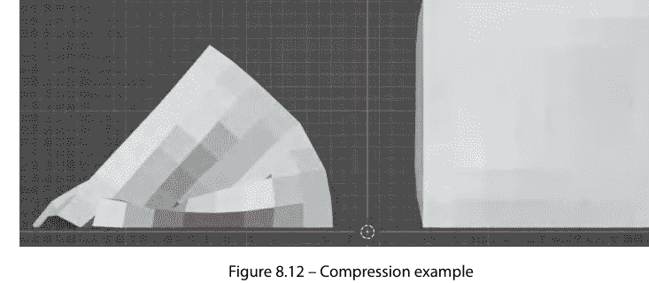

图 8.12 – 压缩示例

- **剪切**：这与**压缩**的工作方式类似。它有助于防止布料自身塌陷。值越高有助于保持布料的结构，而值越低会让布料弯曲并失去结构。

- **弯曲**：这设置布料的弯曲和褶皱程度。值越高会使布料更硬并产生更大的褶皱，而值越低会产生更小的皱纹并使布料松弛很多。将此值调高对于创建皮革和橡胶等织物非常有用。以下截图中的值分别为 0.5（左）和 50（右），以便你可以看到差异：

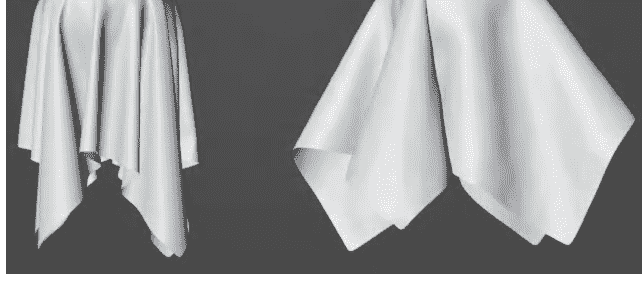

图 8.13 – 弯曲示例

最后，如果你将**弯曲模型**设置为**线性**，**张力**和**压缩**设置将消失并被**结构**取代。此设置同时控制布料的结构以及其拉伸程度。

## 阻尼

**阻尼**选项卡具有**刚度**菜单中列出的所有相同设置：**张力**、**压缩**、**剪切**和**弯曲**。这些值基本上会减慢**刚度**选项卡中每个设置的生效速度。

例如，如果**刚度**选项卡中的**压缩**选项设置为 0，但**阻尼**选项卡中的**压缩**设置为 50，布料仍会塌陷，但会花费更长时间。如果**阻尼**选项卡中的**压缩**选项也设置为 0，那么布料会瞬间塌陷并失去所有结构。所以，再次说明，这些设置会减缓并阻尼**刚度**选项卡中每个选项的效果。

## 内部弹簧

勾选**内部弹簧**框基本上会将你的布料变成软体。

记住，在本章前面，我们谈到了布料模拟的弹簧？好吧，通常弹簧只能应用于 2D 表面，但当启用**内部弹簧**时，3D 弹簧将在物体内部创建，现在它将表现得非常类似于软体。

当你勾选**内部弹簧**框时，这些选项将可用：

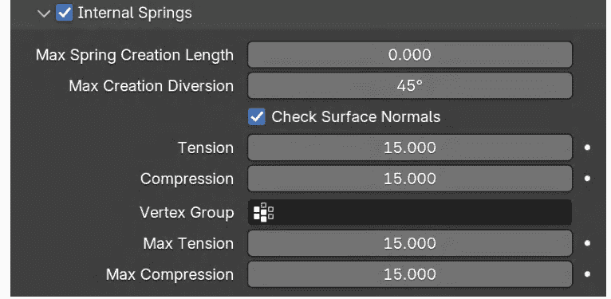

图 8.14 – 内部弹簧设置

让我们逐一介绍它们：

- **最大弹簧创建长度**：这设置弹簧的最大距离。如果弹簧距离超过此长度，则不会创建弹簧。例如，在下面的截图中，有一个大立方体和一个小立方体。**最大弹簧创建长度**对两者都设置为 0.5。由于大立方体内部的距离大于 0.5，因此不会创建弹簧，并且它会塌陷。然而，小立方体在该 0.5 距离范围内，因此会创建弹簧并保持其结构：

- **最大创建偏转**：这设置弹簧创建的最大角度。如果法线的角度超过此值，则不会创建弹簧。

- **检查表面法线**：这会检查法线是否指向相反方向。如果法线未指向相反方向，则不会创建弹簧。在下面的截图示例中，立方体的顶部法线指向网格内部。这意味着该顶部面不会创建弹簧。当此设置未勾选时，它将忽略法线并在各处添加弹簧：

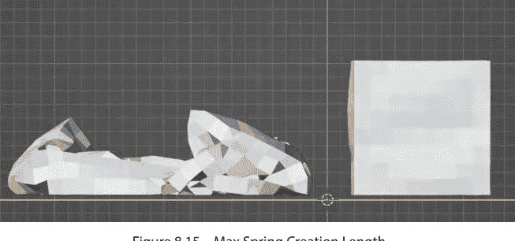

图 8.15 – 最大弹簧创建长度

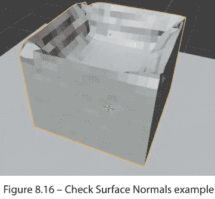

图 8.16 – 检查表面法线示例

- **张力与压缩**：较高的**张力**值会使布料抵抗拉伸，而较高的**压缩**值会防止布料塌陷。

- 你还可以创建一个顶点组并将内部弹簧分配给它。这可以让你更精细地控制弹簧的创建位置。**最大张力**和**压缩**值控制顶点组的应用方式。

完成这些后，让我们来看一下**压力**！

## 压力

启用**压力**将允许你充气布料，这对于创建枕头或气球等物体非常有用。你可以在这里看到设置的概览：

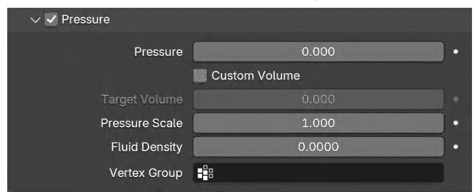

图 8.17 – 压力设置

让我们讨论一下设置：

- **压力**：这控制布料充气的程度。正值会使网格向外扩展，并且你设置的值越高，布料扩展得越多。你也可以设置负值，这会使物体泄气，导致其收缩。下面的截图提供了**压力**值设置为 15 的文本示例：

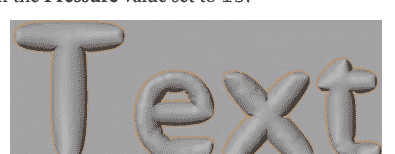

图 8.18 – 压力示例

- **自定义体积**：当勾选此项时，你将能够设置目标体积。这意味着压力将基于物体的体积而不是网格本身进行计算。通常，当**自定义体积**未勾选时，无论物体大小如何，压力对所有物体都相同，如下图所示：

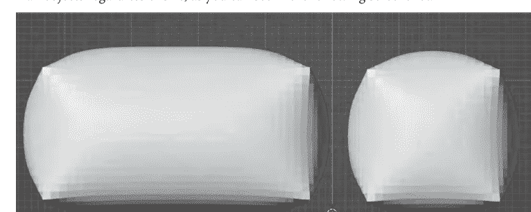

图 8.19 – 压力体积示例

当**自定义体积**被勾选时，应用压力时会计算网格的大小。在下面的截图示例中，每个立方体的**目标体积**都设置为 15。由于较大的立方体体积更大，因此压力不会像较小的立方体那样强：

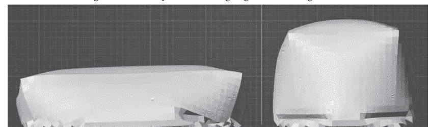

图 8.20 – 目标体积示例

- **压力比例**：这是物体外部和内部的环境压力。增加此值往往会使网格进一步扩展。

- **流体密度**：这是物体内部流体（空气）的密度。当你增加此值时，内部空气会变得更稠密，从而使布料更重。将此值设置为负数会产生相反的效果，使物体上升并浮到空中（这是一种创建气球的好方法）。

- **顶点组**：你可以创建一个顶点组来精细调整想要发生压力或充气的位置，如下图所示：

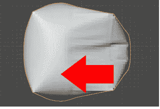

图 8.21 – 压力顶点组

当选择顶点组来确定网格的压力位置时，你可能会遇到一些奇怪的移动。由于网格一侧的压力，被充气的一侧会迫使布料向该方向飞去。这可能不是预期的工作方式，但在决定使用此功能时请记住这一点！

现在，让我们继续到缓存选项卡并学习如何烘焙模拟！

## 缓存

缓存选项卡是烘焙模拟的地方。在渲染之前烘焙模拟通常是个好主意，只是为了确保一切正常工作，但不是必需的。

缓存选项卡可能看起来很熟悉；那是因为它与软体缓存选项卡相同，如下所示：

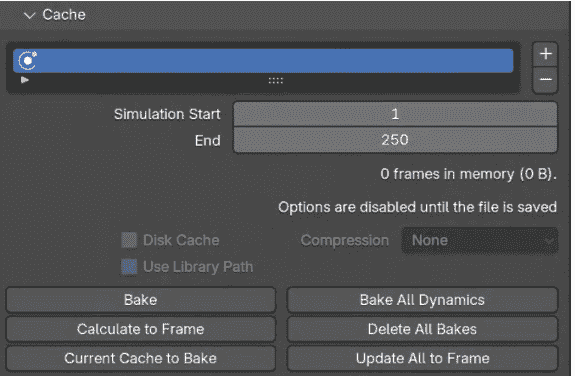

图 8.22 – 缓存


你应该已经知道所有这些是如何工作的，因为我们在第 6 章中已经讲解过，但这里有一些快速笔记，以防你想回顾一下：

-   **Simulation Start** 和 **End** 控制模拟的帧范围。
-   要烘焙布料，你只需点击 **Bake**。这会使所有设置变灰，除非你点击 **Free Bake**，否则你将无法更改它们。
-   如果你有多个布料、软体，甚至粒子系统，并且想一次性烘焙所有内容，只需点击 **Bake All Dynamics**。这样就会一次性烘焙场景中的每个模拟。
-   模拟烘焙的好处是，你可以跳到时间线的任意一帧并预览布料在该帧的外观。如果不烘焙布料模拟，你将无法跳帧；相反，你必须从头开始播放模拟。

至于其余的设置，由于我们在第 6 章中已经讨论过它们，让我们继续前进到 Shape 选项卡！

## Shape

**Shape** 选项卡允许你将顶点固定在原位。这对于创建诸如旗帜、挂在挂钩上的毛巾、吊床或布料被固定在某物上的任何东西都非常有用。

要将布料固定在特定位置，首先进入 **Edit Mode** 并选择你想要固定的网格部分，如以下截图所示：

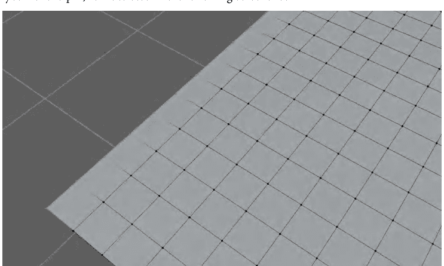

图 8.23 – 已选择的顶点

接下来，转到 Object Data 面板并通过点击 + 按钮创建一个新的顶点组。确保 Weight 值设置为 1（小于 1 的值会导致顶点仅根据权重值部分固定；这基本上会让你的布料看起来像连接到一根弹力绳）然后点击 Assign。你可以在以下截图中看到其概览：

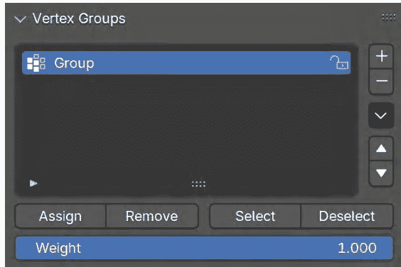

图 8.24 – 已分配的顶点组

在布料模拟中，选择 Pin Group 菜单中的该顶点组，如下图所示：

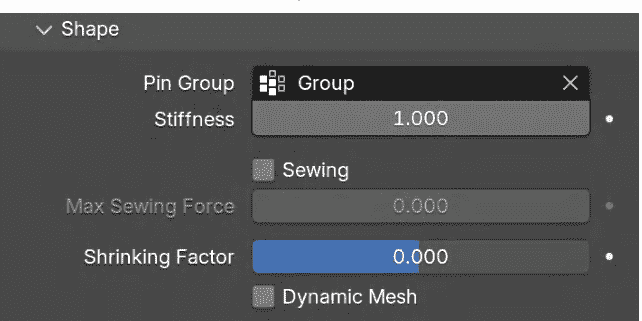

图 8.25 – Pin Group

现在，当你播放动画时，你分配的那些顶点将被固定在原位！

你的布料现在将在你分配的位置被固定。让我们谈谈其余的设置：

-   **Stiffness**：这简单地控制固定顶点的刚度。例如，当 Stiffness 值设为 0 时，只有 Weight 值为 1 的顶点会被固定。然而，如果你将 Stiffness 值设为 50，那么即使 Weight 值小于 1，也会有更多顶点被固定。你可以在以下截图中看到此示例：

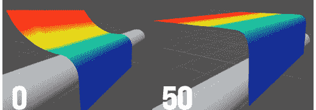

图 8.26 – Shape 刚度

-   **Sewing**：这允许你在网格上创建虚拟线并将它们拉在一起，就像现实生活中的缝纫一样。这是一种快速为角色创建服装或将斗篷系在脖子上的方法。其工作原理是，你需要让想要被拉在一起的部分通过一条边而不是一个面连接起来，如以下截图所示：

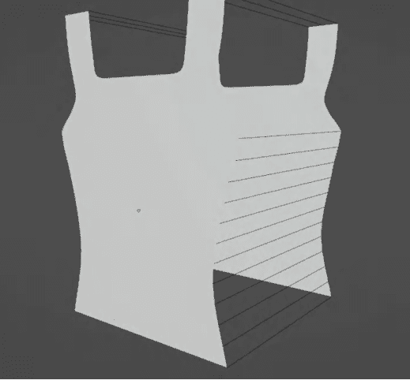

图 8.27 – Sewing 边示例

你可以通过在 Edit Mode 中选择两个顶点并按 F 来在它们之间创建一条边。你可以在以下图中看到这一点：

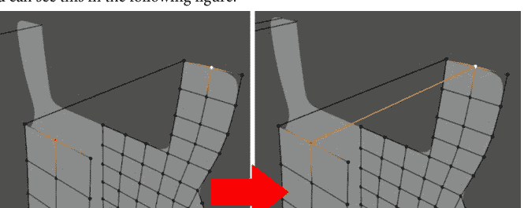

图 8.28 – 连接顶点

之后，启用 Sewing 并播放动画。你的布料现在应该在那些边连接的地方闭合，如以下截图所示：

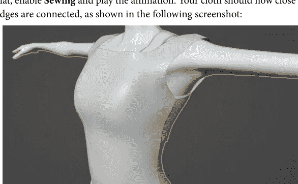

图 8.29 – Sewing 示例

-   **Max Sewing Force**：这控制那些边被拉在一起的强度和速度。如果将其设为 0，则意味着没有最大力，边将被极快地拉动。这可能会导致模拟出现问题，因此建议提高此值。
-   **Shrinking Factor**：在边被拉动时，这会使网格收缩或增长。负值会使布料增长，而正值会使网格收缩；在以下截图中，它被设为 -0.2，如你所见，由于设置为负值，布料现在已扩展：

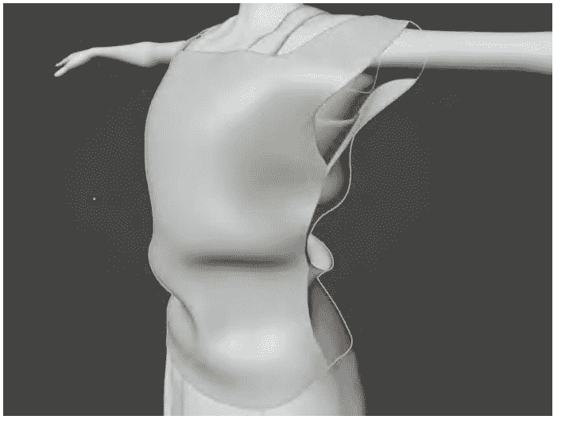

图 8.30 – Shrinking Factor 示例

-   **Dynamic Mesh**：这启用 **Sewing** 以允许任何动画或变形修改器应用于网格（这可以是骨架、晶格等）。启用后，模拟的每一帧都会重新计算，以在使用这些修改器时获得更准确的结果。

现在我们了解了 **Shape** 选项卡，让我们继续到 **Collision** 选项卡并学习布料如何与其他对象发生碰撞！

## Collisions

现在，是时候介绍所有 **Collision** 设置和值了。这里我们设置质量和距离，并确定是否希望布料与其自身发生碰撞。

如本章前面所述，要使布料与某物发生碰撞，我们需要在 **Physics** 面板中为该对象赋予碰撞。然后，在 **Cloth** 设置中，确保 **Object Collisions** 框已勾选（它默认应已勾选；取消勾选意味着布料将直接穿过任何碰撞）。

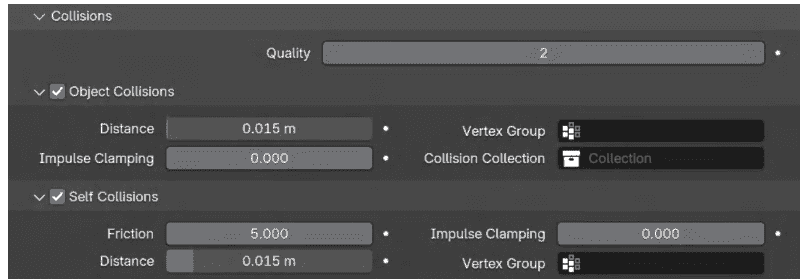

图 8.31 – 布料碰撞设置

让我们逐一介绍设置并讨论每个设置，如下所示：

-   **Quality**：这控制碰撞发生的准确性和质量。较高的值会产生更好的碰撞和更少的错误，但模拟时间会更长。如果碰撞未按预期工作，请尝试提高此值。
-   **Distance**：这是布料发生碰撞的距离。如果此值设置过低，你可能会遇到一些错误，布料可能会穿过碰撞体穿透。一般来说，默认值 `0.015` 对大多数场景都适用。
-   **Impulse Clamping**：有时，在紧密复杂的碰撞中，布料可能会出现一些错误并爆炸。**Impulse Clamping** 通过限制碰撞后布料的移动来帮助防止任何爆炸发生。因此，如果你的碰撞工作不正常，请尝试提高此值。
-   **Vertex Group**：你可以选择一种 **Vertex Group** 类型作为碰撞区域。这在你只想让布料的一半发生碰撞时很有用。
-   **Collision Collection**：这将允许你限制哪些集合将与布料交互。这在你有多个模拟并且不希望它们相互作用时也很有用。
-   **Self Collisions**：通常，除非你勾选 **Self Collisions**，否则布料不会与其自身发生碰撞。如果你使用 **Pressure** 创建枕头，则不一定需要 **Self Collisions**，因为布料不会重叠自身。另一方面，如果你正在创建落在沙发上的毯子，你可能希望打开 **Self Collisions**。这会花费更长的计算时间，因此仅在需要时或想要逼真结果时启用它。

-   **Friction:** 此 **Self Collisions** 菜单中的选项与布料与其自身碰撞时的滑溜程度有关。你在此处设置的值取决于你尝试创建的布料类型。例如，棉质毯子的摩擦力会比丝质毯子高得多。

我们已经讨论过其余的设置，它们的使用方式相同，只是适用于自碰撞。

## Property Weights

还记得我们在本章前面讨论过不同的弹簧类型吗？好吧，**Property Weights** 选项卡允许你使用顶点组来微调布料的这些弹簧。这在你希望布料的某些部分具有不同的物理属性时非常有用。例如，你可以使用 **Structural Group** 类型使布料的某些部分具有更大的张力，或使用 **Shrinking Group** 类型使其收缩。

另一个例子是创建具有不同材质的毯子。如果毯子的某些部分比其他部分弯曲和起皱更多，你可以使用 **Bending Group** 类型。当然，如果你希望布料的某些部分塌陷和剪切更少，你可以使用 **Shear Group** 类型。

你可以在以下截图中看到不同的组类型：

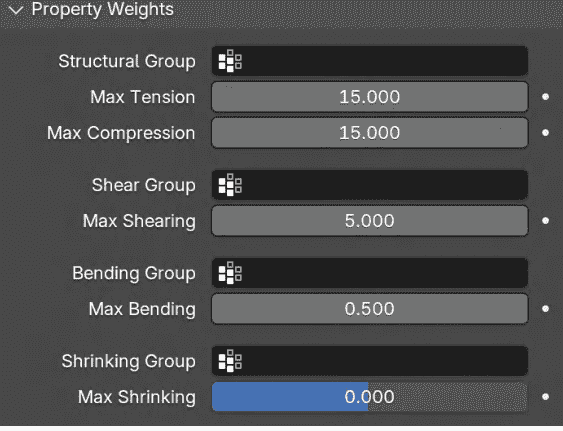

图 8.32 – Property Weights


使用 **Property Weights** 时，首先创建一个顶点组并为其分配顶点。在此示例中，我们已将该平面上的一半顶点赋予权重 1（左侧）：

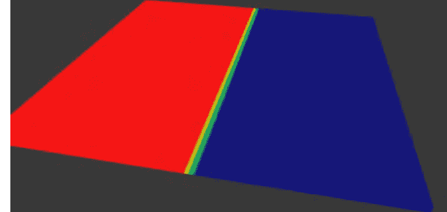

图 8.33 – 平面顶点组

然后，在 **Property Weights** 选项卡中，我们将 **Max Tension** 和 **Max Compression** 设置为 100。我们还将 **Max Bending** 设置为 15，并将该顶点组分配给四个 **Property Weight** 组中的每一个。现在，当我们在平面下方添加一个球体使其与布料碰撞时，你可以看到平面的半边非常僵硬，另一半则松弛，如下图所示：

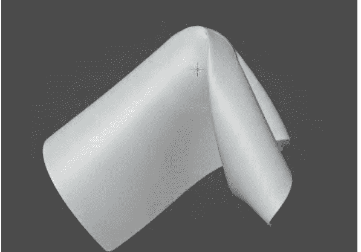

图 8.34 – 属性权重示例

因此，**Property Weights** 选项卡再次允许你使用顶点组对布料上的特定区域进行微调，使其具有特定的物理属性。现在，在本教程结束之前，让我们快速讨论一下 **Field Weights** 选项卡！

## 场权重

最后，布料模拟设置中的最后一个选项卡是 **Field Weights** 选项卡。这应该看起来很熟悉，因为它与本书中讨论的其他模拟的工作方式完全相同。在这里，你可以微调力场对布料的影响方式。你可以在这里看到该选项卡的概览：

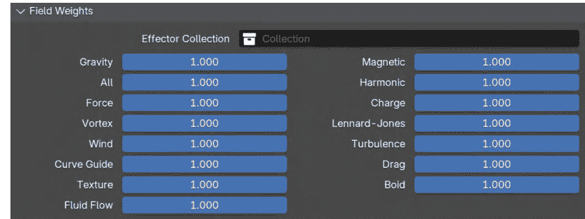

图 8.35 – 场权重

**Effector Collection** 允许你限制哪些集合会影响布料。如果未设置集合，则场景中的每个力场都会与模拟交互。

你还可以选择更改模拟的 **Gravity** 值。你希望布料像在太空中一样漂浮吗？只需将 **Gravity** 值设置为 0 即可！

至于其余的值，它们控制力场的影响强度。例如，如果 **Wind** 设置为 0.5，则只有任何风力场的强度的一半会影响布料。如果有多个布料并且希望风对每个布料的影响不同，这会很有用！

好了！我们已经涵盖了 Blender 中布料模拟的每一个设置。完成之后，让我们快速总结一下！

## 总结

到目前为止，本章我们讨论了大约 60 个设置和值。这可能有很多需要记住，因此如果你忘记了某项功能的作用，始终可以参考本章。现在，让我们快速回顾一下我们学到的内容！

首先，我们讨论了布料模拟是什么、修改器堆栈的重要性，以及布料如何使用不同的弹簧进行模拟。之后，我们学习了碰撞对象以及它们如何与模拟交互。然后，我们回顾了布料模拟的每个设置。我们讨论了物理属性、内部弹簧、压力、固定、布料碰撞和属性权重。

使用逼真的褶皱和折痕建模桌布可能具有挑战性且耗时。幸运的是，布料模拟可以为你节省许多工时。希望本章能让你很好地理解这种模拟及其工作原理。在下一章中，我们将通过使用该系统创建逼真的旗帜来检验这些技能！

## 加入我们的 Discord 社区

加入我们社区的 Discord 空间，与作者和其他读者讨论：

```
https://packt.link/learn-blender-simulations-discord-invite
```


