## 创建逼真的旗帜

创建旗帜布料模拟似乎很容易；然而，模拟旗帜有很多方面，你可能考虑过也可能没有考虑过。如果你观察真实的旗杆，它们有很多不同的部件。例如，旗杆是旗帜连接到缆绳的部分。缆绳是用来从地面升降旗帜的绳索。还有用于将旗帜连接到缆绳的快挂钩。在本逐步教程中，我们将在 Blender 中模拟旗帜并添加所有这些不同的部件，以创建逼真的效果！

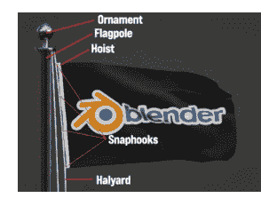

图 9.1 – 旗帜示意图

我们将首先添加场景所需的所有对象，例如旗帜、旗杆、绳索和挂钩。然后，我们将继续创建模拟并将旗帜连接到绳索。最后，我们将创建材质并渲染输出。本章的目标是在创建令人满意的动画过程中，以实用方式理解如何在 Blender 中使用布料模拟。 在本项目结束时，你应该能够将在这里学到的知识应用到未来的项目中！

在本章中，我们将涵盖以下主题：

- 添加对象
- 创建模拟
- 制作材质
- 渲染动画

### 技术要求

本章要求你安装 Blender 4.2 或更高版本。

要下载 Blender，请访问 www.blender.org。

本章稍后我们还将使用一张纹理。要获取纹理，请访问 https://github.com/PacktPublishing/Learn-Blender-4-Simulations-the-Right-Way/tree/main/Chapter%209。

### 添加对象

首先，我们需要决定旗帜的大小。旗帜的大小还取决于旗杆的高度。例如，高 6 米或 20 英尺的杆子会有约 91 x 152 厘米或 3 x 5 英尺的旗帜。旗杆越高，旗帜应该越大。考虑到这一点，让我们开始本教程吧。

### 创建旗帜

在本教程中，我们将创建一个 91 x 152 厘米的旗帜。要创建它，请按照以下步骤操作：

1. 在 Blender 中打开一个全新的场景。你也可以继续删除默认立方体；本场景不需要它。
2. 按 Shift + A 并添加一个平面对象。接下来，通过按 N 打开属性面板，然后将尺寸设置为 X 轴 1.52 m，Y 轴 0.91 m。

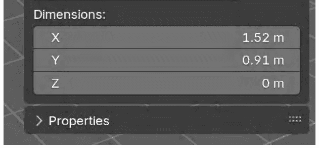

图 9.2 – 旗帜尺寸

3. 让我们也将此平面旋转 90 度，使其直立。确保通过按 *Ctrl + A* 或 *Cmd + A* 并选择 **Scale & Rotation** 来应用缩放和旋转。这样所有值都是正确的，模拟也会正常工作！

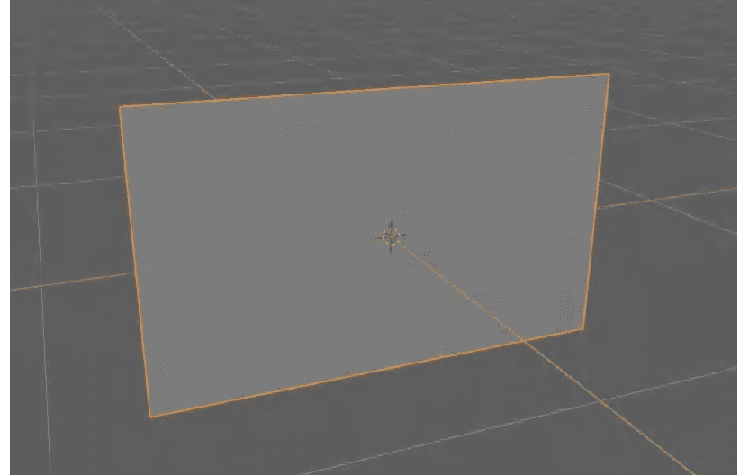

图 9.3 – 旗帜示例

4. 下一步是为我们的平面添加更多几何体；这将有助于正确模拟布料并提供更多细节。由于我们的平面是矩形，如果我们对整个平面进行细分，也会得到矩形面。然而，我们想要的是正方形面。如 *第 6 章* 中所述，要正确模拟软体，整个对象中均匀的几何体是关键。这对于布料模拟也一样。虽然矩形面可以使用，但正方形面使每个面的每条边长度均匀。这反过来会产生更逼真的结果，并且整体模拟效果更好。

要获得正方形面，你需要手动添加两个垂直环切和一个水平环切。你可以通过进入 **Edit Mode**，按 *Ctrl + R* 或 *Cmd + R*，然后将鼠标悬停在平面的某一侧来完成。然后，使用滚轮添加多个环切。

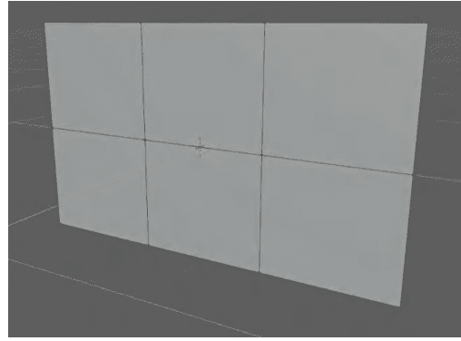

图 9.4 – 环切

5. 现在，我们可以对整个平面进行细分，并获得正方形面。按 A 选择所有内容，右键单击并选择 Subdivide。然后打开底部的面板并将 Number of Cuts 设置为 15。

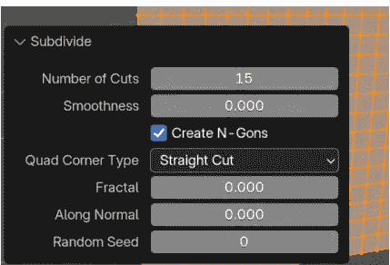

图 9.5 – 切分次数

旗帜就这样完成了！接下来，让我们创建旗杆！

### 创建旗杆

在这一点上，查看一些真实旗杆的参考图像是个好主意，这样你就可以了解自己的旗杆应该是什么样子。旗杆的主要部分是圆柱形，通常在最顶部放置一个黄铜或银色的球体。顶部球体的主要目的之一是使旗杆设计更美观，并防止旗帜从杆顶滑落。考虑到这一点，让我们开始建模：

- 1. 开始时，按 *Shift + A*，进入 **Mesh**，并向场景中添加一个 **Cylinder** 对象。打开视口左下角的 **Add Cylinder** 菜单，我们来更改几个设置。圆柱体的 **Radius** 值应约为 0.05 m，而 **Depth**（即高度）应设置为 6 m。

- 2. 接下来，我们将挤出并缩放顶面，以使旗杆的外观更有趣。选择顶面并按 *E* 进行挤出，然后可以按 *S* 来缩放该面。持续挤出和缩放，直到得到类似以下图所示的效果！

- 3. 我们还在旗杆顶部添加一个 UV 球体。这将代表位于最顶部的装饰物！

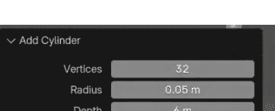

图 9.6 – 旗杆尺寸

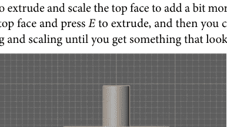

图 9.7 – 挤出的面

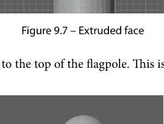

图 9.8 – UV 球体已添加

- 4. 为了使杆子的边缘变圆，看起来不那么尖锐，可以添加一个 **Bevel** 修改器。为此，前往 **Modifier** 选项卡并点击 **Add Modifier | Generate | Bevel**。查看 **Bevel** 修改器设置，**Amount** 控制边缘的圆润程度；让我们将其设置为一个很低的值，例如 0.002 m。然后，将 **Segments** 选项设置为 3；这将提高倒角的分辨率，并在边缘提供更多几何体。

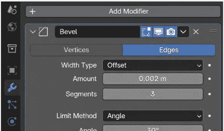

图 9.9 – Bevel 修改器

- 5. 当然，右键单击并为两个对象选择 **Shade Smooth**，以确保一切看起来良好。以下是目前旗杆应有的外观：

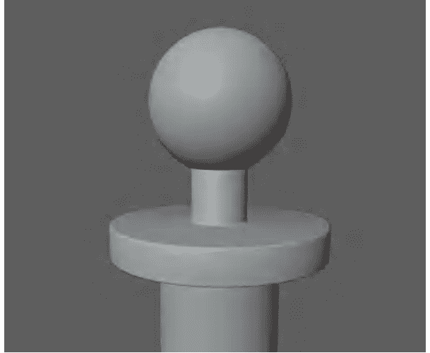

图 9.10 – 完成的旗杆

- 6. 最后，让我们将旗帜对象移动到旗杆对象的右侧并稍微向下。查看以下图示。

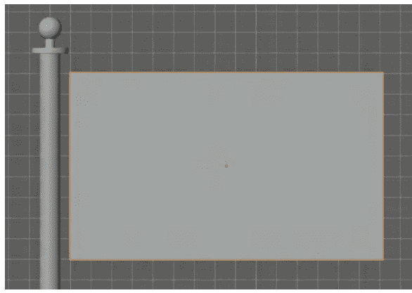

图 9.11 – 旗帜位置

太好了！现在，我们可以开始制作将旗帜固定在杆上的绳索了！

## 创建绳索

接下来我们要创建的是将旗帜连接到杆上的绳索：

- 1. 添加一个新的 **Cylinder** 对象。然后，将 **Vertices** 设置为 4，**Radius** 设置为 0.008 m，Depth 设置为 6 m，以匹配旗杆的高度。

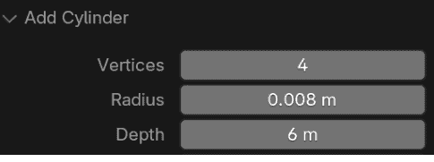

图 9.12 – 绳索数值

- 2. 这个绳索对象也将应用布料模拟。这样它会随旗帜一起摆动和移动。为了实现这一点，我们需要更多的几何体，因此让我们进入 **Edit Mode** 并添加一些环切。

按 *Ctrl+ R* 或 *Cmd + R*，然后输入 200 以添加 200 个水平环切。

- 3. 通常，绳索会通过滑轮系统。这允许旗帜升降。为了模拟这一点，让我们复制绳索（*Shift + D*），这样现在就有两根绳索了。

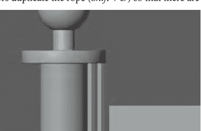

图 9.13 – 绳索位置

将绳索放置在杆子和旗帜之间，如图 9.13 所示，然后我们可以继续制作挂钩！

## 创建挂钩

对于真实的旗帜，根据尺寸，通常有两到四个挂钩将旗帜连接到绳索上。在本教程中，我们将添加四个挂钩：

- 1. 按 *Shift + A* 并添加一个 **Torus** 对象。
- 2. 将其缩放至约 0.03 m，并放置在旗帜的左上角。

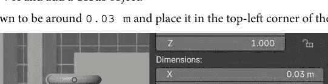

图 9.14 – 挂钩位置

- 3. 现在，我们需要确保环面对象在模拟时随旗帜一起移动。为此，我们将环面父级化到旗帜的顶角顶点。因此，在选择旗帜和环面对象后进入编辑模式。

- 4. 现在，先选择整个环面，然后按住 *Shift* 并选择左上角的顶点。

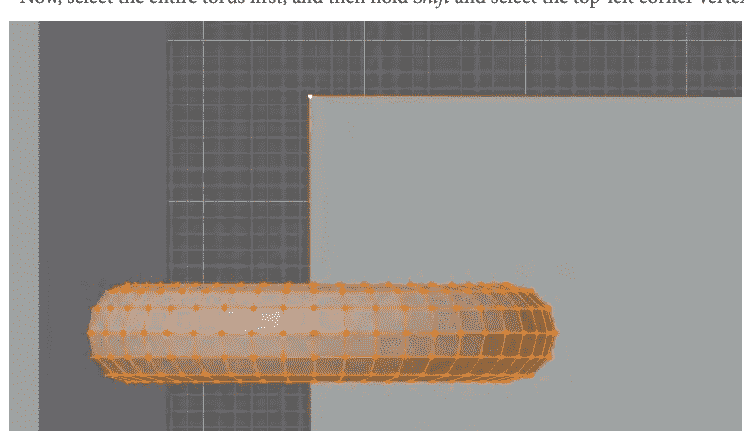

图 9.15 – 顶点选择

- 5. 按 *Ctrl + P* 或 *Cmd + P*，或前往 **Vertex** 菜单并选择 **Make Vertex Parent**。现在，环面将被父级化到该顶点，无论它去哪里，环面都会跟随！

- 6. 对想要添加的剩余挂钩重复 *步骤 1–5*。

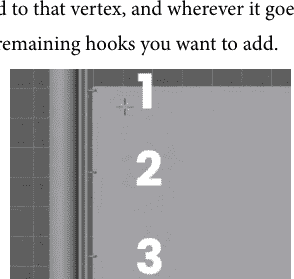

图 9.16 – 已添加环

添加完其余部分后，我们可以继续进行布料模拟！

## 创建模拟

现在场景中的所有对象都已就位，我们可以创建模拟了。不过，在此之前，我们需要做几件事：

- 1. 选择两个绳索对象，然后选择旗帜对象。然后，按 Ctrl + J 或 Cmd + J，或前往 Object | Join；这将把这些对象合并为一个，以便我们的模拟正常工作。
- 2. 接下来，让我们在场景中添加一个风力场。为此，按 Shift + A | Force Field | Wind。
- 3. 前往 Physics 面板并将 Strength 设置为 5000。我们需要相当高的强度值才能使布料移动。接下来，将 Flow 设置为 0，将 Noise Amount 设置为 5，这将为风带来更多变化！

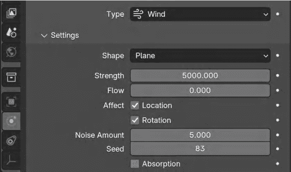

图 9.17 – 风设置

- 4. 将风力场旋转 90 度，使其指向旗帜的方向。

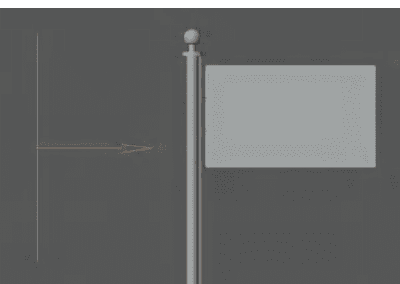

图 9.18 – 风力场方向

现在，让我们创建布料模拟！

- 5. 选择你的旗帜并前往 **Physics** 面板。
- 6. 现在，选择 **Cloth**。我们将从顶部开始，逐步向下调整设置。第一个要更改的是 **Quality**。这将提高模拟的准确性并帮助防止任何错误。由于绳索和旗帜会相互作用，我们需要将 **Quality** 设置为一个较高的值以获得良好的模拟。让我们使用 30。
- 7. 我们目前的布料重量过大，风几乎不会影响它。为了解决这个问题，让我们将 **Vertex Mass** 设置为 0.03 kg。
- 8. 由于风力强度很高，让我们在 **Stiffness** 选项卡中将 **Tension** 设置为 25，以确保布料不会拉伸。
- 9. 对于 **Stiffness** 选项卡中的 **Bending**，将此值设置为 0.4，以便获得稍小的褶皱和弯曲。

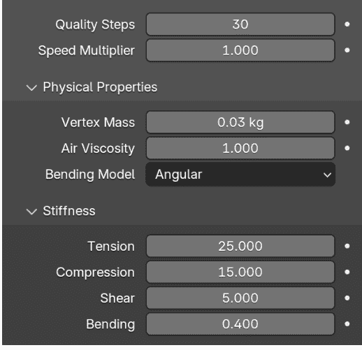

图 9.19 – 刚度值

- 10. 现在，让我们创建固定组，以便旗帜保持在原位而不是直接掉落。为此，我们需要创建一个顶点组并将一些顶点分配给它。

前往 **Object Data** 面板并通过点击右侧的 + 创建一个新的顶点组。

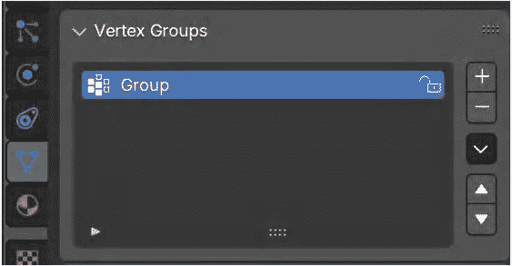

图 9.20 – 顶点组

- 11. 现在，在选择旗帜的情况下进入 **Edit Mode**，并将绳索的顶行面片以 **Weight** 值为 1 分配给该顶点组。查看以下图示以了解应选择哪一行面片！

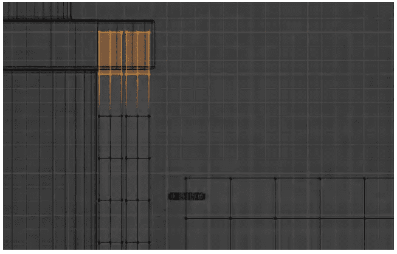

图 9.21 – 绳索上的顶面

- 12. 选择绳索的底行面片并同样分配这些顶点。

我们要做的另一件事是收紧这根绳索。如果现在播放模拟，绳索会因风的推动而远离旗杆。我们希望它更紧一些，更靠近旗杆。

为此，我们将基本上使用另一个顶点组来缩小绳索，使其更紧。

- 13. 首先，进入 **Edit Mode**，将鼠标悬停在绳索对象上并按 *L* 来选择两个绳索对象。此快捷键会自动选择整个对象。

- 14. 接下来，在 **Vertex Groups** 选项卡中点击 + 按钮，并以 **Weight** 值为 1 点击 **Assign**。

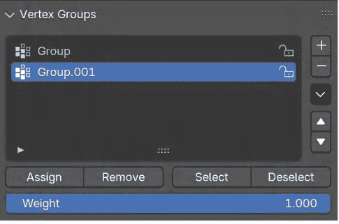

图 9.22 – 两个顶点组

本质上，我们现在已将两个顶点组分配给旗帜。**Group** 分配给绳索的顶面和底面，而 **Group.001** 分配给整个绳索对象。我们将在布料设置中放入这两个顶点组，这样它们将在接下来的几个步骤中实际影响模拟！现在，我们需要使用 **Sewing** 功能将旗帜连接到绳索上！

我们在上一章讨论了 **Sewing** 如何与布料模拟配合使用，但如果需要复习，它基本上通过收紧两个网格的连接边来工作。在这种情况下，我们将在旗帜和绳索对象之间创建一个边。这样，当启用 **Sewing** 时，该边将自动收紧在一起！以下是操作方法！

- 15. 在 **Edit Mode** 中，找到你想要在绳索和旗帜之间连接的顶点，并按 *F* 来填充一条边：

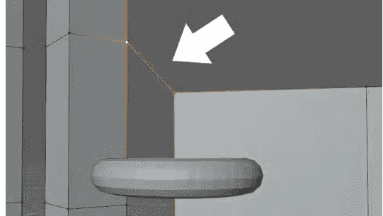

图 9.23 – 旗帜连接

16. 对旗帜上剩余的挂钩重复同样的操作。边缘不直也没关系；这实际上会让旗帜更具随机性，看起来更好！

17. 回到物理面板中，跳到 Shape 标签页，在 Pin Group 选项中选择 Group。然后启用 Sewing，并将 Max Sewing Force，设置这些边缘被拉合的强度，设为 15！

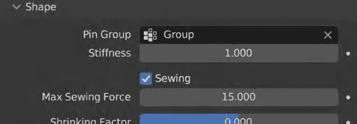

Figure 9.24 – Shape settings

18. 现在要收紧绳索，滚动到 Property Weights 标签页。从 Shrinking Group 选项中选择 Group.001。至于这种收缩效果的强度，我们将 Max Shrinking 的值设为 0.02。

现在，当我们播放模拟时，绳索应该会收紧，并且旗帜顶部应被挂在绳索上！

19. 在烘焙模拟之前最后一步是设置碰撞！打开 Collision 标签页并将 Quality 设为 4。这将使结果更准确。打开 Self Collision 并将距离降低到 0.005。

20. 完成之后，我们就可以烘焙模拟了！前往 Cache 标签页并将 End Frame 设为 200，或你想要动画的长度，然后点击 Bake！

我们刚才讨论的所有设置只是创建漂亮旗帜的基础。随意更改和自定义以符合你的喜好。现在，我们准备好继续创建材质了！

## 创建材质

在本节中，我们将为场景创建所有材质！从旗帜开始，我们将学习如何对物体进行 UV 展开并为其分配纹理。之后，我们还将为旗杆和挂钩创建材质！让我们开始吧！

### 创建旗帜材质

按以下步骤创建旗帜材质：

- 1. 我们需要做的第一件事是决定为旗帜使用什么纹理。你可以使用你国家的国旗，或我为本章创建的 Blender 旗帜。这里是下载该纹理的链接：`https://github.com/PacktPublishing/Learn-Blender-4-Simulations-the-Right-Way/tree/main/Chapter%209`。
- 2. 一旦纹理准备就绪，就将其添加到材质中。为此，前往 **Material** 面板并通过选择 **New** 创建新材质。
- 3. 接下来，点击 **Principled BSDF** 着色器基础颜色旁边的黄色圆点，选择 **Image Texture**，并打开你下载的旗帜纹理。

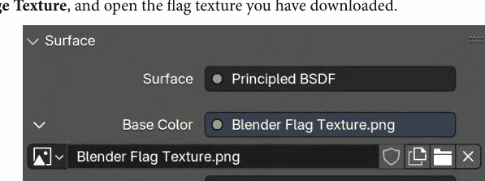

Figure 9.25 – The flag texture

- 4. 现在纹理已添加，我们需要对旗帜进行 UV 展开，以便纹理能正确应用。跳到 **Frame 1** 并在旗帜上进入 **Edit Mode**。通过按 *A* 然后 *U* 选择整个旗帜，并选择 **Unwrap**。
- 5. 如果你按 *Z* 并进入 **Material Preview**，你可能会注意到纹理不在正确的位置。要修复它，切换到顶部的 **UV Editor** 工作区。然后，在 **Edit Mode** 中用 *A* 选择所有内容，并缩放和移动，直到用旗帜的 UV 贴图填满图像。查看下图：

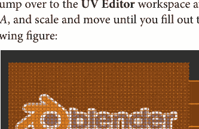

Figure 9.26 – UV map placement

- 6. 回到 **Principled BSDF** 着色器中，让我们将 **Roughness** 设为 0.9，这样它就不会那么有光泽！
- 7. 我们需要做的另一件事是为绳索创建新材质。现在，由于绳索和旗帜是同一个物体，它们共享同一材质。要修复这个问题，点击右侧的 + 按钮添加材质槽。然后，点击 **New**：

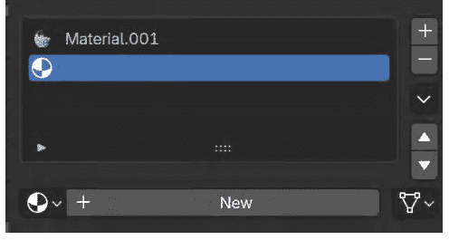

Figure 9.27 – A slot material

- 8. 为其选择你喜欢的颜色并将 **Roughness** 设为 0.9，这样它就不会有光泽。
- 9. 然后，要将新材质分配给绳索物体，进入 **Edit Mode**，选择绳索，然后点击 **Assign**！

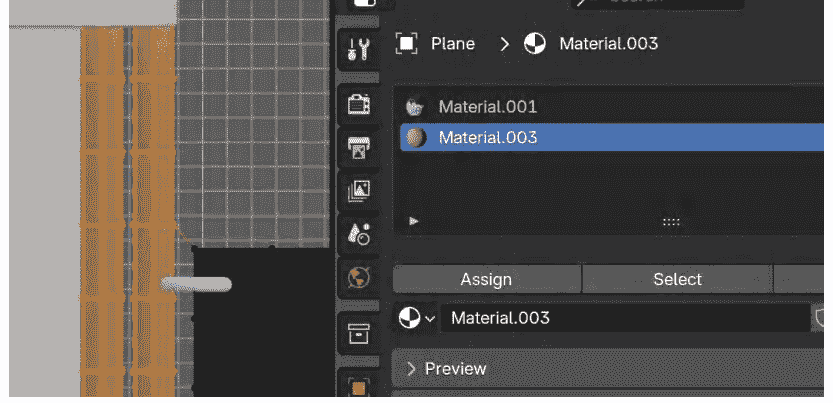

Figure 9.28 – Assigning the material

在本章开头，我们谈到了旗帜的旗杆连接处，即附着在绳索上的部分。要创建它，请重复 *steps 7–9*，但这次使用白色作为材质颜色！将其分配给旗帜本身最左侧的面。查看下图：

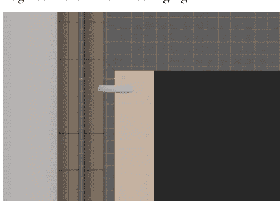

Figure 9.29 – Creating the hoist

完成之后，让我们处理挂钩并创建一个漂亮的金色金属材质！

### 创建挂钩材质

旗帜的挂钩通常是银色或金色，这非常简单：

- 1. 选择其中一个挂钩并点击 **New** 创建新材质。
- 2. 将 **Metallic** 设为 1 和 **Roughness** 设为 0.1。这将使材质具有漂亮的光泽外观。
- 3. 然后，将 **Base Color** 设为橙黄色，这将使其呈现金色外观。

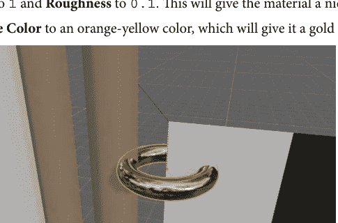

Figure 9.30 – A gold material

这个材质就完成了！然后，只需将剩余的挂钩分配为共享该材质，我们就可以继续了！

### 创建旗杆材质

旗杆材质也将是一个漂亮的金属材质，不过这次我们将使其呈现银色外观：

- 1. 选择旗杆并创建新材质。
- 2. 将 **Metallic** 设为 1 和 **Roughness** 设为 0.1。
- 3. 至于 **Base Color**，让我们将其设为浅灰色。

就是这样！所有材质都已完成，现在我们可以继续进行最终的润色，然后渲染动画！

### 渲染动画

我们的场景进展很顺利，但在本章的最后一部分，我们将介绍一些最终的调整和润色，使渲染效果更好：

- 1. 让我们先处理旗帜。为了抚平褶皱并使其整体外观更好，让我们添加一个 **Subdivision Surface** 修改器。前往 **Modifier** 面板，点击 **Add Modifier**，并选择 **Subdivision Surface**。将 **Viewport** 和 **Render** 级别都设为 2。
- 2. 现在我们的旗帜完全是薄的，这不太真实，所以让我们添加一个 **Solidify** 修改器使其具有一点厚度。将 **Thickness** 设为更低的值，例如 0.002。
- 3. 至于灯光，我建议使用 **High Dynamic Range (HDR)** 图像以获得最真实的效果。你可以在 `polyhaven.com` 免费获取非常高质量的 HDR 图像。一旦找到你喜欢的 HDR 图像，前往 **World** 面板，点击 **Color** 旁边的黄色圆点，选择 **Environment Texture**，并在场景中打开 HDR 图像！

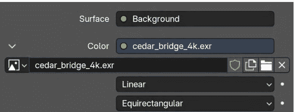

Figure 9.31 – HDR background

- 4. 接下来，在 Render 面板中，让我们启用 Raytracing 以获得更好的反射效果。同时，确保将 Resolution 设为 1:1。

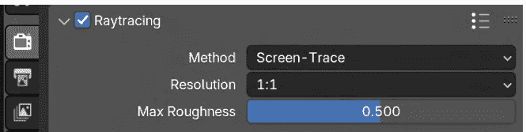

Figure 9.32 – Raytracing

- 5. 在 Color Management 中，将 Look 设为 High Contrast，使颜色更突出一些。
- 6. 之后，你可以将摄像机设置在你喜欢的位置。一个不错的位置是仰视旗帜。这将为旗杆提供良好的透视和高度感。

Figure 9.33 – The camera position

- 7. 最后一步是在 Timeline 中设置结束帧以匹配模拟的长度。

到这一步，我们就可以渲染了。确保设置好输出路径和你想要的文件类型。然后前往 Render 并选择 Render Animation！

## 总结

我们使用 Blender 中的布料模拟创建了一个逼真的旗帜！希望你在过程中学到了一些东西并创建了一些很酷的东西！一如既往，让我们回顾一下本章的内容。

首先，我们讨论了构成旗帜的不同部分及其尺寸和高度。之后，我们添加并建模了所需的所有物体。我们使用多个顶点组设置模拟以固定绳索位置，并使用 **Sewing** 将旗帜附着到绳索上。我们还创建了材质并学习了如何为旗帜添加纹理。最后，我们进行了一些最终润色并渲染了动画！

按照教程练习也总是有益的！这样你学到的步骤和知识才能真正深入！我鼓励你使用布料模拟再创建一个项目——也许是一面巨大的中世纪旗帜，或是角色身上随风飘动的披风！

不仅是本章的结束，也是本书 *Part 2* 的结束！在接下来的几章中，我们将深入探讨刚体模拟，并学习它是什么以及在 Blender 中如何工作！

# 第三部分：深入刚体

刚体模拟就是在 Blender 中使用实体对象创建运动。接下来的两章中，我们将全面了解刚体，它们是什么以及它们如何工作。我们将[content]
# 第三部分：深入刚体

刚体模拟就是在 Blender 中使用实体对象创建运动。接下来的两章中，我们将全面了解刚体，它们是什么以及它们如何工作。我们将逐一介绍所有设置和数值，并了解如何在 Blender 中有效使用它们。到最后，我们将制作一个非常酷且有趣的刚体障碍赛动画！

本部分包含以下章节：

- 第 10 章，刚体简介
- 第 11 章，创建刚体物理课程
