## 刚体简介

**刚体模拟**是在 Blender 中为对象添加物理的另一种方式。与软体和布料模拟不同，刚体模拟不会使对象变形。相反，它会保持网格的结构并确保一切保持刚性。刚体系统也与 Blender 中的动画系统配合得非常好。这意味着你可以让一些对象被动画化，一些不被动画化，而它们仍然会相互作用。

本章的目标是提供刚体模拟及其所有设置的概述。我们将首先了解此模拟是什么以及它如何工作。从那里开始，我们将直接进入设置并讨论每一项。这样，你将确切知道一切是如何工作的，而无需猜测。

在本章中，我们将涵盖以下主题：

- 什么是刚体模拟？
- 了解刚体设置
- 刚体世界
- 刚体对象菜单
- 使用刚体约束

### 技术要求

本章要求你已安装 Blender 4.2 或更高版本。要下载 Blender，请访问 www.blender.org。

本章的配套文件可在以下位置获取：https://github.com/PacktPublishing/Learn-Blender-4-Simulations-the-Right-Way/tree/main/Chapter%2010。

### 什么是刚体模拟？

**刚体**模拟用于在 Blender 中模拟实体对象的运动。它允许网格对象下落、相互碰撞并弹跳，而不会发生变形。此模拟非常适合创建诸如岩石堆、物体撞穿墙壁或任何不带变形的逼真物理等效果。刚体在电影和游戏中也常用于创建基于物理的效果。

要创建刚体模拟，你需要选择一个网格对象。然后，你可以进入 **Physics** 面板并选择 **Rigid Body**，或进入 **Object** 菜单然后进入 **Rigid Body**。选择 **Rigid Body** 后，选择 Add Passive 或 Add Active：

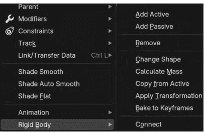

图 10.1 – 刚体菜单

**Active** 和 **Passive** 是你可以在 Blender 中添加的两种刚体类型。活动体将对重力、碰撞甚至力场做出反应，而被动体将保持静态不动，但如果有活动对象与其碰撞，它仍会与活动对象相互作用：

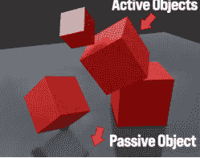

图 10.2 – 活动和被动对象

假设你创建了一个模拟，对象在周围移动并相互碰撞。现在，你希望应用变换，以便在重新启动时间线时对象保持在新位置。好吧，当你创建刚体模拟时，它不会创建修改器，不像我们在本书中讨论过的其他模拟。如果你想应用变换，你需要进入 **Object | Rigid Body** 并选择 **Apply Transformation**（*图 10.1*）。现在，对象将从该新位置开始模拟。

如果你想移除模拟，你可以点击 Physics 面板中 Rigid Body 旁边的 X 按钮，或者再次进入 Object | Rigid Body 并选择 Remove（图 10.1）。我将在本章中大量引用此菜单，因此从现在开始，我们称之为刚体对象菜单。

刚体对象的原点也会影响其模拟方式。例如，在下图中，原点偏向右侧。即使没有任何东西撞击或与立方体交互，它也会因为原点而被向右拉：

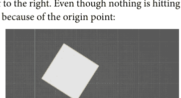

图 10.3 – 原点

因此，如果某个对象以随机方向飞走，请仔细检查其原点位置。要更改原点位置，请在选择对象后右键单击，进入 Set Origin，然后选择 Origin to Geometry。这将使原点移动到对象的中心。

此模拟的另一个方面是刚体约束。如果你使用过骨架或动画，你会熟悉这些操作。它们用于连接两个刚体。你可以通过选择两个刚体，进入刚体对象菜单，然后点击 Connect 来创建约束。这两个刚体之间会创建一个 Empty 对象；这是该约束的控制器：

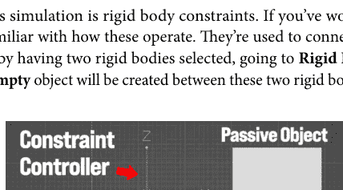

图 10.4 – 已连接的约束

使用约束可以限制刚体的位置和旋转。这对于创建诸如门的铰链或上下移动的电梯等事物非常有用。如果这听起来很复杂，不用担心——我们将在本章后面更详细地介绍刚体约束！

需要提及的一个非常重要的问题是，如果你更改任何刚体的比例，你需要记住应用比例，以便所有比例值都恢复为 1。如果你不这样做，Blender 将无法理解对象的比例，你将得到奇怪的碰撞结果。记住要应用对象的比例，确保对象已选择，按 Ctrl + A 或 Cmd + A，然后选择 Scale。

现在你了解了 Blender 中刚体模拟的工作原理，让我们进入设置并讨论每一项！

### 了解刚体设置

本节全部关于刚体模拟的设置。像往常一样，让我们从顶部开始逐步向下！

当你首次在 Physics 面板中选择 Rigid Body 时，你将能够选择想要的刚体类型。如前所述，有两种类型——Active 和 Passive：

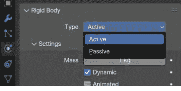

图 10.5 – 刚体 – 类型

Active 表示它将具有物理并对重力和其他力做出反应。Passive 会使刚体保持静态，但它仍会与其他刚体相互作用。

### 设置

以下选项可以在 Settings 选项卡下找到：

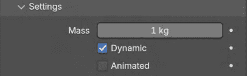

图 10.6 – 设置

让我们更详细地查看这些：

- **Mass**：在这里设置刚体在模拟中的重量。正如你可能猜到的，对象的重量会影响它与其他刚体和力的相互作用。你可以手动输入此数字，也可以让 Blender 自动计算。在 **Rigid Body Object Menu** 区域，你可以选择 **Calculate Mass**。这将打开一个包含所有不同真实世界材料的大菜单：

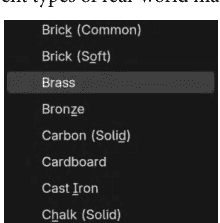

图 10.7 – 计算质量菜单

质量也是根据网格的大小计算的。例如，如果一个立方体为 2 x 2 米，并且你为计算选择了 **Gold**，Blender 将把该立方体视为完全由黄金制成的实心块，并且 **Mass** 将被设置为 154256 kg 或 340076 lb。这相当重，因此请确保为你的模拟选择合适的质量。

- **Dynamic**：这允许你打开和关闭刚体对象。此设置也可以被动画化，这在你希望刚体在时间线的某个点停止与模拟交互时很有用。

- **Animated**：此设置允许你使用动画数据和关键帧移动刚体对象。它仍会与模拟交互！这非常有用，可以应用于许多模拟。另一件很棒的事情是，*图 10.6* 中的 **Animated** 复选框也可以使用动画关键帧打开和关闭。例如，你可以使用位置关键帧让一个立方体飞入其他立方体：

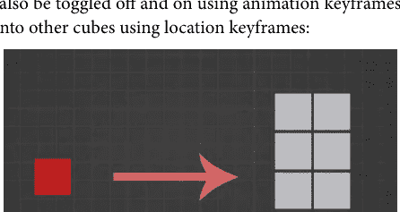

图 10.8 – 立方体动画开启

在最后一个位置关键帧之前，你可以关闭 Animated 复选框。这样可以让立方体保留来自前一个关键帧的速度和动量，并撞向其他立方体，如下图所示：

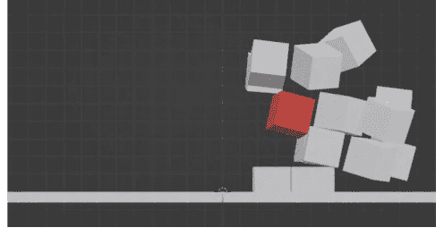

图 10.9 – 立方体动画关闭

如果你不关闭 Animated，立方体将遵循你设置的关键帧并停在其预期位置。

在我们[content]
在最后一个位置关键帧之前，你可以关闭 Animated 复选框。这样可以让立方体保留来自前一个关键帧的速度和动量，并撞向其他立方体，如下图所示：

图 10.9 – 立方体动画关闭

如果你不关闭 Animated，立方体将遵循你设置的关键帧并停在其预期位置。

在我们浏览这些设置时，我建议你自己测试一下，以便了解它们的工作原理。这将帮助你更好地理解此模拟！

## 碰撞

接下来是 碰撞 选项卡。在这里，我们可以更改刚体与其他物体碰撞的方式以及它们对表面的响应：

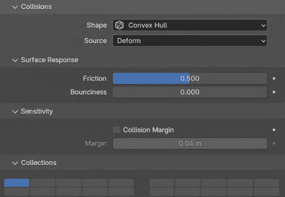

图 10.10 – 碰撞 选项卡

让我们更详细地查看可用的选项：

- **形状**：此选项控制物体的碰撞边界。通过此菜单，你可以选择多种基本形状作为碰撞区域：**盒子**、**球体**、**胶囊**、**圆柱**、**圆锥**、**凸包**、**网格** 和 **复合父级**。如果一个立方体物体的 **形状** 值设置为 **球体** 选项，那么碰撞将呈球体形状而不是立方体本身：

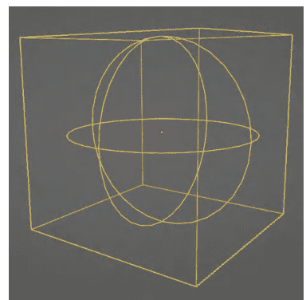

图 10.11 – 球体

其他基本形状也一样。

**凸包** 的工作方式略有不同。你可以认为此碰撞区域是围绕物体收缩包裹的。此方法对于不太复杂的简单网格非常有效：

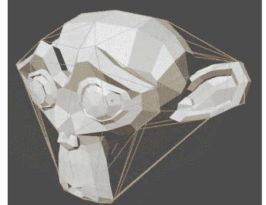

图 10.12 – 凸包 示例

**网格** 形状由三角形组成，涵盖整个物体。这用于更复杂的碰撞区域。**网格** 方法速度较慢，有时会导致错误，因此只有在需要时才使用它。

我们需要讨论的最后一个形状是 **复合父级**。它会获取附加到该网格的所有对象，并将它们用作碰撞边界。

### 什么是父级？

父级意味着将一个或多个对象附加到单个父对象。这样，当你移动、旋转或缩放该父对象时，这些变换也会影响附加在其上的“子”网格。

下图显示所有立方体都父级化到二十面体。当二十面体设置为 **复合父级** 时，它将使用立方体作为碰撞边界，而不是球体本身：

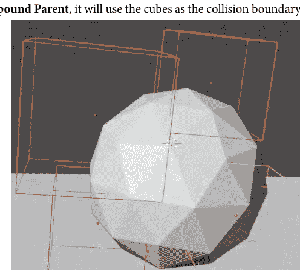

图 10.13 – 复合父级 示例

- **来源**：这也控制碰撞边界。此菜单中有三个选项可供选择：
  - **基础**：这将忽略任何修改器，仅使用基础网格进行碰撞。
  - **变形**：这将允许改变网格形状的任何修改器或形状键在碰撞中被考虑
  - **最终**：这也包括已应用于网格的所有修改器和变形。

当 **形状** 设置为 **网格** 且 **来源** 设置为 **变形** 时，会出现一个 **变形** 复选框。这允许网格在模拟播放时变形，在某些情况下很有用。例如，如果你有一个在模拟期间改变网格几何形状的修改器（如 **置换** 或 **简单变形**），则碰撞形状也会随之改变，并且在勾选 **变形** 时会更准确。

在 **碰撞** 选项卡内，有三个子菜单，其中第一个是 **表面响应** 选项卡。以下是可用的设置：

- **摩擦**：此设置控制表面会有多粘。较低的值会使表面像冰一样，较高的值会防止滑动。
- **弹性**：这正是字面意思——当物体与其碰撞时，表面会有多少弹性。请注意，此设置只有在你同时更改正在碰撞的*两个*物体的 **弹性** 设置后才会生效。

在下图中，左侧立方体的 **弹性** 设置为 0，右侧立方体设置为 2，平面的设置为 1。如你所见，右侧立方体弹得更高：

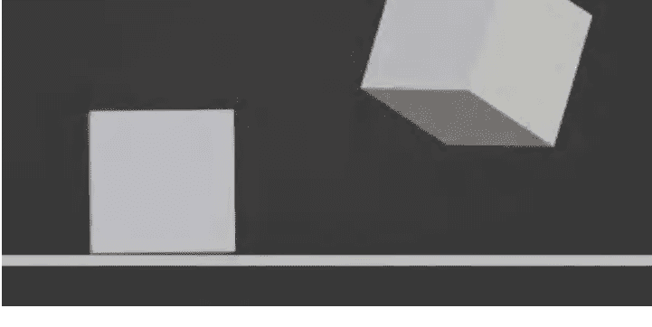

图 10.14 – 弹性 示例

**碰撞** 选项卡中的下一个子菜单是 **灵敏度** 选项卡：

- **碰撞边距**：当此复选框被勾选时，你可以设置 **边距** 值。此值控制与其它物体的碰撞距离。下图显示了一个立方体，其下方平面的 **边距** 值为 0.4 m。如你所见，两者之间存在很大的距离：

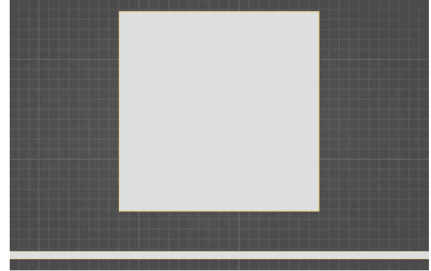

图 10.15 – 碰撞边距

请注意，当 **形状** 选择为 **网格** 和 **圆锥** 时，此设置的行为很奇怪。如果设置了较高的距离，这会使刚体反弹并且无法正常碰撞。确保在使用这些形状时将此值设置为较低值或 0。

**碰撞** 选项卡中的最后一项是 **集合**。在这里，你可以为模拟设置自定义碰撞组：

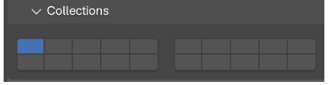

图 10.16 – 集合

此选项卡的主要目的是提供 **集合** 框，以便你可以设置刚体碰撞组。例如，如果一个刚体对象选中了第一个框，而另一个刚体对象选中了第二个框，它们都将被模拟，但不会碰撞或相互作用，因为它们具有不同的碰撞组。

你也可以使用此系统同时在一個或多個对象上高亮多个框。你可以通过按住 Shift 并选择想要的碰撞组来实现。这将导致具有相同高亮框的任何刚体对象相互碰撞。

这对于创建一种效果很有用，其中一个刚体可以穿过另一个刚体而不碰撞，但随后会与另一个刚体碰撞。

## 动力学

**动力学** 选项卡允许你更进一步控制刚体的物理特性。请注意，这仅适用于 **活动** 刚体：

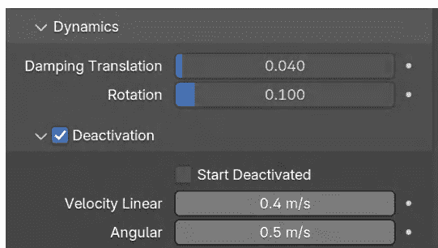

图 10.17 – 动力学

让我们更详细地查看可用的设置：

- **平移阻尼**：此选项控制刚体失去速度并停止的速度。较高的值会阻尼运动，使物体非常快速地停止。
- **旋转**：这以相同的方式工作。如果物体在旋转，此值控制该物体失去角速度并停止的速度。
- **去激活**：当勾选此项时，当物体的速度低于线性值和角值时，Blender 会停止模拟该刚体。有时，使用刚体时，即使它们静止不动，也会抖动。**去激活** 允许它们停止被模拟，并有助于防止抖动。这也有助于节省场景中的内存。
- **开始时去激活**：这将使刚体在另一个刚体与其接触之前不会移动。如果希望物体在另一个物体触碰它之前不移动，这会很有用。

好了！这就是 **物理** 面板中 **刚体** 的所有设置。我们在本章中还有很多内容要介绍，所以让我们谈谈刚体世界！

## 刚体世界

**刚体世界** 位于 **场景** 面板中；在那里你可以设置要模拟的集合、速度和每帧步数。它也是烘焙模拟的地方：

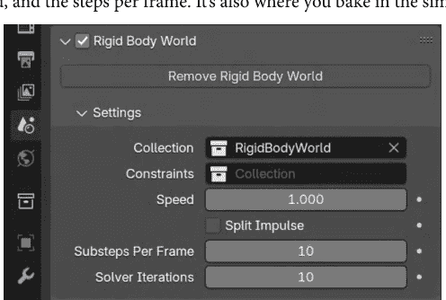

图 10.18 – 刚体世界 设置

当你第一次向场景添加刚体时，刚体世界就会被创建。没有它，什么都不会被模拟；你始终需要刚体世界。你可以通过取消选中它或点击 **移除刚体世界** 来禁用此世界。现在，让我们谈谈此面板中的设置：

- 当名为 **RigidBodyWorld** 的 **集合** 被选中时，*每个* 集合中的*每个* 刚体都可以被模拟。但是，如果你选择特定的集合，则只有该特定集合中的对象才会被模拟。
- **约束**：在图 10.18 中，此集合当前为空。这是因为它在你创建刚体约束之前不会被创建。一旦你这样做，将会创建一个名为 **RigidBodyConstraints** 的新集合：

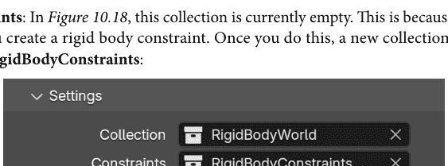

图 10.19 – RigidBodyConstraints

你 在 **大纲** 中看不到这些集合，但如果在选择了其中一个刚体后进入 **对象** 面板并打开 **对象属性** 选项卡，你会在该 **刚体世界** 集合内看到它们：

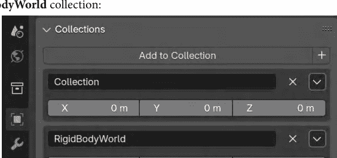

图 10.20 – 对象集合

- **速度**：此选项控制模拟的整体速度。数值越高，模拟速度越快；数值越低，则模拟变慢。
- **分裂冲量**：这有助于减少两个物体碰撞时产生的额外速度。例如，在下图中，两个立方体相互碰撞。开启 **分裂冲量** 时，立方体碰撞后会迅速停止。关闭 **分裂冲量** 时，立方体碰撞后会弹开并向相反方向飞去：

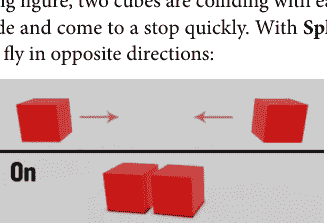

图 10.21 – 分裂冲量

- **每帧子步数**：这是动画每秒发生的步数。增加此值会得到更准确的结果，但也会增加烘焙时间。如果有快速移动的物体，建议提高此值。
- **求解器迭代次数**：这与 **每帧子步数** 类似，但处理的是刚体约束。增加此值会使约束结果更准确，但也会增加烘焙时间。

- **缓存**：此选项卡用于设置 **模拟开始** 和 **结束** 帧并烘焙模拟。由于其工作原理与软体和布料模拟相同，因此应该都很熟悉：

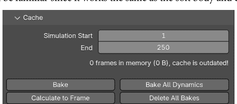

图 10.22 – 缓存选项卡

- **力场权重**：你可以添加不同的力场来控制刚体的运动。这些力场的影响可以在 **力场权重** 选项卡中控制。此处可以更改 **重力** 设置以及每个力场的强度。你还可以选择 **效果器集合** 值，以限制哪些力会影响模拟：

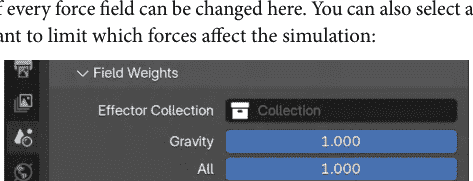

图 10.23 – 力场权重

控制重力的另一个位置是在 **刚体世界** 选项卡上方的 **重力** 选项卡中。在这里，你可以关闭它或为向下作用力设置不同的数值。你甚至可以为重力设置不同的轴：

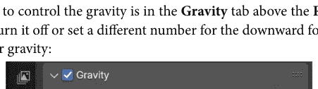

图 10.24 – 重力选项卡

在继续讨论刚体约束之前，让我们先讨论刚体模拟的另外几个选项，以及如何使用 **刚体对象菜单** 区域一次性添加多个刚体对象。

## 刚体对象菜单

正如本章前面提到的，**刚体对象菜单** 区域可以通过进入 **对象** 菜单然后选择 **刚体** 来找到。在这里，你会找到一些我们已经讨论过的选项，还有一些新的选项：

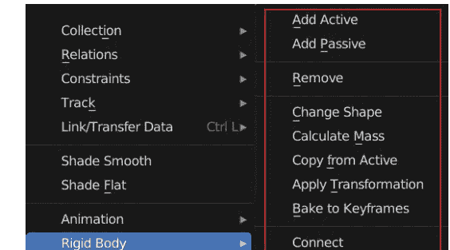

图 10.25 – 刚体对象菜单

- 如果你想一次性创建多个刚体，非常简单！确保所有对象都被选中，然后点击 **添加活动**。现在，你选中的每个对象都会应用 **活动** 刚体。
- **添加被动** 也是如此。
- 你也可以通过选择 **删除** 来移除所有刚体。
- **更改形状** 允许你更改所选对象的碰撞边界。
- **计算质量** 我们之前已经讨论过，所以让我们继续讨论 **从活动复制**。如果你在一个对象上更改了一些设置并想将其复制到另一个对象，此选项可以做到这一点！确保选中你要复制的所有对象，并且具有这些设置的对象是 **活动对象**，然后点击 **从活动复制**。现在，你选中的每个对象都会应用这些确切的设置。这对于一次性将相同设置应用到多个对象非常有用。
- 由于我们之前已经提到过 **应用变换**，这里跳过它，转而查看 **烘焙到关键帧**。此选项允许将刚体的运动转换为关键帧。这可以让你对对象有更大的灵活性，因为现在你处理的是关键帧而不是模拟。当你想与其他模拟一起工作时，这非常有用，因为现在你处理的是动画数据而不是刚体数据，而刚体数据无法转换到其他模拟类型。
- 最后，**连接** 允许你连接两个刚体以创建约束。

说到约束，让我们谈谈 **刚体约束** 以及它们在 Blender 中模拟中的工作原理！

## 使用刚体约束

刚体约束允许你连接两个刚体并在它们之间创建一个 *关节*。此关节可以限制刚体的运动。例如，你可以创建的一种约束是铰链。这对于创建门或杠杆等物体非常有用。

要使其工作，你需要选择两个刚体，然后进入 **刚体对象** **菜单** 区域并点击 **连接**。这将在这些对象之间创建一个 **空对象**；这是约束的控制器。**空对象** 是一个在 3D 空间中只有一个坐标的对象。此对象没有几何体或表面，因此不会被渲染。这些对象可作为许多不同用途的句柄：

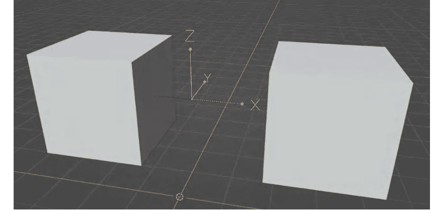

图 10.26 – 空对象约束

你可以通过进入 **物理** 面板并选择 **刚体约束** 来让其中一个刚体对象成为约束控制器：

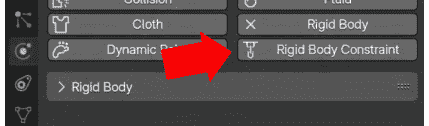

图 10.27 – 刚体约束

这样做不会提供太多自定义，因为 *关节* 位置将位于对象的原点处。使用 **空对象** 作为 *关节* 要好得多，你可以在场景中将其移动到任何位置。

现在我们了解了刚体约束是什么，让我们进入设置并学习它们确切的工作原理。

## 约束设置和类型

当我们第一次使用 **连接** 功能创建约束时，会创建一个 **空对象**。选择此 **空对象** 后，你可以更改约束的 **类型** 以及一些不同的设置。首先，让我们先了解一下设置；之后我们再讨论每种类型的约束：

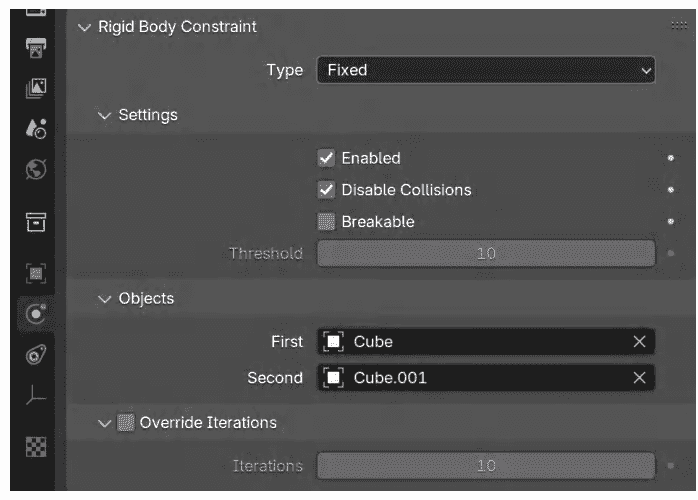

图 10.28 – 约束设置

让我们更详细地查看这些设置：

- **类型**：这允许你更改想要的约束类型。截至撰写时，有八种不同的类型；我们很快会逐一介绍。
- **启用** 复选框：这允许你在约束启用或禁用之间切换。此设置也可以被动画化。
- **禁用碰撞**：勾选时，连接的两个刚体将不会相互碰撞。

- **可破坏**：这允许两个对象之间的连接被打破。**阈值** 决定打破该连接所需的力量的大小。
- **第一个和第二个**：这些是连接的对象。你可以点击下拉菜单搜索名称，或使用 **吸管** 工具并在 **3D 视口** 区域中点击对象。
- **覆盖迭代次数**：这将覆盖 **刚体世界** 选项卡中该特定约束的当前 **求解器迭代次数**。如果你的约束需要比 **刚体世界** 选项卡中设置的更多迭代次数，这会很有用。

其中一些设置因约束类型而异，但我们会在到时介绍！为了让下面的小节更容易理解，我创建了一个 `Rigid Body Constraints Examples.blend` 文件，其中包含不同集合中每种约束的示例。前往 https://github.com/PacktPublishing/Learn-Blender-4-Simulations-the-Right-Way/tree/main/Chapter%2010 下载该 `.blend` 文件。

打开此 `.blend` 文件后，你将在 **大纲** 区域看到八个集合，其中包含不同类型的约束：

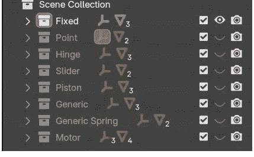

图 10.29 – 约束集合

要在不同的集合之间切换，你可以按键盘顶部的数字键，或按住 *Ctrl/Cmd* 并在右侧左键点击眼睛图标。这将隐藏其他集合，但保持你选择的集合可见。然后，你只需播放模拟即可查看约束的作用！

现在我们已经讨论了通用设置，让我们深入具体内容，谈谈 Blender 中每一种刚体约束的八种类型。我们将从 **固定** 约束开始！

## 固定

**固定** 约束允许两个对象作为一个整体移动。它将它们连接起来，它们会像一个坚实的物体一样下落和旋转：

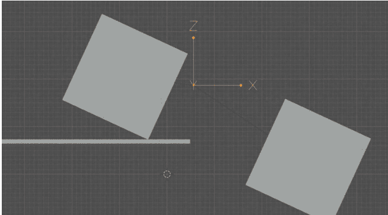

Figure 10.30 – Fixed constraint

## Point
The Point constraint acts as a rope between the two objects. In this example (see the following figure), the top cube is set to Passive, and it connects to an Active object. As you can see, the bottom cube will fall and swing as if attached to a rope:

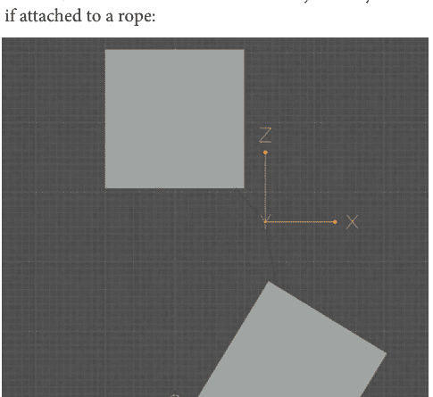

Figure 10.31 – Point constraint

## Hinge
The **Hinge** constraint acts as a hinge for a door. It creates a rotation point that's based on the location of the **Empty** object. The rotation is also constricted to the local Z-axis for the **Empty** object. While you can rotate the **Empty** object at a different angle, make sure you have the Z letter pointing in the direction you want the hinge to be:

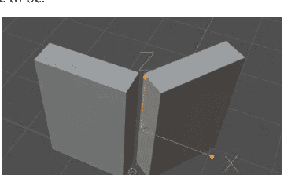

Figure 10.32 – Hinge constraint

In the settings for the **Hinge** constraint, there's a new option: **Z Angle**. Turning this option on allows you to limit the rotation of the hinge using the **Upper** and **Lower** values. Without any limits, the hinge will be able to spin all the way around without stopping.

## Slider
The **Slider** constraint allows the object to slide along the local X-axis of the **Empty** object. The movement is restricted to the X-axis, so make sure you rotate the **Empty** object in the direction you want the slide to happen.

In the settings for the constraints, there's an **X-Axis** checkbox. With this enabled, you can set how far away the rigid body can slide using the **Upper** and **Lower** values:

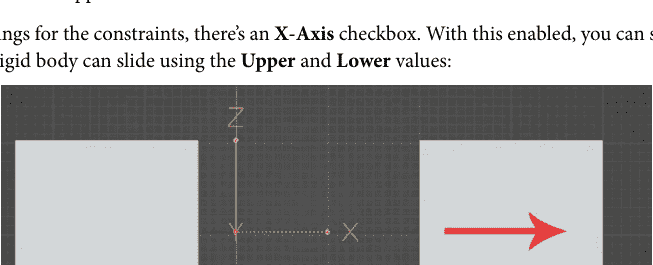

Figure 10.33 – Slider constraint

## Piston
The **Piston** constraint combines both the **Hinge** and **Slider** constraints into one. This constraint allows the rigid body to slide and rotate along the **Empty** object's local X-axis. As mentioned previously, in the settings for the constraint, there are the same options for limiting the movement and rotation using the **Upper** and **Lower** values:

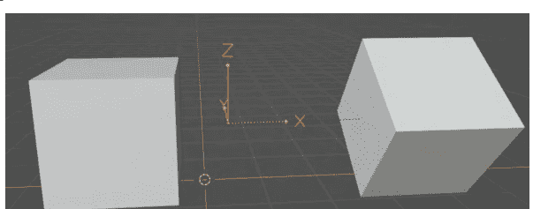

Figure 10.34 – Piston constraint

## Generic
The **Generic** constraint covers all the functions we just talked about. Here, you can set limits for the movement and rotation of the X, Y, and Z axes. When you clamp every value to 0, this constraint will act like the **Fixed** constraint. If you set the **Linear** values to 0 but leave the **Angular** values unchecked, it will act like the **Point** constraint.

Every constraint we've learned about thus far can be created using the **Generic** constraint. The name suits it pretty well:

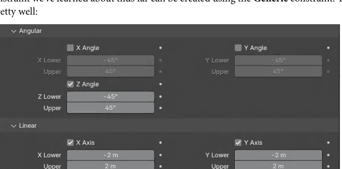

Figure 10.35 – Generic constraint

## Generic Spring
The **Generic Spring** constraint is similar to the **Generic** constraint. It has all the same **Angular** and **Linear** limits, plus the addition of **Spring** settings for the X, Y, and Z axes:

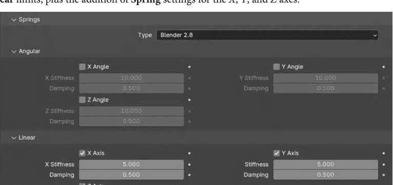

Figure 10.36 – Generic Springs constraint

If only the springs are enabled and not the movement/rotation restrictions, it will act as a springy rope for the constraint. You can see this by playing the animation with the **Generic Spring** collection visible in the .blend file:

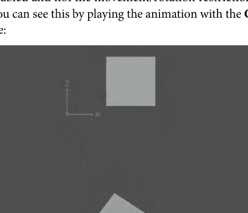

Figure 10.37 – Generic Spring constraint

**Stiffness** controls how strong the spring will be. Higher values will make the spring very stiff and it won't bend as much.

**Damping** will dampen the effect of the spring and slow it down. Higher values will make the rigid body fall much slower.

## Motor
The last rigid body constraint we have is the **Motor** constraint. This constraint creates a motor-like function where the object will move and/or rotate in a certain direction until the end of the simulation. The **Motor** collection contains an example of a platform rising into the air and a gear rotating:

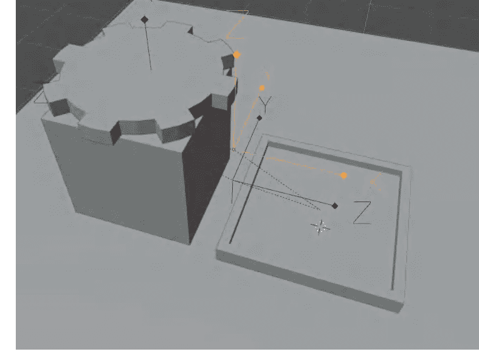

Figure 10.38 – Motor constraint example

There are two motor functions that we can use. **Angular** is for rotating the object and **Linear** is for moving it:

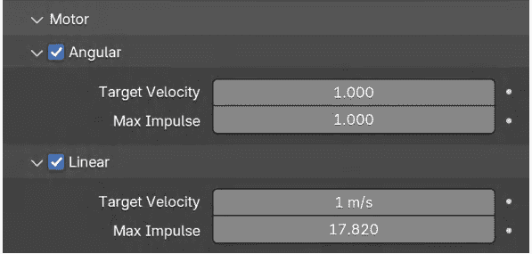

Figure 10.39 – Motor settings

The **Angular** settings are for the rotation. This works by taking the *X*-axis of the **Empty** object and rotating the rigid body along that axis. You can see this by playing the animation and looking at the gear object.

**Linear** is for the movement. Instead of *X*, **Linear** uses the -*X* direction of the **Empty** object and moves the rigid body along that axis. In this case, you'll notice that the **Motor** constraint has been rotated upside down, so the -*X* direction is pointing straight up. This will cause the platform to rise.

Another issue that might come up is a random rotation, which you don't want for the **Linear** movement. To prevent this, you can lock the rotation in the **Properties** panel. To open this panel, press *N*. If you select the rising platform in the **Motor** collection, you'll notice that all rotation is locked. This ensures there's no unwanted rotation:

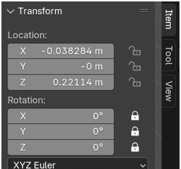

Figure 10.40 – Locked properties

Now, let's look at the two settings that are available in **Angular** and **Linear**:

- **Target Velocity**: This controls the speed of the movement/rotation.
- **Max Impulse**: This controls the strength of the motor. For example, let's say you have a platform rising into the air. If the weight of that object is greater than the **Max Impulse** setting, that platform won't be able to move.

Keep in mind that you can have both the **Angular** and **Linear** motors working at the same time. By doing so, you could create something such as an elevator rotating as it rises into the air!

One last thing to mention is that you can combine multiple constraints into one object. In the Motor collection, you'll notice another empty object. This is a **Generic** constraint and what it does is set a limit for how high the platform will go up. In this case, it's 3 meters. So, you don't need to have only one constraint per object – you can have as many as you want and they'll all work together!

Feel free to play around with all the settings and different constraints! Test them out so that you understand how they work!

## Summary
And there it is! In this chapter, we learned everything there is to know about the rigid body simulation in Blender! Hopefully, at this point, you have a grasp of all the cool and unique things that can be created using this system! Once again, let's recap so that we remember everything we've covered!

First, we discussed what the rigid body simulation is and what you need to know to get started. After that, we jumped into the settings and learned about active and passive objects, collision shapes, and much more! Next up was the **Rigid Body World** tab, and how you can use that panel to set the length and the speed, as well as bake the simulation! Another thing we learned about is the **Rigid Body Object** menu and how you can copy settings from one rigid body to another! We ended this chapter by understanding every type of constraint there is in the simulation.

The rigid body simulation is probably one of the most useful simulations there is. It can be applied to so many different scenes and animations. Speaking of which, in the next chapter, we'll be taking what we learned here and putting it to the test by creating a nice, satisfying animation!

## Join our community on Discord
Join our community’s Discord space for discussions with the author and other readers:
https://packt.link/learn-blender-simulations-discord-invite

## 11

## Creating a Rigid Body Physics Course
Now that we have a good understanding of how the rigid body simulation works in Blender, let’s take everything we learned in the last chapter and apply it to a real project! In this chapter, we will be learning how to use the rigid body simulation to create a full physics-based animation.

In this animation, we will first simulate a swinging wrecking ball that crashes into a domino. That will cause a chain reaction of falling dominos, which will trigger a button that moves up an elevator. Inside that elevator is a sphere. As the sphere moves up, it will eventually pass through a couple of hinge constraints and end up crashing into a large tower of cubes, finishing off the animation. If that sounds like a lot, don’t worry! We will go through it step by step and cover each aspect of this animation in detail.

The goal of this chapter is to understand how to use a rigid body simulation in a practical way to create a nice, interesting animation! By the end, you will have a good understanding of the rigid body system and how to use it in your future projects.

In this chapter, we’ll be covering the following topics:

- Creating the simulation
- Adding the camera animation
- Setting up the render

## Technical requirements
This chapter requires you to have Blender version 4.2 or above installed.

To download Blender, visit www.blender.org.

此外，请确保在此处下载本教程的设置文件：https://github.com/PacktPublishing/Learn-Blender-4-Simulations-the-Right-Way/tree/main/Chapter%2011

## 创建模拟

开始之前，请确保下载 Rigid Body Course Setup.blend 文件。它将包含一个基本场景，其中包含我们动画的所有组件，例如摆动的 wrecking ball、多米诺骨牌、电梯、塔等。每个对象都已放置好材质，但您可以随意更改。您也可以查看右上角的 Outliner，以查看每个对象的名称，以便轻松导航。

熟悉场景后，我们就可以开始创建模拟了。如果您想下载完成的场景 Rigid Body Project File.blend 作为参考，也可以这样做！

处理复杂的刚体模拟时，Blender 倾向于崩溃且无响应。请记住在整个教程中不断保存 Blender 文件，以免程序崩溃时丢失进度。

## 模拟 wrecking ball

让我们开始通过模拟摆动的 wrecking ball 撞击其中一个蓝色立方体！为此，我们将使用刚体 Object 菜单一次为链条和 wrecking ball 添加物理：

- 1. 选择 Chain Top 对象、全部 12 条链条以及 Wrecking Ball 对象，然后前往 Object | Rigid Body | Add Active。

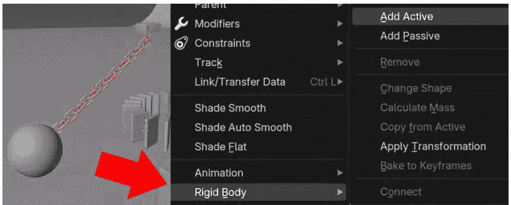

图 11.1 – 破坏球物理

- 2. 对于这些链条，我们需要更改一些设置：
  - I. 在保持全部选中的状态下，前往 **Physics** 面板：将 **Mass** 设置为 4 kg。这将防止链条因重量而断裂。
  - II. 接下来，让我们更改碰撞形状。因为这些链条是相互锁定的，所以 **Convex Hull** 不会起作用。请记住 **Convex Hull** 碰撞边界基本上是围绕物体收缩包裹的。这意味着，在这种情况下，链条的空隙部分内部会出现碰撞。为了解决这个问题，我们需要改用 **Mesh**；这样碰撞就能正常工作，链条也不会断裂。
  - III. 最后，让我们在 **Sensitivity** 中将 **Margin** 设置为 0 m。这将确保链条相互接触且不会抖动！

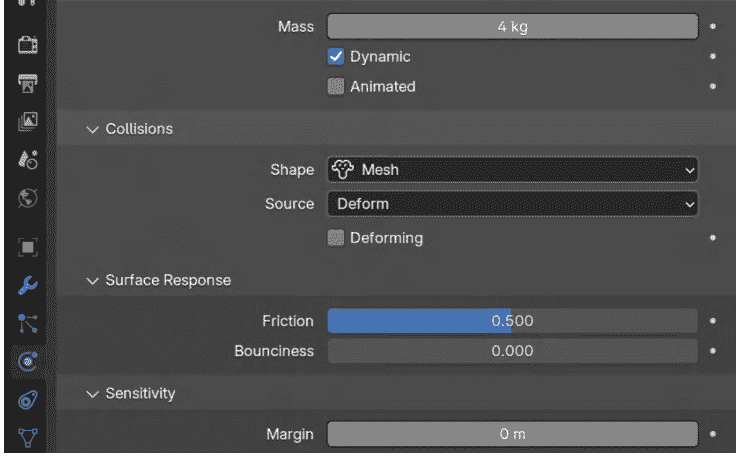

图 11.2 – 破坏球设置

- 3. 现在，让我们将这些更改复制到其余链条。您可以确保它们仍然全部被选中，并且带有这些更改的那个是 *active object*，然后前往 **Object | Rigid Body | Copy From Active**。

- 4. 选择 wrecking ball 对象。在现实生活中，它的重量会大得多，因此让我们在 **Settings** 选项卡中将 **Mass** 设置为 20 kg。此外，在 **Dynamics** 选项卡中将 **Damping Translation** 和 **Rotation** 改为 0.400。这将使 wrecking ball 在动画播放时停止摆动。

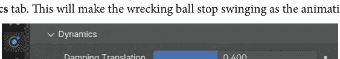

图 11.3 – 阻尼值

- 5. 然后，选择 **Chain Top** 对象并关闭 **Dynamic**。这将确保它保持悬浮且不会掉落。

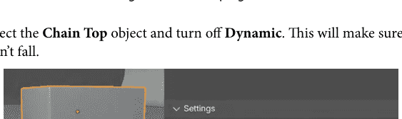

图 11.4 – Chain Top 设置

通常，**Passive** 类型用于平台或更大的表面区域；然而，对于更复杂的网格，使用 **Dynamic** 关闭的 **Active** 更好。

从这里开始，您可以播放动画，wrecking ball 应该会摆动！接下来，让我们创建多米诺效应！

## 创建多米诺效应

现在 wrecking ball 已经在摆动，让它撞击其中一个 **Domino** 对象，引发连锁反应，就像现实生活中的多米诺骨牌一样。我们希望多米诺骨牌按顺序倒下，最终撞到 **Button Cube** 对象。这就是触发电梯向上移动的原因！

- 1. 首先，让我们在场景中选择所有 **Domino** 对象。从那里，前往 **Object | Rigid Body** 并点击 **Add Active**。

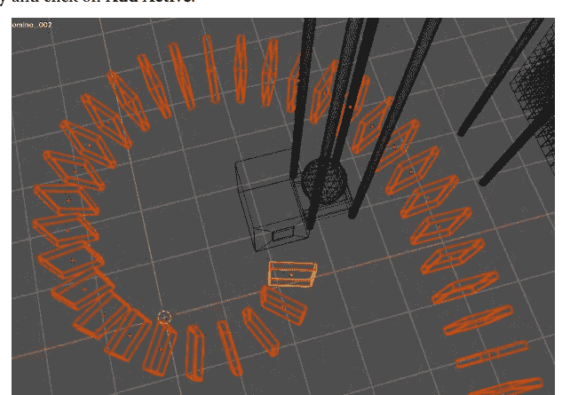

图 11.5 – 选中的立方体

- 2. 我们不需要在 **Physics** 面板中更改任何设置；默认值为这些对象工作得非常好。另外一个重要步骤是选择 **Floor** 对象，并在刚体 **Object** 菜单中选择 **Add Passive**。这样立方体就会保持原位，不会穿过地板掉落！

随意更改多米诺骨牌线的形状。您可以让它绕场景一周或分向两个方向！只要确保它最终会绕回来并撞到 **Button Cube** 对象，因为这会触发电梯上升，我们现在将讨论这个问题！

在继续之前，现在是保存 Blender 文件的好时机。您可以通过按 *Ctrl + S* 或前往 **File | Save** 来实现。

## 模拟电梯

接下来是运送球体到赛道顶部的电梯。为此，我们将使用电机约束！让我们首先通过为 **Button Cube** 对象的按钮制作动画，当最后一个多米诺骨牌撞到它时变绿：

- 1. 选择 **Button Cube** 对象并将其设置为 **Passive** 刚体。这样它将与场景交互。

- 2. 现在，要使其变绿，请找到立方体撞到按钮的帧。您可以通过从时间线的开头播放动画来找到该帧（不幸的是，简单地拖动时间线是行不通的）。在我的场景中，它在 **Frame 122**，但您的可能略有不同。

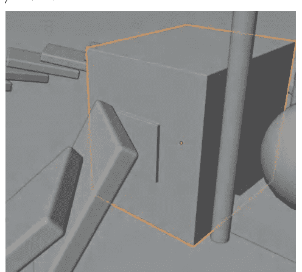

图 11.6 – 第 122 帧

- 3. 让我们前往 **Material** 面板并选择 **Button Light** 材质。

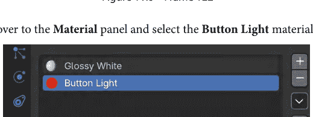

图 11.7 – 材质面板

- 4. 让我们转到前一帧（**121**）并为 **Emission** 着色器中的 **Color** 值添加关键帧。您可以通过将鼠标悬停在颜色上并按 *I* 来实现，或点击颜色旁边的那个小点。

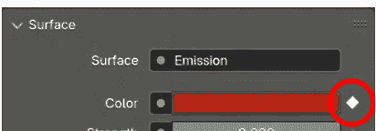

图 11.8 – 发射颜色关键帧

- 5. 跳到下一帧（122），将颜色更改为漂亮的绿色，并添加另一个关键帧。现在，当立方体撞到按钮时，它会变绿！

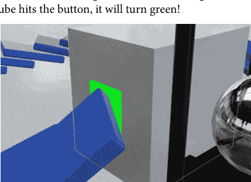

图 11.9 – 按钮变绿

- 6. 要创建电机约束，让我们将 Elevator Platform 对象设置为 Active 刚体，将碰撞形状设置为 Mesh，并将 Sensitivity 边距设置为 0 m。

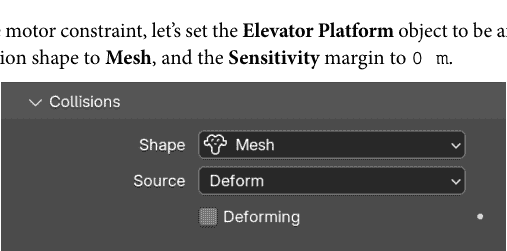

图 11.10 – 电梯设置

- 7. 在 **Elevator Platform** 对象仍被选中的情况下，按 N 打开 **Properties** 面板。让我们锁定所有 **Rotation** 和 **Location** 轴 *except* **Z** 位置；这样，当我们添加电机约束时，它只会沿 **Z** 轴向上移动。

图 11.11 – 已锁定属性

- 8. 选择 **Button Cube** 和 **Elevator Platform** 两个对象，然后前往 **Object | Rigid Body | Connect**。这将在这两个对象之间创建约束。

图 11.12 – 一个空约束

此约束将具有 **X**、**Y** 和 **Z** 手柄。请记住这些手柄的旋转，因为它们决定了许多约束类型的方向和旋转。

- 9. 选择已添加的约束对象并在物理面板中更改一些设置：
  - I. 将类型更改为 Motor。
  - II. 启用 Linear 并将 Target Velocity（控制速度）设置为 2 m/s。
  - III. 将 Max Impulse（控制电机强度）设置为 250，一个足够强的值来携带球体上升。

图 11.13 – 电机设置

- 10. 使用电机约束时，-X 方向是电机将要移动的方向。考虑到这一点，让我们旋转电机约束，使 X 方向指向向下。这将导致电梯向上移动！

图 11.14 – 电机约束旋转

11. 确保播放动画以查看一切是否正常工作，并且平台正在上升。

12. 我们不希望电梯平台在按钮变绿之前移动，所以让我们跳转到按钮变绿前一帧（121），在约束设置中取消选中 Enabled，并添加一个关键帧。

图 11.15 – 动画化 Enabled

13. 在下一帧（122）中，打开 Enabled 并添加另一个关键帧。就这样——电机约束要到第 122 帧最后一个多米诺骨牌撞到按钮时才会启动！

14. 我们想要的另一件事是让电梯在某个点停止，我们可以通过添加一个 Generic 约束来实现：

- I. 选择 Elevator Platform 和 Button Cube，然后通过前往 Object | Rigid Body | Connect 再次连接它们。
- II. 选择新添加的约束对象并将 Type 改为 Generic。
- III. 在 Linear 选项卡中，打开 Z Axis 并将 Upper 设置为 6 m。这将导致电梯在升至空中 6 米时停止，这正是我们需要达到顶部平台的确切高度！

图 11.16 – Generic 约束设置

15. 最后，选择 Sphere，并将其设置为质量为 4 kg 的 Active 刚体。

在播放动画之前，请确保再次保存你的 Blender 文件。之后，播放动画，并确保一切正常工作且电梯升入空中！

如果电梯过早停止，你可能需要在通用约束设置中将 Z Lower 改为 -6 m 的值。这是因为 Upper 和 Lower 值取决于连接 Button Cube 和 Elevator Platform 对象时哪个对象处于活动状态。

图 11.17 – 电梯上升

接下来，我们将制作一个立方体撞击球体并将其沿平台射出的动画！

## 动画化刚体

当球体到达电梯顶部时，我们将让一个立方体滑出并撞击它，使其绕半圆运动！为此，请按照以下说明操作：

- 1. 首先，我们需要延长刚体模拟，因为目前它只持续 250 帧。因此，打开场景属性面板，并在 Rigid Body World 选项卡中，在 Cache 下方将 End 设置为 500。

图 11.18 – 缓存面板

现在，模拟将持续 500 帧，而不是只有 250 帧。

2. 现在，让我们为 **Cube Hit** 对象添加物理。选择它并赋予它一个 **Active** 刚体，同时勾选 **Animated** 复选框。

图 11.19 – Cube Hit 物理

3. 播放动画直到电梯到达顶部并停止弹跳。在我的场景中，它是在 **Frame 220**。如果你的场景计算时间很长，你可以将模拟的 **Start** 设置为电机约束激活前一帧（大约 **122**）。这样你就不必等待；只是记得在最终烘焙时将其改回 1！

4. 选择 **Cube Hit** 对象后，让我们按 K 并在 **Frame 230** 添加一个 **Location** 关键帧。

5. 五帧后，让我们将 **Cube Hit** 对象移动到 **Sphere** 对象内部并添加另一个 **Location** 关键帧。

图 11.20 – 撞击球体

在五帧的过程中，立方体将向外延伸并猛击球体，使其绕半圆运动。

6. 现在，让我们为其余对象添加物理！选择 **Platform 1** 和 **Platform 2**。为它们都赋予 **Passive** 刚体类型，并将 **Shape** 设置为 **Mesh**，**Margin** 设置为 0 m。

图 11.21 – 平台设置

7. 如果 **Sphere** 对象无法绕完整圆圈，你可以将 **Platform 1** 的表面响应中的 **Friction** 设置为大约 0.1。这将使球体滑动更多。

完成之后，让我们继续创建 **Hinge** 约束！

## 创建铰链

球体在撞向立方体塔之前要通过的最后一个障碍是一系列使用 **Hinge** 约束旋转的墙壁。要添加此功能，请执行以下操作：

- 1. 选择 **Wall 1** 对象并赋予它一个 **Active** 刚体。
- 2. 我们希望 **Sphere** 能够轻松推动墙壁上升，所以让我们将 **Wall 1** 的 **Mass** 设置为 0.001 kg。

图 11.22 – 墙壁设置

3. 要创建约束，请同时选择 **Wall 1** 和 **Platform 2**。就像之前一样，让我们前往刚体 **Object** 菜单并选择 **Connect**。这将创建一个用于铰链旋转点的空对象！然后，将约束类型更改为 **Hinge.**

图 11.23 – Hinge 约束

4. **Hinge** 旋转基于约束的 **Z** 角度。因此，如果你希望它像门一样行为，让 **Z**（如图 11.23 所示）指向向上，并将其放置在墙壁侧面。如果你希望铰链点位于顶部，旋转约束使 **Z** 角度指向侧面，然后将其放置在墙壁顶部（如图 11.24 所示）。

图 11.24 – Z 角度向下

5. 在这一点上，你可以通过按 *Shift + D* 并沿平台移动来复制墙壁和 **Hinge** 约束。这样，球体在掉落之前会穿过多个墙壁！确保墙壁不会撞到下层平台，因为这会在模拟中引起问题。

图 11.25 – 添加墙壁

现在，我们来到了这个项目的有趣部分——坍塌立方体塔！

## 坍塌立方体

为右侧堆放的 2,880 个立方体添加物理非常简单，让我们开始吧：

- 1. 首先，选择一个立方体使其成为活动对象。
- 2. 接下来，通过按 Z 并选择 **Wireframe** 进入 **Wireframe** 视图。然后拖动一个框围绕所有立方体进行选择。

3. 前往刚体 **Object** 菜单并选择 **Add Active**。这将为每个立方体赋予一个 **Active** 刚体。

图 11.26 – 已选择的立方体

4. 然后，将活动选择的立方体的质量更改为 0.001 kg。这样，球体就可以非常轻松地撞穿它们全部。

另一个重要步骤是在 **Dynamics** 选项卡中打开 **Deactivation** 并勾选 **Start Deactivated**。**Deactivation** 复选框允许刚体对象在对象的移动或旋转速度慢于 **Velocity Linear** 和 **Angular** 的设置时停止模拟。

**Start Deactivated** 允许刚体对象在另一个对象与其接触之前 *不* 进行模拟。由于塔中每个立方体之间存在轻微间隙，当我们播放动画时，它们会稍微下落。这可能会导致一些立方体移动或从塔上掉落，而我们不希望这样。打开 **Start Deactivated** 将确保它们在球体撞击之前不进行模拟。

图 11.27 – 去激活

- 5. 现在，我们需要将这些更改应用到其余对象。返回刚体 Object 菜单并选择 Copy From Active。这将立即将我们刚刚所做的所有更改复制到其余立方体！
- 6. 接下来，选择支撑平台的每个 Column 对象并为每个对象添加一个 Passive 刚体！现在，立方体也会与它们发生碰撞。
- 7. 现在，我们可以烘焙模拟！记得再次保存文件，然后返回场景属性面板，并进入 Rigid Body World 选项卡。在 Cache 选项卡中，确保起始帧为 1，结束帧设置为 500，然后点击 Bake！

图 11.28 – 缓存面板

烘焙完成后，你将能够播放动画并实时查看模拟！播放它并随意进行更改。也许在场景中添加一些你自己的障碍物！

图 11.29 – 第 384 帧

你可以让球体撞击另一个按钮，释放多个球体撞击立方体，或者也许添加一些力场来彻底干扰刚体。发挥你的想象力并尽情享受！一旦你对模拟感到满意，我们就可以继续进行摄像机动画！

## 添加摄像机动画

项目中的下一步是设置摄像机以跟随模拟的进展，从 wrecking ball 开始，沿着电梯向上移动，跟随球体绕半圆运动，最后拉远以看到所有立方体坍塌。

移动摄像机主要有两种方法：

- 你可以选中 **Camera** 并按 G 手动移动摄像机。
- 你可以按 N 打开 **Properties** 面板，并在 **View** 选项卡中勾选 **Camera to View**。这样你就可以像在视口中移动一样移动摄像机。

图 11.30 – 摄像机对视图

你可以使用自己喜欢的方法！

现在，让我们开始为摄像机制作动画：

- 1. 首先通过在数字键盘上按 0 进入摄像机视图，或通过前往 **View** | **Cameras** | **Active Camera**。
- 2. 接下来选中摄像机并前往 **Object Data** 面板。这里我们可以设置 **Focal Length** 以及聚焦的对象。勾选 **Depth of Field**，并在 **Focus on Object** 中选择 **Sphere**。

图 11.31 – 景深

- 3. **F-Stop** 控制景深的强度。数值越低，背景越模糊。让我们将其设置为 1.0。
- 4. 从这里跳到 **Frame 1**，将摄像机定位到观察场景，按 *I*，然后选择 **Location & Rotation** 来添加新的关键帧。
- 5. 下一步是播放动画约 100–200 帧并将摄像机定位到你喜欢的位置以添加新的关键帧。重复此步骤直到完成动画。记住，如果你不喜欢动画效果，始终可以在时间线上微调关键帧的位置。

如果这部分对你来说有点棘手，你可以从这里下载 `Rigid Body Course Project File.blend` 作为参考：https://github.com/PacktPublishing/Learn-Blender-4-Simulations-the-Right-Way/tree/main/Chapter%2011

现在摄像机动画已完成，让我们通过在 EEVEE 中更改几个渲染设置来完成此场景！

## 设置渲染

在本教程的最后一部分，我们将在 EEVEE 中设置一些渲染设置，以帮助场景在渲染动画时具有漂亮的反射和色彩：

- 1. 前往 **Render** 面板并打开 **Raytracing**。这将添加阴影、反射以及使 EEVEE 中的渲染效果良好的所有其他内容！顺便说一下，让我们将 **Resolution** 设置为 **1.1**。

图 11.32 – 光线追踪

- 2. 同时勾选 **Motion Blur**。**Shutter** 值设置模糊的强度。默认值 0.5 在这里效果很好。让我们也将 **Steps** 设置为 16 以获得更好的模糊质量。

图 11.33 – 运动模糊设置

- 3. 最后，打开 **Color Management** 选项卡并将 **Look** 设置为 **High Contrast**。这将使一切更突出一些。

图 11.34 – 色彩管理

就这样！从这里我们可以渲染动画！前往 **Output** 面板并设置动画渲染的目录。我建议将此动画渲染为图像序列，以防出现任何崩溃。如果你不记得如何操作，请参考第 4 章。

但就是这样！我们现在已经创建了一个完整的刚体障碍赛道！这并不意味着结束。你可以添加更多障碍或其他内容到模拟中。例如，你可以在末尾添加一个 **Wind** 力场将所有红色立方体推离屏幕，或让球体对象触发某些事件导致多个球体撞向塔！

另一个很酷的想法是在球体撞向塔时为模拟速度制作动画。这可以产生很酷的慢动作效果！一切都取决于你和你的想象力！

## 摘要

到目前为止，你应该对 Blender 中的刚体模拟有了良好的理解，并且对创建自己的场景和动画充满信心！如果需要复习，你可以随时返回本章或上一章。

让我们快速回顾一下今天学到的所有内容。首先，我们讨论了如何模拟一个摆动的 wrecking ball 撞击多米诺骨牌对象，从而引发其他多米诺骨牌连锁倒下的反应。我们还学习了如何在 Blender 中为材质颜色制作动画。从那里，我们学习了电机和铰链约束以及如何在模拟中实际使用它们。我们还看到了如何为刚体制作动画以及如何同时模拟成千上万个立方体。最后，我们设置了摄像机动画和渲染设置并导出了动画。

Blender 中的刚体模拟非常强大，可用于创建许多不同的场景和动画。所以，去尝试一下并创建自己的模拟吧！这也是本书 *第 3 部分* 的结束。在 *第 3 部分*，我们将讨论一个很多人不了解的话题——Dynamic Paint！
