## 动态绘画简介

**Dynamic paint** 是一个很少被涵盖的话题。一开始它可能看起来复杂且难以理解，但一旦你学习并开始尝试，你会发现它在 Blender 中是一个非常强大的工具。动态绘画允许你将对象变成画笔和画布。使用此工具，你可以创建网格位移、图像序列、色彩贴图、动态权重绘制等等。诸如雪地脚印、墙面绘画、水面涟漪、雨滴和火焰轨迹等效果都可以使用动态绘画轻松实现！

在本章中，我们将介绍动态绘画是什么以及如何在 Blender 中高效使用它，从基础开始逐步深入。就像本书中讨论过的之前模拟一样，我们将学习每个设置的作用以及如何正确使用它！

在本章中，我们将涵盖以下主题：

- 开始使用动态绘画
- 创建绘画模拟
- 了解画布
- 使用画笔

### 技术要求

本章要求你安装 Blender 版本 4.2 或更高版本。

要下载 Blender，请访问 www.blender.org。

具备 Blender 的基础知识对本章也很有帮助。

本章的配套文件可以在这里找到：https://github.com/PacktPublishing/Learn-Blender-4-Simulations-the-Right-Way/tree/main/Chapter%2012。

### 开始使用动态绘画

使用动态绘画时，你始终需要的有两样东西：一个 **Canvas** 对象和一个 **Brush** 对象。**Canvas** 当然是会被 **Brush** 对象绘制的对象。要创建动态绘画模拟，请确保已选中一个网格对象，然后前往 **Physics** 面板并选择 **Dynamic Paint**：

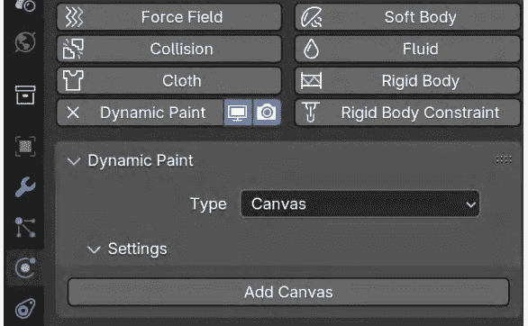

图 12.1 – 添加动态绘画

从这里，你可以通过从 **Type** 菜单中选择来添加 **Canvas** 或 **Brush** 对象。当你选择 **Add Canvas** 时，你可以直接使用 **Vertex** 格式在顶点上绘制，或使用 **Image Sequence** 格式将绘画导出为图像：

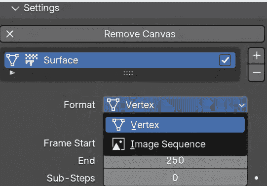

图 12.2 – 格式类型


两种 **Format** 类型各有优缺点，我们在进入设置时再讨论！

在决定使用哪种 **Format** 类型后，你就可以选择想要的 **Surface Type** 选项了！

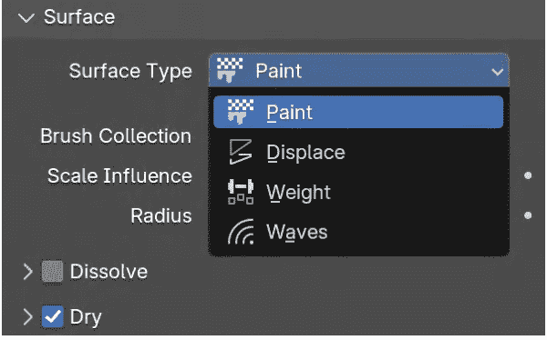

图 12.3 – Surface Type 设置

选择 **Vertex** 格式时，有四种 **Surface Type** 选项（**Weight** 在 **Image Sequence** 格式中不可用）：

-   **Paint** 类型正是你所期望的。它输出显示在画布上的颜色信息。这可用于创建画笔效果、酷炫有趣的材料以及各种各样的其他效果！

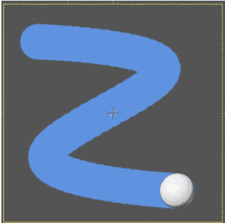

图 12.4 – Paint 类型使用示例

-   **Displace** 类型会根据 **Brush** 对象的大小对网格进行位移。这对于创建轮胎痕迹、脚印等非常有用！

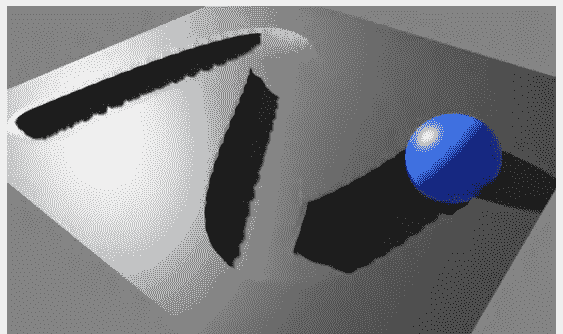

图 12.5 – Displace 类型使用示例

-   **Weight** 允许你创建动态权重绘制贴图。Blender 在几乎所有方面都使用权重绘制——模拟、粒子系统、修改器、材质等。例如，在 *第 15 章* 中，我们将使用 **Weight** 来控制火模拟在网格上的位置。使用这种 **Weight** 类型可以非常强大，并能让你创建一些非常有趣的模拟！

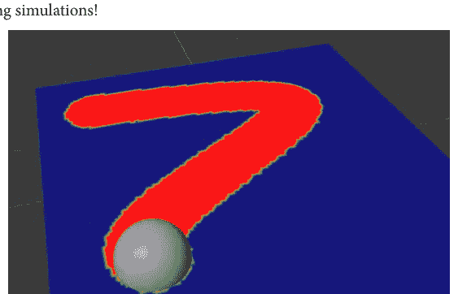

图 12.6 – Weight 类型使用示例

-   最后，**Waves** 允许你创建波浪，就像你的画笔在水中移动一样。这对于创建水面图像中的涟漪、雨滴或湖面上打水漂的效果非常有用。

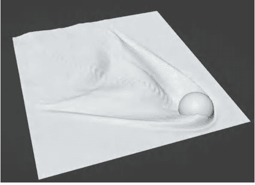

图 12.7 – Waves 类型使用示例

有很多更多的方式可以按你的喜好自定义画布，我们将在本章中讨论！在深入所有设置和数值之前，让我们先快速了解一下画笔对象！

要添加动态绘制画笔，请选择一个网格对象，然后前往物理面板并选择动态绘制。将 Type 改为 Brush 并点击 Add Brush：

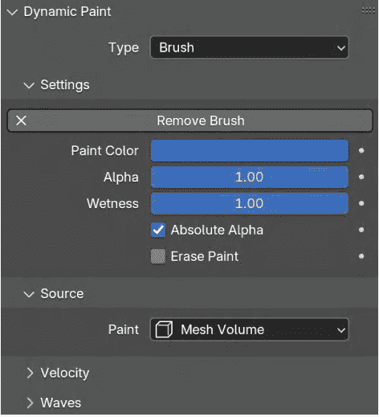

图 12.8 – 画笔设置

在设置中，你可以更改 **Paint Color**、会影响画布的画笔周围的 **Proximity**、位移的 **Depth** 以及波浪的强度 **Factor**。你甚至可以使用粒子系统作为 **Brush**！这对于创建雨滴和粒子绘制效果非常有用。

你是否开始看到动态绘制的强大功能及其在 Blender 中的全部潜力？有这么多方法可以利用这个物理系统来创建有趣且动态（双关语）的动画！

现在你已经了解了动态绘制的原理，让我们一起创建一个简单的绘制模拟吧！

## 创建绘制模拟

创建一个基本的动态绘制模拟设置起来有点棘手，所以让我们一起创建一个并回顾整个过程！为了更容易理解，我建议从这里下载 `Paint Startup.blend` 文件：https://github.com/PacktPublishing/Learn-Blender-4-Simulations-the-Right-Way/tree/main/Chapter%2012。

该文件包含一个球体沿曲线在平面上移动的基础动画：

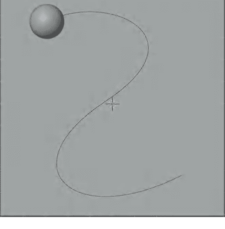

图 12.9 – Paint Startup.blend 示例

让我们开始为平面和球体对象添加动态绘制模拟：

1.  选择 **Plane** 对象并前往 **Physics** 面板。选择 **Dynamic Paint**，确保 **Type** 设置为 **Canvas**，然后点击 **Add Canvas**：

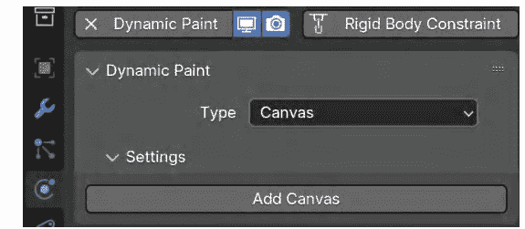

图 12.10 – 添加画布对象

2.  对 Sphere 对象做同样的操作，只是将 Type 设置为 Brush 并点击 Add Brush！

3.  即使场景中已有画笔和画布，播放动画时我们也看不到任何东西。这是因为我们需要先设置颜色信息的输出细节！使用 Vertex 格式时，这些值会输出到对象的 Color Attribute 字段。

选择 Canvas 对象并向下滚动到底部的 Output 选项卡：

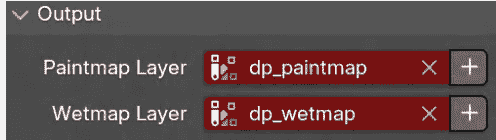

图 12.11 – Output 选项卡

4.  为 Paintmap Layer 和 Wetmap Layer 都点击 + 图标。Paintmap Layer 只是来自画笔的基础颜色信息，而 Wetmap Layer 为我们提供确定油漆是“湿”还是“干”的值。我们将在本章的 Surfaces 部分更详细地介绍这两个图层！

5.  完成这些设置后，我们现在将油漆和湿润信息输出到顶点颜色！你也可以在 Object Data Properties 面板的 Color Attributes 选项卡中看到这一点：

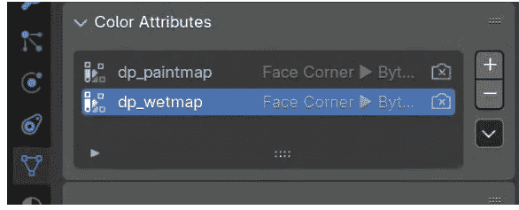

图 12.12 – Color Attributes 选项卡

使用 **Vertex** 格式时，我们直接影响网格每个顶点的颜色。这些颜色随后作为 **Color Attributes** 输出，如 *图 12.12* 所示。请记住，颜色仅影响顶点，而不影响边或面。如果顶点之间存在较大间隙，连接顶点之间会出现颜色渐变。

6.  如果你想看到这种油漆颜色影响画布，可以通过以下几种方式实现：

-   你可以打开材质节点设置，添加一个 **Color Attribute** 节点（见 *图 12.13*），并从下拉菜单中选择 **dp_paintmap**。如果你想预览湿贴图的样子，也可以在 **Color Attribute** 节点中选择 **dp_wetmap**。

现在渲染时油漆颜色将会出现。

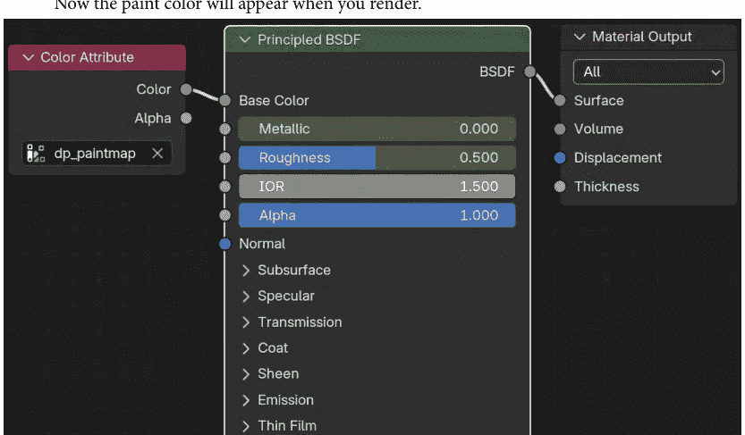

图 12.13 – Color Attribute 节点

-   另一种在视口中查看油漆的方法是切换到左上角的 **Vertex Paint** 模式。你可以通过从下拉菜单中选择来在 **dp_wetmap** 或 **dp_paintmap** 之间切换。

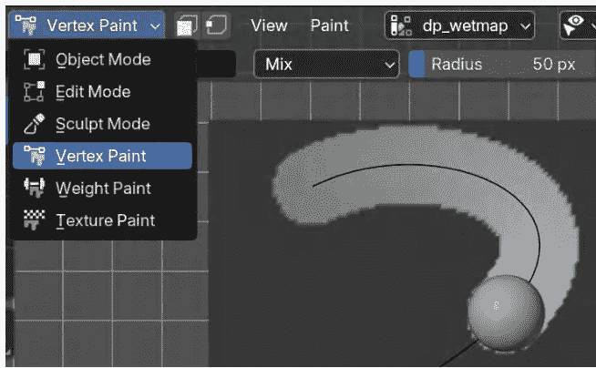

图 12.14 – 顶点模式

-   最后，如果你不想被困在 **Vertex Paint** 模式中，可以前往 **Viewport Shading** 菜单并选择 **Attribute** 模式：

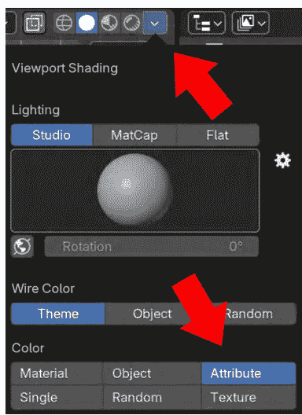

图 12.15 – Viewport Shading 菜单中的 Attribute 模式

现在，你应该能在 **Object** 模式下看到画笔在画布上绘制！

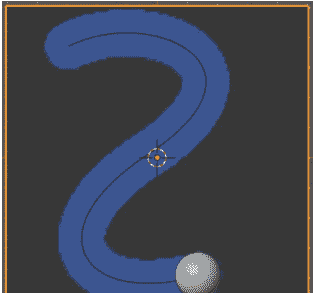

图 12.16 – 画笔对象在画布上绘制

如果你想看看湿贴图图层是什么样子，可以在 **Color Attribute** 选项卡中选择 **dp_wetmap**。请查看图 12.12 以找到该菜单。以下是湿贴图的预览：

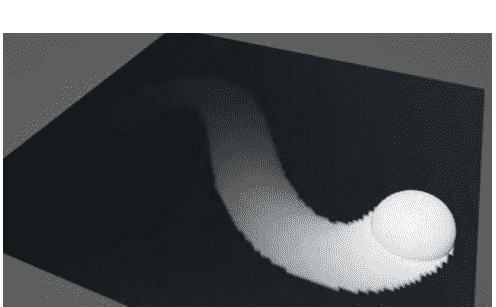

图 12.17 – 湿贴图预览

现在我们了解了如何设置动态绘制模拟，让我们回顾一下设置，从画布开始！

## 了解画布

我们已经介绍了如何创建动态绘制模拟，但现在让我们更深入一些，讨论 Canvas 对象的全部设置：

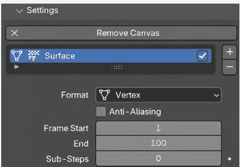

图 12.18 – 画布设置

### 设置

从最顶部开始，让我们介绍 Settings 选项卡：

-   **Remove Canvas**：这显然允许你从所选对象中移除画布。
-   **Surface layers**：在 **Remove Canvas** 下方，你有你的表面图层。在 *图 12.18* 中，图层的名称为 **Surface**；你可以通过双击重命名它。你可以通过点击侧面的 + 和 – 按钮添加或移除图层，也可以通过勾选复选框来切换可见性。

这些图层彼此独立工作，这意味着你可以拥有具有不同表面类型的多个图层，并且可以单独更改每个图层的设置。例如，在下图中，有三个表面图层。一个设置为 **Paint**，另一个设置为 **Displace**，最后一个设置为 **Waves**：

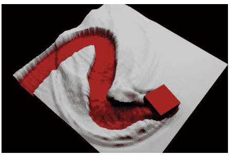

图 12.19 – 三种表面类型


同时使用多层可以创建非常有趣的动画！

-   **格式**：我们在本章前面简要提到了**格式**。可以选择两个选项，**顶点**和**图像序列**：
-   **顶点**：这允许你直接在画布的顶点上绘画。这很有用，因为你可以实时看到结果，这使得测试设置以找到想要的效果变得非常容易！使用此方法的缺点是它需要大量的几何体才能看起来好。在下面的图中，你可以看到低面数网格和高面数网格之间的差异：

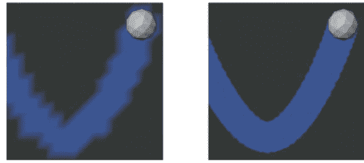

图 12.20 – 左侧为低面数网格，右侧为高面数网格

-   **图像序列**：这允许你将绘画信息导出为一组图像。你可以在**输出**选项卡中设置这些图像生成的目录。我们将在*缓存和输出*部分更详细地介绍导出。

生成图像后，将它们导入材质、纹理、置换或你想要的任何地方！此方法不需要任何几何体即可工作，这意味着你可以在画布上使用很少的几何体获得非常高质量的绘画贴图。

当选择**图像序列**格式时，会出现一个**分辨率**设置，这里可以设置导出图像的大小。请记住，分辨率越高，烘焙或导出所需的时间就越长：

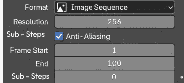

图 12.21 – 分辨率设置

此方法的缺点是使用起来慢得多，因为每次想要更改时都需要重新烘焙并导出所有图像。

-   **抗锯齿**：这会使绘画边缘变得平滑。此效果相当微妙，但如果绘画边缘过于尖锐，则会有帮助。下面的图是抗锯齿的夸大效果：
-   **帧开始**和**结束**：这些当然决定了模拟开始和结束的时间！
-   **子步长**：此选项每帧添加额外的步骤。有时，当你有快速移动的画笔时，油漆会跳过某些区域。提高**子步长**将有助于模拟更准确。

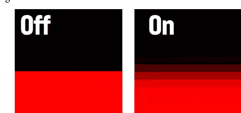

图 12.22 – 抗锯齿设置作用的示例

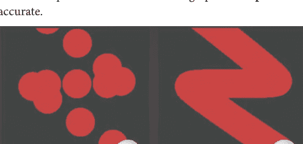

图 12.23 – 子步长选项作用的示例

现在我们已经介绍了**设置**选项卡中的值，让我们进入**表面**选项卡，了解有关不同的**表面类型**选项的所有信息！

## 表面

使用动态绘画模拟时，可以从四个**表面类型**选项中进行选择：**绘画**、**置换**、**权重**和**波浪**。每个都是独特的，可以做很多很酷的事情！

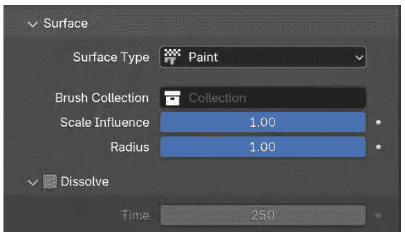

图 12.24 – 通用的表面设置

让我们先查看通用设置，然后再介绍每种类型：

-   **表面类型**：这当然允许你为画笔选择想要的动态绘画类型！
-   **画笔集合**：这允许你将画布上使用的画笔限制为特定集合。如果有多个动态绘画模拟并且不希望它们相互作用时，这会很有用。
-   **缩放影响**：这设置画笔对模拟的影响百分比。这可以使用置换表面类型轻松可视化：

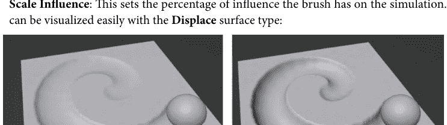

图 12.25 – 缩放影响选项作用的示例

-   **半径**：这控制影响画布的每个画笔周围区域的大小（请记住，此设置仅在画笔的源设置为邻近时才有效——我们将在讨论画笔时更详细地介绍）。

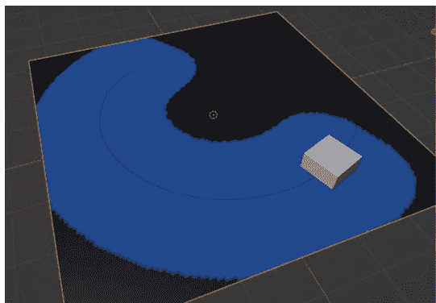

图 12.26 – 半径设置作用的示例

-   **溶解：** 这是**绘画**、**置换**和**权重**类型的另一个通用设置（使用**波浪**表面类型时不可用**溶解**。）启用后，它会随着时间的推移溶解画笔的效果。溶解速度由**时间**值设置。当设置为 100 时，大约需要 100 帧效果才会完全溶解。当选中**慢速**时，溶解的方式会更平滑、更慢：

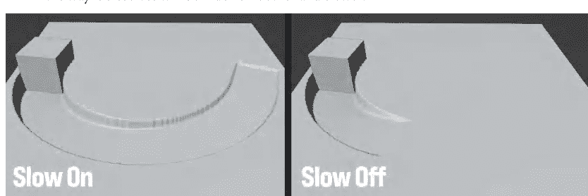

图 12.27 – 溶解设置作用的示例

如果你使用**绘画表面类型**的**溶解**选项，需要记住在**表面**选项卡中取消选中**干燥**，否则它将无法工作。不建议使用此方法溶解油漆，因为它似乎有点不稳定并且不能按预期工作。很多时候，溶解时会得到硬边缘而不是平滑过渡。更好的选择是使用湿贴图来溶解油漆。这样你会有更多控制，并且会更平滑。

现在我们已经介绍了**表面**的通用设置，让我们逐一介绍每种类型的单独设置，从**绘画**开始！

## 绘画

**绘画**是输出颜色信息和湿润度值的基本表面类型。油漆的颜色基于画笔设定的颜色。这可以在**画笔**设置中更改：

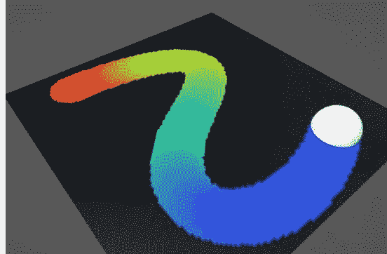

图 12.28 – 画笔颜色

湿润度值是黑白的，它们定义油漆的“湿”或“干”程度：

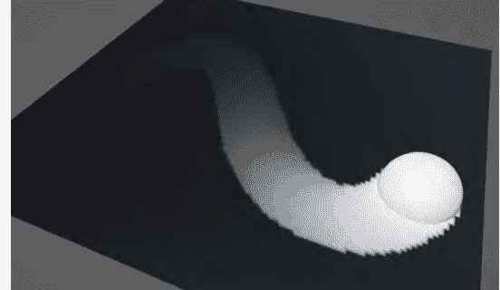

图 12.29 – 湿贴图层的示例

湿贴图可以作为材质的遮罩非常有用，并定义哪些部分应该是光泽或湿润的。如果想创建油漆干燥的动画，可以使用动态绘画来实现。

干燥发生的快慢可以在干燥选项卡中更改：

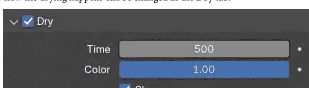

图 12.30 – 干燥设置

## 干燥选项卡

让我们查看干燥选项卡上的选项：

-   **时间**：控制干燥以帧为单位的速度。
-   **颜色**：定义油漆的湿润度开始转变为背景的时间。更简单地理解就是它有助于在干燥时混合扩散的油漆：

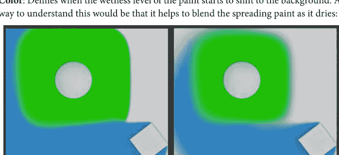

图 12.31 – 干燥颜色设置工作原理的示例

-   **慢速**：这允许油漆更缓慢、更平滑地干燥。

接下来，让我们探索效果选项卡。

## 效果选项卡

在图 12.31 中，你可能注意到油漆是从画笔扩散出来的。这是你可以添加到画布上的三个效果功能之一：

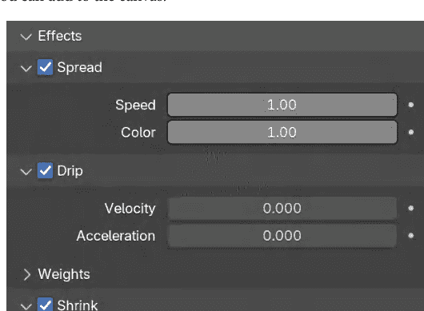

图 12.32 – 效果设置

-   **扩散**：这允许油漆在动画播放时从画笔扩散：
  -   **速度**：这设置油漆扩散的速度。
  -   **颜色**：这有助于在两种油漆颜色相互扩散时进行混合。你可以在下面的图中看到不同的值：

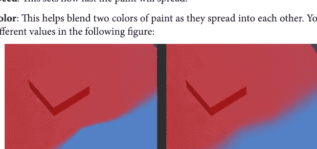

图 12.33 – 颜色扩散作用的示例

-   **滴落**：这允许油漆对重力做出反应。例如，在下面的图中，垂直画布上有一些画笔，正如你所见，重力影响着油漆使其滴落：

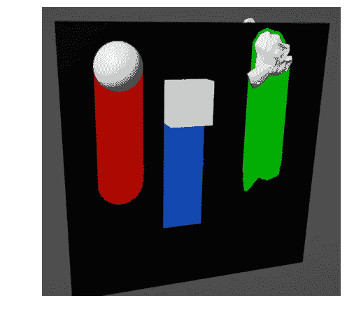

图 12.34 – 滴落设置作用的示例

-   **速度**：这会获取画布的速度并相应地影响油漆。你设置得越高，画布的移动对油漆的影响就越大。例如，当画布快速向右移动时，油漆的来源也会移动。然后，它将在新位置开始滴落。这在下面的图中可视化：

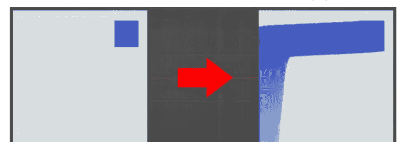

图 12.35 – 速度选项作用的示例


-   **加速度**：这与**速度**的工作方式类似；不同之处在于油漆仍会响应画布的移动，但油漆的来源不会移动。一旦画布停止移动，油漆将在其开始的位置滴落：

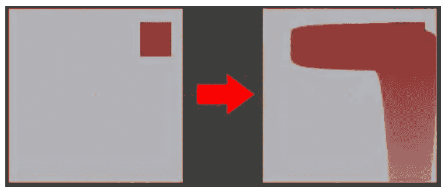

图 12.36 – 加速度选项的示例

**滴落**效果也会对力场做出反应！如果你想为油漆添加一些风的运动，可以做到！你可以在**权重**标签中控制力场的影响强度和范围。

-   **收缩**：此效果仅更改湿贴图层。不是正常干燥，湿贴图层会在两端收缩：

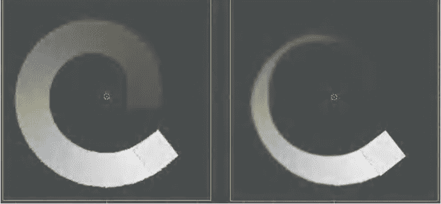

图 12.37 – 收缩选项的示例

你也可以使用**速度**值控制收缩量以及收缩速度。

现在，让我们来看一下**初始颜色**！

## 初始颜色

在**效果**标签下方，我们可以选择画布的**初始颜色**设置。这将使画布具有起始颜色，而不是自动为黑色。

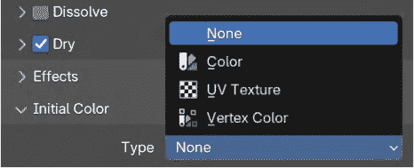

图 12.38 – 初始颜色设置

如果选择**颜色**，你就可以为画布背景选择特定颜色。你也可以选择**UV 纹理**或**顶点颜色**：

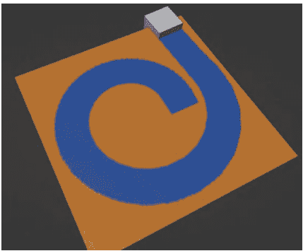

图 12.39 – 初始颜色选项的示例

最后，使用**顶点**格式时，请记得始终在**输出**标签上输出油漆颜色信息。

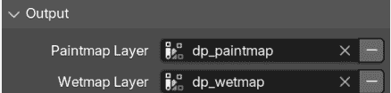

图 12.40 – 输出标签

这就是**油漆**表面类型的全部设置！接下来，让我们谈谈**置换**类型！

## 置换

**置换**类型允许你根据**画笔**对象的大小和比例使网格凹陷！这对于创建脚印、轮胎痕迹、物体落在泥土或雪上等非常有用：

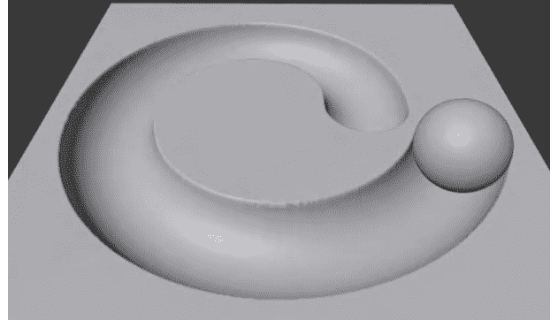

图 12.41 – 置换表面类型

对于**置换**表面类型，我们只需要介绍三个设置：

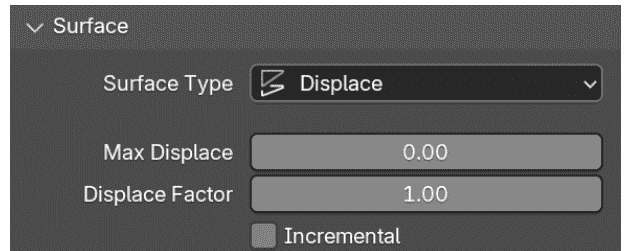

图 12.42 – 置换设置

-   **最大置换**：设置画笔在画布上可产生的最大置换量。此设置以米为单位，因此如果值设为 1，则画笔只能在画布上置换 1 米。值为 0 表示置换可以无限。
-   **置换因子**：乘以置换深度。例如，如果置换深度为 1 米，并且你将**置换因子**设为 3，则深度现在为 3 米。此值也可以设为负数，这样置换会向上而不是向下：

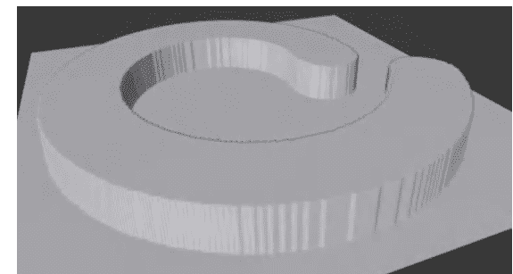

图 12.43 – 负置换因子设置的示例

-   **增量**：允许在现有置换之上添加新的置换。这对于创建挖掘动画可能很有用。

这就是**置换**表面类型的全部设置！接下来，让我们来看**权重**！

## 权重

**权重**表面类型允许你在画布上绘制顶点组。这非常有用，因为 Blender 中的几乎所有内容都可受顶点组影响。例如，使用**权重**类型，你可以轻松绘制火焰轨迹。另一个例子是绘制毛发粒子。在下图中，使用**权重**表面类型在平面上绘制了一个立方体。然后该**权重**表面类型控制粒子系统的密度和大小：

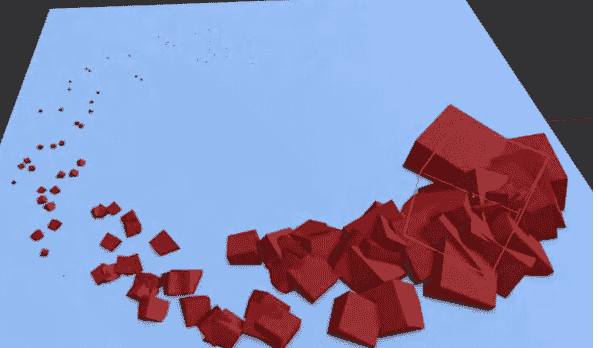

图 12.44 – 权重表面类型的示例

Blender 的大多数修改器也可以受顶点组影响！你可以创建的东西几乎无限！

在本书中，我们讨论了顶点组及其在某些模拟中的使用方式。如果你想复习其工作原理，请查看第 6 章中的软体目标部分。

当你首次选择权重类型时，还需要记得输出到顶点组。将画布设置滚动到底部，然后单击顶点组旁边的 +：

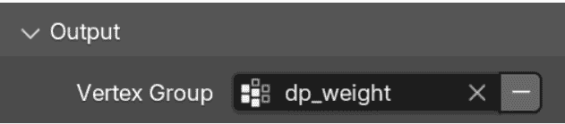

图 12.45 – 输出设置下的顶点组选项

另外，如果你想查看模拟效果，请确保切换到权重绘制模式：

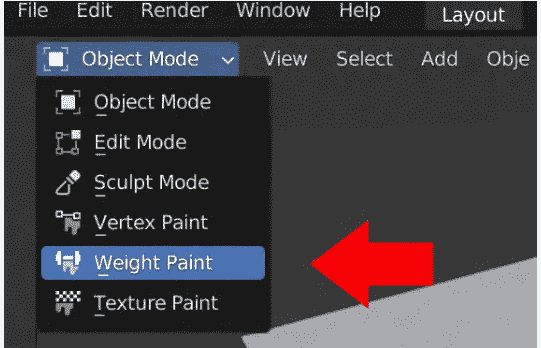

图 12.46 – 权重绘制模式

使用权重表面类型时，我们需要讨论两个设置：

-   **缩放影响**：在画布设置中调整此项会影响绘制的权重。值为 0.5 将绘制 50% 的权重。
-   **溶解**：另一个很酷的技巧是启用**溶解**。这样权重会在动画播放时消失！你可以在下图中看到示例：

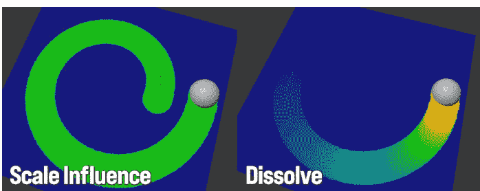

图 12.47 – 缩放影响和溶解

**权重**表面类型非常强大，可以以多种方式使用！一定要试试并尝试不同的修改器和模拟！

## 波浪

最后要讨论的**表面类型**是**波浪**，这是使用动态绘制最酷的方式之一！它基本上允许你将画布变成水，并让画笔在移动时产生波浪和涟漪：

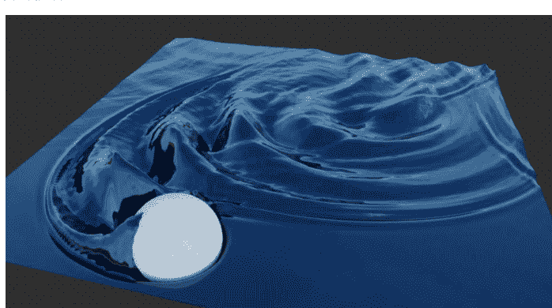

图 12.48 – 波浪类型的示例

在画布设置中，有很多方法可以自定义这些波浪的行为。让我们逐一介绍：

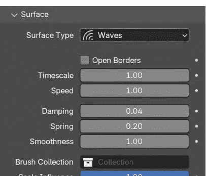

图 12.49 – 波浪设置

-   **开放边界**：这允许波浪穿过画布边缘而不是从边缘反射。通常，未勾选时，波浪会撞到画布边缘并反弹。
-   这里有两个速度设置：**时间比例**和**速度**。这两个设置的区别在于，**时间比例**会加快模拟速度而不影响整体结果。**速度**会加快波浪的移动，从而改变模拟结果。
-   因此，如果你想在不影响外观的情况下减慢或加快模拟，请使用**时间比例**设置。
-   **阻尼**：控制波浪消失的速度。设置为 0 时，波浪会持续移动且永远不会停止弹跳，而设置为较高值（最大为 1）时，波浪会失去强度并最终消失。

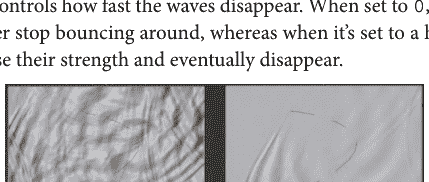

图 12.50 – 阻尼选项的示例

-   **弹簧**值从 0 到 1，它决定波浪被拉回平坦地面的强度/力。较高的值往往使波浪更具弹性和弹性：


图 12.51 – 弹簧设置的示例

-   **平滑度**：使波浪平滑并消除任何凸起或尖锐区域。取值范围为 0 到 10：


图 12.52 – 平滑度设置的示例

现在我们已经介绍了每种表面类型及其相关设置，接下来让我们查看**缓存**标签并讨论烘焙和导出！

## 缓存和输出

**缓存**和**输出**标签分别是烘焙模拟并生成**顶点组**和**绘制贴图层**（网格数据层）以及导出**图像序列**的地方。选择**顶点**格式时，你将看到熟悉的设置列表：


图 12.53 – 缓存选项卡

如果你尚未保存 blend 文件，所有这些设置都会变灰。请确保保存你的项目——只有这样你才能烘焙模拟！

当你烘焙模拟时，缓存会被锁定，如果你想进行更改，就需要释放烘焙。通常建议在渲染之前先烘焙模拟。这样可以确保不会出现问题，并且渲染过程顺利进行。

由于我们在这本书中已经多次讲解过这些设置，让我们跳到输出选项卡。如果你想复习一下，请查看第 6 章中的理解软体设置和数值部分。

当你将格式更改为图像序列时，缓存选项卡将被输出选项卡替换：


图 12.54 – 输出选项卡

- **烘焙图像序列**：点击后，Blender 会导出模拟中的所有图像并将其放置在 **缓存路径** 字段设置的目录中。你可以通过点击 **缓存路径文件夹** 图标来选择图像导出的文件夹。
- **UV 贴图**：对于大多数基础画布对象，如平面、球体或立方体，通常已经存在可供选择的 UV 贴图。选择 **UV 贴图** 会告诉 Blender 如何正确导出图像以便映射到画布上。然而，如果你建模或更改了画布，可能需要对对象进行 UV 展开。UV 展开是我们本章没有时间涵盖的主题。如果你想了解更多关于这个主题的信息，这里有一个很好的资源：https://youtu.be/7JUN1j6mROU?si=-pZsq8Nw1nd5RChY
- **文件格式**：导出图像时有两种文件格式：**PNG** 和 **OpenEXR**。**OpenEXR** 是比 **PNG** 更好、更高质量的图像文件，但文件大小要大得多。通常，**PNG** 对于大多数模拟来说已经完全足够。
- **预乘 Alpha**：这允许你导出透明图像，这样只有油漆会显示出来，而画布不会。在底部，你可以决定导出 **油漆贴图**、**湿贴图** 或两者。

好了！我们现在已经讲完了动态绘画模拟中关于 **画布** 对象的全部内容。本章最后要学习的是 **画笔** 对象及其所有设置。

## 使用画笔

现在我们已经讲解了画布，让我们讨论画笔以及在模拟中自定义其行为的所有方法！

### 设置

让我们先来看 **设置** 选项卡：


图 12.55 – 画笔设置

- **油漆颜色**：这显然允许你更改在画布上绘制的颜色。此颜色也可以被动画化以创建酷炫效果，就像你在图 12.28 中看到的那样。
- **Alpha**：此值范围为 0 到 1，控制油漆的透明度。值越低，油漆越透明：


图 12.56 - Alpha 选项作用的示例

在使用画布设置中的 **权重** 表面类型时，此值现在控制画笔绘制的权重的强度。

- **湿润度**：这设置画笔的湿润程度。你可以在下图中看到这些值：


图 12.57 – 湿润度设置作用的示例

- **绝对 Alpha**：这与透明画笔有关。如果未勾选，画笔将不断在每一帧中添加油漆，从而增加 alpha 值。如果勾选，则画笔的 alpha 值在整个模拟过程中保持不变。通常最好保持此设置被勾选。
- **擦除油漆**：如果勾选，你的画笔现在将变成橡皮擦，删除油漆而不是添加油漆。

接下来，让我们来看 **源**！

### 源

**源** 菜单是你设置画笔如何在画布上绘制的地方：


图 12.58 – 源菜单

让我们分别讨论五种 **绘制** 方法，从 **网格体积** 开始：

- **网格体积：** 选择 **网格体积** 时，画笔对象的大小决定了油漆的位置。只有与画笔几何体相交的画布部分才会被绘制：


图 12.59 – 网格体积选项

- **邻近：** 这允许你在画笔周围的邻近区域绘制。请记住，如果网格内部距离网格表面太远，可能不会被绘制，就像你在下图中看到的那样：


图 12.60 – 邻近设置

让我们逐步了解邻近画笔的设置：

- **距离：** 你可以通过更改距离值来控制邻近区域。
- **衰减：** 这控制其平滑程度。在下图中，左侧为平滑，右侧为恒定：


图 12.61 – 衰减选项作用的示例

- **投影**：这允许你将画笔投影到画布上。在以下示例中，有一个悬浮的立方体设置为 **投影** 绘制类型。你可以看到它基本上像投影仪一样向下投射到画布上。


图 12.62 – 投影选项作用的示例

- **网格体积 + 邻近**：使用此方法，你还可以将我们刚刚讨论的两个源结合起来。在此示例中，**邻近** 有平滑的衰减，但 **网格体积** 内部的内容现在不再是实心的。


图 12.63 – 网格体积 + 邻近示例

- **对象中心：** 这忽略网格，取原点的位置，并在其周围绘制一个区域：


图 12.64 – 使用对象中心设置

- **粒子系统：** 这允许你选择一个粒子系统作为画笔：


图 12.65 – 粒子系统画笔的示例

当你选择一个粒子系统作为画笔时，有几个设置可以更改：


图 12.66 – 粒子系统设置

- **影响实体半径**：这设置每个粒子会影响画布的半径。
- **使用粒子的半径**：这允许粒子的大小决定半径。这也可以在 **粒子系统** 设置中控制。
- **平滑半径**：这控制绘制时每个粒子周围的平滑度。值越低，油漆边缘越锐利；值越高，平滑效果越好。

在模拟中使用粒子系统作为画笔对于创建有趣的粒子绘画效果非常有用。粒子不仅适用于 **绘制表面类型**，还适用于 **波浪**、**置换** 和 **权重**。在下图中，我们设置了一个粒子系统作为雨滴！


图 12.67 – 粒子雨效果

现在我们已经了解了画笔的 **源** 设置，让我们谈谈 **速度** 选项卡！

### 速度

**速度** 选项卡允许你根据速度影响画笔的行为！让我们逐步了解设置：


图 12.68 – 速度选项卡

- **乘以 Alpha**：勾选后，画笔的透明度会根据其在画布上移动的速度而变化。速度越快，alpha 越高；速度越低，alpha 越低。如果你想反转它，使更快移动时 alpha 降低，可以通过翻转 **渐变** 中的值来实现。
- **替换颜色**：这做的是完全相同的事情，但针对的是油漆颜色。此颜色可以在 **渐变** 设置中控制。
- **乘以深度**：这允许你根据画笔的速度更改置换的深度。
- **最大速度**：这让你控制画笔需要多快移动才能影响画布。在下图中，画布上的颜色和置换会根据立方体移动的速度而变化。立方体开始时移动缓慢，然后逐渐加速。这就是为什么你会看到置换增加和颜色变化。


Figure 12.69 – Multiply Depth 和 Replace Color 设置的实际效果

- **Smudge:** 这会使画笔模糊画布上已有的颜料。可以用它来营造凌乱的绘画效果！在下图中，画笔完全透明，**Smudge Strength** 设置为 0.4：


Figure 12.70 – Smudge 选项的实际效果示例

完成之后，让我们来看一下画笔设置的最后一个标签页！

## Waves

我们需要讨论的画笔最后几个设置位于 Waves 标签页。这里可以设置画笔在模拟中对波浪的影响。让我们深入了解一下：


Figure 12.71 – 画笔的 Waves 设置

- **Type**: 从此菜单中，您可以选择画笔对波浪产生什么效果：
  - **None**: 这不会产生任何波浪——相反，它会反射并弹回撞击物体的波浪。
  - **Obstacle**: 这会持续影响画布表面，即使不动也会产生和反射波浪。这在理论上听起来不错，但在测试此类型时，您可能会发现它会在画布上留下奇怪的位移并导致奇怪的问题。
  - **Force**: 这会直接影响波浪的速度和运动。例如，如果波浪穿过 Force 画笔应用的位置，波浪会消散。


Figure 12.72 – Force 设置的实际效果示例

- **Depth Change**: 这是默认类型；只有在画笔移动时才会在线上创建波浪。如果画笔静止，则不会产生波浪。这种类型通常能产生最佳、最干净的结果。
- **Factor**: 这控制画笔对波浪的强度。较高的值往往会产生更大、更高的波浪。负值会反转波浪图案，使其看起来像是波浪是从画布下方而不是上方产生的：
- **Clamp Waves**: 此设置允许您限制波浪的高度或深度。如果波浪太高，请尝试将其设置为较低的值，例如 0.2 左右。设置为 0 时，不会进行限制。


Figure 12.73 – Factor 设置的示例

这就是动态绘画模拟中画笔的所有设置！这个模拟非常强大，可以让您创建许多很棒的动画！其中最有趣的事情之一就是结合不同的模拟。通过使用 **Weight** 表面类型，您可以绘制火焰轨迹！


Figure 12.74 – 火焰轨迹

另一个用途是创建流体模拟在墙上飞溅。然后，使用流体作为画笔，您可以轻松创建油漆飞溅效果！您还可以组合多个动态绘画模拟。使用 Displace 和 Paint 表面类型，您可以创建木雕动画！可能性无穷无尽！

## Summary

Blender 中的 Dynamic Paint 模拟是一个令人难以置信的尝试工具。它可用于创建许多独特且有趣的动画。我们在本章中学习了大量信息，可能有点难以消化，所以让我们回顾一下！

首先，我们了解了动态绘画是什么以及它在 Blender 中有哪些用途。之后，我们一起创建了一个基本的绘画模拟。然后，我们深入设置并讨论了有关画布的所有知识。我们回顾了所有 Surface Type 选项及其各自的实际用途。最后，我们研究了画笔，了解了它们的工作原理以及每个设置的作用。

阅读动态绘画模拟的所有设置和用途非常好，但要真正掌握这些信息，最好的办法就是自己动手创建。我鼓励您打开 Blender 并尝试这个强大的工具。

在接下来的几章中，我们将把学到的知识应用到实际项目中，使用动态绘画创建一些很棒、令人满意的动画。

## Join our community on Discord

加入我们社区的 Discord 空间，与作者和其他读者讨论：

```
https://packt.link/learn-blender-simulations-discord-invite
```


