## 13

## Creating a Paintbrush Effect

到目前为止，您应该对动态绘画及其在 Blender 中的工作原理有了良好的理解。现在，让我们通过使用此模拟创建画笔效果来检验这些技能！我们将学习如何沿曲线动画化画笔，为刷毛创建毛发粒子，并让粒子在平面对象上绘画。从那里，我们将把颜色信息导入材质，以便轻松自定义。之后，我们将设置相机并渲染动画。本章的目标是让您在实践中了解如何使用动态绘画，同时创造出很酷的东西！

In this chapter, we'll be covering the following topics:

- Animating the brush
- Creating hair particles
- Simulating dynamic paint
- Adding the materials
- Rendering the animation

### Technical requirements

本章要求您安装 Blender 4.2 或更高版本。

To download Blender, visit www.blender.org.

我们还将使用一个画笔模型，您可以在此处下载：https://github.com/PacktPublishing/Learn-Blender-4-Simulations-the-Right-Way/tree/main/Chapter%2013

### Animating the brush

开始本教程时，请确保下载 Paint Brush Startup.blend 文件。您可以在技术要求部分找到此链接的链接。该文件包含一个基本的画笔模型、一个平面和用于照明的 HDR。

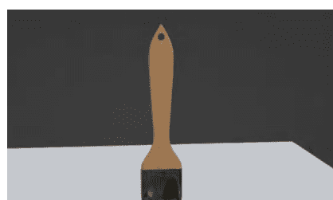

Figure 13.1 – Paintbrush model

The first step is to add a curve object. This is going to be the path for the brush to follow while it paints on the canvas!

让我们开始吧：

- 1. Press Shift + A, go to **Curve**, and select **Bezier Curve**.
- 2. Go to the **Edit** mode with the curve selected. From here, you will be able to select the points on either end of the curve and rotate, scale, and move them however you like. You can also press E to extrude, and this will add more points to the curve. Customize this path however you like, but make sure that the curve stays flat or it might cause issues with the simulation.

为确保曲线平坦，在 **Edit** 模式下，按 A 选择所有内容。然后按 S 缩放，按 Z 将缩放操作锁定到 Z 轴，输入 0，然后按 Enter。

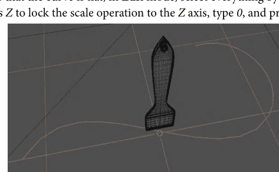

Figure 13.2 – Curve shape

- 3. Right now, our curve looks a bit low poly. To smooth it out, let's change the **Resolution Preview U** value in the curve **Object Data** panel to a value of 32. This will increase the number of points on the curve and, in turn, make the curve appear more smooth.

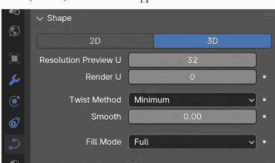

Figure 13.3 – Curve resolution

- 4. Now we can animate the brush following the curve! Select your **Brush** object and head over to the **Constraints** panel.
- 5. Click **Add Constraint** and select **Follow Path**. **Target** is going to be the **BezierCurve** we just added. Also, make sure to enable both the **Fixed Position** and the **Follow Curve** checkboxes. **Fixed Position** allows us to control where the brush is located along the curve using **Offset Factor**, and **Follow Curve** lets the brush rotate and follow the banking of the curve.

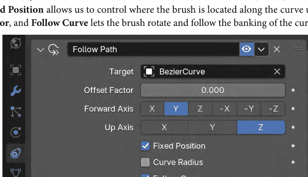

Figure 13.4 – Follow Path constraint

The **Brush** object should have moved to the beginning of the curve. Now the next step is to animate the brush moving down and then following the curve.

- 6. In real life, you don’t paint with a brush completely vertically. You usually hold the brush at around a 35–45-degree angle as you do the paint strokes. We’re going to replicate that with our **Brush** object. With the direction in which the brush will follow the curve, we need to rotate the **Brush** object in the negative direction. Press R, then X, and then X again to lock the rotation to the local X axis. Type -35 and press Enter.
- 7. On **Frame 1**, let’s add a **Location & Rotation** keyframe to the brush. You can do this by pressing K and selecting **Location & Rotation**.
- 8. Jump to **Frame 20**, move the brush back down about 0.1 meters above the plane, and add another **Location & Rotation** keyframe. View the following figure to see the steps side by side.

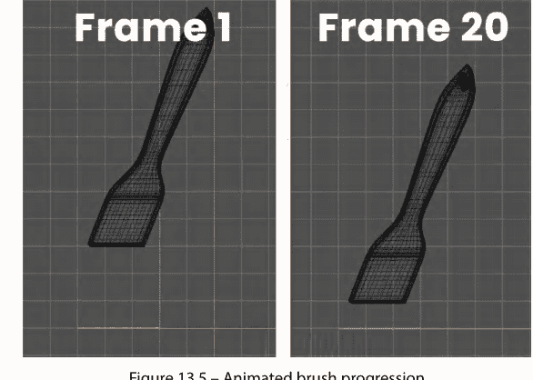

Figure 13.5 – Animated brush progression

- 9. In the **Follow Path** constraint, add a keyframe to **Offset Factor** with a value of 0 on **Frame 20**. You can do this by clicking on the small dot next to **Offset Factor**. View Figure 13.4. **Offset Factor** controls where the brush is on the curve. With a value of 0, the brush will be positioned at the start and as we increase **Offset Factor**, it will move the brush along the curve.
- 10. Then, skip all the way to **Frame 230**, set **Offset Factor** to 1, and add another keyframe.

If you have a longer curve, we recommend extending **End Frame** in **Timeline** and adjusting **Offset Factor** accordingly as it will cause issues if the brush moves too quickly along the curve. If the brush moves around 2 to 3 meters every 100 frames, you should get a nice smooth paint line!

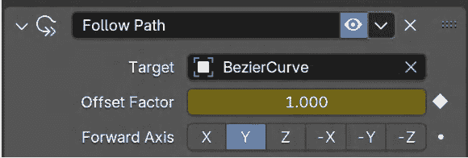

图 13.6 – 偏移因子 1

现在，重新启动并播放动画时，画刷会移动到位置并开始跟随曲线！这就是第 120 帧时应该的样子：

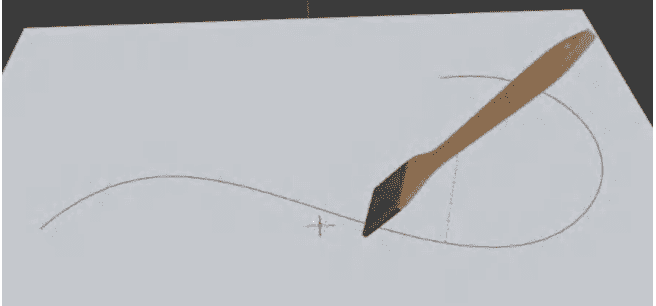

图 13.7 – 画刷跟随曲线

太棒了！我们现在让画刷一直绕着曲线跟随！再次提醒，你可以随意自定义曲线形状和关键帧的位置。但也要确保不要让画刷移动得太快，因为这会导致动态绘画出现问题，我们将在《模拟动态绘画》部分讨论这个问题。一旦你满意，我们就可以继续创建毛发粒子，我们将用它在平面对象上绘画。

## 创建毛发粒子

创建画笔上的鬃毛可能看起来复杂且难以实现，但当我们使用毛发粒子系统时，我们可以轻松添加数千根鬃毛来营造那种效果。我们还可以为毛发添加物理效果，使其在与平面碰撞时弯曲和变形，从而呈现出真正的画笔效果。让我们直接开始：

- 1. 首先，选择位于画笔底部的 **粒子对象**。这是我们用来发射毛发粒子的对象。

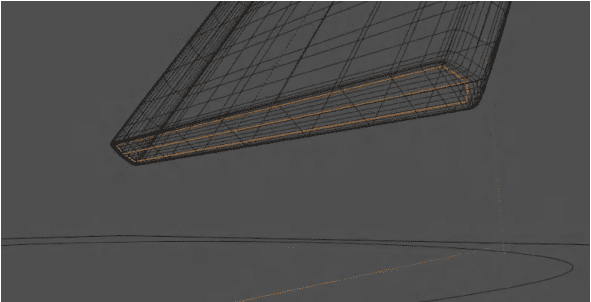

图 13.8 – 粒子对象

- 2. 前往 **粒子系统** 面板，通过点击 + 按钮创建一个新的系统，然后将类型切换为 **毛发**。

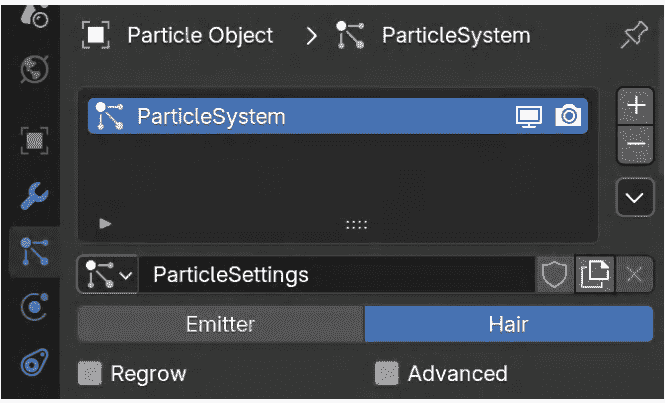

图 13.9 – 毛发粒子系统

- 3. 让我们调整几个设置以获得更好的效果。首先，将毛发粒子数量设置为 2000。这将使粒子数量翻倍。然后，为了使毛发更短，将 **毛发长度** 设置为 0.2。

- 4. 现在到了有趣的部分！在 **粒子系统** 面板中勾选 **毛发动力学**。这将使粒子对重力做出反应，从而弯曲和变形。

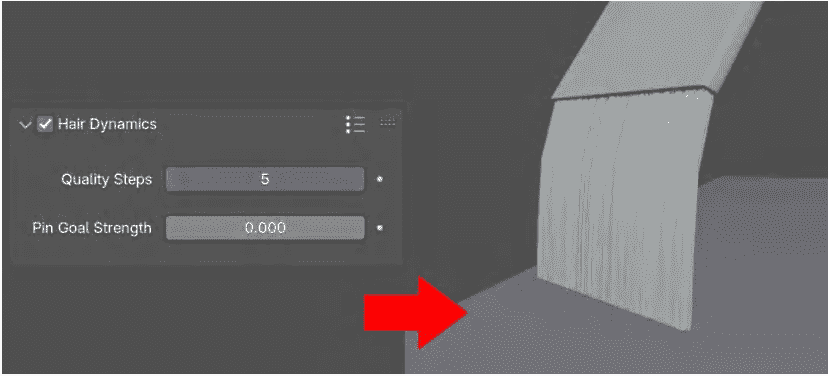

图 13.10 – 毛发动力学

- 5. 为了让毛发与平面发生碰撞，我们需要为平面对象添加一个 **碰撞** 修改器。选择平面对象，前往 **物理** 面板，选择 **碰撞**。另外，请确保将 **外部厚度** 设置为 0.001，以免毛发与平面之间出现较大的间隙。

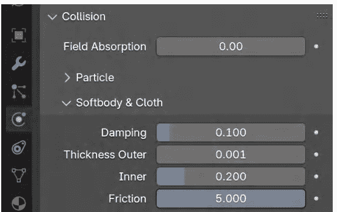

图 13.11 – 碰撞修改器

- 6. 接下来，让我们在 **毛发动力学** 中更改几个设置以获得漂亮的画笔效果：
  - I. 将 **质量步数** 改为 10。这将使整体效果更好。
  - II. 在 **碰撞** 选项卡中，将 **质量** 设置为 4，**距离** 设置为 0.001。
  - III. 毛发也太脆弱了，所以在 结构 选项卡中，将 刚度 增加到 5，随机 增加到 0.5 以获得一些随机变化。

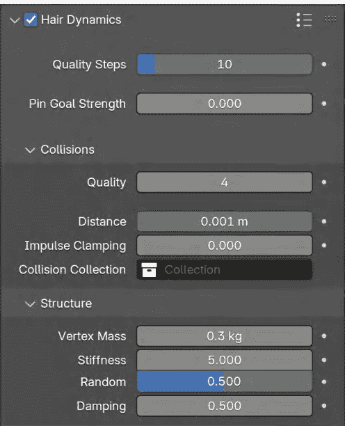

图 13.12 – 毛发动力学设置

- 7. 在烘焙毛发动力学之前，让我们向下滚动到 视口显示 选项卡并将 丝段步数 设置为 6。

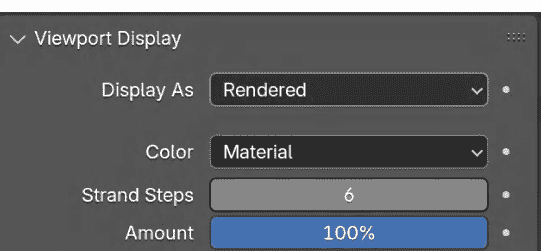

图 13.13 – 视口显示

这将为毛发添加更多点，使其更平滑，并带来更好的外观。你可以在下面的图中看到差异：

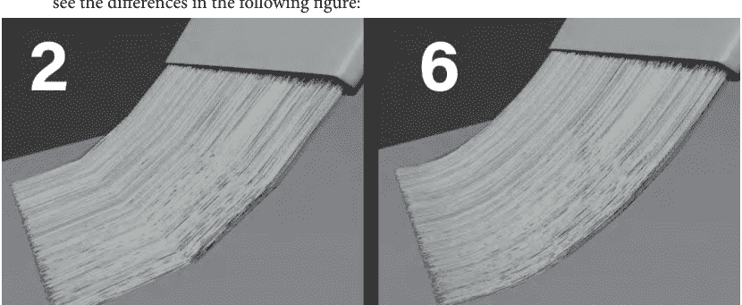

图 13.14 – 丝段步数示例

- 8. 我们现在准备烘焙这个粒子系统了！返回到 缓存 选项卡，确保 结束帧 正确以符合你想要的动画时长，然后点击 烘焙。

动态绘画的一个限制是不能使用毛发粒子在画布上绘画。只有网格对象才有效。因此，为了使我们的模拟正常工作，我们需要在每个毛发粒子上附加一个网格对象。而这就是我们在下一节中要讨论的内容！

## 模拟动态绘画

如前所述，由于毛发粒子技术上不是网格，我们不能在动态绘画模拟中使用它们作为画刷。你可能还记得上一章中，画刷有一个选项可以使用粒子系统作为源。

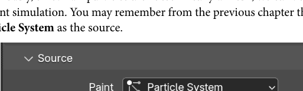

图 13.15 – 粒子系统源

然而，这不起作用。这种方法仅适用于 发射器 粒子系统，而不适用于毛发粒子系统。为了绕过这个问题，我们需要有点创意。我们要做的是添加一个立方体对象并将该立方体实例化到每一个毛发粒子上。那个立方体将在动态绘画模拟中作为 画刷。

## 什么是实例？

实例化一个对象涉及在不复制底层数据的情况下复制其几何体。这种优化有助于渲染引擎（如 Cycles）高效地在场景中的多个位置管理相同的几何体。相比之下，如果复制对象而不是实例化它，会增加场景的数据和内存使用。要了解有关实例化的更多信息，请参阅此资源： https://youtu.be/FGcJ255ZMdY?si=H_Lm-1BcL3Hxk cLwA.

话虽如此，让我们继续为毛发粒子实例化一个立方体吧！

## 实例化立方体

在添加立方体之前，请确保光标位于网格中心。这很重要，因为如果你在中心以外的位置添加立方体，实例化时它将无法与毛发对齐。你可以通过按 Shift + C 将光标重新吸附到中心。然后，按照以下步骤操作：

- 1. 现在我们可以添加立方体了！按 Shift + A，进入 网格，选择 立方体。按 N 打开属性面板，让我们更改此立方体的尺寸以适应毛发粒子。将 X 和 Z 设置为 0.005，Y 设置为 0.2 以匹配毛发的长度。
- 2. 下一步是为立方体添加更多几何体，使其随毛发弯曲。让我们进入编辑模式并按 Ctrl/Cmd + R 添加环切。将鼠标定位使环切水平进行，输入 50，然后按 Enter。这将在立方体长度方向添加 50 个环切。

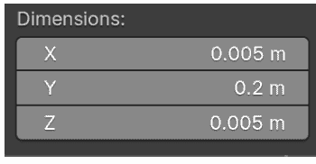

图 13.16 – 立方体尺寸

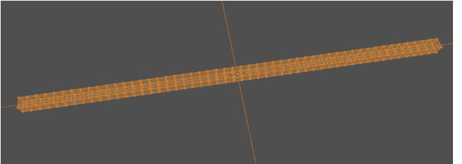

图 13.17 – 添加环切

- 3. 另一个重要步骤是对立方体应用缩放。如果不这样做，立方体将无法与毛发粒子对齐，模拟也无法工作。因此，按 Ctrl/Cmd + A 并选择 缩放。现在缩放数值应恢复为 1，并且可以正常工作！
- 4. 现在让我们在每个毛发粒子上实例化这个立方体！选择立方体，前往修改器面板，选择 添加修改器 | 物理，然后选择 粒子实例。
- 5. 对于 对象，选择 粒子对象，它也应自动选择粒子系统。之后，勾选 沿路径创建，现在立方体应已实例化到每个毛发粒子上。

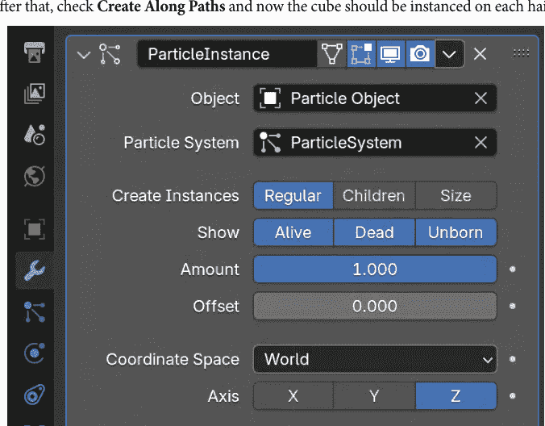

图 13.18 – ParticleInstance 修改器

## 故障排除

如果立方体未正确实例化，你可以尝试两件事。首先，确保你已对立方体和 粒子对象 应用了缩放。你可以通过选择对象，按 Ctrl + A 或 Cmd + A，然后选择 缩放 来完成。其次，再次检查立方体是否位于网格的正中心。如果立方体已移动，这将导致实例化出现问题。你可以通过按 Alt + G 或 Option + G 轻松将其移回中心。

这就是实例化后的立方体应该的样子！

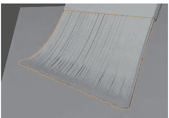

图 13.19 – 实例化立方体

完成之后，我们现在可以继续创建动态绘画模拟了。

## 创建模拟

在所有对象就位后，我们准备开始创建动态绘画模拟了！让我们先添加 画刷，然后再继续 画布：

- 1. 选择已实例化到毛发粒子上的立方体并前往 物理 面板。选择 动态绘画，将 类型 设置为 画刷，然后点击 添加画刷。不要担心 涂料颜色；我们稍后会在材质中更改它。

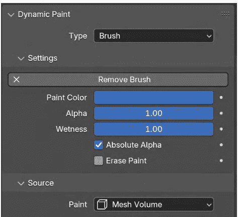

图 13.20 – 画刷设置

我们可以让其余设置保持默认；不需要更改其他任何内容。

2. 接下来，选择平面对象。在物理面板中，选择动态绘画，将类型保持为画布，然后点击添加画布。

3. 对于此模拟，我们将使用图像序列作为格式，分辨率方面，我们使用 2048。分辨率越高，烘焙所需的时间就越长。如果你的电脑较慢，我建议将其设置为 1024。这样仍然可以获得不错的图像，但清晰度不会那么高。

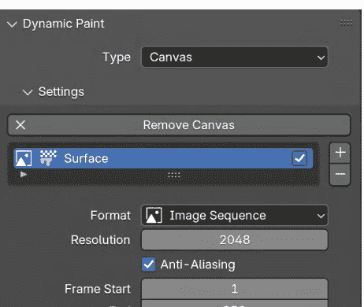

图 13.21 – 添加画布

4. 有一点需要提及的是画布设置中的子步数。通常，对于快速移动的画笔，你会提高此设置以获得漂亮平滑的绘画线条。问题在于，由于动态绘画画笔（实例化立方体）的位置是由粒子系统驱动，而不是立方体本身，因此子步数的值不会影响模拟。这意味着如果画笔对象沿曲线快速移动，即使增加子步数值，你也可能会得到斑点状的绘画线条而不是平滑的连续线条。

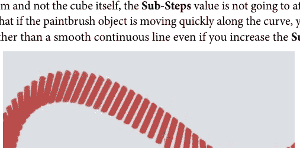

图 13.22 – 快速绘画线条

为帮助解决此问题，你可以做几件事。提高动画的帧率将使画笔每秒拥有更多帧，从而创建更平滑的线条。另一件可能有帮助的事情是增加动画中的帧数，并让画笔沿曲线移动得更慢。由于我们将动画设置为从第 20 帧持续到第 230 帧，这应该足够慢以获得漂亮的绘画线条。话虽如此，让我们继续并更改另外几个设置。

5. 接下来，让我们前往干燥选项卡，将时间设置为 200，以便油漆更快干燥。

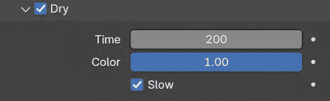

图 13.23 – 干燥选项卡

6. 在输出选项卡中，我们需要设置一个文件夹来导出图像。点击缓存路径中的文件夹图标以设置新目录。我们建议在 Blender 文件所在的文件夹中创建一个新文件夹。

7. 在下拉菜单中选择 UVMap，并确保通过勾选两个框来同时导出绘画贴图和湿贴图。

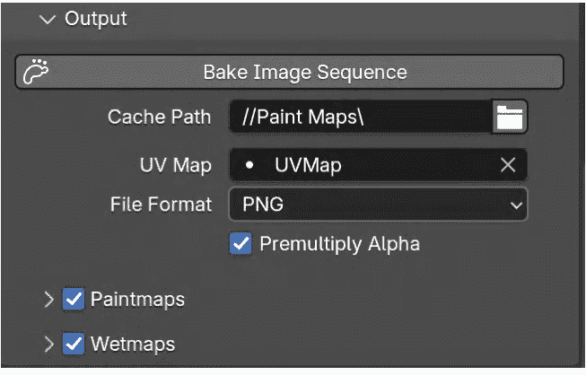

图 13.24 – 输出选项卡

8. 在烘焙图像序列之前，将平面对象稍微向上移动，使画笔和画布相交。这将确保所有立方体都在画布上绘画。

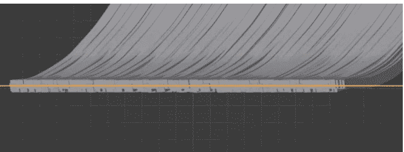

图 13.25 – 画布和画笔位置

太好了！现在模拟已准备好烘焙！在输出选项卡中，点击烘焙图像序列，所有图像将被导出到你为缓存路径设置的文件夹。

烘焙完成后，我们将为画布和毛发粒子创建材质。

## 添加材质

现在我们已经导出了所有动态绘画图像，让我们将它们导入画布的材质中！之后，我们将学习如何为毛发粒子创建材质。开始吧！

## 创建画布材质

在开始为材质添加节点之前，我们需要做的第一件事是将绘画贴图和湿贴图分开。当我们烘焙图像序列时，绘画贴图和湿贴图都被放在同一个文件夹中。

因此，让我们选择所有 wetmap.png 文件并将它们移动到一个新文件夹中，如下图所示：

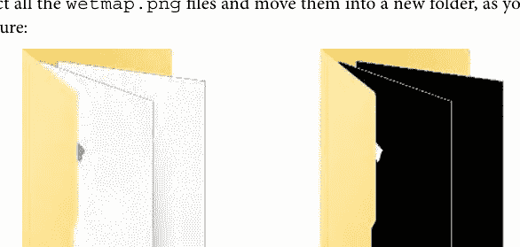

绘画贴图

湿贴图

图 13.26 – 图像文件夹

完成之后，我们就可以回到 Blender 开始创建材质了：

1. 前往 **着色** 工作区，然后点击 **新建** 为平面对象创建一个新材质。给材质命名也是一种好习惯，这样以后更容易找到。

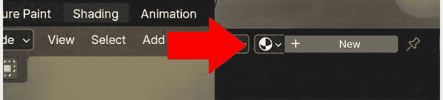

图 13.27 – 创建新材质

2. 让我们先将绘画贴图添加到材质中。按 *Shift + A*，前往 **纹理**，并选择 **图像纹理** 节点。

3. 点击 **打开** 并导航到硬盘上图像所在的位置。找到文件夹后，请再次确认你按 **名称** 排序，而不是 **修改日期**。**名称** 会按文件名按字母顺序排序图像。**修改日期** 会按图像创建的日期/时间排序。由于 **第 1 帧** 图像是首先创建的，这会使图像序列倒放。

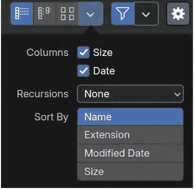

图 13.28 – 排序菜单

4. 然后，你只需按 *A* 选择全部并点击 **打开图像**。

5. 你的 **图像纹理** 节点现在应该已变成 **图像序列** 节点。为了确保其正常工作，将 **颜色** 输出连接到 **Principled BSDF** 着色器的 **基础颜色**。同时，勾选 **自动刷新**，以便图像序列每帧更新。

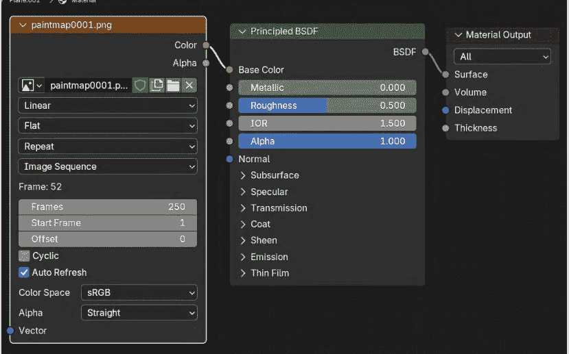

图 13.29 – 测试材质

现在播放你的动画时，你应该会看到油漆随着画笔对象沿曲线移动而在画布上扩散！

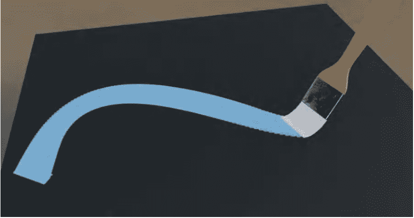

图 13.30 – 在画布上绘画

## 使用顶点格式

如果你决定在未来的模拟中使用动态绘画的顶点格式，你可以将该颜色信息直接通过颜色属性节点插入材质！查看下图以了解设置！

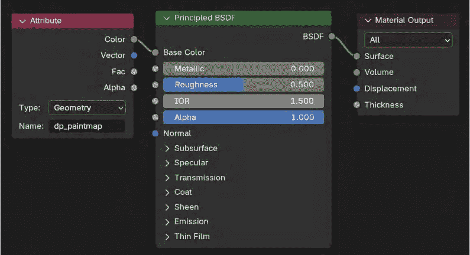

图 13.31 – 颜色属性节点

+   6. 太好了！现在我们知道它能工作了，我们可以调整颜色然后添加湿贴图。让我们按 Shift + A，前往颜色，并添加一个混合颜色节点。此节点将允许我们超级轻松地更改画布和油漆的颜色。

来自图像序列节点的 Alpha 输出将画布设为黑色，油漆设为白色。我们可以利用它创建一个蒙版，以便轻松更改我们喜欢的颜色。

+   7. 从图像序列中取出 Alpha 并直接插入混合颜色节点的 Fac。然后将混合颜色输出直接插入基础颜色。混合颜色节点的 A 颜色现在控制画布，B 颜色控制油漆。选择你喜欢的任何颜色！对于此场景，我们使用了白色画布和红色油漆颜色。

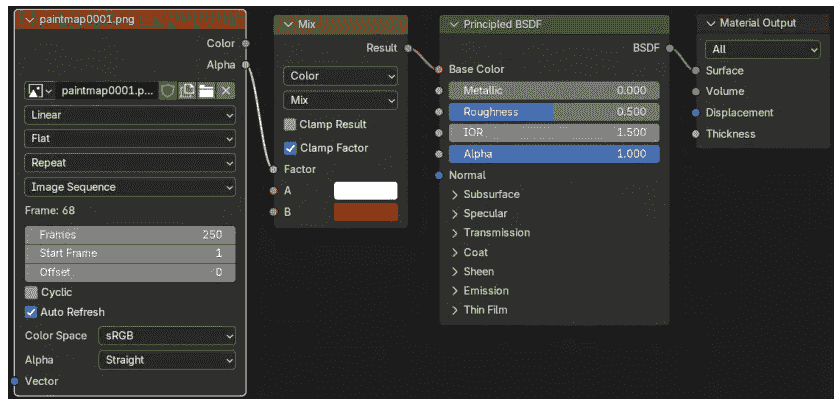

图 13.32 – 添加混合颜色节点

8. 你可能注意到油漆看起来有点斑点。为了防止斑点外观，你可以添加一个颜色渐变节点。按 Shift + A，前往转换器，并选择颜色渐变。将它放置在图像序列和混合颜色节点之间。将白色手柄拖向黑色手柄可以帮助抑制那种斑点外观。

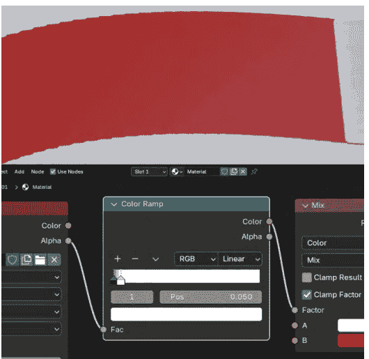

图 13.33 – 颜色渐变修复

+   9. 现在我们可以添加湿贴图了。选择 **图像序列** 节点并按 *Shift + D* 进行复制。将它放置在下方，点击文件夹图标并导航到湿贴图文件夹。按 A 选择全部并点击 **打开图像**。
+   
+   10. 如果你不记得的话，湿贴图是画布上随时间推移可视化油漆干燥的黑白值。我们可以使用这些值来控制材质的 **粗糙度** 值。这将呈现出油漆在动画过程中缓慢干燥的湿润外观。让我们取出 **颜色** 输出并将其插入 **Principled BSDF** 着色器的 **粗糙度** 值。
+   
+   11. 当前效果与我们想要的相反。我们需要反转湿贴图，使油漆看起来有光泽，同时保持画布漫反射。为此，按 *Shift + A* 并添加另一个 **颜色渐变** 节点。
+   
+   12. 翻转 **颜色渐变** 的颜色，使黑色手柄位于右侧，白色手柄位于左侧。然后将黑色手柄移动到大约一半的位置，并将 **插值** 设置为 **缓和**。

这就是完整材质设置应有的外观：

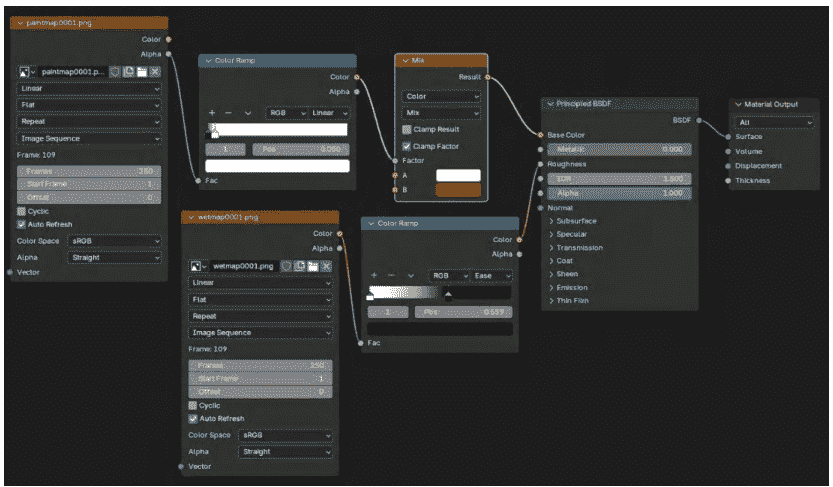

图 13.34 – 完整画布材质

13. 最后一步是在平面上添加一些凹凸。这将为平面提供更多细节，使最终结果更有趣。以下是步骤！

+   I. 按 *Shift + A*，前往 **纹理**，并添加一个 **噪声纹理** 节点。
+   
+   II. 接下来，添加一个 **凹凸** 节点！按 *Shift + A*，然后前往 **向量 | 凹凸**。

III. 从 **Noise Texture** 取出 **Fac** 并将其接入 **Bump** 节点的 **Height**。然后取出 **Normal** 输出并将其接入 **Principled BSDF** 着色器的 **Normal** 输入。

IV. 现在设置数值。将 **Scale** 设置为 500，**Roughness** 设置为 0.9，**Bump** 的 **Strength** 设置为 0.3。以下是完整设置。

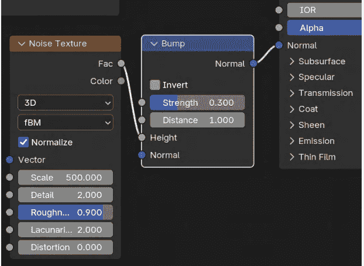

Figure 13.35 – 添加凹凸

如果您想让动画更有趣一些，可以将 **Image Sequence** 节点接入 **Principled BSDF** 着色器的 **Emission** 输入。这将呈现出画笔在画布上绘制发光油漆的效果！

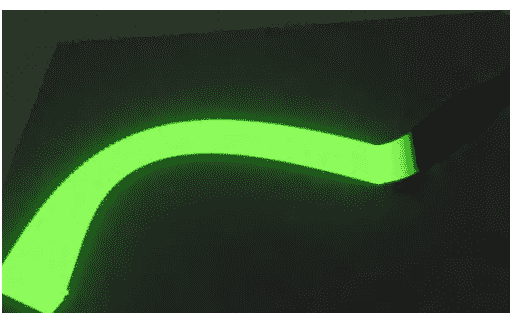

Figure 13.36 – 发光油漆材质

另一个想法是将 Image Texture 节点接入 MixRGB 节点的 B 颜色输入。这样，画笔就不会绘制纯红色，而是绘制图像纹理！请随意发挥创意，尝试不同的图像来创造有趣的效果！

一旦您对画布的外观满意，我们就可以继续创建头发材质！

## 创建头发材质

接下来要创建的材质设置起来相当简单！我们将创建一个渐变效果，其中头发顶部是一种颜色，并在底部附近渐变为另一种颜色：

- 1. 开始之前，让我们先隐藏实例化立方体，以便可以看到头发粒子。在 Outliner 中，点击 Eye 和 Camera 图标来隐藏此对象。这将使其在视图和渲染中都被隐藏。
- 2. 接下来，选择头发粒子并点击 New 创建一个新材质。
- 3. 要创建该渐变效果，我们需要添加两个节点。第一个是 Curves Info 节点。按 Shift + A，进入 Input，选择 Curves Info。
- 4. 另一个需要的节点是 Color Ramp。将其添加到 Curves Info 和 Principled BSDF 着色器之间。
- 5. 在 Curves Info 节点中，我们需要的是 Intercept 输出。将其接入 Color Ramp，然后将 Color Ramp 接入 Principled BSDF 着色器的 Base Color。

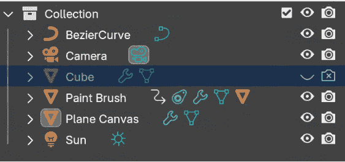

Figure 13.37 – 隐藏实例化立方体

头发粒子现在应该已变为黑白渐变。

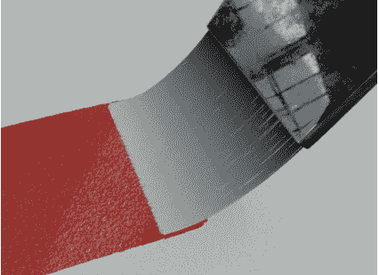

Figure 13.38 – 头发粒子渐变

- 6. 我们可以通过 Color Ramp 的手柄控制渐变的颜色。对于右侧的手柄，选择与油漆相同的颜色。至于左侧手柄，我们选择浅灰色。以下是完整的节点设置：

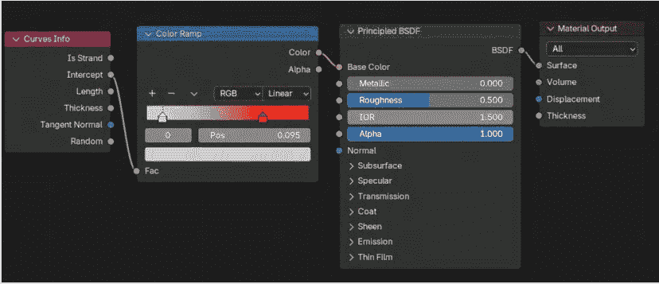

Figure 13.39 – 头发材质节点设置

这基本上就是这个材质所需做的全部！如果您想为此材质添加更多内容，可以取自 Curves Info 节点的 Intercept 输出并让其控制 Principled BSDF 着色器中的 Roughness 值。这可以呈现出粒子上有湿油漆的效果，但我把这个留给您。现在，让我们继续进行最终的渲染设置，然后就可以渲染这个动画了！

## 设置渲染

本教程几乎完成了！我们需要做的最后步骤是设置渲染、为摄像机设置动画使其跟随画笔，并渲染动画。让我们先看看 EEVEE 设置并进行更改，以使整个场景看起来更好：

- 1. 在 **Render** 面板中，让我们打开 **Raytracing** 以在材质中获得漂亮的反射。将 **Resolution** 设置为 **1:1**。
- 2. 在 **Color Management** 选项卡中，让我们将 **Look** 设置为 **High Contrast**。这将使场景中的颜色更加突出！
- 3. 对于 **Camera** 动画，我们建议跳转到 **Frame 1**，将 **Camera** 定位到您想要的视角，然后添加关键帧。您可以通过选择 **Camera**，按 *I*，然后选择 **Location & Rotation** 来实现。
- 4. 在 **Frame 100** 左右，旋转并移动 **Camera** 使其面向画笔，然后添加另一个关键帧。在 **Frame 160** 左右以及 **250** 时重复此步骤。记住，您始终可以通过在 **Timeline** 中选择关键帧并按 G 来移动它们。
- 5. 如果您想删除关键帧，请选择它并按 X，然后选择 **Delete Keyframes**。

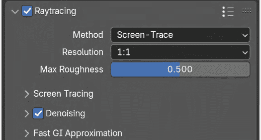

Figure 13.40 – EEVEE 渲染设置

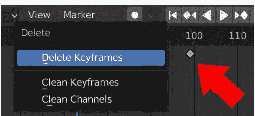

Figure 13.41 – 删除关键帧

- 6. 如果您想为摄像机添加漂亮的外观，请在 **Camera Data Properties** 面板中启用 **Depth of Field**。对于 **Focus on Object**，选择 **Paint Brush**。

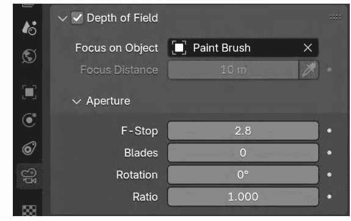

Figure 13.42 – 景深

一旦您设置好摄像机，就准备好渲染动画了。如果您需要复习 Blender 中如何渲染动画，请查看 *Chapter 4*。

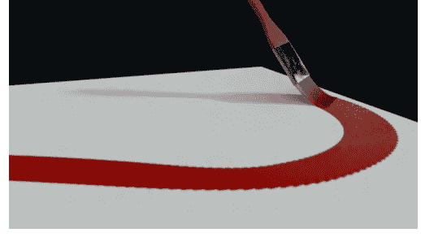

Figure 13.43 – 最终效果

如果您想查看最终效果，或想下载本章的项目文件，可以通过以下链接访问：https://github.com/PacktPublishing/Learn-Blender-4-Simulations-the-Right-Way/tree/main/Chapter%2013

随意添加或更改动画！也许添加两三支画笔，让颜色混合在一起。您甚至可以用画笔拼出一个词！只要记住使用这种方法 **Sub-Steps** 不起作用，因此您必须减慢画笔速度，以免油漆线条出现斑点。

## 总结

我们现在已经完成了本教程，并使用 Blender 中的动态绘画创建了画笔动画。希望现在您对这种强大的模拟以及可以实现的有趣且独特的各种效果有了更深入的理解。像往常一样，让我们回顾一下，以便一切都铭记在心。

首先，我们学习了如何使用 **Follow Path** 约束让对象跟随曲线。之后，我们创建了头发粒子并赋予它们物理属性，使其弯曲和变形。然后我们在每个头发粒子上实例化一个长立方体，并将其用作动态绘画模拟中的画笔。我们创建了画布，设置了所有设置，并制作了图像序列。利用从动态绘画导出的所有图像，我们将图像导入画布材质，然后学习了如何轻松自定义颜色。我们还讨论了头发粒子材质并创建了一个漂亮的渐变。最后，我们设置了摄像机并渲染了动画！

我希望您准备好了，因为在下一章，我们将远离 **Paint Surface Type**，转而查看 **Waves** 并学习如何创建非常漂亮的雨滴效果！
