## 创建雨滴效果

对于本书中的下一个项目，我们将使用动态绘画和粒子在湖面上创建逼真的雨滴效果！凭借本章获得的知识，您将能够为道路上的水坑添加雨滴效果，或创建在海洋上航行的船只，留下波浪痕迹！这种效果有许多不同的用途，绝对可以为您的渲染和动画增添另一层细节！

我们首先将添加场景所需的所有对象。从那里开始，我们将学习如何使用粒子系统创建降雨！之后，我们将进入动态绘画模拟，并学习如何使用 Waves 表面类型创建逼真的雨滴。最后，我们将创建漂亮的水材质并使用 EEVEE 渲染动画！

本章将涵盖以下主题：

- 设置场景
- 创建雨粒子
- 模拟波浪
- 创建水材质
- 设置渲染

## 技术要求

本章要求您已安装 Blender 4.2 或更高版本。

要下载 Blender，请访问 www.blender.org。

请确保也下载此处找到的启动文件：https://github.com/PacktPublishing/Learn-Blender-4-Simulations-the-Right-Way/tree/main/Chapter%2014。


## 设置场景

开始之前，请确保下载 Raindrop Effect Startup.blend 文件。你可以在 技术要求 部分找到链接。此 .blend 文件包含几个带有漂亮纹理的岩石、用于灯光的 HDR 以及一点相机动画。我们首先要做的是添加一个平面对象作为模拟的画布。之后，我们将为背景添加一个更大的平面，动画化位移，并重新排列岩石以获得美观的效果。打开 Blender 文件，开始吧：

- 1. 按 Shift + A 添加一个平面对象。这将成为我们模拟中的画布。
- 2. 我们需要将此平面缩放以使其更适合场景。选择平面并打开属性面板，将 X 和 Y 的尺寸设置为 13 米。这样做会导致缩放数值发生变化，因此让我们按 Ctrl + A 或 Cmd + A 并点击缩放。这会将这些数值恢复到 1.000。

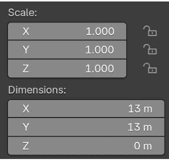

图 14.1 – 平面尺寸

使用动态绘制时，始终要对对象应用缩放非常重要，特别是当你使用 Displace 或 Waves 表面类型时。当缩放数值未设置为 1.000 时，你可能会看到不准确的模拟。在为本章测试时，我们注意到一些雨滴粒子没有产生波纹。原因是在画布上未应用缩放。务必记住应用缩放！

- 3. 接下来，我们需要在平面上添加更多几何体以便产生波纹。为此，进入编辑模式，并选中整个网格，右键单击并选择细分。在左下角打开细分菜单，将切割次数设置为 100。

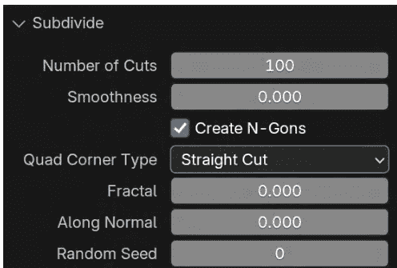

图 14.2 – 对平面进行细分

- 4. 不幸的是，我们仍然需要更多几何体，而且无法将 **切割次数** 设置高于 100。因此，让我们再次右键单击并选择 **细分**。这将使平面的几何体数量翻倍。
- 5. 让我们再重复一次 *步骤 4*，这样平面上的几何体应该就足够让波纹看起来不错了。选中所有内容后，再次右键单击并选择 **细分**。
- 6. 如果我们通过在数字键盘上按 *0* 或通过前往 **视图 | 相机 | 活动相机** 进入相机视图，就可以看到平面的边缘。

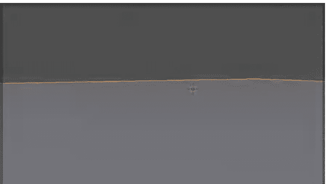

图 14.3 – 平面的边缘

- 7. 这并不能营造出大湖的错觉，因此为了解决这个问题，让我们添加另一个平面对象并将其缩放。按 *Shift + A*，前往 **网格**，并选择 **平面**。
- 8. 在 **尺寸** 中，让我们将 **X** 和 **Y** 设置为 65 米，然后，当然，按 *Ctrl + A* 或 *Cmd + A* 并应用 **缩放**。
- 9. 我们不需要大平面对象延伸到相机后面，因此让我们向前移动它，直到两个平面对象的边缘对齐。然后，稍微向下移动，使它们不相交。

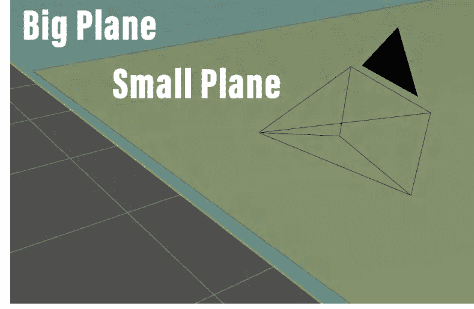

图 14.4 – 移动大平面

### 为什么使用两个平面对象？
我们使用两个平面对象的原因是，我们希望在相机附近有大量几何体以创建漂亮平滑的波纹，但在远处不需要这种细节程度。那只会浪费你电脑的内存，并增加渲染时间。

- 10. 下一步是使用 **置换** 修改器在该更大的平面上伪造雨滴效果！由于更大的平面将从远处观看，它仍然会产生“波纹”效果，而无需动态绘制模拟所需的全部额外几何体。

选择更大的平面对象并前往 **修改器** 面板。选择 **添加修改器 | 生成 | 细分曲面** 并将 **模式** 设置为 **简单**。**简单** 会在不影响形状的情况下细分网格，而 **Catmull-Clark** 则会在增加细分的同时使网格边缘圆滑。并将 **视口** 和 **渲染** 级别设置为 8。这将为我们的网格提供更多几何体，以便 **置换** 修改器正常工作。

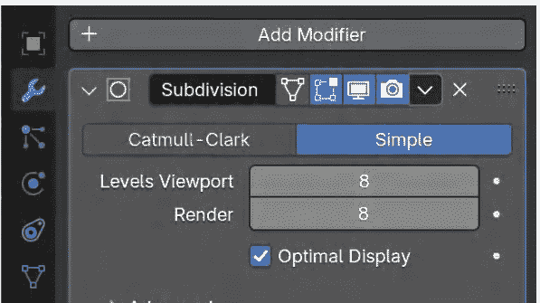

图 14.5 – 细分曲面修改器

- 11. 之后，让我们选择 添加修改器 | 变形 | 置换。
- 12. 点击新建以创建新的置换纹理，然后前往纹理面板。
- 13. 将纹理类型更改为云，并在云选项卡中将大小值设置为 0.10。

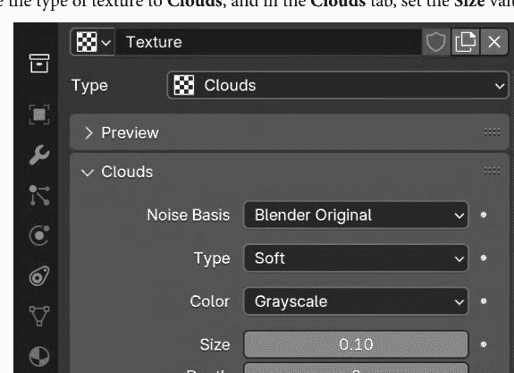

图 14.6 – 一个置换纹理

- 14. 目前，置换强度过高。让我们回到修改器面板并将置换修改器的强度降低到 0.070。
- 15. 我们需要做的最后一件事是为此置换纹理的位置设置动画。这将营造出远处雨滴的错觉。方法如下：
- I. 按 Shift + A 并前往 空对象 | 平面 添加一个新的空对象。
- II. 在第 1 帧，按 K 为空对象添加一个位置关键帧。
- III. 接下来，跳到动画的末尾（第 200 帧）并将空对象沿 X 轴移动 0.5 米。你可以通过按 G，然后按 X，输入 0.5，然后按 Enter 来实现。然后，按 K 并添加另一个位置关键帧。
- IV. 我们需要将这些关键帧的插值更改为线性，以便空对象在整个动画中以恒定速率移动，而不是加速和减速。在时间轴中通过拖动框选择两个关键帧，然后按 T，并选择线性。
- 16. 完成之后，我们可以回到置换修改器。将坐标切换为对象，并在对象菜单中选择空对象。

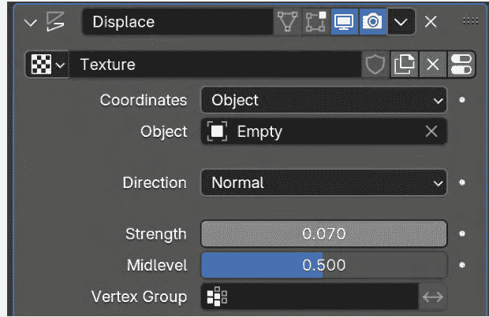

图 14.7 – 置换修改器

如果操作正确，更大平面上的置换应该会随着空对象的移动而移动！这将营造出远处雨滴的错觉！

- 17. 在更大的平面对象仍被选中的情况下，你可以右键单击并选择平滑着色以使所有置换几何体平滑。
- 18. 最后一步是在场景周围放置岩石。我建议进入相机视图并放置岩石。这样，你就知道渲染时它们会是什么样子。缩放、旋转并移动它们，直到填满场景。如果你想添加更多岩石，可以按 Shift + D 进行复制。以下是场景目前的样子：

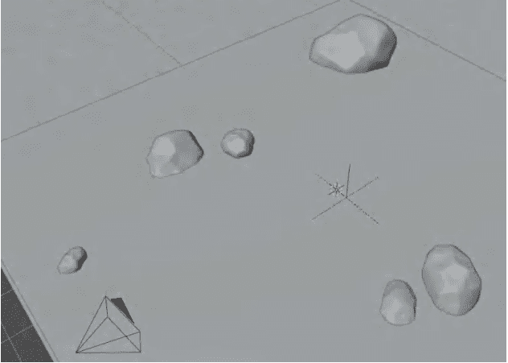

图 14.8 – 岩石位置

太好了！现在场景已经布置完成，让我们使用粒子系统创建雨！

## 创建雨滴粒子

要创建此粒子系统，让我们先添加一个发射器对象以将粒子发射到场景中：

- 1. 按 Shift + A 并添加另一个平面对象。让我们将其缩放为与较小平面相同的大小，然后将其向上移动约四米，置于水面上方。
- 2. 要创建粒子系统，请前往粒子系统面板并点击 + 创建一个新系统。

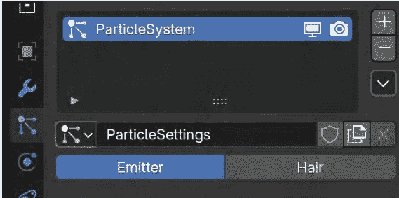

图 14.9 – 新粒子系统

- 3. 现在，让我们决定想要多少雨。是倾盆大雨还是轻微的细雨？让我们选择中间值并创建小雨。为此，将粒子数量设置为 3000。
- 4. 对于 **起始帧**，将其设置为 -50，这样在播放动画时看起来雨已经在下了。对于 **生命周期**，将其设置为 35，以便粒子在进入水面以下后消失。

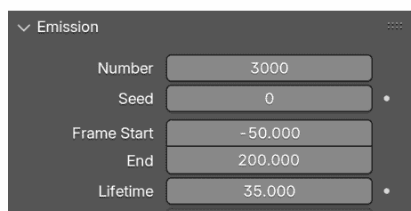

图 14.10 – 发射设置

- 5. 在 **速度** 选项卡中，将 **法线** 设置为 0，将 **对象对齐 Z** 设置为 -1。这将使粒子沿 -Z 轴具有起始速度。
- 6. 粒子目前移动得有点太快。为了解决这个问题，前往 **物理** 选项卡并将 **阻尼** 设置为 0.050。这会稍微减慢粒子的速度。

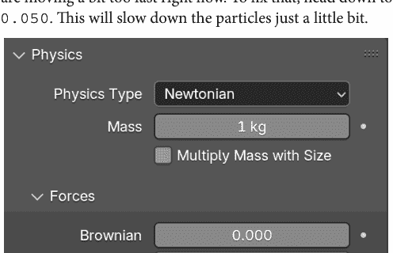

图 14.11 – 物理选项卡

- 7. 现在，我们需要一个对象来表示每个粒子。由于雨滴是球形的，让我们使用一个二十面体球！按 *Shift + A* 并添加一个二十面体球对象。将其移开以便从相机看不到，然后将其缩小 0.2。当然，始终记得应用缩放！按 *Ctrl + A* 或 *Cmd + A* 并选择 **缩放**。


8. 你也可以右键单击并选择平滑着色来平滑二十面体的边缘。

9. 再次选择带有粒子系统的平面，并在渲染选项卡中，将渲染方式切换为对象，然后对于实例对象，选择你刚刚添加的二十面体。另外，请确保关闭显示发射器，这样平面就不会出现在渲染中！

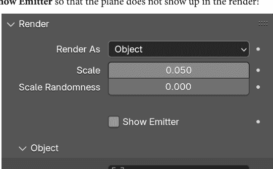

图 14.12 – 渲染选项卡

10. 现在，我们准备烘焙粒子系统！前往缓存选项卡并点击烘焙！

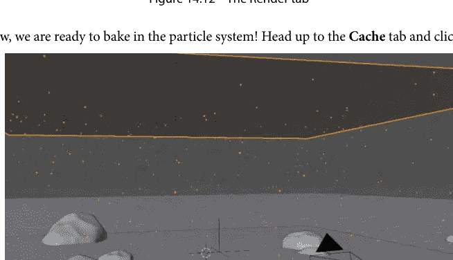

图 14.13 – 雨滴粒子

完成以上操作后，我们就可以继续创建动态绘制模拟了！

## 模拟波浪

现在，是你一直在等待的部分——让我们创建动态绘制模拟并模拟雨滴效果！让我们先创建画布，然后再进行画笔对象：

- 1. 选择较小的平面对象并前往物理面板。选择动态绘制，确保类型设置为画布，然后点击添加画布。
- 2. 帧开始和结束设置应该已经是我们需要的正确值。让我们也确保将子步数更改为 5，以帮助使模拟更准确。

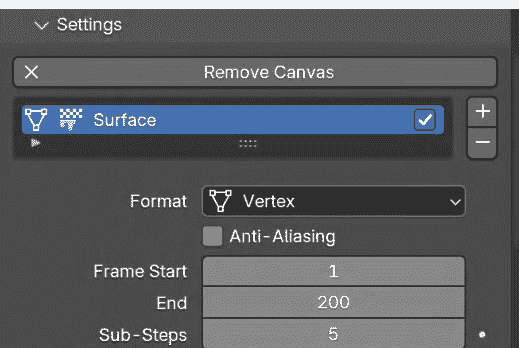

图 14.14 – 动态绘制设置

- 3. 前往表面选项卡并将表面类型设置为波浪。我们将更改波浪中的一些设置，所以让我们逐一进行：
  - I. 首先，让我们打开开放边界，以便波浪不会从网格边缘反弹。
  - II. 接下来，将时间比例更改为 0.30 以减慢模拟速度。
  - III. 速度控制波浪移动的速度；让我们也通过将其更改为 0.40 来减慢它。
  - IV. 为了帮助波浪更快地消散，将阻尼设置为 0.20。
  - V. 最后，为了让波浪反弹更多，你可以将弹簧更改为 0.50。

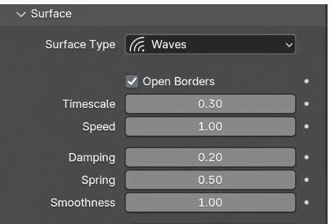

图 14.15 – 波浪画布设置

这就是我们对画布所需的所有设置！接下来，让我们选择带有粒子系统的平面对象并将其添加到模拟中：

- 1. 选择你的粒子系统对象并前往 **物理** 面板。选择 **动态绘制**，将 **类型** 切换为 **画笔**，然后点击 **添加画笔**。
- 2. 在 **源** 选项卡中，将 **绘制** 切换为 **粒子系统**，并从 **粒子系统** 下拉菜单中选择 **ParticleSystem**。
- 3. 接下来，勾选 **使用粒子的半径**。这将使影响画布的半径与粒子的确切大小相同。

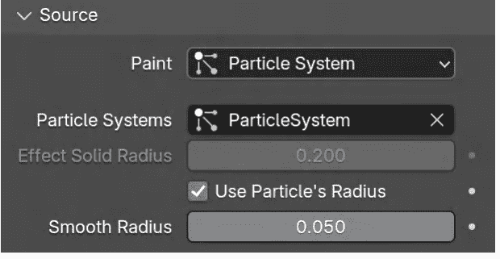

图 14.16 – 画笔源设置

现在，当你重新启动 **时间线** 时，你应该会看到粒子在画布上产生波浪！

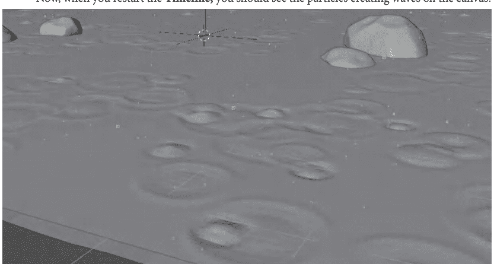

图 14.17 – 模拟波浪

如果你想创建更大的飞溅效果，可以将 **画笔波浪** 选项卡中的 **因子** 设置为更高的值。你可以在以下图中看到不同的值：

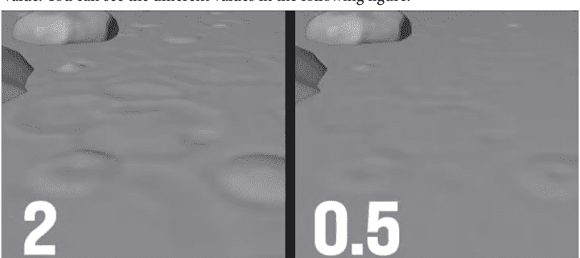

图 14.18 – 波浪因子

- 4. 此外，请确保选择你的画布对象，右键单击并选择 **平滑着色**，以确保面光滑美观。
- 5. 最后，让我们也允许岩石与模拟交互！选择场景中的一块岩石，并在 **物理** 面板中选择 **动态绘制**，将 **类型** 切换为 **画笔**，然后点击 **添加画笔**。

6. 在波浪选项卡中，将类型切换为仅反射。这将允许岩石反射击中它们的任何波浪！

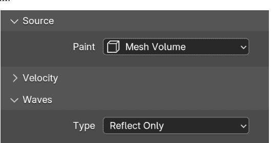

图 14.19 – 仅反射

7. 我们需要对场景中的每块岩石重复此过程。然而，这有点繁琐。为了加快速度，选择所有岩石对象，然后最后选择带有画笔设置的岩石对象。这将使画笔对象成为活动对象。然后，按 Ctrl + L 并选择复制修改器。现在，所有岩石都应应用相同的画笔设置。

8. 一旦你对一切的外观满意，我们就可以烘焙模拟了！再次选择你的画布，并在缓存选项卡中点击烘焙！

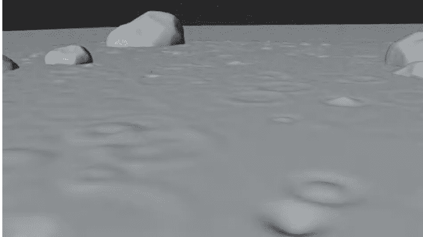

图 14.20 – 烘焙后的模拟

好了！模拟完成并准备就绪！接下来，让我们创建一些漂亮的水材质！

## 创建水材质

我们需要创建两种材质：水和雨滴。让我们先创建水材质：

- 1. 选择画布对象，并前往顶部的 **着色** 工作区。通过点击 **新建** 按钮创建一个新材质。
- 2. 将此材质命名为 Water，以便以后更容易找到。

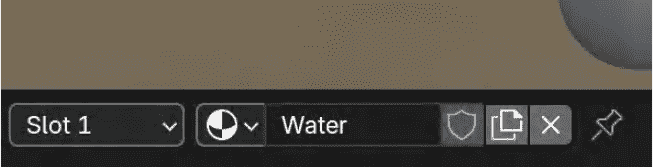

图 14.21 – 材质名称

- 3. 将 **Principled BSDF** 着色器节点中的 **基础颜色** 设置为漂亮的深蓝色。如果你想使用我们使用的相同颜色，十六进制代码是 #274C7A。
- 4. 为了使湖泊具有光泽和反射性，将 **粗糙度** 设置为 0。
- 5. 最后，将 **透射权重** 设置为 1 以获得玻璃的外观，并将 **IOR** 设置为 1.333。 **IOR** 代表 *折射率*。这基本上就是光线如何穿过物体的过程。在这种情况下，水的 IOR 为 1.333。还有大量其他真实材料的 IOR 值列表，你可以在这里参考：https://pixelandpoly.com/ior.html。

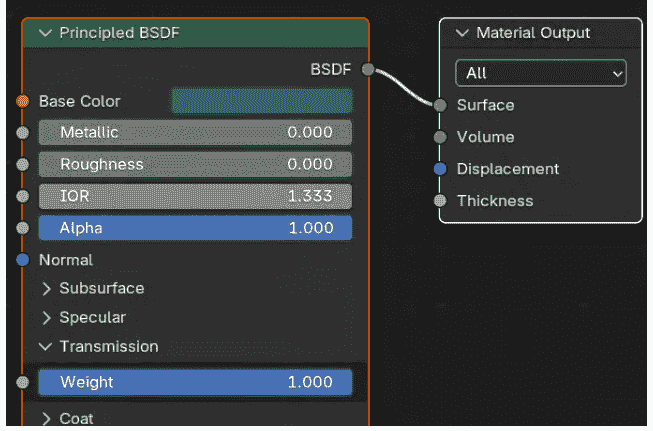

图 14.22 – Principled 着色器

6. 现在，水看起来有点平坦，所以让我们给它一个凹凸！这将增加细节并使水看起来在风中移动！按 Shift + A，前往纹理，并添加一个噪声纹理节点。

7. 接下来，让我们添加一个凹凸节点。按 Shift + A，前往矢量，并添加一个凹凸节点。

8. 现在，我们需要将所有节点连接起来！将噪声纹理的 Fac 插入凹凸节点的高度。然后，将凹凸节点的法线插入 Principled BSDF 着色器的法线。它应该看起来像这样：

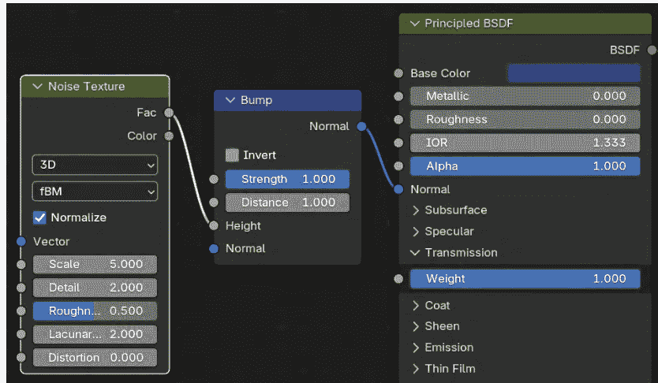

图 14.23 – 噪声和凹凸节点

9. 现在，水看起来有点太凹凸了，所以让我们更改这些节点中的一些值以使其看起来更好：

- I. 从噪声纹理开始，让我们将模式从 3D 切换到 4D。
- II. 一个 W 值应该出现了。增加此值将使水看起来像在移动。让我们为此值添加一个驱动器，以便 W 值在动画过程中自动增加。为此，在 W 字段中输入 #frame/1500。将缩放设置为 75 以使凹凸变小，并将细节设置为 2。

### 什么是驱动器？

驱动器允许你使用函数或数学表达式控制不同的属性值。在这种情况下，使用 #frame 函数，值将与你所在的帧匹配（第 5 帧 = 值 5）。然后，如果我们用 #frame /10 函数除它，在第 5 帧，值将为 0.5。这只是一个简单的例子，但你可以添加更多复杂的驱动器。

III. 水上的凹凸现在太强了，所以让我们将凹凸节点中的 **强度** 降低到 0.050，并将 **距离** 降低到 0.100。现在它应该看起来像这样：

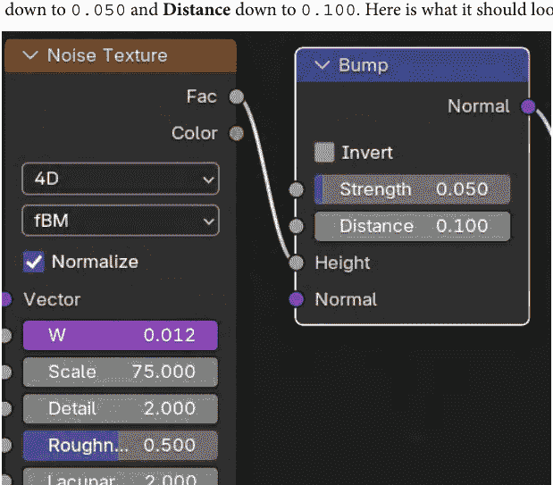

图 14.24 – 噪声纹理和凹凸值

如果我们现在看看水，它应该会有更多细节并且不会那么平坦！

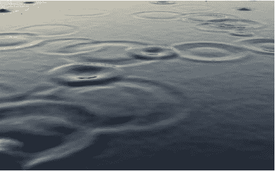

图 14.25 – 带凹凸的水

- 1. 让我们通过选择对象并在 **着色器编辑器** 工作区中点击 **浏览材质** 按钮并选择 **Water** 材质，为较大的平面赋予相同的材质。

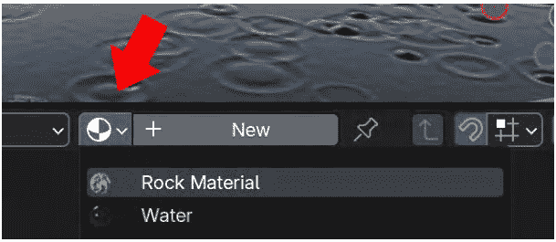

图 14.26 – 浏览材质按钮

如果你按 Z 并进入 **渲染视图**，你将能够看到场景目前的样子！

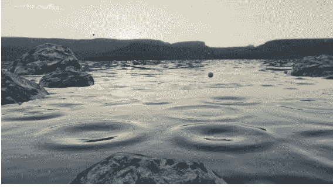

图 14.27 – 水材质预览


- 2. 现在，让我们创建粒子材质！选择 icosphere 物体，点击 **Browse Material** 按钮，并选择 **Water** 材质。

- 3. 我们将要更改此材质的颜色。目前，**Water** 材质在另外三个物体上共享（粒子、平面和更大的平面）。这就是为什么你在材质旁边看到 **3**。我们想要复制此材质，这样我们所做的任何更改都不会影响其他物体。要做到这一点，请点击名称旁边的 **3** 按钮。

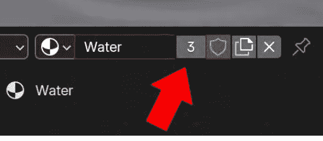

图 14.28 – 复制材质

现在，我们可以更改此材质而不影响其他物体！

- 4. 我们真正需要做的就是将 **Base Color** 设置为非常浅的蓝色。如果您想使用我们使用的确切颜色，十六进制代码是 #B1D4E5。我们还可以删除 **Noise Texture** 和 **Bump** 节点，因为对于雨滴来说我们不需要它们。

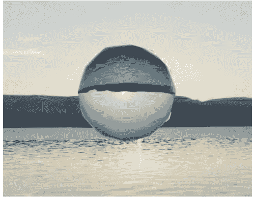

图 14.29 – 粒子材质

太棒了！所有材质现在都完成了，我们的场景看起来真的很不错了！在项目结束之前，让我们设置渲染并真正让这个雨滴效果看起来很棒！

## 设置渲染

现在一切都设置好了，我们基本上可以开始渲染动画了。在此之前，让我们快速回顾一些 EEVEE 设置，以真正让我们的动画更出彩：

- 1. 前往 **Render** 面板，打开 **Raytracing**，并将 **Resolution** 设置为 1:1。这将为水提供准确的反射，总体上使场景看起来更逼真。

- 2. 为了让雨看起来有运动感，让我们启用 **Motion Blur**！**Shutter** 值决定运动模糊的强度。让我们将其降低到 0.25。**Steps** 值也很重要。你设置得越高，运动模糊看起来越好，但渲染时间会更长。对于这个场景，8 的值效果很好。

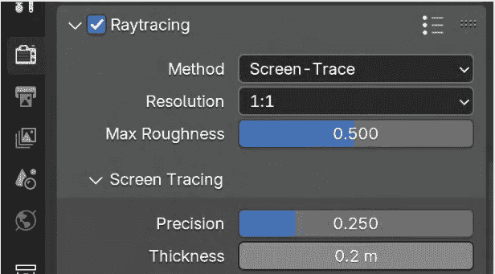

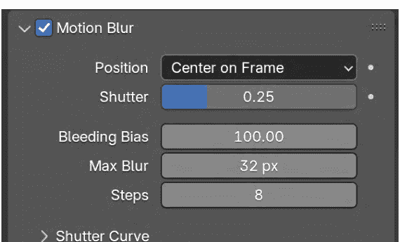

- 3. 为了让整体场景看起来更好，打开 **Color Management** 选项卡并将 **Look** 设置为 **High Contrast**。

- 4. 最后，我们可以设置景深！选择相机并前往 **Object Data Properties** 面板。

- 5. 启用 **Depth of Field**，对于 **Focus on Object**，你可以添加一个新的空物体或使用我们为 **Displace** 修改器使用的同一个物体。

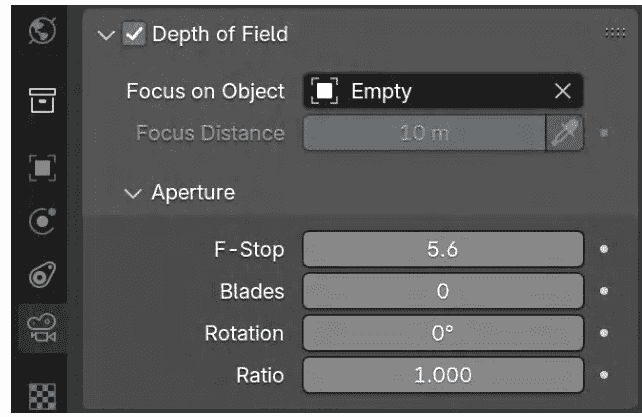

图 14.32 – 景深

- 6. **F-Stop** 值控制景深的浅度。较低的值会使渲染更浅，较高的值会使渲染清晰锐利。这个值是个人偏好，所以设置成你认为好看的值，或者如果你想复制我们，我们将其设置为 5.6。

完成这些后，我们就可以渲染动画了！也可以随意为渲染添加更多元素！也许在岸线旁或悬挂在相机上方添加几棵树。你也可以让一艘船在远处沿着水面行驶，创造更多波浪！尽情享受并尝试不同的想法！准备好后，只需设置一个 **Output** 目录然后渲染动画即可！记住，如果你需要复习如何渲染动画，请查看 *第 4 章*。

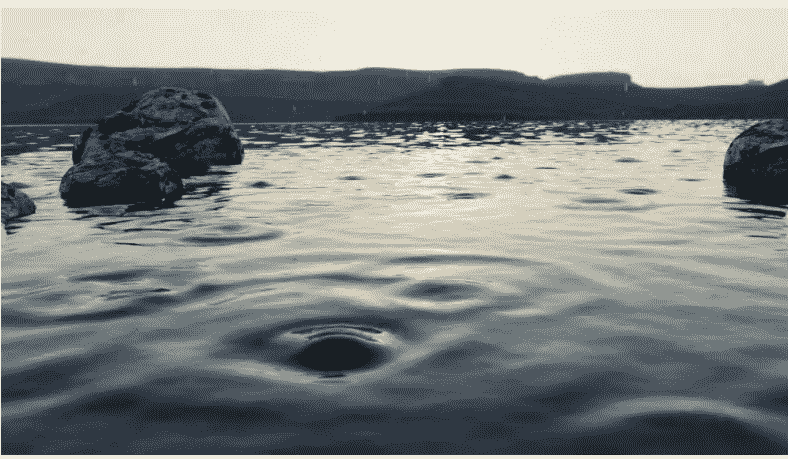

图 14.33 – 最终结果 – 第 83 帧

此外，如果你想下载并试用这个项目的完成的 .blend 文件，可以通过以下链接进行：https://github.com/PacktPublishing/Learn-Blender-4-Simulations-the-Right-Way/tree/main/Chapter%2014.

## 摘要

动态绘画模拟是一个很棒的工具，并且有许多实际用途！创建画笔和雨滴效果只是使用此模拟可以做的事情的一小部分。我鼓励你进入 Blender 并尝试酷炫有趣的想法。限制只有你的想象力！

让我们回顾一下本章学到的内容。首先，我们添加了场景所需的所有物体！之后，我们学习了粒子系统和创建降雨。接下来是动态绘画模拟。我们学习了如何使用粒子系统创建波浪，并调整设置以获得最逼真的效果。之后，我们添加了水材质并设置了渲染。

我希望你在过去的三个章节中学习动态绘画的经历很愉快，并且它对你的项目和动画有所帮助。本书中讨论的每种模拟都有其用途，可以极大地帮助许多不同的场景和项目。对于本书的最后一章，我们将结合火焰、布料和动态绘画来创建燃烧效果！

## 加入我们的 Discord 社区

加入我们社区的 Discord 空间，与作者和其他读者讨论：

```
https://packt.link/learn-blender-simulations-discord-invite
```


