## 15

## 创建燃烧效果

在本书的进程中，我们讨论并学习了 Blender 提供的每一种物理模拟。有一样我们还没有讨论，那就是将这些效果组合在一起。这正是本章的主题！

我们将结合以下模拟在 Blender 中创建燃烧效果：**Dynamic Paint**、**Cloth** 和 **Fire**。本章的目标是演示如何在一個物体上管理多种模拟类型，同时牢记修改器堆栈的顺序。请记住，模拟修改器的顺序极大地影响模拟的结果。

我们将首先在平面物体上使用动态绘画创建一个动画顶点组。接下来，我们将添加布料模拟并使用 **Mask** 修改器慢慢移除网格的一部分。之后，我们将使用我们创建的顶点组来确定在物体上想要火焰出现的位置。最后，我们将创建火焰和烧焦材质，然后渲染动画！

在本章中，我们将涵盖以下主题：

- 动态权重绘制
- 创建布料模拟
- 使用 Mask 修改器
- 模拟火焰
- 添加烧焦和火焰材质

## 技术要求

本章要求你安装 Blender 4.2 或更高版本。

要下载 Blender，请访问 www.blender.org。

确保也下载设置文件，其中包含几个网格物体和灯光：https://github.com/PacktPublishing/Learn-Blender-4-Simulations-the-Right-Way/tree/main/Chapter%2015

## 动态权重绘制

让我们首先打开 `Burning Effect Setup.blend` 文件，其链接可以在 *技术要求* 部分找到。该文件包含一个平面、几个区域灯光以及一些已设置的渲染设置。这个平面物体将成为我们此模拟的画布、布料和流入物体。

我们将首先创建一个新的画笔物体来在画布上绘制权重。然后，从那里开始，我们将使用一个新的顶点组来遮罩画布并确定火焰应该出现的位置。这将创造出 **Plane** 物体燃烧起来的外观！

让我们开始创建这个项目的第一个模拟，动态绘画！

- 1. 我们已经有了动态绘画模拟的画布，所以现在我们需要添加一个画笔物体。按 *Shift + A* 然后点击 **Mesh | Icosphere**。
- 2. 在做任何其他事情之前，请确保打开左下角的菜单并将 **Subdivisions** 设置为 6，这将增加 icosphere 上的几何体数量，并将 **Radius** 设置为 1.5。

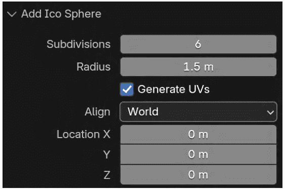

图 15.1 – 添加 Ico 球体菜单

下一步是让这个 icosphere 在画布上绘制权重，我们稍后将使用它来确定火焰在平面上出现的位置。为此，我们需要动画化 icosphere 在平面上向上移动。以下是步骤！

- I. 将 icosphere 置于平面物体下方。
- II. 在 **第 1 帧** 按 *K* 并为画笔添加 **Location** 关键帧。

III. 一直跳转到 **帧 250**，将 icosphere 向上移动直到它完全包围平面对象，然后添加另一个 **位置** 关键帧。

IV. 在 时间线 中，通过绘制一个框来选择两个关键帧。然后，将鼠标悬停在 **时间线** 上，按 T 并选择 **线性**。这将使画笔在整个动画过程中以恒定速度移动。

> **关键帧插值**
> 
> 关键帧之间的正常插值是一个 **贝塞尔** 曲线，这意味着动画开始时缓慢，中间加速，结束时减速。将插值更改为 **线性** 将使画笔对象以恒定速率移动，而不是加速和减速。

V. 在我们开始模拟之前，对画笔对象做的最后一步是添加一个 **位移** 修改器。这将使模拟看起来更自然，因此权重绘制不是完美的 icosphere 形状。要做到这一点，请前往 **修改器** 面板并选择 **添加修改器 | 变形 | 位移**。

VI. 将 **坐标** 设置为 **全局**，将 **强度** 设置为 0.3。将 **坐标** 设置为 **全局** 将使位移随着对象向上移动而随时间变化。

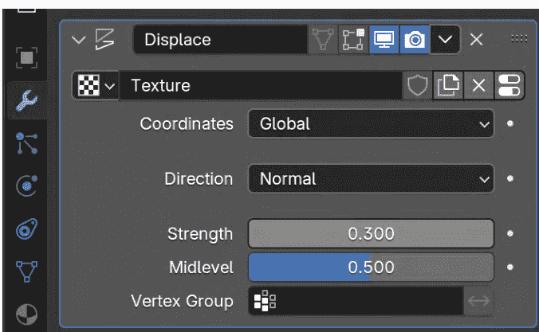

图 15.2 – 位移修改器

VII. 最后，跳转到 **纹理** 面板并将 **类型** 更改为 **云**。现在 icosphere 的表面应该看起来像 **云** 纹理，表面布满凸起和波纹。

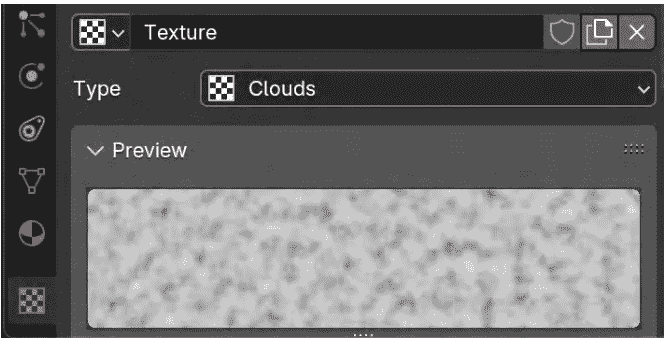

图 15.3 – 纹理类型

现在，当我们播放动画时，icosphere 将向上移动，Cloud 纹理位移也会沿着网格表面移动，使 icosphere 看起来更随机和多样化。完成之后，让我们创建动态绘画模拟！

- 3. 选择 Plane 对象并前往 物理 面板。选择 动态绘画，对于 表面类型，我们可以将其保留在 画布 上。
- 4. 向下滚动到 表面 选项卡并将 表面类型 更改为 权重。
- 5. 接下来，在 输出 选项卡中，确保点击 + 以添加一个新的 顶点组。

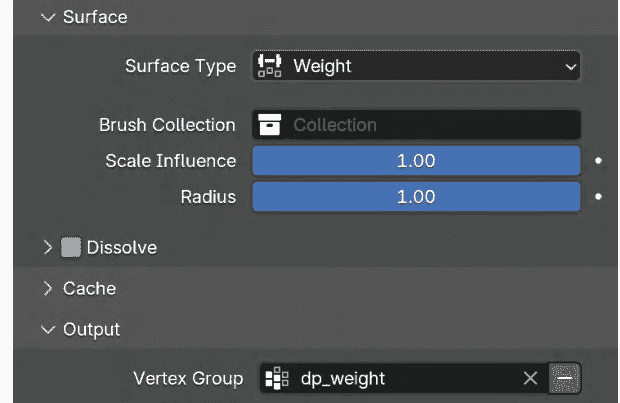

图 15.4 – 画布设置

这就是我们对画布对象需要做的全部！现在让我们继续画笔设置！

- 6. 选择 **Icosphere**，在 **物理** 面板中，选择 **动态绘画**，对于 **类型**，将其更改为 **画笔** 并点击 **添加画笔**。
- 7. 在 **源** 选项卡中，将 **绘制** 更改为 **网格体积 + 邻近**。对于 **距离**，我们使用 0.250 的值。这将为被绘制的权重创建更平滑的过渡。

就是这样！如果您想查看顶点组的外观，可以选择 **Plane** 对象并进入 **权重绘制** 模式。确保您重新启动动画并从头开始播放，否则您将无法看到它。这是在 **帧 120** 时目前的样子。

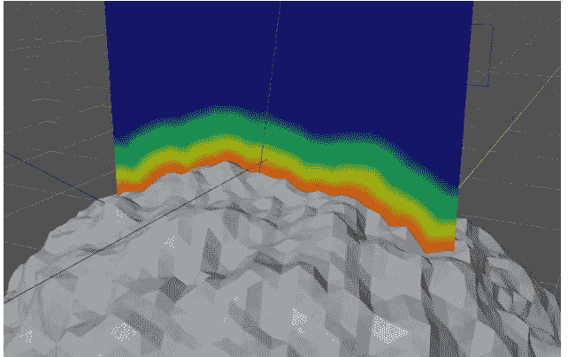

图 15.5 – 权重绘制

如果您对它外观满意，请通过选择 **Plane** 对象来烘焙动态绘画模拟。在画布设置中，向下滚动到 **缓存** 选项卡并点击 **烘焙**！在我们燃烧效果动画的下一步中，我们将使用 **布料** 模拟！

## 创建布料模拟

这个项目的动态绘画部分完成了！现在让我们在平面对象上使用 **布料** 模拟，使其在燃烧时在风中流动和移动！

- 1. 首先，我们需要添加一个 **风** 力场来为平面添加一些运动。按 *Shift + A* 然后点击 **力场 | 风**。确保将 **风** 力场旋转并定位在平面的左侧。
- 2. 在 **物理** 面板中，将此力场的 **强度** 设置为 2500。这应该能让布料有不错的流动和运动。

- 3. 如果我们现在为平面对象添加布料模拟，它会因重力而掉落。为了防止这种情况，让我们创建一个新的针定组并锁定顶行顶点使其无法移动。
- 4. 选择平面后，前往 数据 面板并通过点击 + 按钮创建一个新的顶点组。
- 5. 在 编辑模式 下，选择平面上的顶行顶点。您可以通过按住 Alt 或 Option 键并在顶行顶点任意位置左键单击轻松完成。然后在 数据 面板中点击 分配。

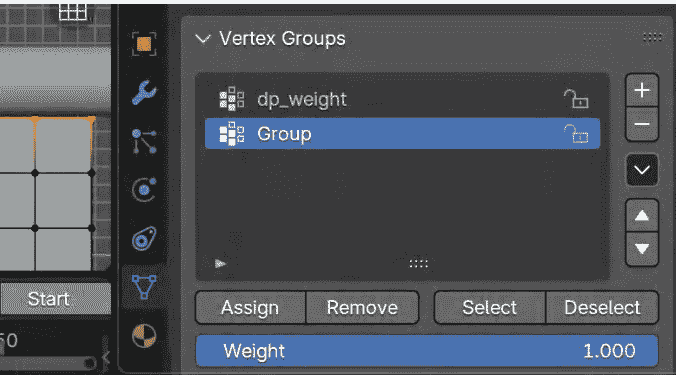

图 15.6 – 顶点组分配

- 6. 现在我们准备好处理布料模拟了！再次前往 物理 面板并选择 布料！
- 7. 在 物理属性 选项卡中，将 顶点质量 设置为 0.2 kg。这将使我们平面上的每个顶点重量略轻一些。
- 8. 在 形状 选项卡中，让我们选择刚刚为针定组创建的顶点组。确保选择 Group 而不是 dp_weight，因为该组用于火焰和遮罩，而不是布料模拟。
- 9. 最后，勾选 自碰撞 并将 距离 设置为尽可能低，即 0.001。

这就是布料模拟设置需要做的全部！您可以随意调整 风 力场的 位置 和 旋转，因为这会影响布料的移动和流动方式。一旦您对结果满意，请打开 缓存 选项卡并选择 烘焙！

## 使用遮罩修改器

到目前为止，我们已经设置了两个模拟，动态绘画和布料。这个项目的下一步是使用 遮罩 修改器来移除网格的部分。这个修改器通过使用顶点组来遮罩对象的部分。在这种情况下，我们想使用动态绘画创建的顶点组！

- 1. 如果尚未选择，请选择 Plane 对象并前往 修改器 面板。点击 添加修改器 | 生成 | 遮罩。
- 2. 在 顶点组 下拉菜单中，选择 dp_weight，这就是我们用动态绘画创建的顶点组！
- 3. 现在，遮罩修改器正在移除未分配给 dp_weight 组的部分网格。这与我们想要的相反。要反转遮罩选择，请点击 顶点组 下拉菜单旁边的双向箭头。
- 4. 最后，勾选 平滑 复选框以帮助遮罩获得更平滑的过渡，并将 阈值 提高到 0.850。这意味着只有大于 0.850 的权重值才会被移除。

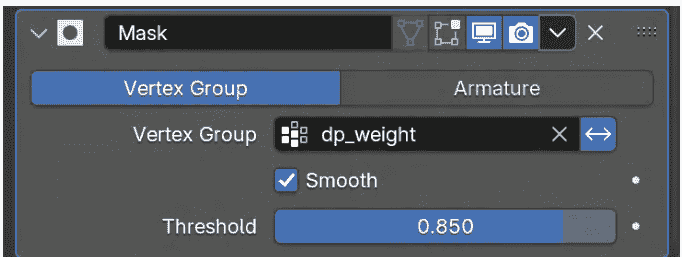

图 15.7 – 遮罩修改器设置

请记住，顶点组值范围从 0 到 1，红色为 1 值，蓝色为 0 值（参见图 15.5）。由于我们将 阈值 值设置为 0.850，遮罩修改器只会移除几乎为该红色颜色的部分网格。要查看此示例，请查看以下图：

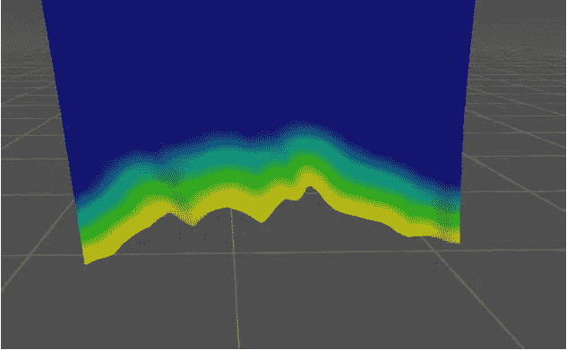

图 15.8 – 遮罩权重示例

- 5. 我们也不再需要在场景中使用 icosphere 对象了，所以让我们通过在 Outliner 中点击 眼睛 图标和 相机 图标来切换视口和渲染可见性。

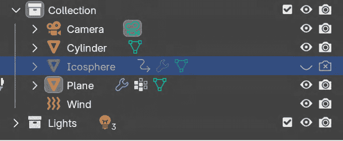

图 15.9 – Icosphere 可见性

现在，当我们播放动画时，平面应该在力场的风中流动并慢慢被遮罩掉！如果一切看起来不错，我们可以继续添加火焰！

## 模拟火焰

我们将添加的最后模拟是火焰！我们将使用平面作为流入对象向场景中发射火焰。模拟将通过取 dp_weight 组并将其分配给流入的顶点组来工作。这将限制火焰仅在平面被遮罩时出现在底部。

### 添加域

开始创建模拟，我们需要在场景中有一个域对象。

- 1. 让我们按 *Shift + A* 然后前往 **网格** 并添加一个新的 **立方体** 对象。
- 2. 接下来，将域对象缩放为您需要的大小。如果您想使用我们使用的相同尺寸，请查看以下图：
- 3. 将域向上移动以包围 **Plane** 对象，并且由于我们更改了比例，我们需要按 *Ctrl + A* 或 *Cmd + A* 并应用 **缩放**。
- 4. 现在让我们添加火焰！选择域后，前往 **物理** 面板，选择 流体，并为类型选择 **域**。

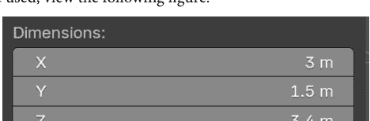

图 15.10 – 域尺寸

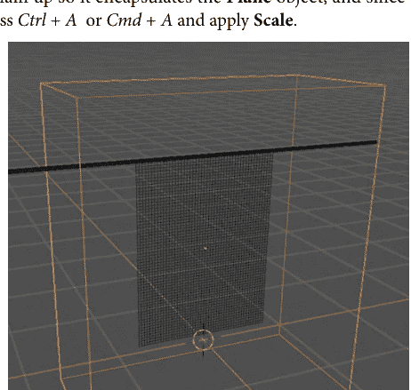

图 15.11 – 域大小

- 5. 对于**分辨率**，我们使用较高的值 256。如果你的电脑较慢，**分辨率**设为 128 也能很好地工作。
- 6. 我们还注意到模拟中火焰移动得有点太快。为了解决这个问题，将**时间比例**设为 0.7。这样会使火焰移动速度降低 30%。
- 7. 我们还将**CFL 数**改为 4。这将有助于稍微改善烘焙时间。

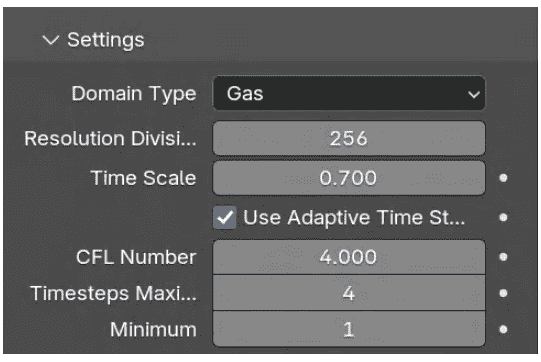

Figure 15.12 – 域设置

- 8. 接下来，向下滚动一点并通过点击复选框启用**自适应域**。这将根据火焰在内部的位置自适应地改变域的大小。启用**自适应域**后，烘焙时间将大幅改善！
- 9. 在火焰选项卡中，将**反应速度**提高到 0.8。此设置控制火焰的高度。值越高，火焰越短。
- 10. 我们还将**涡度**设为 0.6。这会让火焰具有一点更多的随机性和变化。

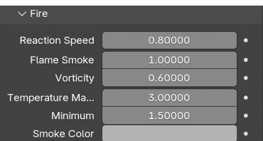

Figure 15.13 – 火焰设置

- 11. 现在打开**缓存**选项卡。如果你想保存模拟数据，请通过点击文件夹图标设置一个新目录。如果你不这样做，数据在关闭项目后会自动删除，这意味着下次打开此 blend 文件时，你需要重新烘焙模拟。不过这也可以是一件好事，可以节省硬盘空间。
- 12. 让我们将**类型**改为**模块化**，这样以后就可以烘焙模拟。确保**帧起始**和**结束**与你期望的模拟长度相匹配。
- 13. 我们还勾选**可恢复**，以防需要暂停烘焙。

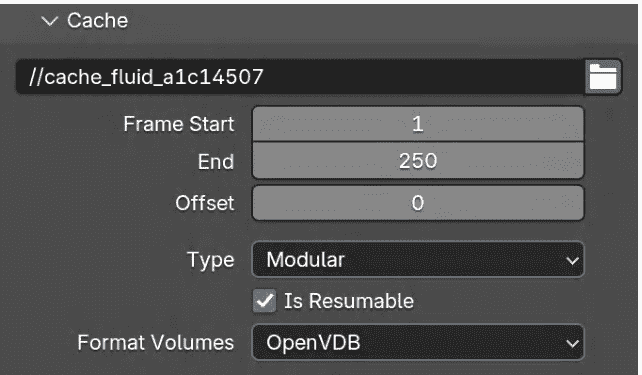

Figure 15.14 – 缓存设置

- 14. 最后，打开**字段权重**选项卡。目前我们有一个**风**力场，其**强度**为 2500，我们曾在布料模拟中使用。如果**强度**这么高，继续启用火焰会变得失控。与其删除力场，不如将**字段权重**中的**风**值设为 0。这样可以防止**风**力场影响火焰。

完成这些设置后，让我们设置流入对象并烘焙模拟！

## 设置流入

域设置完成后，是时候创建流入对象了！

- 1. 选择**平面**对象，并在**物理**面板中选择**流体**，将**类型**改为**流动**。
- 2. 对于**流动类型**选择**火焰**，对于**流动行为**，我们需要选择**流入**，这样它会不断向场景中添加火焰。
- 3. 对于最重要的一点，在**顶点组**菜单中选择**dp_weight**。现在火焰只会在平面对象的最底部出现，因为它被遮罩掉了。
- 4. 最后，打开**流动源**选项卡并将**表面发射**设为 1。这会使火焰更靠近网格表面。

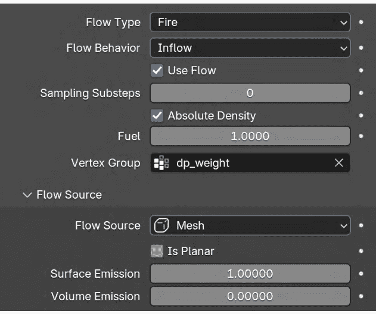

Figure 15.15 – 流入设置

这就是流入对象所需做的全部！现在让我们选择域。在**设置**选项卡中，点击**烘焙数据**！烘焙完成后，我们继续创建火焰材质并为平面添加燃烧效果！

## 添加烧焦和火焰材质

三个模拟都已完成并且在我们的平面对象上正常工作。接下来，我们将为火焰和**平面**对象创建材质！

### 域材质

我们将先从域火焰材质开始，然后再关注平面！

- 1. 转到屏幕顶部的**着色**工作区。

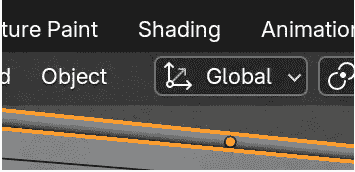

Figure 15.16 – 着色工作区

- 2. 确保你的域对象已选中，然后点击**新建**创建新材质。
- 3. 我们不需要**Principled BSDF**着色器，所以直接删除它。然后，添加一个**Principled Volume**着色器。按 *Shift + A* 然后前往**Shader | Principled Volume**。
- 4. 将**Volume**输出连接到**材质输出**节点的**Volume**输入。

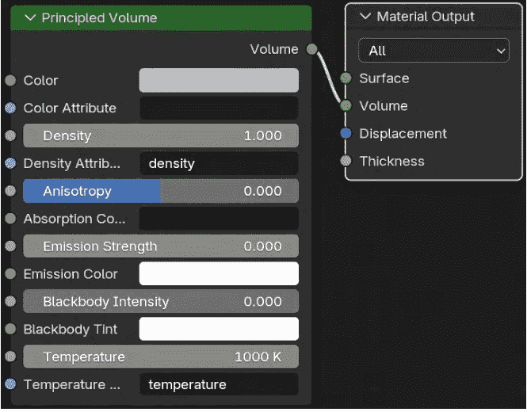

Figure 15.17 – Principled Volume 着色器

- 5. 我们将创建一个与*第3章*中类似的材质。我们将添加**Heat**属性来控制**Emission Strength**和**Emission Color**。为此，按 *Shift + A* 然后前往**Input | Attribute**添加**Attribute**节点，并将其放置在**Principled Volume**节点的左侧。

如*第3章*所述，**Heat**属性仅在 Cycles 中有效，因此如果尚未使用 Cycles 渲染，现在请切换过去。

- 6. 在名称字段中，输入单词 heat（全部小写）。
- 7. 接下来，让我们添加一个 Color Ramp 节点来控制 Heat 属性的外观！按 Shift + A，然后前往 Converter | Color Ramp。
- 8. 将 Attribute 节点的 Fac 输出连接到 Color Ramp 节点的 Fac 输入。
- 9. 然后，为了改变火焰的亮度，让我们添加一个 Math 节点。按 Shift + A 然后前往 Converter | Math。将节点放置在 Color Ramp 和 Principled Volume 节点之间，并将模式改为 Multiply。
- 10. 将 Color Ramp 节点的 Color 输出连接到 Math 节点的顶部输入，然后将 Math 节点的 Value 输出连接到 Principled Volume 节点的 Emission Strength。Math 节点的底部值现在控制火焰的亮度。我们使用 100！

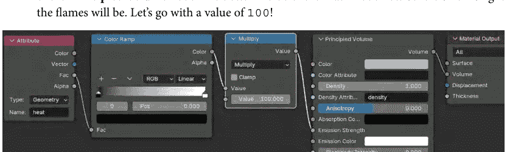

Figure 15.18 – Emission Strength 节点设置

- 11. 使用 Color Ramp 节点，我们将稍微改变手柄的位置。首先将白色手柄向中间移动，然后通过点击 + 按钮添加一个新手柄。将这个新手柄几乎移动到最右侧，但留一点空间，然后将颜色改为黑色。这样做会使火焰的最底部更透明。这将在我们添加烧焦材质时更容易看到它。
- 12. 我们需要添加的最后一个节点是用于 Emission Color。我们可以选中 Color Ramp 节点并按 Ctrl + Shift + D。这将在保持与 Attribute 节点连接的同时复制 Color Ramp 节点。将这个新的 Color Ramp 节点放置在第一个节点下方。
- 13. 将 Color 输出连接到 Principled Volume 节点的 Emission Color。
- 14. 对于这个新的 Color Ramp 上的手柄，将黑色手柄移动到右侧的 0.7 位置。接下来，将白色手柄的颜色改为更黄/橙的颜色。
- 15. 最后，通过点击 + 按钮再添加一个手柄。将这个新手柄放置在黑色和黄色手柄之间的中间位置。将颜色改为更深的橙色。查看下图以了解完整的节点设置：

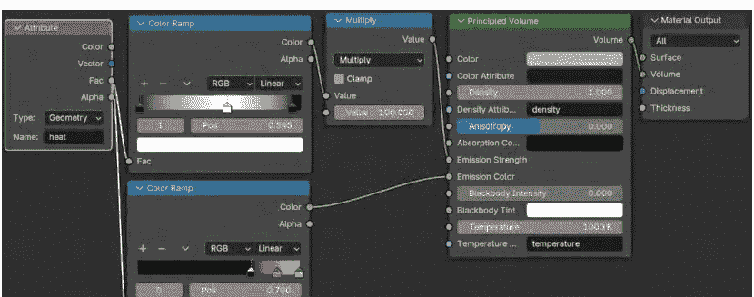

Figure 15.19 – 域节点设置

如果我们现在进入渲染视图，火焰应该看起来像这样：

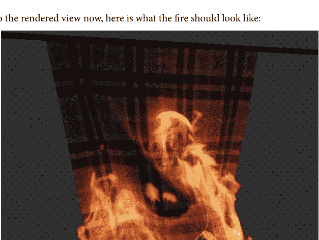

Figure 15.20 – 火焰渲染预览

接下来是平面烧焦材质！

### 燃烧材质

如果你在现实生活中点燃一张纸，火焰会在燃烧时改变纸的颜色。这就是我们在这里使用**平面**对象所要复制的效果：

- 1. 开始时，选择**平面**对象。你会看到一个已有的基础材质，其中包含图像纹理和一个**Bump**节点以增加深度。
- 2. 为了在平面燃烧时创建这种颜色变化，我们将添加三个不同的节点。第一个是**Attribute**节点。按 *Shift + A*，然后前往**Input**添加一个**Attribute**节点，并将其放置在**Image Texture**节点上方。
- 3. 在**名称**字段中，我们将使用本章开头创建的顶点组：**dp_weight**。需要注意的是，在材质节点设置中使用顶点组仅在 Cycles 中有效。EEVEE 不支持顶点组影响材质。由于我们已经在 Cycles 中，这应该无关紧要，但对未来项目了解这一点是好的。
- 4. 为了让**dp_weight**影响材质，我们需要将**Image Texture**和**Attribute**节点混合在一起。按 *Shift + A* 然后前往**Color**添加一个**Mix Color**节点。
- 5. 从**Attribute**节点取出**Fac**并连接到**Mix**节点的**Factor**。然后从**Hue/Saturation/Value**取出**Color**并连接到**A**输入。

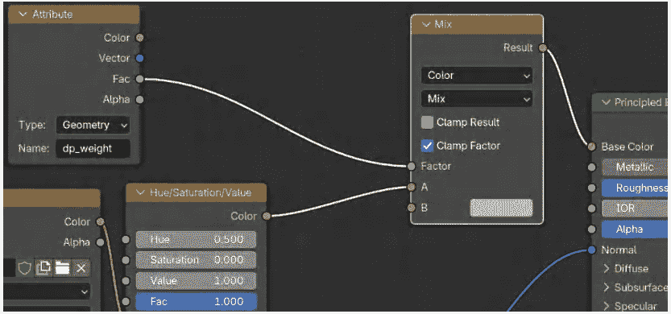

Figure 15.21 – 添加 Mix 节点

- 6. **B**输入颜色现在控制烧焦区域的外观。让我们将此颜色改为黑色。
- 7. 我们将添加的最后一个节点是另一个**Math**节点。按 *Shift + A*，前往**Converter**，并选择**Math**。将其放置在**Attribute**和**Mix**节点之间。

8. 将模式设为 Multiply 时，底部值控制烧焦区域的暗度。这里的值 2 效果很好。以下是完整的节点设置。

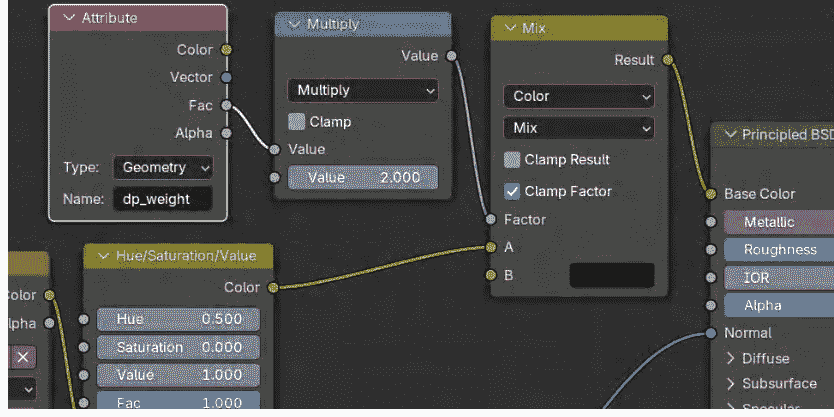

Figure 15.22 – 烧焦材质设置

当我们播放动画时，Plane 对象上带有火焰的区域现在应显示非常暗的颜色，表示它们正在燃烧。以下是颜色变化前后的模拟示例：

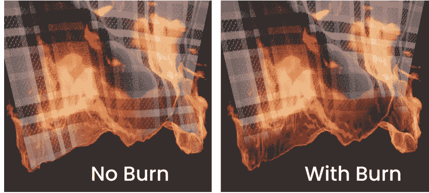

Figure 15.23 – 应用烧焦效果前后的模拟

好了——本项目到此结束！此时，我们已准备好渲染最终动画。如果您需要复习 Blender 中渲染动画的方法，*第4章* 中有完整讲解。以下图示是 **第80帧** 的渲染图像。

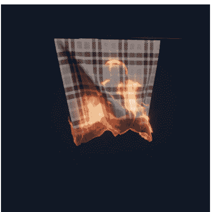

Figure 15.24 – 第80帧渲染

如果您想下载本项目的 Blender 文件，也可以在此处下载：https://github.com/PacktPublishing/Learn-Blender-4-Simulations-the-Right-Way/tree/main/Chapter%2015

最后还需要提及的是我们创建的模拟的顺序以及其重要性。如果我们使用的三个模拟没有按照本章所示的顺序创建，该项目将无法正常工作。如果我们先创建布料模拟，使用画笔创建平滑过渡会困难得多，因为平面会在风中流动和移动。同样，火焰模拟也不会工作，因为我们需要动态绘画模拟来确定火焰在平面上的位置。

因此，在未来的项目中，当您决定同时使用多个模拟时，请注意哪个模拟需要先创建，以便一切正常工作！

## Summary

物理模拟如今无处不在：电影、电视节目、广告，甚至健康和教育。本书中讨论的内容只是使用这些模拟可以做到的事情的一小部分。我鼓励您进入 Blender 并尝试酷炫有趣的想法。限制只在您的想象力！

让我们快速回顾一下本章学到的所有内容！首先，我们添加了一个二十面体，并经历了网格向上移动时进行位移的过程。在此基础上，我们使用 **权重表面类型** 创建了动态绘画模拟。之后，我们使用了布料模拟和力场使平面在风中流动和移动。我们创建的最后一个模拟是火焰。我们讨论了如何使用之前创建的顶点组来确定我们希望火焰出现的位置。最后，我们使用热属性和 **颜色渐变** 创建了火焰材质。我们还在有火焰的地方为 **平面** 对象添加了烧焦效果。

我希望您喜欢学习 Blender 提供的所有模拟，并且它能帮助您完成自己的项目和动画。每个模拟都有其用途，并且可以在许多不同的场景和项目中提供极大帮助。请记住继续学习，如果您需要复习 Blender 中的某个模拟，随时可以再次打开本书！

## Index