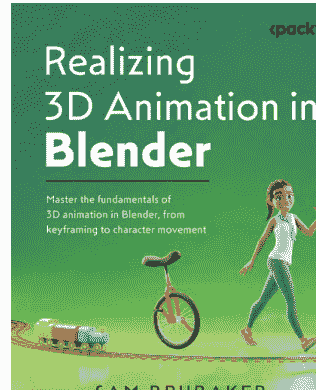
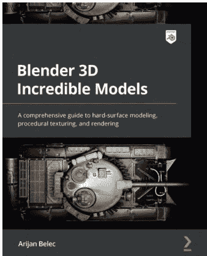

## A

主动刚体 226
控制气流属性
  密度 7
  效应器 7
  流 7
  力场 7
  热 7
  属性 7

## B

坏几何体 131
烘焙 138
弯曲弹簧 178
Blender 3
画笔 303
  设置选项卡 303, 304
  源菜单 305-309
  速度选项卡 310
  波浪选项卡 312, 313
烧焦材质
  添加 378-380

## C

缓存 138
缓存面板 28, 29

篝火模拟
  创建 64
  设置域对象 64, 65
  添加效应器 69, 70
  添加最终细节 78, 79
  创建火焰材质 70-74
  设置流入 66-69
  创建粒子材质 77
  使用粒子系统创建火花 74-76
画布对象 285
  缓存选项卡 301, 302
  输出选项卡 301-303
  设置选项卡 285-287
  表面类型选项 287-289
厘泊 (cP) 单位 40
CGTrader
  网址 104
化学爆炸 107
布料模拟 178-180
  缓存选项卡 191, 192
  碰撞设置 196-198
  创建 367, 368
  字段权重选项卡 200
  物理属性设置 184, 185
  属性权重选项卡 198-200
  设置和值 182-184
  形状选项卡 192-196

## E

EEVEE 渲染引擎 18, 19
  渲染爆炸 123-125
  创建玻璃材质 169-173
效应器对象 11, 60
  设置 61
电梯
  模拟 255-260
爆炸 107
  化学爆炸 107
  设置域 113-115
  创建火焰 119-121
  添加流入 115, 116
  创建材质 117
  机械爆炸 107
  核爆炸 107
  创建粒子系统 108-113
  在 Cycles 中渲染 121, 122
  在 EEVEE 中渲染 123-125
  创建模拟 113
  创建烟雾 117-119

## D

布料模拟，物理属性设置
  阻尼选项卡 187
  内部弹簧框 187-189
  压力设置 189-191
  刚度选项卡 185-187
集合面板 51
碰撞对象 132-135, 180-182
碰撞 61
压缩弹簧 178
Cycles 引擎 18
  渲染爆炸 121, 122
扩散 40
  设置 40, 41
域火焰材质
  添加 374-377
域对象 6, 9, 10, 24
  缓存面板 28, 29
  集合面板 51
  扩散设置 40, 41
  字段权重 51
  气体域 29-35
  指南设置 47-50
  液体域 36-40
  网格面板 44-47
  粒子面板 41-43
  渲染选项卡 53, 54
  设置 25-27
  视口显示 52, 53
多米诺效应
  创建 254, 255
驱动器 356
动态绘画 275-280
动态绘画模拟 323
  创建 280-284, 326-329
  实例化立方体 324-326
动态权重绘画 364-367

## F

字段权重 51
火焰材质
  添加烧焦材质 378-380
  添加域材质 374-377
火焰模拟 11
  渲染动画 18, 19
  设置相机 17
  创建 370
  添加域 371-373
  设置域对象 13-15
  设置流对象 15
  设置流入 373, 374
  创建材质 16, 17
对象，添加 12, 13
输出，设置 19, 20
旗帜 203
  渲染动画 220, 221
  创建 204-206
  创建挂钩材质 219, 220
旗帜布料模拟
  创建 212-216
旗帜材质
  创建 217-219
旗杆 203
  创建 206-209
  创建挂钩 210, 211
  创建绳索 209, 210
旗杆材质
  创建 220
流对象 10, 11, 54
  设置 55-60
流 7
每秒帧数 (FPS) 137

## G
气体域 24, 29
  设置 30-35
气体模拟 4-6
玻璃材质
  在 EEVEE 中创建 169-173
良好几何体 131
引导效应器 11
引导 47, 61
  设置 48-50

## H
光晕 75
升旗索 203
十六进制 (hex) 代码 95
高动态范围 (HDR) 220
起重装置 203

## I
折射率 95
实例 324

## L
液体域 24, 36
  设置 36-40
液体模拟 4, 8, 9
低多边形 (low poly) 87, 130

## M
Mantaflow 3, 4
Mask 修改器
  使用 369, 370
机械爆炸 107
网格 7, 44
网格面板
  设置 44-47
多个软体
  交互 152

## N
法线 134
核爆炸 107

## P
画笔
  动画制作 316-319
  创建画布材质 329-336
  动态绘画模拟 323
创建毛发材质 336, 337
创建毛发粒子 319-323
添加材质 329-337
设置渲染 338, 339
**绘画表面类型**
干燥选项卡 291
效果选项卡 292-294
初始颜色设置 295
**粒子面板 41**
设置 42, 43
**粒子系统 7**
**帕斯卡秒 (Pa.S) 40**
**被动刚体 226**
**Poly Haven**
网址 104

## R
**雨滴效果**
创建粒子系统 347-349
设置渲染 359, 360
场景设置 342-346
创建水材质 354-358
模拟波浪 350-353
**渲染选项卡 53, 54**
**分辨率 6**
**刚体**
主动 226
被动 226
**刚体约束 240**
固定 242
通用 245
通用弹簧 246, 247
铰链 244
马达 247-249
活塞 245
点 243
设置 241, 242
滑块 244
类型 242
**刚体对象菜单 239**
**刚体物理课程**
添加相机动画 268, 269
立方体坍塌 265-267
创建多米诺效应 254, 255
模拟电梯 255-260
创建铰链 263-265
设置渲染 269, 270
动画制作刚体 261-263
创建模拟 252
模拟拆迁球 252-254
**刚体设置 228**
碰撞选项卡 230-235
动力学选项卡 235
设置选项卡 228-230
**刚体模拟 225-228**
**刚体世界 236-238**

## S
**剪切弹簧 178**
**快挂钩 203**
**软体**
缓存选项卡 137-139
边缘选项 143-148
字段权重选项卡 151
目标 140-143
对象设置 136, 137
自碰撞 148-150
求解器选项卡 150, 151
**软体目标**
使用 164-168

### 软体障碍赛道
相机追踪，设置 173-175
布料模拟，创建 161-163
碰撞，添加 157-160
玻璃材质，在 EEVEE 中创建 169-173
模拟，创建 156
软体，添加 156
Soft Body Goal，使用 164-168

### 软体模拟 129, 130
创建 130

### 弹簧
弯曲弹簧 178
压缩弹簧 178
剪切弹簧 178
拉伸弹簧 178

### 表面着色器 16

### 表面类型选项，画布对象 287
位移 296, 297
绘制 290
波浪 299-301
权重 297-299

## T
### 慕尼黑工业大学 (TUM) 4
### 拉伸弹簧 178

## V
### 向量模糊 97
### 顶点格式
使用 332
### 顶点组 137
### 视口显示 52, 53
### 体积着色器 16
### 体素 6

## W
### 瀑布
动画，渲染 101-104
效应器，添加 90, 91
泡沫粒子，添加 91-94
流入对象，添加 89, 90
材质，创建 95, 96
模拟，设置 84-88
向量模糊，添加 96-100
### 拆迁球
模拟 252-254

packtpub.com

订阅我们的在线数字图书馆，即可全面访问 7,000 多本图书和视频，以及行业领先的工具，帮助您规划个人发展并推进职业生涯。更多信息，请访问我们的网站。

## 为什么订阅？

- 用来自 4,000 多名行业专业人士的实用电子书和视频，花更少时间学习，花更多时间编码
- 使用专为你打造的技能计划提升学习效果
- 每月获得一本免费电子书或视频
- 完全可搜索，便于快速获取重要信息
- 复制粘贴、打印和书签保存内容

在 www.packtpub.com，您还可以阅读一系列免费技术文章，订阅多种免费通讯，并获得 Packt 图书和电子书的独家折扣和优惠。

## 你可能喜欢的其他书籍

如果你喜欢这本书，你可能也会对 Packt 出版的其他这些书籍感兴趣：

在 Blender 中实现 3D 动画

Sam Brubaker

ISBN: 978-1-80107-721-7

- 熟练掌握关键帧和插值的简单规则
- 了解 Blender 动画曲线的功能和行为
- 使用 Blender 3D 角色动画让角色栩栩如生
- 利用多台摄像机和视频序列编辑器进行高级镜头合成
- 掌握 Blender 神秘的非线性动画工具
- 探索高级功能，如物理模拟和摄像机技巧

## Blender 3D 令人惊叹的模型

Arijan Belec

ISBN: 978-1-80181-781-3

- 深入了解硬表面建模背后的基本理论
- 探索 Blender 丰富的建模工具和功能
- 使用参考资料制作精致且准确的模型
- 创建具有逼真纹理和材质的模型
- 设置灯光并以风格化方式渲染场景
- 精通多边形的使用，制作游戏优化模型
- 通过探索绑定世界开发令人印象深刻的动画
- 使用纹理绘制和修改器渲染最细微的细节

## Packt 正在寻找像你这样的作者

如果你有兴趣成为 Packt 的作者，请访问 authors.packtpub.com 并立即申请。我们已与数千名开发者和技术专业人士合作，就像你一样，帮助他们与全球技术社区分享见解。你可以提交通用申请，申请我们正在招聘作者的特定热门主题，或提交自己的想法。

## 分享你的想法

现在你已经完成了 *以正确的方式学习 Blender 模拟*，我们很想听听你的想法！如果你是在 Amazon 购买了本书，请点击这里直接前往该书在 Amazon 的评论页面分享你的反馈，或在你购买的网站上留下评论。

你的评论对我们和技术社区都很重要，有助于确保我们提供优质内容。

## 下载本书的免费 PDF 副本

感谢购买本书！

你喜欢随时阅读，但无法随身携带印刷书籍吗？

你的电子书购买与你选择的设备不兼容吗？

不用担心，现在每本 Packt 书籍都免费提供 DRM 免费的 PDF 版本。

在任何地方、任何地点、使用任何设备阅读。直接从你喜爱的 technical 书籍中搜索、复制和粘贴代码到你的应用程序中。

福利还不止于此，你可以每天通过收件箱独家获取折扣、通讯和优质免费内容

按照以下简单步骤获取福利：

- 1. 扫描二维码或访问下方链接
- 2. 提交你的购买证明
- 3. 就这样！我们会直接将你的免费 PDF 和其他福利发送到你的电子邮件

https://packt.link/free-ebook/9781836200055

## 在 Discord 上加入我们的社区

加入我们社区的 Discord 空间，与作者和其他读者讨论：

https://packt.link/learn-blender-simulations-discord-invite

