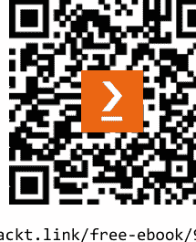
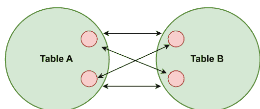
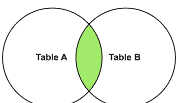
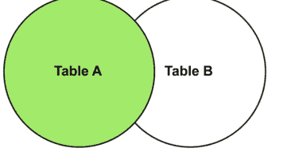
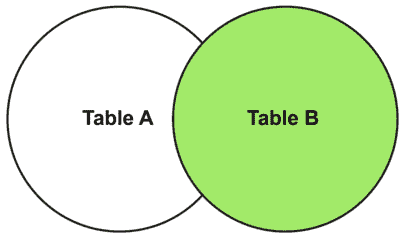
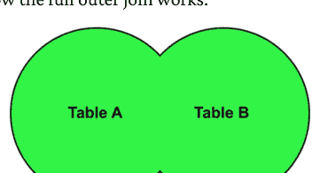
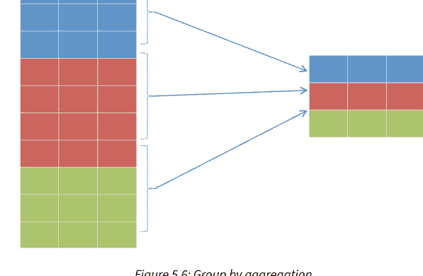

# PostgreSQL 学习 - 第二版：使用、管理并构建 PostgreSQL 16 安全可扩展数据库


To my beautiful wife, Emanuela; I love her like Santa loves his reindeer.

To my great son, Diego, who changed our lives on 1283788200.

To my parents, Miriam and Anselmo: my greatest fans since day one.

– Luca Ferrari

In loving memory of my father, Ilario.

– Enrico Pirozzi

## Contributors

## About the authors

**Luca Ferrari** has been passionate about computer science since the Commodore 64 era, and today holds a master’s degree (with honors) and a Ph.D. from the University of Modena and Reggio Emilia. He has written several research papers, technical articles, and book chapters. In 2011, he was named an adjunct professor by Nipissing University. An avid Unix user, he is a strong advocate of open-source, and in his free time, he collaborates on a few projects. He first encountered PostgreSQL back in the days of release 7.3; he was a founder and former president of the **Italian PostgreSQL Users’ Group (ITPUG)**. He also talks regularly at technical conferences and events and delivers professional training.

**Enrico Pirozzi** has been passionate about computer science since he was a 13-year-old. His first computer was a Commodore 64, and today he holds a master’s degree from the University of Bologna. He has participated as a speaker at national and international conferences on PostgreSQL. He first encountered PostgreSQL back in release 7.2, he was a co-founder of the first PostgreSQL Italian mailing list and the first Italian PostgreSQL website, and he talks regularly at technical conferences and events and delivers professional training. Right now, he is employed as a PostgreSQL database administrator at Zucchetti Hospitality (Zucchetti Group S.p.a).

## About the reviewers

**Chris Mair** holds a master’s degree from the University of Trento, Italy, and has been freelance since 2003. His portfolio consists of contributions to over 25 companies, including consultancy work on database programming, performance optimization, and seamless migrations. Chris has expertise in system and network programming, data processing, ML, and more. He has a particular affinity for PostgreSQL. He has taught over 200 courses on various IT topics and is passionate about open-source software.

**Silvio Trancanella** is a software engineer with around 12 years of experience in backend development, mainly using Java Enterprise and PostgreSQL. He has always been fascinated by database management and was immediately drawn to PostgreSQL from the very beginning of his career. He worked for about 10 years on tourism industry software, developing and maintaining critical services that relied on the PostgreSQL DBMS.

## Learn more on Discord

To join the Discord community for this book – where you can share feedback, ask questions to the author, and learn about new releases – follow the QR code below:

https://discord.gg/jYWCjF6Tku


# Chapter 1: Introduction to PostgreSQL 1

Technical requirements ........................................................................ 2

PostgreSQL at a glance ........................................................................ 2

A brief history of PostgreSQL • 4

What’s new in PostgreSQL 16? • 5

PostgreSQL release policy, version numbers, and life cycle • 5

Exploring PostgreSQL terminology ........................................................................ 6

Installing PostgreSQL ........................................................................ 10

What to install • 11

Installing PostgreSQL from binary packages • 12

Using the book’s Docker images • 13

Installing PostgreSQL on GNU/Linux Debian, Ubuntu, and derivatives • 14

Installing PostgreSQL on Fedora Linux • 15

Installing PostgreSQL on FreeBSD • 16

Installing PostgreSQL from sources • 17

Installing PostgreSQL via pgenv • 18

Summary ........................................................................ 19

References ........................................................................ 20

# Chapter 2: Getting to Know Your Cluster 21

Technical requirements ........................................................ 22

Managing your cluster ........................................................ 22

pg_ctl • 22

PostgreSQL processes • 28

Connecting to the cluster ........................................................ 31

The template databases • 31

The psql command-line client • 33

Entering SQL statements via psql • 35

A glance at the psql commands • 38

Introducing the connection string • 39

Solving common connection problems ........................................................ 40

Database “foo” does not exist • 40

Connection refused • 40

No pg_hba.conf entry • 41

Exploring the disk layout of PGDATA ........................................................ 42

Objects in the PGDATA directory • 43

Tablespaces • 45

Exploring configuration files and parameters ........................................................ 46

Summary ........................................................ 48

Verify your knowledge ........................................................ 49

References ........................................................ 49

# Chapter 3: Managing Users and Connections 51

Technical requirements ........................................................ 52

Introduction to users and groups ........................................................ 52

Managing roles ........................................................ 53

Creating new roles • 53

Role passwords, connections, and availability • 54

Using a role as a group • 55

Removing an existing role • 57

Inspecting existing roles • 58

## Managing incoming connections at the role level ........................................................ 61

The syntax of pg_hba.conf • 62

Order of rules in pg_hba.conf • 64

Merging multiple rules into a single one • 64

Using groups instead of single roles • 65

Using files instead of single roles • 66

Inspecting pg_hba.conf rules • 67

Including other files in pg_hba.conf • 68

## Summary ................................................................................................................................ 68

## Verify your knowledge ........................................................................................................................ 69

## References ................................................................................................................................ 69

# Chapter 4: Basic Statements 71

## Technical requirements ........................................................................................................................ 72

Using the Docker image • 72

Connecting the database • 72

## Creating and managing databases ........................................................................................................ 73

Creating a database • 73

Managing databases • 74

Introducing schemas • 74

PostgreSQL and the public schema • 74

The search_path variable • 75

The correct way to start working • 75

Listing all tables • 76

Making a new database from a modified template • 77

Dropping tables and databases • 78

Dropping tables • 78

Dropping databases • 79

Making a database copy • 79


- 确认数据库大小 • 80
- psql 方法 • 80
- SQL 方法 • 81
- 数据库创建幕后 • 81

### 管理表 ... 84
- EXISTS 选项 • 85
- 管理临时表 • 86
- 管理未记录日志的表 • 88
- 创建表 • 89

### 理解基本的表操作语句 ... 90
- 插入和查询数据 • 90
- NULL 值 • 94
- 对 NULL 值排序 • 96
- 从另一个表创建表 • 97
- 更新数据 • 98
- 删除数据 • 99

### 总结 ... 101
### 验证你的知识 ... 101
### 参考资料 ... 102

# 第5章：高级语句 105
### 技术要求 ... 105
### 探索 SELECT 语句 ... 105
- 使用 LIKE 子句 ... 106
- 使用 ILIKE ... 108
- 使用 DISTINCT ... 108
- 使用 LIMIT 和 OFFSET ... 111
- 使用子查询 ... 112
  - 子查询与 IN/NOT IN 条件 • 113
  - 子查询与 EXISTS/NOT EXISTS 条件 • 116

### 了解连接 ... 117
- 使用 INNER JOIN • 119
- INNER JOIN 与 EXISTS/IN 的对比 • 120
- 使用 LEFT JOIN • 121
- 使用 RIGHT JOIN • 125
- 使用 FULL OUTER JOIN • 127
- 使用 LATERAL JOIN • 129

### 聚合函数 ... 130
- UNION/UNION ALL • 133
- EXCEPT/INTERSECT • 135

### 使用 UPSERT ... 137
- UPSERT – PostgreSQL 方式 • 137

### 学习 INSERT 的 RETURNING 子句 ... 140
- 从查询中返回元组 • 141
- 与多条记录相关的 UPDATE • 141
- MERGE • 142
- 探索 UPDATE ... RETURNING • 144
- 探索 DELETE ... RETURNING • 145

### 探索 CTE ... 145
- CTE 概念 • 145

### PostgreSQL 12 以来的 CTE ... 146
- CTE – 使用场景 • 147
- 查询递归 • 149
- 递归 CTE • 150

### 总结 ... 151
### 验证你的知识 ... 152
### 参考资料 ... 153

# 第6章：窗口函数 ... 155
### 技术要求 ... 155
### 使用基本语句的窗口函数 ... 156
- 使用 PARTITION BY 函数和 WINDOW 子句 • 157
- 介绍一些有用的函数 • 158
- ROW_NUMBER 函数 • 159
- ORDER BY 子句 • 159
- FIRST_VALUE • 160
- LAST_VALUE • 161
- RANK • 161
- DENSE_RANK • 162
- LAG 和 LEAD 函数 • 163
- CUME_DIST 函数 • 165
- NTILE 函数 • 165

### 使用高级语句的窗口函数 ... 167
- 帧子句 • 167
- ROWS BETWEEN 起点和终点 • 168
- RANGE BETWEEN 起点和终点 • 174

### 总结 ... 178
### 验证你的知识 ... 179
### 参考资料 ... 180

# 第7章：服务端编程 181
### 技术要求 ... 182
### 探索数据类型 ... 182
- 可扩展性的概念 • 182
- 标准数据类型 • 182
- 布尔数据类型 • 183
- 数值数据类型 • 184
- 整数类型 • 185
- 固定精度数值数据类型 • 186
- 任意精度数值数据类型 • 186
- 字符数据类型 • 188
- 固定长度字符数据类型 • 188
- 有限制的可变长度字符数据类型 • 190
- 无限制的可变长度字符数据类型 • 191
- 日期/时间戳数据类型 • 192
- 日期数据类型 • 192
- 时间戳数据类型 • 195
- **NoSQL 数据类型** • 197
  - hstore 数据类型 • 198
  - JSON 数据类型 • 201

### 探索函数和语言 ... 205
- 函数 • 205
- SQL 函数 • 206
- 基础函数 • 206
- 返回元素集合的 SQL 函数 • 207
- 返回表的 SQL 函数 • 208
- 多态 SQL 函数 • 210
- PL/pgSQL 函数 • 211
  - 初步概述 • 211
  - 删除函数 • 213
  - 声明函数参数 • 213
    - *IN/OUT 参数* • 214
    - *函数易变性类别* • 216
  - 控制结构 • 219
  - 条件语句 • 220
    - *IF 语句* • 220
    - *CASE 语句* • 222
  - 循环语句 • 225
    - *记录类型* • 226
  - 异常处理语句 • 228
  - 安全定义者 • 229

### 总结 ... 231
### 验证你的知识 ... 231
### 参考资料 ... 232

# 第8章：触发器和规则 233
### 技术要求 ... 234
### 探索 PostgreSQL 中的规则 ... 234
- 理解 OLD 和 NEW 变量 • 234
- 针对 INSERT 的规则 • 235
  - ALSO 选项 • 236
  - INSTEAD OF 选项 • 237
- 针对 DELETE/UPDATE 的规则 • 239
  - 创建新的 tags 表 • 240
  - 创建两张表 • 241
- 管理 INSERT、DELETE 和 UPDATE 事件上的规则 • 242
  - INSERT 规则 • 243
  - DELETE 规则 • 245
  - UPDATE 规则 • 247

### 管理 PostgreSQL 中的触发器 ... 249
- 触发器语法 • 250
- 针对 INSERT 的触发器 • 252
- TG_OP 变量 • 257
- 针对 UPDATE / DELETE 的触发器 • 257

### 事件触发器 ... 264
- 一个事件触发器示例 • 265

### 总结 ... 267
### 验证你的知识 ... 268
### 参考资料 ... 269

# 第9章：分区 271
### 技术要求 ... 271
### 基本概念 ... 271
- 范围分区 • 273


- 列表分区 • 274
- 哈希分区 • 275
- 表继承 • 276
- 删除表 • 280

### 探索声明式分区 280
- 列表分区 • 281
- 范围分区 • 284
- 分区维护 • 288
- 附加新分区 • 288
- 分离现有分区 • 289
- 将现有表附加到父表 • 290

### 默认分区 291
### 分区与表空间 292
### 简单案例研究 295
### 总结 303
### 验证你的知识 303
### 参考资料 305

# 第10章：用户、角色与数据库安全 307
### 技术要求 308
### 理解角色 308
- 与新对象相关的属性 • 308
- 与超级用户相关的属性 • 309
- 与复制相关的属性 • 309
- 与RLS相关的属性 • 309
- 更改现有角色的属性：ALTER ROLE语句 • 310
- 重命名现有角色 • 310
- SESSION_USER 与 CURRENT_USER • 311
- 每角色配置参数 • 312
- 检查角色 • 313
- 继承其他角色的角色 • 316
- 理解权限如何解析 • 319
- 角色继承概述 • 323

### ACL 323
- 默认ACL • 327
- 了解默认ACL • 330

### 授予和撤销权限 331
- 与表相关的权限 • 332
- 基于列的权限 • 333
- 与序列相关的权限 • 337
- 与模式相关的权限 • 339
- 模式中的所有对象 • 341
- 与编程语言相关的权限 • 342
- 与例程相关的权限 • 342
- 与数据库相关的权限 • 343
- 其他GRANT和REVOKE语句 • 344
- 分配对象所有者 • 344
- 检查ACL • 345

### RLS 346
### 角色密码加密 352
### SSL连接 353
- 为SSL配置集群 • 353
- 通过SSL连接到集群 • 354

### 总结 355
### 验证你的知识 356
### 参考资料 356

# 第11章：事务、MVCC、WAL与检查点 359
### 技术要求 360
### 事务介绍 360
- 比较隐式事务和显式事务 • 362
- 事务内的时间 • 368
- 关于事务标识符的更多内容——XID回卷问题 • 369
- 虚拟和真实事务标识符 • 371
- 多版本并发控制 • 373

### 事务隔离级别 379
- 读未提交 • 381
- 读已提交 • 381
- 可重复读 • 381
- 可串行化 • 382

### 解释MVCC 384
### 保存点 387
### 死锁 390
### PostgreSQL如何实现持久性和一致性：WAL 393
- WAL • 393
- WAL作为崩溃时的救援方法 • 397
- 检查点 • 398
- 检查点配置参数 • 399
- checkpoint_timeout 和 max_wal_size • 400
- 检查点节流 • 402
- 手动发出检查点 • 403

### VACUUM 403
- 手动VACUUM • 404
- 自动VACUUM • 410

### 总结 412
### 验证你的知识 413
### 参考资料 414

# 第12章：扩展数据库——扩展生态系统 415
### 技术要求 415
### 扩展介绍 416
- 扩展生态系统 • 417
- 扩展组件 • 418
- 控制文件 • 419
- 脚本文件 • 420

### 管理扩展 421
- 创建扩展 • 421
- 查看已安装的扩展 • 422
- 查找可用的扩展版本 • 423
- 更改现有扩展 • 424
- 删除现有扩展 • 427

### 探索PGXN客户端 428
- 在Debian GNU/Linux及其衍生版本上安装pgxnclient • 429
- 在Fedora Linux和基于Red Hat的发行版上安装pgxnclient • 429
- 在FreeBSD上安装pgxnclient • 429
- 从源代码安装pgxnclient • 429
- pgxnclient命令行界面 • 430

### 安装扩展 432
- 通过pgxnclient安装扩展 • 432
- 手动安装扩展 • 433
- 使用已安装的扩展 • 436
- 删除已安装的扩展 • 437
- 通过pgxnclient删除扩展 • 439
- 删除手动编译的扩展 • 439

### 创建你自己的扩展 439
- 定义示例扩展 • 439
- 创建扩展文件 • 440
- 安装扩展 • 442
- 创建扩展升级 • 443
- 执行扩展升级 • 445

### 总结 446
### 验证你的知识 446
### 参考资料 447

# 第13章：查询调优、索引与性能优化 449
### 技术要求 450
### 语句的执行 450
- 执行阶段 • 451
- 优化器 • 452
- 优化器使用的节点 • 454
- 顺序节点 • 454
- 并行节点 • 457
- 优化器何时选择并行计划？ • 458
- 工具节点 • 459
- 节点成本 • 460

### 索引 462
- 索引类型 • 462
- 创建索引 • 463
- 检查索引 • 465
- 删除索引 • 468
- 使索引失效 • 469
- 重建索引 • 470

### EXPLAIN语句 470
- EXPLAIN输出格式 • 473
- EXPLAIN ANALYZE • 474
- EXPLAIN选项 • 476

### 查询调优示例 480
### ANALYZE以及如何更新统计信息 491
### 自动解释 494
### 总结 498
### 验证你的知识 499
### 参考资料 500


# 第14章：日志记录与审计 503

技术要求 ......................................................... 503

日志介绍 ......................................................... 504

- 在何处记录日志 • 505
- 何时记录日志 • 508
- 记录什么内容 • 512

从日志中提取信息 – pgBadger ......................................................... 514

- 安装 pgBadger • 514
- 为 pgBadger 使用配置 PostgreSQL 日志 • 515
- 使用 pgBadger • 516
- 安排 pgBadger • 521

实现审计 ......................................................... 524

- 安装 PgAudit • 525
- 配置 PostgreSQL 以利用 PgAudit • 526
- 配置 PgAudit • 527
- 按会话审计 • 528
- 按角色审计 • 530

总结 ......................................................... 532

检验你的知识 ......................................................... 532

参考资料 ......................................................... 533

# 第15章：备份与恢复 535

技术要求 ......................................................... 536

介绍备份和恢复的类型 ......................................................... 536

探索逻辑备份 ......................................................... 537

- 转储单个数据库 • 539
- 恢复单个数据库 • 543
- 限制备份的数据量 • 547
- 压缩 • 548
- 转储格式和 pg_restore • 549

执行选择性恢复 • 552

转储整个集群 • 555

并行备份 • 556

备份自动化 • 558

COPY 命令 • 559

### 探索物理备份 ........................................................ 563

执行手动物理备份 • 564

pg_verifybackup • 566

启动克隆集群 • 567

从物理备份恢复 • 568

### PITR 背后的基本概念 ........................................................ 569

### 总结 ........................................................ 570

### 检验你的知识 ........................................................ 570

### 参考资料 ........................................................ 571

# 第16章：配置与监控 573

### 技术要求 ........................................................ 574

### 集群配置 ........................................................ 574

检查所有配置参数 • 576

查找配置错误 • 578

嵌套配置文件 • 579

配置上下文 • 580

主要配置设置 • 581

WAL 设置 • 582

内存相关设置 • 584

进程信息设置 • 585

网络相关设置 • 585

归档和复制设置 • 586

Vacuum 和 autovacuum 相关设置 • 587

优化器设置 • 587

统计收集器 • 587

从实时系统修改配置 • 588

配置生成器 • 589

### 监控集群 ......................................................... 592

有关正在运行的查询和会话的信息 • 593

检查锁 • 594

检查数据库 • 596

检查表和索引 • 597

更多统计信息 • 599

### 使用 pg_stat_statements 进行高级统计 ......................................................... 600

安装 pg_stat_statements 扩展 • 600

使用 pg_stat_statements • 601

重置 pg_stat_statements 收集的数据 • 602

调整 pg_stat_statements • 602

### 总结 ......................................................... 603

### 检验你的知识 ........................................................ 603

### 参考资料 ........................................................ 604

# 第17章：物理复制 607

### 技术要求 ......................................................... 608

### 探索基本复制概念 ......................................................... 609

物理复制和 WAL • 609

wal_level 指令 • 610

为流复制准备环境设置 • 610

### 管理流复制 ......................................................... 612

流复制的基本概念 • 612

异步复制环境 • 614

wal_keep_segments 选项 • 615

槽位方式 • 616

pg_basebackup 命令 • 616

异步复制 • 617

副本监控 • 619

同步复制 • 620

PostgreSQL 设置 • 621

级联复制 • 623

延迟复制 • 626

将副本服务器提升为主服务器 • 626

总结 ........................................................................ 627

检验你的知识 ........................................................................ 628

参考资料 ........................................................................ 628

# 第18章：逻辑复制 631

技术要求 ........................................................................ 631

了解逻辑复制的基本概念 ........................................................................ 632

比较逻辑复制和物理复制 ........................................................................ 635

探索逻辑复制设置以及 PostgreSQL 16 上的新逻辑复制功能 . 636

逻辑复制环境设置 • 636

副本角色 • 637

主服务器 – postgresql.conf • 637

副本服务器 – postgresql.conf • 638

pg_hba.conf 文件 • 639

逻辑复制设置 • 639

监控逻辑复制 • 641

只读与允许写入 • 643

DDL 命令 • 649

禁用逻辑复制 • 651

使用物理复制实例进行逻辑复制 • 652

总结 ........................................................................ 657

检验你的知识 ........................................................................ 658

参考资料 ........................................................................ 658

# 第19章：实用工具和扩展 661

技术要求 ........................................................ 662

探索 pg_trgm 扩展 ........................................................ 662

使用外部数据包装器和 postgres_fdw 扩展 ................................... 665

使用 pgbackrest 进行灾难恢复 .......................................................... 667

基本概念 • 668

环境设置 • 669

公钥交换 • 669

安装 pgbackrest • 671

配置 pgbackrest • 672

存储库配置 • 672

使用对象存储支持的 pgbackrest • 675

PostgreSQL 服务器配置 • 675

postgresql.conf 文件 ............................................................... 675

pgbackrest.conf 文件 ............................................................... 676

创建和管理连续备份 • 677

创建 stanza • 677

检查 stanza • 677

管理基础备份 • 678

管理 PITR • 681

使用 pgloader 从 MySQL/MariaDB 迁移到 PostgreSQL ................................... 684

总结 ....................................................................... 688

检验你的知识 .............................................................. 688

参考资料 ..................................................................... 689

### 你可能喜欢的其他书籍 691

### 索引 697

## 本书适合谁

本书适合任何想从零开始学习 PostgreSQL 数据库的人，或希望构建健壮、可扩展且高可用的数据库应用程序的人。本书将介绍 PostgreSQL 的所有最新和最酷的功能，以及数据库管理员或应用程序开发人员从 PostgreSQL 实例中获得最佳效果所需的所有概念。虽然不需要事先了解 PostgreSQL，但预计读者熟悉数据库和 SQL 语言。

## 本书涵盖内容

*第1章，PostgreSQL 简介，* 解释了 PostgreSQL 数据库是什么、这个优秀且强大的企业级关系数据库背后的社区和开发情况，以及如何获取帮助和识别不同的 PostgreSQL 版本和依赖项。你还将学习如何通过二进制包或从源代码编译来获取和安装 PostgreSQL。你将看到如何使用操作系统工具（systemd 和 rc 脚本）管理集群。

*第2章，了解你的集群，* 通过指定文件系统上的内容、主要配置文件的位置以及它们的使用方式，展示了 PostgreSQL 集群的解剖结构。psql 命令行实用程序的描述将帮助你连接到数据库集群并与其交互。

*第3章，管理用户和连接，* 完整描述了正在运行的实例如何管理用户和连接，以及如何防止或限制用户连接。介绍了“角色”的概念，你将学习如何创建单个用户账户，以及相关用户组。

*第4章，基本语句，* 展示了如何创建和销毁主要数据库对象，例如数据库、表和模式。本章还涵盖了基本语句，例如 SELECT、INSERT、UPDATE 和 DELETE。本章展示了如何在 PostgreSQL 16 上管理 public 模式。

*第5章，高级语句，* 介绍了 PostgreSQL 提供的高级语句，例如公用表表达式、MERGE、UPSERT 以及带 RETURNING 行的查询。本章将提供何时以及如何使用它们的实用示例。


第6章“窗口函数”介绍了一组强大的函数，这些函数提供聚合功能，而无需将结果折叠为单行。换句话说，借助窗口函数，你可以对多行（窗口）执行聚合，同时仍然在输出中呈现所有元组。窗口函数使得商业智能的实现成为可能，并让报表变得简单。

第7章“服务端编程”解决了这样一个事实：虽然 SQL 足以处理大多数日常数据库工作，但你可能最终会遇到需要命令式方法的特定问题。本章展示了如何在数据库中实现自己的代码，如何用不同语言编写函数和过程，以及如何让它们与事务边界交互。

第8章“触发器与规则”通过实际示例介绍了触发器和规则，展示了各自的优缺点。本章最后还提供了事件触发器的示例。

第9章“分区”探讨了分区——将表拆分成更小的部分。PostgreSQL 支持分区已有很长时间，但从版本 10 开始引入了所谓的“声明式分区”。本章重点介绍与声明式分区相关的所有特性、其调优参数，以及如何使用不同的表空间对表进行分区。

第10章“用户、角色与数据库安全”首先介绍了用户管理：角色、组和密码。你将学习如何限制用户只能访问特定数据库以及只能从特定机器访问，以及如何管理与用户和数据库对象关联的权限。然后你将看到行级安全性如何加固表内容，并防止用户检索或修改不属于他们的元组。

第11章“事务、MVCC、WAL 与检查点”介绍了 PostgreSQL 中的基本概念：预写日志（WAL）以及允许数据库运行并发事务并将数据整合到存储中的机制。本章还介绍了事务隔离的概念、ACID 规则，以及数据库如何实现它们。接着，你将了解 WAL 如何加速数据库工作，同时又保护其免受崩溃影响。你将理解 MVCC 是什么以及它为何重要。最后，本章深入讲解了检查点及相关可调参数。

第12章“扩展数据库——扩展生态系统”介绍了一种便捷的方式，通过使用所谓的“扩展”为你的集群插入新功能。本章将展示什么是扩展；如何搜索、获取和安装第三方扩展；以及如何开发自己的扩展。

第13章“查询调优、索引与性能优化”讨论了任何数据库管理员都会关心的重要主题：性能。索引是帮助数据库访问最常用数据的快速方式，但由于维护成本，不能在一切对象上都建立索引。本章介绍可用的索引类型，然后解释如何识别可从索引中受益的表和查询，以及如何部署它们。借助 explain 和 autoexplain 等工具，你将能掌控查询。

第14章“日志与审计”解答了诸如“数据库集群中正在发生什么？”以及“昨天发生了什么？”等问题。拥有良好的日志记录和审计规则集是管理数据库集群的关键所在。本章将介绍日志记录的主要选项、如何使用 pgBadger 等外部工具检查日志，以及如何审计你的集群（这有助于使其符合数据监管政策，例如 GDPR）。

第15章“备份与恢复”解释了为何备份很重要，如何为整个集群或部分集群进行备份，以及如何从有效备份中恢复。本章介绍备份单个数据库或整个集群的基本且最常见的方法，以及如何执行归档和按时间点恢复。

第16章“配置与监控”介绍了集群配置选项以及用于从内部检查系统的 PostgreSQL 目录。将展示调整配置的不同方法。借助诸如 pg_stat_activity 之类的特殊扩展，你将能够实时监控用户对数据库执行的操作。

第17章“物理复制”涵盖了内置复制，这是一种允许你让多个实例保持运行并与单个主节点同步的机制，PostgreSQL 自版本 9 起就支持该机制。复制支持可扩展性和冗余，也支持许多其他场景，例如测试和比较数据库。本章介绍所谓的“物理复制”，即在一个持续跟随其主节点的实例上完整复制整个集群的方式。将介绍异步复制和同步复制，以及复制槽和延迟复制。

第18章“逻辑复制”涵盖了逻辑复制，它允许非常细粒度的复制，可指定哪些表需要复制、哪些不需要——PostgreSQL 自版本 10 起支持该功能。当然，这为跨不同数据库实例的数据共享提供了全新的丰富场景。本章介绍逻辑复制的工作原理、如何设置以及如何监控复制。

第19章“实用工具与实用扩展”应被视为本书的附录。在本章中，我们将讨论一些工具和扩展，它们能让数据库管理员以最小的精力完成最多的工作。

## 充分利用本书

若要充分利用本书，你需要具备 Linux（或其他类 Unix）操作系统的基础知识。所有 SQL 示例都可以使用 psql 命令行程序或任何可用的 GUI 工具（本书未介绍）运行，例如 PostgreSQL 专用的 pgAdmin4。Shell 脚本将使用 GNU Bash 脚本语言执行。

| 本书涵盖的软件/硬件 | 操作系统要求 |
|---|---|
| PostgreSQL 16 | Linux 操作系统/类 Unix 操作系统（例如 FreeBSD、OpenBSD） |

本书提供了一组 Docker 镜像，以便读者可以跟随并测试所有代码示例。运行 Docker 镜像不是强制性的，但这样做并不要求你拥有自己定制的 PostgreSQL 安装。为了运行 Docker 镜像，你需要在操作系统上安装 Docker 应用程序。

如果你使用的是本书的数字版本，我们建议你自己输入代码，或通过 GitHub 仓库（链接见下一节）访问代码。这样做将帮助你避免任何因复制粘贴代码而可能产生的错误。

## 下载示例代码文件

本书的代码包托管在 GitHub 上，地址为 https://github.com/PacktPublishing/Learn-PostgreSQL-Second-Edition。我们还提供了来自我们丰富书籍和视频目录的其他代码包，可在 https://github.com/PacktPublishing/ 获取。快去看看吧！

## 下载彩色图片

我们还提供了一个 PDF 文件，其中包含本书中使用的截图/图表的彩色图片。你可以在此处下载：https://packt.link/gbp/9781837635641。

## 使用的约定

本书通篇使用了许多文本约定。

CodeInText：表示文本中的代码字词、数据库表名、文件夹名、文件名、文件扩展名、路径名、虚拟 URL、用户输入和 Twitter 用户名。例如：“将下载的 WebStorm-10*.dmg 磁盘映像文件作为另一个磁盘挂载到你的系统中。”

代码块如下所示：

```
SELECT rolname, rolcanlogin,
    rolconnlimit, rolpassword
    FROM pg_roles
    WHERE rolname = 'luca';
```

当我们希望引起你对代码块中特定部分的注意时，相关行或项目会以粗体显示：

```
SELECT line_number, type,
    database, user_name,
    address, auth_method
    FROM pg_hba_file_rules;
```

任何命令行输入或输出都按如下方式书写：

```
$ sudo cat $PGDATA/rejected_users.txt
```

粗体：表示新术语、重要字词或你在屏幕上看到的文字。例如，菜单或对话框中的单词会以这种方式出现在文本中。例如：“从管理面板中选择系统信息。”

警告或重要提示显示如下：


提示和技巧显示如下：


## 联系我们

我们非常欢迎读者的反馈。

**一般反馈：** 请发送电子邮件至 feedback@packtpub.com，并在邮件主题中提及图书的标题。如果您对本书的任何方面有疑问，请发送电子邮件至 questions@packtpub.com。

**勘误：** 尽管我们已尽一切努力确保内容的准确性，但难免会出现错误。如果您在本書中发现错误，我们将非常感激您向我们报告。请访问 http://www.packtpub.com/submit-errata，单击 **Submit Errata**，并填写表格。

**盗版：** 如果您在互联网上发现我们作品的任何形式的非法副本，我们将非常感激您提供位置地址或网站名称。请发送电子邮件至 copyright@packtpub.com 并附上相关材料的链接。

**如果您有兴趣成为作者：** 如果您在某个领域拥有专业知识，并且有兴趣撰写或为一本书做出贡献，请访问 http://authors.packtpub.com。

## 分享您的想法

在您阅读完 *Learn PostgreSQL* 后，我们很想听听您的想法！请点击此处直接前往本书在 Amazon 的评论页面并分享您的反馈。

您的评论对我们和技术社区都非常重要，并将帮助我们确保提供优质的内容。

## 下载本书的免费 PDF 副本

感谢您购买本书！

您喜欢在旅途中阅读，但又无法随身携带印刷书籍吗？您购买的电子书与您选择的设备不兼容？

不用担心，现在购买每本 Packt 书籍，您都可免费获得该书的 DRM-free PDF 版本。

在任何地方、任何地点、在任何设备上阅读。直接从您喜爱的 technical 书籍中搜索、复制和粘贴代码到您的应用程序中。

福利还不止于此，您还可以每天通过电子邮件获得独家折扣、新闻通讯和精彩的免费内容

按照以下简单步骤获取福利：

- 1. 扫描二维码或访问下面的链接



https://packt.link/free-ebook/9781837635641

- 2. 提交您的购买证明

- 3. 就这样！我们会直接将您的免费 PDF 和其他福利发送到您的电子邮件

## 1

## PostgreSQL 简介

PostgreSQL 是一款广为人知的开源关系型数据库，其座右铭表明了该项目旨在成为 *世界上最先进的开源数据库*。

吸引大量新用户每年加入并让现有用户对 PostgreSQL 保持热情的主要品质是其坚如磐石的稳定性、可扩展性和安全性，以及企业级数据库管理系统必须提供的所有功能。

虽然 PostgreSQL 是一款关系型数据库，但其生态系统随着时间的推移不断发展，提供了一个丰富的平台，其中包含扩展、工具和语言，这些都由遍布全球的社区联系在一起。

PostgreSQL 是一个开源项目，并且完全在开源世界中开发。这意味着没有单一实体负责该项目，其结果是 PostgreSQL 不是一个商业产品。换句话说，PostgreSQL 属于所有人，任何人都可以为其做出贡献。得益于非常宽松的 BSD 风格许可证，PostgreSQL 可用于任何项目或场景，无论是开源还是闭源。

当然，为如此庞大和复杂的项目做出贡献需要软件开发、数据库概念方面的经验，当然还需要对开源和协作工作的积极态度。开源的本质意味着 PostgreSQL 将几乎永远存续下去，而不会因某家公司倒闭而随之沉没的风险。

官方的 PostgreSQL 开发者通常被称为 **PostgreSQL Global Development Group (PGDG)**，他们是在讨论和协调后实现主要功能并发布新版本的开发者。PGDG 每年发布一次生产版本，通常在每年的最后一个季度。

在撰写本文时，PostgreSQL 16 是该优秀数据库引擎的最新生产版本，和往常一样，下一个版本 PostgreSQL 17 的工作正在进行中。

本书将重点介绍您如何充分利用 PostgreSQL，从基础知识开始（管理用户、数据表、索引等），并逐步转向最令人兴奋和复杂的功能（例如复制您的数据以防止灾难）。我们将采取实用方法，提供多个示例，以便读者更好地理解每个概念并以更有趣、更快捷的方式获取知识。最后，您将能够完全管理一个 PostgreSQL 集群，并且得益于每章中指出的资源，您将能够研究更多功能。

本书涵盖 PostgreSQL 16，但本书中解释的概念也可以应用于后续版本（以及之前存在相同功能的版本）。事实上，虽然未来版本中的某些工具可能会发生变化（例如添加或删除一些选项），但书中表达的基本概念将基本保持不变，与 PostgreSQL 版本无关。

本章将从项目历史和目标开始向您介绍这个优秀的开源数据库；您将学习基本的 PostgreSQL 术语，这对于帮助您搜索文档和理解主要错误信息非常重要，如果需要的话。最后，您将看到如何在不同方式下安装 PostgreSQL，以便您对在不同平台和不同环境下安装它有一个基本的了解。

本章涵盖以下主题：

- PostgreSQL at a glance
- Exploring PostgreSQL terminology
- Installing PostgreSQL 16 or higher

### 技术要求

您可以在以下 GitHub 仓库找到本章的代码：https://github.com/PacktPublishing/Learn-PostgreSQL-Second-Edition。

### PostgreSQL at a glance

作为关系型数据库，PostgreSQL 提供了大量功能，很难“吓到”一个 PostgreSQL 实例。

事实上，单个实例可以包含超过 40 亿个独立数据库，每个数据库具有无限的总大小和容纳超过 10 亿个表的容量，每个表包含 32 TB 的数据。此外，如果您担心这些上限不足，请考虑单个表可以有 1,600 列，每列大小为 1 GB，并且具有无限数量的多列索引（最多 32 列）。简而言之，PostgreSQL 可以存储比您能想象的更多的数据！

虽然 PostgreSQL 可以处理如此庞大的数据量，但这并不意味着您应该将其用作倾倒场或万能存储：为了让某些大型数据库表现良好，您需要了解 PostgreSQL 及其功能，从而能够组织和管理您的数据集。

PostgreSQL 完全符合 ACID 标准（见下文方框），并在数据完整性和并发性方面具有非常坚实的基础。它附带一种过程语言，名为 PL/PgSQL，可用于编写可重用的代码片段，例如函数和过程，并且支持 before 和 after 触发器、视图、物化视图、分区的表、外部数据包装器、多个模式、生成列等等。所有这些概念将在后续章节中进行解释。

> **ACID** 是属性的缩写，用于表示数据库引擎提供 **原子性、一致性、隔离性和持久性**。原子性意味着复杂的数据库操作即使由不同的操作组成，也作为单个指令进行处理。一致性意味着数据库中的数据始终保持一致，并且不会因部分执行的操作而损坏。隔离性允许数据库以“正确”的方式处理并发，即不会因交错的更改而导致数据损坏。最后，持久性意味着数据库引擎应尽可能保护其包含的数据，即使在软件或硬件故障的情况下也是如此。

PostgreSQL 可以使用其他嵌入式语言进行扩展，例如 Perl、Python、Java，甚至 Bash！如果您认为数据库提供的功能不足，您可以插入扩展以获得不同的行为和增强功能——例如 **Geospatial Information System (GIS)**、计划作业、奇特的数据类型以及通用实用程序。这样的实用程序和增强功能不会在本書中涵盖，但得益于本书提供的知识，将有可能利用这些实用程序的在线文档来充分发挥其作用。


PostgreSQL 几乎可以在市面上所有的操作系统上运行，包括 Linux、Unix、macOS X 和微软 Windows，甚至还能在树莓派等廉价硬件上运行。此外，还有多家云计算服务商在其软件目录中收录了 PostgreSQL。

凭借其强大的调优机制，PostgreSQL 能够很好地适应所运行的平台。社区负责将数据库和文档保持在非常高的质量水平，同时邮件列表和 IRC 频道响应迅速，是获取问题解决方案和灵感的重要来源。

根据作者们的经验，从未出现过 PostgreSQL 无法适应某个应用场景的情况。

> PostgreSQL 项目拥有非常丰富且广泛的邮件列表，涵盖从通用话题到非常具体的细节。在邮件列表存档中搜索问题和解决方案是一个好习惯；请访问 https://www.postgresql.org/list/ 了解更多信息。

## PostgreSQL 简史

PostgreSQL 的名字源于其前身：Ingres。

Ingres 是由 Michael Stonebraker 教授开发的关系数据库。1986 年，Stonebraker 教授启动了一个后 Ingres 项目，希望在数据库领域开发新颖、酷炫的特性，并将该项目命名为 **POSTGRES（POST-Ingres）**。该项目旨在开发一个对象关系数据库，这里的“对象”意味着用户能够用自己的对象扩展数据库，例如数据类型、函数等。

1994 年，POSTGRES 以 4.2 版本和 MIT 许可证发布，从而开启了与世界各地其他开发者的合作。当时，POSTGRES 使用一种名为 QUEL 的内部查询语言。两位伯克利的学生 Andrew Yu 和 Jolly Chen 用热门的 SQL 语言取代了 QUEL 查询语言，这一特性极具创新性，以至于项目更名为 Postgres95，以强调与之前版本的不同。

最终，在 1996 年，项目获得了一台公共服务器来托管代码，包括 Marc G. Fournier、Tom Lane 和 Bruce Momjian 在内的五名开发者开始了这个新品牌项目的开发，项目命名为 **PostgreSQL**。从那时起，该项目一直保持着良好的状态并持续更新。

这也意味着 PostgreSQL 已经开发了近 30 年，再次印证了项目本身的稳固性和开放性。如果你感到好奇，还可以在开源世界中一直追溯到最初的提交来深入源码：

```
$ git log 'git rev-list --max-parents=0 HEAD'
commit d31084e9d1118b25fd16580d9d8c2924b5740dff
Author: Marc G. Fournier <scrappy@hub.org>
Date:   Tue Jul 9 06:22:35 1996 +0000

Postgres95 1.01 Distribution - Virgin Sources
```

## PostgreSQL 16 有哪些新特性？

PostgreSQL 16 于 2023 年 9 月 14 日发布。它包含大量改进，其中包括：

- 多项性能优化，从内部内存分配和管理到更默认并行的行为。
- 一套修订后的用户和组权限，包括提供特定能力的新系统组。
- 改进的配置机制，便于包含文件并通过正则表达式匹配用户和主机。
- 更完整的 JSON 函数集。
- 改进的逻辑复制引擎，即使在备服务器上也能进行解码。
- 一组工具列增加了新选项，以便微调管理员需要执行的操作。

与其他版本一样，PostgreSQL 16 也包含一系列旨在让数据库管理员（DBA）工作更轻松的变化——例如移除冲突选项、过时的 SQL 术语和类型。这强调了 PostgreSQL 开发者始终关注数据库本身及其对当前 SQL 标准的遵循。

## PostgreSQL 的发布策略、版本号和生命周期

PostgreSQL 开发者每年发布一次新的主版本，通常在十月左右。主版本是一个稳定的版本，会引入新功能，并可能与之前的版本存在不兼容。在主版本的生命周期内，它会通过次版本不断改进，这些次版本通常是修复错误和维护版本。

PostgreSQL 版本号标识主版本和次版本。版本号表示为 major.minor；例如，16.0 表示第一个主版本 16，而 16.1 表示主版本 16 的次版本 1。简而言之，数字越大，你正在管理的版本就越新。

PostgreSQL 的不同主版本之间不兼容，而不同的次版本之间兼容。这种不兼容意味着什么？PostgreSQL 以二进制格式存储数据，而该格式可能会在主版本之间发生变化。这意味着，虽然你可以在次版本之间即时升级 PostgreSQL，但在主版本升级时，你可能需要转储并恢复数据库内容。

与其他许多软件一样，建议运行你可用的最新版本 PostgreSQL：PostgreSQL 开发者投入了大量精力以提供无缺陷的产品，但新功能可能会引入新 bug，而且无论 PostgreSQL 拥有多么广泛的测试平台，它终究是软件，而软件总会有缺陷。除了内部缺陷，新版本还包括安全漏洞修复和性能改进，因此让你的 PostgreSQL 服务器保持最新是个非常好的习惯。

最后但同样重要的是，并非所有 PostgreSQL 版本都会永远存在。PostgreSQL 在发布新版本后的五年内提供支持和升级；超过这个时间后，主版本将达到其生命周期结束（EOL），PostgreSQL 开发者将不再维护它。这并不意味着你不能运行一个较旧的 PostgreSQL 版本；只是意味着该版本不会从官方项目获得任何升级，因此会过时。例如，由于 PostgreSQL 16 于 2023 年发布，它将在 2028 年达到 EOL。请记住，运行 EOL 版本不仅仅是无法获得新升级、安全补丁和错误修复的问题；你将孤立无援，遇到问题时也找不到帮助。

考虑到这一点，我们现在将介绍主要的 PostgreSQL 术语，以及进一步有助于理解的概念。

## 探索 PostgreSQL 术语

为了让你理解 PostgreSQL 的工作原理并跟随本书各章节中的示例，我们需要介绍 PostgreSQL 及其用户社区中使用的术语。

PostgreSQL 是一种服务，这意味着它作为守护进程运行在操作系统上；运行中的 PostgreSQL 守护进程称为实例。PostgreSQL 实例通常被称为集群，因为单个实例可以服务和管理多个数据库。每个数据库都是一个隔离的空间，用户和应用程序可以在其中存储数据。

数据库由被授权的用户访问，但连接到某个数据库的用户不能跨越数据库边界，与另一个数据库中的数据进行交互，除非他们也明确连接到后者。

数据库可以组织成命名空间，称为模式。模式是用户可以指定的助记名称，用于将数据库对象（如表）组织成更结构化的集合。模式不能嵌套，因此它们表示一个扁平的命名空间。

数据库对象由用户可以在数据库内创建和管理的所有内容表示——例如表、函数、触发器和数据类型。每个对象仅属于一个模式，如果未指定，则该模式以创建该对象的用户命名。

在 PostgreSQL 15 之前的版本中，如果未另行指定，每个新对象都属于默认的 public 模式。自 PostgreSQL 15 起，每个用户都被分配一个个人模式，并且除非明确指定不同的模式名称，否则对象属于该模式。

用户是在集群级别定义的，这意味着他们不与集群中的特定数据库绑定。用户可以连接并管理集群中任何被允许访问的数据库。

PostgreSQL 将用户分为两大类：

- **普通用户：** 这类用户可以根据其权限集连接并处理数据库和对象。
- **超级用户：** 这些用户可以对任何数据库对象进行任何操作。

PostgreSQL 允许按需配置任意数量的超级用户，并且每个超级用户拥有完全相同的权限：他们可以对每个数据库和对象执行任何操作，并且最重要的是，还可以控制集群的生命周期（例如，他们可以终止普通用户的连接、重新加载配置、停止整个集群等）。

PostgreSQL 的内部数据，例如用户、数据库、命名空间、配置和数据库运行时状态，通过目录提供：特殊的表和视图，以 SQL 交互方式呈现信息。许多目录会根据检查它们的用户进行裁剪，但超级用户通常可以看到全部可用信息。

PostgreSQL 将用户数据（例如表）及其内部状态存储在本地文件系统上。


这是一个需要牢记的重要点：PostgreSQL 依赖于底层文件系统来实现持久化，因此调优文件系统是让 PostgreSQL 良好运行的重要任务。特别是，PostgreSQL 将其所有内容（用户数据和内部状态）存储在单个文件系统目录中，该目录称为 PGDATA。PGDATA 目录代表集群所提供的数据库，因此你可以拥有一次 PostgreSQL 安装，并使其切换到不同的 PGDATA 目录以提供不同的内容。正如你在下一节中将看到的，PGDATA 目录需要在被 PostgreSQL 使用之前进行初始化；初始化是在 PGDATA 内部创建目录结构，并且当然是一次性操作。

PGDATA 的详细内容将在下一章中解释，但就目前而言，足以让你记住 PGDATA 目录是 PostgreSQL 期望找到数据和配置文件的地方。特别是，PGDATA 目录至少由 **预写日志（WALs）** 和 **数据存储** 组成。如果缺少其中任何一个部分，集群就无法保证数据一致性，在某些关键情况下甚至无法启动。

WALs 是一种许多数据库系统使用的技术，其工作原理的基本思想与其他技术（如事务性文件系统，例如 ZFS、带软更新的 UFS 等）是共享的。其思想是，在对数据块应用任何更改之前，意图日志将被持久化。在这种情况下，如果集群崩溃，它始终可以依赖已写入的意图日志来了解哪些操作已完成以及必须恢复什么（有关更多细节，请参阅后面的章节）。请注意，使用“崩溃”一词，我们指的是可能影响集群的任何灾难，包括软件错误，但更可能是电力不足、硬盘故障等。PostgreSQL 致力于为你提供最佳的数据一致性，因此它会尽最大努力确保意图日志（WAL）尽可能安全。

在内部，PostgreSQL 在其专用存储，即目录中跟踪表的结构、索引、函数以及管理集群所需的所有内容。

SQL 标准定义了所谓的 **信息模式**，这是一组对所有标准数据库实现（包括 PostgreSQL）通用的表，DBA 可以使用它来检查数据库本身的内部状态。例如，信息模式定义了一个收集所有用户定义表信息的表，以便可以查询信息模式以查看特定表是否存在与否。PostgreSQL 目录可以被称为“加强版的信息模式”：目录比通用信息模式更准确、更 PostgreSQL 特定，DBA 可以从目录中提取更多关于 PostgreSQL 状态的信息。当然，PostgreSQL 确实支持信息模式，但在整本书中，你会看到对目录的引用，因为它们提供了更详细的信息。

当集群启动时，PostgreSQL 启动一个名为 *postmaster* 的单个进程。postmaster 的目标是引导实例，生成管理数据库活动所需的进程，然后等待传入连接。一个用户连接，通常通过 TCP/IP 连接建立，需要 postmaster 分叉另一个名为 *backend process* 的进程，后者负责服务唯一一个连接。

这意味着，每当对集群打开一个新的连接时，集群就会通过启动一个新的后端进程来响应，直到连接结束并且进程随之被销毁。postmaster 通常还会启动一些实用进程，这些进程负责在运行期间保持 PostgreSQL 良好状态；这些进程将在本章和下一章中稍后讨论。

总之，PostgreSQL 为你提供了可安装在系统任何位置的可执行文件，并且可以服务单个集群。集群反过来从单个 PGDATA 目录提供数据，该目录包含用户数据、集群内部状态、目录和 WALs 等内容。每当客户端连接到服务器时，postmaster 进程都会分叉一个新的后端进程，该进程是负责服务该连接的执行者。

从上面解释的概念中，以下是对 PostgreSQL 中使用的最复杂术语的快速回顾：

- **Cluster:** 整个 PostgreSQL 服务。
- **Postmaster:** 集群执行的第一个进程，该进程负责跟踪整个集群的活动。postmaster 在每次建立新连接时都会生成一个后端进程。
- **Database:** 一个隔离的数据容器，用户（或应用程序）可以连接到它。一个集群可以处理多个数据库。一个数据库可以由不同的对象组成，包括模式（命名空间）、表、触发器以及随着本书的进展你将看到的其他对象。
- **PGDATA:** 在持久存储上完全专用于 PostgreSQL 及其数据的目录。PostgreSQL 在此类目录中存储数据。
- **WALs:** 数据库更改的意图日志，用于从关键崩溃中恢复数据。

现在我们已经讨论了与 PostgreSQL 相关的基本术语，是时候在你的机器上安装它了。

## Installing PostgreSQL

PostgreSQL 可以在多个操作系统上运行，最著名的是 Unix 和类 Unix 系统，包括 Linux，以及 Microsoft Windows 11 或更高版本。到目前为止，最受支持的平台仍然是 Linux，因为大多数 PostgreSQL 开发者都在该平台上工作，因此它拥有最多的经过测试的使用案例。然而，在其他受支持平台上部署不应出现任何问题，也不会对你的数据构成任何风险。

本节将重点介绍安装 PostgreSQL 16，因为它是全球可用的最新稳定版本。你将学习如何构建自己的 PostgreSQL 版本，这也可能是你在未来安装 PostgreSQL 其他版本的方式。

在安装 PostgreSQL 之前，你需要选择或至少评估如何安装它。有两种主要方法可以让 PostgreSQL 运行：

- Compiling from sources
- Using binary packages

二进制包由 PostgreSQL 社区或操作系统提供，使用它们的好处是可以为你提供流畅的 PostgreSQL 安装。

此外，二进制包不需要编译工具链，因此更容易采用。最后，二进制包遵循其构建的操作系统约定（例如配置文件的放置位置），升级也可以由操作系统管理。由于二进制包需要由供应商预先构建，它们可能无法反映最新发布的版本。例如，当 PGDG 发布新的次要更新时，操作系统需要几天时间才能为所有受支持平台推送包含此类升级的二进制包。

另一方面，从源码安装需要编译工具链，以及构建 PostgreSQL 可执行文件所需的大量时间和 CPU 消耗。你可以完全控制最终产品中将包含哪些组件，并可以为极高性能修剪和优化实例，将资源消耗降至最低。然而，从长远来看，你将负责维护安装并以类似的方式升级它。

## What to install

PostgreSQL 分为多个组件进行安装：

- PostgreSQL **server** 是可以为应用程序和用户提供数据库的部分，并且是存储数据的必需部分。
- PostgreSQL **client** 是连接到数据库服务器的库和客户端工具。如果不需要在同一台机器上连接数据库，则不需要它，而在客户端机器上则需要它。
- PostgreSQL contrib 包是一组知名扩展和实用程序，可以增强你的 PostgreSQL 体验。此附加包由 PGDG 开发，因此集成良好且稳定。
- PostgreSQL **docs** 是与服务器和客户端相关的文档（例如手册页）。
- PostgreSQL PL/Perl、PL/Python 和 PL/Tcl 是三个组件，允许在 PostgreSQL 服务器内部直接使用 Perl、Python 和 Tcl 等编程语言。

推荐的组件集是服务器、客户端和 contrib 模块；这些模块将在全书中使用。你可以自由决定是否安装其他组件，但本书不会详细介绍它们。


## 从二进制包安装 PostgreSQL

为了更好地理解本书中解释的概念，我们建议读者自行尝试代码示例；因此，你需要有一个可用的 PostgreSQL 实例。虽然在虚拟机或物理计算机上安装以获得完整的 PostgreSQL 实例是最好的选择，但我们也提供了一组 Docker 镜像作为容器化的 PostgreSQL 实例供你运行和实验。因此，你可以选择执行完整安装或快速的 Docker 设置来准备好 PostgreSQL 机器。然而，对每位 DBA 来说，能够在多个系统上安装 PostgreSQL 都是很重要的，因此本节旨在向你展示如何在几种类 Unix 操作系统上从头开始执行完整安装。

在以下各节中，你将看到如何在以下几种流行的 Linux 和 Unix 操作系统上安装 PostgreSQL：

- Linux Docker 容器
- GNU/Linux Debian、Ubuntu 及其衍生版
- Fedora Linux（这也适用于 Red Hat Enterprise Linux 和兼容的发行版，如 Rocky Linux）
- FreeBSD

不可能为所有操作系统的每一种提供详细说明，但以下各节中介绍的概念无论如何都应该具有启发性。

在进行实际安装之前，值得注意的是，二进制包可能有两种形式：由操作系统厂商提供的，以及由 PGDG 提供的。通常，在基于 Linux 的系统上，你应该使用 PGDG 提供的二进制包，因为它们是 PostgreSQL 最权威的来源。事实上，由操作系统厂商提供的包往往很快就会过时，这意味着它们通常比全球可用的最新版本落后几个版本。另一方面，在 FreeBSD、OpenBSD 和 NetBSD 等 BSD 平台上，操作系统移植人员出色地保持了操作系统本身提供的包非常最新，因此你可以安全轻松地使用操作系统包。

需要注意的重要一点是，不同的操作系统将文件存储在不同的位置：通常，所有配置文件都放在 PGDATA 本身内，但某些操作系统的包会将配置文件分散在 /etc 目录下。一些操作系统还将可执行文件放在特定路径中，按 PostgreSQL 版本分隔，而其他操作系统则将所有可执行文件放在同一路径中。

你需要向操作系统包提供商调查每个文件或目录放置的位置，以便能够配置和使用 PostgreSQL。

## 使用本书的 Docker 镜像

Docker 是一个容器，允许你运行一组隔离的进程，就像它们是微型虚拟机的一部分一样。PGDG 提供了一个 Docker 镜像，你可以用它来运行容器化集群。

解释 Docker 技术超出了本书的范围，为了让你以快速简便的方式实验 PostgreSQL，我们提供了一组基于 PostgreSQL 镜像的 Docker 镜像，已定制以便你实验本书中解释的概念。你可以将上述镜像用作自己项目的起点，即使上述镜像并非用于生产环境。镜像包含在本书代码仓库的 docker_images 目录中（https://github.com/PacktPublishing/Learn-PostgreSQL-Second-Edition/）。

我们通过镜像所指的章节将每个 Docker 镜像分开。有名为 standalone 的通用总揽镜像，可用作通用基础，并在最初的章节中使用。其他章节，例如有关复制的章节，需要执行自己的镜像。

要启动基础 standalone 镜像，你只需按如下方式执行 shell 脚本 run-pg-docker.sh：

```
$ sh run-pg-docker.sh
...
postgres@learn_postgresql:~$
```

脚本会要求你输入密码；你的用户需要具有 sudo 权限才能连接 Docker 网络和端口。所有容器都将以 postgres 操作系统用户身份启动一个 GNU Bash 会话。

第一次启动每个容器时，需要一些时间，因为它需要从网络拉取 PostgreSQL 镜像、安装所需包并配置镜像。最终，系统会将你推送到 Bash 提示符；你现在已通过容器以用户 postgres 登录，可以开始按照本书中的示例与系统交互。

在每个容器中，PGDATA 目录设置为 /postgres/16/data。

一旦你离开容器的 shell，容器将停止，不再有任何 PostgreSQL 相关进程处于活动状态。

要启动特定章节的镜像，你可以使用同一脚本，并指定章节文件夹作为参数——例如：

```
$ sh run-pg-docker.sh chapter_12_extensions
```

每个容器都将以预先填充的 PostgreSQL 实例启动，以便你轻松跟随每章中的代码示例。

> 注意：在代码示例中看到的输出与在 Docker 容器中执行相同命令时得到的输出可能存在一些差异。例如，自动生成的值和元组计数可能不同，以及时间戳和日期。此外，每个 Docker 容器都将在单独的磁盘目录中存储数据，因此如果你操作容器化 PostgreSQL 实例的内容，下次启动容器时你的更改将已持久化。

## 在 GNU/Linux Debian、Ubuntu 及其衍生版上安装 PostgreSQL

PGDG 为 Debian 及其衍生版提供二进制包，包括 Ubuntu 操作系统系列。为了使用 PGDG 仓库，你需要先安装仓库的源和签名：

```
$ sudo sh -c 'echo "deb http://apt.postgresql.org/pub/repos/apt $(lsb_release -cs)-pgdg main" > /etc/apt/sources.list.d/pgdg.list'

$ wget --quiet -O - https://www.postgresql.org/media/keys/ACCC4CF8.asc | sudo apt-key add -

$ sudo apt-get update
```

这将确保你的操作系统仓库源是最新的，以便你可以安装 PostgreSQL 包：

```
$ sudo apt-get -y install postgresql
```

Debian 和 Ubuntu 提供了自己的命令来控制集群，pg_ctlcluster(1)。其理由是，在 Debian/Ubuntu 操作系统上，每个 PostgreSQL 版本都安装在其自己的目录中并具有单独的配置文件，因此有一种方法可以并发运行不同版本并通过操作系统管理它们。例如，配置文件位于 /etc/postgresql/16/main 目录下，而数据目录默认设置为 /var/lib/postgresql/16/main。

如果你想在启动时启用 PostgreSQL，你需要运行以下命令：

```
$ sudo update-rc.d postgresql enable
```

要启动你的集群，你可以使用 service(1) 命令如下：
```
$ sudo service postgresql start
```

你已在 GNU/Linux Debian、Ubuntu 及其衍生版上安装了 PostgreSQL。

## 在 Fedora Linux 上安装 PostgreSQL

Fedora Linux 的 PostgreSQL 包由 PostgreSQL 社区提供。为了让 dnf(8) 找到 PostgreSQL 包，你需要安装 PGDG 仓库，然后作为发行版包进行安装：

```
$ sudo dnf install -y https://download.postgresql.org/pub/repos/yum/reporpms/F-38-x86_64/pgdg-fedora-repo-latest.noarch.rpm
```

可用的仓库列表可以从 PostgreSQL 官方网站的下载页面获得（参见参考部分）。

包以版本号作为后缀命名。你可以使用以下命令安装 PostgreSQL 包：

```
$ sudo dnf install -y postgresql16-server postgresql16
```

然后你需要配置系统，指定 PGDATA 目录并启用启动时启动服务的选项。为了指定 PGDATA 目录，你需要使用 systemd(1) 编辑 postgresql-16 服务的覆盖配置文件：

```
$ sudo systemctl edit postgresql-16
```


前面的命令将使用默认文本编辑器打开一个空文件；因此，你可以按如下方式设置 PGDATA 变量，然后保存并退出编辑器以应用更改：

```
[Service]
Environment=PGDATA=/postgres/16/data
```

最后，是时候初始化数据库目录了；这可以使用名为 postgresql-16-setup 的特定 Fedora 安装命令来完成，如下所示：

```
$ sudo /usr/pgsql-16/bin/postgresql-16-setup initdb
```

为了使 PostgreSQL 在启动时启动并立即启动服务器，你可以执行以下命令：

```
$ sudo systemctl enable postgresql-16
$ sudo systemctl start postgresql-16.service
```

如果你的 Fedora 安装包含 service(8) 命令，你也可以使用以下命令启动服务：

```
$ sudo service postgresql-16 start
```

## 在 FreeBSD 上安装 PostgreSQL

PostgreSQL 可通过 FreeBSD 的 ports 和 packages 获得。得益于 pkg(1) 命令，安装 PostgreSQL 非常容易。首先，更新软件包列表，并搜索以主版本号作为后缀命名的 PostgreSQL 软件包：

```
$ pkg update
$ pkg search postgresql16
```

然后你可以通过执行 pkg(1) 并指定你需要的软件包集来安装软件包。当然，安装必须以具有管理权限的用户执行，如下所示：

```
$ sudo pkg install postgresql16-server-16.0 \
    postgresql16-client-16.0 \
    postgresql16-contrib-16.0 \
    postgresql16-docs-16.0
```

为了启动集群，你需要初始化用于服务数据库的目录并在机器启动时启用服务器启动。需要设置的最小参数是 postgresql_enable 和 postgresql_data。

例如，要以管理员用户身份编辑 /etc/rc.conf 文件，请按如下方式添加选项：

```
# to enable PostgreSQL at boot time
postgresql_enable="YES"

# PGDATA to use
postgresql_data="/postgres/16/data"
```

现在你可以使用以下命令初始化数据目录：

```
$ sudo /usr/local/etc/rc.d/postgresql initdb
```

现在一切就绪，你可以使用以下命令启动 PostgreSQL 实例：

```
$ sudo service postgresql start
```

## 从源码安装 PostgreSQL

从源码安装 PostgreSQL 需要下载一个 tarball，即包含所有源代码文件的压缩包，并开始编译。通常，这需要几分钟时间，具体取决于机器的性能和 I/O 带宽。为了从源码编译 PostgreSQL，你需要不同的工具和库，主要是一个符合 C99 标准（或更高）的 C 编译器。通常，你的 Linux 或 Unix 系统上已经有这些工具；否则，请参阅你的操作系统文档，了解如何安装这些工具。

一旦安装了所有依赖项，请按照此处给出的步骤编译和安装 PostgreSQL：

1. 第一步是下载与你要安装的版本相关的 PostgreSQL tarball，并验证其正确性。例如，要下载 16.0 版本，可以执行以下操作：
```
$ wget https://ftp.postgresql.org/pub/source/v16.0/postgresql-16.0.tar.bz2
...
$ wget https://ftp.postgresql.org/pub/source/v16.0/postgresql-16.0.tar.bz2.md5
```
2. 在开始编译之前，检查下载的 tarball 是否完整：
```
$ md5sum --check postgresql-16.0.tar.bz2.md5
postgresql-16.0.tar.bz2: OK
```
3. 一旦你确定下载的 tarball 未损坏，你可以提取其内容并开始编译（请注意，提取的归档文件将占用大约 200 MB 的磁盘空间，编译将占用额外的空间）：

```
$ tar xjvf postgresql-16.0.tar.bz2
$ cd postgresql-16.0
$ ./configure --prefix=/usr/local
$ make && sudo make install
```

如果你想要或需要 systemd(1) 服务文件，请在 configure 行添加 --with-systemd 选项。

4. 数据库安装完成后，你需要创建一个用于运行数据库的用户，通常命名为 postgres，并初始化数据库目录：

```
$ sudo useradd postgres
$ sudo mkdir -p /postgres/16/data
$ sudo chown -R postgres:postgres /postgres/16
$ /usr/local/bin/initdb -D /postgres/16/data
```

## 通过 pgenv 安装 PostgreSQL

pgenv 是一个不错的小工具，允许你在同一台机器上下载和管理多个不同版本的 PostgreSQL 实例。pgenv 背后的想法是让你探索不同的 PostgreSQL 版本——例如，测试你的应用程序在不同主版本下的表现。pgenv 并不是旨在成为管理生产实例的企业级工具；相反，它是一个让开发人员和 DBA 轻松尝试不同版本的 PostgreSQL 并对其进行控制的工具。

当然，作为外部工具，pgenv 必须在使用前安装好。安装过程非常简单，因为该应用程序由单个 Bash 脚本组成。

获取 pgenv 安装的最快方法是克隆 GitHub 仓库并设置 PATH 环境变量以指向可执行目录，如下所示：

```
$ git clone https://github.com/theory/pgenv
$ export PATH=$PATH:./pgenv/bin
```

现在，pgenv 命令触手可及，你可以运行该命令以获取帮助提示并查看可用命令。

pgenv 背后的想法非常简单：它是一个用于自动化“枯燥”工作的工具——即下载、编译、安装以及启动/停止集群。为了让 pgenv 管理特定实例，你必须“使用”它。当你使用一个实例时，pgenv 会检测该实例是否已初始化，如果没有，则会为你进行初始化。

为了安装 PostgreSQL 16.0 和 15.1 版本，你只需运行以下命令：

```bash
$ pgenv build 16.0

$ pgenv build 15.1
```

前面的命令将下载并编译两个版本的 PostgreSQL，操作完成所需的时间取决于你运行机器的性能和速度。之后，你可以使用 use 命令决定启动哪个实例：

```bash
$ pgenv use 16.0
```

pgenv 足够智能，可以判断你要启动的实例是否已初始化，如果没有，它会为你初始化（仅第一次）。

如果需要停止并更改要使用的 PostgreSQL 版本，你可以先发出 stop 命令，然后使用 use 命令指定目标版本。例如，要停止运行 16.0 实例并启动 15.1 实例，可以使用以下命令：

```bash
$ pgenv stop

$ pgenv use 15.1
```

pgenv 工具提供了许多其他命令来获取已安装的 PostgreSQL 版本信息、正在执行的内容（如果有）等。

如果你正在寻找一种快速在同一台机器上测试和运行不同 PostgreSQL 版本的方法，pgenv 是一个不错的工具。

## 总结

本章向你介绍了 PostgreSQL、该项目及其主要特性。你了解了 PostgreSQL 的术语，以及如何在类 Unix 操作系统上安装集群，包括在容器中，以及从各种来源安装集群。

在安装了 PostgreSQL 并学习了其术语后，你可以继续阅读下一章，在那里你将学习如何使用、连接以及在数据库中存储数据。

## 参考文献

- PostgreSQL 发布说明：https://www.postgresql.org/docs/16/release-16.html
- 升级文档：https://www.postgresql.org/docs/current/upgrading.html
- PostgreSQL 版本策略：https://www.postgresql.org/support/versioning/
- PostgreSQL initdb 官方文档：https://www.postgresql.org/docs/current/app-initdb.html
- PostgreSQL pg_ctl 官方文档：https://www.postgresql.org/docs/current/app-pg-ctl.html
- pgenv GitHub 仓库和文档：https://github.com/theory/pgenv

## 在 Discord 上了解更多

要加入本书的 Discord 社区——在那里你可以分享反馈、向作者提问并了解新版本——请扫描下面的二维码：

https://discord.gg/jYWCJF6Tku


## 技术要求

本章所需的知识如下：

- 如何在你的 Unix 机器上安装二进制包
- PostgreSQL 基础术语（来自上一章）
- 基础 Unix 命令行使用
- 本章涵盖的基础 SQL 语句，如 SELECT

本章的示例可以在独立的 Docker 镜像上运行，你可以在本书的 GitHub 仓库中找到它：https://github.com/PacktPublishing/Learn-PostgreSQL-Second-Edition。有关本书提供的 Docker 镜像的安装和使用，请参阅第 1 章《PostgreSQL 简介》中的说明。

## 管理你的集群

PostgreSQL 集群是一组数据库的集合，它们都在同一个 PostgreSQL 服务或实例下运行。

管理集群意味着能够启动、停止、控制以及获取 PostgreSQL 实例的状态信息。

从操作系统的角度来看，PostgreSQL 是一个可以启动、停止，当然也可以监控的服务。正如你在上一章所看到的，通常当你安装 PostgreSQL 时，你还会获得一套特定于操作系统的工具和脚本，用于将 PostgreSQL 与操作系统的服务管理集成。通常，你会找到系统服务文件或其他特定于操作系统的工具，例如 pg_ctlcluster，它随 Debian GNU/Linux 及其衍生版一起提供。

PostgreSQL 附带一个名为 pg_ctl 的专用工具，可帮助管理集群和相关的运行进程。本节将介绍 pg_ctl 的基本用法以及在运行的集群中可能遇到的进程。无论你的操作系统使用哪种服务管理系统，pg_ctl 都将始终可供 PostgreSQL 管理员使用，以便控制数据库实例。

### pg_ctl

pg_ctl 命令行实用程序允许你对集群执行不同的操作，主要包括初始化、启动、重启、停止等。pg_ctl 将要执行的命令作为第一个参数接受，后跟其他特定参数——主要命令如下：

- start、stop 和 restart 在集群上执行相应的操作。
- status 报告集群的当前状态（是否正在运行）。
- initdb（或简写 init）执行集群的初始化，可能删除任何先前存在的数据。
- reload 导致 PostgreSQL 服务器重新加载配置，这在你想要应用配置更改时很有用。
- promote 在集群作为副本服务器（即备用节点）运行时使用，并且从现在起必须与原始主服务器分离而变得独立（复制将在后面的章节中解释）。

一般来说，pg_ctl 主要与 postmaster 交互（集群内启动的第一个进程），后者反过来将命令“重定向”到其他现有进程。例如，当 pg_ctl 启动服务器实例时，它会使 postmaster 进程运行，后者反过来完成所有启动活动，包括启动其他实用进程（如上一章简要解释的那样）。另一方面，当 pg_ctl 停止集群时，它会向 postmaster 发出停止命令，后者反过来要求其他活动进程退出，并等待它们完成。

> postmaster 进程只是实例内启动的第一个与 PostgreSQL 相关的进程；在某些系统上，有一个名为“postmaster”的进程，而在其他操作系统上，只有名为“postgres”的进程。无论其名称如何，首次启动的进程都被称为 postmaster。名称 postmaster 只是一个名称，用于在其他进程中标识一个进程（特别是集群内启动的第一个进程）。

pg_ctl 需要知道 PGDATA 位于何处，这可以通过设置名为 PGDATA 的环境变量或通过命令行使用 -D 标志指定来实现。

与集群状态交互（例如停止它）是一项并非每个用户都必须能够执行的操作；通常，只有操作系统管理员才能与包括 PostgreSQL 在内的服务交互。

为了减轻权限提升的副作用，PostgreSQL 不允许集群由特权用户（如 root）运行。因此，PostgreSQL 由一个“普通”用户运行，通常在所有操作系统上都命名为 postgres。此无特权用户拥有 PGDATA 目录并运行 postmaster 进程，因此也运行 postmaster 本身启动的所有进程。pg_ctl 必须由将要运行集群的同一个无特权操作系统用户运行。

如果你使用的是 Docker 镜像，PostgreSQL 已作为主要服务运行。这意味着发出 stop 或 restart 命令将迫使你因其关闭而退出容器。

此外，在 Docker 容器中，PostgreSQL 服务将无需人工干预即可运行。

status 命令只是查询集群以获取信息，因此作为了解正在发生什么的起点是相当安全的：

```
$ pg_ctl status
pg_ctl: server is running (PID: 1)
/usr/lib/postgresql/16/bin/postgres
```

该命令报告服务器正在运行，进程标识符（PID）等于 1（该数字在你的机器上会不同）。此外，该命令报告用于启动服务器的可执行文件，在上面的示例中为 /usr/lib/postgresql/16/bin/postgres。

如果服务器因任何原因未运行，pg_ctl 命令将报告适当的错误消息以表明它无法找到已启动的 PostgreSQL 实例：

```
$ pg_ctl status
pg_ctl: no server running
```

为了报告集群的状态，pg_ctl 需要知道数据库将自己的数据存储在何处——即 PGDATA 在磁盘上的位置。有两种方法可以使 pg_ctl 知道 PGDATA 在何处：

- 设置名为 PGDATA 的环境变量，其中包含数据目录的路径
- 使用 -D 命令行标志指定数据目录的路径

几乎所有与 PostgreSQL 集群相关的命令都会搜索 PGDATA 的值作为环境变量或作为 -D 命令行选项。

在之前的示例中，没有指定 PGDATA，这是因为假设 PGDATA 的值已由环境变量指定。

验证这一点非常容易——例如，在 Docker 容器中：

```
$ echo $PGDATA
/postgres/16/data
$ pg_ctl status
pg_ctl: server is running (PID: 1)
/usr/lib/postgresql/16/bin/postgres
```

如果你的设置不包含 PGDATA 环境变量，你始终可以在启动 pg_ctl 或任何其他集群相关命令之前手动设置它：

```
$ export PGDATA=/postgres/16/data
$ pg_ctl status
pg_ctl: server is running (PID: 1)
```

命令行参数，使用 -D 指定，始终优先于任何 PGDATA 环境变量，因此如果你未设置或错误配置了 PGDATA 变量，但改为在命令行上传递正确的值，一切都能正常工作：

```
$ export PGDATA=/postgres/data  # wrong PGDATA!
$ pg_ctl status -D /postgres/16/data
pg_ctl: server is running (PID: 1)
/usr/lib/postgresql/16/bin/postgres "-D" "/postgres/16/data"
```

PGDATA 和 -D 可选参数的相同概念适用于几乎所有针对集群操作的“低级”命令，这清楚地表明，使用同一组可执行文件，你可以在同一台机器上运行多个 PostgreSQL 实例，只要你保持每个实例的 PGDATA 目录分开即可。

不要对多个 PostgreSQL 版本使用相同的 PGDATA 目录。虽然在你自己的测试机器上，使用一个 PGDATA 目录依次供 PostgreSQL 16 和 PostgreSQL 15 实例使用可能很诱人，但这不会按预期工作，你可能会丢失所有数据。幸运的是，PostgreSQL 足够智能，能够检测到 PGDATA 已由不同版本创建和使用并拒绝操作，但请务必小心不要与不同实例共享相同的 PGDATA 目录。


pg_ctl 可通过适当的命令启动和停止集群。例如，假设已设置 PGDATA 环境变量，则可使用 start 命令启动实例：

```
```bash
$ pg_ctl start
waiting for server to start....
[27765] LOG:  starting PostgreSQL 16.0 on x86_64-pc-linux-gnu, compiled by gcc (GCC) 12.1.0, 64-bit
[27765] LOG:  listening on IPv6 address "::1", port 5432
[27765] LOG:  listening on IPv4 address "127.0.0.1", port 5432 [27765]
LOG:  listening on Unix socket "/tmp/.s.PGSQL.5432"
[27768] LOG:  database system was shut down at 2023-07-19 07:20:24 EST
[27765] LOG:  database system is ready to accept connections
done
server started
```
```

> start、stop 和 restart 命令在此书仓库中的 Docker 镜像上不起作用，因为此类容器将 PostgreSQL 作为主进程运行；因此，停止或重启会导致容器退出。同样，也无需启动服务，因为容器启动时服务会自动启动。

pg_ctl 命令会启动 postmaster 进程，该进程在将日志重定向到适当日志文件之前会打印几行日志。最后的 server started 消息确认服务器已启动。在启动期间，会在方括号内报告 postmaster 的 PID；在上面的示例中，postmaster 是操作系统进程号 27765。

现在，如果再次运行 pg_ctl 来检查服务器，你会看到它已启动：

```
```bash
$ pg_ctl status
pg_ctl: server is running (PID: 27765)
/usr/pgsql-16/bin/postgres
```
```

正如你所见，服务器现在正在运行，pg_ctl 显示了正在运行的 postmaster 的 PID（27765），以及可执行命令行（在本例中为 /usr/pgsql-16/bin/postgres）。

> 记住：postmaster 进程是集群中启动的第一个进程。后端进程和 postmaster 都是从 postgres 可执行文件启动的，而 postmaster 只是**所有 PostgreSQL 进程的根**，其主要目的是控制所有其他进程。

现在集群正在运行，让我们停止它。可以想象，stop 是用于指示 pg_ctl 执行哪个操作的命令：

```
$ pg_ctl stop
waiting for server to shut down....
[27765] LOG:  received fast shutdown request
[27765] LOG:  aborting any active transactions
[27771] LOG:  background worker "logical replication launcher" (PID 27771) exited with exit code 1
[27766] LOG:  shutting down
[27766] LOG:  checkpoint starting: shutdown immediate
[27766] LOG:  checkpoint complete: wrote 0 buffers (0.0%); 0 WAL file(s) added, 0 removed, 0 recycled; write=0.001 s, sync=0.001 s, total=0.035 s; sync files=0, longest=0.000 s, average=0.000 s; distance=0 kB, estimate=237 kB; lsn=0/1529DC8, redo lsn=0/1529DC8
[27765] LOG:  database system is shut down
done
server stopped
```

在关闭期间，系统会打印几条消息以告知管理员正在发生的事情，一旦服务器停止，server stopped 消息会确认集群不再运行。

关闭集群可能比启动它更成问题，因此可以向 stop 命令传递额外参数以便让 pg_ctl 相应地执行。有三种停止集群的方式：

- smart 模式意味着 PostgreSQL 集群会温和地等待所有连接的客户端断开连接，然后再关闭集群。
- fast 模式会立即断开所有客户端连接，并关闭服务器而无需等待。
- immediate 模式会中止所有 PostgreSQL 进程，包括客户端连接，并以一种“脏”的方式关闭集群，这意味着服务器在重启时需要进行特定活动来清理此类脏数据（将在下一章详细介绍）。

无论如何，一旦发出 stop 命令，服务器将不再接受来自客户端的新入站连接，并且根据你选择的停止模式，现有的连接将被终止。如果未指定，默认停止模式为 fast，这会强制客户端立即断开连接，但确保数据完整性。

如果要更改停止模式，可以使用 -m 标志指定模式名称，如下所示：

```
$ pg_ctl stop -m smart
waiting for server to shut down.................... done
server stopped
```

在前面的示例中，pg_ctl 命令将等待，每秒打印一个点，直到所有客户端从服务器断开连接。在此期间，如果你尝试从另一个客户端连接到同一集群，你将收到错误，因为服务器已进入停止程序：

```
$ psql
psql: error: could not connect to server: FATAL:  the database system is shutting down
```

可以只指定停止模式的首字母而不是整个单词；例如，smart 用 s，immediate 用 i，fast 用 f。

## PostgreSQL 进程

你已经了解到 postmaster 是所有 PostgreSQL 进程的根，但正如第 1 章《PostgreSQL 简介》所解释的，PostgreSQL 在启动时会启动多个不同的进程。这些进程负责保持集群运行并保持良好状态。本节简要介绍在运行中的集群中可以找到的主要进程，让你能够识别它们各自的目的。

如果从操作系统的角度检查正在运行的集群，你会看到与 PostgreSQL 相关的一些进程：

```
$ pstree -p postgres
postgres(1)─postgres(34)
           ├─postgres(35)
           └─postgres(37)
└─postgres(38)
└─postgres(39)

$ ps -C postgres -af
postgres      1  0 0 11:08 ?        00:00:00 postgres
postgres      34 1 0 11:08 ?        00:00:00 postgres: checkpointer
postgres      35 1 0 11:08 ?        00:00:00 postgres: background writer
postgres      37 1 0 11:08 ?        00:00:00 postgres: walwriter
postgres      38 1 0 11:08 ?        00:00:00 postgres: autovacuum launcher
postgres      39 1 0 11:08 ?        00:00:00 postgres: logical replication launcher
```

> 这些示例中报告的 PID 数字指的是 Docker 容器，其中第一个 PostgreSQL 进程的 PID 等于 1。在其他机器上，你会得到不同的 PID 数字。

正如你所见，PID 为 1 的进程是生成多个其他子进程的进程，因此它是启动的第一个也是主要的 PostgreSQL 进程，通常称为 postmaster。其他进程如下：

- checkpointer 是负责执行检查点的进程，检查点是数据库确保所有数据都实际持久存储在磁盘上的时间点。
- background writer 负责帮助将数据从内存推送到永久存储。
- walwriter 负责写入预写日志（WALs），这些日志在数据库崩溃的情况下确保数据可靠性所必需。
- logical replication launcher 是负责处理逻辑复制的进程。

根据集群的确切配置，可能还有其他活动进程：

- 后台工作进程：这些是可以由用户自定义以执行后台任务的进程。
- WAL 接收器和/或 WAL 发送器：这些进程在复制场景中涉及从另一个集群接收数据或向另一个集群发送数据。

随着你阅读本书的章节，前述进程列表的概念和目标会变得更清晰，但现在，知道 PostgreSQL 有一些始终处于活动状态的进程，而与传入的客户端连接无关就足够了。

当客户端连接到你的集群时，会生成一个新的进程：该进程名为后端进程，负责为客户端请求提供服务（即执行查询并返回结果）。你可以通过检查进程列表来查看和计数连接：

```
```text
$ ps -C postgres -af
UID          PID   PPID  C STIME TTY          TIME CMD
postgres       1      0  0 11:08 ?        00:00:00 postgres
postgres      34      1  0 11:08 ?        00:00:00 postgres: checkpointer
postgres      35      1  0 11:08 ?        00:00:00 postgres: background
writer
postgres      37      1  0 11:08 ?        00:00:00 postgres: walwriter
postgres      38      1  0 11:08 ?        00:00:00 postgres: autovacuum
launcher
postgres      39      1  0 11:08 ?        00:00:00 postgres: logical
replication launcher

postgres      40      1  0 04:35 ?        00:00:00 postgres: postgres postgres
[local] idle
```
```

如果你将前面的列表与前一个列表进行比较，你会看到还有一个 PID 为 40 的进程：该进程是一个后端进程。特别是，该进程代表一个客户端连接到名为 postgres 的数据库。

> PostgreSQL 使用进程方法来实现并发，而不是多线程方法。这有不同的原因：最值得注意的是，多进程方法提供的隔离性和可移植性。此外，在现代硬件和软件上，fork 一个进程不再是昂贵的操作。

因此，一旦 PostgreSQL 运行，就会有一个以 postmaster 为根的进程树。后者的目的是在需要处理新的数据库连接时生成新进程，以及监控所有维护进程以确保集群正常运行。


## 连接到集群

一旦 PostgreSQL 运行起来，它就会等待传入的数据库连接以提供服务；只要有连接进来，PostgreSQL 就会通过将客户端连接到正确的数据库来为其服务。这意味着要与集群交互，你需要连接到它。然而，你并不是连接到整个集群；而是要求 PostgreSQL 与集群所服务的数据库之一进行交互。因此，当你连接到集群时，你需要连接到特定的数据库。这也意味着集群必须从其生命的最初开始就至少有一个数据库。

当你使用 `initdb` 命令初始化集群时，PostgreSQL 会构建 PGDATA 目录的文件系统布局并构建两个模板数据库，名为 `template0` 和 `template1`。模板数据库用作克隆其他新数据库的起点，然后这些数据库可以被普通用户用来连接。在一个全新安装的 PostgreSQL 集群中，你通常会得到一个 `postgres` 数据库，用于允许数据库管理员用户 `postgres` 连接并与集群交互。

要连接到其中一个数据库，无论是模板数据库还是用户定义的数据库，你需要一个 *客户端* 来进行连接。PostgreSQL 附带了 `psql`，这是一个命令行客户端，允许你连接、交互和管理数据库以及集群本身。

其他客户端也存在，但本书中不会讨论它们。你可以自由选择自己最喜欢的客户端，因为书中显示的每一条命令、查询和示例都可以在每个兼容的客户端上毫无例外地运行。

虽然交互式地连接到集群对于数据库管理员来说是一项重要任务，但通常，开发人员需要自己的应用程序连接到集群。为此，应用程序需要一个所谓的 *连接字符串*，即一个 URI，用于指示连接到数据库所需的所有参数。

本节将解释前面提到的所有概念，从模板数据库开始，然后展示 `psql` 的基本用法和连接字符串。

## 模板数据库

`template1` 数据库是在系统初始化时创建的第一个数据库，然后被克隆到 `template0`。这意味着这两个数据库至少最初是相同的，而 `template0` 的目的是充当安全副本，以防其意外损坏或删除时进行重建。

这也意味着你把任何对象放入 template1，你会在新创建的数据库中找到完全相同的对象。这对于提供一个通用的基础数据库并使所有其他数据库都以相同的一组属性和对象诞生非常有用。

尽管如此，你并不被强制使用 template1 作为基础模板；事实上，你可以创建自己的数据库并将它们用作其他数据库的模板。然而，请记住，默认情况下（尤其是在新初始化的系统上），template1 数据库是为你将创建的第一个数据库所克隆的。

template1 和 template0 之间的另一个区别，除了前者是新数据库的默认值之外，就是你不能连接到后者。这是为了防止对 template0（安全副本）造成意外损坏。

需要注意的是，集群（以及所有用户定义的数据库）即使没有模板数据库也可以工作——template1 和 template0 数据库并不是其他数据库运行的基础。然而，如果你丢失了模板，你每次执行需要它的操作（例如创建新数据库）时，都需要使用另一个数据库作为模板。


> 模板数据库并非用于交互式连接，除非你需要自定义它们，否则不应连接到模板数据库。如果有活动连接，PostgreSQL 会将其呈现为另一个数据库的骨架。

## psql 命令行客户端

psql 命令是随 PostgreSQL 的每个安装一起提供的命令行界面。虽然你当然可以使用图形用户界面来连接和与数据库交互，但对 psql 的基本了解对于管理 PostgreSQL 集群是强制性的。事实上，每个 PostgreSQL 版本都附带特定版本的 psql；因此，它是最新的与集群使用相同语言（即协议）的客户端。此外，客户端轻量级且在 GUI 不可用时的紧急情况下也很有用。

psql 接受多个选项来连接到数据库，主要如下：

- `-d`: 数据库名称
- `-U`: 用户名
- `-h`: 主机（IPv4 或 IPv6 地址或主机名）

如果未指定任何选项，psql 假定你的操作系统用户正尝试连接到与之同名的数据库，并且在本地连接时数据库用户名称与操作系统名称匹配。以下是一个连接示例：

```
$ id
uid=999(postgres) gid=999(postgres) groups=999(postgres),101(ssl-cert)

$ psql
psql (16.0)
Type "help" for help.

postgres=#
```

这意味着当前操作系统用户（postgres）要求 psql 通过名为 postgres 的 PostgreSQL 用户连接到本地机器上的名为 postgres 的数据库。显式地，连接也可以按如下方式请求：

```
$ psql -U postgres -d postgres
psql (16.0)
Type "help" for help.

postgres=#
```

首先需要注意的是，一旦建立连接，命令提示符就会发生变化：psql 报告用户已连接到的数据库（postgres）以及一个表示其为超级用户的符号（#）。如果用户不是数据库管理员，提示符末尾会放置一个 > 符号。

如果需要连接到与你的操作系统用户名不同的数据库名称，你需要指定它：

```
$ psql -d template1
psql (16.0)
Type "help" for help.

template1=#
```

同样，如果你需要连接到一个与你的操作系统用户名不对应的数据库，并且 PostgreSQL 用户与你的操作系统用户名不同，你必须显式地将两个参数传递给 psql：

```
$ id
uid=999(postgres) gid=999(postgres) groups=999(postgres),101(ssl-cert)

$ psql -d template1 -U luca
psql (16.0)
Type "help" for help.

template1=>
```

正如前面的示例所示，操作系统用户 postgres 已使用 PostgreSQL 用户 luca 连接到 template1 数据库。由于后者不是系统管理员，命令提示符以 > 符号结束。

要退出 psql 并关闭与数据库的连接，你需要输入 \q 或 quit 并按 Enter（你也可以在任何 Unix 和 Linux 机器上按 CTRL + D 退出）：

```
$ psql -d template1 -U luca
psql (16.0)
Type "help" for help.

template1=> \q
$
```

## 通过 psql 输入 SQL 语句

一旦你通过 psql 连接到数据库，你就可以发出任何你喜欢的语句。语句必须以分号终止，表示下一个 Enter 键将执行该语句。以下是一个 Enter 键被强调的示例：

```
$ psql -d template1 -U luca
psql (16.0)
Type "help" for help.
template1=> SELECT current_time; <ENTER>
    current_time
-----------------
06:04:57.435155-05

(1 row)
```

> SQL 是一种不区分大小写的语言，因此你可以以大写、小写或混合形式输入语句。相同的规则适用于列名，它们也不区分大小写。如果你需要具有特定大小写的标识符，你需要在双引号中引用它们。


另一种执行语句的方法是发出 \g 命令，再次后跟 <ENTER>。当通过重新映射键的终端模拟器连接时，这很有用：

```
template1=> SELECT current_time \g <ENTER>
current_time
-----------------
06:07:03.328744-05

(1 row)
```

直到你以分号或 \g 结束语句，psql 都会将你正在输入的内容保留在查询缓冲区中，因此你也可以按如下方式编辑多行文本：

```
template1=> SELECT
template1-> current_time
template1-> ;
current_time
-----------------
06:07:28.908215-05

(1 row)
```

请注意 psql 命令提示符在第一行之后的行的变化：这种差异是为了提醒你正在编辑多行语句，并且 psql 尚未（尚未）找到语句终止符（分号或 \g）。


psql 查询缓冲区的一个实用功能是能够在外部编辑器中编辑查询缓冲区的内容。如果你发出 `\e` 命令，你喜欢的编辑器将会弹出并显示上次编辑的查询内容。然后你可以尽情编辑和优化你的 SQL 语句，一旦退出编辑器，psql 将读取你生成的内容并执行它。所使用的编辑器由操作系统环境变量 EDITOR 决定。

你也可以执行文件中包含的所有语句，或者在执行前先编辑文件。例如，假设 test.sql 文件包含以下内容：

```
$ cat test.sql

SELECT current_database();
SELECT current_time;
SELECT current_role;
```

该文件包含三条非常简单的 SQL 语句。要一次性执行整个文件，你可以使用 `\i` 特殊命令，后跟文件名：

```
template1=> \i test.sql
current_database
-----------------
template1

(1 row)

    current_time
-----------------
06:08:43.077305-05

(1 row)

current_role
------------
luca
(1 row)
```

如你所见，客户端依次执行了文件中的每一条语句。如果你需要在不退出 psql 的情况下编辑文件，可以发出 `\e test.sql` 来打开你喜欢的编辑器，进行修改，然后返回 psql 连接。

SQL 不区分大小写和空格：你可以全部用大写或全部用小写书写，横纵空格的数量也随意。在本书中，SQL 关键字将用大写书写，语句将以清晰易读的格式排版。

## psql 命令一览

每个 psql 特有的命令都以反斜杠字符（`\`）开头。你可以通过特殊的 `\h` 命令获得有关 SQL 语句和 PostgreSQL 命令的帮助，之后你还可以指定需要帮助的具体语句：

```
template1=> \h SELECT
Command:      SELECT
Description: retrieve rows from a table or view
Syntax:
[ WITH [ RECURSIVE ] with_query [, ...] ]
SELECT [ ALL | DISTINCT [ ON ( expression [, ...] ) ] ]
  [ * | expression [ [ AS ] output_name ] [, ...] ]
...
URL: https://www.postgresql.org/docs/16/sql-select.html
```

出于篇幅原因，显示出的帮助信息较为简洁。你可以在在线文档中找到更为详尽的描述和用法示例。因此，在帮助屏幕的末尾有一个指向在线文档的链接。

如果你需要有关 psql 命令的帮助，可以发出 `\?` 命令：

```
template1=> \?
General
  \copyright          show PostgreSQL usage and distribution terms
  \crosstabview [COLUMNS] execute query and display results in crosstab
  \errverbose          show most recent error message at maximum verbosity
  \g [FILE] or ;       execute query (and send results to file or |pipe)
  \gdesc               describe result of query, without executing it
...
```

还有很多*自省*（introspection）命令，例如 `\d` 用于列出所有用户定义的表。这些特殊命令在底层是对 PostgreSQL 系统目录执行查询的一种方式，而系统目录则是数据库中所有对象的注册表。本书后面会介绍这些自省命令，它们作为快捷方式非常有用，可以让你快速了解当前数据库中定义了哪些对象。

随着你阅读本书的深入，许多 psql 功能会逐步详述，但花些时间熟悉这个高效且功能丰富的命令行客户端是值得的。

## 连接字符串简介

在上一节中，你学习了如何指定基本的连接选项，例如分别用于数据库和用户的 `-d` 和 `-U`。psql 也接受 LibPQ 连接字符串。

LibPQ 是任何应用程序都可以用来连接 PostgreSQL 集群的底层库，例如，它被用于 C 和 C++ 客户端以及非本地连接器。

LibPQ 中的连接字符串是一个由多个部分组成的 URI：

```
postgresql://username@host:port/database
```

这里，我们有如下部分：

- `postgresql` 是一个固定字符串，指定该 URI 所指的协议。
- `username` 是连接到数据库时要使用的 PostgreSQL 用户名。
- `host` 是要连接的主机名（或 IP 地址）。
- `port` 是服务器监听的 TCP/IP 端口（默认是 5432）。
- `database` 是你要连接的数据库名称。

如果用户名、端口和数据库部分被设置为默认值（用户名与操作系统用户名相同），则可以省略它们。

以下连接都是等效的：

```
$ psql -d template1 -U luca -h localhost

$ psql postgresql://luca@localhost/template1

$ psql postgresql://luca@localhost:5432/template1
```

## 解决常见的连接问题

在处理数据库连接时，有一些常见问题，本节将对其加以解释，以便你更轻松地连接到集群。

请注意，这里提供的解决方案仅用于测试目的，而非生产环境。所有安全设置将在后面的章节中解释，因此以下小节的目的只是帮助你让测试环境可用。

### 数据库 “foo” 不存在

这表示要么你在连接字符串中拼错了数据库名称，要么你在未指定数据库名的情况下尝试连接。

例如，当操作系统用户名为 luca 的用户执行以下连接时，连接会失败，因为由于没有显式指定数据库，默认情况下系统会假定用户 luca 正在尝试连接同名的数据库（即 luca）：

```
$ psql
psql: error: could not connect to server: FATAL:  database "luca" does not exist
```

解决办法是通过 `-d` 选项提供一个已存在的数据库名称，或者创建一个与用户名同名的数据库。

### 连接被拒绝

这通常意味着存在网络连接问题，可能是你要连接的主机不可达，或者集群未在网络上监听。

例如，假设 PostgreSQL 运行在一台名为 venkman 的机器上，我们从同一网络中的另一台主机尝试连接：

```
$ psql -h venkman -U luca template1
psql: error: could not connect to server: Connection refused
    Is the server running on host "venkman" (192.168.222.123) and accepting
    TCP/IP connections on port 5432?
```

在这种情况下，数据库集群在远程主机上运行，但未接受来自外部的连接。通常，你必须修复服务器配置，或者连接到远程机器（例如通过 SSH），然后从那里打开本地连接。

为了快速解决问题，你必须编辑 postgresql.conf 文件（通常位于 PGDATA 目录下），并确保 listen_address 选项设置为星号（或外部网卡名称），这样服务器就会监听任何可用的网络地址：

```
listen_addresses = '*'
```

重启服务后（通过向 pg_ctl 发出 restart 命令），客户端将能够连接。请注意，让服务器监听任何可用的网络地址可能不是最佳解决方案，并且在生产环境中可能会使服务器暴露于风险之中。在本书后面，你将学习如何具体配置服务器的连接属性。

### 没有 pg_hba.conf 条目

此错误表示服务器已启动并正在运行，能够接受你的请求，但 PostgreSQL 内置的基于主机的访问（HBA）控制不允许你进入。

> 在本章使用的 Docker 容器中，绝不应出现此错误，因为其配置已允许受信任的连接。然而，其他 PostgreSQL 安装会更严格；因此，了解这种类型的错误消息可以帮助你快速找出配置问题所在。

例如，以下连接被拒绝：

```
$ psql -h localhost -U luca template1
psql: error: could not connect to server: FATAL:  no pg_hba.conf entry for host "127.0.0.1", user "luca", database "template1", SSL off
```

原因是检查 pg_hba.conf 文件后发现，没有规则允许用户 luca 通过 localhost 接口进入。因此，例如，在 pg_hba.conf 文件中添加如下一行即可解决问题：

```
host all luca 127.0.0.1/32 trust
```

你需要重新加载配置以应用更改。pg_hba.conf 文件中每一行的格式将在后面讨论，但现在，请先假定上面这行指示集群接受来自 localhost 的、由用户 luca 发起的任何连接。


## 探索 PGDATA 的磁盘布局

在前面的小节中，你已经了解了如何安装 PostgreSQL 并连接到它，但我们还没有查看集群的存储部分。由于 PostgreSQL 以及任何关系型数据库的目标都是永久存储数据，因此集群需要某种永久存储。特别是，PostgreSQL 利用底层文件系统来存储自身的数据。所有与 PostgreSQL 相关的内容都包含在一个名为 PGDATA 的目录中。

PGDATA 目录充当磁盘容器，存储集群的所有数据，包括用户数据和集群配置。

以下是一个运行中的 PostgreSQL 16 集群的 PGDATA 内容示例：

```
$ ls -l /postgres/16/data/base
base
global
pg_commit_ts
pg_dynshmem
pg_hba.conf
pg_ident.conf
pg_logical
pg_multixact
pg_notify
pg_replslot
pg_serial
pg_snapshots
pg_stat
pg_stat_tmp
pg_subtrans
pg_tblspc
pg_twophase
PG_VERSION
pg_wal
pg_xact
postgresql.auto.conf
postgresql.conf
postmaster.opts
postmaster.pid
```

从上述代码可以看出，base 目录包含四个对象，分别名为 1、4、5 和 16386。请注意，这些数字在你的机器上可能不同。尤其是，上述每一项都是一个包含其他文件的目录，如下所示：

```
$ ls -l /postgres/16/data/base/16386 | head
112
113
1247
1247_fsm
1247_vm
1249
1249_fsm
1249_vm
1255
1255_fsm
```

正如你所见，每个文件都以数字标识符命名。在内部，PostgreSQL 维护着一个特定的目录，使数据库能够将助记名称与数字标识符匹配，反之亦然。这个整数标识符被称为 OID（即对象标识符，Object Identifier）；这是一个历史术语，如今对应所谓的 filenode。在本节中，这两个术语将交替使用。

有一个专门的实用程序允许你检查 PGDATA 目录并提取助记名称：oid2name。例如，如果你执行 oid2name 实用程序，你会得到类似于下面这样的所有可用数据库列表：

```
$ oid2name
All databases:
Oid  Database Name  Tablespace
--------------------------------
16390      forumdb  pg_default
5          postgres  pg_default
4          template0  pg_default
1          template1  pg_default
```

正如你所见，oid2name 输出中的 Oid 数字与 base 目录中列出的目录名称一致；每个子目录都有一个与数据库对应的名称。

你甚至可以更进一步，进入数据库目录检查单个文件，使用 `-d` 标志指定要在哪个数据库中搜索对象名称：

```
```bash
$ cd /postgres/16/data/base/1

$ oid2name -d template1 -f 3395
From database "template1":
    Filenode                    Table Name
---------------------------------------------
        3395  pg_init_privs_o_c_o_index
```
```

从上面的示例可以看出，/postgres/16/data/base/1 目录中的 3395 文件对应名为 pg_init_privs_o_c_o_index 的表。因此，当 PostgreSQL 需要与此类表交互时，它会到磁盘上查找 /postgres/16/data/base/1/3395 文件。

从上面的示例可以清楚地看出，每个 SQL 表都以数字命名的文件存储。然而，PostgreSQL 不允许单个文件超过 1 GB，那么如果表增长超过该限制会发生什么？PostgreSQL 会“附加”另一个带有数字扩展名的文件，该扩展名指示下一块 1 GB 数据。换句话说，如果你的表存储在 123 文件中，第二个 GB 将存储在 123.1 文件中；如果需要再增加一个 GB 的存储，则会创建另一个文件 123.2。因此，filenode 指的是与特定表相关的第一个文件，但磁盘上可以存储多个文件。

## 表空间

PostgreSQL 期望在 PGDATA 目录中找到其所有数据，但这并不意味着你的集群被“关押”在该目录中。事实上，PostgreSQL 允许通过**表空间**“逃离”PGDATA 目录。表空间是一个可以在 PGDATA 目录之外、也可以属于不同存储的目录。表空间通过存储在 pg_tblspc 子目录中的符号链接映射到 PGDATA 目录中。这样，PostgreSQL 进程无需在 PGDATA 之外查找，但仍然能够访问“外部”存储。表空间可用于实现不同的目标，例如扩大存储数据量，或为特定对象提供不同的存储性能。例如，你可以将不常访问的对象和表放在慢速磁盘上的表空间中，而将经常访问的对象放在另一个表空间的快速存储中。

你无需自行创建链接：PostgreSQL 提供了 TABLESPACE 功能来管理这一点，集群将在 pg_tblspc 子目录下创建和管理相应的链接。

例如，以下是一个包含三个不同表空间的 PGDATA 目录：

```
$ ls -l /postgres/16/data/pg_tblspc/
lrwxrwxrwx 1 postgres postgres 22 Jan 19 13:08 16384 -> /data/tablespaces/ts_a
lrwxrwxrwx 1 postgres postgres 22 Jan 19 13:08 16385 -> /data/tablespaces/ts_b
lrwxrwxrwx 1 postgres postgres 22 Jan 19 13:08 16386 -> /data/tablespaces/ts_c
```

从上面的示例可以看出，有三个表空间附加到 /data 存储。你可以使用 oid2name 和 -s 标志检查它们：

```
$ oid2name -s
All tablespaces:
Oid Tablespace Name
----------------
1663 pg_default
1664 pg_global
16384 ts_a
16385 ts_b
16386 ts_c
```

正如你所见，符号链接的数字标识符映射到表空间的助记名称。从上面的示例中，你还可以观察到两个特殊的表空间：

- pg_default 是默认表空间，对应于“无”，当未明确指定时，它用于存储每个对象的默认存储。换句话说，直接存储在 PGDATA 目录下的每个对象都归属于 pg_default 表空间。
- pg_global 是用于系统级对象的表空间。

默认情况下，上述两个表空间都直接指向 PGDATA 目录，这意味着任何没有自定义表空间的集群都完全包含在 PGDATA 目录内。

## 探索配置文件和参数

PostgreSQL 的主配置文件是 postgresql.conf，这是一个基于文本的文件，在集群启动时驱动集群。

通常，在更改集群配置时，你必须编辑 `postgresql.conf` 文件以写入新设置，并根据所编辑设置所在的上下文，向集群发送 SIGHUP 信号（即*重新加载*配置）或重启集群。

每个配置参数都与一个*上下文*相关联，根据上下文的不同，你可以选择是否需要重启集群来应用更改。可用的上下文如下：

- `internal`：一组在编译时设置的参数，因此不能在运行时更改。
- `postmaster`：所有需要重启集群（即终止 postmaster 进程并重新启动）才能激活的参数。
- `sighup`：所有可以通过向 postmaster 进程发送 SIGHUP 信号来应用的配置参数，这相当于在操作系统服务管理器中发出重载信号。
- `backend` 和 `superuser-backend`：可在运行时设置，但将应用于下一个普通连接或管理连接的所有参数。
- `user` 和 `superuser`：一组可以在运行时更改并立即对普通连接和管理连接生效的设置。

配置参数将在本书后面解释，但以下是一个包含一些不同设置的最小配置文件示例：

```shell
$ cat /postgres/16/data/postgresql.conf
shared_buffers = 512MB
maintenance_work_mem = 128MB
checkpoint_completion_target = 0.7
wal_buffers = 16MB
work_mem = 32MB
min_wal_size = 1GB
max_wal_size = 2GB
```

`postgresql.auto.conf` 文件与主 `postgresql.conf` 文件具有完全相同的语法，但当系统内直接通过特定管理语句（如 `ALTER SYSTEM`）在运行时更改配置时，PostgreSQL 会自动覆盖它。`postgresql.auto.conf` 文件总是在最后一刻加载，因此会覆盖其他设置。在新安装中，此文件为空，这意味着它不会覆盖任何其他自定义设置。


你并不局限于使用单一的配置文件，事实上，还有特定的指令可以用来包含其他配置文件。集群的配置将在后面的章节中详细介绍。

PostgreSQL 的 HBA 文件（pg_hba.conf）是另一个文本文件，其中包含连接许可：它列出了允许连接到你的集群的数据库、用户和网络。可以把 HBA 方法看作是嵌入到 PostgreSQL 中的防火墙。举例来说，下面是 pg_hba.conf 文件的一个摘录：

```
hosts  all luca 192.168.222.1/32 md5
hostssl all enrico 192.168.222.1/32 md5
```

简而言之，前面的几行意味着用户 luca 可以使用 IPv4 地址为 192.168.222.1 的机器连接到集群中的任何数据库，而用户 enrico 可以从同一台机器连接到任何数据库，但仅限于 SSL 加密连接。所有可用的 pg_hba.conf 规则将在后面的章节中详细介绍，但就目前而言，知道此文件充当传入连接的“防火墙规则列表”就足够了。

## Summary

PostgreSQL 可以在一个集群中处理多个数据库，这些数据库存储在名为 PGDATA 的单个目录中的磁盘存储中。集群运行许多不同的进程，其中之一特别命名为 postmaster，负责为每个客户端连接生成其他进程，并跟踪维护进程的状态。

集群的配置通过基于文本的配置文件进行管理，主要文件是 postgresql.conf。可以通过在 pg_hba.conf 文本文件中放置规则来过滤传入的用户连接。

你可以通过 pg_ctl 工具与集群状态进行交互，或者根据你的操作系统，使用其他提供的程序，如 service 或 systemctl。

本章为你提供了相关信息，使你不仅能够安装 PostgreSQL，还能定期启动和停止它，将其与操作系统集成，并连接到集群。

在下一章中，你将学习如何管理用户和连接。

## Verify your knowledge

+   - What is the pg_ctl command?
+     pg_ctl 是 PostgreSQL 随附的一个命令，允许你启动、重启、停止集群并执行其他操作。它通常被用作管理整个集群的方式。有关更多详细信息，请参阅 pg_ctl 部分。
+   - What is a template database?
+     模板数据库是可以作为基础克隆另一个（新）数据库的数据库，该数据库最初将包含相同的对象。有关更多详细信息，请参阅 The template databases 部分。
+   - What is the psql command?
+     psql 是连接到 PostgreSQL 数据库的官方客户端应用程序。它是一个命令行应用程序，可用于输入 SQL 语句并从集群获取结果。它随 PostgreSQL 的每个版本一起提供。有关更多详细信息，请参阅 The psql command-line client 部分。
+   - What is a connection string?
+     连接字符串是一个 URI，指定连接到数据库所需的所有属性，通常包括用户名、主机、数据库等。有关更多详细信息，请参阅 The connection string 部分。
+   - What are the psql special commands?
+     特殊命令是所有以反斜杠符号开头的简短命令，例如 \d。它们是仅在 psql 客户端中有效的信息命令。有关更多详细信息，请参阅 A glance at the psql commands 部分。

## References

+   - PostgreSQL PGDATA 磁盘布局: https://www.postgresql.org/docs/current/storage-file-layout.html
+   - PostgreSQL initdb 官方文档: https://www.postgresql.org/docs/current/app-initdb.html
+   - PostgreSQL pg_ctl 官方文档: https://www.postgresql.org/docs/current/app-pg-ctl.html
+   - PostgreSQL 的 pgAdmin4 图形客户端: https://www.pgadmin.org/

## Learn more on Discord

要加入本书的 Discord 社区——在那里你可以分享反馈、向作者提问并了解新版本——请扫描下面的二维码：

https://discord.gg/jYWCjF6Tku


重要的是要理解，角色是在集群级别定义的，而权限是在数据库级别定义的。这意味着同一个角色在不同的数据库中可以具有不同的特权和属性（例如，允许连接到一个数据库而不能连接到另一个数据库）。

> 由于角色是在集群级别定义的，因此它必须在整个集群中具有唯一名称。

## Managing roles

角色可以通过三种主要的 SQL 语句进行管理：CREATE ROLE 用于从头创建角色，ALTER ROLE 用于更改某些角色属性（例如登录密码），以及 DROP ROLE 用于删除现有角色。

> PostgreSQL 随操作系统工具一起提供用于管理角色：createuser 和 dropuser。这两个命令都会打开到集群的连接并执行上述 SQL 命令；因此，本章中将不解释这些工具的使用。

为了使用 SQL 语句创建新角色然后管理它们，有必要连接到集群中的一个数据库。超级用户角色 postgres 可以用于此目的，至少在初始阶段是这样，因为在数据库集群初始化时就会创建该角色。使用 postgres 角色和模板数据库是创建初始角色最常见的方式。

角色由表示角色名称的字符串标识，或者更确切地说，是该角色的账户名称。此名称必须在整个系统中唯一，这意味着你不能有两个名称相同的不同角色。名称必须由字母、数字和一些符号组成，例如下划线。

## Creating new roles

为了创建一个新的角色，无论是单个用户账户还是组容器，你需要使用 CREATE ROLE 语句。该语句具有以下简短的语法，并且有一个强制参数，即角色的用户名：

```
CREATE ROLE name [ [ WITH ] option [ ... ] ]
```

你可以在语句中指定的选项范围从账户密码、交互式登录的能力以及超级用户权限。请记住，与其他系统不同，在 PostgreSQL 中，你可以拥有任意数量的超级用户，并且每个人在集群上都具有相同的生死大权。

CREATE ROLE 语句几乎每个选项都有一个正向形式，用于为角色添加能力，以及一个负向形式（以 NO 为前缀），用于从角色中排除该能力。例如，SUPERUSER 选项添加了充当集群超级用户的能力，而 NOSUPERUSER 选项则将其从角色中移除。

在本章中，我们将重点关注登录能力，这是一组受限的选项，允许角色登录到集群。其他选项将在第 10 章《Users, Roles, and Database Security》中讨论，因为它们与角色的安全功能更相关。

> 如果你在 CREATE ROLE 时忘记了一个选项怎么办？如果改变主意想从现有角色中删除一个选项怎么办？有 ALTER ROLE 语句允许你（作为集群超级用户）在无需删除和重新创建的情况下修改现有角色。该语句将在第 10 章《Users, Roles, and Database Security》中展示，并附带一些角色的其他有趣选项。

## Role passwords, connections, and availability

每次连接到 PostgreSQL 都必须连接到特定的数据库，无论打开连接的用户是谁。连接到集群中的数据库意味着角色必须对自己进行身份验证，因此必须有一种身份验证机制，用户名和密码是最经典的。

当用户尝试连接到数据库时，PostgreSQL 会检查登录凭据以及用户的其他一些属性，以确保其被允许登录并且凭据有效。

允许你操作和管理登录尝试的主要选项如下：

+   - PASSWORD 或 ENCRYPTED PASSWORD 是等效选项，允许你为角色设置登录密码。这两个选项是为了与旧版本的 PostgreSQL 保持向后兼容而存在的，但如今集群始终以加密形式存储角色密码，因此使用 ENCRYPTED PASSWORD 与 PASSWORD 选项相比并无额外价值。
+   - PASSWORD NULL 明确强制为空（非空）密码，阻止用户使用任何密码登录。此选项可用于拒绝基于密码的身份验证。


-   `CONNECTION LIMIT <n>` 允许用户同时打开不超过 `<n>` 个到集群的连接，而不限定于某个特定数据库。这通常有助于防止用户浪费集群上的资源。
-   `VALID UNTIL` 允许你指定一个（未来的）时刻，届时该角色将过期。

为某个角色设置密码并不意味着该角色就能连接到集群：为了允许交互式登录，该角色还必须具有 LOGIN 选项。换句话说，下面的语句不会允许该用户登录：

```
postgres=# CREATE ROLE luca
    WITH PASSWORD 'xxx';
```

默认选项是 NOLOGIN（它阻止交互式登录）。因此，为了定义交互式用户，记得在创建角色时添加 LOGIN 选项：

```
template1=# CREATE ROLE luca
    WITH LOGIN PASSWORD 'xxx';
```

多个选项可以按任意顺序书写，因此上面的代码表示相同的语句，但可读性较差：

```
postgres=# CREATE ROLE luca
    WITH PASSWORD 'xxx' LOGIN;
```

VALID UNTIL 选项允许你指定一个未来的日期甚至时间戳（即一个时刻），届时角色密码将过期，并且不再允许登录集群。这对于将一组用户标记为未来可解雇很有用。

当然，这个选项只对交互式角色有意义，也就是那些具有 LOGIN 能力的角色。例如，下面的角色将在 2030 年圣诞节之后被禁止登录：

```
postgres=# CREATE ROLE luca
    WITH LOGIN PASSWORD 'xxx'
    VALID UNTIL '2030-12-25 23:59:59';
```

## 将角色用作组

组是包含其他角色的角色。就这么简单！

通常，当你想创建一个组时，你只需要创建一个没有 LOGIN 选项的角色，然后将所有成员逐个添加到包含角色中。将角色添加到包含角色会使后者成为一个组。

为了将角色创建为特定组的成员，可以使用 `IN ROLE` 选项。该选项接受组名（该组本身也是另一个角色），新创建的角色将成为该组的成员。例如，在下面的代码块中，你可以看到 `book_authors` 组的创建以及角色成员 `luca` 和 `enrico` 的添加：

```
postgres=# CREATE ROLE book_authors
    WITH NOLOGIN;
CREATE ROLE
postgres=# CREATE ROLE luca
    WITH LOGIN PASSWORD 'xxx'
    IN ROLE book_authors;
CREATE ROLE
postgres=# CREATE ROLE enrico
    WITH LOGIN PASSWORD 'xxx'
    IN ROLE book_authors;
CREATE ROLE
```

> CREATE ROLE 的 IN GROUP 子句是 IN ROLE 子句的过时同义词。

也可以使用特殊的 GRANT 语句向组中添加成员。GRANT 语句是允许精细权限调整的通用 SQL 语句（更多内容见第 10 章“用户、角色和数据库安全”）；PostgreSQL 扩展了 SQL 语法，允许将角色授予另一个角色。当你将一个角色授予另一个角色时，后者将成为前者的成员。换句话说，假设所有角色都已存在且没有任何特定关联，下面的语句将角色 `enrico` 添加到 `book_authors` 组中：

```
postgres=# GRANT book_authors TO enrico;
```

每个组可以有一个或多个管理员成员，他们被允许向组中添加新成员。ADMIN 选项允许用户指定将作为新创建组的管理员的成员。例如，在下面的代码块中，你可以看到名为 `book_reviewers` 的新组的创建，并将 `luca` 指定为管理员；这意味着用户 `luca`，即使不是集群超级用户，也能够向 `book_reviewers` 组中添加新成员：

```
postgres=# CREATE ROLE book_reviewers
    WITH NOLOGIN
    ADMIN luca;
CREATE ROLE
```

显然，只有在管理员角色已经存在的情况下，ADMIN 选项才能在 CREATE ROLE 中使用；在示例中，`luca` 角色必须在组之前创建，因为他将成为管理员。

GRANT 语句可以解决这个问题——WITH ADMIN OPTION 子句允许角色成员具有管理权限。

例如，下面的代码展示了如何使 `enrico` 用户也成为 `book_reviewers` 组的管理员。请注意，你必须完整地拼写 WITH ADMIN OPTION，如下所示：

```
postgres=# GRANT book_reviewers
    TO enrico
    WITH ADMIN OPTION;
GRANT ROLE
```

如果组角色具有 LOGIN 选项会怎样？该组仍然是一个角色容器，但它也可以充当一个能够登录的单一用户帐户。虽然这是可能的，但更常见的做法是拒绝组角色登录，以避免混淆。

## 删除现有角色

为了删除现有角色，你需要使用 DROP ROLE 语句。该语句的语法非常简单：

```
DROP ROLE [ IF EXISTS ] name [, ...]
```

你只需要指定要删除的角色名称，或者，如果需要删除多个角色，你可以将它们指定为逗号分隔的列表。

要被删除，角色必须存在；因此，如果你尝试删除一个不存在的角色，你将收到错误：

```
postgres=# DROP ROLE this_role_does_not_exist;
ERROR:  role "this_role_does_not_exist" does not exist
```

如你所见，PostgreSQL 会警告你，如果角色不存在，它无法删除该角色。

你无法破坏 PostgreSQL！PostgreSQL 会保护自身免受你的错误影响，并且在保护你的数据安全方面做得非常出色！前面关于删除不存在角色的示例，就是 PostgreSQL 保护自身免受错误影响以确保服务始终稳定的一个例子。

DROP ROLE 语句支持 IF EXISTS 子句，该子句阻止 PostgreSQL 抱怨删除缺失的角色：

```
postgres=# DROP ROLE IF EXISTS this_role_does_not_exist;
NOTICE:  role "this_role_does_not_exist" does not exist, skipping
DROP ROLE
```

如你所见，这次 PostgreSQL 没有引发错误；相反，它显示一条关于角色不存在的通知。但是，它执行了语句，什么也没做，但报告成功而不是失败。为什么这可能有用？想象你有一个负责删除多个角色的自动化任务：如果 DROP ROLE 报告失败，你的任务可能会中断，而使用 IF EXISTS，你可以放心，PostgreSQL 不会因为缺少角色而导致中止。

有几个语句支持 IF EXISTS 子句，你将在后续章节中看到。其想法是避免在你不感兴趣捕获错误时报告错误，在自动化程序中，你应该尽可能使用此子句。

如果你删除一个组会发生什么？成员角色将保持不变，但当然，与组的关联将丢失（因为组已被删除）。换句话说，删除组不会级联到其成员。

## 检查现有角色

既然你知道了如何创建和删除角色，那么如何检查现有角色，包括你自己的角色？有不同方法可以获取有关现有角色的信息，所有这些方法都依赖于 PostgreSQL 目录，这是集群内省的唯一来源。

为了获取有关你正在运行的角色信息，请使用特殊关键字 CURRENT_ROLE：你可以通过 SELECT 语句查询它（此类语句将在后续章节中介绍，所以现在只需照搬使用，如下所示）：

```
postgres=# SELECT current_role;
current_role
-------------
postgres
(1 row)
```

如果你使用另一个用户连接到数据库，你将看到不同的结果：

```
$ psql -U luca postgres
psql (16.0)
Type "help" for help.

postgres=> SELECT current_role;
current_role
-------------
luca
(1 row)
```

了解自己的角色很重要，但获取现有角色及其属性的信息可能更具启发性。psql 提供了特殊的 `\du` （描述用户）命令，用于列出系统中所有可用的角色：

```
$ psql -U postgres
psql (16.0)
Type "help" for help.

postgres=# \du

               List of roles
 Role name | Attributes
```


-----------------+------------------------------------------------------------
--
book_authors | 无法登录
enrico      |
forum       |
forum_admins | 无法登录
forum_emails | 无继承，无法登录
forum_stats | 无继承，无法登录
luca        | 1 个连接
postgres    | 超级用户，创建角色，创建数据库，复制，绕过 RLS

“Attributes”列显示了角色的选项和属性，其中许多内容将在第 10 章“用户、角色和数据库安全”中讨论。关于登录属性，如果某个角色被禁止以交互方式连接到集群，则会在 `book_authors` 行显示“无法登录”消息，如上面的示例所示。

psql 的特殊命令 `\drg` 会显示角色所属的所有组。

你可以直接查询 `pg_roles` 目录来获取特定角色的信息，该目录包含所有 PostgreSQL 角色的信息。例如，要获取 `luca` 角色的基本连接信息，可以执行以下查询：

```
postgres=# SELECT rolname, rolcanlogin,
               rolconnlimit, rolpassword
               FROM pg_roles
               WHERE rolname = 'luca';
-[ RECORD 1 ]-----
rolname     | luca
rolcanlogin | t
rolconnlimit | 1
rolpassword | ******
```

如你所见，出于安全原因，密码不会显示，即使集群超级用户请求也无法查看。不可能以明文形式获取密码：正如我们已经看到的，密码始终以加密方式存储。

- remote-machine 是期望发起连接的主机名、IP 地址或子网。特殊关键字 `all` 匹配任何发起连接的远程机器，而特殊关键字 `samehost` 和 `samenet` 匹配集群所在的任何主机名或子网。
- auth-method 规定了连接必须如何处理；更一般地说，它处理的是如何检查登录凭据。主要方法有 `scram-sha-256`、`md5`（旧版本使用的方法）、`reject`（始终拒绝连接）和 `trust`（无论提供何种凭据，始终接受连接）。

你不能使用任何特殊关键字来命名数据库或用户，例如 `replication`。

为了帮助你更好地理解系统的工作方式，下面是一个可能的 `pg_hba.conf` 文件片段：

```
host    all     luca    carmensita    scram-sha-256
hostssl all     test    192.168.222.1/32 scram-sha-256
host    digikamdb pgwatch2 192.168.222.4/32 trust
host    digikamdb enrico   carmensita    reject
```

第一行表示用户 `luca` 可以通过 TCP/IP 连接（通过 `host` 子句）从名为 `carmensita` 的主机连接到集群中的每个数据库（通过 `all` 子句），但他必须提供有效的用户名/密码以通过 SCRAM 认证方法。

第二行表示用户 `test` 可以通过 SSL 加密连接（参见 `hostssl` 子句）连接到系统中的每个数据库，但只能从 IPv4 地址为 `192.168.222.1` 的机器发起连接；同样，凭据必须通过 SCRAM 认证方法。

第三行表示只有 `pgwatch2` 用户可以从主机 `192.168.222.4` 通过非加密连接访问 `digikamdb` 数据库；这次无需任何凭据即可授予访问权限（`trust`）。

最后，最后一行拒绝来自名为 `carmensita` 的主机、由用户 `enrico` 发起的对 `digikamdb` 的任何传入连接；换句话说，`enrico` 无法从 `carmensita` 主机连接到 `digikamdb`。

认证方法 `trust` 绝不应被使用；如果基于主机的访问（HBA）规则与传入连接匹配，它允许任何角色连接到数据库。这是集群初始化时使用的方法，以便让新创建的超级用户能够连接到集群。如果你把自己锁在集群之外，始终可以将这一招作为最后的补救措施。

## pg_hba.conf 中规则的顺序

`pg_hba.conf` 文件中规则的列出顺序非常重要。第一条满足逻辑的规则会被应用，其余规则会被跳过。为了更好地理解这一点，假设我们希望允许 `luca` 连接到集群中的任何数据库，但 `forumdb` 除外。以下配置并不能实现这一点：

```
host all    luca all scram-sha-256
 host forumdb luca all reject
```

为什么上面的代码不起作用？

想象用户 `luca` 尝试打开到 `forumdb` 数据库的连接：尝试发起连接的机器会与包含 `luca` 的行中的 `all` 关键字匹配，然后数据库名称会与数据库字段的 `all` 关键字匹配。

由于远程机器和数据库名称都是 `all` 的子集，连接将通过 SCRAM-256 认证方法；如果用户通过认证，连接就会被打开。因此，`reject` 行会被跳过，因为第一行已经匹配。另一方面，如下所示交换规则顺序则是有效的：

```
host forumdb luca all reject
 host all    luca all scram-sha-256
```

这样，当 `luca` 尝试连接数据库时，如果数据库是 `forumdb`，就会被拒绝；否则，他可以连接（前提是他通过所需的认证方法）。

## 将多条规则合并为一条

一行至少声明一条规则，但可以将多行合并为一行。实际上，角色、数据库和远程机器字段允许多个匹配项，每个匹配项之间用 `,`（逗号）分隔。

例如，假设我们希望允许 `luca` 和 `enrico` 角色（来自集群所在的同一网络）访问 `forumdb` 和 `learnpgdb` 数据库，那么 `pg_hba.conf` 可能如下所示：

```
host forumdb luca samenet scram-sha-256
host forumdb enrico samenet scram-sha-256
host learnpgdb luca samenet scram-sha-256
host learnpgdb enrico samenet scram-sha-256
```

由于数据库和角色字段可以列出多个项目，上述代码可以压缩为以下形式：

```
host forumdb,learnpgdb luca samenet scram-sha-256
host forumdb,learnpgdb enrico samenet scram-sha-256
```

我们可以进一步缩小规则，因为两条规则中发起数据库连接的机器完全相同，因此最终代码如下：

```
host forumdb,learnpgdb luca, enrico samenet scram-sha-256
```

现在你应该清楚了：如果多条规则具有相同的认证方法和连接协议，那么可以将它们合并为一个聚合。这有助于你管理基于主机的访问配置。

## 使用组代替单个角色

`pg_hba.conf` 每条规则中的角色字段可以替换为组的名称（记住，组本身也是一个角色）；但是，要使规则对组的每个成员有效，你必须在组名前加上 `+`（加号）前缀。

为了更好地理解这一点，以包含成员 `luca` 的 `book_authors` 组为例。以下规则不允许 `luca` 角色访问数据库：

```
host forumdb book_authors all scram-sha-256
```

即使该用户是 `book_authors` 角色的成员，他也会被拒绝登录数据库；集群的基于主机的访问策略要求规则精确匹配 `book_authors` 角色，而在以下命令中，`luca` 角色不匹配任何规则：

```
$ psql -U luca forumdb
psql: error: could not connect to server:
FATAL:  no pg_hba.conf entry for host "192.168.222.1", user "luca", database "forumdb", SSL off
```

另一方面，如果我们明确指出要将 `book_authors` 角色用作组名，从而允许其所有成员，那么组中的任何角色（包括 `luca`）都可以建立连接。因此，我们将规则修改为：

```
host forumdb +book_authors all scram-sha-256
```

这样（记住加号），连接就变得可能，如下所示：

```text
$ psql -U luca forumdb


forumdb=>
```

`pg_hba.conf` 规则应用于组名（即角色名前有 `+`）时，会包含所有直接和间接成员。

如果我们想允许组中除一个成员之外的所有成员访问数据库，该怎么办？请记住规则引擎会在第一次匹配时停止，因此可以在组接受规则之前放置一条拒绝规则。例如，要允许 `book_authors` 组的所有成员访问数据库，同时阻止单个角色 `luca` 连接，可以使用以下配置：

```
host forumdb luca             all reject
host forumdb +book_authors all scram-sha-256
```

第一行将阻止 `luca` 角色连接，即使下一行允许 `book_authors` 的所有成员（包括 `luca`）连接：第一次匹配优先，因此 `luca` 被锁定在数据库之外。

## 使用文件代替单个角色

规则中的 `role` 字段也可以指定为文本文件，既可以按行分隔，也可以按逗号分隔。当你处理较长的用户名或组名，或处理由批处理过程自动生成的列表时，这会很方便。

如果你使用 `@` 符号前缀（`@`）指定角色字段，则名称会被解释为按行分隔的文本文件（相对于 `PGDATA` 目录的相对名称）。例如，为了拒绝 `rejected_users.txt` 文件中列出的所有用户和组的连接，同时允许 `allowed_users.txt` 文件中指定的所有用户名和组的连接，`pg_hba.conf` 文件必须如下所示：

```
host forumdb @rejected_users.txt   all reject
host forumdb @allowed_users.txt     all scram-sha-256
```


以下是 rejected_users.txt 文件的内容，其后是 allowed_users.txt 文件的内容：

```
$ sudo cat $PGDATA/rejected_users.txt
luca
enrico

$ sudo cat $PGDATA/allowed_users.txt
+book_authors, postgres
```

正如你所见，可以将文件内容指定为以行分隔的用户名列表，也可以指定为以逗号分隔的用户名列表。也可以通过在角色名称前加上 + 号来指定要作为组使用的角色。

## 检查 pg_hba.conf 规则

pg_hba.conf 文件包含应用于传入连接的规则，但由于该文件可能在不使集群重新加载的情况下被手动更改，你如何确定当前应用了哪些规则？PostgreSQL 提供了一个名为 pg_hba_file_rules 的特殊目录，用于显示已应用于集群的规则。

你可以像查询普通表一样查询目录，并获取有关已理解并应用于当前运行集群的 pg_hba.conf 文件每一行的信息。例如，在全新的 PostgreSQL 安装中，你可能会看到如下输出：

```
postgres=# SELECT line_number, type,
                database, user_name,
                address, auth_method
                FROM pg_hba_file_rules;
line_number | type  |   database   | user_name |  address   | auth_method
-------------+-------+--------------+-----------+------------+------------
          89 | local | {all}        | {all}     |            | trust
          91 | host  | {all}        | {all}     | 127.0.0.1  | trust
          93 | host  | {all}        | {all}     | ::1        | trust
          96 | local | {replication}| {all}     |            | trust
          97 | host  | {replication}| {all}     | 127.0.0.1  | trust
          98 | host  | {replication}| {all}     | ::1        | trust
```

```
100 | host | {all} | {all} | all | scram-sha-256
(7 rows)
```

正如你所见，`pg_hba_file_rules` 报告了你在 `pg_hba.conf` 中可以找到的所有相同信息，并带有行号指示，告诉你特定规则是从哪一行加载的。

## 在 pg_hba.conf 中包含其他文件

可以在主 `pg_hba.conf` 文件中包含其他 HBA 配置文件。PostgreSQL 提供了三个主要指令：

- `include_file` 在 `pg_hba.conf` 中包含特定文件
- `include_if_exist` 仅在文件存在时包含特定文件；如果文件不存在或已被删除，不会发生错误
- `include_dir` 包含给定目录中指定的所有文件

得益于此指令，可以定义一组小型配置文件，这些文件将原样包含在 HBA 配置中，就好像管理员直接编辑了 `pg_hba.conf` 文件一样。

为了了解特定规则来自何处，`pg_hba_file_rules` 目录包含一个 `file_name` 列，报告规则是从哪个文件解析的，以及在 `line_number` 的帮助下在该文件的哪一行。

## 总结

PostgreSQL 允许你定义单个用户和用户组，两者都由 SQL 概念中的角色表示。当进行数据库连接尝试时，PostgreSQL 会通过基于主机的访问控制处理连接信息，以便根据类似防火墙的规则立即建立或拒绝连接。如果连接可以建立，则会检查该角色的凭据，最后授予用户访问权限。

用户和组可以根据其授予的权限和连接限制进行精细调整，以便你可以决定单个角色可以消耗多少资源。

在本章中，你已经了解了如何创建和管理角色，以及如何允许单个角色连接到集群和特定数据库。在 *第 10 章，用户、角色和数据库安全* 中，你将了解如何处理用户和组的安全属性，但在继续之前，你需要了解 PostgreSQL 对象如何创建和管理。

在下一章中，你将学习如何使用 SQL 语句与 PostgreSQL 数据库交互。

## 验证你的知识

- pg_hba.conf 文件的目的是什么？
  
  pg_hba.conf 文件配置 **基于主机的访问控制 (HBA)**，一组规则定义了特定角色（用户或组）如何通过定义的协议从特定主机或源连接到特定数据库。有关更多详细信息，请参阅 *在角色级别管理传入连接* 部分。
- 如何检查当前加载的 HBA 规则？
  
  特殊目录 pg_hba_file_rules 提供了有关已加载规则的详细信息。有关更多详细信息，请参阅 *检查 pg_hba.conf 规则* 部分。
- pg_hba.conf 中规则的顺序重要吗？
  
  是的，规则从上到下进行评估，第一个匹配的规则会导致评估结束。有关更多详细信息，请参阅 *pg_hba.conf 中规则的顺序* 部分。
- 你可以在哪里找到有关角色的信息？
  
  特殊目录 pg_roles 和 pg_authid 提供了有关角色的信息。有关更多详细信息，请参阅 *检查现有角色* 部分。
- 如何将一个角色添加到组或从组中移除（即另一个角色）？
  
  GRANT 语句可以将一个角色添加到另一个角色，而 REVOKE 语句可以移除关联。有关更多详细信息，请参阅 *使用角色作为组* 部分。

## 参考文献

- CREATE ROLE 语句官方文档：https://www.postgresql.org/docs/current/sql-createrole.html
- DROP ROLE 语句官方文档：https://www.postgresql.org/docs/current/sql-droprole.html
- PostgreSQL pg_roles 目录详情：https://www.postgresql.org/docs/current/view-pg-roles.html
- PostgreSQL pg_authid 目录详情：https://www.postgresql.org/docs/current/catalog-pg-authid.html
- PostgreSQL 基于主机的访问规则详情：https://www.postgresql.org/docs/current/auth-pg-hba-conf.html

## 在 Discord 上了解更多

要加入本书的 Discord 社区——在那里你可以分享反馈、向作者提问并了解新版本——请扫描下面的二维码：

https://discord.gg/jYWCjF6Tku


## 4

## 基本语句

在本章中，我们将讨论 PostgreSQL 的基本 SQL 命令；这些是 **数据定义语言 (DDL)** 命令和 **数据操作语言 (DML)** 命令。简单来说，DDL 命令用于管理数据库和表，而 DML 命令用于在数据库中插入、删除、更新和选择数据。本章中我们还将深入了解 psql 环境。正如你在 *第 2 章，了解你的集群* 中学到的，psql 可以描述为 PostgreSQL 的 shell 环境；它是我们必须经过的门户，以便开始在 PostgreSQL 中原生编写命令。我们必须记住，psql 在我们使用的任何 PostgreSQL 安装中始终存在，并且值得学习，因为它是一个强大的环境，可以用来管理我们的数据和数据库。

因此，基本语句和 psql 是我们构建 PostgreSQL 知识的基础。因此，阅读和理解本章对于理解我们后面涵盖的一些更复杂主题至关重要。

让我们从列出本章我们将要学习的内容开始：

- 设置我们的开发环境
- 创建和管理数据库
- 管理表
- 理解基本表操作语句

## 技术要求

到本书的这个阶段，我们已经学习了如何安装 PostgreSQL 以及如何配置用户，但如果你没有阅读前面的章节，你也可以使用下面描述的 Docker 镜像轻松开始后续步骤。

## 使用 Docker 镜像

如果你想在不安装和配置 PostgreSQL 的情况下跟进后续步骤，你可以使用 GitHub 仓库中的 Docker 镜像轻松做到这一点（有关如何设置它的详细信息在第 1 章 PostgreSQL 简介 中介绍）。因此，让我们按照第 1 章 PostgreSQL 简介 中描述的方式启动独立容器，然后执行以下操作：

```
$ sudo docker exec -it standalone_learn_postgresql_1 /bin/bash
```

执行此指令后，我们将进入 standalone_learn_postgresql_1 容器中的 root shell：

```
root@learn_postgresql:/#
```

## 连接数据库

即使我们没有使用 Docker 容器，而是使用了第 1 章 PostgreSQL 简介 中描述的原生 PostgreSQL 安装，我们也会达到与上面相同的结果，使用作为 postgres 用户执行的相同语句：

```
root@learn_postgresql:/# su - postgres
postgres@learn_postgresql:~$ psql
postgres=#
```

现在让我们使用 \x 命令打开扩展模式：

```
postgres=# \x
Expanded display is on.
```

然后让我们列出集群中存在的所有数据库：

```
postgres=# \l
List of databases
-[ RECORD 1 ]----------
Name | forumdb
```


所有者 | forum
编码 | UTF8
排序规则 | en_US.utf8
字符分类 | en_US.utf8
ICU 区域设置 | 
区域设置提供程序 | libc
访问权限 | 

由于篇幅原因，我们只报告了从 Docker 脚本导入的 forumdb 数据库，但正如我们在第 2 章《了解你的集群》中所见，还有 template0、template1 和 postgres 数据库。最后，让我们连接到 forumdb 数据库：

```
postgres=# \c forumdb
You are now connected to database "forumdb" as user "postgres".
```

现在我们已经完成了开发环境的设置，可以继续在其中创建数据库了。

## 创建和管理数据库

在本节中，我们将从创建第一个数据库开始，然后学习如何删除数据库，最后学习如何从现有数据库创建新数据库。我们还将从 DBA 的角度进行分析。我们将了解创建新数据库时幕后发生的事情，并学习一些对 DBA 有用的基本函数，以了解数据库的真实大小。

让我们看看如何从头开始创建数据库，以及创建数据库时幕后发生的事情。

## 创建数据库

要从头开始创建一个名为 databasename 的数据库，你需要执行这个简单的语句：

```
CREATE DATABASE databasename;
```

> SQL 是一种不区分大小写的语言，因此我们可以使用大写或小写字母编写所有命令。

现在，让我们看看创建新数据库时幕后会发生什么。PostgreSQL 执行以下步骤：

- 1. 对模板数据库 `template1` 进行物理复制
- 2. 将数据库名称分配给刚刚复制的数据库

template1 数据库是由 initdb 进程在 PostgreSQL 集群初始化期间创建的数据库。

## 管理数据库

我们刚刚了解了如何创建数据库。在本节中，我们将了解如何管理数据库、如何列出集群上所有数据库、如何从现有数据库创建数据库、如何删除数据库，以及创建和删除数据库时内部发生的事情。

## 模式简介

如第 1 章《PostgreSQL 简介》所述：“数据库可以被组织成命名空间，称为模式。模式是用户可分配的助记名称，用于将数据库对象（如表）组织成更结构化的集合。模式不能嵌套，因此它们代表一个扁平的命名空间。”再次参考第 1 章《PostgreSQL 简介》，我们了解到有两种用户：普通用户和超级用户：

- 超级用户可以在数据库和模式之间执行任何操作。
- 普通用户可以根据其权限集执行操作。

## PostgreSQL 与 public 模式

从 PostgreSQL 15 开始，PostgreSQL 改变了管理 public 模式的方式。在本节中，我们将了解其工作原理。在 PostgreSQL 15 之前，任何用户都可以对 public 模式执行任何 DDL 操作。PostgreSQL 15 引入了从 public 模式中移除全局权限的概念。

从 PostgreSQL 15 开始：

- 普通用户将无法在 public 模式上执行 DDL。
- 除非获得超级用户的许可，否则普通用户将无法在 public 模式上执行 DML。

让我们用一个示例来更好地解释这个新功能的工作原理。我们将假设我们使用的是 PostgreSQL 版本 <=14.x。

以下是我们将执行的步骤（其中一些说明将在本书后面解释）：

- 1. 我们将创建一个名为 myuser 的普通用户。
- 2. 我们将以 myuser 用户的身份连接到数据库。
- 3. 作为 myuser，我们将尝试创建一个名为 mytable 的新表。

下面，你可以看到上述步骤的执行结果：

```
forumdb=# create user myuser with password 'SuperSecret' login;
CREATE ROLE
forumdb=# set role to myuser;
SET
forumdb=> create table mytable(id integer);
ERROR:  permission denied for schema public
LINE 1: create table mytable(id integer);
```

正如我们所见，普通用户无法在 public 模式上创建表（DDL）。

## search_path 变量

PostgreSQL 有许多系统变量。其中一个叫做 search_path。search_path 变量包含 PostgreSQL 用于查找表的模式顺序；search_path 的默认值是 $user, public。这意味着它将首先在与用户名同名的模式中搜索所有表，然后搜索 public 模式。

例如，如果我们有一个名为 forum 的用户，并且想要显示名为 cities 的表中的所有记录，PostgreSQL 将首先在 forum 模式中搜索 cities 表，如果在 forum 模式中找不到 cities 表，PostgreSQL 将在 public 模式中搜索 cities 表。

## 开始工作的正确方式

让我们从头开始并执行以下步骤：

- 1. 作为超级用户，让我们创建一个名为 myforumdb 的新数据库并连接到它。
- 2. 作为超级用户，让我们创建一个名为 myforum 的新用户。
- 3. 作为超级用户，让我们创建一个名为 myforum 的新模式，并授权给 myforum 用户。

4. 让我们以 myforum 用户的身份连接到数据库：

```
postgres=# create database myforumdb;
CREATE DATABASE
postgres=# \c myforumdb
You are now connected to database "myforumdb" as user "postgres".
myforumdb=# create user myforum with password 'SuperSecret' login;
CREATE ROLE
myforumdb=# create schema myforum authorization myforum;
CREATE SCHEMA
```

现在让我们尝试以 myforum 用户的身份连接到 myforumdb 数据库：

```
postgres@learn_postgresql:/$ psql -U myforum myforumdb
myforumdb=>
```

让我们尝试像之前一样创建一个名为 mytable 的新表：

```
myforumdb=> create table mytable(id integer);
CREATE TABLE
```

现在它成功了！它之所以成功，是因为 mytable 表是在 myforum 模式内创建的，正如我们上面所解释的那样。

> 容器提供的 forumdb 数据库已经设置为使用 forum 用户，该用户对应 forum 模式。

## 列出所有表

现在让我们以 forum 用户的身份连接到 forumdb 数据库：

```
postgres@learn_postgresql:/$ psql -U forum forumdb
forumdb=>
```

要列出 forumdb 数据库中的所有表，我们必须使用 psql \dt 命令。\dt 命令会列出 forumdb 数据库中的所有表：

```
forumdb=> \dt
    List of relations
```

```
Schema | Name | Type | Owner
--------+-----------+--------+--------
forum | categories | table | forum
forum | j_posts_tags | table | forum
forum | posts | table | forum
forum | tags | table | forum
forum | users | table | forum
(5 rows)
```

## 从修改后的模板创建新数据库

既然我们已经学会了如何列出数据库中的所有表，现在让我们确保对 template1 数据库所做的任何更改都能被以后创建的所有数据库看到。我们将执行以下步骤：

- 1. 连接到 template1 数据库。
- 2. 在 template1 数据库中创建一个名为 dummytable 的表。
- 3. 创建一个名为 dummydb 的新数据库。

让我们按照以下步骤开始创建数据库：

1. 连接到 template1 数据库：

```
postgres@learn_postgresql:/$ psql template1
template1=#
```

2. 作为超级用户，创建一个名为 dummytable 的表。目前我们不必担心创建表的确切语法；稍后将更详细地解释这一点：

```
template1=# create table dummytable (dummyfield integer not null primary key);
CREATE TABLE
```

3. 使用 \dt 命令显示 template1 数据库中的表列表：

```
template1=# \dt
List of relations
Schema | Name | Type | Owner
--------+-----------+--------+---------
public | dummytable | table | postgres
(1 row)
```

4. 因此，我们已成功向 template1 数据库添加了一个新表。现在让我们尝试创建一个名为 dummydb 的新数据库，并列出 dummydb 数据库中的所有表：

```
template1=# create database dummydb;
CREATE DATABASE
template1=# \c dummydb
You are now connected to database "dummydb" as user "postgres".
```

dummydb 数据库包含以下表：

```
dummydb=# \dt
    List of relations
 Schema |   Name    | Type  |  Owner  
--------+-----------+-------+---------
 public | dummytable | table | postgres
(1 row)
```

正如预期的那样，在 dummydb 数据库中，我们可以看到之前在 template1 数据库中创建的表。

> 重要的是要记住，对 template1 数据库所做的任何更改都会出现在此更改之后创建的所有数据库中。

现在我们将删除 dummydb 数据库和 template1 数据库中的 dummytable 表。

## 删除表和数据库

在下一节中，你将学习如何删除表和数据库。我们将学习的命令如下：

- DROP TABLE：用于删除数据库中的表。
- DROP DATABASE：用于删除集群中的数据库。

## 删除表

在 PostgreSQL 中，删除表所需的命令很简单，就是 DROP TABLE tablename。要做到这一点，我们必须连接到该表所属的数据库，然后运行 DROP TABLE tablename 命令。


例如，如果我们想从 `template1` 数据库中删除 `dummytable` 表，就必须执行以下步骤。

我们使用以下命令连接到 `template1` 数据库：

```
dummydb=# \c template1
You are now connected to database "template1" as user "postgres".
```

然后我们可以使用以下命令删除该表：

```
template1=# drop table dummytable;
DROP TABLE
```

## 删除数据库

在 PostgreSQL 中，删除数据库所需的命令很简单，就是 `DROP DATABASE databasename;`。例如，如果我们想删除 `dummydb` 数据库，就必须执行以下命令：

```
template1=# drop database dummydb ;
DROP DATABASE
```

这样，一切就都恢复到了本章开头时的状态。

## 制作数据库副本

以下步骤展示了如何基于模板数据库创建一个新数据库：

1. 在同一 PostgreSQL 集群上，通过执行以下命令制作 `forumdb` 数据库的副本：

```
template1=# create database forumdb2 template forumdb;
CREATE DATABASE
```

使用这条命令，你实际上是在告诉 PostgreSQL，以 `forumdb` 数据库为模板，创建一个名为 `forumdb2` 的新数据库。

2. 以 `forum` 用户身份连接到 `forumdb2` 数据库：

```
postgres@learn_postgresql:/$ psql -U forum forumdb2
forumdb2=>
```

3. 列出 `forumdb2` 数据库中的所有表：

```
forumdb2=> \dt
    List of relations
```

| 字段 | 值 |
| --- | --- |
| 访问权限 | |
| 大小 | 7685 kB |
| 表空间 | pg_default |
| 描述 | |

在“大小”字段中，你现在可以看到该数据库在当时的真实大小。

## SQL 方法

使用上述方法时，你可能会发现自己无法通过 psql 命令连接到数据库。这种情况发生在我们只有数据库的 Web 访问权限时；例如，我们只有 pgadmin4 服务端安装的访问权限。如果发生这种情况，SQL 方法是一种替代方案，可以让你找到相同的信息。要使用这种方法，请完成以下步骤：

1. 执行以下命令：

```
forumdb=> select pg_database_size('forumdb');
```

| 字段 | 值 |
| --- | --- |
| pg_database_size | 7869231 |

`pg_database_size(name)` 函数返回名为 `forumdb` 的数据库所使用的磁盘空间。也就是说，结果是该数据库使用的字节数。

2. 如果你想要一个更易读的“人类可读”结果，可以使用 `pg_size_pretty` 函数并输入以下内容：

```
forumdb=> select pg_size_pretty(pg_database_size('forumdb'));
```

| 字段 | 值 |
| --- | --- |
| pg_size_pretty | 7685 kB |

如你所见，两种方法得出的结果相同。

## 数据库创建背后的原理

我们刚刚了解了用于创建新数据库的命令，但在创建数据库时，幕后发生了什么？

在本节中，我们将了解在 SQL 层执行的操作与文件系统中实际发生的事情之间存在的关系；请注意，我们在下面看到的 oid 编号与所创建的 Docker 镜像有关。你的 Docker 镜像的数值可能会不同。

为了理解这一点，我们需要引入 `pg_database` 系统表：

1. 返回扩展模式并执行以下命令：

```
forumdb=> select * from pg_database where datname='forumdb';
```

| 字段 | 值 |
| --- | --- |
| oid | 16386 |
| datname | forumdb |
| datdba | 16385 |
| encoding | 6 |
| datlocprovider | c |
| datistemplate | f |
| datallowconn | t |
| datconnlimit | -1 |
| datfrozenxid | 717 |
| datminmxid | 1 |
| dattablespace | 1663 |
| datcollate | en_US.utf8 |
| datctype | en_US.utf8 |
| daticulocale | |
| datcollversion | 2.31 |
| datacl | |

这个查询为我们提供了关于 `forumdb` 数据库的所有信息。第一个字段是**对象标识符（OID）**，它是一个唯一标识名为 `forumdb` 的数据库的编号。

2. 退出 psql 环境，进入 `$PGDATA` 目录（如前面章节所示）。

在 Linux Debian 环境中，我们必须执行以下命令：

```
cd /var/lib/postgresql/16/main/
```

对于 Docker 镜像，路径如下：

```
cd /postgres/16/data
```

如果我们不知道 `$PGDATA` 的值是什么，可以以超级用户身份执行以下命令：

```
forumdb=# show data_directory;
```

| data_directory |
| --- |
| /postgres/16/data |

（1 行）

3. 使用 `ls` 命令查看 main 或 data（Docker 镜像）目录中的内容：

```
postgres@learn_postgresql:~/data$ ls -l
total 128
drwx------ 8 postgres postgres 4096 Jan  3 09:49 base
drwx------ 2 postgres postgres 4096 Jan  3 09:49 global
[...]
```

如你所见，第一个目录名为 `base`。它包含集群中的所有数据库。

4. 进入 `base` 目录以查看其内容：

```
postgres@learn_postgresql:~/data$ cd base
postgres@learn_postgresql:~/data/base$
```

5. 列出该目录中的所有文件：

```
postgres@learn_postgresql:~/data/base$ ls -l
total 40
drwx------ 2 postgres postgres 4096 Jan  3 09:45 1
drwx------ 2 postgres postgres 12288 Jan  3 09:14 16386
[...]
```

如你所见，有一个名为 `16386` 的目录；它的名称与 `pg_database` 目录中的 OID 完全一致。

> 当 PostgreSQL 创建新数据库时，它会复制与 template1 数据库对应的目录，然后为其指定一个新名称。在 PostgreSQL 中，数据库就是目录。

在本节中，我们学习了如何管理数据库。在下一节中，我们将学习如何管理表。

## 管理表

在本节中，我们将学习如何管理数据库中的表。

PostgreSQL 有三种类型的表：

- **临时表：** 速度非常快的表，仅对创建它们的用户可见
- **未记录日志的表：** 速度非常快的表，用作所有用户共用的支持表
- **记录日志的表：** 普通表

现在，我们将通过以下步骤从头创建一个用户表：

1. 让我们以 `forum` 用户身份连接到 `forumdb`：

```
postgres@learn_postgresql:~$ psql -U forum forumdb
forumdb=>
```

2. 执行以下命令：

```
forumdb=> CREATE TABLE myusers (
  pk int GENERATED ALWAYS AS IDENTITY
  , username text NOT NULL
  , gecos text
  , email text NOT NULL
  , PRIMARY KEY( pk )
  , UNIQUE ( username )
);
CREATE TABLE
```

`CREATE TABLE` 命令用于创建新表。`GENERATED AS IDENTITY` 命令会自动为列分配一个唯一值。

3. 使用 `\d` 命令观察数据库中创建的内容：

```
forumdb=> \d myusers
```

表 “forum.myusers”

| 列 | 类型 | 排序规则 | 可空 | 默认值 |
| --- | --- | --- | --- | --- |
| pk | integer | | 非空 | 始终按标识生成 |
| username | text | | 非空 | |
| gecos | text | | | |
| email | text | | 非空 | |

索引：

```
"myusers_pkey" PRIMARY KEY, btree (pk)
"myusers_username_key" UNIQUE CONSTRAINT, btree (username)
```

值得注意的是，PostgreSQL 已经创建了一个唯一索引。在本书后面的内容中，我们将更详细地分析索引，介绍索引是什么、存在哪些类型的索引以及如何使用它们。现在，我们只需说明：唯一索引是一种不允许在创建索引的字段上插入重复值的索引。

> 在 PostgreSQL 中，主键是通过唯一索引实现的。

4. 使用以下命令删除表：

```
forumdb=> drop table myusers ;
DROP TABLE
```

上面的命令只是删除了 `myusers` 表。正如我们之前看到的，`CREATE TABLE` 命令有一些有用的选项：

- `IF NOT EXISTS`
- `TEMP`
- `UNLOGGED`

我们将在以下各小节中逐一介绍这些选项。

### EXISTS 选项

EXISTS 选项可以与对象的创建或删除命令结合使用，以检查该对象是否已存在。例如，它可以与 `CREATE TABLE` 或 `CREATE DATABASE` 命令结合使用。在创建或删除序列、索引、角色和模式时，我们也可以使用该选项。

其用法非常简单——如果 EXISTS 子句为真，就执行创建或删除命令；例如，如果我们想创建一个名为 `users` 的表，并且该表已经存在，就需要执行以下 SQL 语句：

```
forumdb=> create table if not exists users (
```


```
pk int GENERATED ALWAYS AS IDENTITY
,username text NOT NULL
,gecos text
,email text NOT NULL
,PRIMARY KEY( pk )
,UNIQUE ( username )
);
NOTICE:  relation "users" already exists, skipping
CREATE TABLE
```

上述命令只会在 `users` 表不存在时创建该表；否则，该命令将被跳过。`DROP` 命令的工作原理类似；`DROP TABLE` 命令用于删除表。`DROP TABLE` 命令同样具有 `if exists` 选项；例如，如果我们要在 `myusers` 表存在时删除它，就必须执行以下命令：

```
forumdb=> drop table if exists myusers;
NOTICE:  table "myusers" does not exist, skipping
DROP TABLE
```

你可以看到，由于该表不存在，该命令被跳过了。这个选项很有用，因为如果表不存在，PostgreSQL 不会阻塞任何其他后续指令。

## 管理临时表

在本书后面，我们将更深入地探讨会话、事务和并发。目前，你只需要知道会话是一组事务，每个会话都是隔离的，而事务与其他一切隔离。换句话说，事务内部发生的任何事情在事务结束之前都不会在事务外部看到。因此，我们可能需要创建一个只在正在运行的事务中可见的数据结构。为此，我们必须使用 `temp` 选项。

我们将探讨两种可能性。第一种可能性是，我们可以创建一个只在创建它的会话中可见的表。第二种是，我们可以创建一个只在创建它的同一事务中可见的表。

以下是第一种可能性的示例，其中有一个在会话内可见的表：

```
forumdb=> create temp table if not exists temp_users (
    pk int GENERATED ALWAYS AS IDENTITY
    ,username text NOT NULL
```
```sql
,gecos text
,email text NOT NULL
,PRIMARY KEY ( pk )
,UNIQUE ( username )
);
CREATE TABLE
```
```

前面的命令将创建 `temp_users` 表，该表只在创建它的会话中可见。

如果我们想要一个只在事务内可见的表，那么就必须添加 `on commit drop` 选项。为此，我们必须执行以下操作：

- 1. 启动一个新事务。
- 2. 创建 `temp_users` 表。
- 3. 提交或回滚在 *步骤 1* 中启动的事务。

让我们从 *步骤 1：* 开始：

- 1. 使用以下代码启动事务：

```
```text
forumdb=>  begin work;
BEGIN
forumdb=*>
```
```

`*` 符号表示我们位于事务块内。

- 2. 创建一个只在事务内部可见的表：

```
```sql
forumdb=*> create temp table if not exists temp_users_transaction (
  pk int GENERATED ALWAYS AS IDENTITY
  ,username text NOT NULL
  ,gecos text
  ,email text NOT NULL
  ,PRIMARY KEY( pk )
  ,UNIQUE ( username )
) on commit drop;
CREATE TABLE
```
```

现在检查该表在事务内部存在，但在事务外部不存在：

```
```text
forumdb=*> \\d temp_users_transaction
```
```

```
Table "pg_temp_3.temp_users_transaction"
Column | Type | Collation | Nullable | Default
--------+--------+------------+----------+--------
------
pk | integer | | not null | generated always as identity
username | text | | not null |
gecos | text | | |
email | text | | not null |
Indexes:
"temp_users_transaction_pkey" PRIMARY KEY, btree (pk)
"temp_users_transaction_username_key" UNIQUE CONSTRAINT, btree (username)
```

3. 你可以看到 `temp_users_transaction` 表的结构，现在提交事务：

```
forumdb=* > commit work;
COMMIT
```

如果你重新执行 DESCRIBE 命令 `\d temp_users_transaction`，PostgreSQL 会这样响应：

```
forumdb=> \d temp_users_transaction
Did not find any relation named "temp_users_transaction".
```

发生这种情况是因为 `on commit drop` 选项在事务完成时删除了该表。

## 管理未记录表

我们现在来讨论未记录表（unlogged tables）的主题。目前，我们只需注意，未记录表比经典表（也称为记录表）快得多，但不能抵御崩溃。这意味着在发生崩溃时，数据的一致性无法得到保证。

以下代码片段展示了如何创建未记录表：

```
forumdb=> create unlogged table if not exists unlogged_users (
    pk int GENERATED ALWAYS AS IDENTITY
    ,username text NOT NULL
    ,gecos text
    ,email text NOT NULL
```
```
,PRIMARY KEY( pk )
,UNIQUE ( username )
);
CREATE TABLE
```

未记录表是永久表和临时表的一种快速替代方案。这种性能提升是以服务器崩溃时丢失数据为代价的。如果服务器崩溃后重新启动，该表将为空。在某些情况下，这可能是你可以接受的。

## 创建表

我们现在将探讨创建新表时幕后发生的事情。另外，对于表，PostgreSQL 会分配一个称为 OID 的对象标识符。我们在第 2 章“了解你的集群”中已经见过 `oid2name`。现在我们将看到类似的东西。OID 只是一个数字，它在内部标识 PostgreSQL 集群中的一个对象。现在让我们看看在 SQL 级别创建的表与文件系统幕后发生的事情之间的关系：

- 1. 为此，我们将使用 OID 和一个名为 `pg_class` 的系统表，该表收集数据库中存在的所有表的信息。那么，让我们运行这个查询：

```
forumdb=> select oid,relname from pg_class where relname='users';
    oid   | relname
--------+---------
  16389 | users
(1 row)
```

这里，`oid` 字段是对象标识符字段，`relname` 表示对象的 relation 名称。如这里所示，`forumdb` 数据库存储在 16389 目录中。

- 2. 现在，让我们看看 `users` 表存储在何处。为此，使用以下代码进入 16386 目录：

```
postgres@learn_postgresql:~$ cd /var/lib/postgresql/16/main/base/16386
```

或者如果你正在使用 Docker 镜像，执行：

```
postgres@learn_postgresql:~$ cd /postgres/16/data/base/16386
```

- 3. 到达此处后，执行以下命令：

```
```bash
postgres@learn_postgresql:~/data/base/16386$ ls -l | grep 16389
-rw------- 1 postgres postgres 0 Jan 3 09:13 16389
```
```

如你所见，在目录 16386 中，有一个名为 16389 的文件。在 PostgreSQL 中，每个表存储在一个或多个文件中。如果表的大小小于 1 GB，那么该表将存储在单个文件中。如果表的大小大于 1 GB，那么该表将存储在两个文件中，第二个文件将称为 16389.1。如果 `users` 表的大小大于 2 GB，那么该表将存储在三个文件中，分别称为 16389、16389.1 和 16389.2；`users_username_key` 索引也会发生同样的情况。

> > 在 PostgreSQL 中，每个表或索引存储在一个或多个文件中。当一个表或索引超过 1 GB 时，它会被分成千兆字节大小的段。

在本节中，我们学习了如何管理表，并看到了内部发生的情况。在下一节中，我们将学习如何操作表中的数据。

## 理解基本表操作语句

现在你已经学会了如何创建表，你需要了解如何在表中插入、查看、修改和删除数据。这将帮助你根据需要更新任何错误条目，或更新现有条目。有许多命令可用于此目的，我们现在将看看这些命令。

## 插入和选择数据

在本节中，我们将学习如何向表中插入数据。要向表中插入数据，你需要使用 `INSERT` 命令。`INSERT` 命令将新行插入到表中。

可以插入由值表达式指定的一行或多行，也可以插入由查询产生的零行或多行。我们现在将看一些用例，如下所示：

- 1. 要在 `users` 表中插入一个新用户，执行以下命令：

```
```sql
forumdb=> insert into users (username,gecos,email) values
('myusername','mygecos','myemail');
INSERT 0 1
```
```


This result shows that PostgreSQL has inserted one record into the users table. The first number is the OID of the row that has been inserted; newer versions of PostgreSQL by default have tables created without OIDs on the rows, so you just get a 0 returned.

2. Now, if we want to see the record that we have just entered into the users table, we have to perform the select command:

```
forumdb=> select * from users;
 pk | username   | gecos     | email
----+------------+-----------+--------
  1 | myusername | mygecos   | myemail
(1 row)
```

The select command is executed in order to retrieve rows from a table. With this SQL statement, PostgreSQL returns all the data present in all the fields of the table. The value * specifies all the fields present. This can also be expressed as follows:

```
forumdb=> select pk,username,gecos,email from users;
 pk | username   | gecos     | email
----+------------+-----------+--------
  1 | myusername | mygecos   | myemail
(1 row)
```

3. Let’s now insert another user into the users table; for example, insert the user 'scotty' with all their own fields:

```
forumdb=> insert into users (username,gecos,email) values
('scotty','scotty_gecos','scotty_email');
INSERT 0 1
```

4. If we want to perform the same search as before, ordering data by the username field, we have to execute the following:

```
forumdb=> select pk,username,gecos,email from users order by username;
 pk | username   | gecos        | email
----+------------+--------------+-------------
  1 | myusername | mygecos      | myemail
  2 | scotty     | scotty_gecos | scotty_email
(2 rows)
```

> The SQL language, without the ORDER BY option, does not return the data in an orderly manner.

In PostgreSQL, this could also be written as follows:

```
forumdb=> select pk,username,gecos,email from users order by 2;
 pk | username | gecos | email
-----+----------+-------+--------
 1 | myusername | mygecos | myemail
 2 | scotty | scotty_gecos | scotty_email
(2 rows)
```

> PostgreSQL also accepts field positions on a query as sorting options.

5. Let’s now see how to insert multiple records using a single-row statement. For example, the following statement will insert three records in the categories table:

```
forumdb=> insert into categories (title,description) values ('C Language', 'Languages'), ('Python Language', 'Languages');
INSERT 0 2
```

This is a slight variation of the INSERT command. Our categories table will now contain the following values:

```
forumdb=> select * from categories;
 pk | title | description
----+---------------+-----------------------------
 1 | Database | Database related discussions
 2 | Unix | Unix and Linux discussions
 3 | Programming Languages | All about programming languages
 4 | C Language | Languages
 5 | Python Language | Languages
(5 rows)
```

6. Now, if we want to select only the tuples where the description is equal to Database related discussions, use the where condition:

```
forumdb=> select * from categories where description ='Database related discussions';
 pk | title | description
----+---------------+-----------------------------
 1 | Database | Database related discussions
(1 row)
```

7. The where condition filters on one or more fields of the table. For example, if we wanted to search for all topics with title as orange and description as fruits, we would have to write the following:

```
forumdb=> select * from categories where description = 'Languages' and title='C Language';
 pk | title | description
----+---------------+------------
 4 | C Language | Languages
(1 row)
```

8. Now if, for example, we want to select all the tuples that both have a description field equal to Languages and are sorted by title in reverse order, execute the following:

```
forumdb=> select * from categories where description ='Languages' order by title desc;
 pk | title | description
----+---------------+------------
 5 | Python Language | Languages
 4 | C Language | Languages
(2 rows)
```

Or we could also write this:

```
forumdb=> select * from categories where description ='Languages' order by 2 desc;
 pk | title | description
----+---------------+------------
 5 | Python Language | Languages
 4 | C Language | Languages
(2 rows)
```

3. So now, if we want to select all the tuples in which the description is not present, we use the following:

```
```sql
forumdb=> select * from categories where description = '';
 pk | title | description
----+-------+-------------
(0 rows)
```
```

As you can see, PostgreSQL does not return any tuples. This is because the last insert has entered a NULL value in the description field.

4. In order to see the NULL values present in the table, let’s execute the following command:

```
```sql
forumdb=> \pset null NULL
Null display is "NULL".
```
```

5. This tells psql to show NULL values that are present in the table as NULL, as shown here:

```
```text
forumdb=> select * from categories;
 pk |          title          |              description
----+-------------------------+-----------------------------------
  1 | Database                | Database related discussions
  2 | Unix                    | Unix and Linux discussions
  3 | Programming Languages   | All about programming languages
  4 | C Language              | Languages
  5 | Python Language         | Languages
  6 | A new discussion        | NULL
(6 rows)
```
```

As you can see, the description value associated with the title A new discussion is not an empty string; it is a NULL value.

6. Now, if we want to see all records that have NULL values in the description field, we have to use the IS NULL operator:

```
```sql
forumdb=> select title,description from categories where description
is null;
          title          | description
-------------------------+-------------
 A new discussion        | NULL
(1 row)
```
```

The preceding query looks for all tuples for which there is no value in the description field.

+   7. Now, we will search for all tuples for which there is a value in the description field using the following query:

```
forumdb=> select title,description from categories where description is not null;
    title                |        description
-------------------------+----------------------------
 Database                | Database related discussions
 Unix                    | Unix and Linux discussions
 Programming Languages   | All about programming languages
 C Language              | Languages
 Python Language         | Languages
(5 rows)
```

To perform searches on NULL fields, we have to use the operators IS NULL / IS NOT NULL. An empty string is different from a NULL value.

## Sorting with NULL values

Now let’s see what happens when ordering a table where there are NULL values present:

+   1. Let’s repeat the sorting query that we performed previously:

```
forumdb=> select * from categories order by description ;
 pk |      title      |        description
----+-----------------+----------------------------
  3 | Programming Languages   | All about programming languages
  1 | Database                | Database related discussions
  4 | C Language              | Languages
  5 | Python Language         | Languages
  2 | Unix                    | Unix and Linux discussions
  6 | A new discussion        | NULL
(6 rows)
```

As you can see, all description values are sorted and NULL values are positioned at the end of the result set. The same thing can be achieved by running the following:

```
forumdb=> select * from categories order by description NULLS last;
pk | title | description
----+---------------+-----------------------------
  3 | Programming Languages | All about programming languages
  1 | Database | Database related discussions
  4 | C Language | Languages
  5 | Python Language | Languages
  2 | Unix | Unix and Linux discussions
  6 | A new discussion | NULL
(6 rows)
```

2. If we want to place NULL values at the beginning, we have to perform the following:

```
forumdb=> select * from categories order by description NULLS first;
pk | title | description
----+---------------+-----------------------------
  6 | A new discussion | NULL
  3 | Programming Languages | All about programming languages
  1 | Database | Database related discussions
  4 | C Language | Languages
  5 | Python Language | Languages
  2 | Unix | Unix and Linux discussions
(6 rows)
```

> If not specified, the following are the default actions for ORDER BY type queries:
> 
> ORDER BY NULLS LAST is the default for ASC (which is also the default) and NULLS FIRST is the default for DESC.

## Creating a table starting from another table

We will now examine how to create a new table using data from another table. To do this, you need to create a temporary table with the data present in the categories table as follows:

```
forumdb=> create temp table temp_categories as select * from categories;
SELECT 6
```


此命令创建一个名为 temp_data 的表，其数据结构和数据与名为 categories 的表相同：

```
forumdb=> select * from temp_categories ;
pk |      title      |      description
----+---------------+-----------------------------
 1 | Database      | Database related discussions
 2 | Unix          | Unix and Linux discussions
 3 | Programming Languages | All about programming languages
 4 | C Language    | Languages
 5 | Python Language | Languages
 6 | A new discussion | NULL
(6 rows)
```

## 更新数据

现在让我们尝试更新一些数据：

- 1. 如果你想将 Unix 值更改为 Linux 值，则需要运行以下语句：

```
forumdb=> update temp_categories set title='Linux' where pk = 2;
UPDATE 1
```

此语句将修改 temp_categories 表中 pk=2 的所有行的 title 字段中的 Unix 值更改为 Linux 值，如下所示：

```
forumdb=> select * from temp_categories where pk=2;
pk | title |      description
----+-------+-----------------------------
 2 | Linux | Unix and Linux discussions
(1 row)
```

- 2. 如果你想更改 description 值为 Languages 的所有行的 title 值，则需要运行以下语句：

```
forumdb=> update temp_categories set title = 'no title' where description = 'Languages';
UPDATE 2
```

UPDATE 2 表示只有两行被修改，如下所示：

```
forumdb=> select * from temp_categories order by description;
 pk |      title      |          description
----+---------------+-----------------------------
  3 | Programming Languages | All about programming languages
  1 | Database      | Database related discussions
  4 | no title      | Languages
  5 | no title      | Languages
  2 | Linux         | Unix and Linux discussions
  6 | A new discussion | NULL
(6 rows)
```

使用 UPDATE 命令时必须小心。如果你在自动提交模式下工作，更新完成后就无法回滚。Auto-commit 是 psql 中的默认值。

## 删除数据

在本节中，我们将了解如何从表中删除数据。删除数据所需的命令是 delete。让我们开始吧：

- 1. 如果我们想删除 temp_categories 表中 pk=5 的所有记录，我们必须执行以下命令：

```
forumdb=> delete from temp_categories where pk=5;
DELETE 1
```

前面的语句删除了所有 pk=5 的记录。DELETE 1 表示已删除一条记录。如你所见，pk 值为 5 的行已不再存在于 temp_categories 中：

```
forumdb=> select * from temp_categories where pk=5;
 pk | title | description
----+-------+-------------
(0 rows)
```

- 2. 现在，如果我们想删除 description 值等于 NULL 的所有行，我们必须执行此语句：

```
forumdb=> delete from temp_categories where description is null;
DELETE 1
```

前面的语句使用了 DELETE 命令结合 IS NULL 运算符。

- 3. 如果你想从表中删除所有记录，必须执行以下操作：

```
forumdb=> delete from temp_categories ;
DELETE 4
```

> 使用此命令时要非常小心——表中存在的所有记录都将被删除！

现在 temp_categories 表为空，如下所示：

```
forumdb=> select * from temp_categories;
pk | title | description
----+-------+-------------
(0 rows)
```

- 4. 如果我们想将 categories 表中的所有数据重新加载到 temp_categories 表中，我们必须执行此语句：

```
forumdb=> insert into temp_categories select * from categories;
INSERT 0 6
```

前面的语句将 categories 表中的所有值取出并放入 temp_categories 表中，如下所示：

```
forumdb=> select * from temp_categories order by description;
pk | title | description
----+--------------------------------+-------------------------------
  3 | Programming Languages | All about programming languages
  1 | Database | Database related discussions
  4 | C Language | Languages
  5 | Python Language | Languages
  2 | Unix | Unix and Linux discussions
  6 | A new discussion | NULL
(6 rows)
```

- 5. 删除数据的另一种方法是使用 TRUNCATE 命令。当我们想在不提供 where 条件的情况下删除表中的所有数据时，可以使用 TRUNCATE 命令：

```
forumdb=> truncate table temp_categories ;
TRUNCATE TABLE
```

TRUNCATE 命令删除表中的所有数据。如你所见，temp_categories 表现在为空：

```
forumdb=> select * from temp_categories;
pk | title | description
----+-------+-------------
(0 rows)
```

以下是有关 TRUNCATE 命令的一些关键信息：

- - TRUNCATE 删除表中的所有记录，与 DELETE 命令类似。
- - 在 TRUNCATE 命令中，不可能使用 where 条件。
- - TRUNCATE 命令比 DELETE 命令删除记录的速度快得多。

## 总结

本章向你介绍了基本的 SQL/PostgreSQL 语句和一些基本 SQL 命令。你学习了如何创建和删除数据库，如何创建和删除表，存在哪些类型的表，使用哪些基本语句来插入、修改和删除数据，以及可用于查询数据库的众多基本查询中的第一个。

在下一章中，你将学习如何编写涉及以不同方式关联的多个表的更复杂查询。

## 验证你的知识

- - 在 PostgreSQL 15 和 PostgreSQL 中，普通用户是否可以执行 DDL？
  - 不可以。有关更多详细信息，请参阅 PostgreSQL 和 public schema 部分。
- - psql 命令是什么，用于列出所有数据库及其大小？

```
postgres=# \l+
```

有关更多详细信息，请参阅确认数据库大小部分。

- - 如果表定义如下：

```
create table mytable (id integer,city_name varchar(60));
```

问题是，以下查询是否显示 city_name 字段为空的所有记录？

```
select * from mytable where city_name = '';
```

不显示。正确的查询是：

```
select * from mytable where city_name is null;
```

有关更多详细信息，请参阅 *NULL 值* 部分。

- - 我们能否创建一个新数据库，以现有数据库作为起点？

可以。我们可以使用 TEMPLATE 选项。

有关更多详细信息，请参阅 *从修改后的模板创建新数据库* 部分。

- - 以下查询是否是删除名为 mytable 的表中所有记录的最佳方法？

```
delete from mytable;
```

不是。删除表中所有记录的最佳方法是使用 TRUNCATE 语句。

有关更多详细信息，请参阅 *删除数据* 部分。

## 参考文献

- - CREATE DATABASE 官方文档：https://www.PostgreSQL.org/docs/current/sql-createdatabase.html
- - CREATE TABLE 官方文档：https://www.PostgreSQL.org/docs/current/sql-createtable.html
- - SELECT 官方文档：https://www.PostgreSQL.org/docs/current/sql-select.html
- - INSERT 官方文档：https://www.PostgreSQL.org/docs/current/sql-insert.html
- - DELETE 官方文档：https://www.PostgreSQL.org/docs/current/sql-delete.html
- - UPDATE 官方文档：https://www.PostgreSQL.org/docs/current/sql-update.html
- - TRUNCATE 官方文档：https://www.PostgreSQL.org/docs/current/sql-truncate.html

## 在 Discord 上了解更多

要加入本书的 Discord 社区——在那里你可以分享反馈、向作者提问并了解新版本——请扫描下面的二维码：

https://discord.gg/jYWCjF6Tku


## 5

## 高级语句

在上一章中，我们开始使用 PostgreSQL 迈出第一步。在本章中，我们将更深入地分析 SQL 语言并编写更复杂的查询。我们将再次讨论 SELECT/INSERT/UPDATE，但这次我们将使用围绕它们的更高级选项。然后我们将深入介绍连接、通用表表达式（CTEs）和 merge。

我们将讨论的主题如下：

- - 探索 SELECT 语句
- - 使用 UPSERT 和 MERGE
- - 探索 CTEs

## 技术要求

开始之前，请记住启动名为 chapter_05 的 Docker 容器，如下所示：

```
$ bash run-pg-docker.sh chapter_05
postgres@learn_postgresql:~$ psql -U forum forumdb
```

## 探索 SELECT 语句

正如我们在上一章中看到的，我们可以使用 SELECT 语句通过相等条件来过滤数据集。以同样的方式，我们可以使用 > 或 < 条件来过滤记录，如以下示例所示：

```
forumdb=> select * from categories where pk > 2;
pk | title | description
----+--------------------------------+-------------------------------
```


```
3 | Programming Languages | All about programming languages
(1 row)
```

上述查询返回所有 pk > 2 的记录。

我们可以在 SELECT 语句中使用的另一个条件是 like 条件。下面我们来看一下。

## 使用 like 子句

假设我们想查找所有 title 字段值以字符串 Prog 开头的记录。

为此，我们必须使用 like 条件：

```
forumdb=> \x
Expanded display is on.
forumdb=> select * from categories where title like 'Prog%';
-[ RECORD 1 ]---------------------------------
pk          | 3
title       | Programming Languages
description | All about programming languages
```

如上所示，上述查询返回所有 title 以字符串 Prog 开头的记录。类似地，如果我们想查找所有 title 以单词 Languages 结尾的记录，则需要编写以下语句：

```
forumdb=> select * from categories where title like '%Languages';
-[ RECORD 1 ]---------------------------------
pk          | 3
title       | Programming Languages
description | All about programming languages
```

这两种搜索也可以组合使用。例如，如果我们想搜索所有包含部分字符串 discuss 的记录，可以这样写：

```
forumdb=> \x
Expanded display is off
forumdb=> select * from categories where description like '%discuss%';
pk | title   | description
----+---------+----------------------------
```

```
1 | Database | Database related discussions
2 | Unix | Unix and Linux discussions
(2 rows)
```

这里给出的查询将返回所有 description 包含字符串 discuss 的记录。

现在让我们尝试运行以下查询，看看会发生什么：

```
forumdb=> select * from categories where title like 'prog%';
(0 rows)
```

如我们所见，搜索没有返回任何结果。这是因为 like 搜索是区分大小写的。

现在让我们介绍 upper(text) 函数。upper 函数接收一个输入字符串，并返回将所有字符转换为大写后的相同字符串，如下所示：

```
forumdb=> select upper('prog');
upper
------
PROG
(1 row)
```

> 在 PostgreSQL 中，可以不写 FROM 就调用函数。PostgreSQL 不需要虚拟表来执行 SELECT 函数。如果是在 Oracle 数据库中，同样的查询就必须写成这样：select upper('prog') from DUAL;

回到前面的示例，如果我们想执行不区分大小写的 like 搜索，就必须编写以下语句：

```
forumdb=> select * from categories where upper(description) like '%DISCUSS%';
pk | title | description
----+-------+-----------------------------
1 | Database | Database related discussions
2 | Unix | Unix and Linux discussions
(2 rows)
```

至此，我们已经介绍了可以使用 like 运算符执行的所有功能。

## 使用 ilike

在 PostgreSQL 中，可以使用 ilike 运算符执行不区分大小写的 like 查询。在这种情况下，我们的查询将变成这样：

```
forumdb=> select * from categories where description ilike '%DISCUSS%';
 pk | title | description
-----+-------+-----------------------------
 1 | Database | Database related discussions
 2 | Unix | Unix and Linux discussions
(2 rows)
```

这是 PostgreSQL 解决我们之前遇到的不区分大小写 like 查询问题的方法。

## 使用 distinct

我们现在将讨论另一种查询：distinct 查询。不过，首先我们需要介绍另一个对 DBA 非常有用的函数——coalesce 函数。coalesce 函数在给定两个或更多参数时，返回第一个不为 NULL 的值。

例如，让我们对测试值使用 coalesce 函数：

```
forumdb=> select coalesce(NULL,'test');
 coalesce
----------
 test
(1 row)
```

在上述查询中，coalesce 函数返回 test，因为第一个参数为 NULL，而第二个参数不为 NULL。

现在，让我们插入一个新类别：

```
forumdb=> insert into categories (title) values ('New Category');
INSERT 0 1
```

然后让我们执行以下查询：

```
forumdb=# \pset null (NULL)
Null display is "(NULL)".
```

```
forumdb=> select pk,title,description from categories;
 pk |      title      |        description
----+---------------+-----------------------------
  1 | Database      | Database related discussions
  2 | Unix          | Unix and Linux discussions
  3 | Programming Languages | All about programming languages
  4 | New Category  | (NULL)
(4 rows)
```

在上面的示例中，对于 title 为 New Category 的记录，description 字段的值为 NULL。

现在让我们尝试使用 coalesce 函数来显示值 No Description 而不是 NULL。

```
forumdb=> select pk,title,coalesce(description,'No description') from categories;
 pk |      title      |        coalesce
----+---------------+-----------------------------
  1 | Database      | Database related discussions
  2 | Unix          | Unix and Linux discussions
  3 | Programming Languages | All about programming languages
  4 | New Category  | No description
(4 rows)
```

在上述代码中，coalesce 函数将任何 NULL 值转换为字符串 No description。coalesce 函数另一个不太友好的地方是，调用函数时给出的字段名并不是我们在查询中想要的名称。在这种情况下，结果集的第二个字段名为 coalesce，这并不是我们想要的名称；因为如果我们在团队中工作，更希望使用人类可读的名称。

在 PostgreSQL 中，可以为查询中的任何字段指定别名。例如，我们可以如下为 coalesce 字段指定别名：

```
forumdb=> select pk,title,coalesce(description,'No description') as description from categories;
 pk |      title      |        description
----+---------------+-----------------------------
  1 | Database      | Database related discussions
  2 | Unix          | Unix and Linux discussions
  3 | Programming Languages | All about programming languages
```

```
4 | New Category | No description
(4 rows)
```

现在结果集中显示的是 description 字段，而不是 coalesce 字段。

如果我们想使用包含空格或大写字母的别名，就必须使用双引号（""）将别名括起来，如下例所示：

```
forumdb=> select pk,title,coalesce(description,'No description') as "Description" from categories;
    pk |      title      |      Description
----+---------------+-----------------------------
  1 | Database      | Database related discussions
  2 | Unix          | Unix and Linux discussions
  3 | Programming Languages | All about programming languages
  4 | New Category  | No description
(4 rows)
```

结果集并没有使用别名 Description（大写），而是使用了别名 description（小写），这看起来不太对。

现在让我们再插入一条这样的记录：

```
forumdb=> insert into categories (title,description) values ('Database','PostgreSQL');
INSERT 0 1
```

让我们执行以下查询：

```
forumdb=> select title from categories order by title;
    title
-----------------
Database
Database
New Category
Programming Languages
Unix
(5 rows)
```

如上查询所示，有两条记录的值为 Database；如果我们想显示所有不同的值，就必须使用 DISTINCT 子句：

```
forumdb=> select distinct title from categories order by title;
    title
```

```
----------------
Database
New Category
Programming Languages
Unix
(4 rows)
```

在上述查询中，我们使用了 select distinct 语句。select distinct 语句仅用于返回不同的（互不相同的）值。在内部，distinct 语句涉及对大表进行数据排序，这意味着如果查询使用了 distinct 语句，随着记录数量的增加，查询可能会变慢。

## 使用 limit 和 offset

limit 子句是 PostgreSQL 中限制查询返回行数的方式，而 offset 子句用于跳过查询返回的指定行数。

limit 和 offset 用于从查询生成的结果集中返回一部分数据；limit 子句用于限制输出中的记录数，而 offset 子句用于告诉 PostgreSQL 从结果集中的哪个位置开始返回数据。

它们可以单独使用，也可以一起使用。

现在让我们通过以下查询来测试 limit 和 offset：

```
forumdb=> select * from categories order by pk limit 1;
pk | title | description
----+--------+-----------------------------
1 | Database | Database related discussions
(1 row)
```

上述查询只返回我们插入的第一条记录；这是因为 pk 字段是整数类型，其默认值始终按 identity 生成。

如果我们想查看插入的前两条记录，需要执行以下查询：

```
forumdb=> select * from categories order by pk limit 2;
pk | title | description
----+--------+-----------------------------
1 | Database | Database related discussions
2 | Unix | Unix and Linux discussions
(2 rows)
```


如果我们只想获取插入的第二条记录，则需要执行以下查询：

```
forumdb=> select * from categories order by pk offset 1 limit 1;
 pk | title |        description
-----+-------+----------------------------
  2 | Unix  | Unix and Linux discussions
(1 row)
```

当我们希望以分页方式返回数据时，offset 和 limit 非常有用。

limit 的另一个重要功能是，它可以基于现有表创建新表。例如，如果我们想从 categories 表创建一个名为 new_categories 的表，则需要执行以下语句：

```
forumdb=> create table new_categories as select * from categories limit 0;
SELECT 0
```

该语句只会将 categories 表的数据结构复制到 new_categories 表中。

SELECT 0 子句表示没有数据被复制到 new_categories 表中；只有数据结构被复制了，如下所示：

```
forumdb=> \d new_categories
               Table "forum.new_categories"
   Column    |  Type   | Collation | Nullable | Default
---------------+---------+-----------+----------+---------
 pk           | integer |           |          |
 title        | text    |           |          |
 description  | text    |           |          |
```

## 使用子查询

在本节中，我们将讨论子查询。子查询可以描述为嵌套查询——我们可以使用括号将一个查询嵌套在另一个查询中。与常规查询一样，子查询可以返回单个值或记录集。我们首先介绍使用 IN/NOT IN 操作符的子查询。

### 子查询与 IN/NOT IN 条件

我们先从 IN 操作符说起；我们可以在 where 子句中使用 IN 操作符，而不必使用多个 OR 条件。例如，如果你想搜索所有 pk=1 或 pk=2 的分类，则需要执行以下语句：

```
forumdb=> select * from categories where pk=1 or pk=2;
 pk | title | description
-----+-------+-----------------------------
 1 | Database | Database related discussions
 2 | Unix | Unix and Linux discussions
(2 rows)
```

另一种达到相同结果的方法是：

```
forumdb=> select * from categories where pk in (1,2);
 pk | title | description
-----+-------+-----------------------------
 1 | Database | Database related discussions
 2 | Unix | Unix and Linux discussions
(2 rows)
```

与 IN 操作符相似但功能相反的操作符是 NOT IN 操作符。例如，如果我们想搜索所有不包含 pk=1 或 pk=2 的分类，则需要执行以下语句：

```
forumdb=> select * from categories where pk not in (1,2);
 pk | title | description
----+--------------------------------+-----------------------------
 3 | Programming Languages | All about programming languages
 4 | New Category | (NULL)
 5 | Database | PostgreSQL
(3 rows)
```

现在，我们可以向 users 和 posts 表插入一些数据：

```
forumdb=> insert into users (username,email) values ('luca_ferrari','luca@pgtraining.com'),('enrico_pirozzi','enrico@pgtraining.com');
INSERT 0 2
```

```
forumdb=> insert into posts (title,content,author,category) values ('Indexing PostgreSQL','Btree in PostgreSQL is....',1,1);
INSERT 0 1
forumdb=> insert into posts (title,content,author,category) values ('Indexing Mysql','Btree in Mysql is....',1,1);
INSERT 0 1
forumdb=> insert into posts (title,content,author,category) values ('Data types in C++','Data type in C++ are ..',2,3);
INSERT 0 1
```

posts 表中现有的记录如下：

```
forumdb=> \x
Expanded display is on.
forumdb=> select pk,title,content,author,category from posts;
-[ RECORD 1 ]-----------------------
pk      | 1
title   | Indexing PostgreSQL
content | Btree in PostgreSQL is....
author  | 1
category | 1
-[ RECORD 2 ]-----------------------
pk      | 2
title   | Indexing Mysql
content | Btree in Mysql is....
author  | 1
category | 1
-[ RECORD 3 ]-----------------------
pk      | 3
title   | Data types in C++
content | Data type in C++ are ..
author  | 2
category | 3
```

假设我们现在想查找所有属于 Database 分类的帖子。为此，我们可以使用多种方法。

以下方法使用子查询：

```
forumdb=> select pk,title,content,author,category from posts where category in (select pk from categories where title ='Database');
-[ RECORD 1 ]-----------------
pk      | 1
title   | Indexing PostgreSQL
content | Btree in PostgreSQL is....
author  | 1
category | 1
-[ RECORD 2 ]-----------------
pk      | 2
title   | Indexing Mysql
content | Btree in Mysql is....
author  | 1
category | 1
```

子查询如下所示：

```
forumdb=> \x
Expanded display is off.

forumdb=> select pk from categories where title ='Database';
pk
----
  1
  5
(2 rows)
```

该语句从 categories 表中提取 pk=1 和 pk=5 的值，外部查询则在 posts 表中搜索包含 pk=1 或 pk=5 的记录。类似地，如果你想查找 posts 表中所有不属于 Database 分类的记录，则需要执行以下语句：

```
forumdb=> \x
Expanded display is on.

forumdb=> select pk,title,content,author,category from posts where category not in (select pk from categories where title ='Database');
```

```
- [ RECORD 1 ]-----------------
pk      | 3
title   | Data types in C++
content | Data type in C++ are ..
author  | 2
category | 3
```

### 子查询与 EXISTS/NOT EXISTS 条件

当我们想检查子查询是否有返回结果（TRUE）时，使用 EXISTS 语句；当我们想检查子查询是否无返回结果（FALSE）时，使用 NOT EXISTS 语句。例如，如果我们想使用 EXISTS/NOT EXISTS 条件编写与之前相同的条件查询，则需要执行以下操作：

```
forumdb=> select pk,title,content,author,category from posts where exists (select 1 from categories where title ='Database' and posts.category=pk);
- [ RECORD 1 ]-----------------
pk      | 1
title   | Indexing PostgreSQL
content | Btree in PostgreSQL is....
author  | 1
category | 1
- [ RECORD 2 ]-----------------
pk      | 2
title   | Indexing Mysql
content | Btree in Mysql is....
author  | 1
category | 1
```

上述查询返回的结果与使用 IN 条件编写的查询结果相同。

类似地，如果我们想使用 NOT EXISTS 条件查找所有不属于 Database 分类的帖子记录，则需要编写以下内容：

```
forumdb=> select pk,title,content,author,category from posts where not exists (select 1 from categories where title ='Database' and posts.category=pk);
- [ RECORD 1 ]-------------
pk      | 3
title   | Data types in C++
```

```
content | Data type in C++ are ..
author | 2
category | 3
```

使用 IN 条件和 EXISTS 条件编写的查询都称为**半连接查询**，我们将在下一节中介绍连接。

## 了解连接

让我们来了解一下什么是连接、连接有哪些类型以及它们的用途。我们可以将连接理解为两个或多个表中行的组合。

例如，以下查询返回 categories 表的行与 posts 表的行的所有组合：

```
forumdb=> select c.pk,c.title,p.pk,p.category,p.title from categories c,posts p;
pk | title | pk | category | title
----+---------------+----+----------+----------------
1 | Database | 1 | 1 | Indexing PostgreSQL
2 | Unix | 1 | 1 | Indexing PostgreSQL
3 | Programming Languages | 1 | 1 | Indexing PostgreSQL
4 | New Category | 1 | 1 | Indexing PostgreSQL
5 | Database | 1 | 1 | Indexing PostgreSQL
1 | Database | 2 | 1 | Indexing Mysql
2 | Unix | 2 | 1 | Indexing Mysql
3 | Programming Languages | 2 | 1 | Indexing Mysql
4 | New Category | 2 | 1 | Indexing Mysql
5 | Database | 2 | 1 | Indexing Mysql
1 | Database | 3 | 3 | Data types in C++
2 | Unix | 3 | 3 | Data types in C++
3 | Programming Languages | 3 | 3 | Data types in C++
4 | New Category | 3 | 3 | Data types in C++
5 | Database | 3 | 3 | Data types in C++
(15 rows)
```


这个查询在类别表和帖子表之间进行笛卡尔积。它也可以称为交叉连接：



图 5.1：一个交叉连接

相同的查询也可以写成以下方式：

```
forumdb=>  select c.pk,c.title,p.pk,p.category,p.title from categories c CROSS JOIN posts p;
 pk |      title      | pk | category |      title
----+---------------+----+----------+---------------
 1 | Database       | 1 | 1 | Indexing PostgreSQL
 2 | Unix           | 1 | 1 | Indexing PostgreSQL
 3 | Programming Languages | 1 | 1 | Indexing PostgreSQL
 4 | New Category   | 1 | 1 | Indexing PostgreSQL
 5 | Database       | 1 | 1 | Indexing PostgreSQL
 1 | Database       | 2 | 1 | Indexing Mysql
 2 | Unix           | 2 | 1 | Indexing Mysql
 3 | Programming Languages | 2 | 1 | Indexing Mysql
 4 | New Category   | 2 | 1 | Indexing Mysql
 5 | Database       | 2 | 1 | Indexing Mysql
 1 | Database       | 3 | 3 | Data types in C++
 2 | Unix           | 3 | 3 | Data types in C++
 3 | Programming Languages | 3 | 3 | Data types in C++
 4 | New Category   | 3 | 3 | Data types in C++
 5 | Database       | 3 | 3 | Data types in C++
(15 rows)
```

## 使用 INNER JOIN

现在假设从类别表行和帖子表行之间存在的所有可能组合开始，我们想要过滤出类别字段值相同的所有行（category.pk = posts.category）。我们希望得到的结果如下图所示：



图 5.2：一个内连接

> INNER JOIN 关键字选择在两个表中具有匹配值的记录。

要实现这一点，我们需要运行以下代码：

```
forumdb=> select c.pk,c.title,p.pk,p.category,p.title from categories c,posts p where c.pk=p.category;
 pk |    title    | pk | category |      title
----+--------------+----+----------+---------------
  1 | Database     |  1 |        1 | Indexing PostgreSQL
  1 | Database     |  2 |        1 | Indexing Mysql
  3 | Programming Languages |  3 |        3 | Data types in C++
(3 rows)
```

我们也可以使用显式的 JOIN 操作编写相同的查询：

```
forumdb=> select c.pk,c.title,p.pk,p.category,p.title from categories c
inner join posts p on c.pk=p.category;
 pk |    title    | pk | category |      title
----+--------------+----+----------+---------------
  1 | Database     |  1 |        1 | Indexing PostgreSQL
  1 | Database     |  2 |        1 | Indexing Mysql
  3 | Programming Languages |  3 |        3 | Data types in C++
(3 rows)
```

## INNER JOIN 与 EXISTS/IN

如果我们想使用 INNER JOIN 条件搜索属于 Database 类别的所有帖子，我们必须以这种方式重写查询：

```
forumdb=> \x
Expanded display is on.

forumdb=> select c.pk,c.title,p.pk,p.category,p.title from categories c inner join posts p on c.pk=p.category where c.title='Database';
- [ RECORD 1 ]-----------------
pk | 1
title | Database
pk | 1
category | 1
title | Indexing PostgreSQL
- [ RECORD 2 ]-----------------
pk | 1
title | Database
pk | 2
category | 1
title | Indexing Mysql
```

使用 INNER JOIN 条件，我们可以重写所有可以使用 IN 或 EXISTS 条件编写的查询。

最好在可能的情况下使用 JOIN 条件而不是 IN 或 EXISTS 条件，因为它们在执行速度方面表现更好，正如我们在后面的章节中将看到的那样。

## 使用 LEFT JOINS

我们现在将探索左连接是什么。作为示例，我们可以执行以下查询：

```
forumdb=> select c.*,p.category,p.title from categories c left join posts p on c.pk=p.category;
-[ RECORD 1 ]----------------------------------------
pk          | 1
title       | Database
description | Database related discussions
category    | 1
title       | Indexing PostgreSQL
-[ RECORD 2 ]----------------------------------------
pk          | 1
title       | Database
description | Database related discussions
category    | 1
title       | Indexing Mysql
-[ RECORD 3 ]----------------------------------------
pk          | 3
title       | Programming Languages
description | All about programming languages
category    | 3
title       | Data types in C++
-[ RECORD 4 ]----------------------------------------
pk          | 2
title       | Unix
description | Unix and Linux discussions
category    | (NULL)
title       | (NULL)
-[ RECORD 5 ]----------------------------------------
pk          | 5
title       | Database
description | PostgreSQL
category    | (NULL)
title       | (NULL)
-[ RECORD 6 ]----------------------------------------
pk          | 4
title       | New Category
description | (NULL)
category    | (NULL)
title       | (NULL)
```

此查询返回 categories 表的所有记录，并返回 posts 表中匹配的记录。正如我们所见，如果第二个表（本例中为 posts 表）没有匹配项，结果为 NULL。

> left join 关键字返回左表（table1）的所有记录，以及右表（table2）的所有记录。如果没有匹配，则右侧结果为 NULL。

此图向我们展示了左连接的工作原理：



图 5.3：一个左连接

现在假设我们想要搜索所有没有帖子的类别——我们可以写如下：

```
forumdb=> \x
Expanded display is off.

forumdb=> select * from categories c where c.pk not in (select category from posts);
pk | title | description
----+----------+-------------------------------
 2 | Unix | Unix and Linux discussions
 4 | New Category | (NULL)
 5 | Database | PostgreSQL
(3 rows)
```

此查询使用 NOT IN 条件编写，用于查找 categories 表中 pk 值与 posts 表的 category 字段不匹配的所有记录。正如我们已经看到的那样，编写相同查询的另一种方法是用 NOT EXISTS 条件：

```
forumdb=> select * from categories c where not exists (select 1 from posts where category=c.pk);
 pk | title       | description
----+-------------+-----------------------------
  2 | Unix        | Unix and Linux discussions
  4 | New Category | (NULL)
  5 | Database    | PostgreSQL
(3 rows)
```

如果我们现在想使用左连接来实现相同的目的，我们将首先编写以下左连接查询：

```
forumdb=> \x
Expanded display is on.

forumdb=> select c.*,p.category from categories c left join posts p on p.category=c.pk;
-[ RECORD 1 ]---------------------------------
pk         | 1
title      | Database
description | Database related discussions
category   | 1
-[ RECORD 2 ]---------------------------------
pk         | 1
title      | Database
description | Database related discussions
category   | 1
-[ RECORD 3 ]---------------------------------
pk         | 3
title      | Programming Languages
description | All about programming languages
category   | 3
-[ RECORD 4 ]---------------------------------
pk          | 2
title       | Unix
description | Unix and Linux discussions
category    | (NULL)
-[ RECORD 5 ]-------------------------------
pk          | 5
title       | Database
description | PostgreSQL
category    | (NULL)
-[ RECORD 6 ]-------------------------------
pk          | 4
title       | New Category
description | (NULL)
category    | (NULL)
```

从结果中可以立即看出，我们正在寻找的所有值都是 p.category 的值为 NULL 的值。

因此，我们按如下方式重写查询：

```
forumdb=> \x
Expanded display is off.

forumdb=> select c.* from categories c left join posts p on p.category=c.pk where p.category is null;
 pk |    title     |       description
----+--------------+-------------------------
  2 | Unix         | Unix and Linux discussions
  4 | New Category | (NULL)
  5 | Database     | PostgreSQL
(3 rows)
```

如图所示，我们得到了与使用 NOT EXISTS 或 NOT IN 条件时相同的结果。

> 使用 left join 条件，我们可以重写一些可以使用 IN 或 EXISTS 条件编写的查询。


如前所述，尽可能使用 JOIN 条件而不是 IN 或 EXISTS 条件通常是更可取的，因为它们在执行速度方面表现更好，我们将在接下来的章节中看到这一点。

## 使用 RIGHT JOIN

右连接是左连接的学生兄弟，因此如果我们写“表 A 左连接表 B”或“表 B 右连接表 A”，会得到相同的结果。例如，我们可以通过以下写法获得相同的结果：

```
select c.*,p.category from categories c left join posts p on p.category=c.pk;
```

或者这样写：

```
select c.*,p.category,p.title from posts p right join categories c on c.pk=p.category;
```

正如我们在这里看到的：

```
forumdb=> \x
Expanded display is on.

forumdb=> select c.*,p.category,p.title from posts p right join categories c on c.pk=p.category;
-[ RECORD 1 ]---------------------------------
pk          | 1
title       | Database
description | Database related discussions
category    | 1
title       | Indexing PostgreSQL
-[ RECORD 2 ]---------------------------------
pk          | 1
title       | Database
description | Database related discussions
category    | 1
title       | Indexing Mysql
-[ RECORD 3 ]---------------------------------
pk          | 3
title       | Programming Languages
description | All about programming languages
category    | 3
title       | Data types in C++
-[ RECORD 4 ]---------------------------------
pk          | 2
title       | Unix
description | Unix and Linux discussions
category    | (NULL)
title       | (NULL)
-[ RECORD 5 ]---------------------------------
pk          | 5
title       | Database
description | PostgreSQL
category    | (NULL)
title       | (NULL)
-[ RECORD 6 ]---------------------------------
pk          | 4
title       | New Category
description | (NULL)
category    | (NULL)
title       | (NULL)
```

RIGHT JOIN 关键字返回右表（table2）中的所有记录，以及左表（table1）中与右表（table2）匹配的所有记录。如果没有匹配，则左表的结果为 NULL。

此图说明了 RIGHT JOIN 的工作原理：



图 5.4：右连接

## 使用 FULL OUTER JOIN

在 SQL 中，FULL OUTER JOIN 是右连接和左连接组合在一起的结果。我们将通过以下步骤来验证：

1. 让我们创建一个新的临时表并插入一些数据：

```
forumdb=> create temp table new_posts as select * from posts;
SELECT 3
forumdb=> insert into new_posts (pk,title,content,author,category)
values (6,'A new Book','A new book not present in
categories....',1,NULL);
INSERT 0 1
```

2. 现在，当前情况如下：

```
forumdb=> \x
Expanded display is off.
forumdb=> select pk,title,category from new_posts ;
pk |      title      | category
----+-----------------+----------
  1 | Indexing PostgreSQL |        1
  2 | Indexing Mysql  |        1
  3 | Data types in C++ |        3
  6 | A new Book      | (NULL)
```

3. 现在让我们尝试编写这个 JOIN 查询：

```
forumdb=> select c.pk,c.title,p.pk,p.title from categories c inner
join new_posts p on p.category=c.pk;
pk |      title      | pk |      title
----+-----------------+----+-------------------
  1 | Database        |  1 | Indexing PostgreSQL
  1 | Database        |  2 | Indexing Mysql
  3 | Programming Languages |  3 | Data types in C++
(3 rows)
```

这个查询返回所有在（new_post 表）中有帖子并且有类别的记录。

4. 如果我们想要在 new_posts 和 categories 表之间进行左连接和右连接，就必须使用全外连接，并编写以下内容：

```
forumdb=> select c.pk,c.title,p.pk,p.title from categories c full outer join new_posts p on p.category=c.pk;
    pk |      title      | pk |      title
----+---------------+----+---------------
  1 | Database       |  1 | Indexing PostgreSQL
  1 | Database       |  2 | Indexing Mysql
  3 | Programming Languages |  3 | Data types in C++
(NULL) | (NULL)      |  6 | A new Book
  2 | Unix           | (NULL) | (NULL)
  5 | Database       | (NULL) | (NULL)
  4 | New Category   | (NULL) | (NULL)
(7 rows)
```

此图说明了全外连接的工作原理：



图 5.5：全外连接

我们需要考虑的一个问题是，全连接与我们在本节开头看到的交叉连接有什么区别？

嗯，全外连接与交叉连接不同，因为交叉连接会对表中的所有记录进行笛卡尔积。

例如，在与上述全连接使用相同数据的交叉连接中，我们会得到以下结果：

```
forumdb=> select c.pk,c.title,p.pk,p.title from categories c cross join new_posts p;
 pk |      title      | pk |      title
----+-----------------+----+---------------
```

```
------------------+-------
Data types in C++ | 0
Indexing PostgreSQL | 3
Indexing Mysql | 3
(3 rows)
```

现在假设我们想查找所有拥有点赞数大于 2 的帖子的用户；解决这个问题的查询是：

```
forumdb=> select u.* from users u where exists (select 1 from posts p where u.pk=p.author and likes > 2 );
pk | username | gecos | email
----+----------+-------+-------------
1 | luca_ferrari | | luca@pgtraining.com
(1 row)
```

现在假设我们也想要 likes 字段的值。解决这个问题的一个简单方法是使用 lateral 连接：

```
forumdb=> select u.username,q.* from users u join lateral (select author, title,likes from posts p where u.pk=p.author and likes > 2 ) as q on true;
username | author | title | likes
---------+--------+---------------+-------
luca_ferrari | 1 | Indexing PostgreSQL | 3
luca_ferrari | 1 | Indexing Mysql | 3
(2 rows)
```

这个查询与 EXISTS 查询非常相似，区别在于在主查询中，我们可以获得子查询中的所有值，并在查询的主部分使用它们。

## 聚合函数

聚合函数对一组行执行计算并返回单行。PostgreSQL 提供了所有标准的 SQL 聚合函数：

- AVG()：此函数返回平均值。
- COUNT()：此函数返回值的数量。
- MAX()：此函数返回最大值。
- MIN()：此函数返回最小值。
- SUM()：此函数返回值的总和。

聚合函数与 group by 子句一起使用。group by 子句将结果集分割成行组，聚合函数对它们执行计算。例如，如果我们想要计算每个类别有多少条记录，PostgreSQL 首先对数据进行分组，然后进行计数。下图说明了这一过程：



图 5.6：分组聚合

此图说明 PostgreSQL 在分组数据之前会在内部对其进行排序。因此，我们必须记住，分组操作总是意味着排序操作；这在后面讨论性能时会变得更加清晰。

现在我们已经理解了理论，让我们来解决如何实际计算每个类别有多少条记录的问题：

```
forumdb=> select category,count(*) from posts group by category;
 category | count
----------+-------
        3 |     1
        1 |     2
(2 rows)
```

上面的查询计算了 posts 表中每个类别有多少条记录。

另一种编写相同查询的方式如下：

```
forumdb=> select category,count(*) from posts group by 1;
 category | count
----------+
    3 | 1
    1 | 2
(2 rows)
```

> 在 PostgreSQL 中，我们可以使用字段名称或它们在查询中的位置来编写 group by 条件。

我们可以使用的另一个条件是 having 条件。假设我们想要计算每个类别中计数大于 2 的记录数。要做到这一点，我们必须将 having 条件放在 group by 条件之后，从而编写以下内容：

```
forumdb=> select category,count(*) from posts group by category having count(*) > 1;
    category | count
    ----------+-------
          1 | 2
(1 row)
```

类似地，我们也可以这样做：

```
forumdb=> select category,count(*) from posts group by 1 having count(*) > 1;
    category | count
    ----------+-------
          1 | 2
(1 row)
```

现在让我们看看如果我们添加别名，聚合函数如何工作。让我们继续使用第一个查询并编写以下内容：

```
forumdb=> select category,count(*) as category_count from posts group by category;
    category | category_count
    ----------+----------------
          3 | 1
          1 | 2
(2 rows)
```


如上所示，我们可以在聚合函数上使用别名。

然而，如果我们想在带有 having 条件 的查询中使用别名，该怎么办？为了解答这个问题，让我们尝试以下语句：

```sql
forumdb=> select category,count(*) as category_count from posts group by category having category_count > 1;
```
```
ERROR:  column "category_count" does not exist
```

如我们所见，我们不能在 having 条件上使用别名。正确编写前述查询的方法如下：

```sql
forumdb=> select category,count(*) as category_count from posts group by category having count(*) > 1;
```

| category | category_count |
|----------|---------------|
| 1 | 2 |

(1 row)

在下一章中，我们将更详细地讨论聚合。

## UNION/UNION ALL

UNION 操作符用于合并两个或多个 SELECT 语句的结果集。我们只能在遵守以下规则时使用 UNION 语句：

- UNION 中的每个 SELECT 语句必须具有相同数量的列。
- 列必须具有相似的数据类型。
- 每个 SELECT 语句中的列必须按相同顺序排列。

让我们探索一个示例。

首先，我们需要插入一些数据：

```sql
forumdb=> insert into tags (tag) values ('Database'),('Operating Systems');
```
```
INSERT 0 2
```

tags 表的情况是：

```sql
forumdb=> select tag from tags;
```

| tag |
|-----|
| Database |
| Operating Systems |

(2 rows)

而 categories 表的情况是：

```sql
forumdb=> select title from categories;
```

| title |
|-------|
| Database |
| Unix |
| Programming Languages |
| New Category |
| Database |

(5 rows)

现在假设我们想要一个是 tags 和 categories 的并集的结果集；换句话说，我们想要得到这个结果：

```
Operating Systems
Database
New Category
Programming Languages
Unix
```

要实现这一点，我们必须使用 UNION 操作符：

```sql
forumdb=> select tag as datalist from tags UNION select title as datalist from categories;
```

| datalist |
|----------|
| New Category |
| Operating Systems |
| Programming Languages |
| Database |
| Unix |

(5 rows)

UNION 操作符合并两个表的数值并删除重复项。如果我们不想删除重复项而是希望它们保留在结果集中，我们必须使用 UNION ALL 操作符：

```sql
forumdb=> select tag as datalist from tags UNION ALL select title as datalist from categories order by 1;
```

| datalist |
|----------|
| Database |
| Database |
| Database |
| New Category |
| Operating Systems |
| Programming Languages |
| Unix |

(7 rows)

## EXCEPT/INTERSECT

EXCEPT 操作符通过比较两个或多个查询的结果集来返回行。EXCEPT 操作符返回第一个（左）查询中不存在于第二个（右）查询输出中的不同行。与 UNION 操作符类似，EXCEPT 操作符也可以比较具有相同数量和相同数据类型字段的查询。

例如，假设我们有以下内容：

```sql
forumdb=> select tag from tags;
```

| tag |
|-----|
| Database |
| Operating Systems |

(2 rows)

```sql
forumdb=> select title from categories;
```

| title |
|-------|
| Database |
| Unix |
| Programming Languages |
| New Category |
| Database |

(5 rows)

我们想要得到这个结果：

```
New Category
Programming Languages
Unix
```

我们需要按 title 字段对存在于 categories 表中但不存在于 tags 表中的所有记录进行排序。为此，我们将使用以下查询：

```sql
forumdb=> select title as datalist from categories except select tag as datalist from tags order by 1;
```

| datalist |
|----------|
| New Category |
| Programming Languages |
| Unix |

(3 rows)

INTERSECT 操作符执行相反的操作。它搜索存在于第一个表中并且也存在于第二个表中的所有记录：

```sql
forumdb=> select title as datalist from categories intersect select tag as datalist from tags order by 1;
```

| datalist |
|----------|
| Database |

(1 row)

在本节中，我们详细研究了使用各种语句和连接在表中搜索数据所需的指令。在下一节中，我们将看到如何以更高级的方式修改表中的数据。

## 使用 UPSERT

在本节中，我们将了解 PostgreSQL 实现 UPSERT 语句的方法。SQL 中没有 UPSERT 语句，但可以使用 INSERT SQL 语句实现相同的效果。

### UPSERT — PostgreSQL 的方式

在 PostgreSQL 中，UPSERT 语句并不像其他 DBMS 那样存在。UPSERT 语句用于在现有记录之上插入新记录或更新现有记录。要在 PostgreSQL 中实现这一点，我们可以使用 ON CONFLICT 关键字：

```sql
INSERT INTO table_name(column_list) VALUES(value_list)
ON CONFLICT target action;
```

这里，ON CONFLICT 表示当记录已存在时（即当存在具有相同主键的记录时）执行目标操作。目标操作可以是：

```
DO NOTHING
```

或者，它可以是以下内容：

```
DO UPDATE SET { column_name = { expression | DEFAULT } |
    ( column_name [, ...] ) = [ ROW ] ( { expression | DEFAULT } [, ...]
) |
    ( column_name [, ...] ) = ( sub-SELECT )
    } [, ...]
[ WHERE condition ]
```

现在，让我们看一个示例以更好地理解 UPSERT 的工作原理：

1. 例如，从 j_posts_tags 表开始：

```sql
forumdb=> \d j_posts_tags
                Table "forum.j_posts_tags"
```

| Column | Type | Collation | Nullable | Default |
|--------|------|-----------|----------|---------|
| tag_pk | integer | | not null | |
| post_pk | integer | | not null | |

```
Foreign-key constraints:
  "j_posts_tags_post_pk_fkey" FOREIGN KEY (post_pk) REFERENCES posts(pk)
  "j_posts_tags_tag_pk_fkey" FOREIGN KEY (tag_pk) REFERENCES tags(pk)
```

2. 首先，让我们为 j_posts_tags 表添加一个主键：

```sql
forumdb=> alter table j_posts_tags add constraint j_posts_tags_pkey primary key (tag_pk,post_pk);
```
```
ALTER TABLE

ALTER TABLE
```

```sql
forumdb=> \d j_posts_tags
               Table "forum.j_posts_tags"
```

| Column | Type | Collation | Nullable | Default |
|--------|------|-----------|----------|---------|
| tag_pk | integer | | not null | |
| post_pk | integer | | not null | |

```
Indexes:
  "j_posts_tags_pkey" PRIMARY KEY, btree (tag_pk, post_pk)
Foreign-key constraints:
  "j_posts_tags_post_pk_fkey" FOREIGN KEY (post_pk) REFERENCES posts(pk)
  "j_posts_tags_tag_pk_fkey" FOREIGN KEY (tag_pk) REFERENCES tags(pk)
```

3. 接下来，让我们在 j_posts_tags 表中插入一些记录：

```sql
forumdb=> insert into j_posts_tags (post_pk ,tag_pk) values (3,2),(1,1),(2,1);
```
```
INSERT 0 3
```

```sql
forumdb=> select * from j_posts_tags ;
```

| tag_pk | post_pk |
|--------|---------|
| 2 | 3 |
| 1 | 1 |
| 1 | 2 |

(3 rows)

4. 现在让我们尝试插入另一条具有相同主键的记录。如果我们执行标准的插入语句，如下所示，我们可以看到 PostgreSQL 返回错误，因为我们试图插入一条已存在的记录：

```sql
forumdb=> insert into j_posts_tags (post_pk ,tag_pk) values (2,1);
```
```
ERROR:  duplicate key value violates unique constraint "j_posts_tags_pkey"
DETAIL:  Key (tag_pk, post_pk)=(1, 2) already exists.
```

5. 现在让我们尝试使用 ON CONFLICT DO NOTHING 选项：

```sql
forumdb=> insert into j_posts_tags (post_pk ,tag_pk) values (2,1) ON CONFLICT DO NOTHING;
```
```
INSERT 0 0
```

```sql
forumdb=> select * from j_posts_tags ;
```

| tag_pk | post_pk |
|--------|---------|
| 2 | 3 |
| 1 | 1 |
| 1 | 2 |

(3 rows)

在这种情况下，PostgreSQL 不会返回错误；它只是什么都不做。

6. 现在让我们尝试 DO UPDATE set 选项。此选项实现了 UPSERT 语句，如以下示例所示：

```sql
forumdb=> insert into j_posts_tags (post_pk ,tag_pk) values (2,1) ON CONFLICT (tag_pk,post_pk) DO UPDATE set tag_pk=excluded.tag_pk+1;
```
```
INSERT 0 1
```

```sql
forumdb=> select * from j_posts_tags ;
```

| tag_pk | post_pk |
|--------|---------|
| 2 | 3 |
| 1 | 1 |
| 2 | 2 |

(3 rows)


ON CONFLICT 条件中的字段必须具有唯一或排除约束。之前的语句只是替换了以下语句：

```
INSERT INTO j_posts_tags (post_pk ,tag_pk) values (2,1)
```

它被替换为以下语句：

```
UPDATE set tag_pk=tag_pk+1 where tag_pk=1 and post_pk=2
```

## 学习 INSERT 的 RETURNING 子句

在 PostgreSQL 中，我们可以在 insert 语句中添加 RETURNING 关键字。PostgreSQL 中的 RETURNING 关键字提供了一个机会，在 insert 或 update 执行后返回该 insert 或 update 语句中任何列的值。例如，如果我们想要返回刚刚插入的记录的所有字段，我们需要执行如下查询：

```
forumdb=> insert into j_posts_tags (tag_pk,post_pk) values(1,3) returning *;
 tag_pk | post_pk
---------+---------
       1 |       3
(1 row)

INSERT 0 1
```

* 表示我们想要返回刚刚插入的记录的所有字段；如果我们只想返回某些字段，就必须指定查询需要返回的字段：

```
forumdb=> insert into j_posts_tags (tag_pk,post_pk) values(1,2) returning tag_pk;
 tag_pk
--------
      1
(1 row)

INSERT 0 1
```

在章节末尾讨论 CTE 时，此功能将显示出特别有用的价值。

## 从查询中返回元组

在之前的章节中，我们已经查看了简单的 update 查询，例如以下：

```
forumdb=> update posts set title = 'A view of  Data types in C++' where pk = 3;
UPDATE 1
```

现在我们将查看更复杂的内容。如果我们想要更新 posts 表中以某种方式相关的记录怎么办？

### 与多个记录相关的 UPDATE

让我们从以下场景开始：

- 1. 考虑 categories 表：

```
forumdb=> SELECT * FROM categories;
pk |       title       |        description
----+------------+----------------------------
 1 | Database          | Database related discussions
 2 | Unix              | Unix and Linux discussions
 3 | Programming Languages | All about programming languages
 4 | New Category      |
 5 | Database          | PostgreSQL
(5 rows)
```

- 2. 让我们考虑一个 categories 表，我们想要用它来更新现有的 categories 表的新表。

```
forumdb=> create temp table t_categories as select * from categories limit 0;
SELECT 0

forumdb=> insert into t_categories (pk,title,description) values (4,'Machine Learning','Machine Learning discussions'),(5,'Software engineering','Software engineering discussions');
INSERT 0 2
forumdb=> select * from t_categories ;
pk |       title       |        description
----+------------+----------------------------
```

```
4 | Machine Learning      | Machine Learning discussions
5 | Software engineering  | Software engineering discussions
(2 rows)
```

假设我们想要从表 t_categories 中提取值并用它们来更新表 categories 的值；以下是我们想要达到的结果集：

| pk | title | description |
|----+-----------------------------------+-----------------------------------|
| 1 | Database | Database related discussions |
| 2 | Unix | Unix and Linux discussions |
| 3 | Programming Languages | All about programming languages |
| 4 | Machine Learning | Machine Learning discussions |
| 5 | Software engineering | Software engineering discussions |

我们必须执行的查询是：

```
forumdb=>update categories c set title=t.title,description=t.description
from t_categories t where c.pk=t.pk;
UPDATE 2

forumdb=> select * from categories;
pk | title                | description
----+-----------------------------------+-------------------------------
1  | Database            | Database related discussions
2  | Unix                | Unix and Linux discussions
3  | Programming Languages | All about programming languages
4  | Machine Learning    | Machine Learning discussions
5  | Software engineering| Software engineering discussions
(5 rows)
```

在此查询中，PostgreSQL 能够使用来自表 t_categories 且在 pk 字段上匹配的数据来更新 categories 表的 title 和 description 字段；当我们谈论 merge 语句时，我们将看到另一种达到相同目标的方法。

## MERGE

从 PostgreSQL 15 开始，我们可以通过使用 MERGE 语句来实现我们在上一节中实现的目标；最好使用 MERGE 语句，因为它存在于 SQL 2003 ANSI 中。

现在，让我们从 categories 表的之前值开始：

```
forumdb=> select * from categories;
 pk |      title      |      description
----+---------------+-------------------------------
 1 | Database      | Database related discussions
 2 | Unix          | Unix and Linux discussions
 3 | Programming Languages | All about programming languages
 4 | Machine Learning      | Machine Learning discussions
 5 | Software engineering  | Software engineering discussions
(5 rows)
```

然后让我们创建另一个数据集，其中包含我们想要应用于 categories 表的一些更改：

```
forumdb=> create temp table new_data as select * from categories limit 0;
SELECT 0

forumdb=> insert into new_data (pk,title,description) values (1,'Database Discussions','Database discussions'),(2,'Unix/Linux discussion','Unix and Linux discussions');
INSERT 0 2

forumdb=> select * from new_data;
 pk |      title      |      description
----+---------------+-------------------------------
 1 | Database Discussions | Database discussions
 2 | Unix/Linux discussion | Unix and Linux discussions
(2 rows)
```

现在我们想要实现的目标是将两个数据集按如下所示合并：

```
1 | Database Discussions   | Database discussions
2 | Unix/Linux discussion  | Unix and Linux discussions
3 | Programming Languages  | All about programming languages
4 | Machine Learning       | Machine Learning discussions
5 | Software engineering   | Software engineering discussions
```

我们必须执行以达到此目标的查询是：

```
```sql
forumdb=> merge into categories c
using new_data n on c.pk=n.pk
when matched then
    update set title=n.title,description=n.description
when not matched then
    insert (pk,title,description)
    OVERRIDING SYSTEM VALUE values (n.pk,n.title,n.description);
MERGE 2

forumdb=> select * from categories order by 1;
 pk |         title         |             description
----+-----------------------+----------------------------------
  1 | Database Discussions  | Database discussions
  2 | Unix/Linux discussion | Unix and Linux discussions
  3 | Programming Languages | All about programming languages
  4 | Machine Learning      | Machine Learning discussions
  5 | Software engineering  | Software engineering discussions
(5 rows)
```
```

上面的查询检查 new_data 表的 PK 字段的值与 categories 表的字段值之间是否存在匹配。如果存在匹配，则执行 UPDATE；否则执行 INSERT。OVERRIDING SYSTEM VALUE 子句用于在 INSERT 语句中，我们还指定了从 new_data 表中插入 PK 字段的值的插入，并且由于 categories 表中的 PK 字段定义为 GENERATED ALWAYS，如果没有 OVERRIDING SYSTEM VALUE 子句，PostgreSQL 将生成错误。

## 探索 UPDATE ... RETURNING

与 INSERT 语句一样，update 语句也有添加 RETURNING 关键字的可能性。update 语句的工作方式与 INSERT 语句相同：

```
```sql
forumdb=> update categories set title='A.I' where pk=4 returning
pk,title,description;
 pk | title |           description
----+-------+------------------------------
  4 | A.I   | Machine Learning discussions
(1 row)
```
```

## 探索 DELETE ... RETURNING

正如我们所见，update 语句与 INSERT 语句一样，有可能添加 RETURNING 关键字；此功能也适用于 delete 语句：

```
forumdb=> delete from t_categories where pk=4 returning
pk,title,description;
 pk |      title      |        description
----+---------------+-----------------------------
  4 | Machine Learning | Machine Learning discussions
(1 row)
DELETE 1
```

在下一节中，我们将讨论 CTE，这是一种高级方法来返回和修改数据。

## 探索 CTEs

在本节中，我们将讨论 CTEs。本节将分为三个部分。首先，我们将讨论 CTEs 的概念；其次，我们将讨论从 PostgreSQL 12 开始 CTEs 的实现方式；最后，我们将探索一些使用 CTEs 的示例。

### CTE 概念

CTE，或公共表表达式，是从 SQL 语句中获取的临时结果。此语句可以包含 SELECT、INSERT、UPDATE 或 DELETE 指令。CTE 的生命周期等于查询的生命周期。以下是 CTE 定义的示例：

```
WITH cte_name (column_list) AS (
  CTE_query_definition
)
statement;
```

例如，如果我们想要创建一个包含作者 enrico_pirozzi 编写的所有帖子的临时数据集，我们必须编写如下内容：

```
forumdb=> with posts_author_1 as
(select p.* from posts p
inner join users u on p.author=u.pk
where username='enrico_pirozzi')
select pk,title from posts_author_1;
```


pk | title
----+---------------
3 | A view of  Data types in C++
(1 row)

我们也可以用内联视图编写相同的查询：

```
forumdb=> select pk,title from
(select p.* from posts p inner join users u on p.author=u.pk where u.username='enrico_pirozzi') posts_author_1;
pk | title
----+---------------
3 | A view of  Data types in C++
(1 row)
```

正如我们所见，结果是相同的。区别在于，在第一个示例中，CTE 会创建一个临时结果集；而第二个查询（内联视图）则不会。

## 自 PostgreSQL 12 以来的 CTE

从 PostgreSQL 12 开始，情况发生了变化，CTE 的执行引入了两个新选项，即 MATERIALIZED 和 NOT MATERIALIZED。如果我们想执行一个会物化临时结果集的 CTE，就必须加上 materialized 关键字：

```
forumdb=> with posts_author_1 as materialized
(select p.* from posts p
inner join users u on p.author=u.pk
where username='enrico_pirozzi')
select pk,title from posts_author_1;
pk | title
----+---------------
3 | A view of  Data types in C++
(1 row)
```

这里编写的查询会物化一个临时结果集，就像 PostgreSQL 之前的版本自动处理的那样。如果我们使用 NOT MATERIALIZE 选项编写查询，PostgreSQL 将不会物化任何临时结果集：

```
forumdb=> with posts_author_1 as not materialized
(select p.* from posts p
inner join users u on p.author=u.pk
where username='enrico_pirozzi')
select pk,title from posts_author_1;
 pk |          title
----+----------------------------
  3 | A view of Data types in C++
(1 row)
```

如果不指定任何选项，默认值为 NOT MATERIALIZED。如果我们要将数据库从较低版本迁移到 PostgreSQL 12，这可能成为一个问题。这是因为查询规划器的行为可能会发生变化，性能也可能会随之变化。

> 从版本 12 开始，如果我们希望查询表现出与之前版本相同的性能表现，就必须加上 **MATERIALIZED** 选项。

## CTE 使用场景

下面我们来看一些使用 CTE 的示例：

- 1. 首先，我们将创建两张新表：
  - `t_posts`，包含 post 表中的所有记录
  - `delete_posts`，与 posts 表具有相同的数据结构

```
forumdb=> create temp table t_posts as select * from posts;
SELECT 3

forumdb=> create table delete_posts as select * from posts limit 0;
SELECT 0
```

t_posts 和 delete_posts 表的初始数据如下：

```
forumdb=> select pk,title,category from t_posts ;
 pk |          title           | category
----+--------------------------+----------
  1 | Indexing PostgreSQL      |        1
  2 | Indexing Mysql           |        1
  3 | A view of Data types in C++ |     3
(3 rows)
```

```
forumdb=> select pk,title,category from delete_posts ;
 pk | title | category
----+-------+----------
(0 rows)
```

- 2. 现在，假设我们要从 t_posts 表中删除一些记录，并且希望所有从 t_posts 表中删除的记录都被插入到 delete_posts 表中。为了达到这个目标，我们需要像下面这样使用 CTE：

```
forumdb=> with del_posts as (
    delete from t_posts
    where category in (select pk from categories where title
='Database Discussions')
    returning *)
insert into delete_posts select * from del_posts;
INSERT 0 2
```

这里的查询会删除 t_posts 表中所有类别为 'Database' 的记录，并在同一事务中把所有被删除的记录插入到 delete_posts 表中，如下所示：

```
forumdb=> select pk,title,category from t_posts ;
 pk |             title             | category
----+-------------------------------+----------
  3 | A view of Data types in C++   |    3
(1 row)

forumdb=> select pk,title,category from delete_posts ;
 pk |        title        | category
----+---------------------+----------
  1 | Indexing PostgreSQL |    1
  2 | Indexing Mysql      |    1
(2 rows)
```

- 3. 现在，让我们回到初始场景，再试一个例子：

```
forumdb=> drop table if exists t_posts;
DROP TABLE
```

```
forumdb=> create temp table t_posts as select * from posts;
SELECT 3
```

- 4. 和之前一样，让我们创建一张名为 inserted_posts 的新表，其数据结构与 posts 表相同：

```
forumdb=> create table inserted_posts as select * from posts limit 0;
SELECT 0
```

- 5. 现在假设我们要执行一条 SQL 查询，在同一事务中把 t_posts 表中的所有记录移动到 inserted_posts 表中。该查询如下：

```
forumdb=> with ins_posts as ( insert into inserted_posts select * from t_posts returning pk) delete from t_posts where pk in (select pk from ins_posts);
DELETE 3
```

从结果可以看出，该查询已经实现了我们的目标：

```
forumdb=> select pk,title,category from t_posts ;
pk | title | category
-----+--------+----------
(0 rows)

forumdb=> select pk,title,category from inserted_posts ;
pk | title | category
-----+--------------------------------+----------
1 | Indexing PostgreSQL | 1
2 | Indexing Mysql | 1
3 | A view of Data types in C++ | 3
(3 rows)
```

## 查询递归

在 PostgreSQL 中，可以创建递归查询。递归查询用于图数据库以及许多常见场景，例如查询表示网站菜单的表。递归 CTE 使 PostgreSQL 能够支持递归查询。

## 递归 CTE

递归 CTE 是一种特殊结构，允许辅助语句引用自身，从而将自身连接到先前计算出的结果上。当我们需要对一个表进行未知次数的连接时，尤其是为了“展开”扁平树结构时，这种方法特别有用。传统解决方案需要某种迭代，可能会使用游标在整个结果集上一次一个元组地迭代。然而，使用递归 CTE，我们可以采用更干净、更简单的方法。递归 CTE 由一个辅助语句构成，该语句基于以下部分构建：

- 非递归语句：作为引导语句，在辅助项首次被求值时执行
- 递归语句：可以引用引导语句或自身

这两个部分通过 UNION 谓词连接在一起。例如，我们在 tag 表中插入一条新记录，然后查看表中的内容：

```
forumdb=> insert into tags (tag,parent) values ('PostgreSQL',1);
INSERT 0 1

forumdb=> select * from tags order by pk;
pk |      tag      | parent
----+---------------+--------
 1 | Database      |
 2 | Operating Systems |
 3 | PostgreSQL    | 1
(3 rows)
```

现在，我们希望“展开”这个扁平树结构，并通过 tags 表的 parent 字段追踪父子关系。因此，我们希望得到如下所示的结果：

```
level |      tag
-------+---------------
 1 | Database
 1 | Operating Systems
 2 | Database -> PostgreSQL
```

要实现这一目标，我们需要执行以下操作：

```
forumdb=> WITH RECURSIVE tags_tree AS (
-- non recursive statement
SELECT tag, pk, 1 AS level
FROM tags WHERE parent IS NULL
UNION
-- recursive statement
SELECT tt.tag|| ' -> ' || ct.tag, ct.pk
, tt.level + 1
FROM tags ct
JOIN tags_tree tt ON tt.pk = ct.parent
)
SELECT level,tag FROM tags_tree
order by level;
level |          tag
-------+--------------------------------
    1 | Database
    1 | Operating Systems
    2 | Database -> PostgreSQL
(3 rows)
```

使用 CTE 时，避免无限循环非常重要。如果递归没有正确结束，就可能会发生无限循环。

至此，我们学会了如何使用 CTE 来操作表。

## 小结

希望本章为开发人员和 DBA（数据库管理员）带来了许多有趣的思路。在本章中，我们讨论了复杂查询；接着介绍了 SELECT 语句，以及 LIKE、ILIKE、DISTINCT、OFFSET、LIMIT、IN 和 NOT IN 子句的用法。然后，我们通过 GROUP BY 和 HAVING 子句开始讨论聚合，并介绍了一些聚合函数，如 SUM()、COUNT()、AVG()、MIN() 和 MAX()。

随后我们深入讨论了子查询和连接。本章另一个非常有趣的话题是 UNION、EXCEPT 和 INTERSECT 查询。最后，通过介绍 INSERT、DELETE、UPDATE 和 MERGE 语句的高级选项，并涵盖 CTE，我们让你领略了 PostgreSQL 所拥有的 SQL 语言的强大能力。


关于聚合的概念，在下一章中，我们将看到使用窗口函数创建聚合的新方法。通过使用窗口函数，我们将能够创建本章描述的所有聚合和聚合函数，但我们也会看到，我们还可以选择创建新的聚合和聚合函数。

## 验证你的知识

- 如果我们在名为 mytable 的表上运行此查询且数据未更改，我们是否总能得到相同的结果？

  `select * from mytable`

  不，不一定，因为数据的顺序可能不同。

  更多细节参见 *探索 SELECT 语句* 一节。
- 查询结果是否可能只有 3 条记录？

  是的，可以使用 LIMIT 子句实现。

  更多细节参见 *使用 limit 和 offset* 一节。
- 如果有两张表：A 表有 3 条记录，字段 id 为主键；B 表有 2 条记录，字段 id 为主键，为了匹配 A 表和 B 表中所有 ID 相同的记录，我们应该使用哪种连接？

  我们必须使用内连接查询：

  `select tableA.id from tableA inner join tableB using(id)`

  更多细节参见 *使用 INNER JOIN* 一节。
- 如果有两张表：A 表有 3 条记录，字段 id 为主键；B 表有 2 条记录，字段 id 为主键，使用 NOT EXISTS 子句，我们如何编写一个查询来显示 A 表中存在而 B 表中不存在的所有记录？

  `select * from tableA where not exists (select 1 from tableB where tableA.id=tableB.id)`

  更多细节参见 *子查询与 EXISTS/NOT EXISTS 条件* 一节。
- PostgreSQL 11 和 PostgreSQL 16 使用 CTE 的方式是否相同？

  不相同。PostgreSQL 11 总是物化数据。PostgreSQL 16 在未指定时，仅当 CTE 在查询中被调用两次或更多次时才物化数据。

```
select * from mytable
```

```
select tableA.id from tableA inner join tableB using(id)
```

```
select * from tableA where not exists (select 1 from tableB where tableA.id=tableB.id)
```

更多细节参见 *子查询与 EXISTS/NOT EXISTS 条件* 和 *探索 CTE* 部分。

## 参考资料

- 子查询表达式官方文档：https://www.postgresql.org/docs/current/functions-subquery.html
- 连接官方文档：https://www.postgresql.org/docs/current/tutorial-join.html
- CTE 官方文档：https://www.postgresql.org/docs/current/queries-with.html
- MERGE 官方文档：https://www.postgresql.org/docs/current/sql-merge.html
- MERGE ANSI 2003 SQL：https://www.w3resource.com/sql/sql-syntax.php

## 在 Discord 上了解更多

要加入本书的 Discord 社区——在这里你可以分享反馈、向作者提问并了解新版本——请扫描下面的二维码：

https://discord.gg/jYWCjF6Tku


