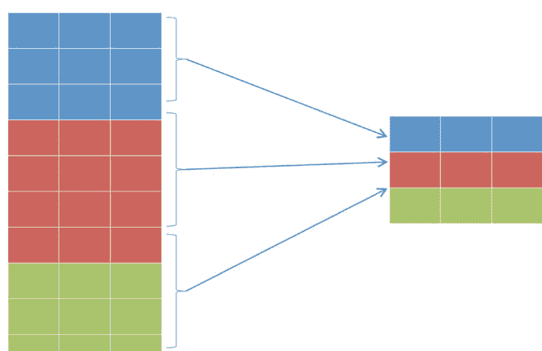
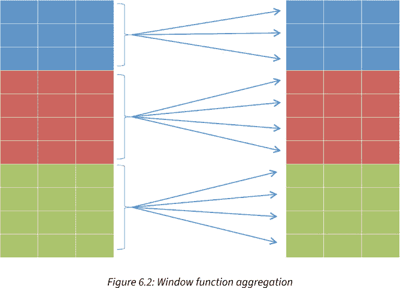
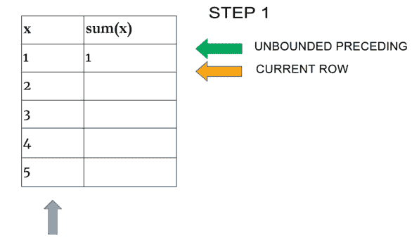

## 使用基础语句窗口函数

在上一章中，我们看到聚合函数的运行方式如下：



图 6.1：标准分组聚合

数据首先被排序，然后进行聚合；数据随后通过聚合被扁平化。当我们以 forum 用户连接到 forumdb 数据库后执行以下语句时，发生的情况如下：

```
forumdb=> select category,count(*) from posts group by category order by category;
category | count
----------+-------
        1 |     2
        3 |     1
(2 rows)
```

或者，我们可以决定通过执行以下语句来使用窗口函数：

```
forumdb=> select category, count(*) over (partition by category) from posts order by category;
category | count
----------+-------
```

```
1 | 2
1 | 2
3 | 1

(3 rows)
```

窗口函数创建聚合时不会将数据扁平化到单一行。然而，它们会将聚合结果复制到分组函数所引用的所有行。PostgreSQL 的行为如下图所示：



这就是为什么如果我们想获得与经典 GROUP BY 查询相同的结果，必须在前面的查询中添加 distinct 关键字。

## 使用 PARTITION BY 函数和 WINDOW 子句

现在让我们使用窗口函数运行一些基本查询。假设我们想使用两个 over 子句。例如，如果我们想在一列上统计与类别相关的行数，并在另一列上统计总计数，那么我们必须运行以下语句：

```
forumdb=> select category, count(*) over (partition by category),count(*) over () from posts order by category;
 category | count | count
----------+-------+-------
     1    |   2   |   3
```

```
1 | 2 | 3
3 | 1 | 3

(3 rows)
```

或者如果我们想去除所有重复行，则必须运行以下语句：

```
forumdb=> select distinct category, count(*) over (partition by category),count(*) over () from posts order by category;
  category | count | count
-----------+-------+-------
        1 |     2 |     3
        3 |     1 |     3

(2 rows)
```

在前面的查询中，第一个窗口函数使用 category 字段聚合数据，而第二个窗口函数聚合整个表的数据。

使用窗口函数，可以在同一个查询中对不同字段的数据进行聚合。

正如我们在这里看到的，我们可以直接在查询级别定义窗口框架，但也可以为窗口框架定义别名。例如，前面的查询变成下面的形式：

```
forumdb=> select distinct category, count(*) over w1 ,count(*) over w2 from posts WINDOW w1 as (partition by category),w2 as () order by category;
  category | count | count
-----------+-------+-------
        1 |     2 |     3
        3 |     1 |     3

(2 rows)
```

使用别名的做法称为 WINDOW 子句。当有很多聚合时，WINDOW 子句非常有用。

## 介绍一些有用的函数

窗口函数可以使用我们在上一章中探讨过的所有聚合函数。除此之外，窗口函数还引入了新的聚合函数。

在探讨其中一些新聚合函数之前，让我们先介绍一个独特的函数——generate_series。generate_series 只是生成一个数值序列，例如：

```
forumdb=> select * from generate_series(1,5);
 generate_series
-----------------
                1
                2
                3
                4
                5
(5 rows)
```

在以下示例中，我们将在各种用例中使用此函数。

## ROW_NUMBER 函数

现在让我们来看一下 ROW_NUMBER() 函数。ROW_NUMBER() 函数为每个分区内的每一行分配一个递增编号：

```
forumdb=> select category, row_number() over w from posts WINDOW w as (partition by category) order by category;
 category | row_number
----------+------------
        1 |          1
        1 |          2
        3 |          1
(3 rows)
```

在前面的查询中，我们使用了 PARTITION BY 子句，根据 category 列中的值将窗口划分为多个子集。可以看到，我们有两个类别值：1 和 3。这意味着我们有两个窗口，在每个窗口内，ROW_NUMBER() 函数会按照我们之前定义的方式分配编号。

## ORDER BY 子句

ORDER BY 子句对窗口内的值进行排序。我们还可以使用 NULLS FIRST 或 NULLS LAST 选项，让 null 值出现在排序结果的开头或末尾。例如，我们可以执行一个没有 ORDER BY 子句的窗口函数查询，如下面的代码片段所示，但我们必须注意正在使用的函数类型以及我们的目标是什么。


如果我们使用不依赖排序顺序的聚合函数，例如 COUNT 函数，我们可以避免对数据进行排序；否则，最好在分区内部对数据进行排序，以避免每次查询启动时结果不同的风险：

```
forumdb=> select category,row_number() over w,title
from posts WINDOW w as (partition by category order by title) order by
category;
 category | row_number |             title
----------+------------+------------------------------
        1 |          1 | Indexing Mysql
        1 |          2 | Indexing PostgreSQL
        3 |          1 | A view of Data types in C++
(3 rows)
```

正如我们所见，在分区内部，数据按 title 字段排序。

## FIRST_VALUE

FIRST_VALUE 函数返回分区内的第一个值，例如：

```
forumdb=> \x
Expanded display is on.

forumdb=> select category,row_number() over w,title,first_value(title)
over w
from posts WINDOW w as (partition by category order by category) order by
category;
-[ RECORD 1 ]-----------------------------
category    | 1
row_number  | 1
title       | Indexing PostgreSQL
first_value | Indexing PostgreSQL
-[ RECORD 2 ]-----------------------------
category    | 1
row_number  | 2
title       | Indexing Mysql
first_value | Indexing PostgreSQL
-[ RECORD 3 ]-----------------------------
category    | 3
row_number  | 1
title  | A view of  Data types in C++
first_value | A view of  Data types in C++
```

## LAST_VALUE

LAST_VALUE 函数返回分区内的最后一个值，例如：

```
forumdb=> select category,row_number() over w,title,last_value(title) over w
from posts WINDOW w as (partition by category order by category) order by category;
-[ RECORD 1 ]---------------------------------
category  | 1
row_number | 1
title     | Indexing PostgreSQL
last_value | Indexing Mysql
-[ RECORD 2 ]---------------------------------
category  | 1
row_number | 2
title     | Indexing Mysql
last_value | Indexing Mysql
-[ RECORD 3 ]---------------------------------
category  | 3
row_number | 1
title     | A view of  Data types in C++
last_value | A view of  Data types in C++
```

在使用 first_value() 或 last_value() 函数时，务必始终使用 Order by 子句，以避免出现错误结果，如前所述。

## RANK

RANK 函数对分区内当前行进行排名，并存在间隔。如果我们不指定 PARTITION BY 子句，函数就不知道如何关联当前元组，因此函数会关联到自身，如下所示：

```
forumdb=> select pk,title,author,rank() over () from posts ;
pk |       title       | author | rank
----+--------------------------------+--------+------
 5 | Indexing PostgreSQL |    1 |   1
 6 | Indexing Mysql      |    1 |   1
7 | A view of  Data types in C++ |     2 |     1
(3 rows)
```

如果我们添加 order by 子句，函数会按指定顺序进行排名，例如，id 为 1 的作者从第 1 条记录开始，id 为 2 的作者从第 3 条记录开始，如以下示例所示：

```
forumdb=> select pk,title,author,rank() over (order by author) from posts ;
pk |      title      | author | rank
----+---------------+--------+------
5  | Indexing PostgreSQL |    1 |   1
6  | Indexing Mysql      |    1 |   1
7  | A view of  Data types in C++ |    2 |   3
(3 rows)
```

如果我们添加 PARTITION BY 子句，其工作机制相同；唯一的区别是排名是在分区内计算，而不是像前一个示例那样在整个表上计算：

```
forumdb=> select pk,title,author,rank() over (partition by author order by author) from posts ;
pk |      title      | author | rank
----+---------------+--------+------
5  | Indexing PostgreSQL |    1 |   1
6  | Indexing Mysql      |    1 |   1
7  | A view of  Data types in C++ |    2 |   1
(3 rows)
```

## DENSE_RANK

DENSE_RANK 函数与 RANK 函数类似。区别在于 DENSE_RANK 函数对分区内当前行进行排名，且不留间隔：

```
forumdb=> select pk,title,author,dense_rank() over (order by author) from posts order by category;
pk |      title      | author | dense_rank
----+---------------+--------+------------
5  | Indexing PostgreSQL |    1 |          1
6  | Indexing Mysql      |    1 |          1
```

## LAG 和 LEAD 函数

在本节中，我们将展示 LAG 和 LEAD 函数的工作方式。首先，我们将设置环境并生成一个数字序列，如之前所做：

```
forumdb=>  select x from generate_series(1,5) as x;
 x
---
1
2
3
4
5
(5 rows)
```

这是本示例的起点。官方文档（https://www.postgresql.org/docs/current/functions-window.html）将 LAG 函数定义如下：

> LAG 函数返回在分区内当前行之前 offset 行处计算的值；如果不存在这样的行，则返回默认值（必须与该值类型相同）。offset 和默认值都相对于当前行进行计算。如果省略，offset 默认为 1，默认值为 null。

现在，让我们编写以下语句：

```
forumdb=> select x,lag(x) over w from (select generate_series(1,5) as x) V WINDOW w as (order by x) ;
 x | lag
----+-----
 1 |
 2 | 1
 3 | 2
 4 | 3
 5 | 4
(5 rows)
```

正如我们所见，lag 函数返回的结果集的偏移值为 1。如果我们引入偏移参数，lag 函数将返回偏移等于我们作为输入传递的数字的结果集，如下一个示例所示：

```
forumdb=> select x,lag(x,2) over w from (select generate_series(1,5) as x)
V WINDOW w as (order by x) ;
 x | lag
----+-----
 1 |
 2 |
 3 | 1
 4 | 2
 5 | 3
(5 rows)
```

lead 函数与 lag 函数相反，如官方文档所述：

> “LEAD 函数返回在分区内当前行之后 offset 行处计算的值；如果不存在这样的行，则返回默认值（必须与所提及的值类型相同）。offset 和默认值都相对于当前行进行计算。如果省略，offset 默认为 1，默认值变为 null。”

以下是几个示例，可以看到其工作原理。在第一个示例中，我们将使用 lead 函数而不带任何参数：

```
forumdb=# select x,lead(x) over w from (select generate_series(1,5) as x)
V WINDOW w as (order by x) ;
 x | lead
----+------
 1 | 2
 2 | 3
 3 | 4
 4 | 5
 5 |
(5 rows)
```

正如我们在 lead 函数中所见，偏移从底部开始。

传递给 NTILE 函数的参数决定了我们希望桶由多少条记录组成。

现在，让我们通过尝试将结果集拆分为两个桶来看看它是如何工作的：

```
forumdb=> select x,ntile(2) over w from (select generate_series(1,6) as x)
V WINDOW w as (order by x);
 x | ntile
----+-------
 1 |   1
 2 |   1
 3 |   1
 4 |   2
 5 |   2
 6 |   2
(6 rows)
```

如果我们想将结果集分成三个桶，我们将运行以下语句：

```
forumdb=> select x,ntile(3) over w from (select generate_series(1,6) as x)
V WINDOW w as (order by x);
 x | ntile
----+-------
 1 |   1
 2 |   1
 3 |   2
 4 |   2
 5 |   3
 6 |   3
(6 rows)
```

NTILE() 函数接受一个整数，并尝试将窗口划分为数量均衡的桶，指定每一行属于哪个桶。

在本节中，我们介绍了一些功能，允许您进行一些基本的数据挖掘。例如，lag 和 lead 可用于比较表的不同行，因此可以比较不同员工的薪水，或比较不同天的收入。

在下一节中，我们将更深入地探讨窗口函数的一些更高级的功能。


## 使用高级语句窗口函数

在本节中，我们将详细讨论高级窗口函数，并探索一些可能有助于进行更详细数据分析的技巧。

让我们从本章开头看到的一个查询开始：

```sql
forumdb=> select distinct category, count(*) over (partition by category)
from posts order by category;
  category | count
-----------+-------
         1 |     2
         3 |     1
(2 rows)
```

下面是我们之前描述的聚合的另一种写法：

```sql
forumdb=> select distinct category, count(*) over w1
from posts WINDOW w1 as (partition by category RANGE BETWEEN UNBOUNDED PRECEDING AND CURRENT ROW)
order by category;
  category | count
-----------+-------
         1 |     2
         3 |     1
(2 rows)
```

RANGE BETWEEN UNBOUNDED PRECEDING AND CURRENT ROW 是什么意思？它们是默认条件，也就是所谓的 frame 子句。这意味着数据首先按类别分区，然后在分区内，每当 frame 改变时，计数都会重置并重新计算。

## frame 子句

在本节中，我们将讨论 frame 子句，它允许我们以不同的方式管理分区。frame 子句有两种形式：

- ROWS BETWEEN 起始点和结束点
- RANGE BETWEEN 起始点和结束点

只有同时存在 ORDER BY 子句时，使用 frame 子句才有意义。当我们要考虑相对于当前行的一组特定记录时，我们会使用 ROWS BETWEEN 子句。当我们要考虑相对于当前行值的某个特定列中的值范围时，我们会使用 RANGE BETWEEN 子句。

### ROWS BETWEEN 起始点和结束点

现在我们将看一些简单的例子，以更好地解释 frame 子句。这些通常用于进行深入的数据分析和数据挖掘等任务。让我们从一些例子开始：

```sql
forumdb=> select x from (select generate_series(1,5) as x) V WINDOW w as (order by x);
 x
---
1
2
3
4
5
(5 rows)
```

假设我们希望逐行进行累加求和。我们想要达到的目标如下：

| x | sum(x) |
|---|--------|
| 1 | 1 |
| 2 | 3 |
| 3 | 6 |
| 4 | 10 |
| 5 | 15 |

这可以通过以下查询实现：

```sql
forumdb=> select x, sum(x) over (order by x) from generate_series(1,5) as x;
 x | sum
----+-----
 1 |  1
 2 |  3
 3 |  6
 4 | 10
 5 | 15
(5 rows)
```

同样的查询也可以这样写：

```sql
forumdb=> SELECT x, SUM(x) OVER w
  FROM (select generate_series(1,5) as x) V
  WINDOW w AS (ORDER BY x ROWS BETWEEN UNBOUNDED PRECEDING AND CURRENT ROW);
  x | sum
  ----+-----
  1 | 1
  2 | 3
  3 | 6
  4 | 10
  5 | 15
  (5 rows)
```

现在，让我们想象该查询是按顺序逐步执行的，每一步对应表中的一行。在下面的示意图中，我们将模拟 PostgreSQL 的内部行为，以更好地理解 ROWS BETWEEN UNBOUNDED PRECEDING AND CURRENT ROW 子句的工作原理：

1. 首先，PostgreSQL 使用 order_by_clause 条件对窗口内的数据进行排序，如下图中蓝色箭头所示：

   

   正如我们所见，在图像的右侧有两个指针：一个绿色指针指向 **UNBOUNDED PRECEDING** 子句，一个橙色指针指向 **CURRENT ROW** 子句。结果是 1，因此在第一步中两个指针都指向第一行。现在，让我们看看接下来的步骤会发生什么。

2. 在这一步中，**UNBOUNDED PRECEDING** 指针仍然指向第一行，而 **CURRENT ROW** 指针现在指向第二行，求和结果为 1+2 = 3：

   | x | sum(x) |
   |---|--------|
   | 1 | 1      |
   | 2 | 3      |
   | 3 |        |
   | 4 |        |
   | 5 |        |

   步骤 2

   UNBOUNDED PRECEDING

   CURRENT ROW

   ORDER BY

   图 6.4：UNBOUNDED PRECEDING 和 CURRENT ROW（1）

3. 接下来，**UNBOUNDED PRECEDING** 指针仍然指向第一行，而 **CURRENT ROW** 指针指向第三行，求和结果为 1+2+3 = 6：

   | x | sum(x) |
   |---|--------|
   | 1 | 1 |
   | 2 | 3 |
   | 3 | 6 |
   | 4 |  |
   | 5 |  |

   步骤 3

   UNBOUNDED PRECEDING

   CURRENT ROW

   ORDER BY

   图 6.5：UNBOUNDED PRECEDING 和 CURRENT ROW（2）

4. 在第四步中，UNBOUNDED PRECEDING 指针仍然指向第一行，而 CURRENT ROW 指针现在指向第四行，求和结果为 1+2+3+4 = 10：

   | x | sum(x) |
   |---|--------|
   | 1 | 1 |
   | 2 | 3 |
   | 3 | 6 |
   | 4 | 10 |
   | 5 |  |

   步骤 4

   UNBOUNDED PRECEDING

   CURRENT ROW

   ORDER BY

   图 6.6：UNBOUNDED PRECEDING 和 CURRENT ROW（3）

5. 在第五步也是最后一步中，我们得到了期望的结果：

   | x | sum(x) |
   |---|--------|
   | 1 | 1 |
   | 2 | 3 |
   | 3 | 6 |
   | 4 | 10 |
   | 5 | 15 |

   步骤 5

   UNBOUNDED PRECEDING

   CURRENT ROW

   ORDER BY

   图 6.7：UNBOUNDED PRECEDING 和 CURRENT ROW（4）

frame 子句就是这样工作的！

让我们再看一些使用不同选项的 frame 子句工作方式的例子。如果我们想为表中的每一行求出当前行与前一行之和，我们可以从以下内容开始：

| X |
|---|
| 1 |
| 2 |
| 3 |
| 4 |
| 5 |

我们希望最终得到以下结果：

| x | sum(x) |
|---|--------|
| 1 | 1 |
| 2 | 3 |
| 3 | 5 |
| 4 | 7 |
| 5 | 9 |

我们需要执行的查询如下例所示：

```sql
forumdb=> SELECT x, SUM(x) OVER w
    FROM (select generate_series(1,5) as x) V
    WINDOW w AS (ORDER BY x RANGE BETWEEN 1 PRECEDING AND CURRENT ROW);
    x | sum
    ----+-----
    1 |  1
    2 |  3
    3 |  5
    4 |  7
    5 |  9
    (5 rows)
```

上述查询的工作原理与我们之前看到的类似。唯一的区别是，现在计算范围是从分区的第一行到当前行，如语句 BETWEEN 1 PRECEDING AND CURRENT ROW 中所写。在这个例子中，只用两行来计算总和。同样的机制也可以用来执行累加求和，如下例所示：

```sql
forumdb=> SELECT x, SUM(x) OVER w
    FROM (select generate_series(1,5) as x) V
    WINDOW w AS (ORDER by x ROWS UNBOUNDED PRECEDING);
    x | sum
    ----+-----
    1 |  1
    2 |  3
    3 |  6
    4 | 10
    5 | 15
    (5 rows)
```

现在唯一的区别是计算范围是 ROWS UNBOUNDED PRECEDING，而不是 BETWEEN 1 PRECEDING AND CURRENT ROW。

让我们再看一个窗口函数简化工作的例子。仍然从我们之前见过的序列开始，我们知道总和是 1+2+3+4+5 = 15。现在假设我们想从表中的最大值（即 5）开始进行反向求和。

在这个例子中，我们希望结果如下：

| x | sum(x) |
|---|--------|
| 1 | 15 |
| 2 | 14 |
| 3 | 12 |
| 4 | 9 |
| 5 | 5 |

实现这一点的查询如下：

```sql
forumdb=> SELECT x, SUM(x) OVER w
FROM (select generate_series(1,5) as x) V
WINDOW w AS (ORDER BY X ROWS BETWEEN CURRENT ROW AND UNBOUNDED FOLLOWING);
x | sum
----+-----
1 | 15
2 | 14
3 | 12
4 | 9
5 | 5
(5 rows)
```

实现这一功能的是 UNBOUNDED FOLLOWING 子句，它的作用与 UNBOUNDED PRECEDING 相反。原因如下：

- 在第一行中，所有值相加：1+2+3+4+5 = 15。
- 在第二行中，这些值相加：2+3+4+5 = 14。
- 在第三行中，这些值相加：3+4+5 = 12。

### RANGE BETWEEN 起始点和结束点

如前所述，使用 RANGE BETWEEN 时，我们将考虑相对于当前行值的一个值范围。与 ROWS 子句的区别在于：如果我们在 ORDER BY 中使用的字段不是每行都有唯一值，那么 RANGE 会合并它遇到的所有具有非唯一值的行，而不是逐行处理。


与之相反，ROWS 会包含非唯一组中的所有行，但会分别处理每一行：

+   1. 首先，让我们创建一个包含重复数据的简单数据集：

```
forumdb=> select generate_series(1,8) % 4 as x order by 1;
 x
---
0
0
1
1
2
2
3
3
(8 rows)
```

+   2. 现在让我们做一些测试来观察 ROWS 和 RANGE 子句之间的差异。让我们从 ROWS 子句开始：

```
forumdb=> SELECT x, row_number() OVER w, SUM(x) OVER w FROM (select generate_series(1,8) % 4 as x) V
WINDOW w AS (ORDER BY x ROWS BETWEEN 1 PRECEDING AND CURRENT ROW);
 x | row_number | sum
---+------------+-----
0 | 1 | 0
0 | 2 | 0
1 | 3 | 1
1 | 4 | 2
2 | 5 | 3
2 | 6 | 4
3 | 7 | 5
3 | 8 | 6
(8 rows)
```

前面的查询的工作方式与我们之前看到的一样；它将上一行与当前行求和。

3. 现在让我们看看如果使用 RANGE 子句而不是 ROWS 子句会发生什么：

```
forumdb=> SELECT x, row_number() OVER w, SUM(x) OVER w
FROM (select generate_series(1,8) % 4 as x) V
WINDOW w AS (ORDER BY x RANGE BETWEEN 1 PRECEDING AND CURRENT ROW);
x | row_number | sum
----+-------------+-----
0 |           1 | 0
0 |           2 | 0
1 |           3 | 2
1 |           4 | 2
2 |           5 | 6
2 |           6 | 6
3 |           7 | 10
3 |           8 | 10
(8 rows)
```

让我们来看一下这个结果：

| x | row_number | sum |
|---|------------|-----|
| 0 | 1 | 0 |
| 0 | 2 | 0 |
| 1 | 3 | 2 |
| 1 | 4 | 2 |
| 2 | 5 | 6 |
| 2 | 6 | 6 |
| 3 | 7 | 10 |
| 3 | 8 | 10 |

现在让我们从窗口帧的角度来看结果：

| x | row_number | sum | Frame Number |
|---|------------|-----|--------------|
| 0 | 1 | 0 | 1 |
| 0 | 2 | 0 | 1 |
| 1 | 3 | 2 | 2 |
| 1 | 4 | 2 | 2 |
| 2 | 5 | 6 | 3 |
| 2 | 6 | 6 | 3 |
| 3 | 7 | 10 | 4 |
| 3 | 8 | 10 | 4 |

正如我们所见，最后一个表中共有四个帧，因此 PostgreSQL 内部的工作方式如下：首先，PostgreSQL 使用 order by 子句将窗口函数拆分为帧，然后在帧之间聚合数据；例如：

+   - 行号 3 的总和是行号 1 + 行号 2 + 行号 3 + 行号 4 的总和：0+0+1+1=2。
+   - 行号 4 的总和是行号 1 + 行号 2 + 行号 3 + 行号 4 的总和：0+0+1+1=2。
+   - 行号 5 的总和是行号 3 + 行号 4 + 行号 5 + 行号 6 的总和：1+1+2+2=6。
+   - 行号 6 的总和是行号 3 + 行号 4 + 行号 5 + 行号 6 的总和：1+1+2+2=6。

在前面的示例中，我们考虑了按升序排序的分区。在下一个示例中，分区按降序排序，我们将在此场景下看到 ROWS 和 RANGE 之间的差异。

这是 RANGE 子句的查询：

```
forumdb=> SELECT x,row_number() OVER w, dense_rank() OVER w,sum(x) OVER w
FROM (select generate_series(1,8) % 4 as x) V
WINDOW w AS (ORDER BY x desc RANGE BETWEEN 1 PRECEDING AND CURRENT ROW);
 x | row_number | dense_rank | sum
----+-------------+------------+-----
 3 |           1 |          1 |   6
 3 |           2 |          1 |   6
 2 |           3 |          2 |  10
 2 |           4 |          2 |  10
 1 |           5 |          3 |   6
 1 |           6 |          3 |   6
 0 |           7 |          4 |   2
 0 |           8 |          4 |   2
(8 rows)
```

而这是 ROWS 子句的查询。正如我们所见，事情的工作方式与之前的示例完全相同，只是没有 ORDER BY DESC 选项：

```
forumdb=> SELECT x,row_number() OVER w, dense_rank() OVER w,sum(x) OVER w
FROM (select generate_series(1,8) % 4 as x) V
WINDOW w AS (ORDER BY x desc ROWS BETWEEN 1 PRECEDING AND CURRENT ROW);
 x | row_number | dense_rank | sum
---+------------+------------+-----
 3 |          1 |          1 |   3
 3 |          2 |          1 |   6
 2 |          3 |          2 |   5
 2 |          4 |          2 |   4
 1 |          5 |          3 |   3
 1 |          6 |          3 |   2
 0 |          7 |          4 |   1
 0 |          8 |          4 |   0
(8 rows)
```

在这个示例中，使用 sum 函数，我们可以更好地理解 RANGE 和 ROWS 选项之间的差异。正如我们所见，RANGE 选项按帧(RANGE)聚合数据，而 ROWS 选项按行聚合数据。ROWS 子句和 RANGE 子句之间的主要区别在于 ROWS 操作于单个行，而 RANGE 操作于组。这结束了我们关于窗口函数的章节。

## Summary

在本章中，我们探讨了如何使用窗口函数。我们已经看到，通过使用窗口函数，我们可以创建比使用 GROUP BY 语句创建的更复杂的聚合，而 GROUP BY 语句我们在第 5 章 高级语句 中看到过。我们学习了如何使用 ROW_NUMBER ()、FIRST_VALUE ()、LAST_VALUE ()、RANK DENSE_RANK()、LAG ()、LEAD ()、CUME_DIST () 和 NTILE () 函数。我们还看到了使用 ROWS BETWEEN 和 RANGE BETWEEN 子句创建聚合之间的差异。你可以在数据挖掘操作中使用本章学到的知识，使你的工作变得更加轻松。

有关窗口函数的更多信息，可以查阅官方文档：https://www.postgresql.org/docs/current/functions-window.html。

在下一章中，我们将讨论服务器端编程。我们将了解如何创建可在服务器端使用的函数，以及在必要时窗口函数的使用位置。

## Verify your knowledge

+   - 考虑这两个查询：
+     1. select category,count(*) from posts group by category order by category;
+     2. select category, count(*) over (partition by category) from posts order by category;
+     哪个查询的记录数更多？
+     第二个查询的记录数更多。
+     有关更多详细信息，请参阅 使用基本语句窗口函数 部分。
+   - 考虑这两个查询：
+     1. select category,count(*) from posts group by category order by category;
+     2. select distinct category, count(*) over (partition by category) from posts order by category;
+     这 2 个查询中哪个查询的记录数更多？
+     这两个查询的记录数相同。
+     有关更多详细信息，请参阅 使用基本语句窗口函数 部分。
+   - 以下两个查询中哪个在语义上是正确的？
+     1. select category,row_number() over w,title from posts WINDOW w as (partition by category order by title) order by category;
+     2. select category,row_number() over w,title from posts WINDOW w as (partition by category) order by category;
+     第一个在语义上是正确的，因为 row_number() 函数依赖于 order by。
+     有关更多详细信息，请参阅 行号函数 部分。

## 7
